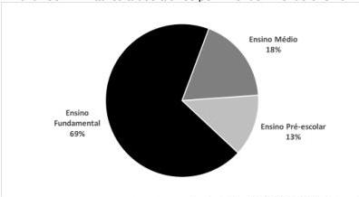
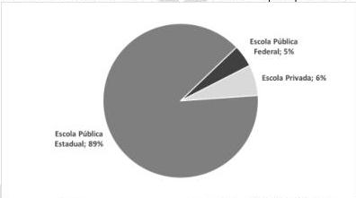

# PROVA — Camara_Abaetetuba_2018_Agente_Legislativo

## 1. Análise geral da prova

- **Identificação:** Camara_Abaetetuba_2018_Agente_Legislativo
- **Quantidade total de questões:** 30
- **Quantidade de textos de apoio (grupos):** 1
- **Quantidade de imagens:** 2
- **Quantidade de gráficos e tabelas:** incluídos nas imagens e no texto extraído, quando presentes no PDF original
- **Quantidade de grupos identificados:** 1
- **Quantidade de questões independentes:** 20
- **Questões que compartilham materiais:** texto-base das questões 01 a 10 → questões 01, 02, 03, 04, 05, 06, 07, 08, 09, 10

### Transcrição integral da capa/instruções (conforme extraída do PDF)

> [!NOTE]
> Conteúdo integral das páginas anteriores à primeira questão, sem cortes.

> Fadesp
> Fundação de Amparo e Desenvolvimento da Pesquisa
> CÂMARA MUNICIPAL DE ABAETETUBA
> CONCURSO PÚBLICO - PROVA OBJETIVA: 26 de agosto de 2018
> # NÍVEL MÉDIO
> # AGENTE LEGISLATIVO
> Nome do Candidato: ________________________________________________________________________
> Nº de Inscrição: ____________________________________________________________
> ____________________________________________________________
> Assinatura
> # PROVA 1 – COR BRANCA
> A COR DA CAPA DO SEU BOLETIM DE QUESTÕES É BRANCA.
> MARQUE A COR EM SEU CARTÃO RESPOSTA.
> # INSTRUÇÕES AO CANDIDATO
> 1. Confira se a prova que você recebeu corresponde ao cargo/nível de escolaridade ao qual você está inscrito, conforme consta no seu cartão de inscrição e no cartão resposta. Caso contrário, comunique imediatamente ao fiscal de sala.
> 2. Confira se, além deste BOLETIM DE QUESTÕES, você recebeu o CARTÃO RESPOSTA, destinado à marcação das respostas às questões objetivas.
> 3. Este BOLETIM DE QUESTÕES contém a Prova Objetiva com 30 (vinte) questões, 10 de Língua Portuguesa, 05 de Matemática e Raciocínio Lógico, 05 de Noções de Informática e 10 de Conhecimentos Específicos. Caso exista alguma falha de impressão, comunique imediatamente ao fiscal de sala. Na prova há espaço reservado para rascunho. Esta prova terá duração de 04 (quatro) horas, tendo seu início às 14:30h e término às 18:30h (horário Abaetetuba).
> 4. Para cada questão objetiva, são apresentadas 04 (quatro) opções de resposta, identificadas com as letras (A), (B), (C), (D). Apenas uma responde corretamente à questão, considerando a numeração de 01 a 30.
> 5. Confira se seu nome, número de inscrição, cargo/nível de escolaridade e data de nascimento, constam na parte superior do CARTÃO RESPOSTA que você recebeu. Caso exista algum erro de impressão, comunique imediatamente ao fiscal de sala, a fim de que este registre a correção na Ata de Sala.
> 6. A saída do candidato da sala somente será permitida depois de transcorrido o tempo de 01 hora do início da prova, mediante a entrega obrigatória ao fiscal de sala do seu cartão resposta e do boletim de questões. A inobservância acarretará a eliminação do candidato.
> 7. É obrigatório que o candidato assine a LISTA DE PRESENÇA e o CARTÃO RESPOSTA, do mesmo modo como está assinado no seu documento de identificação.
> 8. A marcação do CARTÃO RESPOSTA deve ser feita somente com caneta esferográfica de tinta preta ou azul, pois lápis não será considerado.
> 9. A maneira correta de marcar as respostas no CARTÃO RESPOSTA é cobrir totalmente o espaço correspondente à letra a ser assinalada, conforme o exemplo que consta no CARTÃO RESPOSTA.
> 10. Em hipótese alguma haverá substituição do CARTÃO RESPOSTA por erro do candidato. A substituição só será autorizada se for constatada falha de impressão.
> 11. O CARTÃO RESPOSTA É O ÚNICO DOCUMENTO VÁLIDO PARA O PROCESSAMENTO DE SUAS RESPOSTAS, POIS A MARCAÇÃO INCORRETA NO CARTÃO RESPOSTA DA COR DA CAPA DA SUA PROVA É DE SUA INTEIRA RESPONSABILIDADE E NÃO SERÁ CORRIGIDO.
> 12. Será automaticamente eliminado do Concurso Público da Câmara Municipal de Abaetetuba, o candidato que, durante a realização da prova, descumprir os procedimentos definidos no Edital de Abertura nº 001/2018.
> Boa Prova!!!

### Gabarito

| Questão | 01 | 02 | 03 | 04 | 05 |
|---|---|---|---|---|---|
| Resposta | C | B | B | C | A |

| Questão | 06 | 07 | 08 | 09 | 10 |
|---|---|---|---|---|---|
| Resposta | D | A | C | B | A |

| Questão | 11 | 12 | 13 | 14 | 15 |
|---|---|---|---|---|---|
| Resposta | A | B | C | B | D |

| Questão | 16 | 17 | 18 | 19 | 20 |
|---|---|---|---|---|---|
| Resposta | B | A | B | D | C |

| Questão | 21 | 22 | 23 | 24 | 25 |
|---|---|---|---|---|---|
| Resposta | B | D | A | C | B |

| Questão | 26 | 27 | 28 | 29 | 30 |
|---|---|---|---|---|---|
| Resposta | C | A | D | C | A |

## 2. Questões agrupadas

### GRUPO 01 — Texto-base compartilhado pelas questões 01 a 10

**Questões relacionadas:** 01, 02, 03, 04, 05, 06, 07, 08, 09, 10.

#### QUESTÃO 01

✅ **Gabarito: C** (gabarito oficial definitivo — Tipo 1 (Cor Branca))

**Material de apoio:**

Leia atentamente o texto a seguir para responder às questões de 1 a 10.
Saia da cadeira
A vida sedentária é um arriscado convite a doenças cardiovasculares.
Exercícios leves bastam
Dráuzio Varela
1 Pela primeira vez na história da humanidade adquirimos a possibilidade de ganhar o
2 sustento sem levantar da cadeira. Esse privilégio aconteceu graças à tecnologia desenvolvida
3 no último século, intervalo de tempo irrisório se comparado aos 6 milhões de anos, contados a
4 partir da época em que descemos das árvores nas savanas da África.
5 O conforto da vida moderna, no entanto, vem cobrando um alto preço: atualmente,
6 doenças cardiovasculares e câncer são as principais causas de morte, a obesidade virou
7 epidemia até em países de renda mais baixa, os problemas osteoarticulares limitam a
8 mobilidade de milhões de pessoas e os serviços de saúde ficaram sobrecarregados.
9 A vida sedentária está associada a diversos fatores de risco para doenças
10 cardiovasculares: acúmulo de gordura no abdome, hipertensão arterial, inflamação crônica,
11 resistência à insulina e disfunção do endotélio, a camada que reveste a parede interna dos
12 vasos.
13 A disfunção endotelial reduz a disponibilidade de monóxido de nitrogênio (NO) e
14 aumenta a expressão de moléculas de adesão das células vasculares, eventos moleculares
15 decisivos no risco de obstrução das artérias.
16 Ao contrário, o estresse provocado pela atividade física moderada ou intensa aumenta a
17 produção de NO (que provoca dilatação das artérias) e reduz a expressão das moléculas de
18 adesão, mecanismo que diminui o risco cardiovascular.
19 Mesmo exercícios leves (como os movimentos da rotina diária) têm efeitos metabólicos
20 benéficos, embora não esteja claro se causam as alterações protetoras da função endotelial,
21 características das atividades físicas mais vigorosas.
22 A revista Nature traz um estudo para esclarecer esse detalhe: a atividade física leve
23 também seria suficiente para corrigir a disfunção endotelial associada ao sedentarismo? Os
24 autores estudaram três grupos: “Sit, Sitless e Exercise”.
25 Durante quatro dias, os do grupo “Sit” passaram 14 horas diárias sentados. Dessas 14
26 horas diárias, os do grupo “Sitless” ficaram apenas nove horas sentados e cinco a seis horas
27 movimentando-se devagar ou permanecendo em pé. Os do grupo “Exercise” permaneceram 13
28 horas por dia sentados, e uma hora praticando exercícios moderados ou intensos.
29 Comparados aos do grupo “Sit”, os “Exercise” apresentaram função endotelial mais
30 preservada, sugestiva de risco cardiovascular reduzido, entretanto, os níveis de colesterol e a
31 sensibilidade à insulina não se alteraram. Nos “Sitless”, ocorreu o oposto: a disfunção endotelial
32 permaneceu igual à dos sedentários, mas a sensibilidade à insulina e os níveis de colesterol
33 melhoraram.
34 Em resumo, passar o dia sentado aumenta o risco de doença cardiovascular. Reduzir o
35 número de horas sedentárias, sem fazer exercícios mais intensos, melhora o metabolismo dos
36 lipídeos e a sensibilidade à insulina, mas não traz benefícios à função endotelial. Uma hora de
37 exercícios moderados ou intensos faz o contrário.
38 Conclusão: para o bom funcionamento do sistema cardiovascular é preciso fazer
39 exercício e sair da cadeira.
Disponível em https://www.cartacapital.com.br/revista/1009/saia-da-cadeira
Acessado em 2/07/2018

**Enunciado:**

No primeiro parágrafo do texto Saia da cadeira, o autor parte do princípio de que

**Alternativas:**

A) a humanidade costuma se exercitar no ambiente de trabalho.
B) a vida do homem moderno é mais simples do que a de seus antepassados.
C) o ser humano historicamente abre mão de seu conforto para trabalhar.
D) o homem pode ganhar dinheiro sem fazer muito esforço.

**Referências visuais:**

Nenhuma.

---

#### QUESTÃO 02

✅ **Gabarito: B** (gabarito oficial definitivo — Tipo 1 (Cor Branca))

**Material de apoio:**

Leia atentamente o texto a seguir para responder às questões de 1 a 10.
Saia da cadeira
A vida sedentária é um arriscado convite a doenças cardiovasculares.
Exercícios leves bastam
Dráuzio Varela
1 Pela primeira vez na história da humanidade adquirimos a possibilidade de ganhar o
2 sustento sem levantar da cadeira. Esse privilégio aconteceu graças à tecnologia desenvolvida
3 no último século, intervalo de tempo irrisório se comparado aos 6 milhões de anos, contados a
4 partir da época em que descemos das árvores nas savanas da África.
5 O conforto da vida moderna, no entanto, vem cobrando um alto preço: atualmente,
6 doenças cardiovasculares e câncer são as principais causas de morte, a obesidade virou
7 epidemia até em países de renda mais baixa, os problemas osteoarticulares limitam a
8 mobilidade de milhões de pessoas e os serviços de saúde ficaram sobrecarregados.
9 A vida sedentária está associada a diversos fatores de risco para doenças
10 cardiovasculares: acúmulo de gordura no abdome, hipertensão arterial, inflamação crônica,
11 resistência à insulina e disfunção do endotélio, a camada que reveste a parede interna dos
12 vasos.
13 A disfunção endotelial reduz a disponibilidade de monóxido de nitrogênio (NO) e
14 aumenta a expressão de moléculas de adesão das células vasculares, eventos moleculares
15 decisivos no risco de obstrução das artérias.
16 Ao contrário, o estresse provocado pela atividade física moderada ou intensa aumenta a
17 produção de NO (que provoca dilatação das artérias) e reduz a expressão das moléculas de
18 adesão, mecanismo que diminui o risco cardiovascular.
19 Mesmo exercícios leves (como os movimentos da rotina diária) têm efeitos metabólicos
20 benéficos, embora não esteja claro se causam as alterações protetoras da função endotelial,
21 características das atividades físicas mais vigorosas.
22 A revista Nature traz um estudo para esclarecer esse detalhe: a atividade física leve
23 também seria suficiente para corrigir a disfunção endotelial associada ao sedentarismo? Os
24 autores estudaram três grupos: “Sit, Sitless e Exercise”.
25 Durante quatro dias, os do grupo “Sit” passaram 14 horas diárias sentados. Dessas 14
26 horas diárias, os do grupo “Sitless” ficaram apenas nove horas sentados e cinco a seis horas
27 movimentando-se devagar ou permanecendo em pé. Os do grupo “Exercise” permaneceram 13
28 horas por dia sentados, e uma hora praticando exercícios moderados ou intensos.
29 Comparados aos do grupo “Sit”, os “Exercise” apresentaram função endotelial mais
30 preservada, sugestiva de risco cardiovascular reduzido, entretanto, os níveis de colesterol e a
31 sensibilidade à insulina não se alteraram. Nos “Sitless”, ocorreu o oposto: a disfunção endotelial
32 permaneceu igual à dos sedentários, mas a sensibilidade à insulina e os níveis de colesterol
33 melhoraram.
34 Em resumo, passar o dia sentado aumenta o risco de doença cardiovascular. Reduzir o
35 número de horas sedentárias, sem fazer exercícios mais intensos, melhora o metabolismo dos
36 lipídeos e a sensibilidade à insulina, mas não traz benefícios à função endotelial. Uma hora de
37 exercícios moderados ou intensos faz o contrário.
38 Conclusão: para o bom funcionamento do sistema cardiovascular é preciso fazer
39 exercício e sair da cadeira.
Disponível em https://www.cartacapital.com.br/revista/1009/saia-da-cadeira
Acessado em 2/07/2018

**Enunciado:**

Do trecho “Esse privilégio aconteceu graças à tecnologia desenvolvida no último século, intervalo de tempo irrisório se comparado aos 6 milhões de anos, contados a partir da época em que descemos das árvores nas savanas da África.” (linhas 2 a 4) é correto compreender que o autor

**Alternativas:**

A) utiliza tecnologia de ponta em seu trabalho.
B) acredita que o homem se originou do primata.
C) considera o Brasil mais desenvolvido do que a África.
D) crê que a tecnologia se torna obsoleta rapidamente.

**Referências visuais:**

Nenhuma.

---

#### QUESTÃO 03

✅ **Gabarito: B** (gabarito oficial definitivo — Tipo 1 (Cor Branca))

**Material de apoio:**

Leia atentamente o texto a seguir para responder às questões de 1 a 10.
Saia da cadeira
A vida sedentária é um arriscado convite a doenças cardiovasculares.
Exercícios leves bastam
Dráuzio Varela
1 Pela primeira vez na história da humanidade adquirimos a possibilidade de ganhar o
2 sustento sem levantar da cadeira. Esse privilégio aconteceu graças à tecnologia desenvolvida
3 no último século, intervalo de tempo irrisório se comparado aos 6 milhões de anos, contados a
4 partir da época em que descemos das árvores nas savanas da África.
5 O conforto da vida moderna, no entanto, vem cobrando um alto preço: atualmente,
6 doenças cardiovasculares e câncer são as principais causas de morte, a obesidade virou
7 epidemia até em países de renda mais baixa, os problemas osteoarticulares limitam a
8 mobilidade de milhões de pessoas e os serviços de saúde ficaram sobrecarregados.
9 A vida sedentária está associada a diversos fatores de risco para doenças
10 cardiovasculares: acúmulo de gordura no abdome, hipertensão arterial, inflamação crônica,
11 resistência à insulina e disfunção do endotélio, a camada que reveste a parede interna dos
12 vasos.
13 A disfunção endotelial reduz a disponibilidade de monóxido de nitrogênio (NO) e
14 aumenta a expressão de moléculas de adesão das células vasculares, eventos moleculares
15 decisivos no risco de obstrução das artérias.
16 Ao contrário, o estresse provocado pela atividade física moderada ou intensa aumenta a
17 produção de NO (que provoca dilatação das artérias) e reduz a expressão das moléculas de
18 adesão, mecanismo que diminui o risco cardiovascular.
19 Mesmo exercícios leves (como os movimentos da rotina diária) têm efeitos metabólicos
20 benéficos, embora não esteja claro se causam as alterações protetoras da função endotelial,
21 características das atividades físicas mais vigorosas.
22 A revista Nature traz um estudo para esclarecer esse detalhe: a atividade física leve
23 também seria suficiente para corrigir a disfunção endotelial associada ao sedentarismo? Os
24 autores estudaram três grupos: “Sit, Sitless e Exercise”.
25 Durante quatro dias, os do grupo “Sit” passaram 14 horas diárias sentados. Dessas 14
26 horas diárias, os do grupo “Sitless” ficaram apenas nove horas sentados e cinco a seis horas
27 movimentando-se devagar ou permanecendo em pé. Os do grupo “Exercise” permaneceram 13
28 horas por dia sentados, e uma hora praticando exercícios moderados ou intensos.
29 Comparados aos do grupo “Sit”, os “Exercise” apresentaram função endotelial mais
30 preservada, sugestiva de risco cardiovascular reduzido, entretanto, os níveis de colesterol e a
31 sensibilidade à insulina não se alteraram. Nos “Sitless”, ocorreu o oposto: a disfunção endotelial
32 permaneceu igual à dos sedentários, mas a sensibilidade à insulina e os níveis de colesterol
33 melhoraram.
34 Em resumo, passar o dia sentado aumenta o risco de doença cardiovascular. Reduzir o
35 número de horas sedentárias, sem fazer exercícios mais intensos, melhora o metabolismo dos
36 lipídeos e a sensibilidade à insulina, mas não traz benefícios à função endotelial. Uma hora de
37 exercícios moderados ou intensos faz o contrário.
38 Conclusão: para o bom funcionamento do sistema cardiovascular é preciso fazer
39 exercício e sair da cadeira.
Disponível em https://www.cartacapital.com.br/revista/1009/saia-da-cadeira
Acessado em 2/07/2018

**Enunciado:**

Em “O conforto da vida moderna, no entanto, vem cobrando um alto preço: atualmente, doenças cardiovasculares e câncer são as principais causas de morte, a obesidade virou epidemia até em países de renda mais baixa, os problemas osteoarticulares limitam a mobilidade de milhões de pessoas e os serviços de saúde ficaram sobrecarregados.” (linhas 5 a 8), a respeito da existência de uma epidemia de obesidade nos países mais pobres, Dráuzio Varela expressa

**Alternativas:**

A) temor.
B) perplexidade.
C) inconformismo.
D) desesperança.

**Referências visuais:**

Nenhuma.

---

#### QUESTÃO 04

✅ **Gabarito: C** (gabarito oficial definitivo — Tipo 1 (Cor Branca))

**Material de apoio:**

Leia atentamente o texto a seguir para responder às questões de 1 a 10.
Saia da cadeira
A vida sedentária é um arriscado convite a doenças cardiovasculares.
Exercícios leves bastam
Dráuzio Varela
1 Pela primeira vez na história da humanidade adquirimos a possibilidade de ganhar o
2 sustento sem levantar da cadeira. Esse privilégio aconteceu graças à tecnologia desenvolvida
3 no último século, intervalo de tempo irrisório se comparado aos 6 milhões de anos, contados a
4 partir da época em que descemos das árvores nas savanas da África.
5 O conforto da vida moderna, no entanto, vem cobrando um alto preço: atualmente,
6 doenças cardiovasculares e câncer são as principais causas de morte, a obesidade virou
7 epidemia até em países de renda mais baixa, os problemas osteoarticulares limitam a
8 mobilidade de milhões de pessoas e os serviços de saúde ficaram sobrecarregados.
9 A vida sedentária está associada a diversos fatores de risco para doenças
10 cardiovasculares: acúmulo de gordura no abdome, hipertensão arterial, inflamação crônica,
11 resistência à insulina e disfunção do endotélio, a camada que reveste a parede interna dos
12 vasos.
13 A disfunção endotelial reduz a disponibilidade de monóxido de nitrogênio (NO) e
14 aumenta a expressão de moléculas de adesão das células vasculares, eventos moleculares
15 decisivos no risco de obstrução das artérias.
16 Ao contrário, o estresse provocado pela atividade física moderada ou intensa aumenta a
17 produção de NO (que provoca dilatação das artérias) e reduz a expressão das moléculas de
18 adesão, mecanismo que diminui o risco cardiovascular.
19 Mesmo exercícios leves (como os movimentos da rotina diária) têm efeitos metabólicos
20 benéficos, embora não esteja claro se causam as alterações protetoras da função endotelial,
21 características das atividades físicas mais vigorosas.
22 A revista Nature traz um estudo para esclarecer esse detalhe: a atividade física leve
23 também seria suficiente para corrigir a disfunção endotelial associada ao sedentarismo? Os
24 autores estudaram três grupos: “Sit, Sitless e Exercise”.
25 Durante quatro dias, os do grupo “Sit” passaram 14 horas diárias sentados. Dessas 14
26 horas diárias, os do grupo “Sitless” ficaram apenas nove horas sentados e cinco a seis horas
27 movimentando-se devagar ou permanecendo em pé. Os do grupo “Exercise” permaneceram 13
28 horas por dia sentados, e uma hora praticando exercícios moderados ou intensos.
29 Comparados aos do grupo “Sit”, os “Exercise” apresentaram função endotelial mais
30 preservada, sugestiva de risco cardiovascular reduzido, entretanto, os níveis de colesterol e a
31 sensibilidade à insulina não se alteraram. Nos “Sitless”, ocorreu o oposto: a disfunção endotelial
32 permaneceu igual à dos sedentários, mas a sensibilidade à insulina e os níveis de colesterol
33 melhoraram.
34 Em resumo, passar o dia sentado aumenta o risco de doença cardiovascular. Reduzir o
35 número de horas sedentárias, sem fazer exercícios mais intensos, melhora o metabolismo dos
36 lipídeos e a sensibilidade à insulina, mas não traz benefícios à função endotelial. Uma hora de
37 exercícios moderados ou intensos faz o contrário.
38 Conclusão: para o bom funcionamento do sistema cardiovascular é preciso fazer
39 exercício e sair da cadeira.
Disponível em https://www.cartacapital.com.br/revista/1009/saia-da-cadeira
Acessado em 2/07/2018

**Enunciado:**

Do enunciado “Reduzir o número de horas sedentárias, sem fazer exercícios mais intensos, melhora o metabolismo dos lipídeos e a sensibilidade à insulina, mas não traz benefícios à função endotelial. Uma hora de exercícios moderados ou intensos faz o contrário.” (linhas 34 a 36), entende-se que os exercícios

**Alternativas:**

A) melhoram o metabolismo dos lipídeos.
B) aumentam a sensibilidade à insulina.
C) trazem benefícios à função endotelial.
D) não produzem efeitos significativos.

**Referências visuais:**

Nenhuma.

---

#### QUESTÃO 05

✅ **Gabarito: A** (gabarito oficial definitivo — Tipo 1 (Cor Branca))

**Material de apoio:**

Leia atentamente o texto a seguir para responder às questões de 1 a 10.
Saia da cadeira
A vida sedentária é um arriscado convite a doenças cardiovasculares.
Exercícios leves bastam
Dráuzio Varela
1 Pela primeira vez na história da humanidade adquirimos a possibilidade de ganhar o
2 sustento sem levantar da cadeira. Esse privilégio aconteceu graças à tecnologia desenvolvida
3 no último século, intervalo de tempo irrisório se comparado aos 6 milhões de anos, contados a
4 partir da época em que descemos das árvores nas savanas da África.
5 O conforto da vida moderna, no entanto, vem cobrando um alto preço: atualmente,
6 doenças cardiovasculares e câncer são as principais causas de morte, a obesidade virou
7 epidemia até em países de renda mais baixa, os problemas osteoarticulares limitam a
8 mobilidade de milhões de pessoas e os serviços de saúde ficaram sobrecarregados.
9 A vida sedentária está associada a diversos fatores de risco para doenças
10 cardiovasculares: acúmulo de gordura no abdome, hipertensão arterial, inflamação crônica,
11 resistência à insulina e disfunção do endotélio, a camada que reveste a parede interna dos
12 vasos.
13 A disfunção endotelial reduz a disponibilidade de monóxido de nitrogênio (NO) e
14 aumenta a expressão de moléculas de adesão das células vasculares, eventos moleculares
15 decisivos no risco de obstrução das artérias.
16 Ao contrário, o estresse provocado pela atividade física moderada ou intensa aumenta a
17 produção de NO (que provoca dilatação das artérias) e reduz a expressão das moléculas de
18 adesão, mecanismo que diminui o risco cardiovascular.
19 Mesmo exercícios leves (como os movimentos da rotina diária) têm efeitos metabólicos
20 benéficos, embora não esteja claro se causam as alterações protetoras da função endotelial,
21 características das atividades físicas mais vigorosas.
22 A revista Nature traz um estudo para esclarecer esse detalhe: a atividade física leve
23 também seria suficiente para corrigir a disfunção endotelial associada ao sedentarismo? Os
24 autores estudaram três grupos: “Sit, Sitless e Exercise”.
25 Durante quatro dias, os do grupo “Sit” passaram 14 horas diárias sentados. Dessas 14
26 horas diárias, os do grupo “Sitless” ficaram apenas nove horas sentados e cinco a seis horas
27 movimentando-se devagar ou permanecendo em pé. Os do grupo “Exercise” permaneceram 13
28 horas por dia sentados, e uma hora praticando exercícios moderados ou intensos.
29 Comparados aos do grupo “Sit”, os “Exercise” apresentaram função endotelial mais
30 preservada, sugestiva de risco cardiovascular reduzido, entretanto, os níveis de colesterol e a
31 sensibilidade à insulina não se alteraram. Nos “Sitless”, ocorreu o oposto: a disfunção endotelial
32 permaneceu igual à dos sedentários, mas a sensibilidade à insulina e os níveis de colesterol
33 melhoraram.
34 Em resumo, passar o dia sentado aumenta o risco de doença cardiovascular. Reduzir o
35 número de horas sedentárias, sem fazer exercícios mais intensos, melhora o metabolismo dos
36 lipídeos e a sensibilidade à insulina, mas não traz benefícios à função endotelial. Uma hora de
37 exercícios moderados ou intensos faz o contrário.
38 Conclusão: para o bom funcionamento do sistema cardiovascular é preciso fazer
39 exercício e sair da cadeira.
Disponível em https://www.cartacapital.com.br/revista/1009/saia-da-cadeira
Acessado em 2/07/2018

**Enunciado:**

O texto Saia da cadeira é predominantemente

**Alternativas:**

A) argumentativo.
B) descritivo.
C) narrativo.
D) injuntivo.

**Referências visuais:**

Nenhuma.

---

#### QUESTÃO 06

✅ **Gabarito: D** (gabarito oficial definitivo — Tipo 1 (Cor Branca))

**Material de apoio:**

Leia atentamente o texto a seguir para responder às questões de 1 a 10.
Saia da cadeira
A vida sedentária é um arriscado convite a doenças cardiovasculares.
Exercícios leves bastam
Dráuzio Varela
1 Pela primeira vez na história da humanidade adquirimos a possibilidade de ganhar o
2 sustento sem levantar da cadeira. Esse privilégio aconteceu graças à tecnologia desenvolvida
3 no último século, intervalo de tempo irrisório se comparado aos 6 milhões de anos, contados a
4 partir da época em que descemos das árvores nas savanas da África.
5 O conforto da vida moderna, no entanto, vem cobrando um alto preço: atualmente,
6 doenças cardiovasculares e câncer são as principais causas de morte, a obesidade virou
7 epidemia até em países de renda mais baixa, os problemas osteoarticulares limitam a
8 mobilidade de milhões de pessoas e os serviços de saúde ficaram sobrecarregados.
9 A vida sedentária está associada a diversos fatores de risco para doenças
10 cardiovasculares: acúmulo de gordura no abdome, hipertensão arterial, inflamação crônica,
11 resistência à insulina e disfunção do endotélio, a camada que reveste a parede interna dos
12 vasos.
13 A disfunção endotelial reduz a disponibilidade de monóxido de nitrogênio (NO) e
14 aumenta a expressão de moléculas de adesão das células vasculares, eventos moleculares
15 decisivos no risco de obstrução das artérias.
16 Ao contrário, o estresse provocado pela atividade física moderada ou intensa aumenta a
17 produção de NO (que provoca dilatação das artérias) e reduz a expressão das moléculas de
18 adesão, mecanismo que diminui o risco cardiovascular.
19 Mesmo exercícios leves (como os movimentos da rotina diária) têm efeitos metabólicos
20 benéficos, embora não esteja claro se causam as alterações protetoras da função endotelial,
21 características das atividades físicas mais vigorosas.
22 A revista Nature traz um estudo para esclarecer esse detalhe: a atividade física leve
23 também seria suficiente para corrigir a disfunção endotelial associada ao sedentarismo? Os
24 autores estudaram três grupos: “Sit, Sitless e Exercise”.
25 Durante quatro dias, os do grupo “Sit” passaram 14 horas diárias sentados. Dessas 14
26 horas diárias, os do grupo “Sitless” ficaram apenas nove horas sentados e cinco a seis horas
27 movimentando-se devagar ou permanecendo em pé. Os do grupo “Exercise” permaneceram 13
28 horas por dia sentados, e uma hora praticando exercícios moderados ou intensos.
29 Comparados aos do grupo “Sit”, os “Exercise” apresentaram função endotelial mais
30 preservada, sugestiva de risco cardiovascular reduzido, entretanto, os níveis de colesterol e a
31 sensibilidade à insulina não se alteraram. Nos “Sitless”, ocorreu o oposto: a disfunção endotelial
32 permaneceu igual à dos sedentários, mas a sensibilidade à insulina e os níveis de colesterol
33 melhoraram.
34 Em resumo, passar o dia sentado aumenta o risco de doença cardiovascular. Reduzir o
35 número de horas sedentárias, sem fazer exercícios mais intensos, melhora o metabolismo dos
36 lipídeos e a sensibilidade à insulina, mas não traz benefícios à função endotelial. Uma hora de
37 exercícios moderados ou intensos faz o contrário.
38 Conclusão: para o bom funcionamento do sistema cardiovascular é preciso fazer
39 exercício e sair da cadeira.
Disponível em https://www.cartacapital.com.br/revista/1009/saia-da-cadeira
Acessado em 2/07/2018

**Enunciado:**

Ao inverter a posição das orações no trecho “a disfunção endotelial permaneceu igual à dos sedentários, mas a sensibilidade à insulina e os níveis de colesterol melhoraram” (linhas 31 a 33), uma possibilidade de construção do enunciado, sem alterar o seu sentido, é

**Alternativas:**

A) A sensibilidade à insulina e os níveis de colesterol melhoraram porque a disfunção endotelial permaneceu igual à dos sedentários.
B) A sensibilidade à insulina e os níveis de colesterol melhoraram, por conseguinte a disfunção endotelial permaneceu igual à dos sedentários.
C) A sensibilidade à insulina e os níveis de colesterol melhoraram, já que a disfunção endotelial permaneceu igual à dos sedentários.
D) A sensibilidade à insulina e os níveis de colesterol melhoraram, apesar de a disfunção endotelial permanecer igual à dos sedentários.

**Referências visuais:**

Nenhuma.

---

#### QUESTÃO 07

✅ **Gabarito: A** (gabarito oficial definitivo — Tipo 1 (Cor Branca))

**Material de apoio:**

Leia atentamente o texto a seguir para responder às questões de 1 a 10.
Saia da cadeira
A vida sedentária é um arriscado convite a doenças cardiovasculares.
Exercícios leves bastam
Dráuzio Varela
1 Pela primeira vez na história da humanidade adquirimos a possibilidade de ganhar o
2 sustento sem levantar da cadeira. Esse privilégio aconteceu graças à tecnologia desenvolvida
3 no último século, intervalo de tempo irrisório se comparado aos 6 milhões de anos, contados a
4 partir da época em que descemos das árvores nas savanas da África.
5 O conforto da vida moderna, no entanto, vem cobrando um alto preço: atualmente,
6 doenças cardiovasculares e câncer são as principais causas de morte, a obesidade virou
7 epidemia até em países de renda mais baixa, os problemas osteoarticulares limitam a
8 mobilidade de milhões de pessoas e os serviços de saúde ficaram sobrecarregados.
9 A vida sedentária está associada a diversos fatores de risco para doenças
10 cardiovasculares: acúmulo de gordura no abdome, hipertensão arterial, inflamação crônica,
11 resistência à insulina e disfunção do endotélio, a camada que reveste a parede interna dos
12 vasos.
13 A disfunção endotelial reduz a disponibilidade de monóxido de nitrogênio (NO) e
14 aumenta a expressão de moléculas de adesão das células vasculares, eventos moleculares
15 decisivos no risco de obstrução das artérias.
16 Ao contrário, o estresse provocado pela atividade física moderada ou intensa aumenta a
17 produção de NO (que provoca dilatação das artérias) e reduz a expressão das moléculas de
18 adesão, mecanismo que diminui o risco cardiovascular.
19 Mesmo exercícios leves (como os movimentos da rotina diária) têm efeitos metabólicos
20 benéficos, embora não esteja claro se causam as alterações protetoras da função endotelial,
21 características das atividades físicas mais vigorosas.
22 A revista Nature traz um estudo para esclarecer esse detalhe: a atividade física leve
23 também seria suficiente para corrigir a disfunção endotelial associada ao sedentarismo? Os
24 autores estudaram três grupos: “Sit, Sitless e Exercise”.
25 Durante quatro dias, os do grupo “Sit” passaram 14 horas diárias sentados. Dessas 14
26 horas diárias, os do grupo “Sitless” ficaram apenas nove horas sentados e cinco a seis horas
27 movimentando-se devagar ou permanecendo em pé. Os do grupo “Exercise” permaneceram 13
28 horas por dia sentados, e uma hora praticando exercícios moderados ou intensos.
29 Comparados aos do grupo “Sit”, os “Exercise” apresentaram função endotelial mais
30 preservada, sugestiva de risco cardiovascular reduzido, entretanto, os níveis de colesterol e a
31 sensibilidade à insulina não se alteraram. Nos “Sitless”, ocorreu o oposto: a disfunção endotelial
32 permaneceu igual à dos sedentários, mas a sensibilidade à insulina e os níveis de colesterol
33 melhoraram.
34 Em resumo, passar o dia sentado aumenta o risco de doença cardiovascular. Reduzir o
35 número de horas sedentárias, sem fazer exercícios mais intensos, melhora o metabolismo dos
36 lipídeos e a sensibilidade à insulina, mas não traz benefícios à função endotelial. Uma hora de
37 exercícios moderados ou intensos faz o contrário.
38 Conclusão: para o bom funcionamento do sistema cardiovascular é preciso fazer
39 exercício e sair da cadeira.
Disponível em https://www.cartacapital.com.br/revista/1009/saia-da-cadeira
Acessado em 2/07/2018

**Enunciado:**

A classe gramatical à qual pertence a palavra grifada está corretamente indicada em

**Alternativas:**

A) Esse privilégio aconteceu graças à tecnologia desenvolvida no último século, intervalo de tempo irrisório se comparado aos 6 milhões de anos, contados a partir da época em que descemos das árvores nas savanas da África. (linhas 2 a 4) – conjunção.
B) A vida sedentária está associada a diversos fatores de risco para doenças cardiovasculares: acúmulo de gordura no abdome, hipertensão arterial, inflamação crônica, resistência à insulina e disfunção do endotélio, a camada que reveste a parede interna dos vasos. (linhas 9 a 12) – preposição.
C) Nos “Sitless”, ocorreu o oposto: a disfunção endotelial permaneceu igual à dos sedentários, mas a sensibilidade à insulina e os níveis de colesterol melhoraram. – pronome. (linhas 31 a 33)
D) Conclusão: para o bom funcionamento do sistema cardiovascular é preciso fazer exercício e sair da cadeira. (linhas 38 e 39) – verbo.

**Referências visuais:**

Nenhuma.

---

#### QUESTÃO 08

✅ **Gabarito: C** (gabarito oficial definitivo — Tipo 1 (Cor Branca))

**Material de apoio:**

Leia atentamente o texto a seguir para responder às questões de 1 a 10.
Saia da cadeira
A vida sedentária é um arriscado convite a doenças cardiovasculares.
Exercícios leves bastam
Dráuzio Varela
1 Pela primeira vez na história da humanidade adquirimos a possibilidade de ganhar o
2 sustento sem levantar da cadeira. Esse privilégio aconteceu graças à tecnologia desenvolvida
3 no último século, intervalo de tempo irrisório se comparado aos 6 milhões de anos, contados a
4 partir da época em que descemos das árvores nas savanas da África.
5 O conforto da vida moderna, no entanto, vem cobrando um alto preço: atualmente,
6 doenças cardiovasculares e câncer são as principais causas de morte, a obesidade virou
7 epidemia até em países de renda mais baixa, os problemas osteoarticulares limitam a
8 mobilidade de milhões de pessoas e os serviços de saúde ficaram sobrecarregados.
9 A vida sedentária está associada a diversos fatores de risco para doenças
10 cardiovasculares: acúmulo de gordura no abdome, hipertensão arterial, inflamação crônica,
11 resistência à insulina e disfunção do endotélio, a camada que reveste a parede interna dos
12 vasos.
13 A disfunção endotelial reduz a disponibilidade de monóxido de nitrogênio (NO) e
14 aumenta a expressão de moléculas de adesão das células vasculares, eventos moleculares
15 decisivos no risco de obstrução das artérias.
16 Ao contrário, o estresse provocado pela atividade física moderada ou intensa aumenta a
17 produção de NO (que provoca dilatação das artérias) e reduz a expressão das moléculas de
18 adesão, mecanismo que diminui o risco cardiovascular.
19 Mesmo exercícios leves (como os movimentos da rotina diária) têm efeitos metabólicos
20 benéficos, embora não esteja claro se causam as alterações protetoras da função endotelial,
21 características das atividades físicas mais vigorosas.
22 A revista Nature traz um estudo para esclarecer esse detalhe: a atividade física leve
23 também seria suficiente para corrigir a disfunção endotelial associada ao sedentarismo? Os
24 autores estudaram três grupos: “Sit, Sitless e Exercise”.
25 Durante quatro dias, os do grupo “Sit” passaram 14 horas diárias sentados. Dessas 14
26 horas diárias, os do grupo “Sitless” ficaram apenas nove horas sentados e cinco a seis horas
27 movimentando-se devagar ou permanecendo em pé. Os do grupo “Exercise” permaneceram 13
28 horas por dia sentados, e uma hora praticando exercícios moderados ou intensos.
29 Comparados aos do grupo “Sit”, os “Exercise” apresentaram função endotelial mais
30 preservada, sugestiva de risco cardiovascular reduzido, entretanto, os níveis de colesterol e a
31 sensibilidade à insulina não se alteraram. Nos “Sitless”, ocorreu o oposto: a disfunção endotelial
32 permaneceu igual à dos sedentários, mas a sensibilidade à insulina e os níveis de colesterol
33 melhoraram.
34 Em resumo, passar o dia sentado aumenta o risco de doença cardiovascular. Reduzir o
35 número de horas sedentárias, sem fazer exercícios mais intensos, melhora o metabolismo dos
36 lipídeos e a sensibilidade à insulina, mas não traz benefícios à função endotelial. Uma hora de
37 exercícios moderados ou intensos faz o contrário.
38 Conclusão: para o bom funcionamento do sistema cardiovascular é preciso fazer
39 exercício e sair da cadeira.
Disponível em https://www.cartacapital.com.br/revista/1009/saia-da-cadeira
Acessado em 2/07/2018

**Enunciado:**

A vírgula foi empregada para conferir ênfase a uma ideia em

**Alternativas:**

A) *A disfunção endotelial reduz a disponibilidade de monóxido de nitrogênio (NO) e aumenta a expressão de moléculas de adesão das células vasculares, eventos moleculares decisivos no risco de obstrução das artérias.* (linhas 13 a 15)
B) *Os autores estudaram três grupos: “Sit, Sitless e Exercise”.* (linhas 23 e 24)
C) *Os do grupo “Exercise” permaneceram 13 horas por dia sentados, e uma hora praticando exercícios moderados ou intensos.* (linhas 27 e 28)
D) *Em resumo, passar o dia sentado aumenta o risco de doença cardiovascular.* (linha 34)

**Referências visuais:**

Nenhuma.

---

#### QUESTÃO 09

✅ **Gabarito: B** (gabarito oficial definitivo — Tipo 1 (Cor Branca))

**Material de apoio:**

Leia atentamente o texto a seguir para responder às questões de 1 a 10.
Saia da cadeira
A vida sedentária é um arriscado convite a doenças cardiovasculares.
Exercícios leves bastam
Dráuzio Varela
1 Pela primeira vez na história da humanidade adquirimos a possibilidade de ganhar o
2 sustento sem levantar da cadeira. Esse privilégio aconteceu graças à tecnologia desenvolvida
3 no último século, intervalo de tempo irrisório se comparado aos 6 milhões de anos, contados a
4 partir da época em que descemos das árvores nas savanas da África.
5 O conforto da vida moderna, no entanto, vem cobrando um alto preço: atualmente,
6 doenças cardiovasculares e câncer são as principais causas de morte, a obesidade virou
7 epidemia até em países de renda mais baixa, os problemas osteoarticulares limitam a
8 mobilidade de milhões de pessoas e os serviços de saúde ficaram sobrecarregados.
9 A vida sedentária está associada a diversos fatores de risco para doenças
10 cardiovasculares: acúmulo de gordura no abdome, hipertensão arterial, inflamação crônica,
11 resistência à insulina e disfunção do endotélio, a camada que reveste a parede interna dos
12 vasos.
13 A disfunção endotelial reduz a disponibilidade de monóxido de nitrogênio (NO) e
14 aumenta a expressão de moléculas de adesão das células vasculares, eventos moleculares
15 decisivos no risco de obstrução das artérias.
16 Ao contrário, o estresse provocado pela atividade física moderada ou intensa aumenta a
17 produção de NO (que provoca dilatação das artérias) e reduz a expressão das moléculas de
18 adesão, mecanismo que diminui o risco cardiovascular.
19 Mesmo exercícios leves (como os movimentos da rotina diária) têm efeitos metabólicos
20 benéficos, embora não esteja claro se causam as alterações protetoras da função endotelial,
21 características das atividades físicas mais vigorosas.
22 A revista Nature traz um estudo para esclarecer esse detalhe: a atividade física leve
23 também seria suficiente para corrigir a disfunção endotelial associada ao sedentarismo? Os
24 autores estudaram três grupos: “Sit, Sitless e Exercise”.
25 Durante quatro dias, os do grupo “Sit” passaram 14 horas diárias sentados. Dessas 14
26 horas diárias, os do grupo “Sitless” ficaram apenas nove horas sentados e cinco a seis horas
27 movimentando-se devagar ou permanecendo em pé. Os do grupo “Exercise” permaneceram 13
28 horas por dia sentados, e uma hora praticando exercícios moderados ou intensos.
29 Comparados aos do grupo “Sit”, os “Exercise” apresentaram função endotelial mais
30 preservada, sugestiva de risco cardiovascular reduzido, entretanto, os níveis de colesterol e a
31 sensibilidade à insulina não se alteraram. Nos “Sitless”, ocorreu o oposto: a disfunção endotelial
32 permaneceu igual à dos sedentários, mas a sensibilidade à insulina e os níveis de colesterol
33 melhoraram.
34 Em resumo, passar o dia sentado aumenta o risco de doença cardiovascular. Reduzir o
35 número de horas sedentárias, sem fazer exercícios mais intensos, melhora o metabolismo dos
36 lipídeos e a sensibilidade à insulina, mas não traz benefícios à função endotelial. Uma hora de
37 exercícios moderados ou intensos faz o contrário.
38 Conclusão: para o bom funcionamento do sistema cardiovascular é preciso fazer
39 exercício e sair da cadeira.
Disponível em https://www.cartacapital.com.br/revista/1009/saia-da-cadeira
Acessado em 2/07/2018

**Enunciado:**

O enunciado que contém exemplo de prosopopeia é

**Alternativas:**

A) *Pela primeira vez na história da humanidade adquirimos a possibilidade de ganhar o sustento sem levantar da cadeira.* (linhas 1 e 2)
B) *O conforto da vida moderna, no entanto, vem cobrando um alto preço:* (linha 5)
C) *Durante quadro dias, os do grupo “Sit” passaram 14 horas diárias sentados.* (linha 25)
D) *Uma hora de exercícios moderados ou intensos faz o contrário.* (linhas 36 e 37)

**Referências visuais:**

Nenhuma.

---

#### QUESTÃO 10

✅ **Gabarito: A** (gabarito oficial definitivo — Tipo 1 (Cor Branca))

**Material de apoio:**

Leia atentamente o texto a seguir para responder às questões de 1 a 10.
Saia da cadeira
A vida sedentária é um arriscado convite a doenças cardiovasculares.
Exercícios leves bastam
Dráuzio Varela
1 Pela primeira vez na história da humanidade adquirimos a possibilidade de ganhar o
2 sustento sem levantar da cadeira. Esse privilégio aconteceu graças à tecnologia desenvolvida
3 no último século, intervalo de tempo irrisório se comparado aos 6 milhões de anos, contados a
4 partir da época em que descemos das árvores nas savanas da África.
5 O conforto da vida moderna, no entanto, vem cobrando um alto preço: atualmente,
6 doenças cardiovasculares e câncer são as principais causas de morte, a obesidade virou
7 epidemia até em países de renda mais baixa, os problemas osteoarticulares limitam a
8 mobilidade de milhões de pessoas e os serviços de saúde ficaram sobrecarregados.
9 A vida sedentária está associada a diversos fatores de risco para doenças
10 cardiovasculares: acúmulo de gordura no abdome, hipertensão arterial, inflamação crônica,
11 resistência à insulina e disfunção do endotélio, a camada que reveste a parede interna dos
12 vasos.
13 A disfunção endotelial reduz a disponibilidade de monóxido de nitrogênio (NO) e
14 aumenta a expressão de moléculas de adesão das células vasculares, eventos moleculares
15 decisivos no risco de obstrução das artérias.
16 Ao contrário, o estresse provocado pela atividade física moderada ou intensa aumenta a
17 produção de NO (que provoca dilatação das artérias) e reduz a expressão das moléculas de
18 adesão, mecanismo que diminui o risco cardiovascular.
19 Mesmo exercícios leves (como os movimentos da rotina diária) têm efeitos metabólicos
20 benéficos, embora não esteja claro se causam as alterações protetoras da função endotelial,
21 características das atividades físicas mais vigorosas.
22 A revista Nature traz um estudo para esclarecer esse detalhe: a atividade física leve
23 também seria suficiente para corrigir a disfunção endotelial associada ao sedentarismo? Os
24 autores estudaram três grupos: “Sit, Sitless e Exercise”.
25 Durante quatro dias, os do grupo “Sit” passaram 14 horas diárias sentados. Dessas 14
26 horas diárias, os do grupo “Sitless” ficaram apenas nove horas sentados e cinco a seis horas
27 movimentando-se devagar ou permanecendo em pé. Os do grupo “Exercise” permaneceram 13
28 horas por dia sentados, e uma hora praticando exercícios moderados ou intensos.
29 Comparados aos do grupo “Sit”, os “Exercise” apresentaram função endotelial mais
30 preservada, sugestiva de risco cardiovascular reduzido, entretanto, os níveis de colesterol e a
31 sensibilidade à insulina não se alteraram. Nos “Sitless”, ocorreu o oposto: a disfunção endotelial
32 permaneceu igual à dos sedentários, mas a sensibilidade à insulina e os níveis de colesterol
33 melhoraram.
34 Em resumo, passar o dia sentado aumenta o risco de doença cardiovascular. Reduzir o
35 número de horas sedentárias, sem fazer exercícios mais intensos, melhora o metabolismo dos
36 lipídeos e a sensibilidade à insulina, mas não traz benefícios à função endotelial. Uma hora de
37 exercícios moderados ou intensos faz o contrário.
38 Conclusão: para o bom funcionamento do sistema cardiovascular é preciso fazer
39 exercício e sair da cadeira.
Disponível em https://www.cartacapital.com.br/revista/1009/saia-da-cadeira
Acessado em 2/07/2018

**Enunciado:**

Em “atualmente, doenças cardiovasculares e câncer são as principais causas de morte, a obesidade virou epidemia até em países de renda mais baixa” (linhas 5 a 7), o verbo *virar* foi empregado como sinônimo de

**Alternativas:**

A) *tornar-se.*
B) *mudar-se.*
C) *voltar-se.*
D) *revirar-se.*

**Referências visuais:**

Nenhuma.

---

## 3. Questões independentes

#### QUESTÃO 11

✅ **Gabarito: A** (gabarito oficial definitivo — Tipo 1 (Cor Branca))

**Enunciado:**

Segundo o Instituto Brasileiro de Geografia e Estatística (IBGE), o município de Abaetetuba possuía, no ano de 2015, aproximadamente, 40.000 alunos matriculados em três níveis de ensino, conforme dados apresentados no gráfico 1. Quando se observa apenas os alunos matriculados no ensino médio, no gráfico 2, verifica-se que estes alunos estão matriculados em três tipos de escola: privada, pública estadual ou pública federal.

**Gráfico 1** – Matrícula dos alunos por nível de nível de ensino

Fonte: https://bit.ly/2tRP4KM Acesso: 01/07/2018 (adaptado)

**Gráfico 2** – Matrícula dos alunos do ensino médio por tipo de escola

Fonte: https://bit.ly/2tRP4KM Acesso: 01/07/2018 (adaptado)

Com base na análise dos gráficos 1 e 2, o número de alunos do ensino médio matriculados em escolas privadas é, aproximadamente, igual a

**Alternativas:**

A) 432.
B) 576.
C) 778.
D) 864.

**Referências visuais:**

---

#### QUESTÃO 12

✅ **Gabarito: B** (gabarito oficial definitivo — Tipo 1 (Cor Branca))

**Enunciado:**

Em uma empresa, há uma parede retangular de dimensões 6,6 m por 4,2 m, que deverá ser revestida com um tipo de cerâmica especial, para conter o excesso de umidade. A cerâmica utilizada tem o formato de um quadrado de lado igual a 60 cm e é vendida em caixas que custam R$ 39,80 e contém 7 unidades de cerâmica. O preço a pagar pela cerâmica, de modo que a parede seja completamente revestida e a não haja sobras de material, é

**Alternativas:**

A) R$ 304,92.
B) R$ 437,80.
C) R$ 508,20.
D) R$ 847,00.

**Referências visuais:**

Nenhuma.

---

#### QUESTÃO 13

✅ **Gabarito: C** (gabarito oficial definitivo — Tipo 1 (Cor Branca))

**Enunciado:**

A produção de cachaça de um pequeno produtor do município de Abaetetuba está armazenada em garrafas de 50 ml, 750 ml e 1 L. Sabe-se que 1/8 dessas garrafas é de 50 ml, 2/3 das garrafas é de 750 ml e as 250 garrafas restantes são de 1 L. O número de garrafas disponível é:

**Alternativas:**

A) 800.
B) 950.
C) 1200.
D) 1450.

**Referências visuais:**

Nenhuma.

---

#### QUESTÃO 14

✅ **Gabarito: B** (gabarito oficial definitivo — Tipo 1 (Cor Branca))

**Enunciado:**

Duas pessoas investirão R$ 3500,00, cada uma, em duas aplicações financeiras distintas, que deverão ser resgatadas somente ao final do período. A primeira pessoa investirá o capital por 6 meses, na aplicação que rende 2,5% ao mês, enquanto a segunda pessoa investirá o capital por 3 meses, na aplicação que rende 4,5% ao mês. Se o sistema de capitalização for o de juros simples, a diferença entre os montantes resgatados será

**Alternativas:**

A) maior ou igual a R$ 85,00.
B) maior que R$ 42,50 e menor que R$ 55,00.
C) maior que R$ 55,00 e menor que R$ 85,00.
D) maior que R$ 28,50 e menor que R$ 42,50.

**Referências visuais:**

Nenhuma.

---

#### QUESTÃO 15

✅ **Gabarito: D** (gabarito oficial definitivo — Tipo 1 (Cor Branca))

**Enunciado:**

Abaetetuba é um dos maiores produtores de cupuaçu e bacuri no estado do Pará. Uma pesquisa foi realizada com 715 abaetetubenses sobre o consumo destas frutas regionais e obteve-se o seguinte resultado: 253 pessoas consomem bacuri, 412 consomem cupuaçu e 125 pessoas não consomem ambas as frutas. O número de pessoas pesquisadas que consomem as duas frutas é

**Alternativas:**

A) 45.
B) 50.
C) 90.
D) 75.

**Referências visuais:**

Nenhuma.

---

#### QUESTÃO 16

✅ **Gabarito: B** (gabarito oficial definitivo — Tipo 1 (Cor Branca))

**Enunciado:**

No aplicativo Microsoft Internet Explorer 11, versão para área de trabalho, a função do botão 🏠 é

**Alternativas:**

A) iniciar o programa de antivírus instalado e definido como padrão no computador.
B) carregar a página definida como inicial.
C) realizar procedimentos de pesquisa, por exemplo, localizar uma página da Web.
D) adicionar uma página da Web na lista de favoritos.

**Referências visuais:**

Nenhuma.

---

#### QUESTÃO 17

✅ **Gabarito: A** (gabarito oficial definitivo — Tipo 1 (Cor Branca))

**Enunciado:**

Analise as seguintes afirmativas sobre conceitos básicos de internet.

I. O processo de transferência de arquivos de um computador local para um computador remoto é chamado de upload.

II. Plug-in é uma janela que abre no navegador de internet quando se acessa uma página da Web. É um recurso de publicidade usado para transmissão de anúncios.

III. Pop-up é um software que adiciona mais funcionalidades a um outro software já instalado no computador do usuário.

Está correto o que se afirma em

**Alternativas:**

A) I.
B) II.
C) I e III.
D) II e III.

**Referências visuais:**

Nenhuma.

---

#### QUESTÃO 18

✅ **Gabarito: B** (gabarito oficial definitivo — Tipo 1 (Cor Branca))

**Enunciado:**

São exemplos de serviços de armazenamento de arquivos em nuvem

**Alternativas:**

A) Dropbox e Google Chrome.
B) Dropbox e Google Drive.
C) Google Drive e Firefox.
D) Firefox e Google Chrome.

**Referências visuais:**

Nenhuma.

---

#### QUESTÃO 19

✅ **Gabarito: D** (gabarito oficial definitivo — Tipo 1 (Cor Branca))

**Enunciado:**

Sobre o Microsoft Word, versão 2016 para área de trabalho, é correto afirmar que

**Alternativas:**

A) o aplicativo não permite a inclusão de tabelas e gráficos em seus documentos.
B) o atalho Control+V serve para copiar um texto do documento.
C) o atalho Control+Z serve para refazer uma ação de edição desfeita no documento.
D) o aplicativo exporta um arquivo no formato DOCX para o formato PDF.

**Referências visuais:**

Nenhuma.

---

#### QUESTÃO 20

✅ **Gabarito: C** (gabarito oficial definitivo — Tipo 1 (Cor Branca))

**Enunciado:**

Considerando um computador com o sistema operacional Microsoft Windows 7, analise as seguintes afirmativas sobre conceitos básicos de tarefas e procedimentos de informática.

I. Um arquivo excluído da pasta Imagens pode ser restaurado da Lixeira quando a exclusão for realizada usando o botão direito do *mouse* e selecionando a opção “excluir”.

II. Arquivos no formato XLSX armazenados na Lixeira não podem ser excluídos definitivamente do computador.

III. O painel de visualização é um recurso que possibilita a exibição do conteúdo de alguns arquivos selecionados no Windows Explorer, como arquivos nos formatos JPEG e PDF, sem a necessidade de abri-los com o programa definido como padrão no sistema para esses formatos.

Está correto o que se afirma em

**Alternativas:**

A) I, II e III.
B) I e II.
C) I e III.
D) II e III.

**Referências visuais:**

Nenhuma.

---

#### QUESTÃO 21

✅ **Gabarito: B** (gabarito oficial definitivo — Tipo 1 (Cor Branca))

**Enunciado:**

Sobre as noções básicas de política é correto afirmar o seguinte:

**Alternativas:**

A) como a solução para os problemas coletivos de uma comunidade está fora da política, a cidadania consiste, entre outras ações, em deslegitimar parlamentares e eleições como fator de emancipação da sociedade.
B) os que desdenham a política o fazem por ignorância ou má-fé, ignoram o mal que fazem a si próprios ficando alheios ao que acontece em seu entorno, tornando-se potenciais vítimas dessa escolha, ou, intencionalmente, desqualificam a política para dominá-la.
C) o excesso de política, e de discussão política, na perspectiva do senso crítico e da participação cidadã, tem levado à descrença nas instituições, reforçando a lei do mais forte e o individualismo.
D) a política tem uma única dimensão: a escolha dos parlamentares por meio do processo eleitoral, que leva ao exercício do poder no Estado.

**Referências visuais:**

Nenhuma.

---

#### QUESTÃO 22

✅ **Gabarito: D** (gabarito oficial definitivo — Tipo 1 (Cor Branca))

**Enunciado:**

O modelo básico de administração pública que não faz distinção entre o que é público e o que é privado, em que o poder decisório se concentra no chefe do governo e que se configura como assunto puramente pessoal deste, sendo a propriedade e o exercício do poder partes de seu domínio pessoal é denominado

**Alternativas:**

A) burocrático.
B) gerencial.
C) tecnocrático.
D) patrimonialista.

**Referências visuais:**

Nenhuma.

---

#### QUESTÃO 23

✅ **Gabarito: A** (gabarito oficial definitivo — Tipo 1 (Cor Branca))

**Enunciado:**

No que se refere aos novos paradigmas da gestão administrativa é correto afirmar que eles

**Alternativas:**

A) valorizam a comunicação, a persuasão e a permeabilidade às mudanças.
B) defendem que a autoridade organizacional deve ser sempre centralizada.
C) adotam uma estrutura organizacional rígida com linha hierárquica inflexível.
D) promovem a promoção com base na competição entre os colaboradores.

**Referências visuais:**

Nenhuma.

---

#### QUESTÃO 24

✅ **Gabarito: C** (gabarito oficial definitivo — Tipo 1 (Cor Branca))

**Enunciado:**

Tendo em vista que um dos objetivos do controle de estoques é minimizar a aquisição de materiais tendo em vista a economia dos recursos da organização, é correto afirmar que

**Alternativas:**

A) uma organização pode trabalhar sem estoque, pois seu funcionamento nunca será paralisado no caso da falta de um determinado produto.
B) o responsável pelo estoque também tem a tarefa de comprar, pagar, receber, controlar, planejar e replanejar o uso do material da organização.
C) a meta primordial do responsável por este setor na organização é atingir o equilíbrio ideal entre estoque e consumo.
D) este setor deve se preocupar apenas com a guarda de materiais, esquivando-se de controlar desperdícios e desvios.

**Referências visuais:**

Nenhuma.

---

#### QUESTÃO 25

✅ **Gabarito: B** (gabarito oficial definitivo — Tipo 1 (Cor Branca))

**Enunciado:**

Os documentos cujo acesso é irrestrito são chamados de

**Alternativas:**

A) confidenciais.
B) ostensivos.
C) reservados.
D) secretos.

**Referências visuais:**

Nenhuma.

---

#### QUESTÃO 26

✅ **Gabarito: C** (gabarito oficial definitivo — Tipo 1 (Cor Branca))

**Enunciado:**

O paradigma ético que deve orientar os procedimentos no serviço público é o de que

**Alternativas:**

A) a norma ética, por melhor que seja, só terá vigor ou vigência se for imposta rigidamente na consciência do servidor.
B) o fato de governos não se orientarem pela ética não significa que estes deixarão de ter êxito em suas funções.
C) a ética deve ser entendida como a ciência da conduta humana perante o ser e seus semelhantes.
D) a relação profissional, no âmbito de uma organização, deve sempre priorizar os valores pessoais sobre os interesses institucionais.

**Referências visuais:**

Nenhuma.

---

#### QUESTÃO 27

✅ **Gabarito: A** (gabarito oficial definitivo — Tipo 1 (Cor Branca))

**Enunciado:**

Sobre as relações no ambiente de trabalho é correto afirmar que

**Alternativas:**

A) as pessoas podem aprender e aperfeiçoar a sua habilidade em compreender os outros e a si próprias aperfeiçoando suas relações interpessoais.
B) uma pequena parte das tarefas do servidor público é feita por meio do contato com os outros, quer como indivíduos, quer como grupo.
C) a eficiência em lidar com outras pessoas requer boa dose de introversão, silêncio e circunspecção.
D) as pessoas que têm mais habilidade no cumprimento das tarefas são as que evitam contatos pessoais e experiências interpessoais.

**Referências visuais:**

Nenhuma.

---

#### QUESTÃO 28

✅ **Gabarito: D** (gabarito oficial definitivo — Tipo 1 (Cor Branca))

**Enunciado:**

De acordo com a legislação que dispõe sobre os procedimentos para garantir o acesso a informações, é dever dos órgãos e entidades públicas promover a divulgação de informações, como

**Alternativas:**

A) o registro das competências e estrutura organizacional, assim como os endereços e telefones dos respectivos dirigentes.
B) os repasses ou transferências de recursos públicos e os registros das despesas pessoais dos servidores que são ordenadores de despesas.
C) as informações concernentes às licitações e respectivos editais e resultados, bem como os empréstimos concedidos aos servidores do órgão.
D) os dados gerais para o acompanhamento de programas, ações, projetos e obras de órgãos e entidades, assim como as respostas a perguntas mais frequentes da sociedade.

**Referências visuais:**

Nenhuma.

---

#### QUESTÃO 29

✅ **Gabarito: C** (gabarito oficial definitivo — Tipo 1 (Cor Branca))

**Enunciado:**

Em uma correspondência oficial cujo destinatário seja um arcebispo, a forma de tratamento adequada é

**Alternativas:**

A) Vossa Santidade.
B) Vossa Eminência Reverendíssima.
C) Vossa Excelência Reverendíssima.
D) Vossa Senhoria Reverendíssima.

**Referências visuais:**

Nenhuma.

---

#### QUESTÃO 30

✅ **Gabarito: A** (gabarito oficial definitivo — Tipo 1 (Cor Branca))

**Enunciado:**

Nos equipamentos de informática de uma repartição pública, é comum encontrar programas maliciosos desenvolvidos por programadores para prejudicar seu funcionamento. Uma das medidas de prevenção a esse problema é a

**Alternativas:**

A) instalação de um programa antivírus.
B) limpeza regular da máquina com pano úmido.
C) reinicialização imediata do equipamento.
D) formatação da placa mãe e dos periféricos.

**Referências visuais:**

Nenhuma.

---

## 4. Observações e limitações da extração

- Conteúdo extraído via OCR de PDF escaneado (imagem), transcrito integralmente e conferido contra o original.
- Imagens repetidas (logos/marcas d'água) foram descartadas; as imagens de conteúdo foram salvas em `imagens/` com nomenclatura `imagem_00N`.
- A detecção de grupos usa os avisos padrão das bancas ("o texto seguinte servirá de base..."). Bancas sem esse aviso podem ter grupos não identificados — o conteúdo, porém, permanece integral.
- Se houver divergência entre esta versão e o PDF original, vale o PDF original; corrija manualmente o Markdown.
- A prova é um PDF escaneado; o conteúdo foi transcrito integralmente via OCR e conferido contra o original.
- Gabarito oficial definitivo (Edital Nº 001/2018): utilizada a coluna "Tipo 1 – Cor Branca", correspondente à capa branca deste caderno de questões.
- Na questão 7, alternativa C, o OCR duplicou a indicação "– pronome." ao final do enunciado; a repetição foi consolidada em uma única ocorrência.
- Na questão 16, o ícone do botão do Internet Explorer referido no enunciado foi transcrito como o caractere 🏠.
- Os gráficos 1 e 2 da questão 11 foram preservados em `imagens/`; imagens de logotipo e áreas de rascunho foram descartadas.
