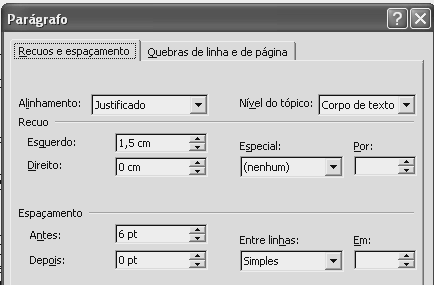

# PROVA — Camara_Alvorada_2008_Agente_Administrativo

## 1. Análise geral da prova

- **Identificação:** Camara_Alvorada_2008_Agente_Administrativo
- **Quantidade total de questões:** 50
- **Quantidade de textos de apoio (grupos):** 2
- **Quantidade de imagens:** 1
- **Quantidade de gráficos e tabelas:** incluídos nas imagens e no texto extraído, quando presentes no PDF original
- **Quantidade de grupos identificados:** 2
- **Quantidade de questões independentes:** 35
- **Questões que compartilham materiais:** texto-base das questões 01 a 08 → questões 01, 02, 03, 04, 05, 06, 07, 08; texto-base das questões 09 a 15 → questões 09, 10, 11, 12, 13, 14, 15

### Transcrição integral da capa/instruções (conforme extraída do PDF)

> [!NOTE]
> Conteúdo integral das páginas anteriores à primeira questão, sem cortes.

> FAURGS – CÂMARA DE ALVORADA – Edital 01/2008
>
> CARGO 3 - AGENTE ADMINISTRATIVO
>
>
>
>
>
>
> Pág. 1
>
>
>
>
>
>
> FAURGS – CÂMARA DE ALVORADA – Edital 01/2008
>
> CARGO 3 - AGENTE ADMINISTRATIVO
> Pág. 2
>
>
>
>
>
>
> FAURGS – CÂMARA DE ALVORADA – Edital 01/2008
>
> CARGO 3 - AGENTE ADMINISTRATIVO
> Pág. 3
> Instrução: As questões 01 a 08 referem-se ao texto
> abaixo.
> Imagine todo o conhecimento humano disponível
> para consulta a qualquer hora e em qualquer lugar. É
> a nova Biblioteca de Alexandria – assim pensadores e
> articulistas descrevem o monumental projeto do Google
> para digitalizar os cerca de 55 milhões de livros que
> existem no mundo. Para muitos, a iniciativa é temerária,
> constituindo uma ameaça à propriedade intelectual.
> O projeto do Google é apenas uma maneira nova
> para as pessoas descobrirem livros. Como você fica
> conhecendo um livro? Lendo uma _______ de revista
> ou jornal? Reparando na capa, no título ou no autor
> do exemplar na livraria? Recebendo a indicação de
> algum conhecido? Pois o Google torna ________ os
> textos completos de muitos livros. As obras vêm de
> duas fontes: bibliotecas e parceiros (editoras e autores).
> Quando vêm de bibliotecas e estão no domínio público,
> você pode visualizá-las por completo e até imprimir
> suas páginas. Se não estão no domínio público, o
> Google só permite a visualização de pequenos trechos.
> Com isso, cumpre as leis de direitos autorais. Já no
> caso dos livros incluídos no programa por parceiros, o
> usuário enxerga até 20% das páginas. O que incentiva
> autores e editoras a incluírem seus livros no programa
> é a possibilidade de que mais pessoas os descubram e
> queiram comprá-los. Cada título visualizado apresenta
> links para livrarias e bibliotecas nas quais o usuário
> pode encontrá-lo. Enquanto isso, por outro lado, outras
> editoras mantêm seus livros apenas nas prateleiras,
> para serem descobertos ________ dos meios tradicio-
> nais. Algumas justificam essa relutância pelo temor de
> que alguém consiga copiar partes de seus livros. Con-
> tudo é mais fácil escanear ou fotocopiar uma obra do
> que tentar burlar o sistema de segurança do Google
> para conseguir imagens de apenas algumas de suas
> páginas. Há ainda as editoras que temem que o leitor
> se satisfaça com as poucas páginas disponibilizadas.
> Estas talvez estejam subestimando suas obras e o veí-
> culo em si. Afinal, 500 anos depois de sua invenção, o
> livro impresso continua sendo um meio de informação
> ímpar. É portátil, relativamente barato e proporciona
> conforto inigualável no ato da leitura. Por esses e por
> outros motivos – como o fato de não precisarem ser
> desligados na decolagem – as pessoas ainda amam os
> livros. A começar por Larry Page e Sergey Brin, fun-
> dadores do Google, que, enquanto estudantes, foram
> colaboradores do projeto de digitalização da Biblioteca
> de Stanford.
> Adaptado de: VELLOSO, Rodrigo. O futuro da leitura.
> Revista da Semana. Edição 18: 03 de janeiro de 2008. Dis-
> ponível em: http://revistadasemana.abril.com.br/edicoes/
> 18/ciencia_tecnologia/materia_ciencia_tecnologia_265078.
> shtml. Acesso em: 16 abr. 2008.

### Gabarito

| Questão | 01 | 02 | 03 | 04 | 05 |
|---|---|---|---|---|---|
| Resposta | C | D | B | B | D |

| Questão | 06 | 07 | 08 | 09 | 10 |
|---|---|---|---|---|---|
| Resposta | A | E | C | D | B |

| Questão | 11 | 12 | 13 | 14 | 15 |
|---|---|---|---|---|---|
| Resposta | E | E | E | A | ANULADA |

| Questão | 16 | 17 | 18 | 19 | 20 |
|---|---|---|---|---|---|
| Resposta | B | E | A | D | A |

| Questão | 21 | 22 | 23 | 24 | 25 |
|---|---|---|---|---|---|
| Resposta | C | D | B | B | E |

| Questão | 26 | 27 | 28 | 29 | 30 |
|---|---|---|---|---|---|
| Resposta | A | D | E | B | C |

| Questão | 31 | 32 | 33 | 34 | 35 |
|---|---|---|---|---|---|
| Resposta | C | C | D | C | D |

| Questão | 36 | 37 | 38 | 39 | 40 |
|---|---|---|---|---|---|
| Resposta | A | B | C | C | B |

| Questão | 41 | 42 | 43 | 44 | 45 |
|---|---|---|---|---|---|
| Resposta | E | B | A | A | B |

| Questão | 46 | 47 | 48 | 49 | 50 |
|---|---|---|---|---|---|
| Resposta | B | D | E | E | D |

## 2. Questões agrupadas

### GRUPO 01 — Texto-base compartilhado pelas questões 01 a 08

**Questões relacionadas:** 01, 02, 03, 04, 05, 06, 07, 08.

#### QUESTÃO 01

✅ **Gabarito: C** (gabarito oficial pareado)

**Material de apoio:**

abaixo.
Imagine todo o conhecimento humano disponível
para consulta a qualquer hora e em qualquer lugar. É
a nova Biblioteca de Alexandria – assim pensadores e
articulistas descrevem o monumental projeto do Google
para digitalizar os cerca de 55 milhões de livros que
existem no mundo. Para muitos, a iniciativa é temerária,
constituindo uma ameaça à propriedade intelectual.
O projeto do Google é apenas uma maneira nova
para as pessoas descobrirem livros. Como você fica
conhecendo um livro? Lendo uma _______ de revista
ou jornal? Reparando na capa, no título ou no autor
do exemplar na livraria? Recebendo a indicação de
algum conhecido? Pois o Google torna ________ os
textos completos de muitos livros. As obras vêm de
duas fontes: bibliotecas e parceiros (editoras e autores).
Quando vêm de bibliotecas e estão no domínio público,
você pode visualizá-las por completo e até imprimir
suas páginas. Se não estão no domínio público, o
Google só permite a visualização de pequenos trechos.
Com isso, cumpre as leis de direitos autorais. Já no
caso dos livros incluídos no programa por parceiros, o
usuário enxerga até 20% das páginas. O que incentiva
autores e editoras a incluírem seus livros no programa
é a possibilidade de que mais pessoas os descubram e
queiram comprá-los. Cada título visualizado apresenta
links para livrarias e bibliotecas nas quais o usuário
pode encontrá-lo. Enquanto isso, por outro lado, outras
editoras mantêm seus livros apenas nas prateleiras,
para serem descobertos ________ dos meios tradicio-
nais. Algumas justificam essa relutância pelo temor de
que alguém consiga copiar partes de seus livros. Con-
tudo é mais fácil escanear ou fotocopiar uma obra do
que tentar burlar o sistema de segurança do Google
para conseguir imagens de apenas algumas de suas
páginas. Há ainda as editoras que temem que o leitor
se satisfaça com as poucas páginas disponibilizadas.
Estas talvez estejam subestimando suas obras e o veí-
culo em si. Afinal, 500 anos depois de sua invenção, o
livro impresso continua sendo um meio de informação
ímpar. É portátil, relativamente barato e proporciona
conforto inigualável no ato da leitura. Por esses e por
outros motivos – como o fato de não precisarem ser
desligados na decolagem – as pessoas ainda amam os
livros. A começar por Larry Page e Sergey Brin, fun-
dadores do Google, que, enquanto estudantes, foram
colaboradores do projeto de digitalização da Biblioteca
de Stanford.
Adaptado de: VELLOSO, Rodrigo. O futuro da leitura.
Revista da Semana. Edição 18: 03 de janeiro de 2008. Dis-
ponível em: http://revistadasemana.abril.com.br/edicoes/
18/ciencia_tecnologia/materia_ciencia_tecnologia_265078.
shtml. Acesso em: 16 abr. 2008.

**Enunciado:**

Com relação à grafia de s ou z, assinale a alternativa
que preenche correta e respectivamente as lacunas
das linhas 10, 13 e 29.

**Alternativas:**

A) rezenha – pesquisáveis – através
B) resenha – pesquisáveis – atravéz
C) resenha – pesquisáveis – através
D) rezenha – pesquizáveis – através
E) rezenha – pesquisáveis – atravéz

**Referências visuais:**

Nenhuma.

---

#### QUESTÃO 02

✅ **Gabarito: D** (gabarito oficial pareado)

**Material de apoio:**

abaixo.
Imagine todo o conhecimento humano disponível
para consulta a qualquer hora e em qualquer lugar. É
a nova Biblioteca de Alexandria – assim pensadores e
articulistas descrevem o monumental projeto do Google
para digitalizar os cerca de 55 milhões de livros que
existem no mundo. Para muitos, a iniciativa é temerária,
constituindo uma ameaça à propriedade intelectual.
O projeto do Google é apenas uma maneira nova
para as pessoas descobrirem livros. Como você fica
conhecendo um livro? Lendo uma _______ de revista
ou jornal? Reparando na capa, no título ou no autor
do exemplar na livraria? Recebendo a indicação de
algum conhecido? Pois o Google torna ________ os
textos completos de muitos livros. As obras vêm de
duas fontes: bibliotecas e parceiros (editoras e autores).
Quando vêm de bibliotecas e estão no domínio público,
você pode visualizá-las por completo e até imprimir
suas páginas. Se não estão no domínio público, o
Google só permite a visualização de pequenos trechos.
Com isso, cumpre as leis de direitos autorais. Já no
caso dos livros incluídos no programa por parceiros, o
usuário enxerga até 20% das páginas. O que incentiva
autores e editoras a incluírem seus livros no programa
é a possibilidade de que mais pessoas os descubram e
queiram comprá-los. Cada título visualizado apresenta
links para livrarias e bibliotecas nas quais o usuário
pode encontrá-lo. Enquanto isso, por outro lado, outras
editoras mantêm seus livros apenas nas prateleiras,
para serem descobertos ________ dos meios tradicio-
nais. Algumas justificam essa relutância pelo temor de
que alguém consiga copiar partes de seus livros. Con-
tudo é mais fácil escanear ou fotocopiar uma obra do
que tentar burlar o sistema de segurança do Google
para conseguir imagens de apenas algumas de suas
páginas. Há ainda as editoras que temem que o leitor
se satisfaça com as poucas páginas disponibilizadas.
Estas talvez estejam subestimando suas obras e o veí-
culo em si. Afinal, 500 anos depois de sua invenção, o
livro impresso continua sendo um meio de informação
ímpar. É portátil, relativamente barato e proporciona
conforto inigualável no ato da leitura. Por esses e por
outros motivos – como o fato de não precisarem ser
desligados na decolagem – as pessoas ainda amam os
livros. A começar por Larry Page e Sergey Brin, fun-
dadores do Google, que, enquanto estudantes, foram
colaboradores do projeto de digitalização da Biblioteca
de Stanford.
Adaptado de: VELLOSO, Rodrigo. O futuro da leitura.
Revista da Semana. Edição 18: 03 de janeiro de 2008. Dis-
ponível em: http://revistadasemana.abril.com.br/edicoes/
18/ciencia_tecnologia/materia_ciencia_tecnologia_265078.
shtml. Acesso em: 16 abr. 2008.

**Enunciado:**

Assinale a afirmativa que está de acordo com o texto.

**Alternativas:**

A) “Biblioteca de Alexandria” é o nome do novo
projeto do Google que pretende reescrever cerca
de 55 milhões de livros existentes no mundo.
B) O novo programa não traz vantagens para autores
e editoras, mas apenas o risco de terem seus
direitos autorais violados.
C) As editoras que buscam manter seus livros apenas
nas prateleiras não correm o risco de terem suas
obras copiadas ilegalmente.
D) O novo projeto do Google apresenta mais um
caminho de acesso aos livros e também constitui
um meio de divulgação do mercado editorial.
E) Enquanto as bibliotecas disponibilizam suas obras
integralmente pelo Google, os chamados parceiros
apenas disponibilizam links que indicam como
adquirir uma obra.

**Referências visuais:**

Nenhuma.

---

#### QUESTÃO 03

✅ **Gabarito: B** (gabarito oficial pareado)

**Material de apoio:**

abaixo.
Imagine todo o conhecimento humano disponível
para consulta a qualquer hora e em qualquer lugar. É
a nova Biblioteca de Alexandria – assim pensadores e
articulistas descrevem o monumental projeto do Google
para digitalizar os cerca de 55 milhões de livros que
existem no mundo. Para muitos, a iniciativa é temerária,
constituindo uma ameaça à propriedade intelectual.
O projeto do Google é apenas uma maneira nova
para as pessoas descobrirem livros. Como você fica
conhecendo um livro? Lendo uma _______ de revista
ou jornal? Reparando na capa, no título ou no autor
do exemplar na livraria? Recebendo a indicação de
algum conhecido? Pois o Google torna ________ os
textos completos de muitos livros. As obras vêm de
duas fontes: bibliotecas e parceiros (editoras e autores).
Quando vêm de bibliotecas e estão no domínio público,
você pode visualizá-las por completo e até imprimir
suas páginas. Se não estão no domínio público, o
Google só permite a visualização de pequenos trechos.
Com isso, cumpre as leis de direitos autorais. Já no
caso dos livros incluídos no programa por parceiros, o
usuário enxerga até 20% das páginas. O que incentiva
autores e editoras a incluírem seus livros no programa
é a possibilidade de que mais pessoas os descubram e
queiram comprá-los. Cada título visualizado apresenta
links para livrarias e bibliotecas nas quais o usuário
pode encontrá-lo. Enquanto isso, por outro lado, outras
editoras mantêm seus livros apenas nas prateleiras,
para serem descobertos ________ dos meios tradicio-
nais. Algumas justificam essa relutância pelo temor de
que alguém consiga copiar partes de seus livros. Con-
tudo é mais fácil escanear ou fotocopiar uma obra do
que tentar burlar o sistema de segurança do Google
para conseguir imagens de apenas algumas de suas
páginas. Há ainda as editoras que temem que o leitor
se satisfaça com as poucas páginas disponibilizadas.
Estas talvez estejam subestimando suas obras e o veí-
culo em si. Afinal, 500 anos depois de sua invenção, o
livro impresso continua sendo um meio de informação
ímpar. É portátil, relativamente barato e proporciona
conforto inigualável no ato da leitura. Por esses e por
outros motivos – como o fato de não precisarem ser
desligados na decolagem – as pessoas ainda amam os
livros. A começar por Larry Page e Sergey Brin, fun-
dadores do Google, que, enquanto estudantes, foram
colaboradores do projeto de digitalização da Biblioteca
de Stanford.
Adaptado de: VELLOSO, Rodrigo. O futuro da leitura.
Revista da Semana. Edição 18: 03 de janeiro de 2008. Dis-
ponível em: http://revistadasemana.abril.com.br/edicoes/
18/ciencia_tecnologia/materia_ciencia_tecnologia_265078.
shtml. Acesso em: 16 abr. 2008.

**Enunciado:**

Assinale a alternativa que está de acordo com o texto.

**Alternativas:**

A) O livro impresso, a partir do novo projeto do
Google, perderá completamente seu espaço para
o livro digitalizado.
B) A digitalização da literatura não apresenta risco
para o mercado editorial, pois o livro impresso
apresenta vantagens em relação à obra digitalizada.
C) A dinâmica da vida moderna trouxe mudanças ao
perfil dos leitores, que preferem a leitura via tela do
computador à leitura via livro impresso.
D) As bibliotecas preferem não colaborar com o
projeto de digitalização, pois o perfil do seu usuário
corresponde ao do leitor de livro impresso apenas.
E) Os leitores atuais não utilizam mais o livro impresso,
comprometendo a tradição de 500 anos deste
meio de informação.
01.
02.
03.
04.
05.
06.
07.
08.
09.
10.
11.
12.
13.
14.
15.
16.
17.
18.
19.
20.
21.
22.
23.
24.
25.
26.
27.
28.
29.
30.
31.
32.
33.
34.
35.
36.
37.
38.
39.
40.
41.
42.
43.
44.
45.
46.
47.
FAURGS – CÂMARA DE ALVORADA – Edital 01/2008
CARGO 3 - AGENTE ADMINISTRATIVO
Pág. 4

**Referências visuais:**

Nenhuma.

---

#### QUESTÃO 04

✅ **Gabarito: B** (gabarito oficial pareado)

**Material de apoio:**

abaixo.
Imagine todo o conhecimento humano disponível
para consulta a qualquer hora e em qualquer lugar. É
a nova Biblioteca de Alexandria – assim pensadores e
articulistas descrevem o monumental projeto do Google
para digitalizar os cerca de 55 milhões de livros que
existem no mundo. Para muitos, a iniciativa é temerária,
constituindo uma ameaça à propriedade intelectual.
O projeto do Google é apenas uma maneira nova
para as pessoas descobrirem livros. Como você fica
conhecendo um livro? Lendo uma _______ de revista
ou jornal? Reparando na capa, no título ou no autor
do exemplar na livraria? Recebendo a indicação de
algum conhecido? Pois o Google torna ________ os
textos completos de muitos livros. As obras vêm de
duas fontes: bibliotecas e parceiros (editoras e autores).
Quando vêm de bibliotecas e estão no domínio público,
você pode visualizá-las por completo e até imprimir
suas páginas. Se não estão no domínio público, o
Google só permite a visualização de pequenos trechos.
Com isso, cumpre as leis de direitos autorais. Já no
caso dos livros incluídos no programa por parceiros, o
usuário enxerga até 20% das páginas. O que incentiva
autores e editoras a incluírem seus livros no programa
é a possibilidade de que mais pessoas os descubram e
queiram comprá-los. Cada título visualizado apresenta
links para livrarias e bibliotecas nas quais o usuário
pode encontrá-lo. Enquanto isso, por outro lado, outras
editoras mantêm seus livros apenas nas prateleiras,
para serem descobertos ________ dos meios tradicio-
nais. Algumas justificam essa relutância pelo temor de
que alguém consiga copiar partes de seus livros. Con-
tudo é mais fácil escanear ou fotocopiar uma obra do
que tentar burlar o sistema de segurança do Google
para conseguir imagens de apenas algumas de suas
páginas. Há ainda as editoras que temem que o leitor
se satisfaça com as poucas páginas disponibilizadas.
Estas talvez estejam subestimando suas obras e o veí-
culo em si. Afinal, 500 anos depois de sua invenção, o
livro impresso continua sendo um meio de informação
ímpar. É portátil, relativamente barato e proporciona
conforto inigualável no ato da leitura. Por esses e por
outros motivos – como o fato de não precisarem ser
desligados na decolagem – as pessoas ainda amam os
livros. A começar por Larry Page e Sergey Brin, fun-
dadores do Google, que, enquanto estudantes, foram
colaboradores do projeto de digitalização da Biblioteca
de Stanford.
Adaptado de: VELLOSO, Rodrigo. O futuro da leitura.
Revista da Semana. Edição 18: 03 de janeiro de 2008. Dis-
ponível em: http://revistadasemana.abril.com.br/edicoes/
18/ciencia_tecnologia/materia_ciencia_tecnologia_265078.
shtml. Acesso em: 16 abr. 2008.

**Enunciado:**

As alternativas abaixo contêm afirmações sobre
concordância entre os termos de orações transcritas
do texto. Assinale-as com V (verdadeiro) ou F (falso).
( ) Na frase As obras vêm de duas fontes:
bibliotecas
e
parceiros
(editoras
e
autores).(λ. 14-15), a substituição de as obras
(λ. 14) por o acervo não torna necessárias
outras alterações na mesma passagem.
( ) Na frase O que incentiva autores e editoras a
incluir
seus
livros
no
programa
é
a
possibilidade de que mais pessoas os
descubram e queiram comprá-los. (λ. 22-
25), a substituição da palavra pessoas (λ. 24)
pela palavra gente acarretaria a alteração das
palavras descubram (λ. 24) e queiram (λ. 25).
( ) Na frase Cada título visualizado apresenta
links para livrarias e bibliotecas nas quais o
usuário pode encontrá-lo. (λ. 25-27), a
substituição de livrarias e bibliotecas (λ. 26)
por uma biblioteca exigiria somente a troca da
expressão nas quais (λ. 26) pela expressão na
qual.
A seqüência correta do preenchimento dos parênteses,
de cima para baixo, é

**Alternativas:**

A) F – F – V.
B) F – V – V.
C) V – F – V.
D) F – V – F.
E) V – F – F.

**Referências visuais:**

Nenhuma.

---

#### QUESTÃO 05

✅ **Gabarito: D** (gabarito oficial pareado)

**Material de apoio:**

abaixo.
Imagine todo o conhecimento humano disponível
para consulta a qualquer hora e em qualquer lugar. É
a nova Biblioteca de Alexandria – assim pensadores e
articulistas descrevem o monumental projeto do Google
para digitalizar os cerca de 55 milhões de livros que
existem no mundo. Para muitos, a iniciativa é temerária,
constituindo uma ameaça à propriedade intelectual.
O projeto do Google é apenas uma maneira nova
para as pessoas descobrirem livros. Como você fica
conhecendo um livro? Lendo uma _______ de revista
ou jornal? Reparando na capa, no título ou no autor
do exemplar na livraria? Recebendo a indicação de
algum conhecido? Pois o Google torna ________ os
textos completos de muitos livros. As obras vêm de
duas fontes: bibliotecas e parceiros (editoras e autores).
Quando vêm de bibliotecas e estão no domínio público,
você pode visualizá-las por completo e até imprimir
suas páginas. Se não estão no domínio público, o
Google só permite a visualização de pequenos trechos.
Com isso, cumpre as leis de direitos autorais. Já no
caso dos livros incluídos no programa por parceiros, o
usuário enxerga até 20% das páginas. O que incentiva
autores e editoras a incluírem seus livros no programa
é a possibilidade de que mais pessoas os descubram e
queiram comprá-los. Cada título visualizado apresenta
links para livrarias e bibliotecas nas quais o usuário
pode encontrá-lo. Enquanto isso, por outro lado, outras
editoras mantêm seus livros apenas nas prateleiras,
para serem descobertos ________ dos meios tradicio-
nais. Algumas justificam essa relutância pelo temor de
que alguém consiga copiar partes de seus livros. Con-
tudo é mais fácil escanear ou fotocopiar uma obra do
que tentar burlar o sistema de segurança do Google
para conseguir imagens de apenas algumas de suas
páginas. Há ainda as editoras que temem que o leitor
se satisfaça com as poucas páginas disponibilizadas.
Estas talvez estejam subestimando suas obras e o veí-
culo em si. Afinal, 500 anos depois de sua invenção, o
livro impresso continua sendo um meio de informação
ímpar. É portátil, relativamente barato e proporciona
conforto inigualável no ato da leitura. Por esses e por
outros motivos – como o fato de não precisarem ser
desligados na decolagem – as pessoas ainda amam os
livros. A começar por Larry Page e Sergey Brin, fun-
dadores do Google, que, enquanto estudantes, foram
colaboradores do projeto de digitalização da Biblioteca
de Stanford.
Adaptado de: VELLOSO, Rodrigo. O futuro da leitura.
Revista da Semana. Edição 18: 03 de janeiro de 2008. Dis-
ponível em: http://revistadasemana.abril.com.br/edicoes/
18/ciencia_tecnologia/materia_ciencia_tecnologia_265078.
shtml. Acesso em: 16 abr. 2008.

**Enunciado:**

Assinale a alternativa que apresenta os sinônimos
mais adequados para as palavras temerária (λ. 06),
relutância (λ. 30) e subestimando (λ. 37).

**Alternativas:**

A) inviável – idiossincrasia – testando
B) medrosa – briga – vangloriando
C) criminosa – indiferença – vendendo
D) audaciosa – resistência – desvalorizando
E) real – relatividade – barateando

**Referências visuais:**

Nenhuma.

---

#### QUESTÃO 06

✅ **Gabarito: A** (gabarito oficial pareado)

**Material de apoio:**

abaixo.
Imagine todo o conhecimento humano disponível
para consulta a qualquer hora e em qualquer lugar. É
a nova Biblioteca de Alexandria – assim pensadores e
articulistas descrevem o monumental projeto do Google
para digitalizar os cerca de 55 milhões de livros que
existem no mundo. Para muitos, a iniciativa é temerária,
constituindo uma ameaça à propriedade intelectual.
O projeto do Google é apenas uma maneira nova
para as pessoas descobrirem livros. Como você fica
conhecendo um livro? Lendo uma _______ de revista
ou jornal? Reparando na capa, no título ou no autor
do exemplar na livraria? Recebendo a indicação de
algum conhecido? Pois o Google torna ________ os
textos completos de muitos livros. As obras vêm de
duas fontes: bibliotecas e parceiros (editoras e autores).
Quando vêm de bibliotecas e estão no domínio público,
você pode visualizá-las por completo e até imprimir
suas páginas. Se não estão no domínio público, o
Google só permite a visualização de pequenos trechos.
Com isso, cumpre as leis de direitos autorais. Já no
caso dos livros incluídos no programa por parceiros, o
usuário enxerga até 20% das páginas. O que incentiva
autores e editoras a incluírem seus livros no programa
é a possibilidade de que mais pessoas os descubram e
queiram comprá-los. Cada título visualizado apresenta
links para livrarias e bibliotecas nas quais o usuário
pode encontrá-lo. Enquanto isso, por outro lado, outras
editoras mantêm seus livros apenas nas prateleiras,
para serem descobertos ________ dos meios tradicio-
nais. Algumas justificam essa relutância pelo temor de
que alguém consiga copiar partes de seus livros. Con-
tudo é mais fácil escanear ou fotocopiar uma obra do
que tentar burlar o sistema de segurança do Google
para conseguir imagens de apenas algumas de suas
páginas. Há ainda as editoras que temem que o leitor
se satisfaça com as poucas páginas disponibilizadas.
Estas talvez estejam subestimando suas obras e o veí-
culo em si. Afinal, 500 anos depois de sua invenção, o
livro impresso continua sendo um meio de informação
ímpar. É portátil, relativamente barato e proporciona
conforto inigualável no ato da leitura. Por esses e por
outros motivos – como o fato de não precisarem ser
desligados na decolagem – as pessoas ainda amam os
livros. A começar por Larry Page e Sergey Brin, fun-
dadores do Google, que, enquanto estudantes, foram
colaboradores do projeto de digitalização da Biblioteca
de Stanford.
Adaptado de: VELLOSO, Rodrigo. O futuro da leitura.
Revista da Semana. Edição 18: 03 de janeiro de 2008. Dis-
ponível em: http://revistadasemana.abril.com.br/edicoes/
18/ciencia_tecnologia/materia_ciencia_tecnologia_265078.
shtml. Acesso em: 16 abr. 2008.

**Enunciado:**

Considere as seguintes afirmações sobre a palavra
escanear (λ. 32).
I - Nela ocorre o mesmo sufixo que existe na palavra
lugar (λ. 02).
II - O sufixo que nela ocorre é formador de verbos.
III - Sua estrutura é derivada da palavra escárnio.
Qual(is) afirmação(ões) acima está(ão) correta(s)?

**Alternativas:**

A) Apenas II.
B) Apenas III.
C) Apenas I e II.
D) Apenas II e III.
E) I, II e III.

**Referências visuais:**

Nenhuma.

---

#### QUESTÃO 07

✅ **Gabarito: E** (gabarito oficial pareado)

**Material de apoio:**

abaixo.
Imagine todo o conhecimento humano disponível
para consulta a qualquer hora e em qualquer lugar. É
a nova Biblioteca de Alexandria – assim pensadores e
articulistas descrevem o monumental projeto do Google
para digitalizar os cerca de 55 milhões de livros que
existem no mundo. Para muitos, a iniciativa é temerária,
constituindo uma ameaça à propriedade intelectual.
O projeto do Google é apenas uma maneira nova
para as pessoas descobrirem livros. Como você fica
conhecendo um livro? Lendo uma _______ de revista
ou jornal? Reparando na capa, no título ou no autor
do exemplar na livraria? Recebendo a indicação de
algum conhecido? Pois o Google torna ________ os
textos completos de muitos livros. As obras vêm de
duas fontes: bibliotecas e parceiros (editoras e autores).
Quando vêm de bibliotecas e estão no domínio público,
você pode visualizá-las por completo e até imprimir
suas páginas. Se não estão no domínio público, o
Google só permite a visualização de pequenos trechos.
Com isso, cumpre as leis de direitos autorais. Já no
caso dos livros incluídos no programa por parceiros, o
usuário enxerga até 20% das páginas. O que incentiva
autores e editoras a incluírem seus livros no programa
é a possibilidade de que mais pessoas os descubram e
queiram comprá-los. Cada título visualizado apresenta
links para livrarias e bibliotecas nas quais o usuário
pode encontrá-lo. Enquanto isso, por outro lado, outras
editoras mantêm seus livros apenas nas prateleiras,
para serem descobertos ________ dos meios tradicio-
nais. Algumas justificam essa relutância pelo temor de
que alguém consiga copiar partes de seus livros. Con-
tudo é mais fácil escanear ou fotocopiar uma obra do
que tentar burlar o sistema de segurança do Google
para conseguir imagens de apenas algumas de suas
páginas. Há ainda as editoras que temem que o leitor
se satisfaça com as poucas páginas disponibilizadas.
Estas talvez estejam subestimando suas obras e o veí-
culo em si. Afinal, 500 anos depois de sua invenção, o
livro impresso continua sendo um meio de informação
ímpar. É portátil, relativamente barato e proporciona
conforto inigualável no ato da leitura. Por esses e por
outros motivos – como o fato de não precisarem ser
desligados na decolagem – as pessoas ainda amam os
livros. A começar por Larry Page e Sergey Brin, fun-
dadores do Google, que, enquanto estudantes, foram
colaboradores do projeto de digitalização da Biblioteca
de Stanford.
Adaptado de: VELLOSO, Rodrigo. O futuro da leitura.
Revista da Semana. Edição 18: 03 de janeiro de 2008. Dis-
ponível em: http://revistadasemana.abril.com.br/edicoes/
18/ciencia_tecnologia/materia_ciencia_tecnologia_265078.
shtml. Acesso em: 16 abr. 2008.

**Enunciado:**

Tendo em vista as regras de acentuação gráfica,
considere as afirmações abaixo.
I - A palavra mantêm (λ. 28), quando na sua forma
de singular, é acentuada pelo mesmo motivo que
a palavra alguém (λ. 31).
II - As palavras relutância (λ. 30) e usuário (λ. 22)
são contempladas pela regra de acentuação das
paroxítonas terminadas em ditongo crescente.
III - As palavras disponível (λ. 01) e fácil (λ. 32)
são
contempladas
pela
mesma
regra
de
acentuação.
Qual(is) afirmação(ões) acima está(ão) correta(s)?

**Alternativas:**

A) Apenas II.
B) Apenas III.
C) Apenas I e II.
D) Apenas II e III.
E) I, II e III.

**Referências visuais:**

Nenhuma.

---

#### QUESTÃO 08

✅ **Gabarito: C** (gabarito oficial pareado)

**Material de apoio:**

abaixo.
Imagine todo o conhecimento humano disponível
para consulta a qualquer hora e em qualquer lugar. É
a nova Biblioteca de Alexandria – assim pensadores e
articulistas descrevem o monumental projeto do Google
para digitalizar os cerca de 55 milhões de livros que
existem no mundo. Para muitos, a iniciativa é temerária,
constituindo uma ameaça à propriedade intelectual.
O projeto do Google é apenas uma maneira nova
para as pessoas descobrirem livros. Como você fica
conhecendo um livro? Lendo uma _______ de revista
ou jornal? Reparando na capa, no título ou no autor
do exemplar na livraria? Recebendo a indicação de
algum conhecido? Pois o Google torna ________ os
textos completos de muitos livros. As obras vêm de
duas fontes: bibliotecas e parceiros (editoras e autores).
Quando vêm de bibliotecas e estão no domínio público,
você pode visualizá-las por completo e até imprimir
suas páginas. Se não estão no domínio público, o
Google só permite a visualização de pequenos trechos.
Com isso, cumpre as leis de direitos autorais. Já no
caso dos livros incluídos no programa por parceiros, o
usuário enxerga até 20% das páginas. O que incentiva
autores e editoras a incluírem seus livros no programa
é a possibilidade de que mais pessoas os descubram e
queiram comprá-los. Cada título visualizado apresenta
links para livrarias e bibliotecas nas quais o usuário
pode encontrá-lo. Enquanto isso, por outro lado, outras
editoras mantêm seus livros apenas nas prateleiras,
para serem descobertos ________ dos meios tradicio-
nais. Algumas justificam essa relutância pelo temor de
que alguém consiga copiar partes de seus livros. Con-
tudo é mais fácil escanear ou fotocopiar uma obra do
que tentar burlar o sistema de segurança do Google
para conseguir imagens de apenas algumas de suas
páginas. Há ainda as editoras que temem que o leitor
se satisfaça com as poucas páginas disponibilizadas.
Estas talvez estejam subestimando suas obras e o veí-
culo em si. Afinal, 500 anos depois de sua invenção, o
livro impresso continua sendo um meio de informação
ímpar. É portátil, relativamente barato e proporciona
conforto inigualável no ato da leitura. Por esses e por
outros motivos – como o fato de não precisarem ser
desligados na decolagem – as pessoas ainda amam os
livros. A começar por Larry Page e Sergey Brin, fun-
dadores do Google, que, enquanto estudantes, foram
colaboradores do projeto de digitalização da Biblioteca
de Stanford.
Adaptado de: VELLOSO, Rodrigo. O futuro da leitura.
Revista da Semana. Edição 18: 03 de janeiro de 2008. Dis-
ponível em: http://revistadasemana.abril.com.br/edicoes/
18/ciencia_tecnologia/materia_ciencia_tecnologia_265078.
shtml. Acesso em: 16 abr. 2008.

**Enunciado:**

Tendo em vista as regras de pontuação, assinale com
V (verdadeiro) ou F (falso) as afirmações abaixo.
( ) O travessão da linha 03 pode ser substituído por
uma vírgula, sem que haja prejuízo da correção
gramatical.
( ) É opcional o uso de vírgula após a expressão
outras editoras (λ. 27-28).
( ) O ponto final (λ. 40) que separa as frases das
linhas 38-40, de um lado, e 40-41, de outro, pode
ser substituído por dois pontos, dada a relação
das duas passagens.
A seqüência correta do preenchimento dos parênteses,
de cima para baixo, é

**Alternativas:**

A) V – F – V.
B) V – F – F.
C) F – F – V.
D) F – V – F.
E) V – V – V.
FAURGS – CÂMARA DE ALVORADA – Edital 01/2008
CARGO 3 - AGENTE ADMINISTRATIVO
Pág. 5
Instrução: As questões 09 a 15 referem-se ao texto
abaixo.
Luzes que obscurecem
Em janeiro de 2007, o cometa McNaught cruzou o
céu de Porto Alegre durante algumas noites. Ofuscado
pela luminosidade que emana da cidade, o McNaught
passou praticamente despercebido, assim como acon-
tece com a maioria dos astros que despontam todos
os dias no firmamento da capital. “Das 5 mil estrelas
que cintilam sobre Porto Alegre, menos de 200 podem
ser vistas”, explica Ivandel Lourenço, técnico do Labo-
ratório de Astronomia da Pontifícia Universidade Cató-
lica do Rio Grande do Sul (PUCRS).
A razão é um problema que se repete em todo
centro urbano do planeta e que tem um nome: poluição
luminosa. Menos conhecido do que outras formas de
poluição, o excesso de iluminação noturna é igual-
mente nocivo, e não apenas para os astrônomos. Esse
tipo de poluição também atrapalha os animais de
hábitos noturnos e as aves migratórias, afeta as plantas
e é uma das maiores fontes de desperdício de energia.
Aproximadamente 19% de toda a eletricidade pro-
duzida na Terra é utilizada para iluminar suas noites.
A questão é que boa parte dessa energia se perde por
conta de lâmpadas ineficientes e luminárias ____ pro-
jetadas, que espalham a luz para o céu, para o topo
de árvores, para a fachada dos prédios e para outros
pontos que pouco interessam. Para compensar a luz
que é jogada fora, _________ a utilização de lâmpadas
mais potentes, que aumentam o consumo de energia
e causam mais poluição luminosa. Isso torna a ilumi-
nação urbana noturna um dos maiores focos de emissão
de dióxido de carbono (CO2), o principal vilão do
aquecimento global. Uma lâmpada comum de 100
watts, por exemplo, produz 3,2 quilos de CO2 por ano,
segundo metodologia adotada pela convenção sobre
mudanças climáticas das Nações Unidas.
Boa parte do problema ______ ser resolvida com
um sistema de iluminação mais eficiente, que con-
templasse medidas como a troca das lâmpadas de
vapor de mercúrio, largamente utilizadas, por lâmpadas
de vapor de sódio. O ganho se dá no rendimento da
lâmpada (a porcentagem de luz que ela joga no
ambiente). A de sódio tem um rendimento em torno
de 80%, contra apenas 55% de rendimento da
lâmpada de mercúrio. Além disso, a luz deve ser dire-
cionada para a pista e para a calçada, de forma a
aumentar a eficiência da iluminação e a segurança
dos locais iluminados e evitar a poluição luminosa.
Adaptado de: WERB, Elton. Luzes que obscurecem. Zero
Hora, Porto Alegre, 14 abr. 2008. Disponível em: http:// ze-
rohora.clicrbs.com.br/zerohora/jsp/default2.jsp?uf=1&local
= 1&source= a1827899.xml&template = 3898.dwt&edition=
9661&section= 604. Acesso em: 14 abr.2008.

**Referências visuais:**

Nenhuma.

---

### GRUPO 02 — Texto-base compartilhado pelas questões 09 a 15

**Questões relacionadas:** 09, 10, 11, 12, 13, 14, 15.

#### QUESTÃO 09

✅ **Gabarito: D** (gabarito oficial pareado)

**Material de apoio:**

08. Tendo em vista as regras de pontuação, assinale com
V (verdadeiro) ou F (falso) as afirmações abaixo.
( ) O travessão da linha 03 pode ser substituído por
uma vírgula, sem que haja prejuízo da correção
gramatical.
( ) É opcional o uso de vírgula após a expressão
outras editoras (λ. 27-28).
( ) O ponto final (λ. 40) que separa as frases das
linhas 38-40, de um lado, e 40-41, de outro, pode
ser substituído por dois pontos, dada a relação
das duas passagens.
A seqüência correta do preenchimento dos parênteses,
de cima para baixo, é
(A) V – F – V.
(B) V – F – F.
(C) F – F – V.
(D) F – V – F.
(E) V – V – V.

FAURGS – CÂMARA DE ALVORADA – Edital 01/2008

CARGO 3 - AGENTE ADMINISTRATIVO
Pág. 5
Instrução: As  referem-se ao texto
abaixo.
Luzes que obscurecem
Em janeiro de 2007, o cometa McNaught cruzou o
céu de Porto Alegre durante algumas noites. Ofuscado
pela luminosidade que emana da cidade, o McNaught
passou praticamente despercebido, assim como acon-
tece com a maioria dos astros que despontam todos
os dias no firmamento da capital. “Das 5 mil estrelas
que cintilam sobre Porto Alegre, menos de 200 podem
ser vistas”, explica Ivandel Lourenço, técnico do Labo-
ratório de Astronomia da Pontifícia Universidade Cató-
lica do Rio Grande do Sul (PUCRS).
A razão é um problema que se repete em todo
centro urbano do planeta e que tem um nome: poluição
luminosa. Menos conhecido do que outras formas de
poluição, o excesso de iluminação noturna é igual-
mente nocivo, e não apenas para os astrônomos. Esse
tipo de poluição também atrapalha os animais de
hábitos noturnos e as aves migratórias, afeta as plantas
e é uma das maiores fontes de desperdício de energia.
Aproximadamente 19% de toda a eletricidade pro-
duzida na Terra é utilizada para iluminar suas noites.
A questão é que boa parte dessa energia se perde por
conta de lâmpadas ineficientes e luminárias ____ pro-
jetadas, que espalham a luz para o céu, para o topo
de árvores, para a fachada dos prédios e para outros
pontos que pouco interessam. Para compensar a luz
que é jogada fora, _________ a utilização de lâmpadas
mais potentes, que aumentam o consumo de energia
e causam mais poluição luminosa. Isso torna a ilumi-
nação urbana noturna um dos maiores focos de emissão
de dióxido de carbono (CO2), o principal vilão do
aquecimento global. Uma lâmpada comum de 100
watts, por exemplo, produz 3,2 quilos de CO2 por ano,
segundo metodologia adotada pela convenção sobre
mudanças climáticas das Nações Unidas.
Boa parte do problema ______ ser resolvida com
um sistema de iluminação mais eficiente, que con-
templasse medidas como a troca das lâmpadas de
vapor de mercúrio, largamente utilizadas, por lâmpadas
de vapor de sódio. O ganho se dá no rendimento da
lâmpada (a porcentagem de luz que ela joga no
ambiente). A de sódio tem um rendimento em torno
de 80%, contra apenas 55% de rendimento da
lâmpada de mercúrio. Além disso, a luz deve ser dire-
cionada para a pista e para a calçada, de forma a
aumentar a eficiência da iluminação e a segurança
dos locais iluminados e evitar a poluição luminosa.
Adaptado de: WERB, Elton. Luzes que obscurecem. Zero
Hora, Porto Alegre, 14 abr. 2008. Disponível em: http:// ze-
rohora.clicrbs.com.br/zerohora/jsp/default2.jsp?uf=1&local
= 1&source= a1827899.xml&template = 3898.dwt&edition=
9661&section= 604. Acesso em: 14 abr.2008.

**Enunciado:**

Assinale a alternativa que preenche correta e
respectivamente as lacunas das linhas 22, 26 e 35.

**Alternativas:**

A) mau – é necessária – poderia
B) mal – são necessárias – poderia
C) mau – é necessária – podia
D) mal – é necessária – poderia
E) mau – são necessárias – podia

**Referências visuais:**

Nenhuma.

---

#### QUESTÃO 10

✅ **Gabarito: B** (gabarito oficial pareado)

**Material de apoio:**

08. Tendo em vista as regras de pontuação, assinale com
V (verdadeiro) ou F (falso) as afirmações abaixo.
( ) O travessão da linha 03 pode ser substituído por
uma vírgula, sem que haja prejuízo da correção
gramatical.
( ) É opcional o uso de vírgula após a expressão
outras editoras (λ. 27-28).
( ) O ponto final (λ. 40) que separa as frases das
linhas 38-40, de um lado, e 40-41, de outro, pode
ser substituído por dois pontos, dada a relação
das duas passagens.
A seqüência correta do preenchimento dos parênteses,
de cima para baixo, é
(A) V – F – V.
(B) V – F – F.
(C) F – F – V.
(D) F – V – F.
(E) V – V – V.

FAURGS – CÂMARA DE ALVORADA – Edital 01/2008

CARGO 3 - AGENTE ADMINISTRATIVO
Pág. 5
Instrução: As  referem-se ao texto
abaixo.
Luzes que obscurecem
Em janeiro de 2007, o cometa McNaught cruzou o
céu de Porto Alegre durante algumas noites. Ofuscado
pela luminosidade que emana da cidade, o McNaught
passou praticamente despercebido, assim como acon-
tece com a maioria dos astros que despontam todos
os dias no firmamento da capital. “Das 5 mil estrelas
que cintilam sobre Porto Alegre, menos de 200 podem
ser vistas”, explica Ivandel Lourenço, técnico do Labo-
ratório de Astronomia da Pontifícia Universidade Cató-
lica do Rio Grande do Sul (PUCRS).
A razão é um problema que se repete em todo
centro urbano do planeta e que tem um nome: poluição
luminosa. Menos conhecido do que outras formas de
poluição, o excesso de iluminação noturna é igual-
mente nocivo, e não apenas para os astrônomos. Esse
tipo de poluição também atrapalha os animais de
hábitos noturnos e as aves migratórias, afeta as plantas
e é uma das maiores fontes de desperdício de energia.
Aproximadamente 19% de toda a eletricidade pro-
duzida na Terra é utilizada para iluminar suas noites.
A questão é que boa parte dessa energia se perde por
conta de lâmpadas ineficientes e luminárias ____ pro-
jetadas, que espalham a luz para o céu, para o topo
de árvores, para a fachada dos prédios e para outros
pontos que pouco interessam. Para compensar a luz
que é jogada fora, _________ a utilização de lâmpadas
mais potentes, que aumentam o consumo de energia
e causam mais poluição luminosa. Isso torna a ilumi-
nação urbana noturna um dos maiores focos de emissão
de dióxido de carbono (CO2), o principal vilão do
aquecimento global. Uma lâmpada comum de 100
watts, por exemplo, produz 3,2 quilos de CO2 por ano,
segundo metodologia adotada pela convenção sobre
mudanças climáticas das Nações Unidas.
Boa parte do problema ______ ser resolvida com
um sistema de iluminação mais eficiente, que con-
templasse medidas como a troca das lâmpadas de
vapor de mercúrio, largamente utilizadas, por lâmpadas
de vapor de sódio. O ganho se dá no rendimento da
lâmpada (a porcentagem de luz que ela joga no
ambiente). A de sódio tem um rendimento em torno
de 80%, contra apenas 55% de rendimento da
lâmpada de mercúrio. Além disso, a luz deve ser dire-
cionada para a pista e para a calçada, de forma a
aumentar a eficiência da iluminação e a segurança
dos locais iluminados e evitar a poluição luminosa.
Adaptado de: WERB, Elton. Luzes que obscurecem. Zero
Hora, Porto Alegre, 14 abr. 2008. Disponível em: http:// ze-
rohora.clicrbs.com.br/zerohora/jsp/default2.jsp?uf=1&local
= 1&source= a1827899.xml&template = 3898.dwt&edition=
9661&section= 604. Acesso em: 14 abr.2008.

**Enunciado:**

De acordo com o texto, é possível afirmar que

**Alternativas:**

A) os porto-alegrenses precisam prestar mais atenção
à beleza de seu céu, para que não percam
espetáculos como a passagem do cometa
McNaught.
B) o desperdício de energia relacionado à poluição
luminosa é conseqüência da falta de um sistema
de iluminação mais eficiente.
C) a poluição luminosa não é muito discutida, pois
seus efeitos prejudiciais são menos intensos do
que os de outras formas de poluição.
D) lâmpadas de vapor de mercúrio são muito utilizadas
nos centros urbanos, para que locais como a
fachada dos prédios possam ser iluminados.
E) os
efeitos
do
aquecimento
global
seriam
minimizados com a adoção de medidas que
tornariam os centros urbanos mais inseguros à
noite pela diminuição da iluminação.

**Referências visuais:**

Nenhuma.

---

#### QUESTÃO 11

✅ **Gabarito: E** (gabarito oficial pareado)

**Material de apoio:**

08. Tendo em vista as regras de pontuação, assinale com
V (verdadeiro) ou F (falso) as afirmações abaixo.
( ) O travessão da linha 03 pode ser substituído por
uma vírgula, sem que haja prejuízo da correção
gramatical.
( ) É opcional o uso de vírgula após a expressão
outras editoras (λ. 27-28).
( ) O ponto final (λ. 40) que separa as frases das
linhas 38-40, de um lado, e 40-41, de outro, pode
ser substituído por dois pontos, dada a relação
das duas passagens.
A seqüência correta do preenchimento dos parênteses,
de cima para baixo, é
(A) V – F – V.
(B) V – F – F.
(C) F – F – V.
(D) F – V – F.
(E) V – V – V.

FAURGS – CÂMARA DE ALVORADA – Edital 01/2008

CARGO 3 - AGENTE ADMINISTRATIVO
Pág. 5
Instrução: As  referem-se ao texto
abaixo.
Luzes que obscurecem
Em janeiro de 2007, o cometa McNaught cruzou o
céu de Porto Alegre durante algumas noites. Ofuscado
pela luminosidade que emana da cidade, o McNaught
passou praticamente despercebido, assim como acon-
tece com a maioria dos astros que despontam todos
os dias no firmamento da capital. “Das 5 mil estrelas
que cintilam sobre Porto Alegre, menos de 200 podem
ser vistas”, explica Ivandel Lourenço, técnico do Labo-
ratório de Astronomia da Pontifícia Universidade Cató-
lica do Rio Grande do Sul (PUCRS).
A razão é um problema que se repete em todo
centro urbano do planeta e que tem um nome: poluição
luminosa. Menos conhecido do que outras formas de
poluição, o excesso de iluminação noturna é igual-
mente nocivo, e não apenas para os astrônomos. Esse
tipo de poluição também atrapalha os animais de
hábitos noturnos e as aves migratórias, afeta as plantas
e é uma das maiores fontes de desperdício de energia.
Aproximadamente 19% de toda a eletricidade pro-
duzida na Terra é utilizada para iluminar suas noites.
A questão é que boa parte dessa energia se perde por
conta de lâmpadas ineficientes e luminárias ____ pro-
jetadas, que espalham a luz para o céu, para o topo
de árvores, para a fachada dos prédios e para outros
pontos que pouco interessam. Para compensar a luz
que é jogada fora, _________ a utilização de lâmpadas
mais potentes, que aumentam o consumo de energia
e causam mais poluição luminosa. Isso torna a ilumi-
nação urbana noturna um dos maiores focos de emissão
de dióxido de carbono (CO2), o principal vilão do
aquecimento global. Uma lâmpada comum de 100
watts, por exemplo, produz 3,2 quilos de CO2 por ano,
segundo metodologia adotada pela convenção sobre
mudanças climáticas das Nações Unidas.
Boa parte do problema ______ ser resolvida com
um sistema de iluminação mais eficiente, que con-
templasse medidas como a troca das lâmpadas de
vapor de mercúrio, largamente utilizadas, por lâmpadas
de vapor de sódio. O ganho se dá no rendimento da
lâmpada (a porcentagem de luz que ela joga no
ambiente). A de sódio tem um rendimento em torno
de 80%, contra apenas 55% de rendimento da
lâmpada de mercúrio. Além disso, a luz deve ser dire-
cionada para a pista e para a calçada, de forma a
aumentar a eficiência da iluminação e a segurança
dos locais iluminados e evitar a poluição luminosa.
Adaptado de: WERB, Elton. Luzes que obscurecem. Zero
Hora, Porto Alegre, 14 abr. 2008. Disponível em: http:// ze-
rohora.clicrbs.com.br/zerohora/jsp/default2.jsp?uf=1&local
= 1&source= a1827899.xml&template = 3898.dwt&edition=
9661&section= 604. Acesso em: 14 abr.2008.

**Enunciado:**

Considere as afirmações abaixo sobre o texto.
I - Astrônomos, animais de hábitos noturnos e aves
migratórias precisam que o céu seja mais
iluminado
para
que
possam
realizar
suas
atividades.
II - Lâmpadas mais potentes são utilizadas para
compensar o fato de a luz não ser corretamente
direcionada para os locais em que a iluminação é
necessária.
III - A poluição luminosa poderia ser diminuída se
fossem adotadas medidas como a utilização de
lâmpadas
com
maior
rendimento
e
o
direcionamento da luz para locais que realmente
precisam ser iluminados.
Qual(is) afirmação(ões) acima está(ão) correta(s)?

**Alternativas:**

A) Apenas II.
B) Apenas III.
C) Apenas I e II.
D) Apenas I e III.
E) Apenas II e III.
01.
02.
03.
04.
05.
06.
07.
08.
09.
10.
11.
12.
13.
14.
15.
16.
17.
18.
19.
20.
21.
22.
23.
24.
25.
26.
27.
28.
29.
30.
31.
32.
33.
34.
35.
36.
37.
38.
39.
40.
41.
42.
43.
44.
45.
46.
FAURGS – CÂMARA DE ALVORADA – Edital 01/2008
CARGO 3 - AGENTE ADMINISTRATIVO
Pág. 6

**Referências visuais:**

Nenhuma.

---

#### QUESTÃO 12

✅ **Gabarito: E** (gabarito oficial pareado)

**Material de apoio:**

08. Tendo em vista as regras de pontuação, assinale com
V (verdadeiro) ou F (falso) as afirmações abaixo.
( ) O travessão da linha 03 pode ser substituído por
uma vírgula, sem que haja prejuízo da correção
gramatical.
( ) É opcional o uso de vírgula após a expressão
outras editoras (λ. 27-28).
( ) O ponto final (λ. 40) que separa as frases das
linhas 38-40, de um lado, e 40-41, de outro, pode
ser substituído por dois pontos, dada a relação
das duas passagens.
A seqüência correta do preenchimento dos parênteses,
de cima para baixo, é
(A) V – F – V.
(B) V – F – F.
(C) F – F – V.
(D) F – V – F.
(E) V – V – V.

FAURGS – CÂMARA DE ALVORADA – Edital 01/2008

CARGO 3 - AGENTE ADMINISTRATIVO
Pág. 5
Instrução: As  referem-se ao texto
abaixo.
Luzes que obscurecem
Em janeiro de 2007, o cometa McNaught cruzou o
céu de Porto Alegre durante algumas noites. Ofuscado
pela luminosidade que emana da cidade, o McNaught
passou praticamente despercebido, assim como acon-
tece com a maioria dos astros que despontam todos
os dias no firmamento da capital. “Das 5 mil estrelas
que cintilam sobre Porto Alegre, menos de 200 podem
ser vistas”, explica Ivandel Lourenço, técnico do Labo-
ratório de Astronomia da Pontifícia Universidade Cató-
lica do Rio Grande do Sul (PUCRS).
A razão é um problema que se repete em todo
centro urbano do planeta e que tem um nome: poluição
luminosa. Menos conhecido do que outras formas de
poluição, o excesso de iluminação noturna é igual-
mente nocivo, e não apenas para os astrônomos. Esse
tipo de poluição também atrapalha os animais de
hábitos noturnos e as aves migratórias, afeta as plantas
e é uma das maiores fontes de desperdício de energia.
Aproximadamente 19% de toda a eletricidade pro-
duzida na Terra é utilizada para iluminar suas noites.
A questão é que boa parte dessa energia se perde por
conta de lâmpadas ineficientes e luminárias ____ pro-
jetadas, que espalham a luz para o céu, para o topo
de árvores, para a fachada dos prédios e para outros
pontos que pouco interessam. Para compensar a luz
que é jogada fora, _________ a utilização de lâmpadas
mais potentes, que aumentam o consumo de energia
e causam mais poluição luminosa. Isso torna a ilumi-
nação urbana noturna um dos maiores focos de emissão
de dióxido de carbono (CO2), o principal vilão do
aquecimento global. Uma lâmpada comum de 100
watts, por exemplo, produz 3,2 quilos de CO2 por ano,
segundo metodologia adotada pela convenção sobre
mudanças climáticas das Nações Unidas.
Boa parte do problema ______ ser resolvida com
um sistema de iluminação mais eficiente, que con-
templasse medidas como a troca das lâmpadas de
vapor de mercúrio, largamente utilizadas, por lâmpadas
de vapor de sódio. O ganho se dá no rendimento da
lâmpada (a porcentagem de luz que ela joga no
ambiente). A de sódio tem um rendimento em torno
de 80%, contra apenas 55% de rendimento da
lâmpada de mercúrio. Além disso, a luz deve ser dire-
cionada para a pista e para a calçada, de forma a
aumentar a eficiência da iluminação e a segurança
dos locais iluminados e evitar a poluição luminosa.
Adaptado de: WERB, Elton. Luzes que obscurecem. Zero
Hora, Porto Alegre, 14 abr. 2008. Disponível em: http:// ze-
rohora.clicrbs.com.br/zerohora/jsp/default2.jsp?uf=1&local
= 1&source= a1827899.xml&template = 3898.dwt&edition=
9661&section= 604. Acesso em: 14 abr.2008.

**Enunciado:**

Assinale a alternativa em que a segunda palavra NÃO
é
um
sinônimo
adequado
para
a
primeira,
considerando-se o contexto em que esta ocorre.

**Alternativas:**

A) emana (λ. 03) – vem
B) despontam (λ. 05) – surgem
C) nocivo (λ. 15) – prejudicial
D) conta (λ. 22) – causa
E) largamente (λ. 38) – negligentemente

**Referências visuais:**

Nenhuma.

---

#### QUESTÃO 13

✅ **Gabarito: E** (gabarito oficial pareado)

**Material de apoio:**

08. Tendo em vista as regras de pontuação, assinale com
V (verdadeiro) ou F (falso) as afirmações abaixo.
( ) O travessão da linha 03 pode ser substituído por
uma vírgula, sem que haja prejuízo da correção
gramatical.
( ) É opcional o uso de vírgula após a expressão
outras editoras (λ. 27-28).
( ) O ponto final (λ. 40) que separa as frases das
linhas 38-40, de um lado, e 40-41, de outro, pode
ser substituído por dois pontos, dada a relação
das duas passagens.
A seqüência correta do preenchimento dos parênteses,
de cima para baixo, é
(A) V – F – V.
(B) V – F – F.
(C) F – F – V.
(D) F – V – F.
(E) V – V – V.

FAURGS – CÂMARA DE ALVORADA – Edital 01/2008

CARGO 3 - AGENTE ADMINISTRATIVO
Pág. 5
Instrução: As  referem-se ao texto
abaixo.
Luzes que obscurecem
Em janeiro de 2007, o cometa McNaught cruzou o
céu de Porto Alegre durante algumas noites. Ofuscado
pela luminosidade que emana da cidade, o McNaught
passou praticamente despercebido, assim como acon-
tece com a maioria dos astros que despontam todos
os dias no firmamento da capital. “Das 5 mil estrelas
que cintilam sobre Porto Alegre, menos de 200 podem
ser vistas”, explica Ivandel Lourenço, técnico do Labo-
ratório de Astronomia da Pontifícia Universidade Cató-
lica do Rio Grande do Sul (PUCRS).
A razão é um problema que se repete em todo
centro urbano do planeta e que tem um nome: poluição
luminosa. Menos conhecido do que outras formas de
poluição, o excesso de iluminação noturna é igual-
mente nocivo, e não apenas para os astrônomos. Esse
tipo de poluição também atrapalha os animais de
hábitos noturnos e as aves migratórias, afeta as plantas
e é uma das maiores fontes de desperdício de energia.
Aproximadamente 19% de toda a eletricidade pro-
duzida na Terra é utilizada para iluminar suas noites.
A questão é que boa parte dessa energia se perde por
conta de lâmpadas ineficientes e luminárias ____ pro-
jetadas, que espalham a luz para o céu, para o topo
de árvores, para a fachada dos prédios e para outros
pontos que pouco interessam. Para compensar a luz
que é jogada fora, _________ a utilização de lâmpadas
mais potentes, que aumentam o consumo de energia
e causam mais poluição luminosa. Isso torna a ilumi-
nação urbana noturna um dos maiores focos de emissão
de dióxido de carbono (CO2), o principal vilão do
aquecimento global. Uma lâmpada comum de 100
watts, por exemplo, produz 3,2 quilos de CO2 por ano,
segundo metodologia adotada pela convenção sobre
mudanças climáticas das Nações Unidas.
Boa parte do problema ______ ser resolvida com
um sistema de iluminação mais eficiente, que con-
templasse medidas como a troca das lâmpadas de
vapor de mercúrio, largamente utilizadas, por lâmpadas
de vapor de sódio. O ganho se dá no rendimento da
lâmpada (a porcentagem de luz que ela joga no
ambiente). A de sódio tem um rendimento em torno
de 80%, contra apenas 55% de rendimento da
lâmpada de mercúrio. Além disso, a luz deve ser dire-
cionada para a pista e para a calçada, de forma a
aumentar a eficiência da iluminação e a segurança
dos locais iluminados e evitar a poluição luminosa.
Adaptado de: WERB, Elton. Luzes que obscurecem. Zero
Hora, Porto Alegre, 14 abr. 2008. Disponível em: http:// ze-
rohora.clicrbs.com.br/zerohora/jsp/default2.jsp?uf=1&local
= 1&source= a1827899.xml&template = 3898.dwt&edition=
9661&section= 604. Acesso em: 14 abr.2008.

**Enunciado:**

A expressão Menos conhecido (λ. 13) refere-se

**Alternativas:**

A) a um problema que se repete (λ. 11).
B) a todo centro urbano do planeta (λ. 11-12).
C) a um nome (λ. 12).
D) a outras formas de poluição (λ. 13-14).
E) ao excesso de iluminação noturna (λ. 14).

**Referências visuais:**

Nenhuma.

---

#### QUESTÃO 14

✅ **Gabarito: A** (gabarito oficial pareado)

**Material de apoio:**

08. Tendo em vista as regras de pontuação, assinale com
V (verdadeiro) ou F (falso) as afirmações abaixo.
( ) O travessão da linha 03 pode ser substituído por
uma vírgula, sem que haja prejuízo da correção
gramatical.
( ) É opcional o uso de vírgula após a expressão
outras editoras (λ. 27-28).
( ) O ponto final (λ. 40) que separa as frases das
linhas 38-40, de um lado, e 40-41, de outro, pode
ser substituído por dois pontos, dada a relação
das duas passagens.
A seqüência correta do preenchimento dos parênteses,
de cima para baixo, é
(A) V – F – V.
(B) V – F – F.
(C) F – F – V.
(D) F – V – F.
(E) V – V – V.

FAURGS – CÂMARA DE ALVORADA – Edital 01/2008

CARGO 3 - AGENTE ADMINISTRATIVO
Pág. 5
Instrução: As  referem-se ao texto
abaixo.
Luzes que obscurecem
Em janeiro de 2007, o cometa McNaught cruzou o
céu de Porto Alegre durante algumas noites. Ofuscado
pela luminosidade que emana da cidade, o McNaught
passou praticamente despercebido, assim como acon-
tece com a maioria dos astros que despontam todos
os dias no firmamento da capital. “Das 5 mil estrelas
que cintilam sobre Porto Alegre, menos de 200 podem
ser vistas”, explica Ivandel Lourenço, técnico do Labo-
ratório de Astronomia da Pontifícia Universidade Cató-
lica do Rio Grande do Sul (PUCRS).
A razão é um problema que se repete em todo
centro urbano do planeta e que tem um nome: poluição
luminosa. Menos conhecido do que outras formas de
poluição, o excesso de iluminação noturna é igual-
mente nocivo, e não apenas para os astrônomos. Esse
tipo de poluição também atrapalha os animais de
hábitos noturnos e as aves migratórias, afeta as plantas
e é uma das maiores fontes de desperdício de energia.
Aproximadamente 19% de toda a eletricidade pro-
duzida na Terra é utilizada para iluminar suas noites.
A questão é que boa parte dessa energia se perde por
conta de lâmpadas ineficientes e luminárias ____ pro-
jetadas, que espalham a luz para o céu, para o topo
de árvores, para a fachada dos prédios e para outros
pontos que pouco interessam. Para compensar a luz
que é jogada fora, _________ a utilização de lâmpadas
mais potentes, que aumentam o consumo de energia
e causam mais poluição luminosa. Isso torna a ilumi-
nação urbana noturna um dos maiores focos de emissão
de dióxido de carbono (CO2), o principal vilão do
aquecimento global. Uma lâmpada comum de 100
watts, por exemplo, produz 3,2 quilos de CO2 por ano,
segundo metodologia adotada pela convenção sobre
mudanças climáticas das Nações Unidas.
Boa parte do problema ______ ser resolvida com
um sistema de iluminação mais eficiente, que con-
templasse medidas como a troca das lâmpadas de
vapor de mercúrio, largamente utilizadas, por lâmpadas
de vapor de sódio. O ganho se dá no rendimento da
lâmpada (a porcentagem de luz que ela joga no
ambiente). A de sódio tem um rendimento em torno
de 80%, contra apenas 55% de rendimento da
lâmpada de mercúrio. Além disso, a luz deve ser dire-
cionada para a pista e para a calçada, de forma a
aumentar a eficiência da iluminação e a segurança
dos locais iluminados e evitar a poluição luminosa.
Adaptado de: WERB, Elton. Luzes que obscurecem. Zero
Hora, Porto Alegre, 14 abr. 2008. Disponível em: http:// ze-
rohora.clicrbs.com.br/zerohora/jsp/default2.jsp?uf=1&local
= 1&source= a1827899.xml&template = 3898.dwt&edition=
9661&section= 604. Acesso em: 14 abr.2008.

**Enunciado:**

Se substituirmos a expressão Em janeiro de 2007
(λ. 01) por Em janeiro de 2009, em quantas
palavras, além dessas, obrigatoriamente haverá
alteração no primeiro parágrafo do texto, considerando
um texto escrito na mesma data (14/04/2008)?

**Alternativas:**

A) Duas.
B) Três.
C) Quatro.
D) Seis.
E) Oito.

**Referências visuais:**

Nenhuma.

---

#### QUESTÃO 15

⚠️ **Gabarito: ANULADA**

**Material de apoio:**

08. Tendo em vista as regras de pontuação, assinale com
V (verdadeiro) ou F (falso) as afirmações abaixo.
( ) O travessão da linha 03 pode ser substituído por
uma vírgula, sem que haja prejuízo da correção
gramatical.
( ) É opcional o uso de vírgula após a expressão
outras editoras (λ. 27-28).
( ) O ponto final (λ. 40) que separa as frases das
linhas 38-40, de um lado, e 40-41, de outro, pode
ser substituído por dois pontos, dada a relação
das duas passagens.
A seqüência correta do preenchimento dos parênteses,
de cima para baixo, é
(A) V – F – V.
(B) V – F – F.
(C) F – F – V.
(D) F – V – F.
(E) V – V – V.

FAURGS – CÂMARA DE ALVORADA – Edital 01/2008

CARGO 3 - AGENTE ADMINISTRATIVO
Pág. 5
Instrução: As  referem-se ao texto
abaixo.
Luzes que obscurecem
Em janeiro de 2007, o cometa McNaught cruzou o
céu de Porto Alegre durante algumas noites. Ofuscado
pela luminosidade que emana da cidade, o McNaught
passou praticamente despercebido, assim como acon-
tece com a maioria dos astros que despontam todos
os dias no firmamento da capital. “Das 5 mil estrelas
que cintilam sobre Porto Alegre, menos de 200 podem
ser vistas”, explica Ivandel Lourenço, técnico do Labo-
ratório de Astronomia da Pontifícia Universidade Cató-
lica do Rio Grande do Sul (PUCRS).
A razão é um problema que se repete em todo
centro urbano do planeta e que tem um nome: poluição
luminosa. Menos conhecido do que outras formas de
poluição, o excesso de iluminação noturna é igual-
mente nocivo, e não apenas para os astrônomos. Esse
tipo de poluição também atrapalha os animais de
hábitos noturnos e as aves migratórias, afeta as plantas
e é uma das maiores fontes de desperdício de energia.
Aproximadamente 19% de toda a eletricidade pro-
duzida na Terra é utilizada para iluminar suas noites.
A questão é que boa parte dessa energia se perde por
conta de lâmpadas ineficientes e luminárias ____ pro-
jetadas, que espalham a luz para o céu, para o topo
de árvores, para a fachada dos prédios e para outros
pontos que pouco interessam. Para compensar a luz
que é jogada fora, _________ a utilização de lâmpadas
mais potentes, que aumentam o consumo de energia
e causam mais poluição luminosa. Isso torna a ilumi-
nação urbana noturna um dos maiores focos de emissão
de dióxido de carbono (CO2), o principal vilão do
aquecimento global. Uma lâmpada comum de 100
watts, por exemplo, produz 3,2 quilos de CO2 por ano,
segundo metodologia adotada pela convenção sobre
mudanças climáticas das Nações Unidas.
Boa parte do problema ______ ser resolvida com
um sistema de iluminação mais eficiente, que con-
templasse medidas como a troca das lâmpadas de
vapor de mercúrio, largamente utilizadas, por lâmpadas
de vapor de sódio. O ganho se dá no rendimento da
lâmpada (a porcentagem de luz que ela joga no
ambiente). A de sódio tem um rendimento em torno
de 80%, contra apenas 55% de rendimento da
lâmpada de mercúrio. Além disso, a luz deve ser dire-
cionada para a pista e para a calçada, de forma a
aumentar a eficiência da iluminação e a segurança
dos locais iluminados e evitar a poluição luminosa.
Adaptado de: WERB, Elton. Luzes que obscurecem. Zero
Hora, Porto Alegre, 14 abr. 2008. Disponível em: http:// ze-
rohora.clicrbs.com.br/zerohora/jsp/default2.jsp?uf=1&local
= 1&source= a1827899.xml&template = 3898.dwt&edition=
9661&section= 604. Acesso em: 14 abr.2008.

**Enunciado:**

Sobre expressões do texto, assinale com V (verdadeiro)
as afirmações abaixo que estão corretas, e com F (falso)
as que estão incorretas.
( ) A expressão dessa energia (λ. 21) faz referência a
toda a eletricidade produzida na terra (λ. 19-20).
( ) A expressão Isso (λ. 28) faz referência a Para
compensar a luz que é jogada fora, são
necessárias lâmpadas mais potentes, que
aumentam o consumo de energia e causam
mais poluição luminosa (λ. 25-28).
( ) A expressão o principal vilão do aquecimento
global
(λ.
30-31)
faz
referência
a
a
iluminação urbana noturna (λ. 28-29).
( ) A expressão ela (λ. 40) faz referência a
lâmpada (λ. 40).
A seqüência correta de preenchimento dos parênteses,
de cima para baixo, é

**Alternativas:**

A) F – V – F – V.
B) F – V – V – F.
C) V – F – F – V.
D) V – F – F – F.
E) F – F – V – V.

**Referências visuais:**

Nenhuma.

---

## 3. Questões independentes

#### QUESTÃO 16

✅ **Gabarito: B** (gabarito oficial pareado)

**Enunciado:**

A Lei Orgânica do Município de Alvorada prevê que:
“Todo poder emana do Povo”. Para o exercício desse
poder, é correto afirmar que:

**Alternativas:**

A) o poder só é do Povo, quando não há uma ordem
do Governo do Estado, não sendo admitida
interferência do Governo Federal, pois ofenderia a
autonomia do Município e, também, a do Estado.
B) o poder poderá ser exercido diretamente pelo Povo,
como, por exemplo, por moção articulada subscrita
por 5% do eleitorado, no caso da iniciativa de Lei
Municipal, salvo nos casos de competência
exclusiva.
C) o poder só é do Povo, quando não há uma ordem
do
Governo
Federal,
não
sendo
admitida
interferência do Governo Estadual, pois ofenderia a
autonomia do Município e, também, agrediria ao
princípio federativo.
D) o poder poderá ser exercido diretamente pelo Povo,
como, por exemplo, por moção articulada subscrita
por 15% do eleitorado, no caso da iniciativa de Lei
Municipal, salvo nos casos de competência
exclusiva.
E) o poder será exercido diretamente pelo Povo, pois
o Povo tem o direito de eleger o(a) Prefeito(a) e
o(a) Presidente da Câmara de Vereadores, bem
como de exercer iniciativa de Lei Municipal.

**Referências visuais:**

Nenhuma.

---

#### QUESTÃO 17

✅ **Gabarito: E** (gabarito oficial pareado)

**Enunciado:**

Quando um projeto de lei é aprovado pela Câmara
Municipal, deve ser encaminhado para o Prefeito. Sobre
o exame elaborado pelos chefes dos Poderes
Executivo e Legislativo,

**Alternativas:**

A) o Prefeito, discordando dos termos do projeto
aprovado, poderá remeter projeto substitutivo,
num prazo de 15 (quinze) dias úteis, o qual deverá
ser votado pela Câmara Municipal, num prazo de
30 (trinta) dias úteis, sob a coordenação do
Presidente da Câmara Municipal.
B) o Prefeito, por razões de foro íntimo, poderá deixar
de se manifestar sobre o projeto de lei; nesse caso,
passados 15 (quinze) dias úteis, o silêncio do
Prefeito será interpretado como veto ao projeto de
lei e o Presidente da Câmara Municipal determinará
o arquivamento.
C) o Prefeito e o Presidente da Câmara Municipal
podem vetar um projeto de lei aprovado pela
Câmara Municipal; nesse caso, o projeto de lei será
submetido, num prazo de 30 (trinta) dias úteis, à
apreciação da Câmara, por voto da maioria.
D) o Prefeito e o Presidente da Câmara Municipal
podem promulgar um projeto de lei aprovado pela
Câmara Municipal, cabendo a sanção ao Prefeito,
sempre que o Presidente da Câmara deixar de
promulgá-lo, ou silenciar sobre o projeto.
E) o Prefeito e o Presidente da Câmara Municipal
podem promulgar um projeto de lei aprovado pela
Câmara Municipal, sendo que a competência desse
FAURGS – CÂMARA DE ALVORADA – Edital 01/2008
CARGO 3 - AGENTE ADMINISTRATIVO
Pág. 7
último se dá na hipótese de derrubada do veto e
não promulgação pelo Prefeito.

**Referências visuais:**

Nenhuma.

---

#### QUESTÃO 18

✅ **Gabarito: A** (gabarito oficial pareado)

**Enunciado:**

Sobre os bens municipais, analise as alternativas e
assinale a INCORRETA.

**Alternativas:**

A) A alienação de bens imóveis dependerá de prévia
autorização legislativa e de concorrência pública,
apenas comportando exceção em caso de
privatização.
B) A alienação de bens móveis independerá de prévia
autorização legislativa, mas terá a concorrência
dispensada em casos de doação condicionada por
relevante interesse público.
C) A concessão de direito real de uso, mediante prévia
autorização legislativa e sujeita a concorrência
pública,
será
preferencial
com
relação
às
alternativas de venda ou doação de bens móveis.
D) Dispensar-se-á a licitação para a alienação de áreas
urbanas remanescentes e inaproveitáveis para
edificações,
resultantes
de
obras
públicas,
mediante
prévia
avaliação
e
autorização
legislativa.
E) Mediante lei específica, aprovada pela Câmara
Municipal, poderá ser dispensada a concorrência
para a concessão de direito real de uso destinado
a entidade assistencial.

**Referências visuais:**

Nenhuma.

---

#### QUESTÃO 19

✅ **Gabarito: D** (gabarito oficial pareado)

**Enunciado:**

Sobre o provimento de cargos públicos, analise as
alternativas e marque a INCORRETA.

**Alternativas:**

A) Dentre outras alternativas, os cargos públicos
serão providos por nomeação.
B) Dentre outras alternativas, os cargos públicos serão
providos por reintegração.
C) Dentre outras alternativas, os cargos públicos serão
providos por aproveitamento.
D) Dentre outras alternativas, os cargos públicos serão
providos por reimplementação.
E) Dentre outras alternativas, os cargos públicos serão
providos por reversão.

**Referências visuais:**

Nenhuma.

---

#### QUESTÃO 20

✅ **Gabarito: A** (gabarito oficial pareado)

**Enunciado:**

Sobre a apuração de irregularidades relativas ao
serviço da Câmara Municipal que podem ser imputadas
a servidor, é correto afirmar que:

**Alternativas:**

A) o servidor poderá ser suspenso preventivamente,
quando houver necessidade do afastamento para
a apuração da falta a ele imputada, pelo prazo de
até 60 (sessenta) dias, prorrogáveis por mais 30
(trinta) dias, se houver necessidade fundamentada.
B) a função sindicante será cometida a servidor; a
critério da autoridade competente, essa comissão
poderá incluir até 4 (quatro) servidores.
C) o servidor sindicante ou a comissão designada
deverá efetuar as diligências necessárias ao
esclarecimento dos fatos e à indicação do
responsável de forma sumária, apresentando
relatório a respeito num prazo máximo de 30
(trinta) dias.
D) o sindicante, ou a comissão, após a reunião dos
elementos apurados, deverá elaborar relatório
com as suas conclusões, identificando o possível
culpado, tipificando a irregularidade ou transgressão
e determinando a sua demissão sumária.
E) nos casos de irregularidades, o servidor, ou a
comissão designada para levar a cabo a
sindicância, deve sempre ouvir e identificar
previamente
a
pessoa
responsável;
caso
contrário, a responsabilidade recairá sobre o
sindicante, ou sobre a comissão.

**Referências visuais:**

Nenhuma.

---

#### QUESTÃO 21

✅ **Gabarito: C** (gabarito oficial pareado)

**Enunciado:**

Os microcomputadores têm memórias voláteis (que se
apagam quando se desliga o computador) e não
voláteis (que não se apagam ao desligar o computador).
Tais memórias são, respectivamente,

**Alternativas:**

A) ROM e EPROM.
B) ROM e RAM.
C) RAM e ROM.
D) RAM e SRAM.
E) SRAM e RAM.

**Referências visuais:**

Nenhuma.

---

#### QUESTÃO 22

✅ **Gabarito: D** (gabarito oficial pareado)

**Enunciado:**

No Windows XP, o botão da esquerda da janela de
um programa serve para

**Alternativas:**

A) alternar entre janela em tela cheia e janela em
tamanho menor.
B) minimizar
a
janela,
fechando
o
programa
correspondente.
C) maximizar a janela, ocupando toda a tela.
FAURGS – CÂMARA DE ALVORADA – Edital 01/2008
CARGO 3 - AGENTE ADMINISTRATIVO
Pág. 8
D) minimizar a janela, colocando na barra de tarefas
um ícone correspondente a esse programa.
E) fechar a janela e o correspondente programa.

**Referências visuais:**

Nenhuma.

---

#### QUESTÃO 23

✅ **Gabarito: B** (gabarito oficial pareado)

**Enunciado:**

No MS-Word 97, tem-se uma formatação de parágrafo,
conforme a figura a seguir:

Para esta formatação, o texto do parágrafo fica com
um espaço de margem esquerda

**Alternativas:**

A) de 1,5 cm somente para a primeira linha do
parágrafo.
B) de 1,5 cm para todas as linhas do parágrafo.
C) ajustado com a margem esquerda do documento.
D) de 6 pontos somente para a primeira linha do
parágrafo.
E) de 6 pontos para todas as linhas do parágrafo.

**Referências visuais:**

---

#### QUESTÃO 24

✅ **Gabarito: B** (gabarito oficial pareado)

**Enunciado:**

Numa célula do MS-Excel 97 tem-se a fórmula
=A$1+$B1. Das alternativas a seguir, qual delas
acontecerá se a célula for copiada e colada para
outras células?

**Alternativas:**

A) Ao se copiar para outras linhas, mantendo a coluna,
A$1 passará para A$2, A$3, A$4 e assim
sucessivamente.
B) Ao se copiar para outras linhas, mantendo a coluna,
$B1 passará para $B2, $B3, $B4 e assim
sucessivamente.
C) Ao se copiar para outras linhas, mantendo a coluna,
$B1 continuará como $B1 para todas as demais
linhas.
D) Ao se copiar para outras colunas, mantendo a
linha, A$1 passará para B$2, B$3, B$4 e assim
sucessivamente.
E) Ao se copiar para outras colunas, mantendo a
linha, $B1 passará para $B2, $B3, $B4 e assim
sucessivamente.

**Referências visuais:**

Nenhuma.

---

#### QUESTÃO 25

✅ **Gabarito: E** (gabarito oficial pareado)

**Enunciado:**

No sistema operacional Windows-XP, pode-se ligar um
recurso chamado firewall. Tal recurso permite que

**Alternativas:**

A) o próprio sistema operacional promova as suas
atualizações automaticamente.
B) o sistema operacional notifique o usuário quando
houver atualizações disponíveis.
C) se possa conectar dispositivos de hardware com
conector Firewire.
D) se possa dispor de conexão com a Internet, sem
fios.
E) se crie uma barreira para certos tipos de vírus
e outras ameaças para a segurança.

**Referências visuais:**

Nenhuma.

---

#### QUESTÃO 26

✅ **Gabarito: A** (gabarito oficial pareado)

**Enunciado:**

Na utilização do agente de usuário de correio eletrônico
Outlook, quando uma mensagem está na caixa de
saída, ela fica armazenada no

**Alternativas:**

A) disco local do computador do usuário até o
momento do seu envio.
B) servidor SMTP até o momento do seu envio.
C) servidor de correio eletrônico do destinatário até
o momento da sua leitura.
D) disco local do computador do destinatário até o
momento da sua leitura.
E) servidor POP3 do originador da mensagem até o
momento da leitura pelo destinatário.

**Referências visuais:**

Nenhuma.

---

#### QUESTÃO 27

✅ **Gabarito: D** (gabarito oficial pareado)

**Enunciado:**

Ao utilizar o navegador Internet Explorer, qual dos
atalhos de teclado listados correspondem a voltar para
a página anteriormente visitada?

**Alternativas:**

A) CTRL + TAB.
B) CTRL + F.
C) ALT + seta à direita.
D) ALT + seta à esquerda.
E) ALT + HOME.

**Referências visuais:**

Nenhuma.

---

#### QUESTÃO 28

✅ **Gabarito: E** (gabarito oficial pareado)

**Enunciado:**

Qual das atividades listadas pode ser realizada pelo
firewall do Windows quando ativado?

**Alternativas:**

A) Remover vírus já instalados no computador.
B) Bloquear a abertura de anexos maliciosos em
mensagens de correio eletrônico.
C) Bloquear o recebimento de spam e de mensagens
não solicitadas.
D) Remover spywares que enviam dados pessoais do
usuário para servidores na Internet.
E) Solicitar permissão ao usuário para aceitar, ou
não, determinados pedidos de conexões de rede.
FAURGS – CÂMARA DE ALVORADA – Edital 01/2008
CARGO 3 - AGENTE ADMINISTRATIVO
Pág. 9

**Referências visuais:**

Nenhuma.

---

#### QUESTÃO 29

✅ **Gabarito: B** (gabarito oficial pareado)

**Enunciado:**

Para que um computador seja ligado na rede e possa
utilizar os serviços da intranet e da Internet, ele deve,
obrigatoriamente, possuir em sua configuração um

**Alternativas:**

A) endereço IPX.
B) endereço IP.
C) nome NETBIOS.
D) nome de domínio.
E) endereço NIS.

**Referências visuais:**

Nenhuma.

---

#### QUESTÃO 30

✅ **Gabarito: C** (gabarito oficial pareado)

**Enunciado:**

Qual das afirmativas é verdadeira a respeito de
navegação na Internet?

**Alternativas:**

A) É impossível que o acesso a um site seja registrado
se for utilizado um proxy.
B) Visualizar uma página da Internet não pode
introduzir vírus no computador.
C) Visualizar uma foto na Internet pode introduzir vírus
no computador.
D) O acesso a um site é dito seguro se o usuário for
previamente cadastrado.
E) As mensagens de correio eletrônico lidas através
de webmail são imunes a vírus.

**Referências visuais:**

Nenhuma.

---

#### QUESTÃO 31

✅ **Gabarito: C** (gabarito oficial pareado)

**Enunciado:**

Em determinados trechos da obra mais famosa de
Fayol, Administração Geral e Industrial, o autor
substantiva as funções e também as denomina como
elementos de administração. Fayol foi um dos
primeiros a identificar que Administrar não é o
mesmo que Chefiar; assim, para esse autor, quais
são as funções do Administrador?

**Alternativas:**

A) Supervisionar, fiscalizar e relatar.
B) Planejar, executar, relatar e cobrar resultados.
C) Prever, organizar, comandar, coordenar e controlar.
D) Levantar informações, analisar e decidir.
E) Decidir e coordenar.

**Referências visuais:**

Nenhuma.

---

#### QUESTÃO 32

✅ **Gabarito: C** (gabarito oficial pareado)

**Enunciado:**

Admitindo-se que você tenha sido aprovado neste
concurso, em se tratando de direitos e deveres dos
servidores, qual, dentre os conjuntos abaixo, reúne a
legislação a ser consultada para instruir os eventuais
processos que lhe forem encaminhados?

I - Lei Orgânica Municipal, Constituição Federal e o
Regime Jurídico Único (Lei nº 4.320/64).
II - Lei Orgânica Municipal, Lei Municipal nº 730/94,
Resolução nº 024/94 da Câmara Municipal, entre
outras.
III - Lei nº 8.866/93 (Licitações & Concursos) e Lei nº
4.320/64 (RJU).
IV - Constituição Federal e o Regime Jurídico Único
(Lei nº 4.320/64).
V - Lei Orgânica Municipal, Lei nº 8.866/93 (Licitações
& Concursos), Lei nº 4.320/64 (RJU) e, a Lei de
Responsabilidade Fiscal (LC nº 110/00).

Assinale a alternativa correta.

**Alternativas:**

A) Apenas I.
B) Apenas I e II.
C) Apenas II.
D) Apenas II e IV.
E) Apenas II, III, IV e V.

**Referências visuais:**

Nenhuma.

---

#### QUESTÃO 33

✅ **Gabarito: D** (gabarito oficial pareado)

**Enunciado:**

Quais os princípios básicos (constitucionais) que todo
agente público, e daí o Agente Administrativo, deve
seguir, sobretudo quando não há norma explícita?

**Alternativas:**

A) Finalidade,
anualidade,
unicidade,
equilíbrio
financeiro.
B) Legalidade, economicidade, razoabilidade, eqüidade
e isonomia.
C) Probidade, julgamento objetivo, imparcialidade.
D) Legalidade,
publicidade,
moralidade,
impessoalidade e eficiência.
E) Legalidade, equilíbrio financeiro, moralidade,
julgamento objetivo e eficiência.

**Referências visuais:**

Nenhuma.

---

#### QUESTÃO 34

✅ **Gabarito: C** (gabarito oficial pareado)

**Enunciado:**

Assinale a alternativa correta.

**Alternativas:**

A) A única forma de ingressar e trabalhar no serviço
público é mediante concurso.
B) Os casos de dispensa e inexigibilidade de licitação
são aplicáveis somente à União e aos estados-
membros, sendo inadmissíveis na esfera municipal.
C) A seleção para os integrantes dos quadros efetivos
do Aparelho do Estado deve ser mediante concurso
público.
FAURGS – CÂMARA DE ALVORADA – Edital 01/2008
CARGO 3 - AGENTE ADMINISTRATIVO
Pág. 10
D) Devido à grande economia que proporciona, as
compras devem sempre ser realizadas
na
modalidade pregão eletrônico.
E) O regime de contratação de todos os agentes
públicos é o concurso.

**Referências visuais:**

Nenhuma.

---

#### QUESTÃO 35

✅ **Gabarito: D** (gabarito oficial pareado)

**Enunciado:**

Concebida pelo homem para melhorar ____________
do trabalho e elevar o grau de satisfação do
trabalhador, o trabalho em equipe pode ser entendido
como ______________.
Assinale a alternativa que completa corretamente as
lacunas da frase anterior.

**Alternativas:**

A) a qualidade – um desenvolvimento
B) o resultado – um desenvolvimento
C) a qualidade – uma estratégia
D) a efetividade – uma estratégia
E) a efetividade – um desenvolvimento

**Referências visuais:**

Nenhuma.

---

#### QUESTÃO 36

✅ **Gabarito: A** (gabarito oficial pareado)

**Enunciado:**

As organizações públicas, privadas, ou do terceiro
setor, devem ser administradas tendo em vista os
Objetivos que pretendem atingir e que estão
determinados
no
Planejamento.
No
caso
da
administração pública, alguns são permanentes e,
por isso, estão inclusos na Lei Maior; outros,
identificam uma gestão (um Plano de Governo) e há
ainda aqueles que orientam as atividades do dia-a-
dia. Contudo, do ponto de vista gerencial, nada
acontecerá se esses Objetivos não forem desdobrados
em:

**Alternativas:**

A) políticas,
diretrizes,
metas,
programas,
procedimentos, métodos, normas e controles
antes, durante e após os processos.
B) distribuição
de
recursos,
atribuições
de
competências e rígido controle ex-post facto.
C) planos de ação e um sistema de informações
gerenciais.
D) objetivos individuais e a implementação de uma
política de empoderamento.
E) orçamentos e contratação de pessoal.

**Referências visuais:**

Nenhuma.

---

#### QUESTÃO 37

✅ **Gabarito: B** (gabarito oficial pareado)

**Enunciado:**

Considere as sentenças no quadro abaixo.
I - Autoridade e responsabilidade são indelegáveis.
II - A autoridade de linha confere ao seu possuidor o
direito de dar ordens diretas a seus subordinados
e de delegar parte de sua autoridade diretamente.
III - A cada responsabilidade deve corresponder uma
autoridade que permita realizá-la e a cada
autoridade
deve
corresponder
uma
responsabilidade que lhe dê conteúdo e objetivo.
IV - A função organizar pode ser desdobrada em:
organizar tarefas, pessoas, órgãos e relações.
V - O controle só será efetivo se for realizado ex-post
facto.
Assinale a alternativa verdadeira.

**Alternativas:**

A) Apenas I, II e III.
B) Apenas II, III e IV.
C) Apenas III, IV e V.
D) Apenas I, III e V.
E) I, II, III, IV e V.

**Referências visuais:**

Nenhuma.

---

#### QUESTÃO 38

✅ **Gabarito: C** (gabarito oficial pareado)

**Enunciado:**

Para elaborar, acompanhar e controlar projetos e
processos, o Agente Administrativo dispõe, entre
outras, das seguintes ferramentas gerenciais:

**Alternativas:**

A) diagrama de Ishikawa, fluxo de caixa, gráfico
(curva) de Pareto.
B) a janela do consumidor, pesquisa de mercado e
os modelos de simulação.
C) fluxograma vertical, fluxograma de blocos, gráfico
de Gantt, árvore de decisões e diagrama de
PERT.
D) planilhas eletrônicas, HouseKeeping (5 S) e
softwares de otimização.
E) HouseKeeping (5 S), fluxo de caixa e pesquisa de
mercado.

**Referências visuais:**

Nenhuma.

---

#### QUESTÃO 39

✅ **Gabarito: C** (gabarito oficial pareado)

**Enunciado:**

Periodicamente os bens de uma organização devem ser
contados e conferidos; este procedimento é denominado
___________. A conferência se dá mediante o
confronto entre a existência e a integridade física do
bem, com os respectivos registros __________ e, em
caso de diferença, deve ______________.

Assinale a alternativa que completa corretamente as
lacunas do enunciado anterior.

**Alternativas:**

A) levantamento – mantidos junto ao Tribunal de
Contas – ser aberto um inquérito administrativo
B) inventário – mantidos junto ao Tribunal de Contas –
ser, de imediato, dado baixa no valor do bem não
encontrado
C) inventário – contábeis – ser sugerida à autoridade
superior que determine a abertura de sindicância
D) balanço financeiro – arquivados – ser comunicado
ao órgão corregedor
E) inventário – mantidos junto ao Tribunal de Contas –
ser comunicado ao órgão corregedor
FAURGS – CÂMARA DE ALVORADA – Edital 01/2008
CARGO 3 - AGENTE ADMINISTRATIVO
Pág. 11

**Referências visuais:**

Nenhuma.

---

#### QUESTÃO 40

✅ **Gabarito: B** (gabarito oficial pareado)

**Enunciado:**

Até pouco tempo atrás, o rápido acesso às informações,
com segurança e com flexibilidade a partir de diferentes
chaves
de
acesso
(senhas,
passwords)
era,
literalmente, uma impossibilidade. Em geral, os
registros (documentos) após a classificação por
_______ ou __________ ou ____________ (entre
outras categorias) eram armazenados fisicamente.
Hoje, através de __________ e ____________
auxiliados por __________, essas dificuldades, em
grande medida, foram superadas possibilitando às
organizações um ganho significativo em termos de
___________ na tarefa de armazenamento e
recuperação de dados e documentos.
Assinale a alternativa que completa corretamente as
lacunas do enunciado anterior.

**Alternativas:**

A) nome – fornecedor – cliente – filtros – firewalls –
hiperlinks – eficácia e efetividade
B) data – assunto – unidade gestora – hiperlinks –
softwares de procura – filtros – eficiência e eficácia
C) nome – fornecedor – cliente – firewalls – filtros –
logins – efetividade
D) data – região – servidor – hiperlinks – passwords
– firewalls – eficiência e efetividade
E) data – região – unidade gestora – hiperlinks –
passwords – firewalls – concretização

**Referências visuais:**

Nenhuma.

---

#### QUESTÃO 41

✅ **Gabarito: E** (gabarito oficial pareado)

**Enunciado:**

A _________________ é um fator substancial que
deve estar ligado ao trabalho em equipe.

**Alternativas:**

A) dimensão
B) opinião
C) decisão
D) atitude
E) motivação

**Referências visuais:**

Nenhuma.

---

#### QUESTÃO 42

✅ **Gabarito: B** (gabarito oficial pareado)

**Enunciado:**

No gerenciamento pela qualidade, as organizações
aprendem a _________________, _____________ e
melhorar constantemente os sistemas de bens e
serviços com o foco voltado para a satisfação dos
usuários.

**Alternativas:**

A) sugestionar – verificar
B) monitorar – controlar
C) compreender – verificar
D) monitorar – verificar
E) sugestionar – controlar

**Referências visuais:**

Nenhuma.

---

#### QUESTÃO 43

✅ **Gabarito: A** (gabarito oficial pareado)

**Enunciado:**

As decisões são baseadas em dados e não em
adivinhações. O uso de um enfoque ______________
torna-se um procedimento _____________, em que
todo o foco é a melhoria de produtos ou serviços
através do método pelo qual o trabalho é feito, em
vez de simplesmente o que é feito.

**Alternativas:**

A) científico – padrão
B) quantitativo – padrão
C) variável – único
D) variável – padrão
E) quantitativo – único

**Referências visuais:**

Nenhuma.

---

#### QUESTÃO 44

✅ **Gabarito: A** (gabarito oficial pareado)

**Enunciado:**

Devem constar no cabeçalho, ou rodapé, do ofício as
seguintes informações do remetente:

**Alternativas:**

A) nome do órgão ou setor, endereço postal, telefone
e endereço de correio eletrônico.
B) nome do órgão ou setor, telefone e endereço de
correio eletrônico.
C) nome do setor, endereço postal, telefone e
endereço de correio eletrônico.
D) nome do órgão, telefone e endereço de correio
eletrônico.
E) nome do órgão ou setor, endereço postal, telefone.

**Referências visuais:**

Nenhuma.

---

#### QUESTÃO 45

✅ **Gabarito: B** (gabarito oficial pareado)

**Enunciado:**

O requerimento é um tipo de correspondência em
que, como o nome o expressa, se requer, ou pede
alguma coisa. Quando o requerimento não é individual,
chama-se _______________.

**Alternativas:**

A) solicitação
B) memorial
C) documento único
D) solicitação com anexos
E) documento com anexos

**Referências visuais:**

Nenhuma.

---

#### QUESTÃO 46

✅ **Gabarito: B** (gabarito oficial pareado)

**Enunciado:**

O atender bem passa necessariamente pelo bom
relacionamento pessoal. Se não for estabelecido um
___________________, dificilmente poderemos gerar
um(a) ________________.

**Alternativas:**

A) relacionamento adequado – relação
B) bom relacionamento inicial – bom atendimento
C) relacionamento adequado – questionamento
D) bom relacionamento inicial – relação
E) relacionamento favorável – bom atendimento
FAURGS – CÂMARA DE ALVORADA – Edital 01/2008
CARGO 3 - AGENTE ADMINISTRATIVO
Pág. 12

**Referências visuais:**

Nenhuma.

---

#### QUESTÃO 47

✅ **Gabarito: D** (gabarito oficial pareado)

**Enunciado:**

A equipe de atendimento precisa estar ciente do(a)
_____________________ e obter _______________,
para atender bem o usuário.

**Alternativas:**

A) mercado – lucros
B) atitude – resultados
C) mercado – resultados
D) valor de seu trabalho – resultados efetivos
E) valor de seu trabalho – lucros

**Referências visuais:**

Nenhuma.

---

#### QUESTÃO 48

✅ **Gabarito: E** (gabarito oficial pareado)

**Enunciado:**

Se estamos atendendo um usuário impaciente,
perguntador cíclico, insistente, compulsivo, chegando
até a insultar quando contrariado, devemos tratá-lo
com

**Alternativas:**

A) apreensão, num clima de tensão.
B) moderação, cortesia e pedindo para acabar logo o
diálogo para não ter mais tensões.
C) brevidade, respondendo logo para acabar o diálogo,
para que haja menos tensão.
D) apreensão, respondendo logo e pedindo desculpas.
E) brevidade, mas com muita cortesia, transmitindo
segurança nas respostas e autocontrole.

**Referências visuais:**

Nenhuma.

---

#### QUESTÃO 49

✅ **Gabarito: E** (gabarito oficial pareado)

**Enunciado:**

O arquivamento representa a _______________ ,
___________________ e tratamento técnico do
processo que tenha cessação da sua tramitação
respaldada pelo recebimento da ___________________
para qual foi formado; nessa fase, o processo que
estiver de fato solucionado, deve ser encaminhado ao
setor responsável para procedimento de arquivamento.
Deve conter no despacho o termo ______________,
assinado pelo autor do referido encaminhamento,
respondendo pelos prejuízos causados em caso de
arquivamento indevido ou processo não solucionado.

**Alternativas:**

A) finalização – conservação – opinião – “guarde-se”
B) guarda – consecução – opinião – “guarde-se”
C) guarda – conservação – opinião – “arquive-se”
D) finalização – consecução – decisão final – “guarde-
se”
E) guarda – conservação – decisão final – “arquive-se”

**Referências visuais:**

Nenhuma.

---

#### QUESTÃO 50

✅ **Gabarito: D** (gabarito oficial pareado)

**Enunciado:**

O ___________ é a modalidade de comunicação entre
______________ administrativos(as) de um mesmo
órgão, que podem estar hierarquicamente em mesmo
nível ou em níveis diferentes. Trata-se, portanto, de
uma
forma
de
comunicação
eminentemente
_____________.

**Alternativas:**

A) memorando – setores – particular
B) ofício – setores – particular
C) ofício – unidades – particular
D) memorando – unidades – interna
E) ofício – setores – interna

**Referências visuais:**

Nenhuma.

---

## 4. Observações e limitações da extração

- Extração automática (texto selecionável do PDF via PyMuPDF), sem OCR: PDFs escaneados podem perder texto.
- Imagens repetidas (logos/marcas d'água) foram descartadas; as imagens de conteúdo foram salvas em `imagens/` com nomenclatura `imagem_00N`.
- A detecção de grupos usa os avisos padrão das bancas ("o texto seguinte servirá de base..."). Bancas sem esse aviso podem ter grupos não identificados — o conteúdo, porém, permanece integral.
- Se houver divergência entre esta versão e o PDF original, vale o PDF original; corrija manualmente o Markdown.
