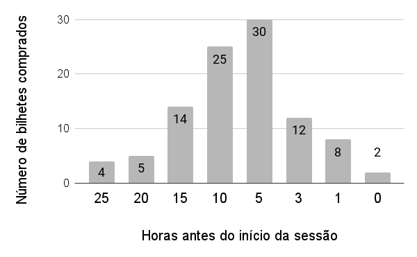
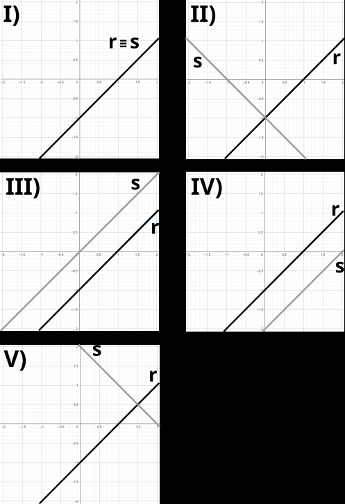
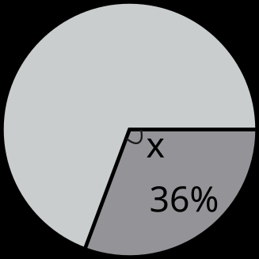

# PROVA — Camara_Americana_2024_Analista_de_Comunicacao

## 1. Análise geral da prova

- **Identificação:** Camara_Americana_2024_Analista_de_Comunicacao
- **Quantidade total de questões:** 50
- **Quantidade de textos de apoio (grupos):** 1
- **Quantidade de imagens:** 3
- **Quantidade de gráficos e tabelas:** incluídos nas imagens e no texto extraído, quando presentes no PDF original
- **Quantidade de grupos identificados:** 1
- **Quantidade de questões independentes:** 43
- **Questões que compartilham materiais:** texto-base das questões 01 a 07 → questões 01, 02, 03, 04, 05, 06, 07

### Transcrição integral da capa/instruções (conforme extraída do PDF)

> [!NOTE]
> Conteúdo integral das páginas anteriores à primeira questão, sem cortes.

> ANALISTA DE COMUNICAÇÃO
> Leia atentamente as instruções abaixo
>
>
>
> CADERNO DE QUESTÕES
> 1. PROVA E FOLHA DE RESPOSTAS
>
> Além deste Caderno de Prova, contendo 50 (cinquenta)
> questões objetivas, você receberá do Fiscal de Sala:
>
>  01 (uma) Folha de Respostas destinada às respostas das
> questões objetivas. Confira se seus dados estão corretos.
>
> 2. TEMPO
>
>  03 (três) horas é o tempo disponível para realização da
> prova, já incluído o tempo para marcação da Folha de
> Respostas da prova objetiva;
>
>  01 (uma) hora após o início da prova é possível, retirar-
> se da sala levando o caderno de prova;
>
> 3. INFORMAÇÕES GERAIS
>
>  As questões objetivas têm 05 (cinco) alternativas de
> resposta (A, B, C, D, E) e somente uma delas está correta;
>
>  Verifique se seu caderno está completo, sem repetição
> de questões ou falhas. Caso contrário, informe
> imediatamente o Fiscal da Sala, para que sejam tomadas
> as devidas providências;
>
>  Confira seus dados pessoais na Folha de Respostas,
> especialmente nome, número de inscrição e documento
> de identidade e leia atentamente as instruções para
> preenchimento;
>
>  O preenchimento das respostas da prova objetiva é de
> sua responsabilidade e não será permitida a troca de
> Folha de Respostas em caso de erro de marcação pelo
> candidato;
>  Marque, na folha de respostas, com caneta de tinta azul
> ou preta, a letra correspondente à alternativa que você
> escolheu.
>
>  Reserve tempo suficiente para o preenchimento de suas
> respostas. Para fins de avaliação, serão levadas em
> consideração apenas as marcações realizadas na Folha de
> Respostas da prova objetiva, não sendo permitido anotar
> informações relativas às respostas em qualquer outro
> meio que não seja o caderno de prova;
>
>  Ao se retirar, entregue a Folha de Respostas preenchida
> e assinada ao Fiscal de Sala.
>
> SERÁ ELIMINADO do presente certame o candidato que:
>
> a) for surpreendido, durante as provas, em qualquer tipo
> de comunicação com outro candidato;
>
> b) portar ou usar, qualquer tipo de aparelho eletrônico
> (calculadoras,
> bips/pagers,
> câmeras
> fotográficas,
> filmadoras, telefones celulares, smartphones, tablets,
> relógios, walkmans, MP3 players, fones de ouvido,
> agendas eletrônicas, notebooks, palmtops ou qualquer
> outro tipo de computador portátil, receptores ou
> gravadores) seja na sala de prova, sanitários, pátios ou
> qualquer outra dependência do local de prova;
>
> c) se ausentar da sala em que se realizam as provas
> levando consigo o Caderno de Questões e/ou a Folha de
> Respostas;
>
> d) se recusar a entregar a Folha de Respostas, quando
> terminar o tempo estabelecido;
>
> e) não assinar a Lista de Presença e/ou a Folha de
> Respostas.
> PROVA OBJETIVA
> CÂMARA MUNICIPAL DE AMERICANA
> CONCURSO PÚBLICO
> 01/2024
>
>
>
>
>
>
> Câmara Municipal De Americana/SP– Concurso Público 01/2024 INSTITUTO AVANÇA SÃO PAULO
> ANALISTA DE COMUNICAÇÃO Página 2 de 12
> LÍNGUA PORTUGUESA
> TEXTO
> Leia o texto para responder às questões de 1 a
> 7.
> Máscara em mosaico e outros tesouros são
> encontrados em tumba de rei maia
> O auge da civilização maia ocorreu entre 250
> d.C. e 900 d.C. Apesar da grande importância
> histórica, existem poucos resquícios desse
> período devido ao saqueamento de sítios
> arqueológicos. Mas, recentemente, um trabalho
> da Universidade Tulane, nos EUA, conseguiu
> recuperar raros tesouros da época.
> Liderado pelo arqueólogo Francisco Estrada-
> Belli, o time de pesquisadores fez investigações
> no
> sítio
> de
> Chochkitam,
> localizado
> na
> Guatemala, em uma região próxima das
> fronteiras dos atuais países México e Belize. Em
> 2022, a equipe encontrou a tumba de um rei maia,
> datada em 1.700 anos.
> A descoberta foi possível graças à tecnologia
> LIDAR, que utilizou um avião para direcionar
> raios laser para o chão e, assim, fazer um
> mapeamento da área. “É como tirar raio-X do
> solo da floresta”, explica Estrada-Belli, em nota.
> “Isso revolucionou o nosso campo. Agora
> podemos ver aonde estamos indo, em vez de
> simplesmente fazer uma expedição na floresta
> esperando achar alguma coisa”, diz.
> A
> tumba
> contém
> oferendas
> funerárias
> consideradas extraordinárias. Há uma máscara de
> jade em mosaico, raras conchas de ostra e
> escritos em ossos humanos. Estima-se que as
> relíquias sejam de 350 d.C.
> A expectativa é que elas contribuam para a
> compreensão de elementos da cultura maia,
> como a religião e a linhagem real. As conchas,
> por exemplo, eram utilizadas pela realeza como
> joias e moedas, além de servirem para oferendas
> religiosas e de sacrifício. Os escritos em ossos
> humanos, por sua vez, foram feitos em pedaços
> de fêmur. Um deles retrata um homem que seria
> um rei — até então desconhecido — segurando
> uma máscara de jade similar à encontrada na
> tumba. Os pesquisadores suspeitam que os
> hieróglifos vistos no material possam identificar
> o pai e o avô do líder, conectando-o a outros
> estados maias, como Tikal e Teotihuacan.
> “Uma descoberta como essa é um pouco como
> ganhar na loteria, em termos de informação”,
> constata o arqueólogo Estrada-Belli. “Ela abre
> uma janela para um tempo obscuro sobre o qual
> temos pouquíssimos textos.”
>
> Revista
> Galileu.
> Disponível
> em:
> https://revistagalileu.globo.com/ciencia/arqueol
> ogia/noticia/2024/02/mascara-em-mosaico-e-
> outros-tesouros-sao-encontrados-em-tumba-de-
> rei-maia.ghtml

### Gabarito

| Questão | 01 | 02 | 03 | 04 | 05 |
|---|---|---|---|---|---|
| Resposta | D | B | A | C | A |

| Questão | 06 | 07 | 08 | 09 | 10 |
|---|---|---|---|---|---|
| Resposta | B | D | A | B | B |

| Questão | 11 | 12 | 13 | 14 | 15 |
|---|---|---|---|---|---|
| Resposta | A | E | A | B | B |

| Questão | 16 | 17 | 18 | 19 | 20 |
|---|---|---|---|---|---|
| Resposta | D | C | A | C | E |

| Questão | 21 | 22 | 23 | 24 | 25 |
|---|---|---|---|---|---|
| Resposta | A | D | E | A | E |

| Questão | 26 | 27 | 28 | 29 | 30 |
|---|---|---|---|---|---|
| Resposta | B | A | D | C | E |

| Questão | 31 | 32 | 33 | 34 | 35 |
|---|---|---|---|---|---|
| Resposta | B | A | E | D | A |

| Questão | 36 | 37 | 38 | 39 | 40 |
|---|---|---|---|---|---|
| Resposta | C | A | D | C | E |

| Questão | 41 | 42 | 43 | 44 | 45 |
|---|---|---|---|---|---|
| Resposta | D | A | E | A | E |

| Questão | 46 | 47 | 48 | 49 | 50 |
|---|---|---|---|---|---|
| Resposta | D | E | C | D | E |

## 2. Questões agrupadas

### GRUPO 01 — Texto-base compartilhado pelas questões 01 a 07

**Questões relacionadas:** 01, 02, 03, 04, 05, 06, 07.

#### QUESTÃO 01

✅ **Gabarito: D** (gabarito oficial pareado — cargo ANALISTA DE COMUNICAÇÃO)

**Material de apoio:**

Máscara em mosaico e outros tesouros são
encontrados em tumba de rei maia
O auge da civilização maia ocorreu entre 250
d.C. e 900 d.C. Apesar da grande importância
histórica, existem poucos resquícios desse
período devido ao saqueamento de sítios
arqueológicos. Mas, recentemente, um trabalho
da Universidade Tulane, nos EUA, conseguiu
recuperar raros tesouros da época.
Liderado pelo arqueólogo Francisco Estrada-
Belli, o time de pesquisadores fez investigações
no
sítio
de
Chochkitam,
localizado
na
Guatemala, em uma região próxima das
fronteiras dos atuais países México e Belize. Em
2022, a equipe encontrou a tumba de um rei maia,
datada em 1.700 anos.
A descoberta foi possível graças à tecnologia
LIDAR, que utilizou um avião para direcionar
raios laser para o chão e, assim, fazer um
mapeamento da área. “É como tirar raio-X do
solo da floresta”, explica Estrada-Belli, em nota.
“Isso revolucionou o nosso campo. Agora
podemos ver aonde estamos indo, em vez de
simplesmente fazer uma expedição na floresta
esperando achar alguma coisa”, diz.
A
tumba
contém
oferendas
funerárias
consideradas extraordinárias. Há uma máscara de
jade em mosaico, raras conchas de ostra e
escritos em ossos humanos. Estima-se que as
relíquias sejam de 350 d.C.
A expectativa é que elas contribuam para a
compreensão de elementos da cultura maia,
como a religião e a linhagem real. As conchas,
por exemplo, eram utilizadas pela realeza como
joias e moedas, além de servirem para oferendas
religiosas e de sacrifício. Os escritos em ossos
humanos, por sua vez, foram feitos em pedaços
de fêmur. Um deles retrata um homem que seria
um rei — até então desconhecido — segurando
uma máscara de jade similar à encontrada na
tumba. Os pesquisadores suspeitam que os
hieróglifos vistos no material possam identificar
o pai e o avô do líder, conectando-o a outros
estados maias, como Tikal e Teotihuacan.
“Uma descoberta como essa é um pouco como
ganhar na loteria, em termos de informação”,
constata o arqueólogo Estrada-Belli. “Ela abre
uma janela para um tempo obscuro sobre o qual
temos pouquíssimos textos.”

Revista
Galileu.
Disponível
em:
https://revistagalileu.globo.com/ciencia/arqueol
ogia/noticia/2024/02/mascara-em-mosaico-e-
outros-tesouros-sao-encontrados-em-tumba-de-
rei-maia.ghtml

**Enunciado:**

De acordo com o texto, todas as afirmações a
seguir são verdadeiras, exceto:

**Alternativas:**

A) os artefatos do auge da cultura maia são
escassos.
B) os hieróglifos gravados nos pedaços de fêmur
são evidências da linhagem real.
C) as conchas encontradas na tumba tinham
utilidades diversas na sociedade maia.
D) o mapeamento do local em que a tumba foi
encontrada foi feito por meio de máquinas de
raio-x.
E) o auge da civilização maia durou mais de
meio século.

**Referências visuais:**

Nenhuma.

---

#### QUESTÃO 02

✅ **Gabarito: B** (gabarito oficial pareado — cargo ANALISTA DE COMUNICAÇÃO)

**Material de apoio:**

Máscara em mosaico e outros tesouros são
encontrados em tumba de rei maia
O auge da civilização maia ocorreu entre 250
d.C. e 900 d.C. Apesar da grande importância
histórica, existem poucos resquícios desse
período devido ao saqueamento de sítios
arqueológicos. Mas, recentemente, um trabalho
da Universidade Tulane, nos EUA, conseguiu
recuperar raros tesouros da época.
Liderado pelo arqueólogo Francisco Estrada-
Belli, o time de pesquisadores fez investigações
no
sítio
de
Chochkitam,
localizado
na
Guatemala, em uma região próxima das
fronteiras dos atuais países México e Belize. Em
2022, a equipe encontrou a tumba de um rei maia,
datada em 1.700 anos.
A descoberta foi possível graças à tecnologia
LIDAR, que utilizou um avião para direcionar
raios laser para o chão e, assim, fazer um
mapeamento da área. “É como tirar raio-X do
solo da floresta”, explica Estrada-Belli, em nota.
“Isso revolucionou o nosso campo. Agora
podemos ver aonde estamos indo, em vez de
simplesmente fazer uma expedição na floresta
esperando achar alguma coisa”, diz.
A
tumba
contém
oferendas
funerárias
consideradas extraordinárias. Há uma máscara de
jade em mosaico, raras conchas de ostra e
escritos em ossos humanos. Estima-se que as
relíquias sejam de 350 d.C.
A expectativa é que elas contribuam para a
compreensão de elementos da cultura maia,
como a religião e a linhagem real. As conchas,
por exemplo, eram utilizadas pela realeza como
joias e moedas, além de servirem para oferendas
religiosas e de sacrifício. Os escritos em ossos
humanos, por sua vez, foram feitos em pedaços
de fêmur. Um deles retrata um homem que seria
um rei — até então desconhecido — segurando
uma máscara de jade similar à encontrada na
tumba. Os pesquisadores suspeitam que os
hieróglifos vistos no material possam identificar
o pai e o avô do líder, conectando-o a outros
estados maias, como Tikal e Teotihuacan.
“Uma descoberta como essa é um pouco como
ganhar na loteria, em termos de informação”,
constata o arqueólogo Estrada-Belli. “Ela abre
uma janela para um tempo obscuro sobre o qual
temos pouquíssimos textos.”

Revista
Galileu.
Disponível
em:
https://revistagalileu.globo.com/ciencia/arqueol
ogia/noticia/2024/02/mascara-em-mosaico-e-
outros-tesouros-sao-encontrados-em-tumba-de-
rei-maia.ghtml

**Enunciado:**

Segundo o texto, as relíquias encontradas na
tumba maia são consideradas extraordinárias
porque:

**Alternativas:**

A) apresentam um alto valor comercial e podem
trazer recursos financeiros para os pesquisadores.
B) podem contribuir para o entendimento de um
período sobre o qual não se tem muita
informação.
C) sugerem que os estados maias Chochkitam,
Tikal e Teotihuacan não tinham qualquer tipo de
ligação.
D) confirmam que o rei maia a que se referem
as oferendas tinha familiares no poder em outros
estados maias.
E) são escrituras em hieróglifos raros que
contam histórias que contrariam o que já se sabia
sobre Tikal e Teotihuacan.
Câmara Municipal De Americana/SP– Concurso Público 01/2024 INSTITUTO AVANÇA SÃO PAULO
ANALISTA DE COMUNICAÇÃO Página 3 de 12

**Referências visuais:**

Nenhuma.

---

#### QUESTÃO 03

✅ **Gabarito: A** (gabarito oficial pareado — cargo ANALISTA DE COMUNICAÇÃO)

**Material de apoio:**

Máscara em mosaico e outros tesouros são
encontrados em tumba de rei maia
O auge da civilização maia ocorreu entre 250
d.C. e 900 d.C. Apesar da grande importância
histórica, existem poucos resquícios desse
período devido ao saqueamento de sítios
arqueológicos. Mas, recentemente, um trabalho
da Universidade Tulane, nos EUA, conseguiu
recuperar raros tesouros da época.
Liderado pelo arqueólogo Francisco Estrada-
Belli, o time de pesquisadores fez investigações
no
sítio
de
Chochkitam,
localizado
na
Guatemala, em uma região próxima das
fronteiras dos atuais países México e Belize. Em
2022, a equipe encontrou a tumba de um rei maia,
datada em 1.700 anos.
A descoberta foi possível graças à tecnologia
LIDAR, que utilizou um avião para direcionar
raios laser para o chão e, assim, fazer um
mapeamento da área. “É como tirar raio-X do
solo da floresta”, explica Estrada-Belli, em nota.
“Isso revolucionou o nosso campo. Agora
podemos ver aonde estamos indo, em vez de
simplesmente fazer uma expedição na floresta
esperando achar alguma coisa”, diz.
A
tumba
contém
oferendas
funerárias
consideradas extraordinárias. Há uma máscara de
jade em mosaico, raras conchas de ostra e
escritos em ossos humanos. Estima-se que as
relíquias sejam de 350 d.C.
A expectativa é que elas contribuam para a
compreensão de elementos da cultura maia,
como a religião e a linhagem real. As conchas,
por exemplo, eram utilizadas pela realeza como
joias e moedas, além de servirem para oferendas
religiosas e de sacrifício. Os escritos em ossos
humanos, por sua vez, foram feitos em pedaços
de fêmur. Um deles retrata um homem que seria
um rei — até então desconhecido — segurando
uma máscara de jade similar à encontrada na
tumba. Os pesquisadores suspeitam que os
hieróglifos vistos no material possam identificar
o pai e o avô do líder, conectando-o a outros
estados maias, como Tikal e Teotihuacan.
“Uma descoberta como essa é um pouco como
ganhar na loteria, em termos de informação”,
constata o arqueólogo Estrada-Belli. “Ela abre
uma janela para um tempo obscuro sobre o qual
temos pouquíssimos textos.”

Revista
Galileu.
Disponível
em:
https://revistagalileu.globo.com/ciencia/arqueol
ogia/noticia/2024/02/mascara-em-mosaico-e-
outros-tesouros-sao-encontrados-em-tumba-de-
rei-maia.ghtml

**Enunciado:**

Considere o excerto: “Isso revolucionou o nosso
campo.” No contexto apresentado, o pronome
demonstrativo “isso” é utilizado como um
recurso de coesão referencial anafórico. O
referente ao qual remete tal pronome é:

**Alternativas:**

A) a tecnologia LIDAR.
B) a floresta.
C) a expedição na floresta.
D) o avião utilizado na expedição.
E) as relíquias encontradas.

**Referências visuais:**

Nenhuma.

---

#### QUESTÃO 04

✅ **Gabarito: C** (gabarito oficial pareado — cargo ANALISTA DE COMUNICAÇÃO)

**Material de apoio:**

Máscara em mosaico e outros tesouros são
encontrados em tumba de rei maia
O auge da civilização maia ocorreu entre 250
d.C. e 900 d.C. Apesar da grande importância
histórica, existem poucos resquícios desse
período devido ao saqueamento de sítios
arqueológicos. Mas, recentemente, um trabalho
da Universidade Tulane, nos EUA, conseguiu
recuperar raros tesouros da época.
Liderado pelo arqueólogo Francisco Estrada-
Belli, o time de pesquisadores fez investigações
no
sítio
de
Chochkitam,
localizado
na
Guatemala, em uma região próxima das
fronteiras dos atuais países México e Belize. Em
2022, a equipe encontrou a tumba de um rei maia,
datada em 1.700 anos.
A descoberta foi possível graças à tecnologia
LIDAR, que utilizou um avião para direcionar
raios laser para o chão e, assim, fazer um
mapeamento da área. “É como tirar raio-X do
solo da floresta”, explica Estrada-Belli, em nota.
“Isso revolucionou o nosso campo. Agora
podemos ver aonde estamos indo, em vez de
simplesmente fazer uma expedição na floresta
esperando achar alguma coisa”, diz.
A
tumba
contém
oferendas
funerárias
consideradas extraordinárias. Há uma máscara de
jade em mosaico, raras conchas de ostra e
escritos em ossos humanos. Estima-se que as
relíquias sejam de 350 d.C.
A expectativa é que elas contribuam para a
compreensão de elementos da cultura maia,
como a religião e a linhagem real. As conchas,
por exemplo, eram utilizadas pela realeza como
joias e moedas, além de servirem para oferendas
religiosas e de sacrifício. Os escritos em ossos
humanos, por sua vez, foram feitos em pedaços
de fêmur. Um deles retrata um homem que seria
um rei — até então desconhecido — segurando
uma máscara de jade similar à encontrada na
tumba. Os pesquisadores suspeitam que os
hieróglifos vistos no material possam identificar
o pai e o avô do líder, conectando-o a outros
estados maias, como Tikal e Teotihuacan.
“Uma descoberta como essa é um pouco como
ganhar na loteria, em termos de informação”,
constata o arqueólogo Estrada-Belli. “Ela abre
uma janela para um tempo obscuro sobre o qual
temos pouquíssimos textos.”

Revista
Galileu.
Disponível
em:
https://revistagalileu.globo.com/ciencia/arqueol
ogia/noticia/2024/02/mascara-em-mosaico-e-
outros-tesouros-sao-encontrados-em-tumba-de-
rei-maia.ghtml

**Enunciado:**

Considere os seguintes excertos, retirados do
texto:
I. Estima-se que as relíquias sejam de 350 d.C.
II. Os pesquisadores suspeitam que os hieróglifos
vistos no material possam identificar o pai e o
avô do líder, conectando-o a outros estados
maias, como Tikal e Teotihuacan.
As normas gramaticais que sugerem a colocação
pronominal enclítica nos casos apresentados são,
respectivamente:

**Alternativas:**

A) I. não se inicia período por pronome átono e
II. usa-se ênclise em verbos flexionados em
oração subordinada.
B) I. usa-se ênclise quando houver palavra
atrativa antes do verbo e II. usa-se ênclise em
orações subordinadas com verbos flexionados
em qualquer tempo e modo.
C) I. não se inicia período por pronome átono e
II. usa-se ênclise em orações reduzidas de
gerúndio não precedidas pela preposição em.
D) I. usa-se ênclise em orações imperativas
afirmativas e II. usa-se ênclise em orações
reduzidas de gerúndio, independentemente dos
demais elementos colocados.
E) I. usa-se ênclise em orações reduzidas de
infinitivo flexionado e II. usa-se ênclise em
orações reduzidas de gerúndio antecedidas pela
preposição em, mesmo que esta esteja implícita.
Considere o excerto a seguir para responder
às questões 5, 6 e 7:
“Uma descoberta como essa é um pouco como
ganhar na loteria, em termos de informação”,
constata o arqueólogo Estrada-Belli. “Ela abre
uma janela para um tempo obscuro sobre o qual
temos pouquíssimos textos.”

**Referências visuais:**

Nenhuma.

---

#### QUESTÃO 05

✅ **Gabarito: A** (gabarito oficial pareado — cargo ANALISTA DE COMUNICAÇÃO)

**Material de apoio:**

Máscara em mosaico e outros tesouros são
encontrados em tumba de rei maia
O auge da civilização maia ocorreu entre 250
d.C. e 900 d.C. Apesar da grande importância
histórica, existem poucos resquícios desse
período devido ao saqueamento de sítios
arqueológicos. Mas, recentemente, um trabalho
da Universidade Tulane, nos EUA, conseguiu
recuperar raros tesouros da época.
Liderado pelo arqueólogo Francisco Estrada-
Belli, o time de pesquisadores fez investigações
no
sítio
de
Chochkitam,
localizado
na
Guatemala, em uma região próxima das
fronteiras dos atuais países México e Belize. Em
2022, a equipe encontrou a tumba de um rei maia,
datada em 1.700 anos.
A descoberta foi possível graças à tecnologia
LIDAR, que utilizou um avião para direcionar
raios laser para o chão e, assim, fazer um
mapeamento da área. “É como tirar raio-X do
solo da floresta”, explica Estrada-Belli, em nota.
“Isso revolucionou o nosso campo. Agora
podemos ver aonde estamos indo, em vez de
simplesmente fazer uma expedição na floresta
esperando achar alguma coisa”, diz.
A
tumba
contém
oferendas
funerárias
consideradas extraordinárias. Há uma máscara de
jade em mosaico, raras conchas de ostra e
escritos em ossos humanos. Estima-se que as
relíquias sejam de 350 d.C.
A expectativa é que elas contribuam para a
compreensão de elementos da cultura maia,
como a religião e a linhagem real. As conchas,
por exemplo, eram utilizadas pela realeza como
joias e moedas, além de servirem para oferendas
religiosas e de sacrifício. Os escritos em ossos
humanos, por sua vez, foram feitos em pedaços
de fêmur. Um deles retrata um homem que seria
um rei — até então desconhecido — segurando
uma máscara de jade similar à encontrada na
tumba. Os pesquisadores suspeitam que os
hieróglifos vistos no material possam identificar
o pai e o avô do líder, conectando-o a outros
estados maias, como Tikal e Teotihuacan.
“Uma descoberta como essa é um pouco como
ganhar na loteria, em termos de informação”,
constata o arqueólogo Estrada-Belli. “Ela abre
uma janela para um tempo obscuro sobre o qual
temos pouquíssimos textos.”

Revista
Galileu.
Disponível
em:
https://revistagalileu.globo.com/ciencia/arqueol
ogia/noticia/2024/02/mascara-em-mosaico-e-
outros-tesouros-sao-encontrados-em-tumba-de-
rei-maia.ghtml

**Enunciado:**

No excerto apresentado, a regência verbal de
“abrir” é:

**Alternativas:**

A) transitiva direta.
B) transitiva indireta.
C) intransitiva.
D) transitiva direta e indireta.
E) pronominal.

**Referências visuais:**

Nenhuma.

---

#### QUESTÃO 06

✅ **Gabarito: B** (gabarito oficial pareado — cargo ANALISTA DE COMUNICAÇÃO)

**Material de apoio:**

Máscara em mosaico e outros tesouros são
encontrados em tumba de rei maia
O auge da civilização maia ocorreu entre 250
d.C. e 900 d.C. Apesar da grande importância
histórica, existem poucos resquícios desse
período devido ao saqueamento de sítios
arqueológicos. Mas, recentemente, um trabalho
da Universidade Tulane, nos EUA, conseguiu
recuperar raros tesouros da época.
Liderado pelo arqueólogo Francisco Estrada-
Belli, o time de pesquisadores fez investigações
no
sítio
de
Chochkitam,
localizado
na
Guatemala, em uma região próxima das
fronteiras dos atuais países México e Belize. Em
2022, a equipe encontrou a tumba de um rei maia,
datada em 1.700 anos.
A descoberta foi possível graças à tecnologia
LIDAR, que utilizou um avião para direcionar
raios laser para o chão e, assim, fazer um
mapeamento da área. “É como tirar raio-X do
solo da floresta”, explica Estrada-Belli, em nota.
“Isso revolucionou o nosso campo. Agora
podemos ver aonde estamos indo, em vez de
simplesmente fazer uma expedição na floresta
esperando achar alguma coisa”, diz.
A
tumba
contém
oferendas
funerárias
consideradas extraordinárias. Há uma máscara de
jade em mosaico, raras conchas de ostra e
escritos em ossos humanos. Estima-se que as
relíquias sejam de 350 d.C.
A expectativa é que elas contribuam para a
compreensão de elementos da cultura maia,
como a religião e a linhagem real. As conchas,
por exemplo, eram utilizadas pela realeza como
joias e moedas, além de servirem para oferendas
religiosas e de sacrifício. Os escritos em ossos
humanos, por sua vez, foram feitos em pedaços
de fêmur. Um deles retrata um homem que seria
um rei — até então desconhecido — segurando
uma máscara de jade similar à encontrada na
tumba. Os pesquisadores suspeitam que os
hieróglifos vistos no material possam identificar
o pai e o avô do líder, conectando-o a outros
estados maias, como Tikal e Teotihuacan.
“Uma descoberta como essa é um pouco como
ganhar na loteria, em termos de informação”,
constata o arqueólogo Estrada-Belli. “Ela abre
uma janela para um tempo obscuro sobre o qual
temos pouquíssimos textos.”

Revista
Galileu.
Disponível
em:
https://revistagalileu.globo.com/ciencia/arqueol
ogia/noticia/2024/02/mascara-em-mosaico-e-
outros-tesouros-sao-encontrados-em-tumba-de-
rei-maia.ghtml

**Enunciado:**

Em relação às categorias gramaticais, no
contexto em que ocorrem, as palavras “uma”,
“descoberta”, “obscuro” e “qual” classificam-se
respectivamente em:

**Alternativas:**

A) pronome indefinido, adjetivo, substantivo e
pronome relativo.
B) artigo indefinido, substantivo, adjetivo e
pronome relativo.
C) artigo indefinido, substantivo, adjetivo e
pronome interrogativo.
D) artigo indefinido, adjetivo, adjetivo e
pronome interrogativo.
E) pronome indefinido, substantivo, substantivo
e pronome relativo.

**Referências visuais:**

Nenhuma.

---

#### QUESTÃO 07

✅ **Gabarito: D** (gabarito oficial pareado — cargo ANALISTA DE COMUNICAÇÃO)

**Material de apoio:**

Máscara em mosaico e outros tesouros são
encontrados em tumba de rei maia
O auge da civilização maia ocorreu entre 250
d.C. e 900 d.C. Apesar da grande importância
histórica, existem poucos resquícios desse
período devido ao saqueamento de sítios
arqueológicos. Mas, recentemente, um trabalho
da Universidade Tulane, nos EUA, conseguiu
recuperar raros tesouros da época.
Liderado pelo arqueólogo Francisco Estrada-
Belli, o time de pesquisadores fez investigações
no
sítio
de
Chochkitam,
localizado
na
Guatemala, em uma região próxima das
fronteiras dos atuais países México e Belize. Em
2022, a equipe encontrou a tumba de um rei maia,
datada em 1.700 anos.
A descoberta foi possível graças à tecnologia
LIDAR, que utilizou um avião para direcionar
raios laser para o chão e, assim, fazer um
mapeamento da área. “É como tirar raio-X do
solo da floresta”, explica Estrada-Belli, em nota.
“Isso revolucionou o nosso campo. Agora
podemos ver aonde estamos indo, em vez de
simplesmente fazer uma expedição na floresta
esperando achar alguma coisa”, diz.
A
tumba
contém
oferendas
funerárias
consideradas extraordinárias. Há uma máscara de
jade em mosaico, raras conchas de ostra e
escritos em ossos humanos. Estima-se que as
relíquias sejam de 350 d.C.
A expectativa é que elas contribuam para a
compreensão de elementos da cultura maia,
como a religião e a linhagem real. As conchas,
por exemplo, eram utilizadas pela realeza como
joias e moedas, além de servirem para oferendas
religiosas e de sacrifício. Os escritos em ossos
humanos, por sua vez, foram feitos em pedaços
de fêmur. Um deles retrata um homem que seria
um rei — até então desconhecido — segurando
uma máscara de jade similar à encontrada na
tumba. Os pesquisadores suspeitam que os
hieróglifos vistos no material possam identificar
o pai e o avô do líder, conectando-o a outros
estados maias, como Tikal e Teotihuacan.
“Uma descoberta como essa é um pouco como
ganhar na loteria, em termos de informação”,
constata o arqueólogo Estrada-Belli. “Ela abre
uma janela para um tempo obscuro sobre o qual
temos pouquíssimos textos.”

Revista
Galileu.
Disponível
em:
https://revistagalileu.globo.com/ciencia/arqueol
ogia/noticia/2024/02/mascara-em-mosaico-e-
outros-tesouros-sao-encontrados-em-tumba-de-
rei-maia.ghtml

**Enunciado:**

O adjetivo “pouquíssimos”, que ocorre no
excerto apresentado, exprime sua qualidade no
grau:

**Alternativas:**

A) positivo.
B) comparativo.
C) superlativo relativo.
D) superlativo absoluto sintético.
E) superlativo absoluto analítico.
Câmara Municipal De Americana/SP– Concurso Público 01/2024 INSTITUTO AVANÇA SÃO PAULO
ANALISTA DE COMUNICAÇÃO Página 4 de 12

**Referências visuais:**

Nenhuma.

---

## 3. Questões independentes

#### QUESTÃO 08

✅ **Gabarito: A** (gabarito oficial pareado — cargo ANALISTA DE COMUNICAÇÃO)

**Enunciado:**

Analise as palavras a seguir quanto à tonicidade
e assinale a alternativa em que a palavra dada é
oxítona.

**Alternativas:**

A) hostil.
B) aeromoça.
C) espelho.
D) patente.
E) esperança.

**Referências visuais:**

Nenhuma.

---

#### QUESTÃO 09

✅ **Gabarito: B** (gabarito oficial pareado — cargo ANALISTA DE COMUNICAÇÃO)

**Enunciado:**

Analise as sentenças a seguir e assinale aquela
em que ocorre um verbo defectivo.

**Alternativas:**

A) Deste pico se vê toda a praia.
B) A prefeitura demoliu os prédios mais antigos
da cidade ontem à tarde.
C) Os
incêndios
florestais
criminosos
multiplicam-se nessa época do ano.
D) A exposição de fotos na biblioteca da
universidade está belíssima.
E) Ele imprimiu todas as suas fotos da viagem à
Flórida.

**Referências visuais:**

Nenhuma.

---

#### QUESTÃO 10

✅ **Gabarito: B** (gabarito oficial pareado — cargo ANALISTA DE COMUNICAÇÃO)

**Enunciado:**

Analise as sentenças a seguir e assinale a
alternativa em que as palavras apontadas
preenchem corretamente as lacunas.
I. O _______ da máquina de lavar ficou muito
caro.
II. Já reservamos os _______ para assistirmos à
peça teatral.
III. Finalmente, as crianças _______ a gritaria.

**Alternativas:**

A) I. concerto; II. assentos; III. cessaram.
B) I. conserto; II. assentos; III. cessaram.
C) I. conserto; II. acentos; III. cessaram.
D) I. concerto; II. assentos; III. sessaram.
E) I. conserto; II. acentos; III. sessaram.
MATEMÁTICA E RACIOCÍNIO LÓGICO

**Referências visuais:**

Nenhuma.

---

#### QUESTÃO 11

✅ **Gabarito: A** (gabarito oficial pareado — cargo ANALISTA DE COMUNICAÇÃO)

**Enunciado:**

A figura abaixo mostra a antecedência de compra
dos clientes para uma determinada sessão de
cinema:
A antecedência de compra é a diferença de tempo
entre o horário do início do filme e o horário da
compra do bilhete. Com base no gráfico, pode-se
dizer que a média de antecedência de compra, em
horas, é:

**Alternativas:**

A) 8,54.
B) 8,15.
C) 9,80.
D) 7,92.
E) 5,15.

**Referências visuais:**

Nenhuma.

---

#### QUESTÃO 12

✅ **Gabarito: E** (gabarito oficial pareado — cargo ANALISTA DE COMUNICAÇÃO)

**Enunciado:**

Um quadrado e um triângulo equilátero têm a
mesma área, qual a razão entre o perímetro deste
quadrado e o perímetro deste triângulo? Sabe-se
que a altura do triângulo equilátero é 𝑎√3
2 , onde
𝑎 é a medida do seu lado.

**Alternativas:**

A) 2 √3
.
B) 3 √3
.
C) 2 √3
4 .
D) 4 √3
4 .
E) 3 √3
.

Câmara Municipal De Americana/SP– Concurso Público 01/2024 INSTITUTO AVANÇA SÃO PAULO
ANALISTA DE COMUNICAÇÃO Página 5 de 12

**Referências visuais:**

Nenhuma.

---

#### QUESTÃO 13

✅ **Gabarito: A** (gabarito oficial pareado — cargo ANALISTA DE COMUNICAÇÃO)

**Enunciado:**

Observe o sistema de equações do primeiro grau
abaixo:
2𝑦= 2𝑥−2
−𝑦= −𝑥+ 1
Essas equações podem ser representadas por
retas r e s, respectivamente, num gráfico. Dentre
as correspondências abaixo, indique o gráfico ao
qual este sistema corresponde:

**Alternativas:**

A) I.
B) II.
C) III.
D) IV.
E) V.

**Referências visuais:**

Nenhuma.

---

#### QUESTÃO 14

✅ **Gabarito: B** (gabarito oficial pareado — cargo ANALISTA DE COMUNICAÇÃO)

**Enunciado:**

Um professor aplicou uma prova cuja nota final
deve estar entre zero e dez. Ao calcular as notas,
ele viu que a média da turma foi 3,0, e o
candidato com maior nota tirou 6,0. Ele resolveu
‘normalizar’ as notas e atribuiu a nota 10,0 ao
estudante com nota máxima anterior, e aumentou
a nota de todos os outros alunos na mesma
porcentagem que aumentou a do estudante com
nota máxima. Neste caso, quanto passou a ser a
média da turma?

**Alternativas:**

A) 5,5.
B) 5,0.
C) 7,0.
D) 6,5.
E) 6,0.

**Referências visuais:**

Nenhuma.

---

#### QUESTÃO 15

✅ **Gabarito: B** (gabarito oficial pareado — cargo ANALISTA DE COMUNICAÇÃO)

**Enunciado:**

Num gráfico de pizza, se quisermos representar
uma fração de 36%, conforme a figura abaixo:
Qual deve ser o ângulo X do setor circular?

**Alternativas:**

A) 224,0°.
B) 129,6°.
C) 136,4°.
D) 64,0°.
E) 112,9°.

Câmara Municipal De Americana/SP– Concurso Público 01/2024 INSTITUTO AVANÇA SÃO PAULO
ANALISTA DE COMUNICAÇÃO Página 6 de 12

**Referências visuais:**

Nenhuma.

---

#### QUESTÃO 16

✅ **Gabarito: D** (gabarito oficial pareado — cargo ANALISTA DE COMUNICAÇÃO)

**Enunciado:**

Numa obra de construção civil, há duas possíveis
formas de pagamento: 1) o cliente paga,
mensalmente, um valor proporcional ao que foi
executado na obra naquele mês. 2) o cliente paga,
mensalmente,
valores
fixos
igualmente
distribuídos no prazo da obra. Suponha que uma
determinada obra vai custar no total 12 milhões
de reais e tem prazo previsto de 15 meses. Porém,
no primeiro mês foi executado apenas 3% da
obra. Nesta situação, quanto o construtor
receberá a menos se a forma de pagamento for a
1) em relação à 2)?

**Alternativas:**

A) R$ 44.000,00.
B) R$ 80.000,00.
C) R$ 360.000,00.
D) R$ 440.000,00.
E) R$ 36.000,00.

**Referências visuais:**

Nenhuma.

---

#### QUESTÃO 17

✅ **Gabarito: C** (gabarito oficial pareado — cargo ANALISTA DE COMUNICAÇÃO)

**Enunciado:**

Observe a seguinte sequência lógica numérica:
6 , 7,
12 , 14,
18 , 21, ...
Indique a divisão do 8° pelo 7° elemento dessa
sequência:

**Alternativas:**

A) 28/24.
B) 24/28.
C) 672.
D) 52.
E) 52/24.

**Referências visuais:**

Nenhuma.

---

#### QUESTÃO 18

✅ **Gabarito: A** (gabarito oficial pareado — cargo ANALISTA DE COMUNICAÇÃO)

**Enunciado:**

Observe as seguintes afirmativas, que são dadas
como VERDADEIRAS:
• João foi à escola
• João não jogou bola
• João não foi ao parque

Com base nas afirmativas, indique a alternativa
que
também
apresenta
uma
afirmativa
necessariamente VERDADEIRA:

**Alternativas:**

A) Se João jogou bola, então João foi ao parque.
B) João jogou bola ou foi ao parque.
C) João não jogou bola e foi ao parque.
D) João foi à escola e jogou bola.
E) Se João foi à escola, então João jogou bola.

**Referências visuais:**

Nenhuma.

---

#### QUESTÃO 19

✅ **Gabarito: C** (gabarito oficial pareado — cargo ANALISTA DE COMUNICAÇÃO)

**Enunciado:**

Em 1994 o Cajueiro de Pirangi, que fica no
estado do Rio Grande do Norte, foi reconhecido
pelo Guiness Book como a maior árvore frutífera
do mundo. A árvore hoje tem cerca de 9000
metros quadrados de extensão e ainda cresce num
ritmo de 0,5 metro quadrado por ano. Se
quisermos expressar esse ritmo de crescimento
em centímetros quadrados por ano, qual será esse
valor?

**Alternativas:**

A) 50.
B) 500.
C) 5000.
D) 50.000.
E) 500.000.

**Referências visuais:**

Nenhuma.

---

#### QUESTÃO 20

✅ **Gabarito: E** (gabarito oficial pareado — cargo ANALISTA DE COMUNICAÇÃO)

**Enunciado:**

Um pacote de biscoitos indica que em 3 unidades
de biscoitos há 375 kcal. Supondo que a
quantidade recomendada de ingestão de calorias
para uma determinada pessoa é de 2000 kcal
diárias, se ela comer somente biscoitos no dia,
quantas unidades de biscoitos ela deveria comer
para atingir o limite recomendado?

**Alternativas:**

A) 5.
B) 6.
C) 8.
D) 12.
E) 16.
Câmara Municipal De Americana/SP– Concurso Público 01/2024 INSTITUTO AVANÇA SÃO PAULO
ANALISTA DE COMUNICAÇÃO Página 7 de 12
NOÇÕES DE INFORMÁTICA

**Referências visuais:**

Nenhuma.

---

#### QUESTÃO 21

✅ **Gabarito: A** (gabarito oficial pareado — cargo ANALISTA DE COMUNICAÇÃO)

**Enunciado:**

No MS-Word 2016, qual das seguintes
alternativas descreve corretamente o processo
para recuperar um documento que não foi salvo
antes do fechamento do aplicativo?

**Alternativas:**

A) Acessar o menu "Arquivo", selecionar
"Informações", depois "Gerenciar Documento" e
"Recuperar Documentos Não Salvos".
B) Reabrir o Word, que automaticamente
exibirá os documentos não salvos.
C) Usar a função "Pesquisar" do sistema
operacional para localizar o arquivo temporário
que corresponderá à versão mais recente editada.
D) Ir em "Opções" dentro do Word, selecionar
"Salvar" e acessar a pasta de auto recuperação
"Recuperar Documentos Não Salvos".
E) Clicar no botão "Desfazer" na barra de
ferramentas de acesso rápido após reabrir o
Word.

**Referências visuais:**

Nenhuma.

---

#### QUESTÃO 22

✅ **Gabarito: D** (gabarito oficial pareado — cargo ANALISTA DE COMUNICAÇÃO)

**Enunciado:**

Quando se deseja alterar a aparência do texto no
Microsoft Word 2016, pode-se modificar a fonte,
o tamanho, sublinhar e alinhar o texto através da
guia _______.

**Alternativas:**

A) Revisão
B) Inserir
C) Layout de Página
D) Página Inicial
E) Referências

**Referências visuais:**

Nenhuma.

---

#### QUESTÃO 23

✅ **Gabarito: E** (gabarito oficial pareado — cargo ANALISTA DE COMUNICAÇÃO)

**Enunciado:**

No Excel 2016, como uma fórmula deve ser
iniciada para realizar cálculos dentro de uma
célula?

**Alternativas:**

A) Com o sinal #
B) Com o sinal &
C) Com o sinal @
D) Com o sinal %
E) Com o sinal =

**Referências visuais:**

Nenhuma.

---

#### QUESTÃO 24

✅ **Gabarito: A** (gabarito oficial pareado — cargo ANALISTA DE COMUNICAÇÃO)

**Enunciado:**

No Microsoft Excel 2016, para realizar o cálculo
do total dos valores presentes em um
determinado conjunto de células, que no presente
caso compreende de A1 até A5, qual das funções
a seguir é apropriada?

**Alternativas:**

A) =SOMA(A1:A5)
B) =SUBTRAIR(A1:A5)
C) =MULTIPLICAR(A1:A5)
D) =DIVIDIR(A1:A5)
E) =MÉDIA(A1:A5)

**Referências visuais:**

Nenhuma.

---

#### QUESTÃO 25

✅ **Gabarito: E** (gabarito oficial pareado — cargo ANALISTA DE COMUNICAÇÃO)

**Enunciado:**

Em relação à criação e execução de macros no
MS-Excel 2016, qual afirmação é verdadeira?

**Alternativas:**

A) O Excel não permite a importação de macros
de outras planilhas, mas suporta a exportação
direta de macros para outros softwares de
planilha.
B) É impossível atribuir uma macro a um botão
na planilha para facilitar sua execução.
C) Macros são usadas para operações de
formatação e não podem automatizar cálculos ou
análise de dados.
D) Para executar uma macro, o usuário precisa
acessar sempre o Visual Basic for Applications
(VBA).
E) Macros permitem automatizar tarefas
repetitivas,
incluindo
cálculos
complexos,
através de scripts no VBA.
CONHECIMENTOS ESPECÍFICOS

**Referências visuais:**

Nenhuma.

---

#### QUESTÃO 26

✅ **Gabarito: B** (gabarito oficial pareado — cargo ANALISTA DE COMUNICAÇÃO)

**Enunciado:**

A comunicação apresenta em sua composição
elementos que se fazem necessários para que
ocorra o processo de transmissão e recebimento
de uma mensagem.

Quem envia a mensagem através da palavra oral
ou escrita, assume a posição de:

**Alternativas:**

A) Receptor.
B) Emissor.
C) Locatário.
D) Canal.
E) Atencioso.
Câmara Municipal De Americana/SP– Concurso Público 01/2024 INSTITUTO AVANÇA SÃO PAULO
ANALISTA DE COMUNICAÇÃO Página 8 de 12

**Referências visuais:**

Nenhuma.

---

#### QUESTÃO 27

✅ **Gabarito: A** (gabarito oficial pareado — cargo ANALISTA DE COMUNICAÇÃO)

**Enunciado:**

Podemos definir como sendo a reação ou
posicionamento do receptor, após avaliar o
comportamento ou mensagem transmitira pelo
emissor em comunicações:

**Alternativas:**

A) Feedback.
B) Ruído.
C) Coworking.
D) Officeless.
E) Benchmarking.

**Referências visuais:**

Nenhuma.

---

#### QUESTÃO 28

✅ **Gabarito: D** (gabarito oficial pareado — cargo ANALISTA DE COMUNICAÇÃO)

**Enunciado:**

Com relação às características da comunicação
pública, assinale a alternativa que apresenta uma
afirmação correta:

**Alternativas:**

A) A comunicação pública requer o uso de
meios únicos de comunicação e linguagem
incomum.
B) A comunicação pública deve promover a
desinformação para assuntos de interesse do
estado.
C) A comunicação pública deve suprimir a
diversidade do contexto comunicacional.
D) A comunicação do serviço público deve
produzir conteúdo adaptado e acessível para
todos da sociedade.
E) A comunicação pública, quando necessário,
deve se submeter a interesse de particulares.

**Referências visuais:**

Nenhuma.

---

#### QUESTÃO 29

✅ **Gabarito: C** (gabarito oficial pareado — cargo ANALISTA DE COMUNICAÇÃO)

**Enunciado:**

Assinale a alternativa que completa corretamente
a lacuna do texto abaixo, de acordo com os
princípios da comunicação pública:
A Comunicação Pública tem como pressuposto
que a verdade e ________ são responsabilidades
de todos os governos, comunicadores, dirigentes
e atores públicos.

**Alternativas:**

A) pessoalidade
B) consentimento
C) ética
D) estudo
E) abstenção

**Referências visuais:**

Nenhuma.

---

#### QUESTÃO 30

✅ **Gabarito: E** (gabarito oficial pareado — cargo ANALISTA DE COMUNICAÇÃO)

**Enunciado:**

Referente a comunicação pública, analisar as
afirmações a seguir:

I. A Ouvidoria da Prefeitura é o canal por meio
do qual o cidadão pode apresentar sugestões,
reclamações, solicitações, elogios e denúncias
sobre a prestação de serviços públicos.
II. Diversos órgãos públicos contam com mídias
oficiais.
III. Publicar notícias e informações sobre os
serviços públicos no site também é uma forma de
o governo se comunicar.

Está(ão) Correto(s):

**Alternativas:**

A) Somente o item I.
B) Somente o item II.
C) Somente o item III.
D) Somente os itens I e III.
E) Todos os itens.

**Referências visuais:**

Nenhuma.

---

#### QUESTÃO 31

✅ **Gabarito: B** (gabarito oficial pareado — cargo ANALISTA DE COMUNICAÇÃO)

**Enunciado:**

A comunicação pública precisa colaborar na
construção da cidadania e no desenvolvimento da
capacidade de ouvir e estar em sintonia com
cidadãs e cidadãos.

Uma das funções da Comunicação Pública é:

**Alternativas:**

A) Disponibilizar ao cidadão o seu prontuário,
de acordo com a legislação vigente e conforme
as normas da instituição.
B) Divulgar os serviços oferecidos pela
administração pública e a forma como as pessoas
podem acessá-los.
C) Fornecer assistência religiosa a todos que
solicitarem.
D) Fiscalizar o poder executivo durante o ano
eleitoral.
E) Fiscalizar as obras e serviço públicos
incessantemente.

**Referências visuais:**

Nenhuma.

---

#### QUESTÃO 32

✅ **Gabarito: A** (gabarito oficial pareado — cargo ANALISTA DE COMUNICAÇÃO)

**Enunciado:**

Consiste no serviço de apuração, coleção e
fornecimento de recortes de jornais e revistas
sobre determinado assunto, sobre as atividades
de uma empresa ou instituição:

**Alternativas:**

A) Clipping.
B) Copidesque.
C) Copyright.
D) Diagramação.
E) Codificação.
Câmara Municipal De Americana/SP– Concurso Público 01/2024 INSTITUTO AVANÇA SÃO PAULO
ANALISTA DE COMUNICAÇÃO Página 9 de 12

**Referências visuais:**

Nenhuma.

---

#### QUESTÃO 33

✅ **Gabarito: E** (gabarito oficial pareado — cargo ANALISTA DE COMUNICAÇÃO)

**Enunciado:**

Ao criador e redator de textos de propaganda é
atribuída a titulação de:

**Alternativas:**

A) Feature.
B) Flash.
C) Gaveta.
D) Lambe-lambe.
E) Copywriter.

**Referências visuais:**

Nenhuma.

---

#### QUESTÃO 34

✅ **Gabarito: D** (gabarito oficial pareado — cargo ANALISTA DE COMUNICAÇÃO)

**Enunciado:**

Tudo aquilo que é publicado, ou feito para ser
publicado, por um jornal, revista, radio jornal ou
telejornal, incluindo textos e ilustrações (visuais
ou sonoras), tanto o original de qualquer notícia,
artigo ou crônica, quanto a sua forma impressa
recebem, genericamente, o nome de:

**Alternativas:**

A) Lide.
B) Nota.
C) Edição.
D) Matéria.
E) Capa.

**Referências visuais:**

Nenhuma.

---

#### QUESTÃO 35

✅ **Gabarito: A** (gabarito oficial pareado — cargo ANALISTA DE COMUNICAÇÃO)

**Enunciado:**

É cada uma das divisões verticais, geralmente
padronizadas, de uma página de jornal, separadas
por fio de coluna ou canal.

**Alternativas:**

A) Coluna.
B) Estrofe.
C) Estribilho.
D) Parágrafo.
E) Jargão.

**Referências visuais:**

Nenhuma.

---

#### QUESTÃO 36

✅ **Gabarito: C** (gabarito oficial pareado — cargo ANALISTA DE COMUNICAÇÃO)

**Enunciado:**

Qual é o tipo de texto jornalístico criado de forma
livre e pessoal, a partir de fatos e acontecimentos
da atualidade, com teor literário, político,
esportivo, artístico e outros:

**Alternativas:**

A) Científico.
B) Verso.
C) Crônica.
D) Publicitário.
E) Lírico.

**Referências visuais:**

Nenhuma.

---

#### QUESTÃO 37

✅ **Gabarito: A** (gabarito oficial pareado — cargo ANALISTA DE COMUNICAÇÃO)

**Enunciado:**

Nos procedimentos licitatórios relacionados as
normas gerais para licitação e contratação pela
administração pública de serviços de publicidade
prestados por intermédio de agências de
propaganda, é correto afirmar que:

**Alternativas:**

A) Os documentos de habilitação serão
apresentados apenas pelos licitantes classificados
no julgamento final das propostas.
B) Devem ser fixados critérios subjetivos e
automáticos de identificação da proposta mais
vantajosa para a administração, no caso de
empate na soma de pontos das propostas
técnicas, nas licitações do tipo “melhor técnica”.
C) Na proposta técnica não será admitido plano
de comunicação publicitária, pertinente às
informações expressas no briefing.
D) As propostas de preços serão apresentadas
em 5 (cinco) invólucro e as propostas técnicas em
4 (quatro) invólucros distintos.
E) As propostas de preços serão apresentadas
em 10 (dez) invólucro e as propostas técnicas em
10 (dez) invólucros distintos.

**Referências visuais:**

Nenhuma.

---

#### QUESTÃO 38

✅ **Gabarito: D** (gabarito oficial pareado — cargo ANALISTA DE COMUNICAÇÃO)

**Enunciado:**

O órgão auxiliar do Congresso Nacional, que tem
como atribuição a realização de estudos,
pareceres, recomendações e outras solicitações
que lhe forem encaminhadas pelo Congresso
Nacional a respeito do monopólio ou oligopólio
dos meios de comunicação social é o(a):

**Alternativas:**

A) Sistema Único de Informação.
B) Agencia Brasileira de Inteligência.
C) Agência Central de Comunicação Social.
D) Conselho de Comunicação Social.
E) Conselho Auxiliar de Comunicação.

**Referências visuais:**

Nenhuma.

---

#### QUESTÃO 39

✅ **Gabarito: C** (gabarito oficial pareado — cargo ANALISTA DE COMUNICAÇÃO)

**Enunciado:**

A instituição que conhece o funcionamento da
mídia tem melhores condições de atendê-la com
eficiência.
Para
aprimorar
essa
relação,
recomenda-se a prática da contratação de uma
equipe especializada em:

**Alternativas:**

A) Mídia premium.
B) Mídia controlada.
C) Mídia training.
D) Mídia Fake.
E) Mídia Copy.
Câmara Municipal De Americana/SP– Concurso Público 01/2024 INSTITUTO AVANÇA SÃO PAULO
ANALISTA DE COMUNICAÇÃO Página 10 de 12

**Referências visuais:**

Nenhuma.

---

#### QUESTÃO 40

✅ **Gabarito: E** (gabarito oficial pareado — cargo ANALISTA DE COMUNICAÇÃO)

**Enunciado:**

Ao atender a imprensa em momentos de crise,
recomenda-se que o porta voz da instituição:

**Alternativas:**

A) Evite o contato direto com a imprensa para
não passar informações indevidas.
B) Utilize o máximo de palavras alarmistas e
negativistas no momento da transmissão de
informação.
C) Oculte informações relevantes sobre os fatos,
para preservar a sua própria imagem.
D) Faça afirmações que não condizem com a
verdade, para minimizar os fatos.
E) Faça um completo levantamento da situação,
preparando-se
com
dados,
números
e
informações atualizadas.

**Referências visuais:**

Nenhuma.

---

#### QUESTÃO 41

✅ **Gabarito: D** (gabarito oficial pareado — cargo ANALISTA DE COMUNICAÇÃO)

**Enunciado:**

Com relação ao gerenciamento de crises em
comunicação pública, analisar as afirmações a
seguir:

I. O responsável pela comunicação com a mídia
jamais deve fugir da imprensa.
II. É recomendado que o porta voz se antecipe à
própria iniciativa da imprensa em descobrir o que
ocorreu.
III. Fazer um levantamento superficial da
situação é uma das formas de evitar futuras
contradições e transmissão de informações
equivocadas para a imprensa.

Está(ão) Correto(s):

**Alternativas:**

A) Somente o item I.
B) Somente o item II.
C) Somente o item III.
D) Somente os itens I e II.
E) Todos os itens.

**Referências visuais:**

Nenhuma.

---

#### QUESTÃO 42

✅ **Gabarito: A** (gabarito oficial pareado — cargo ANALISTA DE COMUNICAÇÃO)

**Enunciado:**

A
profissão
de
Jornalista
compreende,
privativamente,
o
exercício
habitual
e
remunerado de quais das atividades relacionadas
a seguir:

**Alternativas:**

A) Ensino de técnicas de Jornalismo.
B) Ensino de técnicas de Português.
C) Investigações criminais.
D) Levantamento arqueólogos.
E) Produção de salas de reportagens.

**Referências visuais:**

Nenhuma.

---

#### QUESTÃO 43

✅ **Gabarito: E** (gabarito oficial pareado — cargo ANALISTA DE COMUNICAÇÃO)

**Enunciado:**

Com relação a classificação das funções
desempenhadas pelos jornalistas empregados,
podemos afirmar que o redator é responsável por:

**Alternativas:**

A) Criar ou executar desenhos artísticos ou
técnicos de caráter jornalístico
B) Planejar e executar a distribuição gráfica de
matérias, fotografias ou ilustrações de caráter
jornalístico, para fins de publicação.
C) Registrar cinematograficamente quaisquer
fatos ou assuntos de interesse jornalístico
D) Registrar fotograficamente quaisquer fatos
ou assuntos de interesse jornalítisco.
E) Além das incumbências de redação comum,
tem o encargo de redigir editoriais, crônicas ou
comentários.

**Referências visuais:**

Nenhuma.

---

#### QUESTÃO 44

✅ **Gabarito: A** (gabarito oficial pareado — cargo ANALISTA DE COMUNICAÇÃO)

**Enunciado:**

A atividade de organizar e conservar cultural e
tecnicamente o arquivo redatorial, procedendo à
pesquisa dos respectivos dados para a elaboração
de notícias, é atribuída ao:

**Alternativas:**

A) Arquivista-Pesquisador.
B) Repórter Fotográfico.
C) Diagramador.
D) Redator.
E) Revisor.

**Referências visuais:**

Nenhuma.

---

#### QUESTÃO 45

✅ **Gabarito: E** (gabarito oficial pareado — cargo ANALISTA DE COMUNICAÇÃO)

**Enunciado:**

Será passível de trancamento o registro
profissional do jornalista que, sem motivo legal,
deixar de exercer a profissão por mais:

**Alternativas:**

A) 3 meses.
B) 6 meses.
C) 9 meses.
D) 1 ano.
E) 2 anos.
Câmara Municipal De Americana/SP– Concurso Público 01/2024 INSTITUTO AVANÇA SÃO PAULO
ANALISTA DE COMUNICAÇÃO Página 11 de 12

**Referências visuais:**

Nenhuma.

---

#### QUESTÃO 46

✅ **Gabarito: D** (gabarito oficial pareado — cargo ANALISTA DE COMUNICAÇÃO)

**Enunciado:**

Em relação aos fundamentos de fotojornalismo,
analisar as afirmações a seguir:
I. Para uma boa composição fotográfica, o tema
principal deve estar claramente definido e bem
destacado do seu fundo.
II. É fundamental olhar os quatro cantos do visor
e eliminar ao máximo aquilo que não interessa
para a foto.
III. A luz não é um dos aspectos a serem
observados na composição da fotografia.
Está(ão) Correto(s):

**Alternativas:**

A) Somente o item I.
B) Somente o item II.
C) Somente o item III.
D) Somente os itens I e II.
E) Todos os itens.

**Referências visuais:**

Nenhuma.

---

#### QUESTÃO 47

✅ **Gabarito: E** (gabarito oficial pareado — cargo ANALISTA DE COMUNICAÇÃO)

**Enunciado:**

O fotojornalismo diário, interage com diversos
meios de informação, tais como jornais, revistas,
redes ou sites de notícias. Por sua vez, o tipo de
trabalho que exige mais do fotógrafo, visto que,
nessa ramificação foto jornalística é necessário
não só cobrir um acontecimento, mas conhecer a
história e vivenciá-la e também é preciso contá-
la não com apenas uma foto, mas com uma série
delas é o fotojornalismo:

**Alternativas:**

A) Estrutural.
B) Enigmático.
C) Informal.
D) Locacional.
E) Documental.

**Referências visuais:**

Nenhuma.

---

#### QUESTÃO 48

✅ **Gabarito: C** (gabarito oficial pareado — cargo ANALISTA DE COMUNICAÇÃO)

**Enunciado:**

Não comparecendo o Presidente da República,
qual dos agentes a seguir, presidirá a cerimônia a
que estiverem todos presentes:

**Alternativas:**

A) Agente de Comunicação Interna.
B) Agente de Controle de Informações.
C) Vice-Presidente da República.
D) Advogado Geral da União.
E) Secretário-Geral da União.

**Referências visuais:**

Nenhuma.

---

#### QUESTÃO 49

✅ **Gabarito: D** (gabarito oficial pareado — cargo ANALISTA DE COMUNICAÇÃO)

**Enunciado:**

De
acordo
com
o
Decreto
Federal
nº
70.274/1972, assinale a alternativa que apresenta
uma afirmação correta:

**Alternativas:**

A) Hasteia-se com frequência semanal a
Bandeira Nacional no Palácio da Presidência da
República
B) Hasteia-se com frequência semanal a
Bandeira Nacional No Supremo Tribunal
Federal.
C) A Bandeira Nacional, quando não estiver em
uso, deve ser guardada em local ignóbil.
D) Quando várias bandeiras são hasteadas ou
arriadas simultaneamente, a Bandeira Nacional é
a primeira a atingir o tope e a última a dele
descer.
E) A Bandeira Nacional não deve ser destacada
à frente de outras bandeiras, quando conduzida
em formaturas ou desfiles.

**Referências visuais:**

Nenhuma.

---

#### QUESTÃO 50

✅ **Gabarito: E** (gabarito oficial pareado — cargo ANALISTA DE COMUNICAÇÃO)

**Enunciado:**

Em consonância com o Decreto Federal nº
70.274/1972, assinale a alternativa que completa
corretamente a lacuna do texto a seguir:
No respectivo Estado, o Governador, o Vice-
Governador,
o
Presidente da
Assembleia
Legislativa e o __________________ terão,
nessa ordem, precedência sobre as autoridades
federais.

**Alternativas:**

A) Presidente do Ministério de Comunicações.
B) Presidente da Ouvidoria Interna.
C) Presidente do Tribunal de Contas.
D) Presidente da Câmara Legislativa.
E) Presidente do Tribunal de Justiça.
Câmara Municipal De Americana/SP– Concurso Público 01/2024 INSTITUTO AVANÇA SÃO PAULO
ANALISTA DE COMUNICAÇÃO Página 12 de 12

**Referências visuais:**

Nenhuma.

---

## 4. Observações e limitações da extração

- Extração automática (texto selecionável do PDF via PyMuPDF), sem OCR: PDFs escaneados podem perder texto.
- Imagens repetidas (logos/marcas d'água) foram descartadas; as imagens de conteúdo foram salvas em `imagens/` com nomenclatura `imagem_00N`.
- A detecção de grupos usa os avisos padrão das bancas ("o texto seguinte servirá de base..."). Bancas sem esse aviso podem ter grupos não identificados — o conteúdo, porém, permanece integral.
- Se houver divergência entre esta versão e o PDF original, vale o PDF original; corrija manualmente o Markdown.
