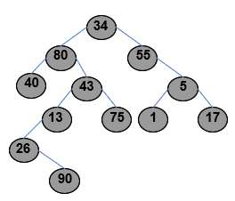
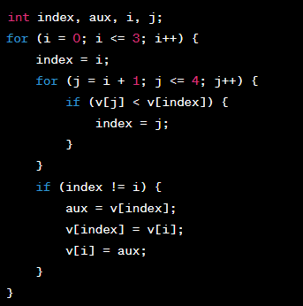
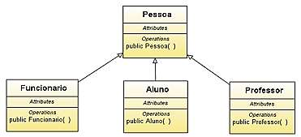
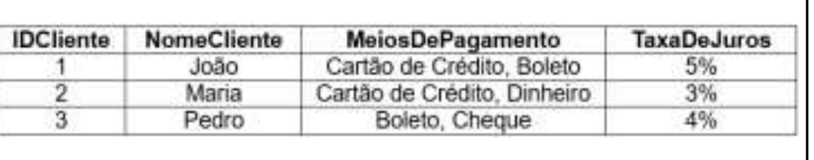
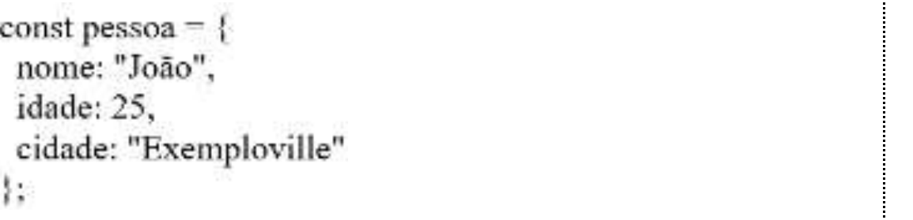
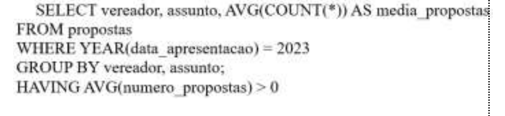
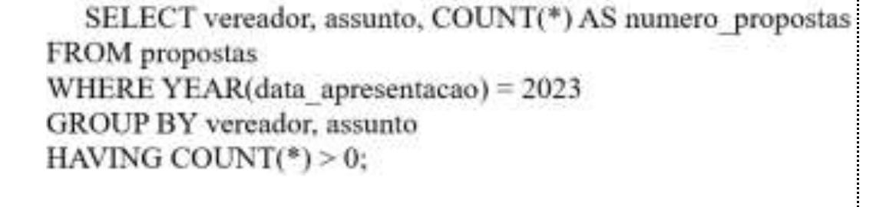
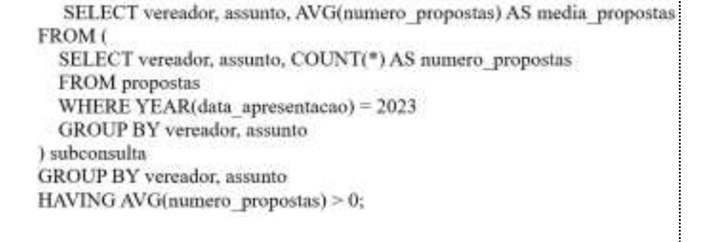
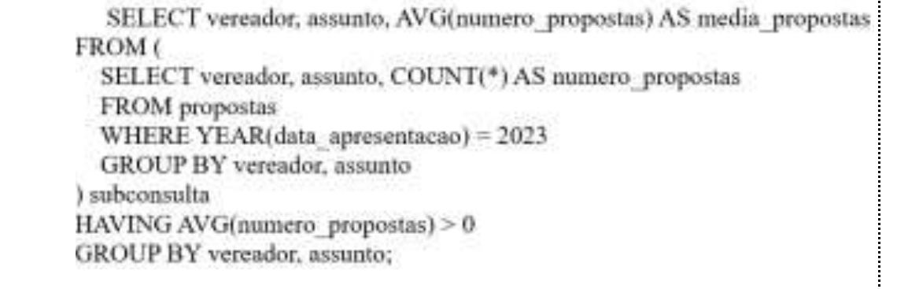

# PROVA — CÂMARA MUNICIPAL DE ANÁPOLIS – GO — CONCURSO PÚBLICO 2024 — ANALISTA ADMINISTRATIVO (ANALISTA DE SISTEMAS)

## 1. Análise geral da prova

**Identificação da prova:**

- **Concurso:** Concurso Público para provimento dos cargos efetivos da Câmara Municipal de Anápolis – GO
- **Cargo:** Analista Administrativo – Analista de Sistemas (Superior)
- **Data da prova:** 28/01/2024
- **Banca:** Instituto Verbena (provas no formato IV/UFG)
- **Estrutura:** 60 questões objetivas (A–D) + 1 questão discursiva (Prova Discursiva, Questão 01)
- **Distribuição:** Língua Portuguesa 01–10; Raciocínio Lógico e Matemático 11–20; Atualidades e História, Geografia e Conhecimentos Gerais de Goiás e de Anápolis 21–30; Legislação 31–40; Conhecimentos Específicos do Cargo 41–60; Prova Discursiva

**Composição quantitativa:**

| Item | Quantidade |
|---|---|
| Total de questões objetivas | 60 |
| Questão discursiva (Prova Discursiva, Questão 01) | 1 |
| Textos de apoio compartilhados (grupos) | 3 (Texto 1: Q02–04; Texto 2: Q05–06; Texto 3: Q07–09) |
| Imagens de conteúdo | 11 |
| Gráficos e tabelas | 1 tabela transcrita (Q17) e 1 tabela-imagem (Q55), incluídas no texto e nas imagens |
| Grupos identificados | 3 |
| Questões independentes | 51 objetivas + 1 discursiva |

**Composição por bloco:**

| Bloco | Questões | Quantidade |
|---|---|---|
| Língua Portuguesa | 01–10 | 10 |
| Raciocínio Lógico e Matemático | 11–20 | 10 |
| Atualidades e História, Geografia e Conhecimentos Gerais de Goiás e de Anápolis | 21–30 | 10 |
| Legislação | 31–40 | 10 |
| Conhecimentos Específicos do Cargo | 41–60 | 20 |
| Prova Discursiva | — | 1 |

**Observações sobre a estrutura original:**

- As alternativas originais usam o formato “(A)”; na organização foram normalizadas para “A)”, sem alteração de conteúdo.
- A tirinha da questão 01 está dividida em duas imagens no PDF original (imagem_001 e imagem_002), reproduzidas na ordem.
- A tabela da questão 17 foi transcrita integralmente do PDF original (tabela vetorial, não é imagem).

> **Transcrição integral da capa e das instruções (conforme extraída do PDF):**
> 
> > DISCIPLINA
> > QUESTÕES
> > Língua Portuguesa
> > 01 a 10
> > Raciocínio Lógico e Matemático
> > 11 a 20
> > Conhecimentos Gerais de Goiás e de
> > Anápolis
> > 21 a 30
> > Legislação
> > 31 a 40
> > Conhecimentos Específicos do Cargo
> > 41 a 60
> > Prova Discursiva
> > -
> > 1. Quando for autorizado abrir o caderno de questões, verifique se ele está completo ou se apresenta
> > imperfeições gráficas que possam gerar dúvidas. Se isso ocorrer, solicite outro exemplar ao(à) fiscal de
> > sala.
> > 2. Este caderno é composto por questões de múltipla escolha. Cada questão apresenta quatro
> > alternativas de respostas, das quais apenas uma é a correta.
> > 3. O cartão-resposta é personalizado e não será substituído em caso de erro no preenchimento. Ao
> > recebê-lo, confira se seus dados estão impressos corretamente. Se houver erro de impressão, notifique
> > o(a) fiscal de sala.
> > 4. Preencha, integralmente, um alvéolo por questão, utilizando caneta de tinta AZUL ou PRETA,
> > fabricada em material transparente. A questão deixada em branco, com rasura ou com marcação dupla
> > terá pontuação ZERO.
> > ANALISTA
> > ADMINISTRATIVO –
> > ANALISTA DE SISTEMAS
> > Atenção: Transcreva no espaço designado da sua FICHA DE IDENTIFICAÇÃO, com
> > sua caligrafia usual, considerando as letras maiúsculas e minúsculas, a seguinte frase:
> > Corações puros não se corrompem.
> > 28/01/2024
> > CADERNO DE QUESTÕES
> > SOMENTE ABRA ESTE CADERNO QUANDO AUTORIZADO
> > LEIA ATENTAMENTE AS INSTRUÇÕES
> > Concurso Público para provimento dos cargos efetivos da Câmara Municipal de Anápolis – GO

**Gabarito oficial — tabela "Gabarito oficial preliminar — Instituto Verbena (29/01/2024), cargo Analista Administrativo – Analista de Sistemas":**

| Questão | Resposta | Questão | Resposta | Questão | Resposta | Questão | Resposta | Questão | Resposta |
|---|---|---|---|---|---|---|---|---|---|
| 01 | **C** | 02 | **D** | 03 | **D** | 04 | **B** | 05 | **A** |
| 06 | **C** | 07 | **B** | 08 | **A** | 09 | **B** | 10 | **C** |
| 11 | **A** | 12 | **C** | 13 | **D** | 14 | **B** | 15 | **B** |
| 16 | **A** | 17 | **C** | 18 | **D** | 19 | **A** | 20 | **B** |
| 21 | **C** | 22 | **D** | 23 | **A** | 24 | **B** | 25 | **D** |
| 26 | **B** | 27 | **D** | 28 | **A** | 29 | **B** | 30 | **C** |
| 31 | **A** | 32 | **C** | 33 | **B** | 34 | **C** | 35 | **B** |
| 36 | **D** | 37 | **A** | 38 | **B** | 39 | **C** | 40 | **D** |
| 41 | **C** | 42 | **A** | 43 | **D** | 44 | **B** | 45 | **B** |
| 46 | **D** | 47 | **D** | 48 | **A** | 49 | **C** | 50 | **C** |
| 51 | **B** | 52 | **A** | 53 | **B** | 54 | **D** | 55 | **A** |
| 56 | **A** | 57 | **C** | 58 | **B** | 59 | **C** | 60 | **D** |

> 📌 Fonte: Gabarito oficial preliminar — Instituto Verbena (29/01/2024), cargo Analista Administrativo – Analista de Sistemas

---

## 2. Questões agrupadas

### GRUPO 01 — Texto-base compartilhado pelas questões 02 a 04 (Texto 1)

**Questões relacionadas:** 02, 03, 04.

**Material de apoio compartilhado:**

> A reinvenção da vírgula
> 
> No começo de 1902, Machado de Assis ficou
> desesperado por causa de um erro de revisão no prefácio
> da segunda edição de suas Poesias completas. Dizem que
> chegou a se ajoelhar aos pés do Garnier implorando para
> que o editor tirasse o livro de circulação. O aristocrático e
> impoluto Machado, quem diria. Mas a gralha era mesmo
> feia. O tipógrafo trocou o “e” por “a” na palavra “cegara”, o
> revisor deixou passar, e vocês imaginam no que deu.
> No nosso caso, o erro não foi nada de mais, nem
> erro foi, para falar a verdade, apenas um acréscimo besta
> de pontuação, talvez dispensável, ainda que de modo
> algum incorreto. Vai o revisor, fiel à ortodoxia da gramática
> normativa, e espeta duas vírgulas para isolar um adjunto
> adverbial deslocado, coisa de pouca monta, diria alguém,
> mas suficiente para o autor sair bradando aos quatro
> ventos que lhe roubaram o ritmo da sentença. Um editor
> experiente traria um cafezinho bem doce, a conter o ímpeto
> dramático do autor de primeira viagem, talvez caçoando,
> “deixa de onda”, a lembrá-lo – valha-me Deus! – que ele
> não é nenhum Bruxo do Cosme Velho*. E assim
> lhe cortando as asas antes do voo.
> *Referência à Machado de Assis. Disponível em
> <https://jornal.usp.br/artigos/a_reinvencao_da_virgula/>. Acesso em: 13
> dez. 2023. [Adaptado].

---

#### QUESTÃO 02

✅ **Gabarito: D** (gabarito oficial preliminar — Instituto Verbena/UFG, bloco “Analista Administrativo – Analista de Sistemas” (página 2 do PDF de gabarito))

**Material de apoio:**

> Leia o Texto 1 para responder às questões de 02 a 04.
> 
> **Texto 1**
> 
> A reinvenção da vírgula
> 
> No começo de 1902, Machado de Assis ficou
> desesperado por causa de um erro de revisão no prefácio
> da segunda edição de suas Poesias completas. Dizem que
> chegou a se ajoelhar aos pés do Garnier implorando para
> que o editor tirasse o livro de circulação. O aristocrático e
> impoluto Machado, quem diria. Mas a gralha era mesmo
> feia. O tipógrafo trocou o “e” por “a” na palavra “cegara”, o
> revisor deixou passar, e vocês imaginam no que deu.
> No nosso caso, o erro não foi nada de mais, nem
> erro foi, para falar a verdade, apenas um acréscimo besta
> de pontuação, talvez dispensável, ainda que de modo
> algum incorreto. Vai o revisor, fiel à ortodoxia da gramática
> normativa, e espeta duas vírgulas para isolar um adjunto
> adverbial deslocado, coisa de pouca monta, diria alguém,
> mas suficiente para o autor sair bradando aos quatro
> ventos que lhe roubaram o ritmo da sentença. Um editor
> experiente traria um cafezinho bem doce, a conter o ímpeto
> dramático do autor de primeira viagem, talvez caçoando,
> “deixa de onda”, a lembrá-lo – valha-me Deus! – que ele
> não é nenhum Bruxo do Cosme Velho*. E assim
> lhe cortando as asas antes do voo.
> *Referência à Machado de Assis. Disponível em
> <https://jornal.usp.br/artigos/a_reinvencao_da_virgula/>. Acesso em: 13
> dez. 2023. [Adaptado].

**Enunciado:**

No trecho “Vai o revisor, fiel à ortodoxia da gramática
normativa, e espeta duas vírgulas para isolar um adjunto
adverbial deslocado”, o emprego da palavra destacada
atribui sentido

**Alternativas:**

A) crítico ao trecho, sugerindo que as orientações da norma-padrão sobre o emprego de vírgulas é algo confuso.

B) elogioso ao trecho, explicitando que o autor do texto revisado ficou agradecido a quem colocou as vírgulas.

C) humorístico ao trecho, indicando que o texto de que faz parte concretiza o gênero textual anedota.

D) irônico ao trecho, mostrando que a colocação das vírgulas foi algo desagradável para o autor do texto revisado.

**Referências visuais:**

Nenhuma.

---

#### QUESTÃO 03

✅ **Gabarito: D** (gabarito oficial preliminar — Instituto Verbena/UFG, bloco “Analista Administrativo – Analista de Sistemas” (página 2 do PDF de gabarito))

**Material de apoio:**

> Leia o Texto 1 para responder às questões de 02 a 04.
> 
> **Texto 1**
> 
> A reinvenção da vírgula
> 
> No começo de 1902, Machado de Assis ficou
> desesperado por causa de um erro de revisão no prefácio
> da segunda edição de suas Poesias completas. Dizem que
> chegou a se ajoelhar aos pés do Garnier implorando para
> que o editor tirasse o livro de circulação. O aristocrático e
> impoluto Machado, quem diria. Mas a gralha era mesmo
> feia. O tipógrafo trocou o “e” por “a” na palavra “cegara”, o
> revisor deixou passar, e vocês imaginam no que deu.
> No nosso caso, o erro não foi nada de mais, nem
> erro foi, para falar a verdade, apenas um acréscimo besta
> de pontuação, talvez dispensável, ainda que de modo
> algum incorreto. Vai o revisor, fiel à ortodoxia da gramática
> normativa, e espeta duas vírgulas para isolar um adjunto
> adverbial deslocado, coisa de pouca monta, diria alguém,
> mas suficiente para o autor sair bradando aos quatro
> ventos que lhe roubaram o ritmo da sentença. Um editor
> experiente traria um cafezinho bem doce, a conter o ímpeto
> dramático do autor de primeira viagem, talvez caçoando,
> “deixa de onda”, a lembrá-lo – valha-me Deus! – que ele
> não é nenhum Bruxo do Cosme Velho*. E assim
> lhe cortando as asas antes do voo.
> *Referência à Machado de Assis. Disponível em
> <https://jornal.usp.br/artigos/a_reinvencao_da_virgula/>. Acesso em: 13
> dez. 2023. [Adaptado].

**Enunciado:**

No primeiro período do texto, a vírgula é utilizada com a
finalidade de

**Alternativas:**

A) deixar implícita uma forma verbal.

B) indicar um trecho explicativo.

C) isolar um aposto temporal.

D) isolar um adjunto adverbial.

**Referências visuais:**

Nenhuma.

---

#### QUESTÃO 04

✅ **Gabarito: B** (gabarito oficial preliminar — Instituto Verbena/UFG, bloco “Analista Administrativo – Analista de Sistemas” (página 2 do PDF de gabarito))

**Material de apoio:**

> Leia o Texto 1 para responder às questões de 02 a 04.
> 
> **Texto 1**
> 
> A reinvenção da vírgula
> 
> No começo de 1902, Machado de Assis ficou
> desesperado por causa de um erro de revisão no prefácio
> da segunda edição de suas Poesias completas. Dizem que
> chegou a se ajoelhar aos pés do Garnier implorando para
> que o editor tirasse o livro de circulação. O aristocrático e
> impoluto Machado, quem diria. Mas a gralha era mesmo
> feia. O tipógrafo trocou o “e” por “a” na palavra “cegara”, o
> revisor deixou passar, e vocês imaginam no que deu.
> No nosso caso, o erro não foi nada de mais, nem
> erro foi, para falar a verdade, apenas um acréscimo besta
> de pontuação, talvez dispensável, ainda que de modo
> algum incorreto. Vai o revisor, fiel à ortodoxia da gramática
> normativa, e espeta duas vírgulas para isolar um adjunto
> adverbial deslocado, coisa de pouca monta, diria alguém,
> mas suficiente para o autor sair bradando aos quatro
> ventos que lhe roubaram o ritmo da sentença. Um editor
> experiente traria um cafezinho bem doce, a conter o ímpeto
> dramático do autor de primeira viagem, talvez caçoando,
> “deixa de onda”, a lembrá-lo – valha-me Deus! – que ele
> não é nenhum Bruxo do Cosme Velho*. E assim
> lhe cortando as asas antes do voo.
> *Referência à Machado de Assis. Disponível em
> <https://jornal.usp.br/artigos/a_reinvencao_da_virgula/>. Acesso em: 13
> dez. 2023. [Adaptado].

**Enunciado:**

No texto, o enunciador utiliza a expressão “Bruxo do Cosme
Velho” como uma referência à Machado de Assis. Esse
recurso de coesão textual, que consiste no emprego de uma
palavra ou expressão para qualificar um referente, é
denominado

**Alternativas:**

A) elipse.

B) epíteto.

C) nominalização.

D) sequenciação.

**Referências visuais:**

Nenhuma.

---

### GRUPO 02 — Texto-base compartilhado pelas questões 05 a 06 (Texto 2)

**Questões relacionadas:** 05, 06.

**Material de apoio compartilhado:**

> A ciência e a tecnologia como estratégia de
> desenvolvimento
> 
> Apesar dos seus feitos extraordinários, a ciência
> enfrenta uma crise de legitimação social no mundo todo.
> Existe uma descrença do cidadão comum no conhecimento
> técnico e científico e, mais do que isso, um certo orgulho
> da própria ignorância sobre vários temas complexos.
> Vários fenômenos sociais recentes, como o movimento
> antivacinação
> ou
> mesmo
> a
> desconfiança
> sobre
> o
> aquecimento global, apesar de todas as evidências
> científicas em contrário, são exemplos dessa descrença.
> IPEA, Centro de Pesquisa em Ciência, Tecnologia e Sociedade. A
> ciência e a tecnologia como estratégia de desenvolvimento. Disponível
> em: <www.ipea.gov.br>. Acesso em: 01 dez. 2023. [Adaptado].

---

#### QUESTÃO 05

✅ **Gabarito: A** (gabarito oficial preliminar — Instituto Verbena/UFG, bloco “Analista Administrativo – Analista de Sistemas” (página 2 do PDF de gabarito))

**Material de apoio:**

> Leia o Texto 2 para responder às questões 05 e 06.
> 
> **Texto 2**
> 
> A ciência e a tecnologia como estratégia de
> desenvolvimento
> 
> Apesar dos seus feitos extraordinários, a ciência
> enfrenta uma crise de legitimação social no mundo todo.
> Existe uma descrença do cidadão comum no conhecimento
> técnico e científico e, mais do que isso, um certo orgulho
> da própria ignorância sobre vários temas complexos.
> Vários fenômenos sociais recentes, como o movimento
> antivacinação
> ou
> mesmo
> a
> desconfiança
> sobre
> o
> aquecimento global, apesar de todas as evidências
> científicas em contrário, são exemplos dessa descrença.
> IPEA, Centro de Pesquisa em Ciência, Tecnologia e Sociedade. A
> ciência e a tecnologia como estratégia de desenvolvimento. Disponível
> em: <www.ipea.gov.br>. Acesso em: 01 dez. 2023. [Adaptado].

**Enunciado:**

Embora não haja conectivos que evidenciem uma relação
sintática entre os dois primeiros períodos do texto, é
possível identificar que o segundo período estabelece com
o primeiro uma relação semântica de

**Alternativas:**

A) causalidade.

B) concessão.

C) condição.

D) contradição.

**Referências visuais:**

Nenhuma.

---

#### QUESTÃO 06

✅ **Gabarito: C** (gabarito oficial preliminar — Instituto Verbena/UFG, bloco “Analista Administrativo – Analista de Sistemas” (página 2 do PDF de gabarito))

**Material de apoio:**

> Leia o Texto 2 para responder às questões 05 e 06.
> 
> **Texto 2**
> 
> A ciência e a tecnologia como estratégia de
> desenvolvimento
> 
> Apesar dos seus feitos extraordinários, a ciência
> enfrenta uma crise de legitimação social no mundo todo.
> Existe uma descrença do cidadão comum no conhecimento
> técnico e científico e, mais do que isso, um certo orgulho
> da própria ignorância sobre vários temas complexos.
> Vários fenômenos sociais recentes, como o movimento
> antivacinação
> ou
> mesmo
> a
> desconfiança
> sobre
> o
> aquecimento global, apesar de todas as evidências
> científicas em contrário, são exemplos dessa descrença.
> IPEA, Centro de Pesquisa em Ciência, Tecnologia e Sociedade. A
> ciência e a tecnologia como estratégia de desenvolvimento. Disponível
> em: <www.ipea.gov.br>. Acesso em: 01 dez. 2023. [Adaptado].

**Enunciado:**

No texto, a estrutura “mais do que isso” funciona como um
organizador textual que colabora na construção da
progressão temática com a finalidade de

**Alternativas:**

A) contradizer a ideia anterior.

B) estabelecer uma comparação.

C) introduzir uma causa.

D) retificar uma proposição.

**Referências visuais:**

Nenhuma.

---

### GRUPO 03 — Texto-base compartilhado pelas questões 07 a 09 (Texto 3)

**Questões relacionadas:** 07, 08, 09.

**Material de apoio compartilhado:**

> Os cinco sentidos
> 
> Os sentidos são dispositivos para a interação com o
> mundo externo que têm por função receber informação
> necessária à sobrevivência. É necessário ver o que há em
> volta para poder evitar perigos. O tato ajuda a obter
> conhecimentos sobre como são os objetos. O olfato e o
> paladar ajudam a catalogar elementos que podem servir ou
> não como alimento. O movimento dos objetos gera ondas
> na atmosfera que são sentidas como sons.
> As informações, baseadas em diferentes fenômenos
> físicos e químicos, apresentam-se na natureza de formas
> muito diversas. Os sentidos são sensores cujo desígnio é
> perceber, de modo preciso, cada tipo distinto de
> informação. A luz é parte da radiação magnética de que
> estamos rodeados.
> 
> Essa radiação é percebida através dos olhos. O tato
> e o ouvido baseiam-se em fenômenos que dependem de
> deformações mecânicas. O ouvido registra ondas sonoras
> que se formam por variações na densidade do ar,
> variações que podem ser captadas pelas deformações que
> produzem em certas membranas. Ouvido e tato são
> sentidos mecânicos. Outro tipo de informação nos chega
> por meio de moléculas químicas distintas que se
> desprendem das substâncias. Elas são captadas por meio
> dos sentidos químicos, o paladar e o olfato. Esses se
> constituem nos tradicionais cinco sentidos que foram
> estabelecidos já por Aristóteles.
> SANTAELLA, Lúcia. Matrizes da linguagem e pensamento. São Paulo:
> Iluminuras, 2001.

---

#### QUESTÃO 07

✅ **Gabarito: B** (gabarito oficial preliminar — Instituto Verbena/UFG, bloco “Analista Administrativo – Analista de Sistemas” (página 2 do PDF de gabarito))

**Material de apoio:**

> Leia o Texto 3 para responder às questões de 07 a 09.
> 
> **Texto 3**
> 
> Os cinco sentidos
> 
> Os sentidos são dispositivos para a interação com o
> mundo externo que têm por função receber informação
> necessária à sobrevivência. É necessário ver o que há em
> volta para poder evitar perigos. O tato ajuda a obter
> conhecimentos sobre como são os objetos. O olfato e o
> paladar ajudam a catalogar elementos que podem servir ou
> não como alimento. O movimento dos objetos gera ondas
> na atmosfera que são sentidas como sons.
> As informações, baseadas em diferentes fenômenos
> físicos e químicos, apresentam-se na natureza de formas
> muito diversas. Os sentidos são sensores cujo desígnio é
> perceber, de modo preciso, cada tipo distinto de
> informação. A luz é parte da radiação magnética de que
> estamos rodeados.
> 
> Essa radiação é percebida através dos olhos. O tato
> e o ouvido baseiam-se em fenômenos que dependem de
> deformações mecânicas. O ouvido registra ondas sonoras
> que se formam por variações na densidade do ar,
> variações que podem ser captadas pelas deformações que
> produzem em certas membranas. Ouvido e tato são
> sentidos mecânicos. Outro tipo de informação nos chega
> por meio de moléculas químicas distintas que se
> desprendem das substâncias. Elas são captadas por meio
> dos sentidos químicos, o paladar e o olfato. Esses se
> constituem nos tradicionais cinco sentidos que foram
> estabelecidos já por Aristóteles.
> SANTAELLA, Lúcia. Matrizes da linguagem e pensamento. São Paulo:
> Iluminuras, 2001.

**Enunciado:**

O texto explica o que são os cinco sentidos e apresenta sua
importância para a sobrevivência humana. Para isso,
estrutura-se, predominantemente, por meio de sequências
textuais

**Alternativas:**

A) argumentativas.

B) expositivas.

C) dialogais.

D) injuntivas.

**Referências visuais:**

Nenhuma.

---

#### QUESTÃO 08

✅ **Gabarito: A** (gabarito oficial preliminar — Instituto Verbena/UFG, bloco “Analista Administrativo – Analista de Sistemas” (página 2 do PDF de gabarito))

**Material de apoio:**

> Leia o Texto 3 para responder às questões de 07 a 09.
> 
> **Texto 3**
> 
> Os cinco sentidos
> 
> Os sentidos são dispositivos para a interação com o
> mundo externo que têm por função receber informação
> necessária à sobrevivência. É necessário ver o que há em
> volta para poder evitar perigos. O tato ajuda a obter
> conhecimentos sobre como são os objetos. O olfato e o
> paladar ajudam a catalogar elementos que podem servir ou
> não como alimento. O movimento dos objetos gera ondas
> na atmosfera que são sentidas como sons.
> As informações, baseadas em diferentes fenômenos
> físicos e químicos, apresentam-se na natureza de formas
> muito diversas. Os sentidos são sensores cujo desígnio é
> perceber, de modo preciso, cada tipo distinto de
> informação. A luz é parte da radiação magnética de que
> estamos rodeados.
> 
> Essa radiação é percebida através dos olhos. O tato
> e o ouvido baseiam-se em fenômenos que dependem de
> deformações mecânicas. O ouvido registra ondas sonoras
> que se formam por variações na densidade do ar,
> variações que podem ser captadas pelas deformações que
> produzem em certas membranas. Ouvido e tato são
> sentidos mecânicos. Outro tipo de informação nos chega
> por meio de moléculas químicas distintas que se
> desprendem das substâncias. Elas são captadas por meio
> dos sentidos químicos, o paladar e o olfato. Esses se
> constituem nos tradicionais cinco sentidos que foram
> estabelecidos já por Aristóteles.
> SANTAELLA, Lúcia. Matrizes da linguagem e pensamento. São Paulo:
> Iluminuras, 2001.

**Enunciado:**

No período “É necessário ver o que há em volta para poder
evitar perigos”, do primeiro parágrafo do texto, as palavras
destacadas classificam-se, respectivamente, como:

**Alternativas:**

A) pronome demonstrativo e pronome relativo.

B) pronome oblíquo e conjunção integrante.

C) pronome oblíquo e pronome relativo.

D) pronome demonstrativo e conjunção integrante.

**Referências visuais:**

Nenhuma.

---

#### QUESTÃO 09

✅ **Gabarito: B** (gabarito oficial preliminar — Instituto Verbena/UFG, bloco “Analista Administrativo – Analista de Sistemas” (página 2 do PDF de gabarito))

**Material de apoio:**

> Leia o Texto 3 para responder às questões de 07 a 09.
> 
> **Texto 3**
> 
> Os cinco sentidos
> 
> Os sentidos são dispositivos para a interação com o
> mundo externo que têm por função receber informação
> necessária à sobrevivência. É necessário ver o que há em
> volta para poder evitar perigos. O tato ajuda a obter
> conhecimentos sobre como são os objetos. O olfato e o
> paladar ajudam a catalogar elementos que podem servir ou
> não como alimento. O movimento dos objetos gera ondas
> na atmosfera que são sentidas como sons.
> As informações, baseadas em diferentes fenômenos
> físicos e químicos, apresentam-se na natureza de formas
> muito diversas. Os sentidos são sensores cujo desígnio é
> perceber, de modo preciso, cada tipo distinto de
> informação. A luz é parte da radiação magnética de que
> estamos rodeados.
> 
> Essa radiação é percebida através dos olhos. O tato
> e o ouvido baseiam-se em fenômenos que dependem de
> deformações mecânicas. O ouvido registra ondas sonoras
> que se formam por variações na densidade do ar,
> variações que podem ser captadas pelas deformações que
> produzem em certas membranas. Ouvido e tato são
> sentidos mecânicos. Outro tipo de informação nos chega
> por meio de moléculas químicas distintas que se
> desprendem das substâncias. Elas são captadas por meio
> dos sentidos químicos, o paladar e o olfato. Esses se
> constituem nos tradicionais cinco sentidos que foram
> estabelecidos já por Aristóteles.
> SANTAELLA, Lúcia. Matrizes da linguagem e pensamento. São Paulo:
> Iluminuras, 2001.

**Enunciado:**

O texto permite perceber que a autora

**Alternativas:**

A) desconsidera a classificação dos sentidos proposta por Aristóteles.

B) ratifica a classificação dos sentidos proposta por Aristóteles.

C) rejeita a classificação dos sentidos proposta por Aristóteles.

D) ressignifica a classificação dos sentidos proposta por Aristóteles.

**Referências visuais:**

Nenhuma.

---

## 3. Questões independentes

#### QUESTÃO 01

✅ **Gabarito: C** (gabarito oficial preliminar — Instituto Verbena/UFG, bloco “Analista Administrativo – Analista de Sistemas” (página 2 do PDF de gabarito))

**Enunciado:**

Leia a tirinha a seguir.

DAVIS, Jim. Garfield. Folha de São Paulo: São Paulo. 11 out. 2004. E9.

O sentido geral dessa tira é construído com base no
emprego

**Alternativas:**

A) da função apelativa da linguagem.

B) do verbo de ligação no terceiro quadrinho.

C) do sintagma “com pouca gordura”.

D) do substantivo polissêmico “gato”.

**Referências visuais:**

---

#### QUESTÃO 10

✅ **Gabarito: C** (gabarito oficial preliminar — Instituto Verbena/UFG, bloco “Analista Administrativo – Analista de Sistemas” (página 2 do PDF de gabarito))

**Enunciado:**

Leia o texto a seguir.

Porta de colégio

Passando pela porta de um colégio, me veio a
sensação nítida de que aquilo era a porta da própria vida.
Banal, direis. Mas a sensação era tocante. Por isso, parei,
como se precisasse ver melhor o que via e previa.
Primeiro há uma diferença de clima entre aquele
bando de adolescentes espalhados pela calçada, sentados
sobre carros, em torno de carrocinhas de doces e
refrigerantes, e aqueles que transitam pela rua. Não é só
o uniforme. Não é só a idade. É toda uma atmosfera, como
se estivessem ainda dentro de uma redoma ou aquário,
numa bolha, resguardados do mundo. Talvez não estejam.
Vários já sofreram a pancada da separação dos pais.
Aprenderam que a vida é também um exercício de
separação. Um ou outro já transou droga, e com isso deve
ter se sentido (equivocadamente) muito adulto. Mas há
uma sensação de pureza angelical misturada com
palpitação sexual, que se exibe nos gestos sedutores dos
adolescentes. Onde estarão esses meninos e meninas
dentro de dez ou vinte anos?
Disponível em: <https://veredasdalingua.blogspot.com/2013/04/texto-porta-de-
colegio-affonso-romano.html>. Acesso em: 30 nov. 2023.

O texto acima, considerada sua funcionalidade, sua
estrutura composicional e seu tema, concretizando o gênero
textual conhecido como

**Alternativas:**

A) artigo de opinião.

B) carta do leitor.

C) crônica.

D) editorial.

**Referências visuais:**

Nenhuma.

---

#### QUESTÃO 11

✅ **Gabarito: A** (gabarito oficial preliminar — Instituto Verbena/UFG, bloco “Analista Administrativo – Analista de Sistemas” (página 2 do PDF de gabarito))

**Enunciado:**

De acordo com o censo 2022 realizado pelo Instituto
Brasileiro de Geografia e Estatística (IBGE), a população de
Goiás aumentou 17,5% no período de 2010 a 2022.
Sabendo-se que a população de Anápolis em 2010 era de
334.623 habitantes e supondo que a cidade tenha crescido
segundo a mesma taxa de crescimento do estado, qual era
a população de Anápolis em 2022?

**Alternativas:**

A) 393.182 habitantes.

B) 393.972 habitantes.

C) 394.162 habitantes.

D) 394.752 habitantes.

**Referências visuais:**

Nenhuma.

---

#### QUESTÃO 12

✅ **Gabarito: C** (gabarito oficial preliminar — Instituto Verbena/UFG, bloco “Analista Administrativo – Analista de Sistemas” (página 2 do PDF de gabarito))

**Enunciado:**

Em uma urna há nove bolas brancas, dez bolas pretas e
onze bolas verdes. Quantas bolas, no mínimo, devem ser
retiradas para que se tenha certeza de que serão obtidas
duas bolas da mesma cor?

**Alternativas:**

A) 2.

B) 3.

C) 4.

D) 5.

**Referências visuais:**

Nenhuma.

---

#### QUESTÃO 13

✅ **Gabarito: D** (gabarito oficial preliminar — Instituto Verbena/UFG, bloco “Analista Administrativo – Analista de Sistemas” (página 2 do PDF de gabarito))

**Enunciado:**

Uma criança possui 9 bolinhas brancas, 12 bolinhas pretas
e 21 bolinhas amarelas. Ela organizará as bolinhas em
caixas, de modo que cada caixa tenha o mesmo número de
bolinhas e cada cor fique igualmente distribuída nas caixas.
Se ela deve usar a quantidade máxima de caixas possíveis
para isso, qual a soma das quantidades de bolinhas
brancas, pretas e amarelas que ficarão em cada caixa?

**Alternativas:**

A) 3.

B) 7.

C) 10.

D) 14.

**Referências visuais:**

Nenhuma.

---

#### QUESTÃO 14

✅ **Gabarito: B** (gabarito oficial preliminar — Instituto Verbena/UFG, bloco “Analista Administrativo – Analista de Sistemas” (página 2 do PDF de gabarito))

**Enunciado:**

Sabe-se que para produzir uma unidade de queijo, pesando
1 kg, são necessários 10 litros de leite. Um produtor de
queijo possui sete vacas leiteiras que dão a ele 30 litros de
leite por dia. Supondo que esses números se mantenham
por quinze dias, quantas unidades de queijo podem ser
produzidas nesse período?

**Alternativas:**

A) 310.

B) 315.

C) 320.

D) 325.

**Referências visuais:**

Nenhuma.

---

#### QUESTÃO 15

✅ **Gabarito: B** (gabarito oficial preliminar — Instituto Verbena/UFG, bloco “Analista Administrativo – Analista de Sistemas” (página 2 do PDF de gabarito))

**Enunciado:**

Um carro é vendido de acordo com as seguintes condições:

1. À vista por R$123.590,00;
2. Entrada de 74.154,00 e segunda parcela, após um mês, de
R$52.017,00.

Qual é, aproximadamente, a taxa de juros aplicada pela loja
na opção 2?

**Alternativas:**

A) 5,0% ao mês.

B) 5,2% ao mês.

C) 5,4% ao mês.

D) 5,6% ao mês.

**Referências visuais:**

Nenhuma.

---

#### QUESTÃO 16

✅ **Gabarito: A** (gabarito oficial preliminar — Instituto Verbena/UFG, bloco “Analista Administrativo – Analista de Sistemas” (página 2 do PDF de gabarito))

**Enunciado:**

Sabe-se que o número máximo de fios de cabelo que uma
pessoa pode ter na cabeça é 150.000. Quantos moradores
de Anápolis, pelo menos, possuem o mesmo número de fios
de cabelo na cabeça, se essa cidade possui 391.772
habitantes?

**Alternativas:**

A) 2.

B) 5.

C) 9.

D) 14.

**Referências visuais:**

Nenhuma.

---

#### QUESTÃO 17

✅ **Gabarito: C** (gabarito oficial preliminar — Instituto Verbena/UFG, bloco “Analista Administrativo – Analista de Sistemas” (página 2 do PDF de gabarito))

**Enunciado:**

Observe a tabela a seguir.

| Mês | jan. | fev. | mar. | abr. | mai. | jun. | jul. | ago. | set. | out. | nov. | dez. |
|---|---|---|---|---|---|---|---|---|---|---|---|---|
| Mínima | 19 | 19 | 19 | 18 | 17 | 15 | 15 | 16 | 18 | 19 | 19 | 19 |
| Máxima | 27 | 27 | 27 | 28 | 27 | 27 | 27 | 29 | 30 | 29 | 27 | 26 |

A tabela acima representa uma série histórica, que se refere
às temperaturas mínimas e máximas médias, em graus
Celsius, durante o ano em Anápolis. A diferença entre as
medianas, em valor absoluto, das temperaturas mínimas e
máximas médias, é igual a

**Alternativas:**

A) 6,0.

B) 7,0.

C) 8,5.

D) 9,5.

**Referências visuais:**

Nenhuma.

---

#### QUESTÃO 18

✅ **Gabarito: D** (gabarito oficial preliminar — Instituto Verbena/UFG, bloco “Analista Administrativo – Analista de Sistemas” (página 2 do PDF de gabarito))

**Enunciado:**

Uma urna contém uma bola branca, três bolas pretas e três
bolas azuis. Duas bolas serão retiradas ao acaso e sem
reposição. Qual a probabilidade de que as duas bolas não
sejam da mesma cor?

**Alternativas:**

A) 2/7

B) 3/7

C) 4/7

D) 5/7

**Referências visuais:**

Nenhuma.

---

#### QUESTÃO 19

✅ **Gabarito: A** (gabarito oficial preliminar — Instituto Verbena/UFG, bloco “Analista Administrativo – Analista de Sistemas” (página 2 do PDF de gabarito))

**Enunciado:**

Qual a negação da afirmação: “Se ela é anapolina, então é
goiana”?

**Alternativas:**

A) Ela é anapolina e não é goiana.

B) Ela é anapolina ou não é goiana.

C) Ela não é anapolina e é goiana.

D) Ela não é anapolina ou é goiana.

**Referências visuais:**

Nenhuma.

---

#### QUESTÃO 20

✅ **Gabarito: B** (gabarito oficial preliminar — Instituto Verbena/UFG, bloco “Analista Administrativo – Analista de Sistemas” (página 2 do PDF de gabarito))

**Enunciado:**

Qual é o próximo termo da sequência: 1, 7, 25, 79,...?

**Alternativas:**

A) 239.

B) 241.

C) 243.

D) 245. Mês jan. fev. mar. abr. mai. jun. jul. ago. set. out. nov. dez. Mínima 19 19 19 18 17 15 15 16 18 19 19 19 Máxima 27 27 27 28 27 27 27 29 30 29 27 26 Atualidades e História, Geografia e Conhecimentos Gerais de Goiás e de Anápolis_Superior

**Referências visuais:**

Nenhuma.

---

#### QUESTÃO 21

✅ **Gabarito: C** (gabarito oficial preliminar — Instituto Verbena/UFG, bloco “Analista Administrativo – Analista de Sistemas” (página 2 do PDF de gabarito))

**Enunciado:**

A República Federativa do Brasil constitui-se como um
Estado Democrático de Direito, o qual se caracteriza por

**Alternativas:**

A) ignorar as normas legais estabelecidas, agindo de forma arbitrária.

B) priorizar os interesses individuais, favorecendo práticas patrimonialistas.

C) garantir a igualdade de todos perante a lei, respeitando os direitos fundamentais.

D) permitir a concentração de poderes nas mãos de um órgão governamental.

**Referências visuais:**

Nenhuma.

---

#### QUESTÃO 22

✅ **Gabarito: D** (gabarito oficial preliminar — Instituto Verbena/UFG, bloco “Analista Administrativo – Analista de Sistemas” (página 2 do PDF de gabarito))

**Enunciado:**

Leia o texto a seguir.

A abreviação TICCAs se refere a Territórios e Áreas
Conservadas por Povos Indígenas e Comunidades Tradicionais
e Locais. Essas áreas e territórios também são conhecidos
como territórios de vida, onde vivem comunidades e grupos de
pessoas que possuem forte conexão com o local.
Disponível em:
<https://tonomapa.org.br/ticcas/#:~:text=A%20abrevia%C3%A7%C3%A3o%20
TICCAs%20se%20refere,forte%20conex%C3%A3o%20com%20o%20local>.
Acesso em: 16 nov. 2023.

Um exemplo de Território e Área Conservada por Povos
Indígenas e Comunidades Tradicionais (TICCAs) e Locais
situado no estado de Goiás é

**Alternativas:**

A) a terra indígena Krenak.

B) a terra indígena Munduruku.

C) o território quilombola de Tapuio.

D) o território quilombola Kalunga.

**Referências visuais:**

Nenhuma.

---

#### QUESTÃO 23

✅ **Gabarito: A** (gabarito oficial preliminar — Instituto Verbena/UFG, bloco “Analista Administrativo – Analista de Sistemas” (página 2 do PDF de gabarito))

**Enunciado:**

Leia o texto a seguir.

O Cerrado é o segundo maior bioma terrestre do país. Ocupa
cerca de 22% do território nacional, alcançando as cinco regiões
brasileiras.
Disponível em: <https://www.nexojornal.com.br/expresso/2023/11/28/Por-que-
%C3%A9-importante-conservar-a-vegeta%C3%A7%C3%A3o-do-
Cerrado?posicao-centro=1>. Acesso em: 29 nov. 2023.

Além de Goiás, o cerrado também está presente no estado do

**Alternativas:**

A) Maranhão.

B) Amazonas.

C) Rio de Janeiro.

D) Rio Grande do Sul.

**Referências visuais:**

Nenhuma.

---

#### QUESTÃO 24

✅ **Gabarito: B** (gabarito oficial preliminar — Instituto Verbena/UFG, bloco “Analista Administrativo – Analista de Sistemas” (página 2 do PDF de gabarito))

**Enunciado:**

As
políticas
governamentais
promovem
práticas
sustentáveis de acesso à energia, à equidade social e à
mitigação de desafios ambientais, por meio

**Alternativas:**

A) do estabelecimento de políticas públicas ambientais sem considerar aspectos sociais.

B) da promoção de incentivos para energias limpas e programas de acesso equitativo para regiões carentes.

C) da regulamentação de leis que permitem o aumento das emissões de gases de efeito estufa.

D) do fornecimento de subsídios financeiros para o desenvolvimento de energias não renováveis.

**Referências visuais:**

Nenhuma.

---

#### QUESTÃO 25

✅ **Gabarito: D** (gabarito oficial preliminar — Instituto Verbena/UFG, bloco “Analista Administrativo – Analista de Sistemas” (página 2 do PDF de gabarito))

**Enunciado:**

O machine learning é uma ferramenta crucial no
desenvolvimento tecnológico contemporâneo e tem um
impacto significativo no meio social, pois

**Alternativas:**

A) restringe o acesso tecnológico, tornando as operações mais complicadas para os usuários.

B) opera de forma analógica, processando informações de maneira contínua e fluida, sem depender da digitalização dos dados.

C) afeta a dinâmica de inovação, tornando as tecnologias existentes mais estáticas e menos flexíveis.

D) permite que sistemas reconheçam padrões e tomem decisões com base em dados, influenciando a personalização de serviços.

**Referências visuais:**

Nenhuma.

---

#### QUESTÃO 26

✅ **Gabarito: B** (gabarito oficial preliminar — Instituto Verbena/UFG, bloco “Analista Administrativo – Analista de Sistemas” (página 2 do PDF de gabarito))

**Enunciado:**

As Convenções de Genebra constituem um conjunto de
tratados desenvolvidos entre 1864 e 1949 em Genebra,
Suíça. Esses acordos são fundamentais na definição das
normas de Direito Internacional Humanitário, pois

**Alternativas:**

A) orientam a criação de políticas internacionais que visem a regulamentação de questões ambientais em escala global.

B) regulam padrões para a proteção de prisioneiros de guerra, civis e feridos em conflitos armados.

C) promovem acordos de comércio internacional entre as nações desenvolvidas e as nações em desenvolvimento.

D) instauram diretrizes para a padronização de medidas de segurança cibernética entre países membros. Atualidades e História, Geografia e Conhecimentos Gerais de Goiás e de Anápolis_Superior

**Referências visuais:**

Nenhuma.

---

#### QUESTÃO 27

✅ **Gabarito: D** (gabarito oficial preliminar — Instituto Verbena/UFG, bloco “Analista Administrativo – Analista de Sistemas” (página 2 do PDF de gabarito))

**Enunciado:**

Leia o texto a seguir.

Ações afirmativas: designação geral de políticas focais que
alocam recursos em benefício de pessoas pertencentes a
grupos
discriminados
e
vitimados
pela
exclusão
socioeconômica no passado ou no presente.
Disponível em: <https://pp.nexojornal.com.br/glossario/A%C3%A7%C3%B5es-
afirmativas>. Acesso em: 23 nov. 2023.

A política designada como “ação afirmativa” tem como
finalidade

**Alternativas:**

A) reforçar estereótipos étnicos, raciais, religiosos, de gênero e de classe.

B) restringir oportunidades profissionais com base em identidades étnicas.

C) promover a supremacia de um grupo étnico sobre os demais grupos sociais.

D) fomentar a igualdade material e a pluralidade étnica, racial, de classe e de gênero.

**Referências visuais:**

Nenhuma.

---

#### QUESTÃO 28

✅ **Gabarito: A** (gabarito oficial preliminar — Instituto Verbena/UFG, bloco “Analista Administrativo – Analista de Sistemas” (página 2 do PDF de gabarito))

**Enunciado:**

A instalação do Porto Seco no Distrito Agroindustrial de
Anápolis (DAIA) foi um marco para a região Centro-Oeste
do Brasil, pois

**Alternativas:**

A) favoreceu o estabelecimento de relações comerciais entre a região e outros países.

B) expandiu as fronteiras estaduais, fortalecendo laços turísticos com países vizinhos.

C) causou um declínio na atividade industrial local, devido à centralização logística.

D) teve um impacto insignificante na competitividade econômica da região.

**Referências visuais:**

Nenhuma.

---

#### QUESTÃO 29

✅ **Gabarito: B** (gabarito oficial preliminar — Instituto Verbena/UFG, bloco “Analista Administrativo – Analista de Sistemas” (página 2 do PDF de gabarito))

**Enunciado:**

Anápolis recebe a alcunha de “Trevo do Brasil” em razão de
sua

**Alternativas:**

A) história como ponto de convergência cultural de diferentes etnias e tradições.

B) localização estratégica, sendo um importante entroncamento rodoviário que interliga diversas regiões do país.

C) fama como principal produtora de energia renovável do país, liderando inovações na área de sustentabilidade.

D) tradição na produção de artesanato regional, sendo reconhecida como referência na preservação das técnicas artísticas tradicionais.

**Referências visuais:**

Nenhuma.

---

#### QUESTÃO 30

✅ **Gabarito: C** (gabarito oficial preliminar — Instituto Verbena/UFG, bloco “Analista Administrativo – Analista de Sistemas” (página 2 do PDF de gabarito))

**Enunciado:**

O crescimento da insegurança alimentar em diversos países
tem como uma de suas causas

**Alternativas:**

A) a intensificação da circulação internacional de alimentos.

B) o investimento em agricultura familiar.

C) as mudanças climáticas extremas.

D) o rígido controle demográfico.

**Referências visuais:**

Nenhuma.

---

#### QUESTÃO 31

✅ **Gabarito: A** (gabarito oficial preliminar — Instituto Verbena/UFG, bloco “Analista Administrativo – Analista de Sistemas” (página 2 do PDF de gabarito))

**Enunciado:**

Nos termos da Lei n° 8.429/1992, com as alterações feitas
pela
Lei
n°
14.230/2021,
consideram-se
atos
de
improbidade administrativa as condutas dolosas tipificadas
nos artigos 9º, 10 e 11. Assim, conforme previsão do artigo
11, constitui ato de improbidade administrativa que atenta
contra os princípios da administração pública a ação ou
omissão dolosa que viole os deveres de honestidade, de
imparcialidade e de legalidade, caracterizada por

**Alternativas:**

A) frustrar, em ofensa à imparcialidade, o caráter concorrencial de concurso público, de chamamento ou de procedimento licitatório, com vistas à obtenção de benefício próprio ou de terceiros.

B) liberar verba pública sem a estrita observância das normas pertinentes ou influir de qualquer forma para a sua aplicação irregular.

C) receber vantagem econômica de qualquer natureza, direta ou indiretamente, para omitir ato de ofício, providência ou declaração a que esteja obrigado.

D) frustrar a licitude de processo licitatório ou de processo seletivo para celebração de parcerias com entidades sem fins lucrativos, ou dispensá-los indevidamente, acarretando perda patrimonial efetiva.

**Referências visuais:**

Nenhuma.

---

#### QUESTÃO 32

✅ **Gabarito: C** (gabarito oficial preliminar — Instituto Verbena/UFG, bloco “Analista Administrativo – Analista de Sistemas” (página 2 do PDF de gabarito))

**Enunciado:**

A Lei n° 12.527/2011, também conhecida como Lei de
Acesso à Informação Pública, estabelece regras de
restrição a certas informações, observado o teor e em razão
da imprescindibilidade à segurança da sociedade ou do
Estado.
Tais
informações
sensíveis
poderão
ser
classificadas como ultrassecreta, secreta ou reservada e
podem
ser
restritas,
com
amparo
no
dispositivo
constitucional supra. Ao disciplinar a restrição de acesso por
meio da classificação de informações, a Lei de Acesso à
Informação estabeleceu hipóteses de restrição. Estão
sujeitas à classificação, portanto, as informações que
possam

**Alternativas:**

A) prejudicar projetos de pesquisa e desenvolvimento científico ou tecnológico, não abrangendo sistemas, bens e instalações de interesse estratégico nacional.

B) comprometer atividades de inteligência, investigação em andamento, relacionadas a infrações que envolvam exclusivamente agentes públicos.

C) colocar em risco a condução de relações internacionais do país, ou as que tenham sido fornecidas em caráter sigiloso por organismos internacionais.

D) expor informações relativas à atividade empresarial de pessoas físicas ou jurídicas de direito privado obtidas pelo Banco Central do Brasil.

**Referências visuais:**

Nenhuma.

---

#### QUESTÃO 33

✅ **Gabarito: B** (gabarito oficial preliminar — Instituto Verbena/UFG, bloco “Analista Administrativo – Analista de Sistemas” (página 2 do PDF de gabarito))

**Enunciado:**

A República Federativa do Brasil é formada pela união
indissolúvel da União, Estados-Membros, municípios e
Distrito Federal, cujos entes possuem competências
instituídas pela Constituição Federal de 1988. O texto
constitucional as divide em legislativas ou processuais, não-
legislativas ou materiais. De acordo com o que está disposto
no Título III da Organização do Estado, a competência
legislativa
dos
entes
federativos,
trata-se
daquela
constitucionalmente definida para elaborar leis, distribuídas
entre a União, Estados, Distrito Federal e Municípios, de
acordo com a matéria, podendo ser privativa, exclusiva ou
concorrente. Nesses termos, a competência legislativa
concorrente da União pode ser

**Alternativas:**

A) assegurada aos Estados, Distrito Federal e Municípios e se refere à possibilidade de elaboração de normas gerais, instituídas no artigo 24 da Constituição Federal.

B) suplementada pelos Estados e Distrito Federal, configurando repartição vertical de competência, conforme o artigo 24 da Constituição Federal.

C) delegada, por meio de lei ordinária, aos Estados e ao Distrito Federal, para assuntos que demandam tratamento uniforme, nos termos do artigo 21 da Constituição Federal.

D) exercida pela União, Estados, Distrito Federal e Municípios, caracterizando divisão vertical de competência, de acordo com o artigo 23 da Constituição Federal.

**Referências visuais:**

Nenhuma.

---

#### QUESTÃO 34

✅ **Gabarito: C** (gabarito oficial preliminar — Instituto Verbena/UFG, bloco “Analista Administrativo – Analista de Sistemas” (página 2 do PDF de gabarito))

**Enunciado:**

O artigo 37 da Constituição Federal de 1988 estabelece em
suas normas gerais, a Administração Pública direta e
indireta, bem como elenca disposições sobre servidores
públicos. Especificamente sobre a investidura dos agentes
públicos, os incisos I e II do dispositivo legal assegura que a
investidura em cargo ou emprego público é acessível

**Alternativas:**

A) a todas as pessoas após aprovação em concurso público, de acordo com a natureza e a complexidade do cargo ou emprego, sem exceções ou ressalvas.

B) às pessoas com deficiência, de acordo com percentual reservado em lei, salvo funções de confiança, que terá critérios específicos de admissão.

C) aos brasileiros que preencham os requisitos estabelecidos em lei, assim como aos estrangeiros, quando houver lei expressamente autorizando.

D) aos servidores efetivos, somente, em cargos de contratação por tempo determinado, para atender necessidade excepcional e temporária do Poder Público.

**Referências visuais:**

Nenhuma.

---

#### QUESTÃO 35

✅ **Gabarito: B** (gabarito oficial preliminar — Instituto Verbena/UFG, bloco “Analista Administrativo – Analista de Sistemas” (página 2 do PDF de gabarito))

**Enunciado:**

Leia o texto a seguir sobre a definição de atos
administrativos.

“[...] toda manifestação unilateral de vontade da Administração,
ou de quem lhe faça as vezes, que, agindo nessa qualidade,
tenha por fim imediato adquirir, resguardar, transferir, modificar,
extinguir e declarar direitos ou impor obrigações aos
administrados, passível de reapreciação pelo Poder Judiciário”.
SPITZCOVSKY, Celso. Esquematizado – Direito Administrativo. 5 ed. Editora
Saraiva, 2022.

Conforme exposto no texto, as espécies dos atos
administrativos se diferenciam pelo conteúdo do ato
emanado.
Dessa
forma,
são
espécies
de
atos
administrativos
os
punitivos,
os
enunciativos,
os
ordinatórios, os normativos e os negociais. Os últimos – atos
negociais – são indispensáveis à manifestação de vontade
da Administração Pública.  Mediante o exposto, quanto ao
conceito e aplicabilidade dos atos administrativos negociais,
eles são entendidos como aqueles

**Alternativas:**

A) em que a Administração Pública se limita a certificar ou a atestar um fato, ou emitir opinião sobre determinado assunto, no exercício de função consultiva.

B) que representam uma declaração de vontade do poder público coincidente com a pretensão do particular, que venham também a preservar os interesses da coletividade.

C) que contêm uma sanção aos que descumprirem normas legais ou administrativas, quando a Administração Pública faz uso do seu poder hierárquico.

D) cujos ajustes são fixados de acordo com condições estabelecidas bilateralmente pela própria Administração e pelo particular contratante.

**Referências visuais:**

Nenhuma.

---

#### QUESTÃO 36

✅ **Gabarito: D** (gabarito oficial preliminar — Instituto Verbena/UFG, bloco “Analista Administrativo – Analista de Sistemas” (página 2 do PDF de gabarito))

**Enunciado:**

A anulação trata-se da forma de desfazimento dos atos
administrativos nas situações em que são verificadas
ilegalidades. Nesse sentido, a Lei n° 9.784/1999 estabelece
ao administrador a perspectiva de anular seus próprios atos.
A anulação de atos gera efeitos jurídicos para a
Administração Pública e os administrados. Assim, uma vez
anulados os atos administrativos, seus efeitos

**Alternativas:**

A) retroagem à data da declaração da nulidade, não garantindo legalidade e aplicabilidade aos atos administrativos anteriormente praticados.

B) geram direitos ou obrigações para as partes, apesar de não criar situações jurídicas definitivas, admitindo-se sua convalidação.

C) prevalecem, após a anulação, em todos os casos, quando há prejuízo comprovado sobre direitos dos administrados.

D) preservam os direitos adquiridos por terceiros de boa-fé, sob pena de violação do princípio da segurança jurídica.

**Referências visuais:**

Nenhuma.

---

#### QUESTÃO 37

✅ **Gabarito: A** (gabarito oficial preliminar — Instituto Verbena/UFG, bloco “Analista Administrativo – Analista de Sistemas” (página 2 do PDF de gabarito))

**Enunciado:**

Leia o caso a seguir.

Uma servidora pública efetiva da Câmara Municipal de
Anápolis, adquiriu, durante o exercício do cargo público,
imóveis de luxo em condomínio horizontal de alto padrão nos
arredores da cidade. Ao declarar seus bens, foi possível
constatar que os imóveis adquiridos são avaliados em valores
bem superiores à evolução de seu patrimônio e da sua renda.

Juridicamente, tendo como base as disposições da Lei de
Improbidade Administrativa (Lei n° 8.429/1992), em tese, ela
praticou

**Alternativas:**

A) ato de improbidade administrativa por enriquecimento ilícito, cujas sanções consistem em perda dos bens ou valores acrescidos ilicitamente ao patrimônio e, quando for o caso, ressarcimento integral do dano.

B) falta disciplinar e ato de improbidade administrativa por enriquecimento ilícito, ambos puníveis com pena de demissão, sem possibilidade de reversão, ainda que tenha declarado os bens.

C) ato de improbidade administrativa por dano causado ao Erário, cujas sanções, consistem em ressarcimento integral do dano, demissão, multa civil e cassação dos direitos políticos.

D) falta disciplinar, punível com sanção administrativa de suspensão de cento e vinte dias, mas não praticou ato de improbidade administrativa, pois não se trata de enriquecimento ilícito, uma vez que declarou os bens.

**Referências visuais:**

Nenhuma.

---

#### QUESTÃO 38

✅ **Gabarito: B** (gabarito oficial preliminar — Instituto Verbena/UFG, bloco “Analista Administrativo – Analista de Sistemas” (página 2 do PDF de gabarito))

**Enunciado:**

Leia o texto a seguir.

Com efeito, as várias competências previstas na Constituição
para a União, Estados e Municípios são distribuídas entre seus
respectivos órgãos, cada qual dispondo de determinado número
de cargos criados por lei, que lhes confere denominação
própria, define suas atribuições e fixa o padrão de vencimento
ou remuneração. [...] Durante muito tempo, essa unidade de
atribuições correspondia ao cargo e era atribuída ao funcionário
público sob regime estatutário. Quando se passou a aceitar a
possibilidade de contratação de servidores sob o regime da
legislação trabalhista, a expressão “emprego público” passou a
ser utilizada, paralelamente à “cargo público”, também para
designar uma unidade de atribuições, distinguindo-se uma da
outra pelo tipo de vínculo que liga o servidor ao Estado.
PIETRO, Maria Sylvia Zanella D. Direito Administrativo. 36 ed. Grupo GEN,
2023.

A partir das considerações acima, a Administração Pública
passou
a
adotar
dois
regimes
jurídicos
distintos,
dependendo da categoria de agentes públicos, quais sejam,
estatutário ou celetista. Nestes termos, a Administração
Pública pode adotar regime jurídico

**Alternativas:**

A) estatutário aos servidores da União, Estados e Municípios, bem como aos particulares em exercício de função pública.

B) celetista aos servidores públicos das empresas públicas e sociedades de economia mista.

C) celetista aos servidores que ocupam cargos públicos, tanto na Administração Pública Direta ou Indireta.

D) estatutário aos empregados públicos, que possuem vínculo empregatício com qualquer ente estatal.

**Referências visuais:**

Nenhuma.

---

#### QUESTÃO 39

✅ **Gabarito: C** (gabarito oficial preliminar — Instituto Verbena/UFG, bloco “Analista Administrativo – Analista de Sistemas” (página 2 do PDF de gabarito))

**Enunciado:**

A Lei Orgânica do Município de Anápolis estabelece no Art.
45 as disposições sobre a instalação, funcionamento e
poderes das Comissões Especiais de Inquérito na Câmara
Municipal. Nos termos do referido texto legal, tais
Comissões terão poderes de investigação, próprios das
autoridades judiciais e serão criadas pela Câmara mediante
requerimento de

**Alternativas:**

A) 2/3 de seus membros, para apuração de fato determinado e por prazo indefinido, sendo suas conclusões, se for o caso, encaminhado ao Ministério Público para que promova a responsabilidade civil ou criminal dos infratores.

B) 1/3 de seus membros, para a apuração de fato determinado e por indefinido, sendo suas conclusões, se for o caso, encaminhado ao Poder Judiciário, para que promova a responsabilidade civil ou criminal dos infratores.

C) 1/3 de seus membros, para a apuração de fato determinado e por prazo certo, sendo suas conclusões, se for o caso, encaminhado ao Ministério Público para que promova a responsabilidade civil ou criminal dos infratores.

D) 2/3 de seus membros, para apuração de fato determinado e por prazo certo, sendo suas conclusões, se for o caso, encaminhado ao Poder Judiciário para que promova a responsabilidade civil ou criminal dos infratores.

**Referências visuais:**

Nenhuma.

---

#### QUESTÃO 40

✅ **Gabarito: D** (gabarito oficial preliminar — Instituto Verbena/UFG, bloco “Analista Administrativo – Analista de Sistemas” (página 2 do PDF de gabarito))

**Enunciado:**

Segundo disposições do Regimento Interno da Câmara
Municipal de Anápolis, vereadores são agentes políticos,
que exercem mandato legislativo eleitos pelo sistema
partidário e de representação proporcional, por voto secreto
e direto. Desde a posse, nos termos ao Art. 68 do
Regimento, nenhum vereador poderá

**Alternativas:**

A) adquirir propriedade imóvel, superior a cinquenta hectares, fora da circunscrição do Município de Anápolis, no qual deve obrigatoriamente residir.

B) ocupar cargo, função ou emprego, que seja efetivado por aprovação em concurso público, nas entidades da Administração Pública direta ou indireta federais e estaduais.

C) deixar de patrocinar causa em que seja interessada autarquia, empresa pública, sociedade de economia mista ou empresa concessionária de serviço público, sempre que convocado.

D) ser proprietário ou diretor de empresa que goze de favor decorrente de contrato com pessoa jurídica de direito público ou nela exercer função remunerada.

**Referências visuais:**

Nenhuma.

---

#### QUESTÃO 41

✅ **Gabarito: C** (gabarito oficial preliminar — Instituto Verbena/UFG, bloco “Analista Administrativo – Analista de Sistemas” (página 2 do PDF de gabarito))

**Enunciado:**

Em arquitetura de computadores, um registrador é um
pequeno local de armazenamento de dados dentro de uma
CPU. A função do registrador Contador de Programa (PC) é
armazenar

**Alternativas:**

A) os dados do sistema operacional, garantindo a continuidade do programa após uma reinicialização.

B) a próxima instrução que será executada durante a execução de um programa.

C) o endereço da próxima instrução a ser buscada na memória durante a execução de um programa.

D) os dados relativos à taxa de transferência de dados entre a CPU e a memória cache.

**Referências visuais:**

Nenhuma.

---

#### QUESTÃO 42

✅ **Gabarito: A** (gabarito oficial preliminar — Instituto Verbena/UFG, bloco “Analista Administrativo – Analista de Sistemas” (página 2 do PDF de gabarito))

**Enunciado:**

Expressões lógicas são frequentemente utilizadas em
linguagens de programação. Por exemplo, um comando if
com a expressão ‘if not (A or B)’ pode ser reescrito, para
quaisquer valores lógicos de A e B, com a expressão if

**Alternativas:**

A) (not A) and (not B).

B) (not A) or (not B).

C) A and B.

D) not ((not A) and (not B)).

**Referências visuais:**

Nenhuma.

---

#### QUESTÃO 43

✅ **Gabarito: D** (gabarito oficial preliminar — Instituto Verbena/UFG, bloco “Analista Administrativo – Analista de Sistemas” (página 2 do PDF de gabarito))

**Enunciado:**

Matrizes
esparsas
visam
economizar
espaço
de
armazenamento. A estrutura de dados utilizada para
implementar matriz esparsa é

**Alternativas:**

A) a fila.

B) a árvore binária.

C) o vetor.

D) a lista de lista.

**Referências visuais:**

Nenhuma.

---

#### QUESTÃO 44

✅ **Gabarito: B** (gabarito oficial preliminar — Instituto Verbena/UFG, bloco “Analista Administrativo – Analista de Sistemas” (página 2 do PDF de gabarito))

**Enunciado:**

Observe a figura a seguir.

Para a árvore binária apresentada, qual a ordem correta de
visitação dos nós em um percurso em pós-ordem(pós-fixo)?

**Alternativas:**

A) 40, 80, 26, 90, 13, 43, 75, 34, 55, 1, 5, 17.

B) 40, 90, 26, 13, 75, 43, 80, 1, 17, 5, 55, 34.

C) 34, 80, 40, 43, 13, 26, 90, 75, 55, 5, 1, 17.

D) 90, 26, 13, 75, 43, 40, 80, 17, 5, 1, 55, 34.

**Referências visuais:**

---

#### QUESTÃO 45

✅ **Gabarito: B** (gabarito oficial preliminar — Instituto Verbena/UFG, bloco “Analista Administrativo – Analista de Sistemas” (página 2 do PDF de gabarito))

**Enunciado:**

Qual é a quantidade máxima de arestas que um grafo G com
100 vértices deve ter para que G seja conexo e acíclico?

**Alternativas:**

A) 98.

B) 99.

C) 100.

D) 101.

**Referências visuais:**

Nenhuma.

---

#### QUESTÃO 46

✅ **Gabarito: D** (gabarito oficial preliminar — Instituto Verbena/UFG, bloco “Analista Administrativo – Analista de Sistemas” (página 2 do PDF de gabarito))

**Enunciado:**

Considere o trecho abaixo de código escrito na linguagem
Java

Suponha um vetor inteiro v de tamanho 5. Ao entrar com
valores v = [3, 7, 2, 3, 10] a saída deste vetor após passar
pelo código será

**Alternativas:**

A) v = [10, 7, 3, 3, 2].

B) v = [2, 3, 10, 3, 7].

C) v = [3, 3, 2, 10, 7].

D) v = [2, 3, 3, 7, 10].

**Referências visuais:**

---

#### QUESTÃO 47

✅ **Gabarito: D** (gabarito oficial preliminar — Instituto Verbena/UFG, bloco “Analista Administrativo – Analista de Sistemas” (página 2 do PDF de gabarito))

**Enunciado:**

Em orientação a objetos, há um princípio que se refere ao
grau em que os elementos (métodos e atributos) de uma
classe estão relacionados e servem a uma única
responsabilidade. Trata-se de

**Alternativas:**

A) encapsulamento.

B) polimorfismo.

C) acoplamento.

D) coesão.

**Referências visuais:**

Nenhuma.

---

#### QUESTÃO 48

✅ **Gabarito: A** (gabarito oficial preliminar — Instituto Verbena/UFG, bloco “Analista Administrativo – Analista de Sistemas” (página 2 do PDF de gabarito))

**Enunciado:**

Considere o seguinte vetor em Python.

numeros = [1, 3, 5, 7, 9]

Qual é o comando correto em Python para adicionar o
número 10 ao final desse vetor?

**Alternativas:**

A) numeros.append(10)

B) numeros.extend(10)

C) numeros.insert(10)

D) numeros.add(10)

**Referências visuais:**

Nenhuma.

---

#### QUESTÃO 49

✅ **Gabarito: C** (gabarito oficial preliminar — Instituto Verbena/UFG, bloco “Analista Administrativo – Analista de Sistemas” (página 2 do PDF de gabarito))

**Enunciado:**

Observe o diagrama a seguir.

Qual é a forma correta de criar um objeto na linguagem de
programação Java utilizando o conceito de polimorfismo?

**Alternativas:**

A) Aluno a = new Pessoa();

B) Funcionario f = new Professor();

C) Pessoa p = new Aluno();

D) Funcionario f = new Funcionario();

**Referências visuais:**

---

#### QUESTÃO 50

✅ **Gabarito: C** (gabarito oficial preliminar — Instituto Verbena/UFG, bloco “Analista Administrativo – Analista de Sistemas” (página 2 do PDF de gabarito))

**Enunciado:**

O padrão arquitetural que enfatiza a simplicidade e a
escalabilidade na comunicação entre cliente e servidor,
permitindo uma separação clara de responsabilidades entre
o lado do cliente (lógica de apresentação) e o lado do
servidor (lógica de negócios) é conhecido como

**Alternativas:**

A) SOAP (Simple Object Access Protocol).

B) MVC (Model-View-Controller).

C) REST (Representational State Transfer).

D) GraphQL (Graph Query Language).

**Referências visuais:**

Nenhuma.

---

#### QUESTÃO 51

✅ **Gabarito: B** (gabarito oficial preliminar — Instituto Verbena/UFG, bloco “Analista Administrativo – Analista de Sistemas” (página 2 do PDF de gabarito))

**Enunciado:**

A elicitação de requisitos é um processo fundamental no
desenvolvimento de software e em projetos de engenharia.
Ela se refere à prática de coletar, identificar, documentar e
gerenciar os requisitos de um sistema ou projeto. Qual é o
principal benefício da aplicação da técnica de etnografia
para a coleta de requisitos de sistemas de software?

**Alternativas:**

A) Melhoria na comunicação entre desenvolvedores e clientes.

B) Captura das práticas e necessidades dos usuários no ambiente real de trabalho.

C) Identificação precisa de requisitos funcionais e não funcionais.

D) Automatização eficiente dos processos da área de negócios.

**Referências visuais:**

Nenhuma.

---

#### QUESTÃO 52

✅ **Gabarito: A** (gabarito oficial preliminar — Instituto Verbena/UFG, bloco “Analista Administrativo – Analista de Sistemas” (página 2 do PDF de gabarito))

**Enunciado:**

Os padrões de projeto, também conhecidos como Design
Patterns,
referem-se
a
soluções
reutilizáveis
para
problemas comuns no design de software. Eles representam
as
melhores
práticas
usadas
por
desenvolvedores
experientes para resolver problemas específicos de design
durante o desenvolvimento de software. Os padrões de
projeto observer, factory method e proxy, são classificados,
respectivamente, como padrões de projeto do tipo

**Alternativas:**

A) comportamental, criacional e estrutural.

B) criacional, estrutural e comportamental.

C) criacional, comportamental e estrutural.

D) estrutural, comportamental e criacional.

**Referências visuais:**

Nenhuma.

---

#### QUESTÃO 53

✅ **Gabarito: B** (gabarito oficial preliminar — Instituto Verbena/UFG, bloco “Analista Administrativo – Analista de Sistemas” (página 2 do PDF de gabarito))

**Enunciado:**

As métricas de avaliação de complexidade de software são
indicadores quantitativos que ajudam a medir e avaliar
vários aspectos da complexidade de um sistema de
software. A complexidade ciclomática (ciclomatic complexity)
é frequentemente utilizada como uma métrica para avaliar

**Alternativas:**

A) o tamanho total do código-fonte.

B) a complexidade estrutural do código.

C) a quantidade de memória consumida pelo software.

D) o número de erros lógicos no programa.

**Referências visuais:**

Nenhuma.

---

#### QUESTÃO 54

✅ **Gabarito: D** (gabarito oficial preliminar — Instituto Verbena/UFG, bloco “Analista Administrativo – Analista de Sistemas” (página 2 do PDF de gabarito))

**Enunciado:**

Um Sistema Gerenciador de Banco de Dados (SGBD) é um
software projetado para gerenciar e facilitar o armazenamento,
a organização, a recuperação, a atualização e a segurança
de dados em um banco de dados. Qual das seguintes
afirmações define corretamente o conceito de schema em
um SGBD?

**Alternativas:**

A) Conjunto de dados não estruturados armazenados em um sistema distribuído.

B) Protocolo de comunicação utilizado para transferir dados entre servidores de banco de dados.

C) Método de compressão de dados para reduzir o espaço de armazenamento.

D) Modelo lógico que especifica a estrutura e organização dos dados em um banco de dados.

**Referências visuais:**

Nenhuma.

---

#### QUESTÃO 55

✅ **Gabarito: A** (gabarito oficial preliminar — Instituto Verbena/UFG, bloco “Analista Administrativo – Analista de Sistemas” (página 2 do PDF de gabarito))

**Enunciado:**

Considere a tabela chamada “MeioDePagamento”.

Como aplicar a Terceira Forma Normal a essa tabela?

**Alternativas:**

A) Separar a tabela em duas, uma para clientes e outra para meios de pagamento.

B) Criar uma tabela adicional para armazenar as taxas de juros.

C) Adicionar uma coluna de chave estrangeira para referenciar a tabela de clientes.

D) Manter a tabela como está, pois já está na terceira forma normal.

**Referências visuais:**

---

#### QUESTÃO 56

✅ **Gabarito: A** (gabarito oficial preliminar — Instituto Verbena/UFG, bloco “Analista Administrativo – Analista de Sistemas” (página 2 do PDF de gabarito))

**Enunciado:**

Considere o código em JavaScript a seguir.

Qual é a forma correta para converter esse objeto para uma
string JSON?

**Alternativas:**

A) stringifyJSON(pessoa).

B) parseJSON(pessoa).

C) decodeJSON(pessoa).

D) encodeJSON(pessoa).

**Referências visuais:**

---

#### QUESTÃO 57

✅ **Gabarito: C** (gabarito oficial preliminar — Instituto Verbena/UFG, bloco “Analista Administrativo – Analista de Sistemas” (página 2 do PDF de gabarito))

**Enunciado:**

Qual a consulta SQL ANSI adequada para calcular a média
de propostas que cada vereador apresentou no ano de
2023, agrupadas por assunto e garantir que a média seja
maior que zero? Considere uma tabela chamada
“propostas” com informações sobre as propostas, incluindo
a coluna “vereador” para representar o autor da proposta, a
coluna “assunto” para indicar o tema da proposta e a coluna
“data_apresentacao”
para
armazenar
a
data
de
apresentação.

**Alternativas:**

A) 

B) 

C) 

D) 

**Referências visuais:**

Nenhuma.

---

#### QUESTÃO 58

✅ **Gabarito: B** (gabarito oficial preliminar — Instituto Verbena/UFG, bloco “Analista Administrativo – Analista de Sistemas” (página 2 do PDF de gabarito))

**Enunciado:**

O modelo de recuperação de falhas em um banco de dados
é de extrema importância para garantir a confiabilidade, a
consistência e a integridade dos dados, mesmo em
situações de falhas inesperadas. Qual é a desvantagem do
modelo de recuperação de falhas com atualização imediata
em um sistema de gerenciamento de banco de dados?

**Alternativas:**

A) Dificuldade em lidar com grande volume de transações simultâneas.

B) Probabilidade maior de perda de dados em caso de falha do sistema.

C) Atraso na confirmação de alterações, prejudicando a eficiência operacional.

D) Necessidade constante de reinicialização do sistema para aplicar atualizações.

**Referências visuais:**

Nenhuma.

---

#### QUESTÃO 59

✅ **Gabarito: C** (gabarito oficial preliminar — Instituto Verbena/UFG, bloco “Analista Administrativo – Analista de Sistemas” (página 2 do PDF de gabarito))

**Enunciado:**

Os bancos de dados chave-valor são um tipo de banco de
dados NoSQL que armazena dados como pares chave-
valor, onde cada valor é associado a uma chave única. Uma
característica fundamental dos bancos de dados chave-
valor é

**Alternativas:**

A) dar suporte a consultas complexas.

B) possibilitar a estruturação de dados em tabelas relacionadas.

C) possuir alta escalabilidade horizontal.

D) ter ênfase na consistência ACID.

**Referências visuais:**

Nenhuma.

---

#### QUESTÃO 60

✅ **Gabarito: D** (gabarito oficial preliminar — Instituto Verbena/UFG, bloco “Analista Administrativo – Analista de Sistemas” (página 2 do PDF de gabarito))

**Enunciado:**

O Apache Hadoop é um framework de software de código
aberto projetado para processamento distribuído de grandes
conjuntos de dados. Qual componente é responsável pelo
armazenamento distribuído de dados no Apache Hadoop?

**Alternativas:**

A) MapReduce.

B) Apache Spark.

C) Apache Hive.

D) Hadoop Distributed File System.

**Referências visuais:**

Nenhuma.

---

### PROVA DISCURSIVA

⚠️ **Gabarito: não se aplica — questão discursiva**

CARGO: Analista Administrativo – Analista de Sistemas - Superior

____Questão 01 _______________________________________________________________________

**Enunciado:**

Leia o caso a seguir.

A Câmara Municipal de Anápolis está desenvolvendo um sistema interno para processar dados relacionados às proposições legislativas. No entanto, é necessária uma função que calcule o fatorial de um número inteiro para aplicar em uma análise estatística. Sua tarefa é implementar um método recursivo em Java para calcular o fatorial. O método deve receber um número inteiro como parâmetro e retornar o fatorial desse número. É preciso lidar com casos em que o número seja não-negativo. Deve-se utilizar a recursão para a implementação.

A partir do caso apresentado explique, de forma sucinta, como a recursão funciona; exponha quais são as vantagens de implementar os métodos recursivos; escreva o método recursivo em Java para calcular o fatorial do número e apresente um exemplo de como você testaria esse método usando um número específico.

**Referências visuais:**

Nenhuma.

---

## 4. Observações e limitações da extração

- As alternativas originais usam o formato “(A)”; na organização foram normalizadas para “A)”, sem alteração de conteúdo.
- A tirinha da questão 01 está dividida em duas imagens no PDF original (imagem_001 e imagem_002), reproduzidas na ordem.
- A tabela da questão 17 foi transcrita integralmente do PDF original (tabela vetorial, não é imagem).
- As figuras da tabela (Q55), do código JavaScript (Q56) e das quatro alternativas de consultas SQL (Q57) eram elementos vetoriais do PDF e foram recortadas das páginas originais em alta resolução (300 dpi).
- A fração das alternativas da questão 18 vinha partida em duas linhas no PDF (numerador e denominador); foi reproduzida como “numerador/denominador”.
- Gabarito oficial PRELIMINAR (Instituto Verbena, Goiânia, 29 de janeiro de 2024), bloco do cargo Analista Administrativo – Analista de Sistemas, extraído da página 2 do PDF de gabarito multi-cargo.
- A questão discursiva não possui gabarito de resposta fechada (avaliação por critérios).
