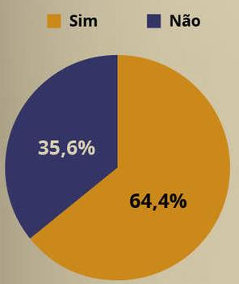
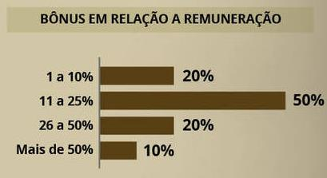
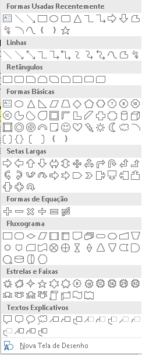
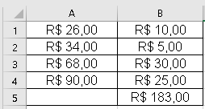
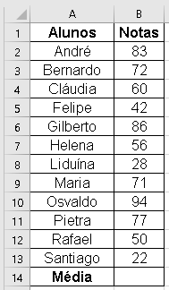

# PROVA — CÂMARA MUNICIPAL DE AQUIRAZ – CE — CONCURSO PÚBLICO 2001 — AGENTE ADMINISTRATIVO

## 1. Análise geral da prova

**Identificação da prova:**

- **Concurso:** Concurso Público para provimento de cargos efetivos do Poder Legislativo do Município de Aquiraz – CE
- **Cargo:** Agente Administrativo
- **Ano:** 2001
- **Estrutura:** 40 questões objetivas (A–D): Português (01–10), Raciocínio Lógico (11–15), Conhecimentos Específicos (16–40)

**Composição quantitativa:**

| Item | Quantidade |
|---|---|
| Total de questões | 40 |
| Textos de apoio compartilhados (grupos) | 3 (texto “Prioridades” de Lya Luft: Q01–Q04; tirinha de Mafalda: Q05–Q06; anúncio publicitário: Q07–Q08) |
| Imagens de conteúdo | 9 (tirinha Q05–Q06, anúncio Q07–Q08, painel de Formas Q31, planilha Q35, planilha Q36, ícone Q39, faixa de ícones Q40) |
| Gráficos e tabelas | 3 (tabelas do anúncio Q07–Q08, planilha da Q35, planilha da Q36) |
| Grupos identificados | 3 |
| Questões independentes | 32 |

**Composição por bloco:**

| Bloco | Questões | Quantidade |
|---|---|---|
| Português | 01–10 | 10 |
| Raciocínio Lógico | 11–15 | 5 |
| Conhecimentos Específicos | 16–40 | 25 |

**Observações sobre a estrutura original:**

- A prova é formada por 4 alternativas (A–D) em todas as questões.
- As questões 39 e 40 referenciam figuras menores que 150x80 px, descartadas pela ferramenta oficial de extração; foram recuperadas como recortes de página em alta resolução (imagem_009.png e imagem_010.png).
- A fonte da tirinha (“QUINO. Toda Mafalda. São Paulo: Martins Fontes, 1993. p. 75.”) não está na camada de texto do PDF; foi transcrita a partir da renderização da página 4.
- Imagens não vinculadas a questões (logotipo da capa) foram descartadas.

> **Transcrição integral da capa e das instruções (conforme extraída do PDF):**
> 
> > 
> > 
> > CONCURSO PÚBLICO
> > PARA PROVIMENTO DE CARGOS EFETIVOS DO PODER LEGISLATIVO
> > DO MUNICÍPIO DE AQUIRAZ - CE
> > 2001 - AGENTE ADMINISTRATIVO
> > NÚMERO DE INSCRIÇÃO
> > NOME DO CANDIDATO
> > ASSINATURA DO CANDIDATO
> > INSTRUÇÕES AO CANDIDATO
> > 01. Você recebeu do fiscal o seguinte material:
> > a) Este caderno com o enunciado das questões da prova, sem repetição ou falha;
> > b) O cartão de respostas destinado às respostas das questões objetivas formuladas na prova.
> > 02. Verifique se este material está em ordem, preencha os espaços destinados ao seu nome, número de inscrição e cargo e assine no
> > local especificado.
> > 03. No cartão respostas, a marcação das letras correspondentes às respostas certas deve ser feita com caneta esferográfica de tinta
> > preta ou azul.
> > 04. Tenha muito cuidado com o cartão de respostas, pois o mesmo não poderá ser substituído.
> > 05. Para cada uma das questões objetivas, são apresentadas 4 (quatro) alternativas classificadas com as letras (A), (B), (C) e (D).
> > Somente uma corresponde adequadamente ao quesito proposto. Você só deve assinalar uma resposta. A marcação de mais de
> > uma alternativa anula a questão. Mesmo que uma das respostas esteja correta.
> > 06. Será eliminado do Concurso Público o candidato que:
> > a) Não apresentar o documento de identidade exigido pelo Regulamento;
> > b) Ausentar-se da sala de provas antes do tempo mínimo de 60 (sessenta) minutos;
> > c) Ausentar-se da sala de provas, no tempo permitido, sem o acompanhamento do fiscal;
> > d) For surpreendido em comunicação com outro candidato ou terceiros, verbalmente, por escrito ou por qualquer outro meio
> > de comunicação, sobre a prova que estiver sendo realizada, ou utilizando-se de máquinas calculadoras e/ou similares, livros,
> > anotações, réguas de cálculo, impressos ou qualquer outro material de consulta, inclusive códigos e/ou legislação;
> > e) Durante a realização das provas, for surpreendido portando aparelhos eletrônicos, tais como bip, telefone celular, walkman,
> > agenda eletrônica, notebook, palmtop, receptor, gravador, máquina de calcular, máquina fotográfica, controle de alarme de
> > carro, pendrive, tablet, smartphone, mp3 player e similares, bem como relógio de qualquer espécie, óculos escuros ou
> > quaisquer acessórios de chapelaria, tais como chapéu, boné, gorro, etc. e, ainda, lápis, lapiseira/grafite e/ou borracha,
> > recipiente ou embalagem, tais como garrafas de água, suco, refrigerante e embalagens de alimentos (biscoitos, barras de
> > cereais, chocolates) que não sejam fabricadas em material transparente ou que estejam com o rótulo;
> > f) Estiver portando, durante as provas, qualquer tipo de equipamento eletrônico de comunicação (ver item e) ou manter o
> > equipamento ligado, mesmo que este esteja acomodado conforme previsto no Regulamento (16.3.2 Os pertences pessoais
> > dos candidatos serão acomodados em local a ser indicado pelos fiscais, onde deverão ficar durante todo o período de
> > permanência dos candidatos no local de prova);
> > g) Lançar mão de meios ilícitos para executar as provas;
> > h) Não devolver o Cartão de Respostas e o Caderno de Questões;
> > i) Fizer anotação de informações relativas às suas respostas em qualquer outro meio que não o fornecido pelo PRÓ-MUNICÍPIO;
> > j) For flagrado descumprindo, durante a realização das provas, o disposto no Capítulo XVI do Regulamento;
> > k) Perturbar, de qualquer modo, a ordem dos trabalhos ou agir com descortesia para com qualquer dos examinadores,
> > executores, fiscais e seus auxiliares ou autoridades presentes nos locais de provas;
> > l) Recusar-se a ser submetido ao detector de metal.
> > 07. Reserve os 30 (trinta) minutos finais para marcar seu cartão de respostas. Os rascunhos e as marcações assinaladas no caderno
> > de questões não serão levados em conta.
> > 08. Ao terminar, entregue ao fiscal o caderno de questões e a folha de respostas e assine a folha de presença.
> > 09. O tempo disponível para esta prova de questões objetivas é de 4 (quatro) horas.
> > 10. Não esquecer de assinar o caderno de questões.
> > PREENCHA COM AS SUAS MARCAÇÕES ABAIXO E DESTAQUE NA LINHA PONTILHADA ACIMA
> > 01 02 03 04 05 06 07 08 09 10 11 12 13 14 15 16 17 18 19 20
> > 
> > 21 22 23 24 25 26 27 28 29 30 31 32 33 34 35 36 37 38 39 40
> > 16 de outubro de 2016

---

## 2. Questões agrupadas

### GRUPO 01 — Texto “Prioridades” (Lya Luft) — questões 01 a 04

**Questões relacionadas:** 01, 02, 03 e 04.

**Material de apoio compartilhado:**

> Leia o texto para responder às questões de 01 a 04:
> Prioridades
> “Muito do que gastamos (e nos desgastamos) nesse
> consumismo feroz podia ser negociado com a gente
> mesmo: uma hora de alegria em troca daquele sapato.
> Uma tarde de amor em troca da prestação do carro do
> ano; um fim de semana em família em lugar daquele
> trabalho extra que está me matando e ainda por cima
> detesto.
> Não sei se sou otimista demais, ou fora da
> realidade. Mas, à medida que fui gostando mais do meu
> jeans, camiseta e mocassins, me agitando menos,
> querendo ter menos, fui ficando mais tranquila e mais
> divertida. Sapato e roupa simbolizam bem mais do que
> isso que são: representam uma escolha de vida, uma
> postura interior.
> Nunca fui modelo de nada, graças a Deus. Mas
> amadurecer me obrigou a fazer muita faxina nos armários
> da alma e na bolsa também. Resistir a certas tentações é
> burrice; mas fugir de outras pode ser crescimento, e muito
> mais alegria.
> Cada um que examine o baú de suas prioridades, e
> faça a arrumação que quiser ou puder.
> Que seja para aliviar a vida, o coração e o
> pensamento – não para inventar de acumular ali mais
> alguns compromissos estéreis e mortais.”
> Lya Luft

---

#### QUESTÃO 01

⚠️ **Gabarito: oficial não disponível**

**Material de apoio:**

> Leia o texto para responder às questões de 01 a 04:
> Prioridades
> “Muito do que gastamos (e nos desgastamos) nesse
> consumismo feroz podia ser negociado com a gente
> mesmo: uma hora de alegria em troca daquele sapato.
> Uma tarde de amor em troca da prestação do carro do
> ano; um fim de semana em família em lugar daquele
> trabalho extra que está me matando e ainda por cima
> detesto.
> Não sei se sou otimista demais, ou fora da
> realidade. Mas, à medida que fui gostando mais do meu
> jeans, camiseta e mocassins, me agitando menos,
> querendo ter menos, fui ficando mais tranquila e mais
> divertida. Sapato e roupa simbolizam bem mais do que
> isso que são: representam uma escolha de vida, uma
> postura interior.
> Nunca fui modelo de nada, graças a Deus. Mas
> amadurecer me obrigou a fazer muita faxina nos armários
> da alma e na bolsa também. Resistir a certas tentações é
> burrice; mas fugir de outras pode ser crescimento, e muito
> mais alegria.
> Cada um que examine o baú de suas prioridades, e
> faça a arrumação que quiser ou puder.
> Que seja para aliviar a vida, o coração e o
> pensamento – não para inventar de acumular ali mais
> alguns compromissos estéreis e mortais.”
> Lya Luft

**Enunciado:**

Para a autora do texto, as prioridades na vida devem ser:

**Alternativas:**

A) Ter sempre mais roupas e sapatos;

B) Acumular compromissos estéreis e mortais;

C) Aliviar a vida, o coração e pensamento, deixando de lado o consumismo feroz;

D) Resistir a todas as tentações para o próprio crescimento.

**Referências visuais:**

Nenhuma.

---

#### QUESTÃO 02

⚠️ **Gabarito: oficial não disponível**

**Material de apoio:**

> Leia o texto para responder às questões de 01 a 04:
> Prioridades
> “Muito do que gastamos (e nos desgastamos) nesse
> consumismo feroz podia ser negociado com a gente
> mesmo: uma hora de alegria em troca daquele sapato.
> Uma tarde de amor em troca da prestação do carro do
> ano; um fim de semana em família em lugar daquele
> trabalho extra que está me matando e ainda por cima
> detesto.
> Não sei se sou otimista demais, ou fora da
> realidade. Mas, à medida que fui gostando mais do meu
> jeans, camiseta e mocassins, me agitando menos,
> querendo ter menos, fui ficando mais tranquila e mais
> divertida. Sapato e roupa simbolizam bem mais do que
> isso que são: representam uma escolha de vida, uma
> postura interior.
> Nunca fui modelo de nada, graças a Deus. Mas
> amadurecer me obrigou a fazer muita faxina nos armários
> da alma e na bolsa também. Resistir a certas tentações é
> burrice; mas fugir de outras pode ser crescimento, e muito
> mais alegria.
> Cada um que examine o baú de suas prioridades, e
> faça a arrumação que quiser ou puder.
> Que seja para aliviar a vida, o coração e o
> pensamento – não para inventar de acumular ali mais
> alguns compromissos estéreis e mortais.”
> Lya Luft

**Enunciado:**

Analise as afirmativas acerca das palavras do texto:

I. A palavra “estéreis” no último parágrafo significa
“improdutivos”;
II. Nas palavras “amadurecer” e “crescimento” o número
de letras é igual ao número de fonemas;
III. Nas
palavras
“negociado”
e
“acessórios”
há
respectivamente hiato e ditongo oral decrescente;
IV. Nas palavras “matando” e “compromissos” há
encontro consonantal.

Estão corretas apenas as afirmativas:

**Alternativas:**

A) I e II;

B) II e III;

C) II e IV;

D) I e III.

**Referências visuais:**

Nenhuma.

---

#### QUESTÃO 03

⚠️ **Gabarito: oficial não disponível**

**Material de apoio:**

> Leia o texto para responder às questões de 01 a 04:
> Prioridades
> “Muito do que gastamos (e nos desgastamos) nesse
> consumismo feroz podia ser negociado com a gente
> mesmo: uma hora de alegria em troca daquele sapato.
> Uma tarde de amor em troca da prestação do carro do
> ano; um fim de semana em família em lugar daquele
> trabalho extra que está me matando e ainda por cima
> detesto.
> Não sei se sou otimista demais, ou fora da
> realidade. Mas, à medida que fui gostando mais do meu
> jeans, camiseta e mocassins, me agitando menos,
> querendo ter menos, fui ficando mais tranquila e mais
> divertida. Sapato e roupa simbolizam bem mais do que
> isso que são: representam uma escolha de vida, uma
> postura interior.
> Nunca fui modelo de nada, graças a Deus. Mas
> amadurecer me obrigou a fazer muita faxina nos armários
> da alma e na bolsa também. Resistir a certas tentações é
> burrice; mas fugir de outras pode ser crescimento, e muito
> mais alegria.
> Cada um que examine o baú de suas prioridades, e
> faça a arrumação que quiser ou puder.
> Que seja para aliviar a vida, o coração e o
> pensamento – não para inventar de acumular ali mais
> alguns compromissos estéreis e mortais.”
> Lya Luft

**Enunciado:**

Coloque (C) para certo e (E) para errado a respeito das
afirmações sobre as palavras do texto:

(   ) Assim como “examine” são escritas com X as
palavras: exímio, exorbitar e exaurido;
(   ) A palavra “desgastamos” é formada por derivação
prefixal e a palavra “crescimento” por derivação
sufixal;
(   ) “Não sei se sou otimista demais, ou fora da
realidade”.  A palavra destacada é uma conjunção
subordinativa condicional;
(   ) As palavras “alegria” e “família”  são trissílabas;
(   ) As palavras “baú” e “fugir” são oxítonas.

A sequência correta é:

**Alternativas:**

A) C, C, E, E, C;

B) C, C, E, C, C;

C) E, C, C, E, C;

D) C, E, E, E, C.

**Referências visuais:**

Nenhuma.

---

#### QUESTÃO 04

⚠️ **Gabarito: oficial não disponível**

**Material de apoio:**

> Leia o texto para responder às questões de 01 a 04:
> Prioridades
> “Muito do que gastamos (e nos desgastamos) nesse
> consumismo feroz podia ser negociado com a gente
> mesmo: uma hora de alegria em troca daquele sapato.
> Uma tarde de amor em troca da prestação do carro do
> ano; um fim de semana em família em lugar daquele
> trabalho extra que está me matando e ainda por cima
> detesto.
> Não sei se sou otimista demais, ou fora da
> realidade. Mas, à medida que fui gostando mais do meu
> jeans, camiseta e mocassins, me agitando menos,
> querendo ter menos, fui ficando mais tranquila e mais
> divertida. Sapato e roupa simbolizam bem mais do que
> isso que são: representam uma escolha de vida, uma
> postura interior.
> Nunca fui modelo de nada, graças a Deus. Mas
> amadurecer me obrigou a fazer muita faxina nos armários
> da alma e na bolsa também. Resistir a certas tentações é
> burrice; mas fugir de outras pode ser crescimento, e muito
> mais alegria.
> Cada um que examine o baú de suas prioridades, e
> faça a arrumação que quiser ou puder.
> Que seja para aliviar a vida, o coração e o
> pensamento – não para inventar de acumular ali mais
> alguns compromissos estéreis e mortais.”
> Lya Luft

**Enunciado:**

Assinale a opção em que a classificação da oração
destacada está correta:

**Alternativas:**

A) “Não sei se sou otimista demais, ou fora da realidade.” Oração coordenada aditiva;

B) “Mas, à medida que fui gostando mais do meu jeans, camiseta e mocassins, me agitando menos, querendo ter menos, fui ficando mais tranquila e mais divertida.” Oração subordinada adverbial proporcional;

C) “..., e faça a arrumação que quiser ou puder.” Oração subordinada adjetiva explicativa;

D) “Resistir a certas tentações é burrice; mas fugir de outras pode ser crescimento, e muito mais alegria.” Oração coordenada adversativa. A tirinha a seguir servirá de base para as questões 05 e 06:

**Referências visuais:**

Nenhuma.

---

### GRUPO 02 — Tirinha de Mafalda (Quino) — questões 05 e 06

**Questões relacionadas:** 05 e 06.

**Material de apoio compartilhado:**

> A tirinha a seguir servirá de base para as questões 05 e 06:
> QUINO. Toda Mafalda. São Paulo: Martins Fontes, 1993. p. 75.

---

#### QUESTÃO 05

⚠️ **Gabarito: oficial não disponível**

**Material de apoio:**

> A tirinha a seguir servirá de base para as questões 05 e 06:
> QUINO. Toda Mafalda. São Paulo: Martins Fontes, 1993. p. 75.

**Enunciado:**

Assinale a opção em que a classe gramatical da palavra
destacada está correta:

**Alternativas:**

A) “Fiquei sabendo que mais da metade da população mundial somos crianças” – conjunção integrante;

B) “... Mas daqui a trinta anos...” – artigo;

C) “... Agora nenhuma...” – pronome;

D) “Que mania de amargurar a vida dos outro!” – pronome relativo.

**Referências visuais:**

---

#### QUESTÃO 06

⚠️ **Gabarito: oficial não disponível**

**Material de apoio:**

> A tirinha a seguir servirá de base para as questões 05 e 06:
> QUINO. Toda Mafalda. São Paulo: Martins Fontes, 1993. p. 75.

**Enunciado:**

Observe as considerações a respeito da tirinha:

I. “Fiquei sabendo que mais da metade da população
mundial somos crianças”- Na frase dita pela
personagem há concordância ideológica, pois a
personagem se inclui como sujeito da oração;
II. “Nós é que vamos fazer coisas e ocupar cargos”- A
concordância verbal não está de acordo com a
Gramática normativa;
III. “Ô cara, daqui a trinta anos não vamos mais ser
crianças.” A vírgula foi usada para isolar o vocativo;
IV. No último quadrinho, Filipe diz que Mafalda amargura
a vida dos outros pelo fato de discordar da tese dele
de que no futuro as crianças terão o mundo nas mãos.

Estão corretas as considerações:

**Alternativas:**

A) I, II e IV, apenas;

B) II e III, apenas;

C) I, III e IV, apenas;

D) I, II, III e IV. A imagem servirá de base para as questões 07 e 08:

**Referências visuais:**

---

### GRUPO 03 — Anúncio publicitário — questões 07 e 08

**Questões relacionadas:** 07 e 08.

**Material de apoio compartilhado:**

> A imagem servirá de base para as questões 07 e 08:

---

#### QUESTÃO 07

⚠️ **Gabarito: oficial não disponível**

**Material de apoio:**

> A imagem servirá de base para as questões 07 e 08:

**Enunciado:**

Pelas características, o texto pertence ao gênero:

**Alternativas:**

A) Charge;

B) Anúncio Publicitário;

C) Tirinha;

D) Infográfico.

**Referências visuais:**

---

#### QUESTÃO 08

⚠️ **Gabarito: oficial não disponível**

**Material de apoio:**

> A imagem servirá de base para as questões 07 e 08:

**Enunciado:**

Marque a opção correta:

**Alternativas:**

A) “OFERECE REMUNERAÇÃO VARIÁVEL (BÔNUS) À MAIORIA DOS FUNCIONÁRIOS?” – O termo destacado exerce função sintática de objeto indireto;

B) “BÔNUS EM RELAÇÃO A REMUNERAÇÃO” – Há uma incorreção gramatical, pois o A deveria ter o sinal indicativo de crase para que estivesse correto quanto à regência nominal;

C) A palavra “BÔNUS” é acentuada por ser uma oxítona terminada em “US”;

D) “OFERECE REMUNERAÇÃO VARIÁVEL (BÔNUS) À MAIORIA DOS FUNCIONÁRIOS?” – O termo destacado exerce função sintática de complemento nominal.

**Referências visuais:**

---

## 3. Questões independentes

#### QUESTÃO 09

⚠️ **Gabarito: oficial não disponível**

**Enunciado:**

Marque a opção em que o período está de acordo com a
Norma Culta da Língua quanto à regência, pontuação e
acentuação gráfica:

**Alternativas:**

A) Esses fatos, conforme informaram no jornal do meio- dia, são falsos;

B) O bom motorista obedece as leis de trânsito;

C) A idéia era fazer com que os objetivos almejados fossem conseguidos;

D) Ele só visava uma posição de destaque.

**Referências visuais:**

Nenhuma.

---

#### QUESTÃO 10

⚠️ **Gabarito: oficial não disponível**

**Enunciado:**

Assinale o item em que a palavra destacada está escrita
corretamente e possui coerência com o contexto na qual
está inserida:

**Alternativas:**

A) Fiquem atentos, pois o perigo está eminente;

B) Não agia de forma correta, não tinha bom censo;

C) A jiboia foi vista em cima do girau;

D) Minha mãe cosia as roupas pacientemente.

**Referências visuais:**

Nenhuma.

---

#### QUESTÃO 11

⚠️ **Gabarito: oficial não disponível**

**Enunciado:**

Dizemos
que
duas
proposições
são
logicamente
equivalentes (ou simplesmente equivalentes) quando são
compostas pelas mesmas proposições simples e os
resultados de suas tabelas-verdade são idênticos.
Considerando as afirmações abaixo:

I. Se A, então B equivale a se não B, então não A
II. Se A, então B equivale a não A ou B

Marque:

**Alternativas:**

A) Se I e II são corretas;

B) Se I é correta e II é falsa;

C) Se I é falsa e II é correta;

D) Se I e II são falsas.

**Referências visuais:**

Nenhuma.

---

#### QUESTÃO 12

⚠️ **Gabarito: oficial não disponível**

**Enunciado:**

Considerando as duas sentenças matemáticas a seguir:
I.
√2+√3
2
> √6+√2
4
;
II. √7 + 4√3 + √7 −4√3 ∈ℚ.

Podemos afirmar corretamente que:

**Alternativas:**

A) I e II são verdadeiras;

B) I é verdadeira e II é falsa;

C) I é falsa e II é verdadeira;

D) I e II são falsas.

**Referências visuais:**

Nenhuma.

---

#### QUESTÃO 13

⚠️ **Gabarito: oficial não disponível**

**Enunciado:**

O Ministério Público tem trabalhado intensamente no
combate a corrupção. Uma importante tentativa nesse
sentido tem sido o desenrolar de operações como a “Lava-
jato”, que revelou o envolvimento de destacados políticos
e empresários brasileiros. Três políticos I, II e III
montaram um engenhoso esquema de fraudes e
desviaram a quantia de 115 milhões de reais dos cofres
públicos. Na divisão do dinheiro desviado as quantidades
que couberam aos políticos I, II e III foram diretamente
proporcionais aos números 1, 2 e 3, e inversamente
proporcionais aos números 4, 5 e 6. Com base no texto,
podemos garantir que:

**Alternativas:**

A) I e II juntos ficaram com menos 60 milhões de reais;

B) I e III juntos ficaram com 75 milhões de reais;

C) II ficou com o dobro de I;

D) III ficou com o triplo de I.

**Referências visuais:**

Nenhuma.

---

#### QUESTÃO 14

⚠️ **Gabarito: oficial não disponível**

**Enunciado:**

Sabendo que a equação 𝑥2 −9𝑥+ 𝑘= 0 tem raízes
inteiras, podemos afirmar que o maior valor possível para
𝑘 é:

**Alternativas:**

A) 8;

B) 14;

C) 18;

D) 20.

**Referências visuais:**

Nenhuma.

---

#### QUESTÃO 15

⚠️ **Gabarito: oficial não disponível**

**Enunciado:**

A Associação Ecológica dos Bugueiros de Aquiraz – AEBA
– oferece 5 opções de passeio de Buggy na cidade:

Passeio 1: Aquiraz Antigo, Dunas e Rios;
Passeio 2: Centro Cultural da Prainha;
Passeio 3: Praias da Costa Leste até a Praia de Caponga;
Passeio 4: Praias da Costa Leste até a Praia das Fontes;
Passeio 5: Lagoa de Uruaú.

Letícia e Rui Lucas desejam realizar um desses passeios
no próximo sábado e outro no domingo. O número de
maneiras distintas que eles podem planejar o passeio é:

**Alternativas:**

A) 10;

B) 15;

C) 20;

D) 30.

**Referências visuais:**

Nenhuma.

---

#### QUESTÃO 16

⚠️ **Gabarito: oficial não disponível**

**Enunciado:**

Observe as colunas que seguem e responda o que se pede.

1. Administração Pública Patrimonialista;
2. Administração Pública Burocrática;
3. Administração Pública Gerencial.

(   ) Modelo de gestão, o qual distingue o público e o privado. Possui como princípios: a profissionalização, a
impessoalidade, a formalização da carreira e a hierarquia;
(   ) Modelo de gestão consequente dos avanços tecnológicos e da nova organização política e econômica mundial;
(   ) Modelo de gestão que traz a confusão entre patrimônio público, Estado, e o patrimônio particular do detentor do poder.

Relacionando a 2ª coluna de acordo com a 1ª, tem-se:

**Alternativas:**

A) 1, 3, 2;

B) 2, 1, 3;

C) 1, 2, 3;

D) 2, 3, 1.

**Referências visuais:**

Nenhuma.

---

#### QUESTÃO 17

⚠️ **Gabarito: oficial não disponível**

**Enunciado:**

Leia o texto a seguir.
Por uma gestão transparente
Para garantir a transparência das ações governamentais e o direito dos cidadãos de conhecer dados dos órgãos públicos
que sejam de seu interesse foi instituída a Lei de Acesso à Informação (nº 12.527/2011). Em vigor desde 16 de maio
daquele ano, a lei nada mais é do que a regulamentação do artigo 5º (inciso XXXIII, capítulo I) da Constituição Federal,
que prega que "todos têm direito a receber dos órgãos públicos informações de seu interesse particular, ou de interesse
coletivo ou geral, que serão prestadas no prazo da lei, sob pena de responsabilidade, ressalvadas aquelas cujo sigilo seja
imprescindível à segurança da sociedade e do Estado".
Fonte: http://revistaescolapublica.com.br/textos/27/por-uma-gestao-transparente-261534-1.asp

Tendo em vista o tema "Transparência na Administração Pública", é correto afirmar que:

**Alternativas:**

A) A divulgação de dados e informações, facilita o acesso às informações, mas não permite que as pessoas participem da gestão pública;

B) Os entes da Federação devem disponibilizar a qualquer pessoa física ou jurídica os dados resumidos da despesa pública realizada, dispensado o fornecimento de informações sobre o número dos processos que originaram as despesas;

C) Pouco adianta ao cidadão-solicitante o direito de acesso, se ele não sabe o que e como pedir;

D) A disponibilização de informação de um dos entes da Federação só será realizada se o solicitante for pessoa física, devidamente identificada.

**Referências visuais:**

Nenhuma.

---

#### QUESTÃO 18

⚠️ **Gabarito: oficial não disponível**

**Enunciado:**

No tocante à gestão de contratos e ao processo licitatório na administração pública, assinale a alternativa correta.

**Alternativas:**

A) O processo licitatório depende da esfera da Administração Pública e representa um ato administrativo formal;

B) Na administração pública, a gestão de contratos constitui-se nas etapas de gerenciamento, acompanhamento e fiscalização, desde a elaboração do edital da licitação até a assinatura do contrato;

C) A licitação não será sigilosa, sendo disponibilizados ao público os atos do conteúdo da proposta e procedimento;

D) Como critério de desempate, os bens e serviços produzidos ou prestados por empresas brasileiras de capital nacional terão preferência.

**Referências visuais:**

Nenhuma.

---

#### QUESTÃO 19

⚠️ **Gabarito: oficial não disponível**

**Enunciado:**

Quanto às modalidades, limites e dispensa de licitação,
marque a opção correta:

**Alternativas:**

A) Convite é a modalidade de licitação, a qual participa interessados de um determinado objeto, cadastrados ou não, escolhidos e convidados em número máximo de 3 (três) pela unidade administrativa, podendo ser utilizada para aquisições e serviços comuns;

B) A modalidade de tomada de preços se destina a interessados cadastrados ou não, estando dividida em duas fases;

C) A modalidade Concorrência destina-se para contratações de obras e serviços de engenharia em que o valor estimado esteja acima de R$ 650.000,00;

D) A modalidade Pregão é utilizada para fornecimento de bens e serviços e serviços comuns aplicáveis a qualquer valor estimado de contratação.

**Referências visuais:**

Nenhuma.

---

#### QUESTÃO 20

⚠️ **Gabarito: oficial não disponível**

**Enunciado:**

Assinale a alternativa correta:

**Alternativas:**

A) O agente público é toda pessoa física ou jurídica que se encontra no exercício de uma função pública;

B) O servidor público em regime especial de trabalho é uma espécie de agente público, servindo ao Poder Público como instrumento expressivo de sua vontade ou ação, ainda quando o façam apenas ocasionalmente;

C) Os servidores públicos sob regime jurídico celetista não podem exercer as atividades-fim do Estado, mas somente aquelas consideradas atividades-meio;

D) O regime especial de trabalho decorre de contrato administrativo vitalício, o qual poderá ser regido pela CLT ou a própria lei.

**Referências visuais:**

Nenhuma.

---

#### QUESTÃO 21

⚠️ **Gabarito: oficial não disponível**

**Enunciado:**

Por mais variados que sejam, os documentos costumam
apresentar elementos característicos comuns. Estes estão
apresentados na 1ª coluna:

Elementos característicos comuns dos documentos
1. Forma;
2. Gênero;
3. Tipo.

Exemplos
(   ) Boletim de ocorrência, certidão de nascimento,
certidão de óbito, declaração de bens, declaração de
imposto de renda, relatório de atividades, relatório de
fiscalização;
(   ) Cópia, minuta, rascunho;
(   ) Documentação
audiovisual,
documentação
fonográfica,
documentação
iconográfica,
documentação textual.

Relacionando a 2ª coluna de acordo com a 1ª, tem-se:

**Alternativas:**

A) 1, 3, 2;

B) 2, 1, 3;

C) 1, 2, 3;

D) 3, 1, 2.

**Referências visuais:**

Nenhuma.

---

#### QUESTÃO 22

⚠️ **Gabarito: oficial não disponível**

**Enunciado:**

A respeito da classificação e organização de arquivos,
assinale a alternativa correta:

**Alternativas:**

A) Os documentos de arquivo são classificados através de métodos pré-determinados;

B) Os arquivos são classificados em institucionais, pessoais ou familiares;

C) De acordo com a classificação dos documentos, filme, códice e contrato são, respectivamente, exemplos de gênero, tipo e natureza;

D) A classificação de documentos de arquivo é realizada de acordo com o assunto ou tema do documento.

**Referências visuais:**

Nenhuma.

---

#### QUESTÃO 23

⚠️ **Gabarito: oficial não disponível**

**Enunciado:**

De forma cronológica, a Teoria das Três Idades classifica
os documentos em:

**Alternativas:**

A) Corrente, morto e permanente;

B) Ativo, permanente e morto;

C) Corrente, intermediário e permanente;

D) Ativo, inativo e permanente.

**Referências visuais:**

Nenhuma.

---

#### QUESTÃO 24

⚠️ **Gabarito: oficial não disponível**

**Enunciado:**

A classificação é uma das atividades mais importantes da
gestão arquivística de documentos, a qual inclui
procedimentos e rotinas específicas que visam maior
celeridade na gestão e controle das informações. O Agente
Administrativo deve ter conhecimento de que ela deve ser
realizada de acordo com as seguintes operações:

**Alternativas:**

A) Estudo e Codificação;

B) Recepção e protocolo;

C) Protocolo e Seleção;

D) Estudo e protocolo.

**Referências visuais:**

Nenhuma.

---

#### QUESTÃO 25

⚠️ **Gabarito: oficial não disponível**

**Enunciado:**

Tanto a classificação quanto a ordenação estão a serviço
da organização dos documentos. Assinale o item correto:

**Alternativas:**

A) O objetivo da ordenação é, principalmente dar visibilidade às funções e às atividades do organismo produtor do arquivo, deixando claras as ligações dos documentos;

B) O procedimento técnico de ordenação alcança, portanto, os tipos documentais, considerando a forma e as razões que determinam a sua existência;

C) A classificação é antes de tudo lógica. A partir da análise do organismo produtor de documentos de arquivo, são criadas categorias, classes genéricas;

D) O objetivo da classificação é facilitar e agilizar a consulta aos documentos.

**Referências visuais:**

Nenhuma.

---

#### QUESTÃO 26

⚠️ **Gabarito: oficial não disponível**

**Enunciado:**

Leia o texto a seguir e responda o que se pede:
O que é intranet e extranet?
Muitas são as palavras usadas hoje em dia para se referir
aos diferentes tipos de rede. A mais usada é internet, mas
temos também LAN, intranet e extranet. A final de contas,
o que é tudo isso?
[...] internet é uma rede de comunicação de computadores
ligados coletivamente através de servidores de acesso[...]
[...] A intranet é uma rede interna, fechada e exclusiva,
com acesso somente para os funcionários de uma
determinada empresa e muitas vezes liberado somente no
ambiente de trabalho e em computadores registrados na
rede[...]
[...] Quando alguma informação dessa intranet é aberta a
clientes ou fornecedores dessa empresa, essa rede passa
a ser chamada de extranet[...]
Fonte: http://www.tecmundo.com.br/conexao/1955-o-que-e-
intranet-e-extranet-.htm

Considerando as informações básicas de Internet e
intranet, marque a opção correta:

**Alternativas:**

A) Uma grande empresa pode utilizar sua intranet, sem conexão com a internet, para realizar diversas operações com fornecedores externos, de forma segura, através do acesso por navegador web;

B) Para que se tenha acesso à Intranet é necessário estar conectado à Internet, visto que essa rede não utiliza a tecnologia TCP/IP;

C) A internet e a intranet não se integram, logo um usuário pode utilizar a intranet fora da empresa, sem colocar as informações desta em risco;

D) A intranet é uma rede privada que usa a mesma tecnologia da Internet, ou seja, TCP/IP.

**Referências visuais:**

Nenhuma.

---

#### QUESTÃO 27

⚠️ **Gabarito: oficial não disponível**

**Enunciado:**

Sobre as ferramentas da internet, julgue os itens
subsequentes, assinalando a alternativa correta:

**Alternativas:**

A) O protocolo FTP é somente utilizado para o envio de anexos de mensagens de correio eletrônico, podendo também compactá-los para facilitar a transmissão da mensagem;

B) O protocolo SMTP possibilita o envio de mensagens de correio eletrônico entre usuários., enquanto que o protocolo IRC é utilizado para acessar mensagens enviadas;

C) O modem ADSL possibilita o tráfego simultâneo dos sinais de dados e de voz, em um mesmo canal de comunicação;

D) O serviço de e-mail utiliza diversos protocolos. Quando envia e ler e-mails diretamente do servidor sem precisar baixá-los para um computador local devem ser usados os protocolos POP 3 e IMAP.

**Referências visuais:**

Nenhuma.

---

#### QUESTÃO 28

⚠️ **Gabarito: oficial não disponível**

**Enunciado:**

Leia o texto abaixo.
A origem da Internet
A internet revolucionou o funcionamento tradicional das
sociedades modernas como o fizeram, a seu tempo, a
imprensa, a máquina a vapor, a eletricidade ou a telegrafia
sem fio (rádio). Hoje parece normal fazer cursos on-line,
preencher formulários administrativos a distância ou
expressar opiniões em fóruns de discussão[...]
De acordo com o dicionário Houaiss, internet é “rede de
computadores dispersos por todo o planeta que trocam
dados e mensagens utilizando um protocolo comum”. Ela
nasceu no final dos anos 1960, em plena Guerra Fria,
graças à iniciativa do Departamento de Defesa americano,
que queria dispor de um conjunto de comunicação militar
entre seus diferentes centros. Uma rede que fosse capaz
de resistir a uma destruição parcial, provocada, por
exemplo, por um ataque nuclear[...]
Fonte:
http://www2.uol.com.br/historiaviva/reportagens/o_nascimento
_da_internet.html

A ação de enviar um arquivo do computador local para
outro computador remoto conectado na Internet, é
chamada de:

**Alternativas:**

A) Download;

B) Nuvem;

C) Upload;

D) E-mail.

**Referências visuais:**

Nenhuma.

---

#### QUESTÃO 29

⚠️ **Gabarito: oficial não disponível**

**Enunciado:**

O acesso à distância entre computadores:

**Alternativas:**

A) Pode ser realizado entre máquinas conectadas à internet;

B) Deve ser realizado entre máquinas diferente e com a mesma memória;

C) Não pode ser feito por conexão com conexão ADSL;

D) Deverá ser feito por computadores diferentes.

**Referências visuais:**

Nenhuma.

---

#### QUESTÃO 30

⚠️ **Gabarito: oficial não disponível**

**Enunciado:**

No Microsoft Word 2016, o botão
permite, caso
esteja ativado:

**Alternativas:**

A) Alinhar o conteúdo com a margem esquerda;

B) Distribuir o texto uniformemente entre as margens;

C) Alinhar o conteúdo do texto à direita;

D) Centralizar seu conteúdo na página.

**Referências visuais:**

Nenhuma.

---

#### QUESTÃO 31

⚠️ **Gabarito: oficial não disponível**

**Enunciado:**

Observe e analise a imagem a seguir e responde o que se
pede.
No Word 2016, a janela é aberta a partir da seguinte
sequência:

**Alternativas:**

A) Formatar → Imagens;

B) Inserir → Imagens;

C) Inserir → Formas;

D) Formatar → Formas.

**Referências visuais:**

---

#### QUESTÃO 32

⚠️ **Gabarito: oficial não disponível**

**Enunciado:**

No Microsoft Office, programa Word 2016, a tecla de
atalho utilizada para imprimir o documento é:

**Alternativas:**

A) Ctrl + T;

B) Ctrl + C;

C) Ctrl + V;

D) Ctrl + P.

**Referências visuais:**

Nenhuma.

---

#### QUESTÃO 33

⚠️ **Gabarito: oficial não disponível**

**Enunciado:**

Considere o Microsoft Office, programa Word 2016. O
comando “Adicionar ou remover colunas” é acessado
através do menu:

**Alternativas:**

A) Inserir;

B) Design;

C) Layout;

D) Revisão.

**Referências visuais:**

Nenhuma.

---

#### QUESTÃO 34

⚠️ **Gabarito: oficial não disponível**

**Enunciado:**

O Microsoft Excel é um software para criação e
manutenção de Planilhas Eletrônicas. O Excel permite,
além da manipulação de cálculos em planilhas, a inclusão
de gráficos criados com base nos dados da planilha. A
principal característica de uma planilha Excel é o fato de:

**Alternativas:**

A) Diferente do Microsoft Word, não permite a inserção de imagem em suas células;

B) Ser estruturada em uma matriz de linhas x colunas;

C) Não permite o filtro de informações das células;

D) Utiliza em suas células somente carácteres numéricos.

**Referências visuais:**

Nenhuma.

---

#### QUESTÃO 35

⚠️ **Gabarito: oficial não disponível**

**Enunciado:**

Considere a seguinte planilha de dados no Microsoft Excel
2016 e responda o que se pede:
A célula B5 apresenta o valor R$ 183,00. Esse valor é
resultado de uma fórmula representada pela expressão:

**Alternativas:**

A) =SOMA(A1;A3;A4)-B4;

B) =SOMA(A1:A4)-SOMA(B1:B4);

C) =SOMA(A1:A4)-SOMA(B1;B4);

D) =SOMA(A2;A4)-SOMA (B2;B4).

**Referências visuais:**

---

#### QUESTÃO 36

⚠️ **Gabarito: oficial não disponível**

**Enunciado:**

Observe e analise a planilha a seguir.
Considerando que a planilha contém notas de 12 alunos
no Excel. Assinale a alternativa que apresenta a fórmula
para se calcular a média dessas notas, apresentada na
célula B14:

**Alternativas:**

A) =MÉDIA(B2:B13);

B) =MÉDIA(B1:B13);

C) =MÉDIA(B1:B14);

D) =MÉDIA(B2:B14).

**Referências visuais:**

---

#### QUESTÃO 37

⚠️ **Gabarito: oficial não disponível**

**Enunciado:**

O software que permite a criação de materiais que podem
ser apresentados por meio de um projetor:

**Alternativas:**

A) Excel;

B) Word;

C) Power Point;

D) Access.

**Referências visuais:**

Nenhuma.

---

#### QUESTÃO 38

⚠️ **Gabarito: oficial não disponível**

**Enunciado:**

A respeito do software Microsoft Power Point é correto
afirmar:

**Alternativas:**

A) O slide mestre é um modelo para os outros slides de uma mesma apresentação, de forma que as alterações que são feitas na estrutura desse slide repercutem em todos os outros;

B) Um slide pode conter foto e texto, mas não, gráfico ou filme;

C) Para se visualizar os slides como eles serão apresentados, somente um slide por tela, é necessário utilizar o modo de exibição chamado de Classificação;

D) O PowerPoint é capaz de manipular grandes bancos de dados, de forma a gerar automaticamente gráficos e tabelas associados a esses bancos.

**Referências visuais:**

Nenhuma.

---

#### QUESTÃO 39

⚠️ **Gabarito: oficial não disponível**

**Enunciado:**

Observe a figura a seguir e responda ao que se pede.
A imagem anterior contém um ícone retirado da Página
Inicial, do software PowerPoint. A funcionalidade
associada a esse ícone é de:

**Alternativas:**

A) Copiar;

B) Formatar;

C) Colar;

D) Revisar.

**Referências visuais:**

---

#### QUESTÃO 40

⚠️ **Gabarito: oficial não disponível**

**Enunciado:**

Observe a figura a seguir e responda ao que se pede.
No Microsoft Power Point, a figura apresenta tipos de:

**Alternativas:**

A) Animação;

B) Apresentação de Slides;

C) Design;

D) Transição.

**Referências visuais:**

---

## 4. Observações e limitações da extração

- ⚠️ Gabarito oficial não disponível: o PDF de gabarito fornecido para esta prova corresponde ao concurso de 2016 (edital 008/2016), não a esta prova de 2001. Todas as questões estão marcadas como “Gabarito: oficial não disponível”.
- As questões 39 e 40 tinham figuras abaixo do limite de extração da ferramenta oficial (150x80 px); foram inseridas como recortes de página em alta resolução.
- Logotipo da capa descartado (não é conteúdo de questão).
