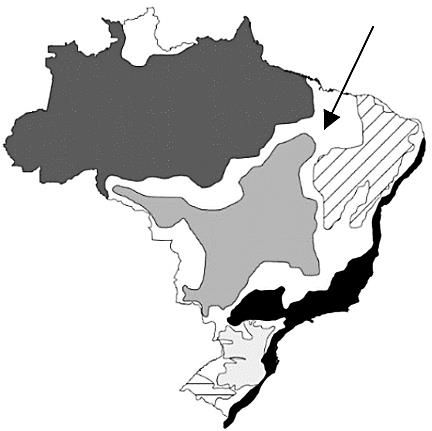

# PROVA — CÂMARA MUNICIPAL DE AQUIRAZ – CE — CONCURSO PÚBLICO 2024 — AGENTE ADMINISTRATIVO DO LEGISLATIVO

## 1. Análise geral da prova

**Identificação da prova:**

- **Concurso:** Concurso Público — Câmara Municipal de Aquiraz – CE (Edital Nº 001/2024, de 06 de setembro de 2024)
- **Cargo:** Agente Administrativo do Legislativo
- **Data da prova:** 24/11/2024
- **Estrutura:** 60 questões objetivas (A–E): Conhecimentos Gerais (01–40) e Conhecimentos Específicos (41–60)

**Composição quantitativa:**

| Item | Quantidade |
|---|---|
| Total de questões | 60 |
| Textos de apoio compartilhados (grupos) | 1 (editorial “Sem professores não há desenvolvimento”: Q01–Q10) |
| Imagens de conteúdo | 4 (tirinha Q11 em 2 partes, charge Q32, mapa Q34) |
| Gráficos e tabelas | 0 |
| Grupos identificados | 1 |
| Questões independentes | 50 |

**Composição por bloco:**

| Bloco | Questões | Quantidade |
|---|---|---|
| Conhecimentos Gerais | 01–40 | 40 |
| Conhecimentos Específicos | 41–60 | 20 |

**Observações sobre a estrutura original:**

- As alternativas originais usam o formato “a)” (minúsculo); na organização foram normalizadas para maiúsculas (A–E), sem alteração de conteúdo.
- A tirinha da questão 11 está dividida em duas imagens no PDF original, reproduzidas na ordem.
- Imagens não vinculadas a questões (logotipos da capa e marca d’água “RASCUNHO”) foram descartadas.

> **Transcrição integral da capa e das instruções (conforme extraída do PDF):**
> 
> > 
> > 
> > 
> > C O N C U R S O       P Ú B L I C O
> > EDITAL  Nº  001/2024  DE  06  DE  SETEMBRO  2024
> > AGENTE  ADMINISTRATIVO  DO  LEGISLATIVO
> > NOME DO CANDIDATO: ____________________________________________________________________________________
> > RG: ______________________________                       ÓRGÃO EXPEDIDOR: _________________________________________
> > Nº DE INSCRIÇÃO
> > ASSINATURA: _____________________________________________________
> > LEIA COM ATENÇÃO E SIGA RIGOROSAMENTE ESTAS INSTRUÇÕES:
> > 1. Este caderno contém 60 (sessenta) questões de
> > múltipla escolha, numeradas de 1 (um) a 60
> > (sessenta).
> > 2. Cada uma das questões apresenta um enunciado
> > seguido de 5 (cinco) alternativas, das quais somente
> > uma deve ser assinalada.
> > 3. Examine se a prova está completa com a sequência
> > numérica
> > das
> > questões,
> > se
> > há
> > falhas
> > ou
> > imperfeições
> > gráficas
> > que
> > causem
> > dúvidas.
> > Qualquer reclamação deverá ser feita durante os 20
> > minutos iniciais. Após esse tempo, qualquer
> > reclamação será desconsiderada.
> > 4. Depois de decorridas 2 (duas) horas do início da
> > prova, será distribuído a folha de respostas, o qual
> > será o único documento válido para a correção. Ao
> > recebê-lo, verifique se seu nome e seu número de
> > inscrição estão corretos. Reclame imediatamente se
> > houver discrepância.
> > 5. A folha de respostas não pode ser dobrada,
> > amassada, rasurada ou manchada. Exceto sua
> > assinatura e data de nascimento, nada deve ser
> > escrito ou registrado fora dos locais destinados às
> > respostas. Tenha muita atenção ao marcar sua folha
> > de respostas, pois não haverá substituição por erro
> > do candidato. Marque sua resposta pintando
> > completamente
> > o
> > espaço
> > correspondente
> > à
> > alternativa de sua opção.
> > Ex.: A
> > 
> > B
> > 
> > C
> > 
> > D
> > 
> > E
> > 6. A leitora de marcas não registrará as respostas em
> > que houver falta de nitidez, uso de corretivo,
> > marcação a lápis ou marcação de mais de uma letra.
> > Não serão computadas questões não assinaladas.
> > 7. Durante a prova, é proibido o intercâmbio e o
> > empréstimo de material de qualquer natureza entre
> > os candidatos. A tentativa de fraude, a indisciplina e
> > o desrespeito às autoridades encarregadas dos
> > trabalhos
> > são
> > faltas
> > que
> > implicarão
> > a
> > desclassificação do candidato.
> > 8. Qualquer forma de comunicação entre candidatos
> > implicará a eliminação de ambos do certame.
> > 9. Não será permitido ao candidato, durante a
> > realização das provas, portar armas, aparelhos
> > eletrônicos de qualquer natureza, relógios, bolsas,
> > livros, jornais e impressos em geral; bonés,
> > chapéus, lenço de cabelo, bandanas etc.
> > 10. É vedado o uso de telefone celular ou de qualquer
> > outro meio de comunicação. O candidato que for
> > flagrado portando aparelho celular ou qualquer outro
> > meio de comunicação, durante o período de
> > realização da prova, e/ou o aparelho celular tocar
> > será sumariamente eliminado do certame.
> > 11. Em caso de dúvida, durante a prova, levante o braço
> > para solicitar atendimento da fiscalização. Jamais
> > pergunte em voz alta.
> > 12. Ao terminar a resolução da prova, entregue-a ao
> > fiscal de sala juntamente com a folha de respostas.
> > Não se esqueça de assinar a folha de respostas e
> > a folha de frequência.
> > 13. O candidato que permanecer na sala de provas, por
> > mais de 3h30min, poderá levar consigo o caderno
> > de provas, fornecido pela ORGANIZADORA.
> > 14. As provas terão duração de 4 (quatro) horas com
> > início às 14h e término às 18h. O candidato só
> > poderá ausentar-se da sala depois de decorridas
> > duas horas do início das provas.
> > 15. Os Gabaritos Preliminares das Provas Objetivas
> > serão divulgados 72 (setenta e duas) horas após a
> > realização das mesmas.
> > 

**Gabarito oficial — tabela "Gabarito oficial preliminar — Edital Nº 001/2024":**

| Questão | Resposta | Questão | Resposta | Questão | Resposta | Questão | Resposta | Questão | Resposta |
|---|---|---|---|---|---|---|---|---|---|
| 01 | **A** | 02 | **E** | 03 | **D** | 04 | **C** | 05 | **C** |
| 06 | **E** | 07 | **A** | 08 | **C** | 09 | **B** | 10 | **C** |
| 11 | **D** | 12 | **C** | 13 | **E** | 14 | **E** | 15 | **E** |
| 16 | **A** | 17 | **B** | 18 | **B** | 19 | **C** | 20 | **A** |
| 21 | **D** | 22 | **C** | 23 | **B** | 24 | **D** | 25 | **D** |
| 26 | **B** | 27 | **E** | 28 | **A** | 29 | **C** | 30 | **B** |
| 31 | **D** | 32 | **A** | 33 | **B** | 34 | **C** | 35 | **D** |
| 36 | **D** | 37 | **B** | 38 | **A** | 39 | **A** | 40 | **B** |
| 41 | **C** | 42 | **B** | 43 | **B** | 44 | **A** | 45 | **D** |
| 46 | **D** | 47 | **B** | 48 | **B** | 49 | **A** | 50 | **B** |
| 51 | **B** | 52 | **C** | 53 | **C** | 54 | **B** | 55 | **B** |
| 56 | **D** | 57 | **C** | 58 | **A** | 59 | **C** | 60 | **B** |

> 📌 Fonte: Gabarito oficial preliminar — Edital Nº 001/2024

---

## 2. Questões agrupadas

### GRUPO 01 — Editorial “Sem professores não há desenvolvimento” (Correio Braziliense, 15/10/2024) — questões 01 a 10

**Questões relacionadas:** 01, 02, 03, 04, 05, 06, 07, 08, 09, 10.

**Material de apoio compartilhado:**

> Leia o texto a seguir para responder as questões de 1 a 10.
> Sem professores não há desenvolvimento
> É essencial que os docentes sejam merecedores de iniciativas de
> Estado que tornem a docência uma carreira atraente. Sem
> professores, o país entra em rota de involução
> Correio Braziliense | 15/10/2024
> A
> boa
> educação
> IMPUSSIONA
> o desenvolvimento
> econômico e social de um país se contar com profissionais
> competentes, reconhecidos e respeitados por todas as classes
> sociais e econômicas de uma sociedade. Cada categoria
> profissional tem uma participação na construção e no crescimento
> de uma nação. Os professores, em todos os níveis, são os
> responsáveis pelo repasse de informações e ensinamentos para
> o surgimento desses profissionais, lembrando que os atuais
> docentes passaram pelas mãos dos que os antecederam,
> propiciando-lhes meios de serem educadores e mestres sobre os
> mais diversos campos do saber e da ciência.
> 
> Hoje, 15 de outubro, é dia de parabenizar os 2,31 milhões
> de professores existentes no país. Boa parcela da categoria,
> porém, não vê muita razão para CEREBRAÇÕES. Há anos, os
> docentes pedem condições mais adequadas de trabalho, escolas
> com padrão de qualidade, com acesso aos avanços tecnológicos,
> salas confortáveis para os discentes. Reclamam também da
> própria falta de valorização da categoria pelos detentores de
> poderes.
> 
> Os professores são [indispensáveis], mas não bem
> remunerados, seja nas grandes cidades, seja nos municípios
> mais empobrecidos do país. Os pisos salariais justificam a evasão
> de docentes. Estão bem abaixo dos detentores dos poderes, que
> têm autonomia para fixar os próprios rendimentos, sem muita
> preocupação com o Orçamento da União ou com as políticas
> públicas indispensáveis ao bem-estar da sociedade.
> 
> As disparidades salariais bem explicam o esgotamento da
> esperança dos profissionais de ensino. Na última década
> encerrada em 2023, o número de professores concursados
> despencou na maioria das redes públicas de educação. Passou
> de 505 mil em 2013 — o correspondente a 68,4% do total de
> docentes nas redes estaduais — para 321 mil no ano passado
> (46,5%), segundo levantamento do Instituto Nacional de Estudos
> e Pesquisas Educacionais Anísio Teixeira (Inep). Boa parte das
> vagas
> deixadas
> pelos
> concursados
> foi
> preenchida
> por
> professores temporários, sem os mesmos direitos e benefícios
> dos efetivos. O que seria uma EXCEÇÃO tornou-se um padrão.
> 
> O Plano Nacional de Educação (PNE) estabeleceu metas
> para VALORIZAR os professores em todas as etapas do ensino,
> prevendo que 90% dos professores de escolas públicas sejam
> efetivos — uma orientação que deveria ser cumprida até 2017.
> Como boa proposta, não foi cumprida. Se, por um lado, os
> contratados temporários são alternativas para suprir a demanda
> por profissionais, por outro, a solução causa impactos negativos
> aos estudantes.
> 
> As recentes políticas de educação têm buscado elevar a
> qualidade do ensino, impedir que alunos abandonem as salas de
> aula por meio de diferentes estímulos. Nesse sentido, é
> ESSENCIAL que os docentes sejam merecedores de iniciativas
> de Estado que tornem a docência uma carreira atraente para os
> professores, para os estudantes e para o país e que traduza em
> qualidade de vida para todos os brasileiros. Sem professores, o
> país entra em rota de involução.
> SEM professores não há desenvolvimento. Correio Braziliense, 15 de outubro de
> 2024. Disponível em:
> https://www.correiobraziliense.com.br/opiniao/2024/10/6964785-sem-professores-
> nao-ha-desenvolvimento.html. Acesso em: 15 out. 2024. Adaptado.

---

#### QUESTÃO 01

✅ **Gabarito: A** (gabarito oficial preliminar — nível Médio (CONHECIMENTOS GERAIS 01–40 e CONHECIMENTOS ESPECÍFICOS — AGENTE ADMINISTRATIVO DO LEGISLATIVO 41–60))

**Material de apoio:**

> Leia o texto a seguir para responder as questões de 1 a 10.
> Sem professores não há desenvolvimento
> É essencial que os docentes sejam merecedores de iniciativas de
> Estado que tornem a docência uma carreira atraente. Sem
> professores, o país entra em rota de involução
> Correio Braziliense | 15/10/2024
> A
> boa
> educação
> IMPUSSIONA
> o desenvolvimento
> econômico e social de um país se contar com profissionais
> competentes, reconhecidos e respeitados por todas as classes
> sociais e econômicas de uma sociedade. Cada categoria
> profissional tem uma participação na construção e no crescimento
> de uma nação. Os professores, em todos os níveis, são os
> responsáveis pelo repasse de informações e ensinamentos para
> o surgimento desses profissionais, lembrando que os atuais
> docentes passaram pelas mãos dos que os antecederam,
> propiciando-lhes meios de serem educadores e mestres sobre os
> mais diversos campos do saber e da ciência.
> 
> Hoje, 15 de outubro, é dia de parabenizar os 2,31 milhões
> de professores existentes no país. Boa parcela da categoria,
> porém, não vê muita razão para CEREBRAÇÕES. Há anos, os
> docentes pedem condições mais adequadas de trabalho, escolas
> com padrão de qualidade, com acesso aos avanços tecnológicos,
> salas confortáveis para os discentes. Reclamam também da
> própria falta de valorização da categoria pelos detentores de
> poderes.
> 
> Os professores são [indispensáveis], mas não bem
> remunerados, seja nas grandes cidades, seja nos municípios
> mais empobrecidos do país. Os pisos salariais justificam a evasão
> de docentes. Estão bem abaixo dos detentores dos poderes, que
> têm autonomia para fixar os próprios rendimentos, sem muita
> preocupação com o Orçamento da União ou com as políticas
> públicas indispensáveis ao bem-estar da sociedade.
> 
> As disparidades salariais bem explicam o esgotamento da
> esperança dos profissionais de ensino. Na última década
> encerrada em 2023, o número de professores concursados
> despencou na maioria das redes públicas de educação. Passou
> de 505 mil em 2013 — o correspondente a 68,4% do total de
> docentes nas redes estaduais — para 321 mil no ano passado
> (46,5%), segundo levantamento do Instituto Nacional de Estudos
> e Pesquisas Educacionais Anísio Teixeira (Inep). Boa parte das
> vagas
> deixadas
> pelos
> concursados
> foi
> preenchida
> por
> professores temporários, sem os mesmos direitos e benefícios
> dos efetivos. O que seria uma EXCEÇÃO tornou-se um padrão.
> 
> O Plano Nacional de Educação (PNE) estabeleceu metas
> para VALORIZAR os professores em todas as etapas do ensino,
> prevendo que 90% dos professores de escolas públicas sejam
> efetivos — uma orientação que deveria ser cumprida até 2017.
> Como boa proposta, não foi cumprida. Se, por um lado, os
> contratados temporários são alternativas para suprir a demanda
> por profissionais, por outro, a solução causa impactos negativos
> aos estudantes.
> 
> As recentes políticas de educação têm buscado elevar a
> qualidade do ensino, impedir que alunos abandonem as salas de
> aula por meio de diferentes estímulos. Nesse sentido, é
> ESSENCIAL que os docentes sejam merecedores de iniciativas
> de Estado que tornem a docência uma carreira atraente para os
> professores, para os estudantes e para o país e que traduza em
> qualidade de vida para todos os brasileiros. Sem professores, o
> país entra em rota de involução.
> SEM professores não há desenvolvimento. Correio Braziliense, 15 de outubro de
> 2024. Disponível em:
> https://www.correiobraziliense.com.br/opiniao/2024/10/6964785-sem-professores-
> nao-ha-desenvolvimento.html. Acesso em: 15 out. 2024. Adaptado.

**Enunciado:**

Qual é o referente textual do pronome lhes em destaque
no parágrafo introdutório do editorial?

**Alternativas:**

A) “os atuais docentes”

B) “desses profissionais”

C) “educadores e mestres”

D) “dos que os antecederam”

E) “Cada categoria profissional”

**Referências visuais:**

Nenhuma.

---

#### QUESTÃO 02

✅ **Gabarito: E** (gabarito oficial preliminar — nível Médio (CONHECIMENTOS GERAIS 01–40 e CONHECIMENTOS ESPECÍFICOS — AGENTE ADMINISTRATIVO DO LEGISLATIVO 41–60))

**Material de apoio:**

> Leia o texto a seguir para responder as questões de 1 a 10.
> Sem professores não há desenvolvimento
> É essencial que os docentes sejam merecedores de iniciativas de
> Estado que tornem a docência uma carreira atraente. Sem
> professores, o país entra em rota de involução
> Correio Braziliense | 15/10/2024
> A
> boa
> educação
> IMPUSSIONA
> o desenvolvimento
> econômico e social de um país se contar com profissionais
> competentes, reconhecidos e respeitados por todas as classes
> sociais e econômicas de uma sociedade. Cada categoria
> profissional tem uma participação na construção e no crescimento
> de uma nação. Os professores, em todos os níveis, são os
> responsáveis pelo repasse de informações e ensinamentos para
> o surgimento desses profissionais, lembrando que os atuais
> docentes passaram pelas mãos dos que os antecederam,
> propiciando-lhes meios de serem educadores e mestres sobre os
> mais diversos campos do saber e da ciência.
> 
> Hoje, 15 de outubro, é dia de parabenizar os 2,31 milhões
> de professores existentes no país. Boa parcela da categoria,
> porém, não vê muita razão para CEREBRAÇÕES. Há anos, os
> docentes pedem condições mais adequadas de trabalho, escolas
> com padrão de qualidade, com acesso aos avanços tecnológicos,
> salas confortáveis para os discentes. Reclamam também da
> própria falta de valorização da categoria pelos detentores de
> poderes.
> 
> Os professores são [indispensáveis], mas não bem
> remunerados, seja nas grandes cidades, seja nos municípios
> mais empobrecidos do país. Os pisos salariais justificam a evasão
> de docentes. Estão bem abaixo dos detentores dos poderes, que
> têm autonomia para fixar os próprios rendimentos, sem muita
> preocupação com o Orçamento da União ou com as políticas
> públicas indispensáveis ao bem-estar da sociedade.
> 
> As disparidades salariais bem explicam o esgotamento da
> esperança dos profissionais de ensino. Na última década
> encerrada em 2023, o número de professores concursados
> despencou na maioria das redes públicas de educação. Passou
> de 505 mil em 2013 — o correspondente a 68,4% do total de
> docentes nas redes estaduais — para 321 mil no ano passado
> (46,5%), segundo levantamento do Instituto Nacional de Estudos
> e Pesquisas Educacionais Anísio Teixeira (Inep). Boa parte das
> vagas
> deixadas
> pelos
> concursados
> foi
> preenchida
> por
> professores temporários, sem os mesmos direitos e benefícios
> dos efetivos. O que seria uma EXCEÇÃO tornou-se um padrão.
> 
> O Plano Nacional de Educação (PNE) estabeleceu metas
> para VALORIZAR os professores em todas as etapas do ensino,
> prevendo que 90% dos professores de escolas públicas sejam
> efetivos — uma orientação que deveria ser cumprida até 2017.
> Como boa proposta, não foi cumprida. Se, por um lado, os
> contratados temporários são alternativas para suprir a demanda
> por profissionais, por outro, a solução causa impactos negativos
> aos estudantes.
> 
> As recentes políticas de educação têm buscado elevar a
> qualidade do ensino, impedir que alunos abandonem as salas de
> aula por meio de diferentes estímulos. Nesse sentido, é
> ESSENCIAL que os docentes sejam merecedores de iniciativas
> de Estado que tornem a docência uma carreira atraente para os
> professores, para os estudantes e para o país e que traduza em
> qualidade de vida para todos os brasileiros. Sem professores, o
> país entra em rota de involução.
> SEM professores não há desenvolvimento. Correio Braziliense, 15 de outubro de
> 2024. Disponível em:
> https://www.correiobraziliense.com.br/opiniao/2024/10/6964785-sem-professores-
> nao-ha-desenvolvimento.html. Acesso em: 15 out. 2024. Adaptado.

**Enunciado:**

De acordo com as informações do texto, os professores

**Alternativas:**

A) têm uma remuneração melhor do que outros cargos detentores de poder.

B) têm optado pelos concursos públicos somente em algumas cidades.

C) sentem-se mais valorizados quando trabalham temporariamente nas escolas.

D) sentem-se mais respeitados em instituições de ensino da esfera privada.

E) têm direito a benefícios na carreira quando são concursados.

**Referências visuais:**

Nenhuma.

---

#### QUESTÃO 03

✅ **Gabarito: D** (gabarito oficial preliminar — nível Médio (CONHECIMENTOS GERAIS 01–40 e CONHECIMENTOS ESPECÍFICOS — AGENTE ADMINISTRATIVO DO LEGISLATIVO 41–60))

**Material de apoio:**

> Leia o texto a seguir para responder as questões de 1 a 10.
> Sem professores não há desenvolvimento
> É essencial que os docentes sejam merecedores de iniciativas de
> Estado que tornem a docência uma carreira atraente. Sem
> professores, o país entra em rota de involução
> Correio Braziliense | 15/10/2024
> A
> boa
> educação
> IMPUSSIONA
> o desenvolvimento
> econômico e social de um país se contar com profissionais
> competentes, reconhecidos e respeitados por todas as classes
> sociais e econômicas de uma sociedade. Cada categoria
> profissional tem uma participação na construção e no crescimento
> de uma nação. Os professores, em todos os níveis, são os
> responsáveis pelo repasse de informações e ensinamentos para
> o surgimento desses profissionais, lembrando que os atuais
> docentes passaram pelas mãos dos que os antecederam,
> propiciando-lhes meios de serem educadores e mestres sobre os
> mais diversos campos do saber e da ciência.
> 
> Hoje, 15 de outubro, é dia de parabenizar os 2,31 milhões
> de professores existentes no país. Boa parcela da categoria,
> porém, não vê muita razão para CEREBRAÇÕES. Há anos, os
> docentes pedem condições mais adequadas de trabalho, escolas
> com padrão de qualidade, com acesso aos avanços tecnológicos,
> salas confortáveis para os discentes. Reclamam também da
> própria falta de valorização da categoria pelos detentores de
> poderes.
> 
> Os professores são [indispensáveis], mas não bem
> remunerados, seja nas grandes cidades, seja nos municípios
> mais empobrecidos do país. Os pisos salariais justificam a evasão
> de docentes. Estão bem abaixo dos detentores dos poderes, que
> têm autonomia para fixar os próprios rendimentos, sem muita
> preocupação com o Orçamento da União ou com as políticas
> públicas indispensáveis ao bem-estar da sociedade.
> 
> As disparidades salariais bem explicam o esgotamento da
> esperança dos profissionais de ensino. Na última década
> encerrada em 2023, o número de professores concursados
> despencou na maioria das redes públicas de educação. Passou
> de 505 mil em 2013 — o correspondente a 68,4% do total de
> docentes nas redes estaduais — para 321 mil no ano passado
> (46,5%), segundo levantamento do Instituto Nacional de Estudos
> e Pesquisas Educacionais Anísio Teixeira (Inep). Boa parte das
> vagas
> deixadas
> pelos
> concursados
> foi
> preenchida
> por
> professores temporários, sem os mesmos direitos e benefícios
> dos efetivos. O que seria uma EXCEÇÃO tornou-se um padrão.
> 
> O Plano Nacional de Educação (PNE) estabeleceu metas
> para VALORIZAR os professores em todas as etapas do ensino,
> prevendo que 90% dos professores de escolas públicas sejam
> efetivos — uma orientação que deveria ser cumprida até 2017.
> Como boa proposta, não foi cumprida. Se, por um lado, os
> contratados temporários são alternativas para suprir a demanda
> por profissionais, por outro, a solução causa impactos negativos
> aos estudantes.
> 
> As recentes políticas de educação têm buscado elevar a
> qualidade do ensino, impedir que alunos abandonem as salas de
> aula por meio de diferentes estímulos. Nesse sentido, é
> ESSENCIAL que os docentes sejam merecedores de iniciativas
> de Estado que tornem a docência uma carreira atraente para os
> professores, para os estudantes e para o país e que traduza em
> qualidade de vida para todos os brasileiros. Sem professores, o
> país entra em rota de involução.
> SEM professores não há desenvolvimento. Correio Braziliense, 15 de outubro de
> 2024. Disponível em:
> https://www.correiobraziliense.com.br/opiniao/2024/10/6964785-sem-professores-
> nao-ha-desenvolvimento.html. Acesso em: 15 out. 2024. Adaptado.

**Enunciado:**

Qual das palavras a seguir, extraídas do texto, possui, em
sua formação, uma estrutura cuja ideia transmitida é a de
negação?

**Alternativas:**

A) autonomia.

B) iniciativas.

C) esgotamento.

D) involução.

E) empobrecidos.

**Referências visuais:**

Nenhuma.

---

#### QUESTÃO 04

✅ **Gabarito: C** (gabarito oficial preliminar — nível Médio (CONHECIMENTOS GERAIS 01–40 e CONHECIMENTOS ESPECÍFICOS — AGENTE ADMINISTRATIVO DO LEGISLATIVO 41–60))

**Material de apoio:**

> Leia o texto a seguir para responder as questões de 1 a 10.
> Sem professores não há desenvolvimento
> É essencial que os docentes sejam merecedores de iniciativas de
> Estado que tornem a docência uma carreira atraente. Sem
> professores, o país entra em rota de involução
> Correio Braziliense | 15/10/2024
> A
> boa
> educação
> IMPUSSIONA
> o desenvolvimento
> econômico e social de um país se contar com profissionais
> competentes, reconhecidos e respeitados por todas as classes
> sociais e econômicas de uma sociedade. Cada categoria
> profissional tem uma participação na construção e no crescimento
> de uma nação. Os professores, em todos os níveis, são os
> responsáveis pelo repasse de informações e ensinamentos para
> o surgimento desses profissionais, lembrando que os atuais
> docentes passaram pelas mãos dos que os antecederam,
> propiciando-lhes meios de serem educadores e mestres sobre os
> mais diversos campos do saber e da ciência.
> 
> Hoje, 15 de outubro, é dia de parabenizar os 2,31 milhões
> de professores existentes no país. Boa parcela da categoria,
> porém, não vê muita razão para CEREBRAÇÕES. Há anos, os
> docentes pedem condições mais adequadas de trabalho, escolas
> com padrão de qualidade, com acesso aos avanços tecnológicos,
> salas confortáveis para os discentes. Reclamam também da
> própria falta de valorização da categoria pelos detentores de
> poderes.
> 
> Os professores são [indispensáveis], mas não bem
> remunerados, seja nas grandes cidades, seja nos municípios
> mais empobrecidos do país. Os pisos salariais justificam a evasão
> de docentes. Estão bem abaixo dos detentores dos poderes, que
> têm autonomia para fixar os próprios rendimentos, sem muita
> preocupação com o Orçamento da União ou com as políticas
> públicas indispensáveis ao bem-estar da sociedade.
> 
> As disparidades salariais bem explicam o esgotamento da
> esperança dos profissionais de ensino. Na última década
> encerrada em 2023, o número de professores concursados
> despencou na maioria das redes públicas de educação. Passou
> de 505 mil em 2013 — o correspondente a 68,4% do total de
> docentes nas redes estaduais — para 321 mil no ano passado
> (46,5%), segundo levantamento do Instituto Nacional de Estudos
> e Pesquisas Educacionais Anísio Teixeira (Inep). Boa parte das
> vagas
> deixadas
> pelos
> concursados
> foi
> preenchida
> por
> professores temporários, sem os mesmos direitos e benefícios
> dos efetivos. O que seria uma EXCEÇÃO tornou-se um padrão.
> 
> O Plano Nacional de Educação (PNE) estabeleceu metas
> para VALORIZAR os professores em todas as etapas do ensino,
> prevendo que 90% dos professores de escolas públicas sejam
> efetivos — uma orientação que deveria ser cumprida até 2017.
> Como boa proposta, não foi cumprida. Se, por um lado, os
> contratados temporários são alternativas para suprir a demanda
> por profissionais, por outro, a solução causa impactos negativos
> aos estudantes.
> 
> As recentes políticas de educação têm buscado elevar a
> qualidade do ensino, impedir que alunos abandonem as salas de
> aula por meio de diferentes estímulos. Nesse sentido, é
> ESSENCIAL que os docentes sejam merecedores de iniciativas
> de Estado que tornem a docência uma carreira atraente para os
> professores, para os estudantes e para o país e que traduza em
> qualidade de vida para todos os brasileiros. Sem professores, o
> país entra em rota de involução.
> SEM professores não há desenvolvimento. Correio Braziliense, 15 de outubro de
> 2024. Disponível em:
> https://www.correiobraziliense.com.br/opiniao/2024/10/6964785-sem-professores-
> nao-ha-desenvolvimento.html. Acesso em: 15 out. 2024. Adaptado.

**Enunciado:**

O conectivo sublinhado no segundo parágrafo do texto
NÃO pode ser substituído por

**Alternativas:**

A) “todavia”.

B) “mas”.

C) “logo”.

D) “contudo”.

E) “entretanto”.

**Referências visuais:**

Nenhuma.

---

#### QUESTÃO 05

✅ **Gabarito: C** (gabarito oficial preliminar — nível Médio (CONHECIMENTOS GERAIS 01–40 e CONHECIMENTOS ESPECÍFICOS — AGENTE ADMINISTRATIVO DO LEGISLATIVO 41–60))

**Material de apoio:**

> Leia o texto a seguir para responder as questões de 1 a 10.
> Sem professores não há desenvolvimento
> É essencial que os docentes sejam merecedores de iniciativas de
> Estado que tornem a docência uma carreira atraente. Sem
> professores, o país entra em rota de involução
> Correio Braziliense | 15/10/2024
> A
> boa
> educação
> IMPUSSIONA
> o desenvolvimento
> econômico e social de um país se contar com profissionais
> competentes, reconhecidos e respeitados por todas as classes
> sociais e econômicas de uma sociedade. Cada categoria
> profissional tem uma participação na construção e no crescimento
> de uma nação. Os professores, em todos os níveis, são os
> responsáveis pelo repasse de informações e ensinamentos para
> o surgimento desses profissionais, lembrando que os atuais
> docentes passaram pelas mãos dos que os antecederam,
> propiciando-lhes meios de serem educadores e mestres sobre os
> mais diversos campos do saber e da ciência.
> 
> Hoje, 15 de outubro, é dia de parabenizar os 2,31 milhões
> de professores existentes no país. Boa parcela da categoria,
> porém, não vê muita razão para CEREBRAÇÕES. Há anos, os
> docentes pedem condições mais adequadas de trabalho, escolas
> com padrão de qualidade, com acesso aos avanços tecnológicos,
> salas confortáveis para os discentes. Reclamam também da
> própria falta de valorização da categoria pelos detentores de
> poderes.
> 
> Os professores são [indispensáveis], mas não bem
> remunerados, seja nas grandes cidades, seja nos municípios
> mais empobrecidos do país. Os pisos salariais justificam a evasão
> de docentes. Estão bem abaixo dos detentores dos poderes, que
> têm autonomia para fixar os próprios rendimentos, sem muita
> preocupação com o Orçamento da União ou com as políticas
> públicas indispensáveis ao bem-estar da sociedade.
> 
> As disparidades salariais bem explicam o esgotamento da
> esperança dos profissionais de ensino. Na última década
> encerrada em 2023, o número de professores concursados
> despencou na maioria das redes públicas de educação. Passou
> de 505 mil em 2013 — o correspondente a 68,4% do total de
> docentes nas redes estaduais — para 321 mil no ano passado
> (46,5%), segundo levantamento do Instituto Nacional de Estudos
> e Pesquisas Educacionais Anísio Teixeira (Inep). Boa parte das
> vagas
> deixadas
> pelos
> concursados
> foi
> preenchida
> por
> professores temporários, sem os mesmos direitos e benefícios
> dos efetivos. O que seria uma EXCEÇÃO tornou-se um padrão.
> 
> O Plano Nacional de Educação (PNE) estabeleceu metas
> para VALORIZAR os professores em todas as etapas do ensino,
> prevendo que 90% dos professores de escolas públicas sejam
> efetivos — uma orientação que deveria ser cumprida até 2017.
> Como boa proposta, não foi cumprida. Se, por um lado, os
> contratados temporários são alternativas para suprir a demanda
> por profissionais, por outro, a solução causa impactos negativos
> aos estudantes.
> 
> As recentes políticas de educação têm buscado elevar a
> qualidade do ensino, impedir que alunos abandonem as salas de
> aula por meio de diferentes estímulos. Nesse sentido, é
> ESSENCIAL que os docentes sejam merecedores de iniciativas
> de Estado que tornem a docência uma carreira atraente para os
> professores, para os estudantes e para o país e que traduza em
> qualidade de vida para todos os brasileiros. Sem professores, o
> país entra em rota de involução.
> SEM professores não há desenvolvimento. Correio Braziliense, 15 de outubro de
> 2024. Disponível em:
> https://www.correiobraziliense.com.br/opiniao/2024/10/6964785-sem-professores-
> nao-ha-desenvolvimento.html. Acesso em: 15 out. 2024. Adaptado.

**Enunciado:**

Dentre os cinco vocábulos escritos em letras maiúsculas
no texto, quantos estão corretamente grafados, segundo a
ortografia oficial da Língua Portuguesa?

**Alternativas:**

A) Somente um vocábulo.

B) Dois vocábulos.

C) Três vocábulos.

D) Quatro vocábulos.

E) Todos os vocábulos.

**Referências visuais:**

Nenhuma.

---

#### QUESTÃO 06

✅ **Gabarito: E** (gabarito oficial preliminar — nível Médio (CONHECIMENTOS GERAIS 01–40 e CONHECIMENTOS ESPECÍFICOS — AGENTE ADMINISTRATIVO DO LEGISLATIVO 41–60))

**Material de apoio:**

> Leia o texto a seguir para responder as questões de 1 a 10.
> Sem professores não há desenvolvimento
> É essencial que os docentes sejam merecedores de iniciativas de
> Estado que tornem a docência uma carreira atraente. Sem
> professores, o país entra em rota de involução
> Correio Braziliense | 15/10/2024
> A
> boa
> educação
> IMPUSSIONA
> o desenvolvimento
> econômico e social de um país se contar com profissionais
> competentes, reconhecidos e respeitados por todas as classes
> sociais e econômicas de uma sociedade. Cada categoria
> profissional tem uma participação na construção e no crescimento
> de uma nação. Os professores, em todos os níveis, são os
> responsáveis pelo repasse de informações e ensinamentos para
> o surgimento desses profissionais, lembrando que os atuais
> docentes passaram pelas mãos dos que os antecederam,
> propiciando-lhes meios de serem educadores e mestres sobre os
> mais diversos campos do saber e da ciência.
> 
> Hoje, 15 de outubro, é dia de parabenizar os 2,31 milhões
> de professores existentes no país. Boa parcela da categoria,
> porém, não vê muita razão para CEREBRAÇÕES. Há anos, os
> docentes pedem condições mais adequadas de trabalho, escolas
> com padrão de qualidade, com acesso aos avanços tecnológicos,
> salas confortáveis para os discentes. Reclamam também da
> própria falta de valorização da categoria pelos detentores de
> poderes.
> 
> Os professores são [indispensáveis], mas não bem
> remunerados, seja nas grandes cidades, seja nos municípios
> mais empobrecidos do país. Os pisos salariais justificam a evasão
> de docentes. Estão bem abaixo dos detentores dos poderes, que
> têm autonomia para fixar os próprios rendimentos, sem muita
> preocupação com o Orçamento da União ou com as políticas
> públicas indispensáveis ao bem-estar da sociedade.
> 
> As disparidades salariais bem explicam o esgotamento da
> esperança dos profissionais de ensino. Na última década
> encerrada em 2023, o número de professores concursados
> despencou na maioria das redes públicas de educação. Passou
> de 505 mil em 2013 — o correspondente a 68,4% do total de
> docentes nas redes estaduais — para 321 mil no ano passado
> (46,5%), segundo levantamento do Instituto Nacional de Estudos
> e Pesquisas Educacionais Anísio Teixeira (Inep). Boa parte das
> vagas
> deixadas
> pelos
> concursados
> foi
> preenchida
> por
> professores temporários, sem os mesmos direitos e benefícios
> dos efetivos. O que seria uma EXCEÇÃO tornou-se um padrão.
> 
> O Plano Nacional de Educação (PNE) estabeleceu metas
> para VALORIZAR os professores em todas as etapas do ensino,
> prevendo que 90% dos professores de escolas públicas sejam
> efetivos — uma orientação que deveria ser cumprida até 2017.
> Como boa proposta, não foi cumprida. Se, por um lado, os
> contratados temporários são alternativas para suprir a demanda
> por profissionais, por outro, a solução causa impactos negativos
> aos estudantes.
> 
> As recentes políticas de educação têm buscado elevar a
> qualidade do ensino, impedir que alunos abandonem as salas de
> aula por meio de diferentes estímulos. Nesse sentido, é
> ESSENCIAL que os docentes sejam merecedores de iniciativas
> de Estado que tornem a docência uma carreira atraente para os
> professores, para os estudantes e para o país e que traduza em
> qualidade de vida para todos os brasileiros. Sem professores, o
> país entra em rota de involução.
> SEM professores não há desenvolvimento. Correio Braziliense, 15 de outubro de
> 2024. Disponível em:
> https://www.correiobraziliense.com.br/opiniao/2024/10/6964785-sem-professores-
> nao-ha-desenvolvimento.html. Acesso em: 15 out. 2024. Adaptado.

**Enunciado:**

Assinale a assertiva cuja sentença é formada por um
período composto.

**Alternativas:**

A) “Cada categoria profissional tem uma participação na construção e no crescimento de uma nação.”

B) “Há anos, os docentes pedem condições mais adequadas de trabalho, escolas com padrão de qualidade, com acesso aos avanços tecnológicos, salas confortáveis para os discentes.”

C) “Reclamam também da própria falta de valorização da categoria pelos detentores de poderes.”

D) “As disparidades salariais bem explicam o esgotamento da esperança dos profissionais de ensino.”

E) “As recentes políticas de educação têm buscado elevar a qualidade do ensino, impedir que alunos abandonem as salas de aula por meio de diferentes estímulos.”

**Referências visuais:**

Nenhuma.

---

#### QUESTÃO 07

✅ **Gabarito: A** (gabarito oficial preliminar — nível Médio (CONHECIMENTOS GERAIS 01–40 e CONHECIMENTOS ESPECÍFICOS — AGENTE ADMINISTRATIVO DO LEGISLATIVO 41–60))

**Material de apoio:**

> Leia o texto a seguir para responder as questões de 1 a 10.
> Sem professores não há desenvolvimento
> É essencial que os docentes sejam merecedores de iniciativas de
> Estado que tornem a docência uma carreira atraente. Sem
> professores, o país entra em rota de involução
> Correio Braziliense | 15/10/2024
> A
> boa
> educação
> IMPUSSIONA
> o desenvolvimento
> econômico e social de um país se contar com profissionais
> competentes, reconhecidos e respeitados por todas as classes
> sociais e econômicas de uma sociedade. Cada categoria
> profissional tem uma participação na construção e no crescimento
> de uma nação. Os professores, em todos os níveis, são os
> responsáveis pelo repasse de informações e ensinamentos para
> o surgimento desses profissionais, lembrando que os atuais
> docentes passaram pelas mãos dos que os antecederam,
> propiciando-lhes meios de serem educadores e mestres sobre os
> mais diversos campos do saber e da ciência.
> 
> Hoje, 15 de outubro, é dia de parabenizar os 2,31 milhões
> de professores existentes no país. Boa parcela da categoria,
> porém, não vê muita razão para CEREBRAÇÕES. Há anos, os
> docentes pedem condições mais adequadas de trabalho, escolas
> com padrão de qualidade, com acesso aos avanços tecnológicos,
> salas confortáveis para os discentes. Reclamam também da
> própria falta de valorização da categoria pelos detentores de
> poderes.
> 
> Os professores são [indispensáveis], mas não bem
> remunerados, seja nas grandes cidades, seja nos municípios
> mais empobrecidos do país. Os pisos salariais justificam a evasão
> de docentes. Estão bem abaixo dos detentores dos poderes, que
> têm autonomia para fixar os próprios rendimentos, sem muita
> preocupação com o Orçamento da União ou com as políticas
> públicas indispensáveis ao bem-estar da sociedade.
> 
> As disparidades salariais bem explicam o esgotamento da
> esperança dos profissionais de ensino. Na última década
> encerrada em 2023, o número de professores concursados
> despencou na maioria das redes públicas de educação. Passou
> de 505 mil em 2013 — o correspondente a 68,4% do total de
> docentes nas redes estaduais — para 321 mil no ano passado
> (46,5%), segundo levantamento do Instituto Nacional de Estudos
> e Pesquisas Educacionais Anísio Teixeira (Inep). Boa parte das
> vagas
> deixadas
> pelos
> concursados
> foi
> preenchida
> por
> professores temporários, sem os mesmos direitos e benefícios
> dos efetivos. O que seria uma EXCEÇÃO tornou-se um padrão.
> 
> O Plano Nacional de Educação (PNE) estabeleceu metas
> para VALORIZAR os professores em todas as etapas do ensino,
> prevendo que 90% dos professores de escolas públicas sejam
> efetivos — uma orientação que deveria ser cumprida até 2017.
> Como boa proposta, não foi cumprida. Se, por um lado, os
> contratados temporários são alternativas para suprir a demanda
> por profissionais, por outro, a solução causa impactos negativos
> aos estudantes.
> 
> As recentes políticas de educação têm buscado elevar a
> qualidade do ensino, impedir que alunos abandonem as salas de
> aula por meio de diferentes estímulos. Nesse sentido, é
> ESSENCIAL que os docentes sejam merecedores de iniciativas
> de Estado que tornem a docência uma carreira atraente para os
> professores, para os estudantes e para o país e que traduza em
> qualidade de vida para todos os brasileiros. Sem professores, o
> país entra em rota de involução.
> SEM professores não há desenvolvimento. Correio Braziliense, 15 de outubro de
> 2024. Disponível em:
> https://www.correiobraziliense.com.br/opiniao/2024/10/6964785-sem-professores-
> nao-ha-desenvolvimento.html. Acesso em: 15 out. 2024. Adaptado.

**Enunciado:**

A palavra entre colchetes no terceiro parágrafo do texto
pode ser substituída pelo seguinte sinônimo:

**Alternativas:**

A) imprescindíveis.

B) relevantes.

C) supérfluos.

D) supríveis.

E) insignificantes.

**Referências visuais:**

Nenhuma.

---

#### QUESTÃO 08

✅ **Gabarito: C** (gabarito oficial preliminar — nível Médio (CONHECIMENTOS GERAIS 01–40 e CONHECIMENTOS ESPECÍFICOS — AGENTE ADMINISTRATIVO DO LEGISLATIVO 41–60))

**Material de apoio:**

> Leia o texto a seguir para responder as questões de 1 a 10.
> Sem professores não há desenvolvimento
> É essencial que os docentes sejam merecedores de iniciativas de
> Estado que tornem a docência uma carreira atraente. Sem
> professores, o país entra em rota de involução
> Correio Braziliense | 15/10/2024
> A
> boa
> educação
> IMPUSSIONA
> o desenvolvimento
> econômico e social de um país se contar com profissionais
> competentes, reconhecidos e respeitados por todas as classes
> sociais e econômicas de uma sociedade. Cada categoria
> profissional tem uma participação na construção e no crescimento
> de uma nação. Os professores, em todos os níveis, são os
> responsáveis pelo repasse de informações e ensinamentos para
> o surgimento desses profissionais, lembrando que os atuais
> docentes passaram pelas mãos dos que os antecederam,
> propiciando-lhes meios de serem educadores e mestres sobre os
> mais diversos campos do saber e da ciência.
> 
> Hoje, 15 de outubro, é dia de parabenizar os 2,31 milhões
> de professores existentes no país. Boa parcela da categoria,
> porém, não vê muita razão para CEREBRAÇÕES. Há anos, os
> docentes pedem condições mais adequadas de trabalho, escolas
> com padrão de qualidade, com acesso aos avanços tecnológicos,
> salas confortáveis para os discentes. Reclamam também da
> própria falta de valorização da categoria pelos detentores de
> poderes.
> 
> Os professores são [indispensáveis], mas não bem
> remunerados, seja nas grandes cidades, seja nos municípios
> mais empobrecidos do país. Os pisos salariais justificam a evasão
> de docentes. Estão bem abaixo dos detentores dos poderes, que
> têm autonomia para fixar os próprios rendimentos, sem muita
> preocupação com o Orçamento da União ou com as políticas
> públicas indispensáveis ao bem-estar da sociedade.
> 
> As disparidades salariais bem explicam o esgotamento da
> esperança dos profissionais de ensino. Na última década
> encerrada em 2023, o número de professores concursados
> despencou na maioria das redes públicas de educação. Passou
> de 505 mil em 2013 — o correspondente a 68,4% do total de
> docentes nas redes estaduais — para 321 mil no ano passado
> (46,5%), segundo levantamento do Instituto Nacional de Estudos
> e Pesquisas Educacionais Anísio Teixeira (Inep). Boa parte das
> vagas
> deixadas
> pelos
> concursados
> foi
> preenchida
> por
> professores temporários, sem os mesmos direitos e benefícios
> dos efetivos. O que seria uma EXCEÇÃO tornou-se um padrão.
> 
> O Plano Nacional de Educação (PNE) estabeleceu metas
> para VALORIZAR os professores em todas as etapas do ensino,
> prevendo que 90% dos professores de escolas públicas sejam
> efetivos — uma orientação que deveria ser cumprida até 2017.
> Como boa proposta, não foi cumprida. Se, por um lado, os
> contratados temporários são alternativas para suprir a demanda
> por profissionais, por outro, a solução causa impactos negativos
> aos estudantes.
> 
> As recentes políticas de educação têm buscado elevar a
> qualidade do ensino, impedir que alunos abandonem as salas de
> aula por meio de diferentes estímulos. Nesse sentido, é
> ESSENCIAL que os docentes sejam merecedores de iniciativas
> de Estado que tornem a docência uma carreira atraente para os
> professores, para os estudantes e para o país e que traduza em
> qualidade de vida para todos os brasileiros. Sem professores, o
> país entra em rota de involução.
> SEM professores não há desenvolvimento. Correio Braziliense, 15 de outubro de
> 2024. Disponível em:
> https://www.correiobraziliense.com.br/opiniao/2024/10/6964785-sem-professores-
> nao-ha-desenvolvimento.html. Acesso em: 15 out. 2024. Adaptado.

**Enunciado:**

A vírgula empregada na última frase do texto tem a função
de

**Alternativas:**

A) isolar um aposto explicativo.

B) isolar um vocativo.

C) isolar um adjunto adverbial.

D) separar orações coordenadas assindéticas.

E) separar termos em uma enumeração.

**Referências visuais:**

Nenhuma.

---

#### QUESTÃO 09

✅ **Gabarito: B** (gabarito oficial preliminar — nível Médio (CONHECIMENTOS GERAIS 01–40 e CONHECIMENTOS ESPECÍFICOS — AGENTE ADMINISTRATIVO DO LEGISLATIVO 41–60))

**Material de apoio:**

> Leia o texto a seguir para responder as questões de 1 a 10.
> Sem professores não há desenvolvimento
> É essencial que os docentes sejam merecedores de iniciativas de
> Estado que tornem a docência uma carreira atraente. Sem
> professores, o país entra em rota de involução
> Correio Braziliense | 15/10/2024
> A
> boa
> educação
> IMPUSSIONA
> o desenvolvimento
> econômico e social de um país se contar com profissionais
> competentes, reconhecidos e respeitados por todas as classes
> sociais e econômicas de uma sociedade. Cada categoria
> profissional tem uma participação na construção e no crescimento
> de uma nação. Os professores, em todos os níveis, são os
> responsáveis pelo repasse de informações e ensinamentos para
> o surgimento desses profissionais, lembrando que os atuais
> docentes passaram pelas mãos dos que os antecederam,
> propiciando-lhes meios de serem educadores e mestres sobre os
> mais diversos campos do saber e da ciência.
> 
> Hoje, 15 de outubro, é dia de parabenizar os 2,31 milhões
> de professores existentes no país. Boa parcela da categoria,
> porém, não vê muita razão para CEREBRAÇÕES. Há anos, os
> docentes pedem condições mais adequadas de trabalho, escolas
> com padrão de qualidade, com acesso aos avanços tecnológicos,
> salas confortáveis para os discentes. Reclamam também da
> própria falta de valorização da categoria pelos detentores de
> poderes.
> 
> Os professores são [indispensáveis], mas não bem
> remunerados, seja nas grandes cidades, seja nos municípios
> mais empobrecidos do país. Os pisos salariais justificam a evasão
> de docentes. Estão bem abaixo dos detentores dos poderes, que
> têm autonomia para fixar os próprios rendimentos, sem muita
> preocupação com o Orçamento da União ou com as políticas
> públicas indispensáveis ao bem-estar da sociedade.
> 
> As disparidades salariais bem explicam o esgotamento da
> esperança dos profissionais de ensino. Na última década
> encerrada em 2023, o número de professores concursados
> despencou na maioria das redes públicas de educação. Passou
> de 505 mil em 2013 — o correspondente a 68,4% do total de
> docentes nas redes estaduais — para 321 mil no ano passado
> (46,5%), segundo levantamento do Instituto Nacional de Estudos
> e Pesquisas Educacionais Anísio Teixeira (Inep). Boa parte das
> vagas
> deixadas
> pelos
> concursados
> foi
> preenchida
> por
> professores temporários, sem os mesmos direitos e benefícios
> dos efetivos. O que seria uma EXCEÇÃO tornou-se um padrão.
> 
> O Plano Nacional de Educação (PNE) estabeleceu metas
> para VALORIZAR os professores em todas as etapas do ensino,
> prevendo que 90% dos professores de escolas públicas sejam
> efetivos — uma orientação que deveria ser cumprida até 2017.
> Como boa proposta, não foi cumprida. Se, por um lado, os
> contratados temporários são alternativas para suprir a demanda
> por profissionais, por outro, a solução causa impactos negativos
> aos estudantes.
> 
> As recentes políticas de educação têm buscado elevar a
> qualidade do ensino, impedir que alunos abandonem as salas de
> aula por meio de diferentes estímulos. Nesse sentido, é
> ESSENCIAL que os docentes sejam merecedores de iniciativas
> de Estado que tornem a docência uma carreira atraente para os
> professores, para os estudantes e para o país e que traduza em
> qualidade de vida para todos os brasileiros. Sem professores, o
> país entra em rota de involução.
> SEM professores não há desenvolvimento. Correio Braziliense, 15 de outubro de
> 2024. Disponível em:
> https://www.correiobraziliense.com.br/opiniao/2024/10/6964785-sem-professores-
> nao-ha-desenvolvimento.html. Acesso em: 15 out. 2024. Adaptado.

**Enunciado:**

Qual é o tipo de texto que estrutura o último parágrafo do
editorial?

**Alternativas:**

A) Injuntivo.

B) Argumentativo.

C) Descritivo.

D) Expositivo.

E) Narrativo.

**Referências visuais:**

Nenhuma.

---

#### QUESTÃO 10

✅ **Gabarito: C** (gabarito oficial preliminar — nível Médio (CONHECIMENTOS GERAIS 01–40 e CONHECIMENTOS ESPECÍFICOS — AGENTE ADMINISTRATIVO DO LEGISLATIVO 41–60))

**Material de apoio:**

> Leia o texto a seguir para responder as questões de 1 a 10.
> Sem professores não há desenvolvimento
> É essencial que os docentes sejam merecedores de iniciativas de
> Estado que tornem a docência uma carreira atraente. Sem
> professores, o país entra em rota de involução
> Correio Braziliense | 15/10/2024
> A
> boa
> educação
> IMPUSSIONA
> o desenvolvimento
> econômico e social de um país se contar com profissionais
> competentes, reconhecidos e respeitados por todas as classes
> sociais e econômicas de uma sociedade. Cada categoria
> profissional tem uma participação na construção e no crescimento
> de uma nação. Os professores, em todos os níveis, são os
> responsáveis pelo repasse de informações e ensinamentos para
> o surgimento desses profissionais, lembrando que os atuais
> docentes passaram pelas mãos dos que os antecederam,
> propiciando-lhes meios de serem educadores e mestres sobre os
> mais diversos campos do saber e da ciência.
> 
> Hoje, 15 de outubro, é dia de parabenizar os 2,31 milhões
> de professores existentes no país. Boa parcela da categoria,
> porém, não vê muita razão para CEREBRAÇÕES. Há anos, os
> docentes pedem condições mais adequadas de trabalho, escolas
> com padrão de qualidade, com acesso aos avanços tecnológicos,
> salas confortáveis para os discentes. Reclamam também da
> própria falta de valorização da categoria pelos detentores de
> poderes.
> 
> Os professores são [indispensáveis], mas não bem
> remunerados, seja nas grandes cidades, seja nos municípios
> mais empobrecidos do país. Os pisos salariais justificam a evasão
> de docentes. Estão bem abaixo dos detentores dos poderes, que
> têm autonomia para fixar os próprios rendimentos, sem muita
> preocupação com o Orçamento da União ou com as políticas
> públicas indispensáveis ao bem-estar da sociedade.
> 
> As disparidades salariais bem explicam o esgotamento da
> esperança dos profissionais de ensino. Na última década
> encerrada em 2023, o número de professores concursados
> despencou na maioria das redes públicas de educação. Passou
> de 505 mil em 2013 — o correspondente a 68,4% do total de
> docentes nas redes estaduais — para 321 mil no ano passado
> (46,5%), segundo levantamento do Instituto Nacional de Estudos
> e Pesquisas Educacionais Anísio Teixeira (Inep). Boa parte das
> vagas
> deixadas
> pelos
> concursados
> foi
> preenchida
> por
> professores temporários, sem os mesmos direitos e benefícios
> dos efetivos. O que seria uma EXCEÇÃO tornou-se um padrão.
> 
> O Plano Nacional de Educação (PNE) estabeleceu metas
> para VALORIZAR os professores em todas as etapas do ensino,
> prevendo que 90% dos professores de escolas públicas sejam
> efetivos — uma orientação que deveria ser cumprida até 2017.
> Como boa proposta, não foi cumprida. Se, por um lado, os
> contratados temporários são alternativas para suprir a demanda
> por profissionais, por outro, a solução causa impactos negativos
> aos estudantes.
> 
> As recentes políticas de educação têm buscado elevar a
> qualidade do ensino, impedir que alunos abandonem as salas de
> aula por meio de diferentes estímulos. Nesse sentido, é
> ESSENCIAL que os docentes sejam merecedores de iniciativas
> de Estado que tornem a docência uma carreira atraente para os
> professores, para os estudantes e para o país e que traduza em
> qualidade de vida para todos os brasileiros. Sem professores, o
> país entra em rota de involução.
> SEM professores não há desenvolvimento. Correio Braziliense, 15 de outubro de
> 2024. Disponível em:
> https://www.correiobraziliense.com.br/opiniao/2024/10/6964785-sem-professores-
> nao-ha-desenvolvimento.html. Acesso em: 15 out. 2024. Adaptado.

**Enunciado:**

Segundo o texto, qual é a principal causa de
desmotivação dos docentes no Brasil?

**Alternativas:**

A) Falta de estímulo à formação continuada.

B) Falta de reconhecimento dos estudantes.

C) Falta de valorização salarial da carreira.

D) Falta de políticas de inclusão de pessoas com deficiência.

E) Falta de tempo para atividades de lazer.

**Referências visuais:**

Nenhuma.

---

## 3. Questões independentes

#### QUESTÃO 11

✅ **Gabarito: D** (gabarito oficial preliminar — nível Médio (CONHECIMENTOS GERAIS 01–40 e CONHECIMENTOS ESPECÍFICOS — AGENTE ADMINISTRATIVO DO LEGISLATIVO 41–60))

**Enunciado:**

Observe a tirinha a seguir.
BERTAZZI, Galvão. Vida besta. Folha de São Paulo, 12 de outubro de 2024.
Disponível em: https://cartum.folha.uol.com.br/quadrinhos/2024/10/12/vida-besta-
galvao-bertazzi.shtml. Acesso em: 15 out. 2024.
Em qual das ideias listadas nas alternativas se baseia a
mensagem da tirinha?

**Alternativas:**

A) Confrontação.

B) Sensatez.

C) Humildade.

D) Contrassenso.

E) Solidariedade.

**Referências visuais:**

---

#### QUESTÃO 12

✅ **Gabarito: C** (gabarito oficial preliminar — nível Médio (CONHECIMENTOS GERAIS 01–40 e CONHECIMENTOS ESPECÍFICOS — AGENTE ADMINISTRATIVO DO LEGISLATIVO 41–60))

**Enunciado:**

Leia o excerto a seguir.
“Os economistas Daron Acemoglu e Simon Johnson, do
Instituto de Tecnologia de Massachusetts (MIT), e James
Robinson, da Universidade de Chicago, ambos situados nos
Estados Unidos, venceram o Prêmio Nobel de Economia de 2024,
por sua contribuição para o entendimento das diferenças entre
nações pobres e ricas e do papel desempenhado pelas
instituições no processo de desenvolvimento econômico. Ao
anunciar o reconhecimento nesta segunda-feira (14), a Academia
Real de Ciências da Suécia destacou a importância da
democracia para que as sociedades sustentem a prosperidade no
longo prazo, uma das ideias defendidas pelo trio de laureados.
[...]
Na visão do trio, instituições políticas e econômicas
construídas pelas diferentes sociedades ajudam a explicar por
que algumas se tornaram prósperas e outras ainda não
conseguiram superar a pobreza. Assim, instituições de caráter
inclusivo, de países com leis de proteção a direitos de
propriedade e eleições regulares, estimulariam o crescimento
sustentável. Por outro lado, instituições classificadas pelos
economistas como extrativas são aquelas que propiciaram o
enriquecimento de uma pequena elite em desfavor de grandes
massas, contribuindo para o atraso e a pobreza. [...]”
BALTHAZAR, Ricardo. Nobel reconhece trio de economistas que procura entender
diferenças entre nações ricas e pobres. Pesquisa Fapesp, 14 de outubro de 2024.
Disponível em: https://revistapesquisa.fapesp.br/nobel-reconhece-trio-de-
economistas-que-procura-entender-diferencas-entre-nacoes-ricas-e-pobres/.
Acesso em: 15 out. 2024. Este texto foi originalmente publicado por Pesquisa
FAPESP de acordo com a licença Creative Commons CC-BY-NC-ND.
Segundo as informações explicitadas nesse excerto, o

**Alternativas:**

A) prêmio Nobel de Economia foi concedido a um trabalho sobre o papel da democracia mundo afora.

B) trio de laureados com o Nobel de Economia não aceitou o prêmio por não concordar com a riqueza.

C) trabalho que recebeu o Nobel de Economia apresenta possíveis motivos para a persistência da pobreza.

D) trio de laureados com o Nobel de Economia são oriundos de um país cuja economia é de caráter extrativo.

E) prêmio Nobel de Economia não foi concedido a pessoas que, de fato, fizeram um trabalho relevante.

**Referências visuais:**

Nenhuma.

---

#### QUESTÃO 13

✅ **Gabarito: E** (gabarito oficial preliminar — nível Médio (CONHECIMENTOS GERAIS 01–40 e CONHECIMENTOS ESPECÍFICOS — AGENTE ADMINISTRATIVO DO LEGISLATIVO 41–60))

**Enunciado:**

Leia o fragmento a seguir, observando os sentidos
veiculados pela palavra “para” em destaque.
“Quando Carlos o sacudiu, o pobre John abriu um olho triste, e
bruscamente ergueu-se sobre o cotovelo, espantado para1 o
quarto, para2 os cortinados de damasco verde, para3 um retrato
de dama empoada que lhe sorria de dentro da sua moldura
dourada. Decerto as memórias da véspera o assaltaram, porque
se enterrou para4 baixo, com os lençóis até ao queixo; e a sua
face esverdeada, envelhecida, exprimiu a desconsolação de
deixar aqueles fofos colchões, a paz confortável da quinta —
para5 ir afrontar a Lisboa toda a sorte de coisas amargas.”
QUEIRÓS, Eça de. Os Maias. Porto: Porto Editora, 1999. Disponível em:
https://bibliotecadigital.ebsqf.pt/index.php?page=13&id=25.
Acesso em: 14 out. 2024.
Qual das ocorrências veicula, no excerto, um sentido de
finalidade?

**Alternativas:**

A) A primeira.

B) A segunda.

C) A terceira.

D) A quarta.

E) A quinta.

**Referências visuais:**

Nenhuma.

---

#### QUESTÃO 14

✅ **Gabarito: E** (gabarito oficial preliminar — nível Médio (CONHECIMENTOS GERAIS 01–40 e CONHECIMENTOS ESPECÍFICOS — AGENTE ADMINISTRATIVO DO LEGISLATIVO 41–60))

**Enunciado:**

Observe a tirinha a seguir.
LEITE, Will. Tira atemporal. 14/10/2024. Disponível em:
http://www.willtirando.com.br/tira-atemporal/. Acesso em: 15 out. 2024.
Quais são as funções da linguagem que estruturam o texto
verbal da tirinha?

**Alternativas:**

A) Emotiva e apelativa.

B) Referencial e emotiva.

C) Apelativa e poética.

D) Fática e metalinguística.

E) Referencial e metalinguística.

**Referências visuais:**

Nenhuma.

---

#### QUESTÃO 15

✅ **Gabarito: E** (gabarito oficial preliminar — nível Médio (CONHECIMENTOS GERAIS 01–40 e CONHECIMENTOS ESPECÍFICOS — AGENTE ADMINISTRATIVO DO LEGISLATIVO 41–60))

**Enunciado:**

Em qual das frases a seguir a palavra sublinhada está
corretamente classificada quanto à classe de palavras a que
pertence, considerando-se seu emprego na afirmativa?

**Alternativas:**

A) As chuvas estão ficando cada vez mais perigosas para as áreas de risco. [PREPOSIÇÃO]

B) As músicas instrumentais podem auxiliar no relaxamento mental e físico. [SUBSTANTIVO]

C) Por um acaso, alguém viu por aí uma caneta bicolor de tubo amarelo? [NUMERAL]

D) Notícias sobre influenciadores digitais envolvidos em crimes têm se tornado comuns. [ADVÉRBIO]

E) O outono é uma estação em que as temperaturas ficam mais amenas. [ARTIGO]

**Referências visuais:**

Nenhuma.

---

#### QUESTÃO 16

✅ **Gabarito: A** (gabarito oficial preliminar — nível Médio (CONHECIMENTOS GERAIS 01–40 e CONHECIMENTOS ESPECÍFICOS — AGENTE ADMINISTRATIVO DO LEGISLATIVO 41–60))

**Enunciado:**

Leia o excerto a seguir.
“Provavelmente já aconteceu com você em algum momento:
você está na sala de aula ou no ônibus e, de repente, tem aquela
sensação estranha de que alguém está te olhando. Você se vira
e descobre que não está enganado, tem alguém realmente
fazendo isso!
Este fenômeno é conhecido como escopaestesia — e tem
despertado muita curiosidade na neurociência. E, embora
existam fatores neurobiológicos e psicológicos que possam
estar envolvidos, não há evidências científicas sólidas de que
tenhamos de fato uma habilidade especial de perceber olhares.
[...]”
RUIZ, Francisco José Esteban; PARRO, Sergio Iglesias. Por que 'percebemos'
quando alguém nos encara fixamente. BBC Brasil, 8 de outubro de 2024.
Disponível em: https://www.bbc.com/portuguese/articles/c1jde369py6o.
Acesso em: 14 out. 2024.
Analisando-se o contexto em que ocorre, qual é o sentido
conferido pelo trecho grifado no excerto?

**Alternativas:**

A) Concessão / adversidade.

B) Causa / explicação.

C) Consequência / conclusão.

D) Condição / possibilidade.

E) Comparação / analogia.

**Referências visuais:**

Nenhuma.

---

#### QUESTÃO 17

✅ **Gabarito: B** (gabarito oficial preliminar — nível Médio (CONHECIMENTOS GERAIS 01–40 e CONHECIMENTOS ESPECÍFICOS — AGENTE ADMINISTRATIVO DO LEGISLATIVO 41–60))

**Enunciado:**

Qual dos pares de palavras a seguir necessita de
receber acento gráfico?

**Alternativas:**

A) HIENA | MALUCO.

B) BENÇAO | ORGAO.

C) ITEM | COMPUTADOR.

D) MAMAO | PIMPOLHO.

E) ECONOMIA | RESIDENCIAL.

**Referências visuais:**

Nenhuma.

---

#### QUESTÃO 18

✅ **Gabarito: B** (gabarito oficial preliminar — nível Médio (CONHECIMENTOS GERAIS 01–40 e CONHECIMENTOS ESPECÍFICOS — AGENTE ADMINISTRATIVO DO LEGISLATIVO 41–60))

**Enunciado:**

Uma escola tem três turmas que fazem atividades
extracurriculares em horários diferentes. A Turma A faz
atividades a cada 6 dias, a Turma B a cada 8 dias e a Turma
C a cada 12 dias. Em quantos dias todas as turmas farão
atividades no mesmo dia?

**Alternativas:**

A) 12 dias.

B) 24 dias.

C) 36 dias.

D) 48 dias.

E) 72 dias.

**Referências visuais:**

Nenhuma.

---

#### QUESTÃO 19

✅ **Gabarito: C** (gabarito oficial preliminar — nível Médio (CONHECIMENTOS GERAIS 01–40 e CONHECIMENTOS ESPECÍFICOS — AGENTE ADMINISTRATIVO DO LEGISLATIVO 41–60))

**Enunciado:**

Um pai tem 26 anos mais que seu filho. Há 2 anos, a
idade do pai excedia em 4 anos o triplo da idade do filho. A
idade do pai é

**Alternativas:**

A) 42 anos.

B) 40 anos.

C) 39 anos.

D) 38 anos.

E) 37 anos.

**Referências visuais:**

Nenhuma.

---

#### QUESTÃO 20

✅ **Gabarito: A** (gabarito oficial preliminar — nível Médio (CONHECIMENTOS GERAIS 01–40 e CONHECIMENTOS ESPECÍFICOS — AGENTE ADMINISTRATIVO DO LEGISLATIVO 41–60))

**Enunciado:**

Uma destilaria abastece 20 bares, dando a um deles 15
litros por dia, durante 42 dias. Se os bares fossem 35 e se
cada um deles recebesse 12 litros, durante quantos dias a
destilaria poderia abastecê-los?

**Alternativas:**

A) 30 dias.

B) 45dias.

C) 50 dias.

D) 58 dias.

E) 64 dias.

**Referências visuais:**

Nenhuma.

---

#### QUESTÃO 21

✅ **Gabarito: D** (gabarito oficial preliminar — nível Médio (CONHECIMENTOS GERAIS 01–40 e CONHECIMENTOS ESPECÍFICOS — AGENTE ADMINISTRATIVO DO LEGISLATIVO 41–60))

**Enunciado:**

Assinale a sentença matemática que apresenta a
afirmação VERDADEIRA.

**Alternativas:**

A) (√7 + 1)(√7 – 1) é irracional e 7.2121... é racional.

B) (√7 + 1)(√7 – 1) é racional e 7,2121... é irracional.

C) (√7 + 1)(√7 – 1) é irracional e 7,2121... é irracional.

D) (√7 + 1)(√7 – 1) é racional e 7,2121... é racional.

E) (√7 + 1)(√7 – 1) e 7,2121... não são números reais.

**Referências visuais:**

Nenhuma.

---

#### QUESTÃO 22

✅ **Gabarito: C** (gabarito oficial preliminar — nível Médio (CONHECIMENTOS GERAIS 01–40 e CONHECIMENTOS ESPECÍFICOS — AGENTE ADMINISTRATIVO DO LEGISLATIVO 41–60))

**Enunciado:**

Dadas as funções 𝒇(𝒙) = 𝟒𝒙+ 𝟓 e 𝒈(𝒙) = 𝟐𝒙+ 𝒎, temos
que 𝒈𝒐𝒇(𝒙) = 𝒇𝒐𝒈(𝒙), se e somente se m for igual a

**Alternativas:**

A) 5.

B) 3.

C) 3.

D) 5.

E) 5.

**Referências visuais:**

Nenhuma.

---

#### QUESTÃO 23

✅ **Gabarito: B** (gabarito oficial preliminar — nível Médio (CONHECIMENTOS GERAIS 01–40 e CONHECIMENTOS ESPECÍFICOS — AGENTE ADMINISTRATIVO DO LEGISLATIVO 41–60))

**Enunciado:**

Seja f uma função real dada pela lei 𝒇(𝒙) = 𝟐𝒙+ 𝒂, sendo
a uma constante real. Sabendo que 𝒇−𝟏(𝟔) = 𝟖, o valor de 𝒇(𝟒)
é

**Alternativas:**

A) -3.

B) -2.

C) 0.

D) 2.

E) 3.

**Referências visuais:**

Nenhuma.

---

#### QUESTÃO 24

✅ **Gabarito: D** (gabarito oficial preliminar — nível Médio (CONHECIMENTOS GERAIS 01–40 e CONHECIMENTOS ESPECÍFICOS — AGENTE ADMINISTRATIVO DO LEGISLATIVO 41–60))

**Enunciado:**

Considere as funções f(x) = x2 – 5x + 6 e g(x) = x – 2,
analise as alternativas a seguir e assinale a sentença FALSA.

**Alternativas:**

A) O conjunto solução da inequação 𝑓(𝑥).𝑔(𝑥) ≥0 é igual a S = { x  IR / x  3 e x = 2}.

B) A quantidade de soluções naturais da inequação 𝑓(𝑥) 𝑔(𝑥) < 0 é igual a 2.

C) O conjunto solução da inequação 𝑓(𝑥) 𝑔(𝑥) ≤0 é igual a S = { x  IR / x ≤ 3}.

D) A soma das soluções naturais da inequação 𝑓(𝑥).𝑔(𝑥) ≤0 é igual a 2.

E) O conjunto solução da inequação 𝑓(𝑥) 𝑔(𝑥) > 0 é igual a S = { x  IR / x > 3}.

**Referências visuais:**

Nenhuma.

---

#### QUESTÃO 25

✅ **Gabarito: D** (gabarito oficial preliminar — nível Médio (CONHECIMENTOS GERAIS 01–40 e CONHECIMENTOS ESPECÍFICOS — AGENTE ADMINISTRATIVO DO LEGISLATIVO 41–60))

**Enunciado:**

Seja a função f, de R em R, dada por f(x) = ax + b, em
que a e b são constantes reais. Se os pontos (-1, 3) e (0, -1)
pertencem ao gráfico f, então

**Alternativas:**

A) f é crescente para qualquer 𝑥∈ℝ.

B) 4 é raiz da equação f(x).

C) O ponto (-10, 41) pertence ao gráfico f(x).

D) 𝑓(𝑥) ≤0 𝑠𝑒 𝑥≥− 4.

E) 𝑓(𝑥) < 0 𝑠𝑒 𝑥< 4.

**Referências visuais:**

Nenhuma.

---

#### QUESTÃO 26

✅ **Gabarito: B** (gabarito oficial preliminar — nível Médio (CONHECIMENTOS GERAIS 01–40 e CONHECIMENTOS ESPECÍFICOS — AGENTE ADMINISTRATIVO DO LEGISLATIVO 41–60))

**Enunciado:**

Uma pessoa sobe uma rampa que mede 4,0 m de altura
na parte mais alta. Após caminhar 12,3 m sobre a rampa, ela
nota que está a 1,5 m de altura em relação ao solo. Calcule
quantos metros a pessoa ainda deve caminhar para atingir o
ponto mais alto da rampa

**Alternativas:**

A) 20 m.

B) 20,5 m.

C) 22 m.

D) 22,5 m.

E) 24 m.

**Referências visuais:**

Nenhuma.

---

#### QUESTÃO 27

✅ **Gabarito: E** (gabarito oficial preliminar — nível Médio (CONHECIMENTOS GERAIS 01–40 e CONHECIMENTOS ESPECÍFICOS — AGENTE ADMINISTRATIVO DO LEGISLATIVO 41–60))

**Enunciado:**

Um barco navegou 10 km para o oeste, depois 5 km para
o sul, depois 13 km para o leste e finalmente 9 km para o
norte. Onde o barco parou relativamente ao ponto de
partida?

**Alternativas:**

A) 3 km a sudeste.

B) 3 km a sudoeste.

C) 4 km ao sul.

D) 5 km ao norte.

E) 5 km a noroeste.

**Referências visuais:**

Nenhuma.

---

#### QUESTÃO 28

✅ **Gabarito: A** (gabarito oficial preliminar — nível Médio (CONHECIMENTOS GERAIS 01–40 e CONHECIMENTOS ESPECÍFICOS — AGENTE ADMINISTRATIVO DO LEGISLATIVO 41–60))

**Enunciado:**

Uma das maiores usinas hidrelétricas do Brasil é a de
Belo Monte localizada no Estado do

**Alternativas:**

A) Pará.

B) Amazonas.

C) Tocantins.

D) Ceará.

E) Paraná.

**Referências visuais:**

Nenhuma.

---

#### QUESTÃO 29

✅ **Gabarito: C** (gabarito oficial preliminar — nível Médio (CONHECIMENTOS GERAIS 01–40 e CONHECIMENTOS ESPECÍFICOS — AGENTE ADMINISTRATIVO DO LEGISLATIVO 41–60))

**Enunciado:**

A usina hidrelétrica de Tucuruí, considerada a segunda
maior usina hidrelétrica brasileira, está localizada na bacia
hidrográfica do rio

**Alternativas:**

A) São Francisco.

B) Paraná.

C) Tocantins-Araguaia.

D) Amazonas.

E) Parnaíba.

**Referências visuais:**

Nenhuma.

---

#### QUESTÃO 30

✅ **Gabarito: B** (gabarito oficial preliminar — nível Médio (CONHECIMENTOS GERAIS 01–40 e CONHECIMENTOS ESPECÍFICOS — AGENTE ADMINISTRATIVO DO LEGISLATIVO 41–60))

**Enunciado:**

Leia a afirmativa a seguir.
O rompimento da barragem de Fundão, em Mariana, matou
pessoas, destruiu comunidades e plantações, poluiu cursos
d’água, deixando um rastro de destruição em toda a bacia do rio
_____________, em Minas Gerais, com reflexos até a foz do rio,
no Estado do Espírito Santo e no Oceano Atlântico.
(Fonte: MPMG, 29 de outubro de 2020).
Marque a opção que preenche corretamente a lacuna.

**Alternativas:**

A) Jequitinhonha

B) Doce

C) Jequitaí

D) Das Velhas

E) Verde Grande

**Referências visuais:**

Nenhuma.

---

#### QUESTÃO 31

✅ **Gabarito: D** (gabarito oficial preliminar — nível Médio (CONHECIMENTOS GERAIS 01–40 e CONHECIMENTOS ESPECÍFICOS — AGENTE ADMINISTRATIVO DO LEGISLATIVO 41–60))

**Enunciado:**

A mineração em terras indígenas no Brasil

**Alternativas:**

A) é permitida pelo Congresso Nacional, mas questionada pela CF 1988.

B) dispensa consulta à comunidade local.

C) é permitida somente em casos previstos em lei.

D) é permitida, mas depende de autorização do Congresso Nacional.

E) é proibida pela CF 1988 e pelo Congresso Nacional.

**Referências visuais:**

Nenhuma.

---

#### QUESTÃO 32

✅ **Gabarito: A** (gabarito oficial preliminar — nível Médio (CONHECIMENTOS GERAIS 01–40 e CONHECIMENTOS ESPECÍFICOS — AGENTE ADMINISTRATIVO DO LEGISLATIVO 41–60))

**Enunciado:**

Observe a charge a seguir.
A charge satiriza o(a)

**Alternativas:**

A) líder coreano e seu projeto de armas nucleares.

B) conflito entre a China e a Coreia do Norte.

C) política nuclear da Rússia.

D) derrota da Coreia pelos Estados Unidos.

E) base econômica da Coreia do Norte.

**Referências visuais:**

---

#### QUESTÃO 33

✅ **Gabarito: B** (gabarito oficial preliminar — nível Médio (CONHECIMENTOS GERAIS 01–40 e CONHECIMENTOS ESPECÍFICOS — AGENTE ADMINISTRATIVO DO LEGISLATIVO 41–60))

**Enunciado:**

O Acordo de Paris é um tratado global que visa
combater e se adaptar às mudanças climáticas e tem, como
um dos seus objetivos,

**Alternativas:**

A) eliminar a emissão de gases de efeito estufa.

B) manter o aumento da temperatura média global abaixo de 1,5ºc.

C) aumentar as áreas de preservação ambiental.

D) extinguir o mercado de carbono.

E) criar um mercado verde.

**Referências visuais:**

Nenhuma.

---

#### QUESTÃO 34

✅ **Gabarito: C** (gabarito oficial preliminar — nível Médio (CONHECIMENTOS GERAIS 01–40 e CONHECIMENTOS ESPECÍFICOS — AGENTE ADMINISTRATIVO DO LEGISLATIVO 41–60))

**Enunciado:**

Observe o mapa a seguir.
A seta no mapa indica

**Alternativas:**

A) o Pantanal.

B) a Amazônia.

C) as áreas de transição.

D) a Mata Atlântica.

E) o Cerrado.

**Referências visuais:**

---

#### QUESTÃO 35

✅ **Gabarito: D** (gabarito oficial preliminar — nível Médio (CONHECIMENTOS GERAIS 01–40 e CONHECIMENTOS ESPECÍFICOS — AGENTE ADMINISTRATIVO DO LEGISLATIVO 41–60))

**Enunciado:**

As longas estiagens e a vegetação xerófita caracterizam
o domínio morfoclimático

**Alternativas:**

A) Cerrado.

B) Mares de Morro.

C) Araucária.

D) Caatinga.

E) Amazônico.

**Referências visuais:**

Nenhuma.

---

#### QUESTÃO 36

✅ **Gabarito: D** (gabarito oficial preliminar — nível Médio (CONHECIMENTOS GERAIS 01–40 e CONHECIMENTOS ESPECÍFICOS — AGENTE ADMINISTRATIVO DO LEGISLATIVO 41–60))

**Enunciado:**

A organização social inclui povos e comunidades
tradicionais. A Região Nordeste do Brasil é marcada pela
presença de
I.
geraizeiros.
II.
catingueiros.
III. caiçaras.
IV. quilombolas.
Marque a opção que indica a(s) afirmativa(s) CORRETA(S).

**Alternativas:**

A) I – II – III.

B) II – III – IV.

C) I – III.

D) II – IV.

E) IV.

**Referências visuais:**

Nenhuma.

---

#### QUESTÃO 37

✅ **Gabarito: B** (gabarito oficial preliminar — nível Médio (CONHECIMENTOS GERAIS 01–40 e CONHECIMENTOS ESPECÍFICOS — AGENTE ADMINISTRATIVO DO LEGISLATIVO 41–60))

**Enunciado:**

Analise as afirmativas a seguir.
I.
A ética ambiental é uma abordagem que se preocupa com a
relação entre os seres humanos e o meio ambiente,
examinando as questões éticas e morais relacionadas à
conservação, proteção e uso sustentável dos recursos
naturais e dos ecossistemas.
II.
A consciência ambiental, desenvolvida por meio de ações
concretas, reconhece que os seres humanos têm uma
responsabilidade moral para com o meio ambiente e as
outras espécies que nele habitam.
Assinale a alternativa CORRETA.

**Alternativas:**

A) Apenas a afirmativa I está correta.

B) Ambas as afirmativas estão corretas.

C) Ambas as afirmativas estão corretas, mas tratam de temáticas divergentes.

D) Apenas a afirmativa II está correta.

E) Ambas as afirmativas estão incorretas.

**Referências visuais:**

Nenhuma.

---

#### QUESTÃO 38

✅ **Gabarito: A** (gabarito oficial preliminar — nível Médio (CONHECIMENTOS GERAIS 01–40 e CONHECIMENTOS ESPECÍFICOS — AGENTE ADMINISTRATIVO DO LEGISLATIVO 41–60))

**Enunciado:**

O acidente com um helicóptero do Corpo de Bombeiros
que caiu após auxiliar nas buscas do acidente aeronáutico,
envolvendo um monomotor no Distrito de São Bartolomeu,
ocorreu no Estado de:

**Alternativas:**

A) Minas Gerais.

B) Sergipe.

C) Alagoas.

D) São Paulo.

E) Tocantins.

**Referências visuais:**

Nenhuma.

---

#### QUESTÃO 39

✅ **Gabarito: A** (gabarito oficial preliminar — nível Médio (CONHECIMENTOS GERAIS 01–40 e CONHECIMENTOS ESPECÍFICOS — AGENTE ADMINISTRATIVO DO LEGISLATIVO 41–60))

**Enunciado:**

O Estado Brasileiro é caracterizado como
I.
democrático de direito.
II.
presidencialista.
III. parlamentarista.
IV. autocrático.
Marque a opção que indica a(s) afirmativa(s) CORRETA(S).

**Alternativas:**

A) I – II.

B) II – III.

C) I – IV.

D) III – IV.

E) IV.

**Referências visuais:**

Nenhuma.

---

#### QUESTÃO 40

✅ **Gabarito: B** (gabarito oficial preliminar — nível Médio (CONHECIMENTOS GERAIS 01–40 e CONHECIMENTOS ESPECÍFICOS — AGENTE ADMINISTRATIVO DO LEGISLATIVO 41–60))

**Enunciado:**

Segundo informações veiculadas na mídia, furacões
têm nome humano para que o(a)

**Alternativas:**

A) estação do ano da ocorrência do fenômeno tenha registro.

B) população compreenda melhor e mais rápido a informação.

C) evento climático fique registrado na História.

D) governo tenha um controle do poder destrutivo de cada evento climático.

E) população não fique temerosa.

**Referências visuais:**

Nenhuma.

---

#### QUESTÃO 41

✅ **Gabarito: C** (gabarito oficial preliminar — nível Médio (CONHECIMENTOS GERAIS 01–40 e CONHECIMENTOS ESPECÍFICOS — AGENTE ADMINISTRATIVO DO LEGISLATIVO 41–60))

**Enunciado:**

Analise as afirmativas que completa a afirmação:
Podemos afirmar que a redação oficial se caracteriza pelo(a)
I.
uso da impessoalidade e da clareza.
II.
observância à formalidade e ao vocabulário técnico.
III. linguagem criativa e informal.
IV. padronização e obediência às normas gramaticais.
Marque a opção que apresenta as afirmativas CORRETAS.

**Alternativas:**

A) I – II – III.

B) II – IV.

C) I – II – IV.

D) I – IV.

E) I – II – III – IV.

**Referências visuais:**

Nenhuma.

---

#### QUESTÃO 42

✅ **Gabarito: B** (gabarito oficial preliminar — nível Médio (CONHECIMENTOS GERAIS 01–40 e CONHECIMENTOS ESPECÍFICOS — AGENTE ADMINISTRATIVO DO LEGISLATIVO 41–60))

**Enunciado:**

O princípio da impessoalidade na administração pública
significa que a(o)(os)

**Alternativas:**

A) administração deve atender a interesses particulares.

B) atos administrativos devem ser praticados visando ao interesse público, sem favorecimentos pessoais.

C) servidor público deve agir conforme suas preferências pessoais.

D) administrador público pode emitir opiniões pessoais nos documentos oficiais.

E) administração deve ser realizada exclusivamente por pessoas indicadas pelo governo.

**Referências visuais:**

Nenhuma.

---

#### QUESTÃO 43

✅ **Gabarito: B** (gabarito oficial preliminar — nível Médio (CONHECIMENTOS GERAIS 01–40 e CONHECIMENTOS ESPECÍFICOS — AGENTE ADMINISTRATIVO DO LEGISLATIVO 41–60))

**Enunciado:**

Podemos afirmar que o ato administrativo é um(uma)

**Alternativas:**

A) ação privada que independe da autorização legal.

B) ato praticado por agentes públicos no exercício de suas funções, com o objetivo de atender ao interesse público.

C) ação exclusiva de empresas privadas que possuem contratos com a administração pública.

D) procedimento utilizado apenas em emergências públicas.

E) decisão tomada por servidores em caráter pessoal.

**Referências visuais:**

Nenhuma.

---

#### QUESTÃO 44

✅ **Gabarito: A** (gabarito oficial preliminar — nível Médio (CONHECIMENTOS GERAIS 01–40 e CONHECIMENTOS ESPECÍFICOS — AGENTE ADMINISTRATIVO DO LEGISLATIVO 41–60))

**Enunciado:**

O protocolo tem muita importância nos registros
administrativos e tem como função

**Alternativas:**

A) receber, registrar e expedir correspondências e documentos dentro da administração pública.

B) organizar os arquivos físicos e digitais de maneira cronológica.

C) realizar a emissão de contratos e convênios administrativos.

D) supervisionar o uso de materiais de escritório por servidores públicos.

E) controlar os horários de trabalho dos servidores.

**Referências visuais:**

Nenhuma.

---

#### QUESTÃO 45

✅ **Gabarito: D** (gabarito oficial preliminar — nível Médio (CONHECIMENTOS GERAIS 01–40 e CONHECIMENTOS ESPECÍFICOS — AGENTE ADMINISTRATIVO DO LEGISLATIVO 41–60))

**Enunciado:**

Analise as afirmativas que completa a afirmação:
O Regime Jurídico dos Servidores Públicos Federais,
previsto na Lei nº 8.112/90, estabelece que o(a)
I.
servidor público deve agir com legalidade e ética no
desempenho de suas funções.
II.
estabilidade no serviço público é garantida após três anos de
efetivo exercício e avaliação de desempenho.
III. servidor pode ser exonerado a qualquer momento, sem
justificativa, após o estágio probatório.
IV. aposentadoria é compulsória aos 70 anos de idade.
Marque a opção que apresenta as afirmativas CORRETAS.

**Alternativas:**

A) I – II.

B) I – II – III.

C) II – IV.

D) I – II – IV.

E) I – II – III – IV.

**Referências visuais:**

Nenhuma.

---

#### QUESTÃO 46

✅ **Gabarito: D** (gabarito oficial preliminar — nível Médio (CONHECIMENTOS GERAIS 01–40 e CONHECIMENTOS ESPECÍFICOS — AGENTE ADMINISTRATIVO DO LEGISLATIVO 41–60))

**Enunciado:**

Os
contratos
administrativos
apresentam
características específicas como

**Alternativas:**

A) prevalência absoluta dos interesses do contratado.

B) privilégio para empresas estrangeiras nas contratações.

C) flexibilidade nas exigências legais.

D) supremacia do interesse público e mutabilidade conforme a conveniência administrativa.

E) inaplicabilidade de penalidades em caso de descumprimento.

**Referências visuais:**

Nenhuma.

---

#### QUESTÃO 47

✅ **Gabarito: B** (gabarito oficial preliminar — nível Médio (CONHECIMENTOS GERAIS 01–40 e CONHECIMENTOS ESPECÍFICOS — AGENTE ADMINISTRATIVO DO LEGISLATIVO 41–60))

**Enunciado:**

No expediente funcional e organizacional, a função
principal do material de escritório é

**Alternativas:**

A) servir como adorno decorativo nos ambientes de trabalho.

B) facilitar o desenvolvimento das atividades administrativas, garantindo eficiência nos processos diários.

C) controlar o tempo de trabalho dos servidores.

D) aumentar a produtividade dos servidores por meio de incentivos financeiros.

E) evitar que os servidores utilizem recursos tecnológicos.

**Referências visuais:**

Nenhuma.

---

#### QUESTÃO 48

✅ **Gabarito: B** (gabarito oficial preliminar — nível Médio (CONHECIMENTOS GERAIS 01–40 e CONHECIMENTOS ESPECÍFICOS — AGENTE ADMINISTRATIVO DO LEGISLATIVO 41–60))

**Enunciado:**

A documentação tem como principais finalidades:

**Alternativas:**

A) Organizar informações pessoais dos servidores para futuros processos seletivos.

B) Garantir a preservação da memória institucional e servir de base para tomadas de decisão.

C) Facilitar o controle de contratos de empresas privadas com a administração pública.

D) Simplificar o processo de expedição de correspondências.

E) Garantir que todos os arquivos sejam mantidos em formato digital.

**Referências visuais:**

Nenhuma.

---

#### QUESTÃO 49

✅ **Gabarito: A** (gabarito oficial preliminar — nível Médio (CONHECIMENTOS GERAIS 01–40 e CONHECIMENTOS ESPECÍFICOS — AGENTE ADMINISTRATIVO DO LEGISLATIVO 41–60))

**Enunciado:**

Analise as afirmativas que completa a afirmação:
Entre os poderes administrativos, podemos destacar o poder
I.
hierárquico, que permite o controle interno dentro da
administração pública.
II.
de polícia, que envolve a fiscalização e regulação de
atividades privadas.
III. normativo,
que
autoriza
a
criação
de
normas
complementares à lei.
IV. discricionário, que limita a atuação do administrador
estritamente à lei.

Marque a opção que apresenta as afirmativas CORRETAS.

**Alternativas:**

A) I – II – III.

B) I – IV.

C) II – III.

D) I – II – III – IV.

E) III – IV.

**Referências visuais:**

Nenhuma.

---

#### QUESTÃO 50

✅ **Gabarito: B** (gabarito oficial preliminar — nível Médio (CONHECIMENTOS GERAIS 01–40 e CONHECIMENTOS ESPECÍFICOS — AGENTE ADMINISTRATIVO DO LEGISLATIVO 41–60))

**Enunciado:**

O arquivamento tem como principal objetivo:

**Alternativas:**

A) impedir o acesso a documentos sigilosos, por funcionários de outras seções.

B) facilitar a recuperação e o uso de documentos no momento necessário, garantindo a preservação e organização.

C) reduzir o número de documentos produzidos pela administração pública, principalmente documentos irrelevantes.

D) manter os documentos indisponíveis para uso imediato, para evitar número de acesso desnecessários.

E) garantir que apenas documentos digitais sejam utilizados na administração pública.

**Referências visuais:**

Nenhuma.

---

#### QUESTÃO 51

✅ **Gabarito: B** (gabarito oficial preliminar — nível Médio (CONHECIMENTOS GERAIS 01–40 e CONHECIMENTOS ESPECÍFICOS — AGENTE ADMINISTRATIVO DO LEGISLATIVO 41–60))

**Enunciado:**

No que se refere ao regime jurídico dos servidores
públicos federais, é correto afirmar que o(a)

**Alternativas:**

A) servidor pode acumular indiscriminadamente cargos públicos.

B) servidor tem o dever de agir com probidade e legalidade, zelando pelos bens e interesses públicos.

C) servidor está dispensado de seguir orientações superiores.

D) exoneração é obrigatória após 20 anos de serviço.

E) estabilidade é adquirida automaticamente após um ano de serviço.

**Referências visuais:**

Nenhuma.

---

#### QUESTÃO 52

✅ **Gabarito: C** (gabarito oficial preliminar — nível Médio (CONHECIMENTOS GERAIS 01–40 e CONHECIMENTOS ESPECÍFICOS — AGENTE ADMINISTRATIVO DO LEGISLATIVO 41–60))

**Enunciado:**

Em
relação
ao
arquivamento,
o
conceito
de
"transferência" refere-se a

**Alternativas:**

A) descartar documentos que não são mais necessários para a organização.

B) enviar documentos de um departamento para outro sem registro.

C) transferir documentos da área de arquivo corrente para o arquivo intermediário, devido à baixa utilização.

D) eliminar documentos sigilosos com mais de cinco anos.

E) transferir documentos físicos para formato digital.

**Referências visuais:**

Nenhuma.

---

#### QUESTÃO 53

✅ **Gabarito: C** (gabarito oficial preliminar — nível Médio (CONHECIMENTOS GERAIS 01–40 e CONHECIMENTOS ESPECÍFICOS — AGENTE ADMINISTRATIVO DO LEGISLATIVO 41–60))

**Enunciado:**

Analise as indicações sobre arquivamento. Podemos
dizer que os sistemas de arquivamento podem ser
classificados de diversas formas. Assim sendo as formas
mais comuns de arquivamento são o arquivamento
I.
alfabético.
II.
numérico.
III. geográfico.
IV. temático.
Marque a opção que apresenta as afirmativas CORRETAS.

**Alternativas:**

A) I – II – IV.

B) II – III.

C) I – II – III – IV.

D) I – III.

E) III – IV.

**Referências visuais:**

Nenhuma.

---

#### QUESTÃO 54

✅ **Gabarito: B** (gabarito oficial preliminar — nível Médio (CONHECIMENTOS GERAIS 01–40 e CONHECIMENTOS ESPECÍFICOS — AGENTE ADMINISTRATIVO DO LEGISLATIVO 41–60))

**Enunciado:**

No
que
tange
à
expedição
e
distribuição
de
correspondências, é correto afirmar que o(a)

**Alternativas:**

A) expedição refere-se, apenas, a documentos eletrônicos, não há regras para documentos físicos.

B) distribuição de correspondências internas e externas deve seguir procedimentos de controle rigoroso, incluindo o registro de envio.

C) envio de correspondências é opcional em, organizações públicas, porque essa ação e irrelevante.

D) correspondência é distribuída diretamente ao público sem nenhum registro, para evitar excesso de burocratização.

E) expedição de documentos é uma função exclusiva do chefe de gabinete. Somente para ele há normas.

**Referências visuais:**

Nenhuma.

---

#### QUESTÃO 55

✅ **Gabarito: B** (gabarito oficial preliminar — nível Médio (CONHECIMENTOS GERAIS 01–40 e CONHECIMENTOS ESPECÍFICOS — AGENTE ADMINISTRATIVO DO LEGISLATIVO 41–60))

**Enunciado:**

O processo de normalização da documentação tem
como objetivo

**Alternativas:**

A) flexibilizar o uso de normas e padrões em documentos, facilitando as ações rotineiras.

B) garantir a uniformidade e a consistência dos documentos oficiais, facilitando seu uso e consulta.

C) eliminar o uso de padrões de arquivamento para tornar-se pessoal de acordo com o gestor.

D) aumentar a personalização dos documentos administrativos, tendo em vista a autonomia.

E) substituir documentos físicos por digitais de forma indiscriminada, considerando a eficiência.

**Referências visuais:**

Nenhuma.

---

#### QUESTÃO 56

✅ **Gabarito: D** (gabarito oficial preliminar — nível Médio (CONHECIMENTOS GERAIS 01–40 e CONHECIMENTOS ESPECÍFICOS — AGENTE ADMINISTRATIVO DO LEGISLATIVO 41–60))

**Enunciado:**

Marque a opção CORRETA que apresenta o talho para
salvar o documento no Microsoft Word.

**Alternativas:**

A) Ctrl + N.

B) Ctrl + C.

C) Ctrl + V.

D) Ctrl + S.

E) Ctrl + P.

**Referências visuais:**

Nenhuma.

---

#### QUESTÃO 57

✅ **Gabarito: C** (gabarito oficial preliminar — nível Médio (CONHECIMENTOS GERAIS 01–40 e CONHECIMENTOS ESPECÍFICOS — AGENTE ADMINISTRATIVO DO LEGISLATIVO 41–60))

**Enunciado:**

Em relação ao Microsoft Word, o recurso de "Quebra de
Página" serve para

**Alternativas:**

A) inserir uma nova linha de texto na página.

B) inserir uma nova coluna em uma tabela preexistente.

C) inserir uma nova página no documento, sem interferir no texto já digitado.

D) inserir uma tabela nova, sem prejudicar a diagramação inicial.

E) apagar a página anterior, mantendo os aspectos originais.

**Referências visuais:**

Nenhuma.

---

#### QUESTÃO 58

✅ **Gabarito: A** (gabarito oficial preliminar — nível Médio (CONHECIMENTOS GERAIS 01–40 e CONHECIMENTOS ESPECÍFICOS — AGENTE ADMINISTRATIVO DO LEGISLATIVO 41–60))

**Enunciado:**

No Microsoft Excel, o atalho Ctrl + T é usado para

**Alternativas:**

A) inserir uma tabela.

B) abrir um novo documento.

C) criar um gráfico.

D) salvar o documento atual.

E) criar um novo arquivo de texto.

**Referências visuais:**

Nenhuma.

---

#### QUESTÃO 59

✅ **Gabarito: C** (gabarito oficial preliminar — nível Médio (CONHECIMENTOS GERAIS 01–40 e CONHECIMENTOS ESPECÍFICOS — AGENTE ADMINISTRATIVO DO LEGISLATIVO 41–60))

**Enunciado:**

No Microsoft Word, ao selecionar o texto e pressionar
Ctrl + B, a formatação aplicada será

**Alternativas:**

A) itálico.

B) sublinhado.

C) negrito.

D) texto centralizado.

E) texto justificado.

**Referências visuais:**

Nenhuma.

---

#### QUESTÃO 60

✅ **Gabarito: B** (gabarito oficial preliminar — nível Médio (CONHECIMENTOS GERAIS 01–40 e CONHECIMENTOS ESPECÍFICOS — AGENTE ADMINISTRATIVO DO LEGISLATIVO 41–60))

**Enunciado:**

Podemos afirmar que, no Microsoft Excel, a função
"PROCV" é usada para

**Alternativas:**

A) somar valores em uma planilha, somente na horizontal.

B) procurar um valor em uma tabela verticalmente e retornar o valor correspondente.

C) calcular a média de um intervalo de valores numa tabela específica.

D) encontrar a posição de um número em uma lista, indicada nos dados verticais.

E) criar gráficos, automaticamente, por instrução da ferramenta.

**Referências visuais:**

Nenhuma.

---

## 4. Observações e limitações da extração

