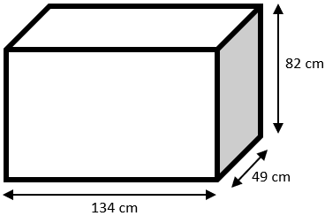
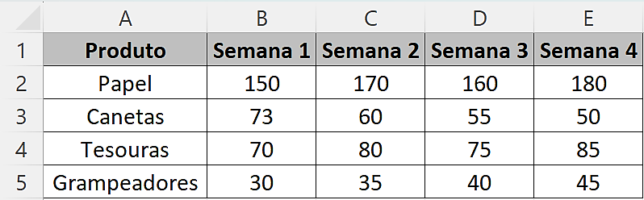

# PROVA — CÂMARA MUNICIPAL DE ARARAQUARA/SP — CONCURSO PÚBLICO 2003 — AGENTE ADMINISTRATIVO

## 1. Análise geral da prova

**Identificação da prova:**

- **Concurso:** Concurso Público — Câmara Municipal de Araraquara/SP (Instituto Consulplan)
- **Cargo:** Agente Administrativo
- **Ano:** 2003 (prova TARDE | TIPO 1 – BRANCA)
- **Estrutura:** 60 questões objetivas (A–E): Língua Portuguesa (01–20), Raciocínio Lógico-Matemático (21–35), Informática (36–50), Legislação Municipal (51–60)

**Composição quantitativa:**

| Item | Quantidade |
|---|---|
| Total de questões | 60 |
| Textos de apoio compartilhados (grupos) | 2 (conto de Caio Fernando Abreu: Q01–Q09; texto de Milton Santos: Q11–Q20) |
| Imagens de conteúdo | 2 (caixa de aço Q23, planilha Excel Q37) |
| Gráficos e tabelas | 1 (planilha Excel da Q37) |
| Grupos identificados | 2 |
| Questões independentes | 40 |

**Composição por bloco:**

| Bloco | Questões | Quantidade |
|---|---|---|
| Língua Portuguesa | 01–20 | 20 |
| Raciocínio Lógico-Matemático | 21–35 | 15 |
| Informática | 36–50 | 15 |
| Legislação Municipal | 51–60 | 10 |

**Observações sobre a estrutura original:**

- A questão 10 é independente, embora esteja posicionada entre os dois grupos de texto da prova original.
- Imagens não vinculadas a questões (logotipos da capa e do cabeçalho, incluindo a página 17 que contém apenas o logotipo do Instituto Consulplan) foram descartadas.

> **Transcrição integral da capa, das instruções e do aviso final (conforme extraída do PDF):**
> 
> > 
> > 
> > Agente Administrativo
> > 
> > 
> > Câmara Municipal de
> > Araraquara/SP
> > PROVA 7IPO-%5$1&$
> > TARDE
> > Concurso Público
> > (dital4
> > 
> > 
> > INSTRUÇÕES
> > 
> > 1. Somente será permitida a utilização de caneta esferográfica de tinta azul ou preta, feita de material transparente e de ponta grossa.
> > 2. É proibida, durante a realização das provas, a comunicação entre os candidatos e a utilização de máquinas calculadoras e/ou
> > similares, livros, anotações, impressos ou qualquer outro material de consulta, protetor auricular, lápis, borracha ou corre-
> > tivo. Especificamente, não será permitido ao candidato ingressar na sala de provas sem o devido recolhimento, com respec-
> > tiva identificação, dos seguintes equipamentos: bip, telefone celular, walkman, agenda eletrônica, notebook, palmtop, ipod,
> > ipad, tablet, smartphone, mp3, mp4, receptor, gravador, máquina de calcular, máquina fotográfica, controle de alarme de
> > veículo, relógio de qualquer modelo, pulseiras magnéticas e similares etc., o que não acarreta em qualquer responsabilidade
> > do Instituto Consulplan sobre tais equipamentos.
> > 3. Com vistas à garantia da segurança e da integridade do certame, no dia da realização das provas escritas, os candidatos serão
> > submetidos ao sistema de detecção de metais na entrada e na saída dos sanitários. Excepcionalmente, poderão ser realiza-
> > dos, a qualquer tempo durante a realização das provas, outros procedimentos de vistoria além do descrito.
> > 4. As provas terão duração de três horas e trinta minutos para os cargos de Analista de Comunicação Social, Analista em Comuni-
> > cação Visual, Analista em Informação, Cerimonialista, Contador, Tradutor e Intérprete de Libras, Técnico em Informática, Agente
> > Administrativo e Condutor de Veículo e cinco horas para os cargos de Analista de Controle Interno, Analista em Gestão de Pes-
> > soas, Analista Legislativo, Consultor Legislativo, Jornalista e Procurador. Esse período abrange a assinatura, assim como a trans-
> > crição das respostas para o Cartão de Respostas (gabarito) e o preenchimento da Folha de Textos Definitivos (Prova Discursiva),
> > quando houver.
> > 5. O caderno de provas é composto por sessenta questões para os cargos de nível superior, médio e médio técnico e cinquenta ques-
> > tões para o cargo de nível fundamental.
> > 6. As questões das provas objetivas são do tipo múltipla escolha, com cinco opções (A a E) e uma única resposta correta. Ao ter-
> > minar a prova, o candidato, obrigatoriamente, deverá devolver ao Fiscal de Aplicação o Cartão de Respostas (gabarito) e a Folha
> > de Textos Definitivos (Prova Discursiva), quando houver, devidamente assinados nos locais indicados.
> > 7. Ao receber o material de realização das provas, o candidato deverá conferir atentamente se o caderno de provas contém o número
> > de questões previsto, se corresponde ao cargo a que está concorrendo, bem como se os dados constantes no Cartão de Respostas
> > (gabarito) e na Folha de Textos Definitivos (Prova Discursiva) estão corretos. Caso os dados estejam incorretos, ou o material esteja
> > incompleto ou, ainda, detenha qualquer imperfeição, o candidato deverá informar tal ocorrência ao Fiscal de Aplicação, não cabendo
> > reclamações posteriores nesse sentido.
> > 8. Os Fiscais de Aplicação não estão autorizados a emitir opinião nem prestar esclarecimentos sobre o conteúdo das provas.
> > Cabe única e exclusivamente ao candidato interpretar e decidir.
> > 9. Não é permitida a anotação de informações relativas às suas respostas (cópia de gabarito) no comprovante de inscrição ou
> > em qualquer outro meio.
> > 10. O candidato poderá se retirar do local de provas somente a partir dos noventa minutos do início de sua realização, contudo
> > não poderá levar consigo o caderno de provas. O candidato somente poderá se retirar do local de realização das provas
> > levando o caderno de provas no decurso dos últimos trinta minutos anteriores ao horário previsto para o seu término.
> > 11. Os três últimos candidatos de cada sala só poderão sair juntos. Caso algum candidato insista em sair do local de aplicação
> > antes de autorizado pelo Fiscal de Aplicação, será lavrado Termo de Ocorrência, assinado pelo candidato e testemunhado
> > pelos outros dois candidatos, pelo Fiscal de Aplicação da sala e pelo Coordenador da Unidade de Provas, para posterior aná-
> > lise pela Comissão Especial Para Realização de Concurso Público.
> > RESULTADOS E RECURSOS
> > 
> > - Os gabaritos oficiais preliminares das provas objetivas serão divulgados na internet, no endereço eletrônico www.institutoconsulplan.org.br,
> > a partir das 16h da segunda-feira subsequente à realização das provas.
> > - O candidato que desejar interpor recursos contra os gabaritos oficiais preliminares das provas objetivas deverá fazê-lo apenas em
> > requerimento próprio, disponibilizado no link correlato ao Concurso Público, no endereço eletrônico www.institutoconsulplan.org.br.
> > - A interposição de recursos deverá ser feita apenas no prazo recursal, conforme informações contidas no edital do certame.
> >
> > ATENÇÃO
> > NÃO é permitida a anotação das respostas da prova em nenhum meio.
> > O candidato flagrado nessa conduta poderá ser eliminado do processo.

---

## 2. Questões agrupadas

### GRUPO 01 — Texto “Eu deveria cantar...” (Caio Fernando Abreu) — questões 01 a 09

**Questões relacionadas:** 01, 02, 03, 04, 05, 06, 07, 08, 09.

**Material de apoio compartilhado:**

> Texto para responder às questões de 01 a 09.
> Eu deveria cantar.
> Rolar de rir ou chorar, eu deveria, mas tinha desaprendido essas coisas. Talvez então pudesse acender uma vela, correr
> até a igreja da Consolação, rezar um Pai Nosso, uma Ave Maria e uma Glória ao Pai, tudo que eu lembrava, depois enfiar algum
> trocado, se tivesse, e nos últimos meses nunca, na caixa de metal “Para as Almas do Purgatório”. Agradecer, pedir luz, como
> nos tempos em que tinha fé.
> Bons tempos aqueles, pensei. Acendi um cigarro. E não tomei nenhuma dessas atitudes, dramáticas como se em algum
> canto houvesse sempre uma câmera cinematográfica à minha espreita. Ou Deus. Sem juiz nem plateia, sem close nem zoom,
> fiquei ali parado no começo da tarde escaldante de fevereiro, olhando o telefone que acabara de desligar. Nem sequer fiz o
> sinal da cruz ou levantei os olhos para o céu. O mínimo, suponho, que um sujeito tem a obrigação de fazer nesses casos, mesmo
> sem nenhuma fé, como se reagisse a uma espécie de reflexo condicionado místico.
> Acontecera um milagre. Um milagre à toa, mas básico para quem, como eu, não tinha pais ricos, dinheiro aplicado, imóveis,
> nem herança e apenas tentava viver sozinho numa cidade infernal como aquela que trepidava lá fora, além da janela ainda
> fechada do apartamento. Nada muito sensacional, tipo recuperar de súbito a visão ou erguer-se da cadeira de rodas com o
> semblante beatificado e a leveza de quem pisa sobre as águas. Embora a miopia ficasse cada vez mais aguda e os joelhos
> tremessem com frequência, não sabia se fome crônica ou pura tristeza, meus olhos e pernas ainda funcionavam razoavelmente.
> Outros órgãos, verdade, bem menos.
> Toquei o pescoço. E o cérebro, por exemplo.
> Já chega, disse para mim mesmo, parado nu no meio da penumbra gosmenta do meio-dia. Pense nesse milagre, homem.
> Singelo, quase insignificante na sua simplicidade, o pequeno milagre capaz de trazer alguma paz àquela série de solavancos sem
> rumo nem ritmo que eu, com certa complacência e nenhuma originalidade, estava habituado a chamar de minha vida, tinha
> um nome. Chamava-se – um emprego.
> (ABREU, Caio Fernando. Onde andará Dulce Veiga? São Paulo: Planeta De Agostini, 2003, p. 11-12.)

---

#### QUESTÃO 01

⚠️ **Gabarito: oficial não disponível**

**Material de apoio:**

> Texto para responder às questões de 01 a 09.
> Eu deveria cantar.
> Rolar de rir ou chorar, eu deveria, mas tinha desaprendido essas coisas. Talvez então pudesse acender uma vela, correr
> até a igreja da Consolação, rezar um Pai Nosso, uma Ave Maria e uma Glória ao Pai, tudo que eu lembrava, depois enfiar algum
> trocado, se tivesse, e nos últimos meses nunca, na caixa de metal “Para as Almas do Purgatório”. Agradecer, pedir luz, como
> nos tempos em que tinha fé.
> Bons tempos aqueles, pensei. Acendi um cigarro. E não tomei nenhuma dessas atitudes, dramáticas como se em algum
> canto houvesse sempre uma câmera cinematográfica à minha espreita. Ou Deus. Sem juiz nem plateia, sem close nem zoom,
> fiquei ali parado no começo da tarde escaldante de fevereiro, olhando o telefone que acabara de desligar. Nem sequer fiz o
> sinal da cruz ou levantei os olhos para o céu. O mínimo, suponho, que um sujeito tem a obrigação de fazer nesses casos, mesmo
> sem nenhuma fé, como se reagisse a uma espécie de reflexo condicionado místico.
> Acontecera um milagre. Um milagre à toa, mas básico para quem, como eu, não tinha pais ricos, dinheiro aplicado, imóveis,
> nem herança e apenas tentava viver sozinho numa cidade infernal como aquela que trepidava lá fora, além da janela ainda
> fechada do apartamento. Nada muito sensacional, tipo recuperar de súbito a visão ou erguer-se da cadeira de rodas com o
> semblante beatificado e a leveza de quem pisa sobre as águas. Embora a miopia ficasse cada vez mais aguda e os joelhos
> tremessem com frequência, não sabia se fome crônica ou pura tristeza, meus olhos e pernas ainda funcionavam razoavelmente.
> Outros órgãos, verdade, bem menos.
> Toquei o pescoço. E o cérebro, por exemplo.
> Já chega, disse para mim mesmo, parado nu no meio da penumbra gosmenta do meio-dia. Pense nesse milagre, homem.
> Singelo, quase insignificante na sua simplicidade, o pequeno milagre capaz de trazer alguma paz àquela série de solavancos sem
> rumo nem ritmo que eu, com certa complacência e nenhuma originalidade, estava habituado a chamar de minha vida, tinha
> um nome. Chamava-se – um emprego.
> (ABREU, Caio Fernando. Onde andará Dulce Veiga? São Paulo: Planeta De Agostini, 2003, p. 11-12.)

**Enunciado:**

O texto em análise pertence ao gênero narrativo e apresenta um potencial de eventos interligados em uma sequência
temporal, baseados em fatos reais. Contribuem, para isso, os seguintes elementos linguísticos relacionados, EXCETO:

**Alternativas:**

A) O tempo passado como predominante.

B) O uso de verbos de ação que dá progressão ao conto.

C) O foco narrativo atribuído pelo narrador em primeira pessoa.

D) O narrador protagonista que conduz a sequência de acontecimentos do enredo.

E) O tempo psicológico, marcado por flashbacks, como predominante na narrativa.

**Referências visuais:**

Nenhuma.

---

#### QUESTÃO 02

⚠️ **Gabarito: oficial não disponível**

**Material de apoio:**

> Texto para responder às questões de 01 a 09.
> Eu deveria cantar.
> Rolar de rir ou chorar, eu deveria, mas tinha desaprendido essas coisas. Talvez então pudesse acender uma vela, correr
> até a igreja da Consolação, rezar um Pai Nosso, uma Ave Maria e uma Glória ao Pai, tudo que eu lembrava, depois enfiar algum
> trocado, se tivesse, e nos últimos meses nunca, na caixa de metal “Para as Almas do Purgatório”. Agradecer, pedir luz, como
> nos tempos em que tinha fé.
> Bons tempos aqueles, pensei. Acendi um cigarro. E não tomei nenhuma dessas atitudes, dramáticas como se em algum
> canto houvesse sempre uma câmera cinematográfica à minha espreita. Ou Deus. Sem juiz nem plateia, sem close nem zoom,
> fiquei ali parado no começo da tarde escaldante de fevereiro, olhando o telefone que acabara de desligar. Nem sequer fiz o
> sinal da cruz ou levantei os olhos para o céu. O mínimo, suponho, que um sujeito tem a obrigação de fazer nesses casos, mesmo
> sem nenhuma fé, como se reagisse a uma espécie de reflexo condicionado místico.
> Acontecera um milagre. Um milagre à toa, mas básico para quem, como eu, não tinha pais ricos, dinheiro aplicado, imóveis,
> nem herança e apenas tentava viver sozinho numa cidade infernal como aquela que trepidava lá fora, além da janela ainda
> fechada do apartamento. Nada muito sensacional, tipo recuperar de súbito a visão ou erguer-se da cadeira de rodas com o
> semblante beatificado e a leveza de quem pisa sobre as águas. Embora a miopia ficasse cada vez mais aguda e os joelhos
> tremessem com frequência, não sabia se fome crônica ou pura tristeza, meus olhos e pernas ainda funcionavam razoavelmente.
> Outros órgãos, verdade, bem menos.
> Toquei o pescoço. E o cérebro, por exemplo.
> Já chega, disse para mim mesmo, parado nu no meio da penumbra gosmenta do meio-dia. Pense nesse milagre, homem.
> Singelo, quase insignificante na sua simplicidade, o pequeno milagre capaz de trazer alguma paz àquela série de solavancos sem
> rumo nem ritmo que eu, com certa complacência e nenhuma originalidade, estava habituado a chamar de minha vida, tinha
> um nome. Chamava-se – um emprego.
> (ABREU, Caio Fernando. Onde andará Dulce Veiga? São Paulo: Planeta De Agostini, 2003, p. 11-12.)

**Enunciado:**

No excerto “Nada muito sensacional, tipo recuperar de súbito a visão ou erguer-se da cadeira de rodas com o semblante
beatificado e a leveza de quem pisa sobre as águas.” (4º§), os termos grifados têm sua classificação morfológica correta-
mente assinalada em:

**Alternativas:**

A) Conjunção.

B) Preposição.

C) Interjeição.

D) Artigo definido.

E) Pronome oblíquo.

**Referências visuais:**

Nenhuma.

---

#### QUESTÃO 03

⚠️ **Gabarito: oficial não disponível**

**Material de apoio:**

> Texto para responder às questões de 01 a 09.
> Eu deveria cantar.
> Rolar de rir ou chorar, eu deveria, mas tinha desaprendido essas coisas. Talvez então pudesse acender uma vela, correr
> até a igreja da Consolação, rezar um Pai Nosso, uma Ave Maria e uma Glória ao Pai, tudo que eu lembrava, depois enfiar algum
> trocado, se tivesse, e nos últimos meses nunca, na caixa de metal “Para as Almas do Purgatório”. Agradecer, pedir luz, como
> nos tempos em que tinha fé.
> Bons tempos aqueles, pensei. Acendi um cigarro. E não tomei nenhuma dessas atitudes, dramáticas como se em algum
> canto houvesse sempre uma câmera cinematográfica à minha espreita. Ou Deus. Sem juiz nem plateia, sem close nem zoom,
> fiquei ali parado no começo da tarde escaldante de fevereiro, olhando o telefone que acabara de desligar. Nem sequer fiz o
> sinal da cruz ou levantei os olhos para o céu. O mínimo, suponho, que um sujeito tem a obrigação de fazer nesses casos, mesmo
> sem nenhuma fé, como se reagisse a uma espécie de reflexo condicionado místico.
> Acontecera um milagre. Um milagre à toa, mas básico para quem, como eu, não tinha pais ricos, dinheiro aplicado, imóveis,
> nem herança e apenas tentava viver sozinho numa cidade infernal como aquela que trepidava lá fora, além da janela ainda
> fechada do apartamento. Nada muito sensacional, tipo recuperar de súbito a visão ou erguer-se da cadeira de rodas com o
> semblante beatificado e a leveza de quem pisa sobre as águas. Embora a miopia ficasse cada vez mais aguda e os joelhos
> tremessem com frequência, não sabia se fome crônica ou pura tristeza, meus olhos e pernas ainda funcionavam razoavelmente.
> Outros órgãos, verdade, bem menos.
> Toquei o pescoço. E o cérebro, por exemplo.
> Já chega, disse para mim mesmo, parado nu no meio da penumbra gosmenta do meio-dia. Pense nesse milagre, homem.
> Singelo, quase insignificante na sua simplicidade, o pequeno milagre capaz de trazer alguma paz àquela série de solavancos sem
> rumo nem ritmo que eu, com certa complacência e nenhuma originalidade, estava habituado a chamar de minha vida, tinha
> um nome. Chamava-se – um emprego.
> (ABREU, Caio Fernando. Onde andará Dulce Veiga? São Paulo: Planeta De Agostini, 2003, p. 11-12.)

**Enunciado:**

Em relação à acentuação gráfica, assinale, a seguir, a alternativa que apresenta palavras do texto que sejam trissílabas e
proparoxítonas.

**Alternativas:**

A) Místico; súbito; e cérebro.

B) Crônica; frequência; e céu.

C) Purgatório; dramáticas; e águas.

D) Câmera; imóveis; e complacência.

E) Glória; cinematográfica; e frequência.

**Referências visuais:**

Nenhuma.

---

#### QUESTÃO 04

⚠️ **Gabarito: oficial não disponível**

**Material de apoio:**

> Texto para responder às questões de 01 a 09.
> Eu deveria cantar.
> Rolar de rir ou chorar, eu deveria, mas tinha desaprendido essas coisas. Talvez então pudesse acender uma vela, correr
> até a igreja da Consolação, rezar um Pai Nosso, uma Ave Maria e uma Glória ao Pai, tudo que eu lembrava, depois enfiar algum
> trocado, se tivesse, e nos últimos meses nunca, na caixa de metal “Para as Almas do Purgatório”. Agradecer, pedir luz, como
> nos tempos em que tinha fé.
> Bons tempos aqueles, pensei. Acendi um cigarro. E não tomei nenhuma dessas atitudes, dramáticas como se em algum
> canto houvesse sempre uma câmera cinematográfica à minha espreita. Ou Deus. Sem juiz nem plateia, sem close nem zoom,
> fiquei ali parado no começo da tarde escaldante de fevereiro, olhando o telefone que acabara de desligar. Nem sequer fiz o
> sinal da cruz ou levantei os olhos para o céu. O mínimo, suponho, que um sujeito tem a obrigação de fazer nesses casos, mesmo
> sem nenhuma fé, como se reagisse a uma espécie de reflexo condicionado místico.
> Acontecera um milagre. Um milagre à toa, mas básico para quem, como eu, não tinha pais ricos, dinheiro aplicado, imóveis,
> nem herança e apenas tentava viver sozinho numa cidade infernal como aquela que trepidava lá fora, além da janela ainda
> fechada do apartamento. Nada muito sensacional, tipo recuperar de súbito a visão ou erguer-se da cadeira de rodas com o
> semblante beatificado e a leveza de quem pisa sobre as águas. Embora a miopia ficasse cada vez mais aguda e os joelhos
> tremessem com frequência, não sabia se fome crônica ou pura tristeza, meus olhos e pernas ainda funcionavam razoavelmente.
> Outros órgãos, verdade, bem menos.
> Toquei o pescoço. E o cérebro, por exemplo.
> Já chega, disse para mim mesmo, parado nu no meio da penumbra gosmenta do meio-dia. Pense nesse milagre, homem.
> Singelo, quase insignificante na sua simplicidade, o pequeno milagre capaz de trazer alguma paz àquela série de solavancos sem
> rumo nem ritmo que eu, com certa complacência e nenhuma originalidade, estava habituado a chamar de minha vida, tinha
> um nome. Chamava-se – um emprego.
> (ABREU, Caio Fernando. Onde andará Dulce Veiga? São Paulo: Planeta De Agostini, 2003, p. 11-12.)

**Enunciado:**

Caio Fernando Abreu foi um transgressor, autor de uma obra autoconfessional. Fascinado pelo tema da individualidade, por
vezes sombrio, voltou a ter enorme popularidade nestes tempos de mídias sociais. Em relação ao texto apresentado, de Caio
Fernando Abreu, é correto afirmar que:

**Alternativas:**

A) Utiliza a pessoalidade gramatical, já que tem a intenção de especificar um posicionamento.

B) Assinala a necessidade de “arranjar um emprego” fora dos contextos sociais da época atual.

C) Apresenta um predomínio de sequências textuais injuntivas e expositivas, características dos textos narrativos.

D) Emprega a expressão “Para as Almas do Purgatório” entre aspas para destacar uma inadequação ideológica do termo.

E) Aborda, através da exposição de fatos, isto é, de uma história, um tema bastante corriqueiro e contemporâneo da sociedade atual.

**Referências visuais:**

Nenhuma.

---

#### QUESTÃO 05

⚠️ **Gabarito: oficial não disponível**

**Material de apoio:**

> Texto para responder às questões de 01 a 09.
> Eu deveria cantar.
> Rolar de rir ou chorar, eu deveria, mas tinha desaprendido essas coisas. Talvez então pudesse acender uma vela, correr
> até a igreja da Consolação, rezar um Pai Nosso, uma Ave Maria e uma Glória ao Pai, tudo que eu lembrava, depois enfiar algum
> trocado, se tivesse, e nos últimos meses nunca, na caixa de metal “Para as Almas do Purgatório”. Agradecer, pedir luz, como
> nos tempos em que tinha fé.
> Bons tempos aqueles, pensei. Acendi um cigarro. E não tomei nenhuma dessas atitudes, dramáticas como se em algum
> canto houvesse sempre uma câmera cinematográfica à minha espreita. Ou Deus. Sem juiz nem plateia, sem close nem zoom,
> fiquei ali parado no começo da tarde escaldante de fevereiro, olhando o telefone que acabara de desligar. Nem sequer fiz o
> sinal da cruz ou levantei os olhos para o céu. O mínimo, suponho, que um sujeito tem a obrigação de fazer nesses casos, mesmo
> sem nenhuma fé, como se reagisse a uma espécie de reflexo condicionado místico.
> Acontecera um milagre. Um milagre à toa, mas básico para quem, como eu, não tinha pais ricos, dinheiro aplicado, imóveis,
> nem herança e apenas tentava viver sozinho numa cidade infernal como aquela que trepidava lá fora, além da janela ainda
> fechada do apartamento. Nada muito sensacional, tipo recuperar de súbito a visão ou erguer-se da cadeira de rodas com o
> semblante beatificado e a leveza de quem pisa sobre as águas. Embora a miopia ficasse cada vez mais aguda e os joelhos
> tremessem com frequência, não sabia se fome crônica ou pura tristeza, meus olhos e pernas ainda funcionavam razoavelmente.
> Outros órgãos, verdade, bem menos.
> Toquei o pescoço. E o cérebro, por exemplo.
> Já chega, disse para mim mesmo, parado nu no meio da penumbra gosmenta do meio-dia. Pense nesse milagre, homem.
> Singelo, quase insignificante na sua simplicidade, o pequeno milagre capaz de trazer alguma paz àquela série de solavancos sem
> rumo nem ritmo que eu, com certa complacência e nenhuma originalidade, estava habituado a chamar de minha vida, tinha
> um nome. Chamava-se – um emprego.
> (ABREU, Caio Fernando. Onde andará Dulce Veiga? São Paulo: Planeta De Agostini, 2003, p. 11-12.)

**Enunciado:**

Bechara (2019) denota que “a compreensão de texto consiste em analisar o que realmente está escrito, ou seja, coletar dados
do texto; e a interpretação consiste em saber o que se infere (conclui) do que está escrito”. Nesse contexto, é possível inferir
que o autor parte de uma situação particular para desenvolver a ideia central do texto, como é possível evidenciar em:

**Alternativas:**

A) A falta de apoio e de iniciativa para conseguir um emprego digno hoje em dia.

B) No conto, o autor se refere a um milagre que é arranjar um emprego para o personagem.

C) Há um número expressivo de pessoas desempregadas que se entregam à fé para conseguir um trabalho.

D) A linguagem simbólica “Para as Almas do Purgatório” demonstra a grandiosa fé atribuída ao personagem.

E) É bastante comum estar desempregado atualmente e não ter apoio de pessoas com disponibilidade para ajudar.

**Referências visuais:**

Nenhuma.

---

#### QUESTÃO 06

⚠️ **Gabarito: oficial não disponível**

**Material de apoio:**

> Texto para responder às questões de 01 a 09.
> Eu deveria cantar.
> Rolar de rir ou chorar, eu deveria, mas tinha desaprendido essas coisas. Talvez então pudesse acender uma vela, correr
> até a igreja da Consolação, rezar um Pai Nosso, uma Ave Maria e uma Glória ao Pai, tudo que eu lembrava, depois enfiar algum
> trocado, se tivesse, e nos últimos meses nunca, na caixa de metal “Para as Almas do Purgatório”. Agradecer, pedir luz, como
> nos tempos em que tinha fé.
> Bons tempos aqueles, pensei. Acendi um cigarro. E não tomei nenhuma dessas atitudes, dramáticas como se em algum
> canto houvesse sempre uma câmera cinematográfica à minha espreita. Ou Deus. Sem juiz nem plateia, sem close nem zoom,
> fiquei ali parado no começo da tarde escaldante de fevereiro, olhando o telefone que acabara de desligar. Nem sequer fiz o
> sinal da cruz ou levantei os olhos para o céu. O mínimo, suponho, que um sujeito tem a obrigação de fazer nesses casos, mesmo
> sem nenhuma fé, como se reagisse a uma espécie de reflexo condicionado místico.
> Acontecera um milagre. Um milagre à toa, mas básico para quem, como eu, não tinha pais ricos, dinheiro aplicado, imóveis,
> nem herança e apenas tentava viver sozinho numa cidade infernal como aquela que trepidava lá fora, além da janela ainda
> fechada do apartamento. Nada muito sensacional, tipo recuperar de súbito a visão ou erguer-se da cadeira de rodas com o
> semblante beatificado e a leveza de quem pisa sobre as águas. Embora a miopia ficasse cada vez mais aguda e os joelhos
> tremessem com frequência, não sabia se fome crônica ou pura tristeza, meus olhos e pernas ainda funcionavam razoavelmente.
> Outros órgãos, verdade, bem menos.
> Toquei o pescoço. E o cérebro, por exemplo.
> Já chega, disse para mim mesmo, parado nu no meio da penumbra gosmenta do meio-dia. Pense nesse milagre, homem.
> Singelo, quase insignificante na sua simplicidade, o pequeno milagre capaz de trazer alguma paz àquela série de solavancos sem
> rumo nem ritmo que eu, com certa complacência e nenhuma originalidade, estava habituado a chamar de minha vida, tinha
> um nome. Chamava-se – um emprego.
> (ABREU, Caio Fernando. Onde andará Dulce Veiga? São Paulo: Planeta De Agostini, 2003, p. 11-12.)

**Enunciado:**

A linguagem metafórica é marcada por forte emoções e representações, a fim de estabelecer um canal direto de comunica-
ção. Dessa forma, ela contribui para construir um sentido expressivo no texto. É possível inferir que há um exemplo de
linguagem metafórica ou simbólica em:

**Alternativas:**

A) “Eu deveria cantar.” (1º§).

B) “Acendi um cigarro.” (3º§).

C) “Nem sequer fiz o sinal da cruz ou levantei os olhos para o céu.” (3º§).

D) “Embora a miopia ficasse cada vez mais aguda e os joelhos tremessem com frequência, [...]” (4º§).

E) “Já chega, disse para mim mesmo, parado nu no meio da penumbra gosmenta do meio-dia.” (6º§).

**Referências visuais:**

Nenhuma.

---

#### QUESTÃO 07

⚠️ **Gabarito: oficial não disponível**

**Material de apoio:**

> Texto para responder às questões de 01 a 09.
> Eu deveria cantar.
> Rolar de rir ou chorar, eu deveria, mas tinha desaprendido essas coisas. Talvez então pudesse acender uma vela, correr
> até a igreja da Consolação, rezar um Pai Nosso, uma Ave Maria e uma Glória ao Pai, tudo que eu lembrava, depois enfiar algum
> trocado, se tivesse, e nos últimos meses nunca, na caixa de metal “Para as Almas do Purgatório”. Agradecer, pedir luz, como
> nos tempos em que tinha fé.
> Bons tempos aqueles, pensei. Acendi um cigarro. E não tomei nenhuma dessas atitudes, dramáticas como se em algum
> canto houvesse sempre uma câmera cinematográfica à minha espreita. Ou Deus. Sem juiz nem plateia, sem close nem zoom,
> fiquei ali parado no começo da tarde escaldante de fevereiro, olhando o telefone que acabara de desligar. Nem sequer fiz o
> sinal da cruz ou levantei os olhos para o céu. O mínimo, suponho, que um sujeito tem a obrigação de fazer nesses casos, mesmo
> sem nenhuma fé, como se reagisse a uma espécie de reflexo condicionado místico.
> Acontecera um milagre. Um milagre à toa, mas básico para quem, como eu, não tinha pais ricos, dinheiro aplicado, imóveis,
> nem herança e apenas tentava viver sozinho numa cidade infernal como aquela que trepidava lá fora, além da janela ainda
> fechada do apartamento. Nada muito sensacional, tipo recuperar de súbito a visão ou erguer-se da cadeira de rodas com o
> semblante beatificado e a leveza de quem pisa sobre as águas. Embora a miopia ficasse cada vez mais aguda e os joelhos
> tremessem com frequência, não sabia se fome crônica ou pura tristeza, meus olhos e pernas ainda funcionavam razoavelmente.
> Outros órgãos, verdade, bem menos.
> Toquei o pescoço. E o cérebro, por exemplo.
> Já chega, disse para mim mesmo, parado nu no meio da penumbra gosmenta do meio-dia. Pense nesse milagre, homem.
> Singelo, quase insignificante na sua simplicidade, o pequeno milagre capaz de trazer alguma paz àquela série de solavancos sem
> rumo nem ritmo que eu, com certa complacência e nenhuma originalidade, estava habituado a chamar de minha vida, tinha
> um nome. Chamava-se – um emprego.
> (ABREU, Caio Fernando. Onde andará Dulce Veiga? São Paulo: Planeta De Agostini, 2003, p. 11-12.)

**Enunciado:**

Considerando o contexto, é possível concluir que a expressão em destaque em “Um milagre à toa, mas básico para quem,
como eu, não tinha pais ricos, dinheiro aplicado, imóveis, nem herança e apenas tentava viver sozinho numa cidade infernal
como aquela que trepidava lá fora, além da janela ainda fechada do apartamento.” (4º§) assevera o seguinte significado:

**Alternativas:**

A) É própria do inferno; demoníaca; satânica.

B) É excessivamente mal; intolerável; insuportável.

C) Possui características superiores; excelente ou admirável.

D) Causa desconforto pelo excesso de violência ou de intensidade.

E) É comparável com o inferno pelo tormento que desperta; diabólica.

**Referências visuais:**

Nenhuma.

---

#### QUESTÃO 08

⚠️ **Gabarito: oficial não disponível**

**Material de apoio:**

> Texto para responder às questões de 01 a 09.
> Eu deveria cantar.
> Rolar de rir ou chorar, eu deveria, mas tinha desaprendido essas coisas. Talvez então pudesse acender uma vela, correr
> até a igreja da Consolação, rezar um Pai Nosso, uma Ave Maria e uma Glória ao Pai, tudo que eu lembrava, depois enfiar algum
> trocado, se tivesse, e nos últimos meses nunca, na caixa de metal “Para as Almas do Purgatório”. Agradecer, pedir luz, como
> nos tempos em que tinha fé.
> Bons tempos aqueles, pensei. Acendi um cigarro. E não tomei nenhuma dessas atitudes, dramáticas como se em algum
> canto houvesse sempre uma câmera cinematográfica à minha espreita. Ou Deus. Sem juiz nem plateia, sem close nem zoom,
> fiquei ali parado no começo da tarde escaldante de fevereiro, olhando o telefone que acabara de desligar. Nem sequer fiz o
> sinal da cruz ou levantei os olhos para o céu. O mínimo, suponho, que um sujeito tem a obrigação de fazer nesses casos, mesmo
> sem nenhuma fé, como se reagisse a uma espécie de reflexo condicionado místico.
> Acontecera um milagre. Um milagre à toa, mas básico para quem, como eu, não tinha pais ricos, dinheiro aplicado, imóveis,
> nem herança e apenas tentava viver sozinho numa cidade infernal como aquela que trepidava lá fora, além da janela ainda
> fechada do apartamento. Nada muito sensacional, tipo recuperar de súbito a visão ou erguer-se da cadeira de rodas com o
> semblante beatificado e a leveza de quem pisa sobre as águas. Embora a miopia ficasse cada vez mais aguda e os joelhos
> tremessem com frequência, não sabia se fome crônica ou pura tristeza, meus olhos e pernas ainda funcionavam razoavelmente.
> Outros órgãos, verdade, bem menos.
> Toquei o pescoço. E o cérebro, por exemplo.
> Já chega, disse para mim mesmo, parado nu no meio da penumbra gosmenta do meio-dia. Pense nesse milagre, homem.
> Singelo, quase insignificante na sua simplicidade, o pequeno milagre capaz de trazer alguma paz àquela série de solavancos sem
> rumo nem ritmo que eu, com certa complacência e nenhuma originalidade, estava habituado a chamar de minha vida, tinha
> um nome. Chamava-se – um emprego.
> (ABREU, Caio Fernando. Onde andará Dulce Veiga? São Paulo: Planeta De Agostini, 2003, p. 11-12.)

**Enunciado:**

A fim de construir sentidos, considera-se que a estratégia pela qual as palavras se correlacionam é fundamental e decisiva.
Assim sendo, assinale a associação INADEQUADA em relação à significação das palavras, tendo em vista o contexto em que
se encontram empregadas.

**Alternativas:**

A) “[...] como se reagisse a uma espécie de reflexo condicionado místico.” (3º§) – incompreensível.

B) “Já chega, disse para mim mesmo, parado nu no meio da penumbra gosmenta do meio-dia.” (6º§) – claridade.

C) “[...] erguer-se da cadeira de rodas com o semblante beatificado e a leveza de quem pisa sobre as águas.” (4º§) – glorificado.

D) “[...] fiquei ali parado no começo da tarde escaldante de fevereiro, olhando o telefone que acabara de desligar.” (3º§) – quente.

E) “[...] que eu, com certa complacência e nenhuma originalidade, estava habituado a chamar de minha vida, [...]” (6º§) – satisfação.

**Referências visuais:**

Nenhuma.

---

#### QUESTÃO 09

⚠️ **Gabarito: oficial não disponível**

**Material de apoio:**

> Texto para responder às questões de 01 a 09.
> Eu deveria cantar.
> Rolar de rir ou chorar, eu deveria, mas tinha desaprendido essas coisas. Talvez então pudesse acender uma vela, correr
> até a igreja da Consolação, rezar um Pai Nosso, uma Ave Maria e uma Glória ao Pai, tudo que eu lembrava, depois enfiar algum
> trocado, se tivesse, e nos últimos meses nunca, na caixa de metal “Para as Almas do Purgatório”. Agradecer, pedir luz, como
> nos tempos em que tinha fé.
> Bons tempos aqueles, pensei. Acendi um cigarro. E não tomei nenhuma dessas atitudes, dramáticas como se em algum
> canto houvesse sempre uma câmera cinematográfica à minha espreita. Ou Deus. Sem juiz nem plateia, sem close nem zoom,
> fiquei ali parado no começo da tarde escaldante de fevereiro, olhando o telefone que acabara de desligar. Nem sequer fiz o
> sinal da cruz ou levantei os olhos para o céu. O mínimo, suponho, que um sujeito tem a obrigação de fazer nesses casos, mesmo
> sem nenhuma fé, como se reagisse a uma espécie de reflexo condicionado místico.
> Acontecera um milagre. Um milagre à toa, mas básico para quem, como eu, não tinha pais ricos, dinheiro aplicado, imóveis,
> nem herança e apenas tentava viver sozinho numa cidade infernal como aquela que trepidava lá fora, além da janela ainda
> fechada do apartamento. Nada muito sensacional, tipo recuperar de súbito a visão ou erguer-se da cadeira de rodas com o
> semblante beatificado e a leveza de quem pisa sobre as águas. Embora a miopia ficasse cada vez mais aguda e os joelhos
> tremessem com frequência, não sabia se fome crônica ou pura tristeza, meus olhos e pernas ainda funcionavam razoavelmente.
> Outros órgãos, verdade, bem menos.
> Toquei o pescoço. E o cérebro, por exemplo.
> Já chega, disse para mim mesmo, parado nu no meio da penumbra gosmenta do meio-dia. Pense nesse milagre, homem.
> Singelo, quase insignificante na sua simplicidade, o pequeno milagre capaz de trazer alguma paz àquela série de solavancos sem
> rumo nem ritmo que eu, com certa complacência e nenhuma originalidade, estava habituado a chamar de minha vida, tinha
> um nome. Chamava-se – um emprego.
> (ABREU, Caio Fernando. Onde andará Dulce Veiga? São Paulo: Planeta De Agostini, 2003, p. 11-12.)

**Enunciado:**

Tendo em vista que o valor de um conectivo é fundamentado no contexto em que se encontra, podemos afirmar que a
conjunção “mas” em “Rolar de rir ou chorar, eu deveria, mas tinha desaprendido essas coisas.” (2º§), manteria o sentido que
expressa, caso fosse substituída por:

**Alternativas:**

A) Embora.

B) Contudo.

C) Ademais.

D) Ainda que.

E) Porquanto.

**Referências visuais:**

Nenhuma.

---

### GRUPO 02 — Texto “Há cidadãos neste país?” (Milton Santos) — questões 11 a 20

**Questões relacionadas:** 11, 12, 13, 14, 15, 16, 17, 18, 19, 20.

**Material de apoio compartilhado:**

> Texto para responder às questões de 11 a 20.
> Há cidadãos neste país?
> Cabem, pelo menos, duas perguntas em um país onde a figura do cidadão é tão esquecida. Quantos habitantes, no Brasil,
> são cidadãos? Quantos nem sequer sabem que não o são?
> O simples nascer investe o indivíduo de uma soma inalienável de direitos, apenas pelo fato de ingressar na sociedade
> humana. Viver, tornar-se de um ser no mundo, é assumir, com os demais, uma herança moral, que faz de cada qual um portador
> de prerrogativas sociais. Direito a um teto, à comida, à educação, à saúde, à proteção contra o frio, a chuva, as intempéries;
> direito ao trabalho, à justiça, à liberdade e a uma existência digna.
> O discurso das liberdades humanas e dos direitos seus garantidores é, certamente, ainda mais vasto. Tantas vezes
> proclamado e repetido, tantas vezes menosprezado. É isso, justamente, o que faz a diferença entre a retórica e o fato. O respeito
> ao indivíduo é a consagração da cidadania, pela qual uma lista de princípios gerais e abstratos se impõem como um corpo de
> direitos concretos individualizados. A cidadania é uma lei da sociedade que, sem distinção, atinge a todos e investe cada qual
> com a força de se ver respeitado contra a força, em qualquer circunstância.
> A cidadania, sem dúvida, se aprende. É assim que ela se torna um estado de espírito, enraizado na cultura. É, talvez, nesse
> sentido, que se costuma dizer que a liberdade não é uma dádiva, mas uma conquista, uma conquista a se manter. Ameaçada
> por um cotidiano implacável, não basta à cidadania ser um estado de espírito ou uma declaração de intenções. Ela tem o seu
> corpo e os seus limites como uma situação social, jurídica e política. Para ser mantida pelas gerações sucessivas, para ter eficácia
> e ser fonte de direitos, ela deve se inscrever na própria letra das leis, mediante dispositivos institucionais que assegurem a
> fruição das prerrogativas pactuadas e, sempre que haja recusa, o direito de reclamar e ser ouvido.
> A cidadania pode começar por definições abstratas, cabíveis em qualquer tempo e lugar, mas para ser válida deve poder
> ser reclamada. A metamorfose dessa liberdade teórica em direito positivo depende de condições concretas, como a natureza
> do Estado e do regime, o tipo de sociedade estabelecida e o grau de pugnacidade que vem da consciência possível dentro da
> sociedade civil em movimento. É por isso que, desse ponto de vista, a situação dos indivíduos não é imutável, está sujeita a
> retrocessos e avanços. Os homens, pela sua própria essência, buscam a liberdade. Não a procuram com a mesma determinação
> porque o seu grau de entendimento do mundo não é o mesmo. As sociedades, pela sua própria história, são mais ou menos
> abertas às conquistas do homem.
> (SANTOS, Milton. O espaço do cidadão. 7. ed. São Paulo: Edusp, 2007. p. 19. Adaptado.)

---

#### QUESTÃO 11

⚠️ **Gabarito: oficial não disponível**

**Material de apoio:**

> Texto para responder às questões de 11 a 20.
> Há cidadãos neste país?
> Cabem, pelo menos, duas perguntas em um país onde a figura do cidadão é tão esquecida. Quantos habitantes, no Brasil,
> são cidadãos? Quantos nem sequer sabem que não o são?
> O simples nascer investe o indivíduo de uma soma inalienável de direitos, apenas pelo fato de ingressar na sociedade
> humana. Viver, tornar-se de um ser no mundo, é assumir, com os demais, uma herança moral, que faz de cada qual um portador
> de prerrogativas sociais. Direito a um teto, à comida, à educação, à saúde, à proteção contra o frio, a chuva, as intempéries;
> direito ao trabalho, à justiça, à liberdade e a uma existência digna.
> O discurso das liberdades humanas e dos direitos seus garantidores é, certamente, ainda mais vasto. Tantas vezes
> proclamado e repetido, tantas vezes menosprezado. É isso, justamente, o que faz a diferença entre a retórica e o fato. O respeito
> ao indivíduo é a consagração da cidadania, pela qual uma lista de princípios gerais e abstratos se impõem como um corpo de
> direitos concretos individualizados. A cidadania é uma lei da sociedade que, sem distinção, atinge a todos e investe cada qual
> com a força de se ver respeitado contra a força, em qualquer circunstância.
> A cidadania, sem dúvida, se aprende. É assim que ela se torna um estado de espírito, enraizado na cultura. É, talvez, nesse
> sentido, que se costuma dizer que a liberdade não é uma dádiva, mas uma conquista, uma conquista a se manter. Ameaçada
> por um cotidiano implacável, não basta à cidadania ser um estado de espírito ou uma declaração de intenções. Ela tem o seu
> corpo e os seus limites como uma situação social, jurídica e política. Para ser mantida pelas gerações sucessivas, para ter eficácia
> e ser fonte de direitos, ela deve se inscrever na própria letra das leis, mediante dispositivos institucionais que assegurem a
> fruição das prerrogativas pactuadas e, sempre que haja recusa, o direito de reclamar e ser ouvido.
> A cidadania pode começar por definições abstratas, cabíveis em qualquer tempo e lugar, mas para ser válida deve poder
> ser reclamada. A metamorfose dessa liberdade teórica em direito positivo depende de condições concretas, como a natureza
> do Estado e do regime, o tipo de sociedade estabelecida e o grau de pugnacidade que vem da consciência possível dentro da
> sociedade civil em movimento. É por isso que, desse ponto de vista, a situação dos indivíduos não é imutável, está sujeita a
> retrocessos e avanços. Os homens, pela sua própria essência, buscam a liberdade. Não a procuram com a mesma determinação
> porque o seu grau de entendimento do mundo não é o mesmo. As sociedades, pela sua própria história, são mais ou menos
> abertas às conquistas do homem.
> (SANTOS, Milton. O espaço do cidadão. 7. ed. São Paulo: Edusp, 2007. p. 19. Adaptado.)

**Enunciado:**

“Cabem, pelo menos, duas perguntas em um país onde a figura do cidadão é tão esquecida. Quantos habitantes, no Brasil,
são cidadãos? Quantos nem sequer sabem que não o são?” (1º§). Em relação ao excerto, assinale a afirmativa INCORRETA.

**Alternativas:**

A) O pronome relativo “onde” exerce a função de adjunto adverbial de lugar.

B) No fragmento “Quantos nem sequer sabem que não o são?”, “o” é pronome.

C) “Figura” e “cidadão” são substantivos, sendo o primeiro abstrato e o segundo concreto.

D) A palavra “sequer” é advérbio variável; portanto, muda de forma para concordar com sujeito.

E) Na oração “Quantos habitantes, no Brasil, são cidadãos?”, “cidadãos” exerce a função de predicativo do sujeito.

**Referências visuais:**

Nenhuma.

---

#### QUESTÃO 12

⚠️ **Gabarito: oficial não disponível**

**Material de apoio:**

> Texto para responder às questões de 11 a 20.
> Há cidadãos neste país?
> Cabem, pelo menos, duas perguntas em um país onde a figura do cidadão é tão esquecida. Quantos habitantes, no Brasil,
> são cidadãos? Quantos nem sequer sabem que não o são?
> O simples nascer investe o indivíduo de uma soma inalienável de direitos, apenas pelo fato de ingressar na sociedade
> humana. Viver, tornar-se de um ser no mundo, é assumir, com os demais, uma herança moral, que faz de cada qual um portador
> de prerrogativas sociais. Direito a um teto, à comida, à educação, à saúde, à proteção contra o frio, a chuva, as intempéries;
> direito ao trabalho, à justiça, à liberdade e a uma existência digna.
> O discurso das liberdades humanas e dos direitos seus garantidores é, certamente, ainda mais vasto. Tantas vezes
> proclamado e repetido, tantas vezes menosprezado. É isso, justamente, o que faz a diferença entre a retórica e o fato. O respeito
> ao indivíduo é a consagração da cidadania, pela qual uma lista de princípios gerais e abstratos se impõem como um corpo de
> direitos concretos individualizados. A cidadania é uma lei da sociedade que, sem distinção, atinge a todos e investe cada qual
> com a força de se ver respeitado contra a força, em qualquer circunstância.
> A cidadania, sem dúvida, se aprende. É assim que ela se torna um estado de espírito, enraizado na cultura. É, talvez, nesse
> sentido, que se costuma dizer que a liberdade não é uma dádiva, mas uma conquista, uma conquista a se manter. Ameaçada
> por um cotidiano implacável, não basta à cidadania ser um estado de espírito ou uma declaração de intenções. Ela tem o seu
> corpo e os seus limites como uma situação social, jurídica e política. Para ser mantida pelas gerações sucessivas, para ter eficácia
> e ser fonte de direitos, ela deve se inscrever na própria letra das leis, mediante dispositivos institucionais que assegurem a
> fruição das prerrogativas pactuadas e, sempre que haja recusa, o direito de reclamar e ser ouvido.
> A cidadania pode começar por definições abstratas, cabíveis em qualquer tempo e lugar, mas para ser válida deve poder
> ser reclamada. A metamorfose dessa liberdade teórica em direito positivo depende de condições concretas, como a natureza
> do Estado e do regime, o tipo de sociedade estabelecida e o grau de pugnacidade que vem da consciência possível dentro da
> sociedade civil em movimento. É por isso que, desse ponto de vista, a situação dos indivíduos não é imutável, está sujeita a
> retrocessos e avanços. Os homens, pela sua própria essência, buscam a liberdade. Não a procuram com a mesma determinação
> porque o seu grau de entendimento do mundo não é o mesmo. As sociedades, pela sua própria história, são mais ou menos
> abertas às conquistas do homem.
> (SANTOS, Milton. O espaço do cidadão. 7. ed. São Paulo: Edusp, 2007. p. 19. Adaptado.)

**Enunciado:**

No 3º§, o autor cita a diferença entre retórica e fato para:

**Alternativas:**

A) Concordar com a realidade que se apresenta na sociedade atual.

B) Apresentar que o cidadão é respeitado como princípio da cidadania.

C) Expor o conceito de cidadania e afirmar que ela chega a todos os cidadãos.

D) Afirmar que as declarações feitas em relação aos direitos do cidadão são colocadas em prática.

E) Criticar a diferença entre o discurso e a prática, mostrando que a cidadania alcança sua plenitude quando o que é mencio- nado verbalmente se torna ação concreta.

**Referências visuais:**

Nenhuma.

---

#### QUESTÃO 13

⚠️ **Gabarito: oficial não disponível**

**Material de apoio:**

> Texto para responder às questões de 11 a 20.
> Há cidadãos neste país?
> Cabem, pelo menos, duas perguntas em um país onde a figura do cidadão é tão esquecida. Quantos habitantes, no Brasil,
> são cidadãos? Quantos nem sequer sabem que não o são?
> O simples nascer investe o indivíduo de uma soma inalienável de direitos, apenas pelo fato de ingressar na sociedade
> humana. Viver, tornar-se de um ser no mundo, é assumir, com os demais, uma herança moral, que faz de cada qual um portador
> de prerrogativas sociais. Direito a um teto, à comida, à educação, à saúde, à proteção contra o frio, a chuva, as intempéries;
> direito ao trabalho, à justiça, à liberdade e a uma existência digna.
> O discurso das liberdades humanas e dos direitos seus garantidores é, certamente, ainda mais vasto. Tantas vezes
> proclamado e repetido, tantas vezes menosprezado. É isso, justamente, o que faz a diferença entre a retórica e o fato. O respeito
> ao indivíduo é a consagração da cidadania, pela qual uma lista de princípios gerais e abstratos se impõem como um corpo de
> direitos concretos individualizados. A cidadania é uma lei da sociedade que, sem distinção, atinge a todos e investe cada qual
> com a força de se ver respeitado contra a força, em qualquer circunstância.
> A cidadania, sem dúvida, se aprende. É assim que ela se torna um estado de espírito, enraizado na cultura. É, talvez, nesse
> sentido, que se costuma dizer que a liberdade não é uma dádiva, mas uma conquista, uma conquista a se manter. Ameaçada
> por um cotidiano implacável, não basta à cidadania ser um estado de espírito ou uma declaração de intenções. Ela tem o seu
> corpo e os seus limites como uma situação social, jurídica e política. Para ser mantida pelas gerações sucessivas, para ter eficácia
> e ser fonte de direitos, ela deve se inscrever na própria letra das leis, mediante dispositivos institucionais que assegurem a
> fruição das prerrogativas pactuadas e, sempre que haja recusa, o direito de reclamar e ser ouvido.
> A cidadania pode começar por definições abstratas, cabíveis em qualquer tempo e lugar, mas para ser válida deve poder
> ser reclamada. A metamorfose dessa liberdade teórica em direito positivo depende de condições concretas, como a natureza
> do Estado e do regime, o tipo de sociedade estabelecida e o grau de pugnacidade que vem da consciência possível dentro da
> sociedade civil em movimento. É por isso que, desse ponto de vista, a situação dos indivíduos não é imutável, está sujeita a
> retrocessos e avanços. Os homens, pela sua própria essência, buscam a liberdade. Não a procuram com a mesma determinação
> porque o seu grau de entendimento do mundo não é o mesmo. As sociedades, pela sua própria história, são mais ou menos
> abertas às conquistas do homem.
> (SANTOS, Milton. O espaço do cidadão. 7. ed. São Paulo: Edusp, 2007. p. 19. Adaptado.)

**Enunciado:**

Conforme o contexto a seguir, assinale a alternativa cuja palavra sublinhada apresenta a significação correta.

**Alternativas:**

A) “O simples nascer investe o indivíduo de uma soma inalienável de direitos, [...]” (2º§) – transferível

B) “Ameaçada por um cotidiano implacável, não basta à cidadania ser um estado de espírito [...]” (4º§) – flexível

C) “[...] mediante dispositivos institucionais que assegurem a fruição das prerrogativas pactuadas [...]” (4º§) – abundância

D) “[...] e o grau de pugnacidade que vem da consciência possível dentro da sociedade civil em movimento.” (5º§) – combatividade

E) “[…] é assumir, com os demais, uma herança moral, que faz de cada qual um portador de prerrogativas sociais.” (2º§) – deveres

**Referências visuais:**

Nenhuma.

---

#### QUESTÃO 14

⚠️ **Gabarito: oficial não disponível**

**Material de apoio:**

> Texto para responder às questões de 11 a 20.
> Há cidadãos neste país?
> Cabem, pelo menos, duas perguntas em um país onde a figura do cidadão é tão esquecida. Quantos habitantes, no Brasil,
> são cidadãos? Quantos nem sequer sabem que não o são?
> O simples nascer investe o indivíduo de uma soma inalienável de direitos, apenas pelo fato de ingressar na sociedade
> humana. Viver, tornar-se de um ser no mundo, é assumir, com os demais, uma herança moral, que faz de cada qual um portador
> de prerrogativas sociais. Direito a um teto, à comida, à educação, à saúde, à proteção contra o frio, a chuva, as intempéries;
> direito ao trabalho, à justiça, à liberdade e a uma existência digna.
> O discurso das liberdades humanas e dos direitos seus garantidores é, certamente, ainda mais vasto. Tantas vezes
> proclamado e repetido, tantas vezes menosprezado. É isso, justamente, o que faz a diferença entre a retórica e o fato. O respeito
> ao indivíduo é a consagração da cidadania, pela qual uma lista de princípios gerais e abstratos se impõem como um corpo de
> direitos concretos individualizados. A cidadania é uma lei da sociedade que, sem distinção, atinge a todos e investe cada qual
> com a força de se ver respeitado contra a força, em qualquer circunstância.
> A cidadania, sem dúvida, se aprende. É assim que ela se torna um estado de espírito, enraizado na cultura. É, talvez, nesse
> sentido, que se costuma dizer que a liberdade não é uma dádiva, mas uma conquista, uma conquista a se manter. Ameaçada
> por um cotidiano implacável, não basta à cidadania ser um estado de espírito ou uma declaração de intenções. Ela tem o seu
> corpo e os seus limites como uma situação social, jurídica e política. Para ser mantida pelas gerações sucessivas, para ter eficácia
> e ser fonte de direitos, ela deve se inscrever na própria letra das leis, mediante dispositivos institucionais que assegurem a
> fruição das prerrogativas pactuadas e, sempre que haja recusa, o direito de reclamar e ser ouvido.
> A cidadania pode começar por definições abstratas, cabíveis em qualquer tempo e lugar, mas para ser válida deve poder
> ser reclamada. A metamorfose dessa liberdade teórica em direito positivo depende de condições concretas, como a natureza
> do Estado e do regime, o tipo de sociedade estabelecida e o grau de pugnacidade que vem da consciência possível dentro da
> sociedade civil em movimento. É por isso que, desse ponto de vista, a situação dos indivíduos não é imutável, está sujeita a
> retrocessos e avanços. Os homens, pela sua própria essência, buscam a liberdade. Não a procuram com a mesma determinação
> porque o seu grau de entendimento do mundo não é o mesmo. As sociedades, pela sua própria história, são mais ou menos
> abertas às conquistas do homem.
> (SANTOS, Milton. O espaço do cidadão. 7. ed. São Paulo: Edusp, 2007. p. 19. Adaptado.)

**Enunciado:**

Em relação às informações do texto, analise as afirmativas a seguir.
I. O texto sugere uma reflexão profunda de cidadania, independente de sua aplicabilidade na sociedade.
II. Para o autor, uma parcela da população não tem acesso a seus direitos ou não tem conhecimento sobre eles.
III. A cidadania envolve os direitos e a sua aplicação plena. No entanto, não é para todos os moradores do Brasil, pois nem
todos são cidadãos.
Está correto o que se afirma em

**Alternativas:**

A) I, II e III.

B) I, apenas.

C) II, apenas.

D) III, apenas.

E) II e III, apenas.

**Referências visuais:**

Nenhuma.

---

#### QUESTÃO 15

⚠️ **Gabarito: oficial não disponível**

**Material de apoio:**

> Texto para responder às questões de 11 a 20.
> Há cidadãos neste país?
> Cabem, pelo menos, duas perguntas em um país onde a figura do cidadão é tão esquecida. Quantos habitantes, no Brasil,
> são cidadãos? Quantos nem sequer sabem que não o são?
> O simples nascer investe o indivíduo de uma soma inalienável de direitos, apenas pelo fato de ingressar na sociedade
> humana. Viver, tornar-se de um ser no mundo, é assumir, com os demais, uma herança moral, que faz de cada qual um portador
> de prerrogativas sociais. Direito a um teto, à comida, à educação, à saúde, à proteção contra o frio, a chuva, as intempéries;
> direito ao trabalho, à justiça, à liberdade e a uma existência digna.
> O discurso das liberdades humanas e dos direitos seus garantidores é, certamente, ainda mais vasto. Tantas vezes
> proclamado e repetido, tantas vezes menosprezado. É isso, justamente, o que faz a diferença entre a retórica e o fato. O respeito
> ao indivíduo é a consagração da cidadania, pela qual uma lista de princípios gerais e abstratos se impõem como um corpo de
> direitos concretos individualizados. A cidadania é uma lei da sociedade que, sem distinção, atinge a todos e investe cada qual
> com a força de se ver respeitado contra a força, em qualquer circunstância.
> A cidadania, sem dúvida, se aprende. É assim que ela se torna um estado de espírito, enraizado na cultura. É, talvez, nesse
> sentido, que se costuma dizer que a liberdade não é uma dádiva, mas uma conquista, uma conquista a se manter. Ameaçada
> por um cotidiano implacável, não basta à cidadania ser um estado de espírito ou uma declaração de intenções. Ela tem o seu
> corpo e os seus limites como uma situação social, jurídica e política. Para ser mantida pelas gerações sucessivas, para ter eficácia
> e ser fonte de direitos, ela deve se inscrever na própria letra das leis, mediante dispositivos institucionais que assegurem a
> fruição das prerrogativas pactuadas e, sempre que haja recusa, o direito de reclamar e ser ouvido.
> A cidadania pode começar por definições abstratas, cabíveis em qualquer tempo e lugar, mas para ser válida deve poder
> ser reclamada. A metamorfose dessa liberdade teórica em direito positivo depende de condições concretas, como a natureza
> do Estado e do regime, o tipo de sociedade estabelecida e o grau de pugnacidade que vem da consciência possível dentro da
> sociedade civil em movimento. É por isso que, desse ponto de vista, a situação dos indivíduos não é imutável, está sujeita a
> retrocessos e avanços. Os homens, pela sua própria essência, buscam a liberdade. Não a procuram com a mesma determinação
> porque o seu grau de entendimento do mundo não é o mesmo. As sociedades, pela sua própria história, são mais ou menos
> abertas às conquistas do homem.
> (SANTOS, Milton. O espaço do cidadão. 7. ed. São Paulo: Edusp, 2007. p. 19. Adaptado.)

**Enunciado:**

“Viver, tornar-se de um ser no mundo, é assumir, com os demais, uma herança moral, [...]” (2º§). Quanto ao trecho subli-
nhado, assinale a alternativa correta.

**Alternativas:**

A) Sintetiza o verbo “viver”.

B) Especifica o termo anterior de maneira distribuída.

C) Enumera elementos relacionados ao termo anterior.

D) Acrescenta uma contradição quanto ao termo anterior.

E) Explica o termo anterior acrescentando uma informação.

**Referências visuais:**

Nenhuma.

---

#### QUESTÃO 16

⚠️ **Gabarito: oficial não disponível**

**Material de apoio:**

> Texto para responder às questões de 11 a 20.
> Há cidadãos neste país?
> Cabem, pelo menos, duas perguntas em um país onde a figura do cidadão é tão esquecida. Quantos habitantes, no Brasil,
> são cidadãos? Quantos nem sequer sabem que não o são?
> O simples nascer investe o indivíduo de uma soma inalienável de direitos, apenas pelo fato de ingressar na sociedade
> humana. Viver, tornar-se de um ser no mundo, é assumir, com os demais, uma herança moral, que faz de cada qual um portador
> de prerrogativas sociais. Direito a um teto, à comida, à educação, à saúde, à proteção contra o frio, a chuva, as intempéries;
> direito ao trabalho, à justiça, à liberdade e a uma existência digna.
> O discurso das liberdades humanas e dos direitos seus garantidores é, certamente, ainda mais vasto. Tantas vezes
> proclamado e repetido, tantas vezes menosprezado. É isso, justamente, o que faz a diferença entre a retórica e o fato. O respeito
> ao indivíduo é a consagração da cidadania, pela qual uma lista de princípios gerais e abstratos se impõem como um corpo de
> direitos concretos individualizados. A cidadania é uma lei da sociedade que, sem distinção, atinge a todos e investe cada qual
> com a força de se ver respeitado contra a força, em qualquer circunstância.
> A cidadania, sem dúvida, se aprende. É assim que ela se torna um estado de espírito, enraizado na cultura. É, talvez, nesse
> sentido, que se costuma dizer que a liberdade não é uma dádiva, mas uma conquista, uma conquista a se manter. Ameaçada
> por um cotidiano implacável, não basta à cidadania ser um estado de espírito ou uma declaração de intenções. Ela tem o seu
> corpo e os seus limites como uma situação social, jurídica e política. Para ser mantida pelas gerações sucessivas, para ter eficácia
> e ser fonte de direitos, ela deve se inscrever na própria letra das leis, mediante dispositivos institucionais que assegurem a
> fruição das prerrogativas pactuadas e, sempre que haja recusa, o direito de reclamar e ser ouvido.
> A cidadania pode começar por definições abstratas, cabíveis em qualquer tempo e lugar, mas para ser válida deve poder
> ser reclamada. A metamorfose dessa liberdade teórica em direito positivo depende de condições concretas, como a natureza
> do Estado e do regime, o tipo de sociedade estabelecida e o grau de pugnacidade que vem da consciência possível dentro da
> sociedade civil em movimento. É por isso que, desse ponto de vista, a situação dos indivíduos não é imutável, está sujeita a
> retrocessos e avanços. Os homens, pela sua própria essência, buscam a liberdade. Não a procuram com a mesma determinação
> porque o seu grau de entendimento do mundo não é o mesmo. As sociedades, pela sua própria história, são mais ou menos
> abertas às conquistas do homem.
> (SANTOS, Milton. O espaço do cidadão. 7. ed. São Paulo: Edusp, 2007. p. 19. Adaptado.)

**Enunciado:**

Analise a frase “[...] ela deve se inscrever na própria letra das leis, mediante dispositivos institucionais que assegurem a
fruição das prerrogativas pactuadas [...]” (4º§) e assinale a afirmativa correta quanto ao vocábulo “que”.

**Alternativas:**

A) É um pronome relativo e introduz uma oração subordinada adjetiva restritiva.

B) É uma conjunção integrante e faz parte de uma oração subordinada substantiva subjetiva.

C) Exerce a função de pronome relativo e introduz uma oração subordinada adjetiva explicativa.

D) Tem função de conjunção integrante e introduz uma oração subordinada substantiva objetiva direta.

E) Exerce a função de conjunção integrante e faz parte de uma oração subordinada substantiva objetiva indireta.

**Referências visuais:**

Nenhuma.

---

#### QUESTÃO 17

⚠️ **Gabarito: oficial não disponível**

**Material de apoio:**

> Texto para responder às questões de 11 a 20.
> Há cidadãos neste país?
> Cabem, pelo menos, duas perguntas em um país onde a figura do cidadão é tão esquecida. Quantos habitantes, no Brasil,
> são cidadãos? Quantos nem sequer sabem que não o são?
> O simples nascer investe o indivíduo de uma soma inalienável de direitos, apenas pelo fato de ingressar na sociedade
> humana. Viver, tornar-se de um ser no mundo, é assumir, com os demais, uma herança moral, que faz de cada qual um portador
> de prerrogativas sociais. Direito a um teto, à comida, à educação, à saúde, à proteção contra o frio, a chuva, as intempéries;
> direito ao trabalho, à justiça, à liberdade e a uma existência digna.
> O discurso das liberdades humanas e dos direitos seus garantidores é, certamente, ainda mais vasto. Tantas vezes
> proclamado e repetido, tantas vezes menosprezado. É isso, justamente, o que faz a diferença entre a retórica e o fato. O respeito
> ao indivíduo é a consagração da cidadania, pela qual uma lista de princípios gerais e abstratos se impõem como um corpo de
> direitos concretos individualizados. A cidadania é uma lei da sociedade que, sem distinção, atinge a todos e investe cada qual
> com a força de se ver respeitado contra a força, em qualquer circunstância.
> A cidadania, sem dúvida, se aprende. É assim que ela se torna um estado de espírito, enraizado na cultura. É, talvez, nesse
> sentido, que se costuma dizer que a liberdade não é uma dádiva, mas uma conquista, uma conquista a se manter. Ameaçada
> por um cotidiano implacável, não basta à cidadania ser um estado de espírito ou uma declaração de intenções. Ela tem o seu
> corpo e os seus limites como uma situação social, jurídica e política. Para ser mantida pelas gerações sucessivas, para ter eficácia
> e ser fonte de direitos, ela deve se inscrever na própria letra das leis, mediante dispositivos institucionais que assegurem a
> fruição das prerrogativas pactuadas e, sempre que haja recusa, o direito de reclamar e ser ouvido.
> A cidadania pode começar por definições abstratas, cabíveis em qualquer tempo e lugar, mas para ser válida deve poder
> ser reclamada. A metamorfose dessa liberdade teórica em direito positivo depende de condições concretas, como a natureza
> do Estado e do regime, o tipo de sociedade estabelecida e o grau de pugnacidade que vem da consciência possível dentro da
> sociedade civil em movimento. É por isso que, desse ponto de vista, a situação dos indivíduos não é imutável, está sujeita a
> retrocessos e avanços. Os homens, pela sua própria essência, buscam a liberdade. Não a procuram com a mesma determinação
> porque o seu grau de entendimento do mundo não é o mesmo. As sociedades, pela sua própria história, são mais ou menos
> abertas às conquistas do homem.
> (SANTOS, Milton. O espaço do cidadão. 7. ed. São Paulo: Edusp, 2007. p. 19. Adaptado.)

**Enunciado:**

“[...] a situação dos indivíduos não é imutável, está sujeita a retrocessos e avanços.” (5º§). Assinale a alternativa cuja
conjunção não altera o sentido do excerto ao ser acrescentada após a vírgula.

**Alternativas:**

A) Mas.

B) Assim.

C) Porque.

D) Contudo.

E) Portanto.

**Referências visuais:**

Nenhuma.

---

#### QUESTÃO 18

⚠️ **Gabarito: oficial não disponível**

**Material de apoio:**

> Texto para responder às questões de 11 a 20.
> Há cidadãos neste país?
> Cabem, pelo menos, duas perguntas em um país onde a figura do cidadão é tão esquecida. Quantos habitantes, no Brasil,
> são cidadãos? Quantos nem sequer sabem que não o são?
> O simples nascer investe o indivíduo de uma soma inalienável de direitos, apenas pelo fato de ingressar na sociedade
> humana. Viver, tornar-se de um ser no mundo, é assumir, com os demais, uma herança moral, que faz de cada qual um portador
> de prerrogativas sociais. Direito a um teto, à comida, à educação, à saúde, à proteção contra o frio, a chuva, as intempéries;
> direito ao trabalho, à justiça, à liberdade e a uma existência digna.
> O discurso das liberdades humanas e dos direitos seus garantidores é, certamente, ainda mais vasto. Tantas vezes
> proclamado e repetido, tantas vezes menosprezado. É isso, justamente, o que faz a diferença entre a retórica e o fato. O respeito
> ao indivíduo é a consagração da cidadania, pela qual uma lista de princípios gerais e abstratos se impõem como um corpo de
> direitos concretos individualizados. A cidadania é uma lei da sociedade que, sem distinção, atinge a todos e investe cada qual
> com a força de se ver respeitado contra a força, em qualquer circunstância.
> A cidadania, sem dúvida, se aprende. É assim que ela se torna um estado de espírito, enraizado na cultura. É, talvez, nesse
> sentido, que se costuma dizer que a liberdade não é uma dádiva, mas uma conquista, uma conquista a se manter. Ameaçada
> por um cotidiano implacável, não basta à cidadania ser um estado de espírito ou uma declaração de intenções. Ela tem o seu
> corpo e os seus limites como uma situação social, jurídica e política. Para ser mantida pelas gerações sucessivas, para ter eficácia
> e ser fonte de direitos, ela deve se inscrever na própria letra das leis, mediante dispositivos institucionais que assegurem a
> fruição das prerrogativas pactuadas e, sempre que haja recusa, o direito de reclamar e ser ouvido.
> A cidadania pode começar por definições abstratas, cabíveis em qualquer tempo e lugar, mas para ser válida deve poder
> ser reclamada. A metamorfose dessa liberdade teórica em direito positivo depende de condições concretas, como a natureza
> do Estado e do regime, o tipo de sociedade estabelecida e o grau de pugnacidade que vem da consciência possível dentro da
> sociedade civil em movimento. É por isso que, desse ponto de vista, a situação dos indivíduos não é imutável, está sujeita a
> retrocessos e avanços. Os homens, pela sua própria essência, buscam a liberdade. Não a procuram com a mesma determinação
> porque o seu grau de entendimento do mundo não é o mesmo. As sociedades, pela sua própria história, são mais ou menos
> abertas às conquistas do homem.
> (SANTOS, Milton. O espaço do cidadão. 7. ed. São Paulo: Edusp, 2007. p. 19. Adaptado.)

**Enunciado:**

Em relação à predicação verbal, assinale a alternativa cujo verbo sublinhado é transitivo direto e indireto.

**Alternativas:**

A) “Não a procuram com a mesma determinação [...]” (5º§)

B) “É assim que ela se torna um estado de espírito, enraizado na cultura.” (4º§)

C) “O simples nascer investe o indivíduo de uma soma inalienável de direitos, […]” (2º§)

D) “[…] ela deve se inscrever na própria letra das leis, mediante dispositivos institucionais [...]” (4º§)

E) “A metamorfose dessa liberdade teórica em direito positivo depende de condições concretas, […]” (5º§)

**Referências visuais:**

Nenhuma.

---

#### QUESTÃO 19

⚠️ **Gabarito: oficial não disponível**

**Material de apoio:**

> Texto para responder às questões de 11 a 20.
> Há cidadãos neste país?
> Cabem, pelo menos, duas perguntas em um país onde a figura do cidadão é tão esquecida. Quantos habitantes, no Brasil,
> são cidadãos? Quantos nem sequer sabem que não o são?
> O simples nascer investe o indivíduo de uma soma inalienável de direitos, apenas pelo fato de ingressar na sociedade
> humana. Viver, tornar-se de um ser no mundo, é assumir, com os demais, uma herança moral, que faz de cada qual um portador
> de prerrogativas sociais. Direito a um teto, à comida, à educação, à saúde, à proteção contra o frio, a chuva, as intempéries;
> direito ao trabalho, à justiça, à liberdade e a uma existência digna.
> O discurso das liberdades humanas e dos direitos seus garantidores é, certamente, ainda mais vasto. Tantas vezes
> proclamado e repetido, tantas vezes menosprezado. É isso, justamente, o que faz a diferença entre a retórica e o fato. O respeito
> ao indivíduo é a consagração da cidadania, pela qual uma lista de princípios gerais e abstratos se impõem como um corpo de
> direitos concretos individualizados. A cidadania é uma lei da sociedade que, sem distinção, atinge a todos e investe cada qual
> com a força de se ver respeitado contra a força, em qualquer circunstância.
> A cidadania, sem dúvida, se aprende. É assim que ela se torna um estado de espírito, enraizado na cultura. É, talvez, nesse
> sentido, que se costuma dizer que a liberdade não é uma dádiva, mas uma conquista, uma conquista a se manter. Ameaçada
> por um cotidiano implacável, não basta à cidadania ser um estado de espírito ou uma declaração de intenções. Ela tem o seu
> corpo e os seus limites como uma situação social, jurídica e política. Para ser mantida pelas gerações sucessivas, para ter eficácia
> e ser fonte de direitos, ela deve se inscrever na própria letra das leis, mediante dispositivos institucionais que assegurem a
> fruição das prerrogativas pactuadas e, sempre que haja recusa, o direito de reclamar e ser ouvido.
> A cidadania pode começar por definições abstratas, cabíveis em qualquer tempo e lugar, mas para ser válida deve poder
> ser reclamada. A metamorfose dessa liberdade teórica em direito positivo depende de condições concretas, como a natureza
> do Estado e do regime, o tipo de sociedade estabelecida e o grau de pugnacidade que vem da consciência possível dentro da
> sociedade civil em movimento. É por isso que, desse ponto de vista, a situação dos indivíduos não é imutável, está sujeita a
> retrocessos e avanços. Os homens, pela sua própria essência, buscam a liberdade. Não a procuram com a mesma determinação
> porque o seu grau de entendimento do mundo não é o mesmo. As sociedades, pela sua própria história, são mais ou menos
> abertas às conquistas do homem.
> (SANTOS, Milton. O espaço do cidadão. 7. ed. São Paulo: Edusp, 2007. p. 19. Adaptado.)

**Enunciado:**

Assinale a alternativa a seguir cuja concordância verbal está INCORRETA.

**Alternativas:**

A) “É por isso que, desse ponto de vista, a situação dos indivíduos não é imutável, [...]” (5º§)

B) “O discurso das liberdades humanas e dos direitos seus garantidores é, certamente, ainda mais vasto.” (3º§)

C) “Não a procuram com a mesma determinação porque o seu grau de entendimento do mundo não é o mesmo.” (5º§)

D) “[…] uma lista de princípios gerais e abstratos se impõem como um corpo de direitos concretos individualizados.” (3º§)

E) “É, talvez, nesse sentido, que se costuma dizer que a liberdade não é uma dádiva, mas uma conquista, uma conquista a se manter.” (4º§)

**Referências visuais:**

Nenhuma.

---

#### QUESTÃO 20

⚠️ **Gabarito: oficial não disponível**

**Material de apoio:**

> Texto para responder às questões de 11 a 20.
> Há cidadãos neste país?
> Cabem, pelo menos, duas perguntas em um país onde a figura do cidadão é tão esquecida. Quantos habitantes, no Brasil,
> são cidadãos? Quantos nem sequer sabem que não o são?
> O simples nascer investe o indivíduo de uma soma inalienável de direitos, apenas pelo fato de ingressar na sociedade
> humana. Viver, tornar-se de um ser no mundo, é assumir, com os demais, uma herança moral, que faz de cada qual um portador
> de prerrogativas sociais. Direito a um teto, à comida, à educação, à saúde, à proteção contra o frio, a chuva, as intempéries;
> direito ao trabalho, à justiça, à liberdade e a uma existência digna.
> O discurso das liberdades humanas e dos direitos seus garantidores é, certamente, ainda mais vasto. Tantas vezes
> proclamado e repetido, tantas vezes menosprezado. É isso, justamente, o que faz a diferença entre a retórica e o fato. O respeito
> ao indivíduo é a consagração da cidadania, pela qual uma lista de princípios gerais e abstratos se impõem como um corpo de
> direitos concretos individualizados. A cidadania é uma lei da sociedade que, sem distinção, atinge a todos e investe cada qual
> com a força de se ver respeitado contra a força, em qualquer circunstância.
> A cidadania, sem dúvida, se aprende. É assim que ela se torna um estado de espírito, enraizado na cultura. É, talvez, nesse
> sentido, que se costuma dizer que a liberdade não é uma dádiva, mas uma conquista, uma conquista a se manter. Ameaçada
> por um cotidiano implacável, não basta à cidadania ser um estado de espírito ou uma declaração de intenções. Ela tem o seu
> corpo e os seus limites como uma situação social, jurídica e política. Para ser mantida pelas gerações sucessivas, para ter eficácia
> e ser fonte de direitos, ela deve se inscrever na própria letra das leis, mediante dispositivos institucionais que assegurem a
> fruição das prerrogativas pactuadas e, sempre que haja recusa, o direito de reclamar e ser ouvido.
> A cidadania pode começar por definições abstratas, cabíveis em qualquer tempo e lugar, mas para ser válida deve poder
> ser reclamada. A metamorfose dessa liberdade teórica em direito positivo depende de condições concretas, como a natureza
> do Estado e do regime, o tipo de sociedade estabelecida e o grau de pugnacidade que vem da consciência possível dentro da
> sociedade civil em movimento. É por isso que, desse ponto de vista, a situação dos indivíduos não é imutável, está sujeita a
> retrocessos e avanços. Os homens, pela sua própria essência, buscam a liberdade. Não a procuram com a mesma determinação
> porque o seu grau de entendimento do mundo não é o mesmo. As sociedades, pela sua própria história, são mais ou menos
> abertas às conquistas do homem.
> (SANTOS, Milton. O espaço do cidadão. 7. ed. São Paulo: Edusp, 2007. p. 19. Adaptado.)

**Enunciado:**

Assinale a alternativa que apresenta a afirmativa correta.

**Alternativas:**

A) “Há cidadãos neste país?”: ao substituir o verbo “haver” pelo verbo “existir”, “cidadão” assume a função de sujeito do verbo “existir”.

B) “As sociedades, pela sua própria história, são mais ou menos abertas às conquistas do homem.” (5º§): o período é composto formado por duas orações.

C) “Direito a um teto, à comida, à educação, à saúde, à proteção contra o frio, a chuva, as intempéries; [...]” (2º§): há erro de regência em “direito a um teto”, pois deveria ser “direito à um teto”.

D) “A cidadania pode começar por definições abstratas, cabíveis em qualquer tempo e lugar, mas para ser válida deve poder ser reclamada.” (5º§): o vocábulo “mas” introduz uma oração assindética.

E) “Para ser mantida pelas gerações sucessivas, para ter eficácia e ser fonte de direitos, ela deve se inscrever na própria letra das leis, [...]” (4º§): o excerto é composto por ação e consequência sucessivamente.

**Referências visuais:**

Nenhuma.

---

## 3. Questões independentes

#### QUESTÃO 10

⚠️ **Gabarito: oficial não disponível**

**Enunciado:**

Sabe-se que a elaboração de correspondências, protocolos circulares e ofícios requer conhecimentos de redação oficial, pa-
dronização e coerência. Assim sendo, as correspondências oficiais devem, EXCETO:

**Alternativas:**

A) Ser claras e objetivas.

B) Ser precisas e coerentes.

C) Ser regida pela adequação às regras da gramática normativa.

D) Apresentar critérios que possibilitem o entendimento entre remetente e destinatário.

E) Apresentar expressões de circulação restrita, como gíria, regionalismos vocabulares ou jargão técnico. Texto para responder às questões de 11 a 20. Há cidadãos neste país? Cabem, pelo menos, duas perguntas em um país onde a figura do cidadão é tão esquecida. Quantos habitantes, no Brasil, são cidadãos? Quantos nem sequer sabem que não o são? O simples nascer investe o indivíduo de uma soma inalienável de direitos, apenas pelo fato de ingressar na sociedade humana. Viver, tornar-se de um ser no mundo, é assumir, com os demais, uma herança moral, que faz de cada qual um portador de prerrogativas sociais. Direito a um teto, à comida, à educação, à saúde, à proteção contra o frio, a chuva, as intempéries; direito ao trabalho, à justiça, à liberdade e a uma existência digna. O discurso das liberdades humanas e dos direitos seus garantidores é, certamente, ainda mais vasto. Tantas vezes proclamado e repetido, tantas vezes menosprezado. É isso, justamente, o que faz a diferença entre a retórica e o fato. O respeito ao indivíduo é a consagração da cidadania, pela qual uma lista de princípios gerais e abstratos se impõem como um corpo de direitos concretos individualizados. A cidadania é uma lei da sociedade que, sem distinção, atinge a todos e investe cada qual com a força de se ver respeitado contra a força, em qualquer circunstância. A cidadania, sem dúvida, se aprende. É assim que ela se torna um estado de espírito, enraizado na cultura. É, talvez, nesse sentido, que se costuma dizer que a liberdade não é uma dádiva, mas uma conquista, uma conquista a se manter. Ameaçada por um cotidiano implacável, não basta à cidadania ser um estado de espírito ou uma declaração de intenções. Ela tem o seu corpo e os seus limites como uma situação social, jurídica e política. Para ser mantida pelas gerações sucessivas, para ter eficácia e ser fonte de direitos, ela deve se inscrever na própria letra das leis, mediante dispositivos institucionais que assegurem a fruição das prerrogativas pactuadas e, sempre que haja recusa, o direito de reclamar e ser ouvido. A cidadania pode começar por definições abstratas, cabíveis em qualquer tempo e lugar, mas para ser válida deve poder ser reclamada. A metamorfose dessa liberdade teórica em direito positivo depende de condições concretas, como a natureza do Estado e do regime, o tipo de sociedade estabelecida e o grau de pugnacidade que vem da consciência possível dentro da sociedade civil em movimento. É por isso que, desse ponto de vista, a situação dos indivíduos não é imutável, está sujeita a retrocessos e avanços. Os homens, pela sua própria essência, buscam a liberdade. Não a procuram com a mesma determinação porque o seu grau de entendimento do mundo não é o mesmo. As sociedades, pela sua própria história, são mais ou menos abertas às conquistas do homem. (SANTOS, Milton. O espaço do cidadão. 7. ed. São Paulo: Edusp, 2007. p. 19. Adaptado.)

**Referências visuais:**

Nenhuma.

---

#### QUESTÃO 21

⚠️ **Gabarito: oficial não disponível**

**Enunciado:**

Joaquim foi assistir a uma corrida de carros e, na arquibancada, conseguiu ver somente a numeração de 9 carros, conforme
mostrado a seguir:
4, 27, 23, 16, 125, 109, 36, 343, 307, ....

Considerando que a numeração dos carros é dada por uma sequência lógica, qual a numeração do décimo segundo carro?

**Alternativas:**

A) 64.

B) 492.

C) 537.

D) 665.

E) 729.

**Referências visuais:**

Nenhuma.

---

#### QUESTÃO 22

⚠️ **Gabarito: oficial não disponível**

**Enunciado:**

Com a intenção de abrir uma distribuidora de bebidas alcoólicas, Pedro realizou uma pesquisa na região onde mora, para
entender a preferência dos clientes e, ainda, observar as bebidas que possivelmente seriam mais adquiridas. Para isso, ele
entrevistou 463 pessoas, questionando sobre qual bebida preferem, cerveja ou gim. O resultado mostrou que 127 pessoas
não consomem nenhum tipo de bebida alcoólica, algumas pessoas consomem gim, 264 pessoas consomem cerveja e 1/3 das
pessoas que consomem gim também consomem cerveja. Do total de pessoas entrevistadas, a quantidade de indivíduos que
consomem somente gim corresponde a:

**Alternativas:**

A) 36.

B) 72.

C) 84.

D) 108.

E) 125.

**Referências visuais:**

Nenhuma.

---

#### QUESTÃO 23

⚠️ **Gabarito: oficial não disponível**

**Enunciado:**

Mário, proprietário de uma mecânica, comprou uma caixa de aço para armazenar o óleo que é retirado dos veículos durante
a troca por um novo. As medidas da caixa são: 82 cm de altura, 49 cm de largura e 134 cm de comprimento. Sabe-se que cada
placa de aço possui dois centímetros de espessura, conforme ilustrado na imagem a seguir:
Considerando que as medidas ilustradas na figura correspondem às dimensões externas da caixa, o volume máximo de óleo
que cabe no interior da caixa, em litros, varia entre:

**Alternativas:**

A) 456 a 460.

B) 470 a 475.

C) 486 a 490.

D) 510 a 515.

E) 536 a 540.

**Referências visuais:**

---

#### QUESTÃO 24

⚠️ **Gabarito: oficial não disponível**

**Enunciado:**

José, proprietário de uma sorveteira, oferece ao público 17 sabores diferentes de sorvetes, possibilitando, ao cliente, montar
o seu pote de sorvete com até 5 sabores variados. Analisando a lógica de José, o total de combinações de sabores que o
freguês poderá comprar nessa sorveteria corresponde a:

**Alternativas:**

A) 6.188.

B) 9.401.

C) 10.387.

D) 11.425.

E) 11.893.

**Referências visuais:**

Nenhuma.

---

#### QUESTÃO 25

⚠️ **Gabarito: oficial não disponível**

**Enunciado:**

Ao saber que aconteceria em sua cidade uma competição de quem come a maior quantidade de hambúrgueres, Júlio se
preparou, diariamente, durante um certo período de tempo para participar da disputa. No primeiro dia de preparação, ele
comeu 4 hambúrgueres. Do segundo dia em diante, ele comeu, a cada dia que passou, 2 hambúrgueres a mais que o dia
anterior, conseguindo comer um total de 130 hambúrgueres durante todos os dias que passou treinando.  Sendo assim, qual
a quantidade de hambúrgueres que Júlio comeu no último dia de treinamento?

**Alternativas:**

A) 10.

B) 13.

C) 17.

D) 20.

E) 22.

**Referências visuais:**

Nenhuma.

---

#### QUESTÃO 26

⚠️ **Gabarito: oficial não disponível**

**Enunciado:**

No ano passado, Carlos, proprietário de uma confecção, observou que, ao iniciar tardiamente a produção de pijamas, não
conseguiu atender o pedido que recebeu. Para evitar que esse problema acontecesse novamente, ele decidiu produzir,
mesmo sem nenhum pedido solicitado, a maior quantidade de pijamas possíveis durante 52 dias. Inicialmente, sua confecção
contava com 30 funcionários que trabalhavam 8 horas por dia e, após 17 dias de serviço, conseguiram produzir um total de
8.000 peças de pijamas. Percebendo que a quantidade de peças estava longe de atingir a demanda do ano anterior, ele
resolveu contratar, temporariamente, 10 funcionários e aumentou a jornada de trabalho para 9 horas por dia. Considerando
que a velocidade do serviço se manteve a mesma durante todo o tempo de produção, qual a quantidade de peças produzidas
ao final dos 52 dias de serviço?

**Alternativas:**

A) 40.000.

B) 45.450.

C) 48.000.

D) 49.500.

E) 52.000.

**Referências visuais:**

Nenhuma.

---

#### QUESTÃO 27

⚠️ **Gabarito: oficial não disponível**

**Enunciado:**

A prefeitura de certa cidade apresentou um projeto para a construção de um campo de futebol em formato retangular e a
empresa escolhida para a execução da obra propôs passar as medidas para aprovação e início da obra. Por um erro interno,
somente foi informado à prefeitura a área do campo, correspondente a 4.896 m quadrados, e que a medida do comprimento
é 45 m a mais que a largura do campo. Considerando as informações dispostas, qual a medida, em metros, do comprimento
do campo de futebol?

**Alternativas:**

A) 51.

B) 72.

C) 96.

D) 105.

E) 147.

**Referências visuais:**

Nenhuma.

---

#### QUESTÃO 28

⚠️ **Gabarito: oficial não disponível**

**Enunciado:**

Em uma indústria produtora de remédios, 5 máquinas conseguem produzir, em 12 dias, 8.000 remédios, trabalhando 8 horas
por dia. Por falta de manutenção, 2 máquinas acabaram estragando e, junto a isso, a empresa recebeu uma demanda para
a produção de 15.000 comprimidos com prazo para entrega de 25 dias. Para que o pedido seja atendido respeitando o prazo
solicitado, o tempo de funcionamento, em horas por dia, que as máquinas terão que operar para atender o pedido será de:

**Alternativas:**

A) 9 horas.

B) 10 horas.

C) 11 horas.

D) 12 horas.

E) 13 horas.

**Referências visuais:**

Nenhuma.

---

#### QUESTÃO 29

⚠️ **Gabarito: oficial não disponível**

**Enunciado:**

A Câmara Municipal X iniciou um projeto de ampliação do arquivo legislativo para organizar o crescente volume de documen-
tos gerados a cada ano. Anualmente, uma nova prateleira é instalada para armazenar, exclusivamente, os documentos
aprovados durante aquele período. O número de documentos arquivados na prateleira do segundo ano é o dobro do número
armazenado na prateleira do primeiro ano, e essa progressão continua nos anos seguintes. Após 6 anos de arquivamento, o
total acumulado de documentos nas prateleiras chegou a 3.150. Quantos documentos foram arquivados na prateleira corres-
pondente ao 6º ano?

**Alternativas:**

A) 1.000.

B) 1.200.

C) 1.400.

D) 1.600.

E) 1.800.

**Referências visuais:**

Nenhuma.

---

#### QUESTÃO 30

⚠️ **Gabarito: oficial não disponível**

**Enunciado:**

A Câmara Municipal X está votando um projeto de lei que oferece incentivos fiscais para os trabalhadores do município que
possuem ensino superior, para aqueles que ganham mais de 10 mil reais por mês e para empreendedores locais. Após
estudos realizados pelos servidores da Câmara, constatou-se que há 80 mil trabalhadores no município. Dentre esses
trabalhadores:
• 25 mil possuem nível superior;
• 15 mil ganham mais de 10 mil reais por mês;
• 12 mil são empreendedores;
• 8 mil possuem nível superior e ganham mais de 10 mil reais por mês;
• 5 mil possuem nível superior e são empreendedores;
• 4 mil ganham mais de 10 mil reais e são empreendedores; e
• 2.500 possuem nível superior, ganham mais de 10 mil reais por mês e são empreendedores ao mesmo tempo.
Considerando essas informações, quantos trabalhadores serão beneficiados com a aprovação do projeto de lei?

**Alternativas:**

A) 37.500.

B) 40.000.

C) 52.000.

D) 62.000.

E) 71.500.

**Referências visuais:**

Nenhuma.

---

#### QUESTÃO 31

⚠️ **Gabarito: oficial não disponível**

**Enunciado:**

Considere os seguintes argumentos lógicos:

Argumento I:

Premissas
Todo projeto aprovado pela Câmara Municipal é sancionado pelo Prefeito.
Projetos sancionados pelo Prefeito são obrigatoriamente incluídos no orçamento do município.
Alguns projetos incluídos no orçamento do município são destinados à área da saúde.
O projeto X foi aprovado pela Câmara Municipal e sancionado pelo Prefeito.
Conclusão: O projeto X será destinado à área da saúde.

Argumento II:

Premissas
Se um vereador falta a três sessões consecutivas, ele é advertido pela Mesa Diretora.
Carlos foi advertido pela Mesa Diretora.
Conclusão: Carlos faltou a três sessões consecutivas.

Argumento III:

Premissas
Nenhum funcionário público temporário tem direito à licença remunerada.
João, servidor da Câmara Municipal, está de licença remunerada.
Conclusão: João não é um funcionário público temporário.

Argumento IV:

Premissas
Sempre que a Câmara Municipal rejeita um projeto, ele é arquivado.
O projeto Y foi arquivado.
Conclusão: O projeto Y foi rejeitado pela Câmara Municipal.

Dentre os argumentos apresentados, quantos são válidos?

**Alternativas:**

A) Um.

B) Dois.

C) Três.

D) Quatro.

E) Nenhum.

**Referências visuais:**

Nenhuma.

---

#### QUESTÃO 32

⚠️ **Gabarito: oficial não disponível**

**Enunciado:**

Durante uma sessão extraordinária na Câmara Municipal X, 8 projetos de lei foram colocados em pauta. A mesa diretora
precisa definir a ordem de votação para 4 desses projetos, com as seguintes regras:
• O primeiro projeto a ser votado deve ser o mais urgente, escolhido entre os 8 projetos disponíveis;
• Após a definição do projeto mais urgente, os outros 3 projetos devem ser escolhidos entre os 7 restantes, sendo organizados
em uma ordem específica.
De acordo com essas informações, o número de maneiras diferentes que a mesa diretora pode organizar essa ordem de votação é:

**Alternativas:**

A) Menor que 1.000.

B) Entre 1.000 e 1.200.

C) Entre 1.201 e 1.400.

D) Entre 1.401 e 1.600.

E) Maior que 1.600.

**Referências visuais:**

Nenhuma.

---

#### QUESTÃO 33

⚠️ **Gabarito: oficial não disponível**

**Enunciado:**

Em determinada Câmara Municipal, uma gráfica imprime relatórios e documentos legislativos. Sabe-se que 5 impressoras,
operando 5 horas por dia, conseguem imprimir 18.000 páginas em 6 dias. Quantas páginas poderão ser impressas se forem
utilizadas 10 impressoras idênticas, operando 8 horas por dia, durante 9 dias?

**Alternativas:**

A) 54.000.

B) 64.800.

C) 72.000.

D) 78.000.

E) 86.400.

**Referências visuais:**

Nenhuma.

---

#### QUESTÃO 34

⚠️ **Gabarito: oficial não disponível**

**Enunciado:**

O museu da Câmara Municipal possui um sistema de registro de visitantes. O servidor responsável pelo registro observou
que o número total de visitantes nas últimas semanas foi de 182 pessoas, de tal modo que:
• Na última semana observada, foram registrados 50 visitantes;
• O número de visitantes aumentou em 8 visitantes a cada semana.
Considerando essas informações, o número de visitantes na primeira semana do período observado pelo servidor é:

**Alternativas:**

A) Inferior a 3 visitantes.

B) De 3 a 5 visitantes.

C) De 6 a 8 visitantes.

D) De 9 a 10 visitantes.

E) Superior a 10 visitantes.

**Referências visuais:**

Nenhuma.

---

#### QUESTÃO 35

⚠️ **Gabarito: oficial não disponível**

**Enunciado:**

5 funcionários da Câmara Municipal X, sendo eles: Alice, Bruno, Carla, Daniel e Eduardo, são responsáveis por trancar a sala
do conselho ao final do expediente, de segunda a sexta-feira. Cada funcionário realiza essa tarefa em um dia diferente, de
acordo com as seguintes informações:
• Alice não tranca a sala na sexta-feira;
• Carla tranca a sala um dia antes de Alice;
• Bruno tranca a sala no dia seguinte ao de Eduardo;
• Daniel tranca a sala um dia depois de Bruno;
• Eduardo não tranca a sala na terça-feira.
Tendo em vista essas informações, é correto afirmar que:

**Alternativas:**

A) Eduardo tranca a sala segunda-feira.

B) Daniel tranca a sala na quarta-feira.

C) Bruno tranca a sala na quinta-feira.

D) Alice tranca a sala na quinta-feira.

E) Carla tranca a sala na sexta-feira.

**Referências visuais:**

Nenhuma.

---

#### QUESTÃO 36

⚠️ **Gabarito: oficial não disponível**

**Enunciado:**

No Windows, os arquivos e endereços da internet utilizam extensões e protocolos que identificam seu tipo ou função. Com
base nisso, corresponde a um protocolo de internet que NÃO possui uma camada de segurança integrada:

**Alternativas:**

A) .TLS

B) .SSH

C) .FTPS

D) .HTTP

E) .HTTPS

**Referências visuais:**

Nenhuma.

---

#### QUESTÃO 37

⚠️ **Gabarito: oficial não disponível**

**Enunciado:**

Micaela, agente administrativo da Câmara Municipal, deverá analisar os custos de diferentes materiais de escritório durante o
mês. Para isso, a profissional elaborou a seguinte planilha no Microsoft Excel 365 (Configuração Padrão – Idioma Português-Brasil):
Para calcular uma métrica que ajuda a entender o custo total, Micaela utilizou a fórmula =Mult(Máximo(B2:E2);mínimo(B3:E3))).
Com base nessa fórmula, o valor do cálculo para o indicador de desempenho será:

**Alternativas:**

A) 9.000.

B) 10.100.

C) 10.800.

D) 12.000.

E) 13.140.

**Referências visuais:**

---

#### QUESTÃO 38

⚠️ **Gabarito: oficial não disponível**

**Enunciado:**

As redes de computadores podem ser classificadas em diferentes tipos, dependendo de sua área de cobertura e finalidade.
Diante do exposto, relacione adequadamente os tipos de redes com os locais e situações em que são geralmente utilizadas.
1. MAN.
2. WAN.
3. LAN.
4. CAN.
(     ) Filiais de empresas em diferentes países.
(     ) Bairros em uma grande cidade.
(     ) Edifícios de um campus universitário ou de uma organização grande.
(     ) Pequenas empresas ou residências.
A sequência está correta em

**Alternativas:**

A) 1, 2, 3, 4.

B) 2, 1, 4, 3.

C) 3, 2, 1, 4.

D) 4, 1, 3, 2.

E) 4, 3, 1, 2.

**Referências visuais:**

Nenhuma.

---

#### QUESTÃO 39

⚠️ **Gabarito: oficial não disponível**

**Enunciado:**

No Microsoft Excel 365 (Configuração Padrão – Idioma Português-Brasil), vários símbolos são empregados para operações e
formatação. Sobre os símbolos utilizados no Excel, assinale a afirmativa INCORRETA.

**Alternativas:**

A) +: soma valores em células ou em fórmulas.

B) &: concatenar (une) textos em uma célula.

C) #: insere uma célula com formatação numérica personalizada.

D) $: fixa uma referência de célula, permitindo que ela não se altere ao arrastar a fórmula.

E) @: referencia células ou faixas de dados de uma tabela estruturada ao ser aplicado em fórmulas.

**Referências visuais:**

Nenhuma.

---

#### QUESTÃO 40

⚠️ **Gabarito: oficial não disponível**

**Enunciado:**

No Microsoft Word 365 (Configuração Padrão – Idioma Português-Brasil), os atalhos de teclado são recursos essenciais para
aumentar a produtividade e a agilidade na execução das tarefas. Considerando essa funcionalidade do software, o atalho de
teclado para abrir um novo documento no Word é:

**Alternativas:**

A) Ctrl + N

B) Ctrl + O

C) Ctrl + B

D) Ctrl + A

E) Ctrl + S

**Referências visuais:**

Nenhuma.

---

#### QUESTÃO 41

⚠️ **Gabarito: oficial não disponível**

**Enunciado:**

No Microsoft Teams, existe uma ferramenta que permite exibir todas as menções, respostas e outras notificações. Essa ferra-
menta é chamada de:

**Alternativas:**

A) Chat.

B) Canal.

C) Tarefa.

D) Arquivo.

E) Atividade.

**Referências visuais:**

Nenhuma.

---

#### QUESTÃO 42

⚠️ **Gabarito: oficial não disponível**

**Enunciado:**

Sobre o uso da autenticação de dois fatores (2FA) em contas on-line, assinale a afirmativa correta.

**Alternativas:**

A) Ao realizar 2FA, a conta on-line não exige login do usuário nas próximas visitas, deixando a experiência mais ágil.

B) A autenticação de dois fatores elimina a necessidade de criar senhas fortes, pois a verificação extra substitui a senha.

C) A autenticação de dois fatores pode ser feita apenas por meio de mensagens de texto, tornando as opções de segurança limitadas.

D) Uma empresa que utiliza a rede intranet não precisa utilizar a autenticação de dois fatores, pois o acesso está restrito à rede interna e não há risco de ataques externos.

E) Uma desvantagem de utilizar tokens enviados por SMS é que as mensagens podem ser interceptadas por terceiros, compro- metendo a segurança do processo de autenticação.

**Referências visuais:**

Nenhuma.

---

#### QUESTÃO 43

⚠️ **Gabarito: oficial não disponível**

**Enunciado:**

Assinale, a seguir, a alternativa que representa um exemplo de hardware de um computador.

**Alternativas:**

A) Bios.

B) Firewall.

C) Planilha eletrônica.

D) Sistema operacional.

E) Unidade de Disco Rígido.

**Referências visuais:**

Nenhuma.

---

#### QUESTÃO 44

⚠️ **Gabarito: oficial não disponível**

**Enunciado:**

A UEFI (Unified Extensible Firmware Interface) é uma solução moderna que vem substituindo gradualmente a BIOS (Basic Input-
Output System) nos PCs desde a introdução do Windows Vista Service Pack 1 e Windows 7, em 2007. Com o tempo, os fabri-
cantes de computadores começaram a enviar desktops e laptops com suporte à UEFI, um refinamento da BIOS tradicional,
oferecendo recursos mais avançados e projetados para ser a base do firmware no futuro dos sistemas. Por outro lado, a BIOS,
que surgiu na década de 1980, foi o sistema de inicialização padrão dos computadores por muitos anos. Embora tenha passado
por algumas melhorias ao longo do tempo, a BIOS está desatualizada e, atualmente, a maioria dos computadores novos utilizam
a UEFI devido às suas vantagens, como maior velocidade de inicialização e suporte a discos rígidos maiores e mais partições.
(Disponível em: https://br.easeus.com/partition-manager-tips/uefi-vs-bios.html. Acesso em: janeiro de 2025.)

Para realizar algumas configurações no computador, é necessário acessar a interface da BIOS ou UEFI. Qual é o procedimento
técnico adequado para acessar essa interface?

**Alternativas:**

A) Desligar o computador, ligar novamente e pressionar a tecla Ctrl + Alt + Del simultaneamente para acessar as configurações da BIOS ou UEFI.

B) Utilizar a combinação de teclas Ctrl + Esc durante o carregamento do sistema operacional para abrir a interface de configu- ração do firmware.

C) Acessar as configurações do sistema operacional e selecionar a opção “Reiniciar” com a tecla Shift pressionada para acessar a interface de firmware.

D) Ligar ou reiniciar o computador e pressionar a tecla F2, F10, Del, ou outra tecla específica, conforme o fabricante, durante o processo de inicialização.

E) Acessar o menu de opções avançadas do Windows através da opção “Configurações” e, em seguida, selecionar “Reiniciar agora” para acessar a interface UEFI ou BIOS.

**Referências visuais:**

Nenhuma.

---

#### QUESTÃO 45

⚠️ **Gabarito: oficial não disponível**

**Enunciado:**

Um analista está projetando uma rede para suportar aproximadamente 500 dispositivos, definindo o endereço de rede como
192.168.10.0. Sabe-se que o primeiro endereço IP utilizável será 192.168.10.1 e o último 192.168.11.254, enquanto o ende-
reço 192.168.11.255 é reservado para broadcast. Com base nas definições de rede impostas pelo analista, como essa rede
poderá ser representada, utilizando a notação CIDR (Classless Inter-Domain Routing)?

**Alternativas:**

A) 192.168.10.0/8.

B) 192.168.10.0/12.

C) 192.168.10.0/23.

D) 192.168.10.0/24.

E) 192.168.10.0/32.

**Referências visuais:**

Nenhuma.

---

#### QUESTÃO 46

⚠️ **Gabarito: oficial não disponível**

**Enunciado:**

A Cortana é a assistente virtual do Windows 10, que nos ajuda a acessar temas do nosso interesse, lugares favoritos, e-mails,
entre outros, através de um comando de voz. Basta falar com a Cortana, e essa ferramenta poderá lembrar datas e tarefas
importantes. Além disso, ela usa suas pesquisas na internet e suas informações para trazer notícias.
(Disponível em: https://edu.gcfglobal.org/pt/tudo-sobre-o-windows-10. Acesso em: janeiro de 2025.)

A Cortana, assistente virtual do Windows 10, foi descontinuada em 2020. Com o lançamento do Windows 11, em outubro de
2021, o sistema operacional passou a receber atualizações de segurança e melhorias significativas. Uma dessas melhorias foi a
introdução de um aplicativo baseado em inteligência artificial, oficialmente lançado em 2023. assinale-o.

**Alternativas:**

A) Copilot.

B) Gemini.

C) ChatGPT.

D) Cortana 2.0.

E) Virtual Assistant Pro.

**Referências visuais:**

Nenhuma.

---

#### QUESTÃO 47

⚠️ **Gabarito: oficial não disponível**

**Enunciado:**

No contexto histórico, a Microsoft implementou evoluções significativas em seus sistemas operacionais, estendendo essas
mudanças ao Microsoft Office. Em 2011, foi lançado o Office 365 – uma solução baseada em assinatura; e, em 2020, o serviço
foi rebatizado como Microsoft 365, refletindo uma abordagem mais abrangente de produtividade, segurança, colaboração e
armazenamento em nuvem. O Microsoft Excel, por exemplo, passou a incorporar novas funções e recursos avançados,
ampliando sua capacidade de análise de dados e automação de processos. No entanto, algumas dessas novas funcionalidades
não estão disponíveis em versões anteriores do Office. Trata-se de uma função disponível somente nas versões mais recentes
do Office, como Excel para Microsoft 365 e Excel 2021:

**Alternativas:**

A) LET.

B) SOMA.

C) ARRED.

D) PROCV.

E) SEERRO.

**Referências visuais:**

Nenhuma.

---

#### QUESTÃO 48

⚠️ **Gabarito: oficial não disponível**

**Enunciado:**

“Técnica de engenharia social em que os alvos são induzidos a fornecer informações sensíveis por meio de mensagens de
texto enviadas via dispositivos móveis. Essa modalidade é uma variante do phishing, na qual o atacante se disfarça como
uma entidade confiável, levando a vítima a revelar dados pessoais, credenciais ou informações confidenciais.” Assinale a
alternativa que corresponde à ameaça descrita.

**Alternativas:**

A) Vishing.

B) Smishing.

C) Pharming.

D) Spear phishing.

E) Phishing via e-mail.

**Referências visuais:**

Nenhuma.

---

#### QUESTÃO 49

⚠️ **Gabarito: oficial não disponível**

**Enunciado:**

O Windows 11 está disponível em várias edições, cada uma projetada para atender a diferentes perfis de usuários e neces-
sidades. A versão Windows 11 Home é voltada para usuários domésticos, oferecendo recursos essenciais para o dia a dia. Já o
Windows 11 Pro inclui funcionalidades avançadas voltadas para profissionais e empresas, como maior segurança, geren-
ciamento e suporte a redes corporativas. Trata-se de um recurso ausente no Windows 11 Home presente no Windows 11 Pro:

**Alternativas:**

A) Windows Hello.

B) Modo de segurança.

C) Firewall e proteção de rede.

D) Controle e proteção dos pais.

E) Criptografia de unidade BitLocker.

**Referências visuais:**

Nenhuma.

---

#### QUESTÃO 50

⚠️ **Gabarito: oficial não disponível**

**Enunciado:**

“É um ataque que utiliza tentativa e erro para adivinhar uma senha, onde os atacantes tentam todas as combinações possí-
veis na esperança de acertar. São tentativas excessivas com o objetivo de comprometer a senha. Uma boa prática para
prevenir esse tipo de ataque é criar senhas seguras, atendendo a requisitos de complexidade, como o uso de caracteres
especiais, números, letras maiúsculas e minúsculas, além de implementar a autenticação multifatorial e outros recursos de
segurança.” Assinale a alternativa que corresponde ao ataque descrito.

**Alternativas:**

A) DDoS.

B) Phishing.

C) Keylogger.

D) Brute Force.

E) Man-in-the-middle.

**Referências visuais:**

Nenhuma.

---

#### QUESTÃO 51

⚠️ **Gabarito: oficial não disponível**

**Enunciado:**

À luz do que disciplina a Lei Municipal nº 1.939/1972, serão considerados de efetivo exercício para todos os efeitos, os
seguintes afastamentos, EXCETO:

**Alternativas:**

A) Os trinta dias de férias gozadas por Gabriel.

B) A convocação de Laura para atuação na função de jurado.

C) O luto de até dois dias, pelo falecimento da nora de Juliana.

D) O luto de até cinco dias, pelo falecimento do sogro de Amanda.

E) Os oito dias de afastamento gozados por Lucas, em virtude de seu casamento.

**Referências visuais:**

Nenhuma.

---

#### QUESTÃO 52

⚠️ **Gabarito: oficial não disponível**

**Enunciado:**

Luiz e Carlos estão aguardando atendimento na Unidade de Pronto Atendimento (UPA) da Vila Xavier e começam a conversar
sobre as competências do município de Araraquara. Luiz afirma que o município é responsável por todo atendimento de
saúde, sem o auxílio de qualquer outro ente de federação. Carlos, por sua vez, contradiz Luiz, afirmando que o município
depende única e exclusivamente de recursos federais. Diante das afirmações apresentadas, tem-se que:

**Alternativas:**

A) Luiz está equivocado em sua afirmação, visto que a competência para prestação de serviços de atendimento à saúde é privativa do estado.

B) Carlos está equivocado em sua afirmação, visto que a competência para prestação de serviços de atendimento à saúde é de competência privativa da União.

C) Luiz está correto em sua afirmação, visto que a competência para prestação de serviços de atendimento à saúde é de competência privativa do município de Araraquara.

D) Ambos estão equivocados em suas afirmações, visto que cabe ao município prestar, com cooperação técnica e financeira da União e do estado, os serviços de atendimento à saúde pública.

E) Carlos está correto em sua afirmação, visto que o município de Araraquara tem autonomia técnica e administrativa para prestar os serviços de atendimento à saúde pública. A responsabilidade financeira é bipartite com a União.

**Referências visuais:**

Nenhuma.

---

#### QUESTÃO 53

⚠️ **Gabarito: oficial não disponível**

**Enunciado:**

Josias, Vereador da Câmara Municipal de Araraquara, teve seus direitos políticos cassados por sentença penal condenatória
transitada em julgado. Diante de tal decisão irrecorrível, Josias:

**Alternativas:**

A) Perderá seu mandato, após imposição de renúncia ao mandato eletivo.

B) Continuará exercendo a vereança, tendo em vista a impossibilidade de perda de mandato por sentença penal condenatória transitada em julgado.

C) Poderá perder o mandato, após decisão da Câmara Municipal, por voto secreto e maioria simples, após processo político- -administrativo, assegurados a ampla defesa e o contraditório.

D) Poderá perder o mandato, após decisão da Câmara Municipal, por voto descoberto e maioria absoluta, após processo político-administrativo, assegurados a ampla defesa e o contraditório.

E) Perderá seu mandato, após declaração pela Mesa da Câmara, de ofício ou mediante provocação de qualquer de seus membros ou de partido político representado na Câmara Municipal, assegurada a ampla defesa.

**Referências visuais:**

Nenhuma.

---

#### QUESTÃO 54

⚠️ **Gabarito: oficial não disponível**

**Enunciado:**

O processo legislativo é democrático na medida em que permite a participação popular na criação de leis e na tomada de
decisões. Para que a proposta popular seja exercida, existem requisitos objetivos a serem observados, previstos na Lei
Orgânica Municipal. Sobre tais requisitos, analise as afirmativas a seguir.
I. A iniciativa popular será exercida através da apresentação à Câmara Municipal, de projeto de lei subscrito por, no mínimo,
8% dos eleitores inscritos no município.
II. A proposta popular deve vir acompanhada da identificação dos assinantes, mediante indicação do número do respectivo
título eleitoral, bem como a certidão expedida pelo órgão eleitoral competente, contendo a informação do número total de
eleitores do município.
III. Caberá ao Regimento Interno da Câmara definir sobre o modo pelo qual os projetos de iniciativa popular serão defendidos
na Tribuna da Câmara.
IV. Matérias orçamentárias e as que autorizam a abertura de créditos poderão ser objeto de iniciativa popular.
Está correto o que se afirma apenas em

**Alternativas:**

A) I e II.

B) I e III.

C) I e IV.

D) II e III.

E) II e IV.

**Referências visuais:**

Nenhuma.

---

#### QUESTÃO 55

⚠️ **Gabarito: oficial não disponível**

**Enunciado:**

De acordo com o Regimento Interno da Câmara Municipal de Araraquara, o pronunciamento de uma Comissão Permanente
sobre qualquer matéria sujeita à sua apreciação, e que possui requisitos mínimos estabelecidos, como a forma escrita,
exposição da matéria em exame, conclusão do relator e decisão da Comissão, deve ser expedido em formato de:

**Alternativas:**

A) Voto.

B) Parecer.

C) Decisão.

D) Relatório.

E) Memorando.

**Referências visuais:**

Nenhuma.

---

#### QUESTÃO 56

⚠️ **Gabarito: oficial não disponível**

**Enunciado:**

O vice-prefeito eleito de Araraquara foi nomeado pelo prefeito municipal para ocupar o cargo de secretário de governo.
Considerando tal situação hipotética, assinale a afirmativa correta.

**Alternativas:**

A) O exercício de cargo de livre nomeação e exoneração pelo vice-prefeito demanda renúncia ao cargo de vice-prefeito.

B) A nomeação do vice-prefeito para a ocupação do cargo de secretário de governo é considerada ilícito administrativo pela Lei Orgânica Municipal.

C) O vice-prefeito poderá ocupar o cargo de provimento em comissão, desde que opte dentre os vencimentos do serviço público e o subsídio do mandato.

D) O exercício de cargo de livre nomeação e exoneração pelo vice-prefeito é incompatível com suas atribuições, visto que este auxiliará o prefeito, sempre que por ele convocado.

E) O vice-prefeito poderá ocupar o cargo de provimento em comissão, desde que haja compatibilidade de horários, para que tenha acúmulo das funções, do vencimento do serviço público e do subsídio do mandato.

**Referências visuais:**

Nenhuma.

---

#### QUESTÃO 57

⚠️ **Gabarito: oficial não disponível**

**Enunciado:**

À luz do que disciplina a Lei Municipal nº 1.939/1972, marque V para as afirmativas verdadeiras e F para as falsas.
(     ) José Carlos, servidor da Câmara Municipal de Araraquara, completou 70 anos no dia oito de fevereiro e foi aposentado
compulsoriamente, com vencimentos integrais pelos serviços prestados nos últimos vinte e cinco anos à Casa Legislativa.
(     ) Maria de Fátima é servidora da Câmara Municipal de Araraquara há trinta e dois anos e já possui tempo de serviço
suficiente para solicitar sua aposentadoria, que será percebida integralmente.
(     ) Cassius, servidor efetivo da Casa Legislativa, sofreu um acidente automobilístico e ficou tetraplégico, totalmente incapaz
para o trabalho. Ele inicialmente será licenciado do cargo com todos os vencimentos, por período não excedente a quatro
anos. Findo tal prazo, será aposentado, com vencimentos proporcionais.
(     ) Ao civil, ex-combatente da segunda Guerra Mundial, que tenha participado efetivamente em operações bélicas da F.E.B.,
da Marinha, da Força Aérea Brasileira, da Marinha-Mercante ou da Força do Exército, é assegurada a aposentadoria
integral aos vinte e cinco anos de serviço.
(     ) A aposentadoria compulsória é automática. O retardamento do decreto que declarar a aposentadoria compulsória não
impedirá que o funcionário se afaste do exercício no dia imediato ao em que atingir a idade limite.
A sequência está correta em

**Alternativas:**

A) F, V, F, V, V.

B) F, V, V, F, V.

C) V, F, V, F, F.

D) V, F, F, V, F.

E) V, F, F, V, V.

**Referências visuais:**

Nenhuma.

---

#### QUESTÃO 58

⚠️ **Gabarito: oficial não disponível**

**Enunciado:**

Segundo o Regimento Interno da Câmara Municipal, estabelecido pela Resolução nº 399/2012, sempre que o vereador
comete, dentro do recinto da Câmara, excesso que deva ser reprimido, o Presidente da Câmara, conhecendo o fato, aplicará
as seguintes medidas, conforme a gravidade; relacione-as.
1. Advertência.
2. Censura.
3. Suspensão temporária do mandato.
4. Perda do mandato.
(     ) Será punido o vereador que cometer a infração político-administrativa.
(     ) Será aplicada verbalmente ao vereador que perturbar a ordem das sessões ou das reuniões.
(     ) Será aplicada ao vereador que revelar informações e documentos oficiais de caráter reservado, de que tenha conheci-
mento na forma regimental.
(     ) É medida disciplinar verbal aplicável com a finalidade de prevenir a prática de faltas mais graves, de competência do
Presidente da Câmara ou Presidente do Conselho de Ética e Decoro Parlamentar.
(     ) Será aplicada por escrito, imposta pelo Conselho de Ética e Decoro Parlamentar e homologada pela Mesa Diretora, ao
vereador que praticar ofensas morais a qualquer pessoa, no edifício da Câmara Municipal.
A sequência está correta em

**Alternativas:**

A) 3, 1, 3, 2, 4.

B) 4, 2, 3, 1, 2.

C) 1, 2, 2, 3, 4.

D) 2, 4, 3, 1, 1.

E) 2, 1, 4, 3, 2.

**Referências visuais:**

Nenhuma.

---

#### QUESTÃO 59

⚠️ **Gabarito: oficial não disponível**

**Enunciado:**

A Câmara Municipal de Araraquara se reunirá em sessões ordinárias, extraordinárias, solenes, cidadãs e do Parlamento
Jovem. À luz da Resolução nº 399/2012 – Regimento Interno da Câmara Municipal, sobre as sessões, é correto afirmar que:

**Alternativas:**

A) É vedada a entrada e permanência dos assessores dos vereadores no Plenário.

B) Verificada a insuficiência de quórum de abertura da sessão, a Presidência declarará a impossibilidade de sua realização e o seu encerramento.

C) O voto do vereador será sempre secreto, salvo na votação de decreto legislativo para a concessão de qualquer honraria, quando será público.

D) O vereador poderá participar das sessões camarárias remotamente, um dia por ano, exclusivamente por afastamento por motivo de saúde, apresentando atestado médico para abono de sua falta.

E) A mudança de data ou horário das sessões somente será autorizada mediante requerimento da maioria simples dos membros da Câmara, condicionada a alteração ao seu deferimento com antecedência mínima de vinte e quatro horas da sessão que se pretende alterar; e a apresentação de justificativa por escrito deverá ser anexada ao requerimento.

**Referências visuais:**

Nenhuma.

---

#### QUESTÃO 60

⚠️ **Gabarito: oficial não disponível**

**Enunciado:**

A política urbana será formulada no âmbito do processo de planejamento municipal e terá como objetivo o pleno
desenvolvimento das funções sociais da cidade e o bem-estar de seus habitantes. Dentre os instrumentos adotados para a
promoção do acesso de todos os cidadãos aos bens e serviços urbanos, assegurando-lhes condições de vida e moradia
compatíveis com o estágio de desenvolvimento do município, há aquele que fixa os critérios que asseguram a função social
da propriedade e define as áreas especiais de interesse social, urbanístico ou ambiental. Também conhecido como o
instrumento básico da política urbana, tal instrumento é denominado:

**Alternativas:**

A) Plano Diretor.

B) Código de Obras e Edificações.

C) Código de Posturas Municipais.

D) Lei de Diretrizes Urbanísticas do Município.

E) Lei de Controle do Uso, do Parcelamento e da Ocupação do Solo Urbano.

**Referências visuais:**

Nenhuma.

---

## 4. Observações e limitações da extração

- ⚠️ Gabarito oficial não disponível: o PDF de gabarito fornecido corresponde ao concurso de 2024, não a esta prova de 2003. Todas as questões estão marcadas como “Gabarito: oficial não disponível”.
- A capa do PDF original tem fonte corrompida (mapeamento de caracteres da banca): as linhas “PROVA 7IPO - %5$1&$” e “(dital ...” estão parcialmente ilegíveis no arquivo original; foram transcritas exatamente como constam, sem correção.
- Logotipos da capa, do cabeçalho e a página 17 (apenas logotipo do Instituto Consulplan) foram descartados.
