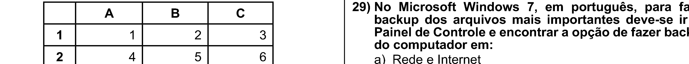

# PROVA — CÂMARA MUNICIPAL DE ARARAQUARA/SP — EDITAL Nº 01/2016 — ASSISTENTE DE CERIMONIAL

## 1. Análise geral da prova

**Identificação da prova:**

- **Concurso:** Concurso Público — Câmara Municipal de Araraquara/SP (IBFC)
- **Cargo:** Assistente de Cerimonial (código da prova IBFC_05)
- **Ano:** 2016 (Edital nº 01/2016 — Nível Superior)
- **Estrutura:** 50 questões objetivas (A–D): Língua Portuguesa (01–15), Matemática (16–20), Noções de Informática (21–30), Conhecimentos Específicos (31–50) + 01 tema de redação (discursiva)

**Composição quantitativa:**

| Item | Quantidade |
|---|---|
| Total de questões objetivas | 50 |
| Redação (discursiva) | 1 tema com 2 textos de apoio |
| Textos de apoio compartilhados (grupos) | 1 (texto “O estudo científico da comunicação…”: Q01–Q10) |
| Imagens de conteúdo | 1 (planilha Excel 2010 da Q23) |
| Gráficos e tabelas | 1 (planilha Excel da Q23) |
| Grupos identificados | 1 |
| Questões independentes | 40 objetivas + redação |

**Composição por bloco:**

| Bloco | Questões | Quantidade |
|---|---|---|
| Língua Portuguesa | 01–15 | 15 |
| Matemática | 16–20 | 05 |
| Noções de Informática | 21–30 | 10 |
| Conhecimentos Específicos | 31–50 | 20 |
| Redação (discursiva) | tema único | — |

**Observações sobre a estrutura original:**

- A redação não é uma questão objetiva: foi preservada como bloco próprio (instruções, tema e os dois textos de apoio integrais) ao final das questões independentes, conforme a estrutura original.
- A prova é um documento escaneado: a extração foi feita por OCR em múltiplas resoluções, com verificação visual em recortes ampliados dos pontos críticos.
- O logotipo do IBFC presente na capa foi descartado (não é conteúdo de questão).

> **Transcrição integral da capa, das instruções gerais e do gabarito de rascunho (conforme extraída do PDF):**

> > CÂMARA MUNICIPAL DE ARARAQUARA
> > EDITAL N° 01/2016 - NÍVEL SUPERIOR
> > ASSISTENTE DE CERIMONIAL
> > NOME DO CANDIDATO
> > ASSINATURA DO CANDIDATO
> > RG DO CANDIDATO
> > # LEIA COM ATENÇÃO AS INSTRUÇÕES ABAIXO
> > # INSTRUÇÕES GERAIS
> > I. Nesta prova, você encontrará 07 (sete) páginas numeradas sequencialmente, contendo 50 (cinquenta) questiones correspondentes às seguições disciplinas: Língua Portuguesa (15 quostões), Matemática (05 quostões), Noções de Informática (10 quostões), Conhecimentos Específicos (20 quostões) e 01 (um) tema para redação.
> > II. Verifique se seu nome e número de inscrição está correto no cartão de respostas. Se houvererro,notifique o fiscal.
> > III. Assine e preencha o cartão de respostas nos locais indicados, com caneta azul ou preta.
> > IV. Verifique se a impressao, a paginacao e a numeração das quostoes está corretas. Caso observe qualquer erro, notifique o fiscal.
> > V. Sua redação deverá ter no minimo 20 e no maior 30 linhas.
> > VI. Você dispõe de 03 (três) horas para fazer esta prova. Reserve os 20 (vinte) minutos finals para marcar o cartão de respostas.
> > VII. O candidato está poderá retirar-se do setor de prova 01 (uma) hora après seu inico.
> > VIII. O candidato não poderá levar o caderno de quostões. O caderno de quostões sera(publicado no site do ibfc, no prazo recursal contra gabarito.
> > IX. Marque o cartão de respostas cobrindo fortemente o espaço correspondente à letra a ser assinalada, conforme o exemplo noignonio cartão de respostas.
> > X. A leitora optica não registrará as respostas em que houver falta de nitidez e/ou marca de mais de uma alternativa.
> > XI. O cartão de respostas não pode ser dobrado, amassado, rasurado ou manchado. Exceto sua assinatura, nada deve ser escrito ou registrar fora dos locais destinados às respostas.
> > XII. Ao terminar a prova, entrega ao fiscal o cartão de respostas e este caderno. As observações ou markações registradas no caderno não são levadas em consideração.
> > XIII. É terminamente proibido o uso de téléphone cellular, pager ou similares.
> > Boa Prova!
> > INSTITUTO BRASILEIRO DE FORMAÇÃO E CAPACITAÇÃO
> > DESTAQUE AQUI
> > # GABARITO DO CANDIDATO - RASCUNHO
> > INSTITUTO BRASILEIRO DE FORMAÇÃO E CAPACITAÇÃO
> > Nome:
> > Assinatura do Candidato:
> > Inscrição:
> > 1
> > 2
> > 3
> > 4
> > 5
> > 6
> > 7
> > 8
> > 9
> > 10
> > 11
> > 12
> > 13
> > 14
> > 15
> > 16
> > 17
> > 18
> > 19
> > 20
> > 21
> > 22
> > 23
> > 24
> > 25
> > ☐
> > ☐
> > ☐
> > ☐
> > ☐
> > ☐
> > ☐
> > ☐
> > ☐
> > ☐
> > ☐
> > ☐
> > ☐
> > ☐
> > ☐
> > ☐
> > ☐
> > ☐
> > ☐
> > ☐
> > ☐
> > ☐
> > ☐
> > ☐
> > ☐
> > 26
> > 27
> > 28
> > 29
> > 30
> > 31
> > 32
> > 33
> > 34
> > 35
> > 36
> > 37
> > 38
> > 39
> > 40
> > 41
> > 42
> > 43
> > 44
> > 45
> > 46
> > 47
> > 48
> > 49
> > 50
> > ☐
> > ☐
> > ☐
> > ☐
> > ☐
> > ☐
> > ☐
> > ☐
> > ☐
> > ☐
> > ☐
> > ☐
> > ☐
> > ☐
> > ☐
> > ☐
> > ☐
> > ☐
> > ☐
> > ☐
> > ☐
> > ☐
> > ☐
> > ☐
> > ☐
> > IBFC_05

---

## 2. Questões agrupadas

### GRUPO 01 — Texto “O estudo científico da comunicação: avanços teóricos e metodológicos ensejados pela escola latino-americana” — questões 01 a 10

**Questões relacionadas:** 01, 02, 03, 04, 05, 06, 07, 08, 09, 10.

**Material de apoio compartilhado:**

> Leia o texto abaixo e responda as questões de 1 a 10:

> O estudo científico da comunicação: avanços teóricos e metodológicos ensejados pela escola latino-americana

> INTRODUÇÃO

> A sociedade moderna está cercada de todos os lados pelos vários sistemas de comunicação. Estudar a comunicação social é uma necessidade atual de todos os povos em qualquer parte do mundo. Conhecer e dominar os sistemas de informação e da comunicação é indispensável no mundo globalizado. Estamos iniciando os últimos passos para a saída do século XX e os primeiros para a entrada do século XXI. Neste período de transição o ser humano vive momentos de incertezas da comunicação e de (in)comunicação, das crises políticas, culturais, econômicas e religiosas. As distâncias na sociedade contemporânea estão cada vez mais próximas, quer seja pelos modernos meios de transporte ou pelas telecomunicações via satélite, Internet, etc. Com as novas tecnologias, a velocidade da informação e o processo comunicacional tornam-se cada vez mais complexos e consequentemente de mais difícil compreensão.

> No início do século XX o impacto sociocultural e econômico se deu com a revolução industrial. O século XXI está chegando sob o impacto da revolução dos meios de comunicação e das novas tecnologias da informação. É inegável a importância dos meios de comunicação social e sua influência na complexa sociedade globalizada. Desta forma, estudar as mídias passou a ser uma prioridade no campo das interações sociais. É necessário investigar, compreender e formular teorias de comunicação que possam atender os interesses da sociedade no mundo globalizado. Em busca desse objetivo resolvemos fazer algumas reflexões sobre os paradigmas existentes e tentar abrir algumas brechas que possam contribuir na formatação de novos ingredientes colaboradores do processo de interpretação e explicação da realidade atual. É neste mundo globalizado que o homem vive atualmente e dele retira as informações que irão contribuir para ampliação dos seus conhecimentos e das suas experiências.

> http://www2.metodista.br/unesco/PCLA/revista6/artigo%206-3.htm – acesso em 03/05/2016.

---

#### QUESTÃO 01

⚠️ **Gabarito: oficial não disponível**

**Material de apoio:**

> Leia o texto abaixo e responda as questões de 1 a 10:

> O estudo científico da comunicação: avanços teóricos e metodológicos ensejados pela escola latino-americana

> INTRODUÇÃO

> A sociedade moderna está cercada de todos os lados pelos vários sistemas de comunicação. Estudar a comunicação social é uma necessidade atual de todos os povos em qualquer parte do mundo. Conhecer e dominar os sistemas de informação e da comunicação é indispensável no mundo globalizado. Estamos iniciando os últimos passos para a saída do século XX e os primeiros para a entrada do século XXI. Neste período de transição o ser humano vive momentos de incertezas da comunicação e de (in)comunicação, das crises políticas, culturais, econômicas e religiosas. As distâncias na sociedade contemporânea estão cada vez mais próximas, quer seja pelos modernos meios de transporte ou pelas telecomunicações via satélite, Internet, etc. Com as novas tecnologias, a velocidade da informação e o processo comunicacional tornam-se cada vez mais complexos e consequentemente de mais difícil compreensão.

> No início do século XX o impacto sociocultural e econômico se deu com a revolução industrial. O século XXI está chegando sob o impacto da revolução dos meios de comunicação e das novas tecnologias da informação. É inegável a importância dos meios de comunicação social e sua influência na complexa sociedade globalizada. Desta forma, estudar as mídias passou a ser uma prioridade no campo das interações sociais. É necessário investigar, compreender e formular teorias de comunicação que possam atender os interesses da sociedade no mundo globalizado. Em busca desse objetivo resolvemos fazer algumas reflexões sobre os paradigmas existentes e tentar abrir algumas brechas que possam contribuir na formatação de novos ingredientes colaboradores do processo de interpretação e explicação da realidade atual. É neste mundo globalizado que o homem vive atualmente e dele retira as informações que irão contribuir para ampliação dos seus conhecimentos e das suas experiências.

> http://www2.metodista.br/unesco/PCLA/revista6/artigo%206-3.htm – acesso em 03/05/2016.

**Enunciado:**

Analise as afirmativas e dê valores Verdadeiro (V) ou Falso (F).
( ) No século XX, a Revolução Industrial influenciou diretamente o processo de comunicação.
( ) Ainda há a necessidade de se aprimorar os estudos sobre comunicação e apresentá-lo à sociedade atual.
( ) A distância entre as pessoas na sociedade antiga pode ser um dos grandes problemas na comunicação.
( ) Estudar as mídias sociais é algo dispensável para a sociedade que se encontra na transição do século XX para o XXI.

**Alternativas:**

A) V – F – V – V

B) V – V – F – F

C) F – V – F – V

D) F – F – V – V

**Referências visuais:**

Nenhuma.

---

#### QUESTÃO 02

⚠️ **Gabarito: oficial não disponível**

**Material de apoio:**

> Leia o texto abaixo e responda as questões de 1 a 10:

> O estudo científico da comunicação: avanços teóricos e metodológicos ensejados pela escola latino-americana

> INTRODUÇÃO

> A sociedade moderna está cercada de todos os lados pelos vários sistemas de comunicação. Estudar a comunicação social é uma necessidade atual de todos os povos em qualquer parte do mundo. Conhecer e dominar os sistemas de informação e da comunicação é indispensável no mundo globalizado. Estamos iniciando os últimos passos para a saída do século XX e os primeiros para a entrada do século XXI. Neste período de transição o ser humano vive momentos de incertezas da comunicação e de (in)comunicação, das crises políticas, culturais, econômicas e religiosas. As distâncias na sociedade contemporânea estão cada vez mais próximas, quer seja pelos modernos meios de transporte ou pelas telecomunicações via satélite, Internet, etc. Com as novas tecnologias, a velocidade da informação e o processo comunicacional tornam-se cada vez mais complexos e consequentemente de mais difícil compreensão.

> No início do século XX o impacto sociocultural e econômico se deu com a revolução industrial. O século XXI está chegando sob o impacto da revolução dos meios de comunicação e das novas tecnologias da informação. É inegável a importância dos meios de comunicação social e sua influência na complexa sociedade globalizada. Desta forma, estudar as mídias passou a ser uma prioridade no campo das interações sociais. É necessário investigar, compreender e formular teorias de comunicação que possam atender os interesses da sociedade no mundo globalizado. Em busca desse objetivo resolvemos fazer algumas reflexões sobre os paradigmas existentes e tentar abrir algumas brechas que possam contribuir na formatação de novos ingredientes colaboradores do processo de interpretação e explicação da realidade atual. É neste mundo globalizado que o homem vive atualmente e dele retira as informações que irão contribuir para ampliação dos seus conhecimentos e das suas experiências.

> http://www2.metodista.br/unesco/PCLA/revista6/artigo%206-3.htm – acesso em 03/05/2016.

**Enunciado:**

Assinale a alternativa correta. O termo (in)comunicação nos leva a entender:

**Alternativas:**

A) Comunicação interna

B) Comunicação adequada

C) Falta de comunicação

D) Falha de comunicação

**Referências visuais:**

Nenhuma.

---

#### QUESTÃO 03

⚠️ **Gabarito: oficial não disponível**

**Material de apoio:**

> Leia o texto abaixo e responda as questões de 1 a 10:

> O estudo científico da comunicação: avanços teóricos e metodológicos ensejados pela escola latino-americana

> INTRODUÇÃO

> A sociedade moderna está cercada de todos os lados pelos vários sistemas de comunicação. Estudar a comunicação social é uma necessidade atual de todos os povos em qualquer parte do mundo. Conhecer e dominar os sistemas de informação e da comunicação é indispensável no mundo globalizado. Estamos iniciando os últimos passos para a saída do século XX e os primeiros para a entrada do século XXI. Neste período de transição o ser humano vive momentos de incertezas da comunicação e de (in)comunicação, das crises políticas, culturais, econômicas e religiosas. As distâncias na sociedade contemporânea estão cada vez mais próximas, quer seja pelos modernos meios de transporte ou pelas telecomunicações via satélite, Internet, etc. Com as novas tecnologias, a velocidade da informação e o processo comunicacional tornam-se cada vez mais complexos e consequentemente de mais difícil compreensão.

> No início do século XX o impacto sociocultural e econômico se deu com a revolução industrial. O século XXI está chegando sob o impacto da revolução dos meios de comunicação e das novas tecnologias da informação. É inegável a importância dos meios de comunicação social e sua influência na complexa sociedade globalizada. Desta forma, estudar as mídias passou a ser uma prioridade no campo das interações sociais. É necessário investigar, compreender e formular teorias de comunicação que possam atender os interesses da sociedade no mundo globalizado. Em busca desse objetivo resolvemos fazer algumas reflexões sobre os paradigmas existentes e tentar abrir algumas brechas que possam contribuir na formatação de novos ingredientes colaboradores do processo de interpretação e explicação da realidade atual. É neste mundo globalizado que o homem vive atualmente e dele retira as informações que irão contribuir para ampliação dos seus conhecimentos e das suas experiências.

> http://www2.metodista.br/unesco/PCLA/revista6/artigo%206-3.htm – acesso em 03/05/2016.

**Enunciado:**

O texto trata do rompimento de paradigma. Assinale a alternativa que indica um sinônimo para o termo citado.

**Alternativas:**

A) Regra

B) Opção

C) Falha

D) Construção

**Referências visuais:**

Nenhuma.

---

#### QUESTÃO 04

⚠️ **Gabarito: oficial não disponível**

**Material de apoio:**

> Leia o texto abaixo e responda as questões de 1 a 10:

> O estudo científico da comunicação: avanços teóricos e metodológicos ensejados pela escola latino-americana

> INTRODUÇÃO

> A sociedade moderna está cercada de todos os lados pelos vários sistemas de comunicação. Estudar a comunicação social é uma necessidade atual de todos os povos em qualquer parte do mundo. Conhecer e dominar os sistemas de informação e da comunicação é indispensável no mundo globalizado. Estamos iniciando os últimos passos para a saída do século XX e os primeiros para a entrada do século XXI. Neste período de transição o ser humano vive momentos de incertezas da comunicação e de (in)comunicação, das crises políticas, culturais, econômicas e religiosas. As distâncias na sociedade contemporânea estão cada vez mais próximas, quer seja pelos modernos meios de transporte ou pelas telecomunicações via satélite, Internet, etc. Com as novas tecnologias, a velocidade da informação e o processo comunicacional tornam-se cada vez mais complexos e consequentemente de mais difícil compreensão.

> No início do século XX o impacto sociocultural e econômico se deu com a revolução industrial. O século XXI está chegando sob o impacto da revolução dos meios de comunicação e das novas tecnologias da informação. É inegável a importância dos meios de comunicação social e sua influência na complexa sociedade globalizada. Desta forma, estudar as mídias passou a ser uma prioridade no campo das interações sociais. É necessário investigar, compreender e formular teorias de comunicação que possam atender os interesses da sociedade no mundo globalizado. Em busca desse objetivo resolvemos fazer algumas reflexões sobre os paradigmas existentes e tentar abrir algumas brechas que possam contribuir na formatação de novos ingredientes colaboradores do processo de interpretação e explicação da realidade atual. É neste mundo globalizado que o homem vive atualmente e dele retira as informações que irão contribuir para ampliação dos seus conhecimentos e das suas experiências.

> http://www2.metodista.br/unesco/PCLA/revista6/artigo%206-3.htm – acesso em 03/05/2016.

**Enunciado:**

Leia a citação abaixo e assinale a alternativa em que a alteração de pontuação não deixa a frase incorreta.
Com as novas tecnologias, a velocidade da informação e o processo comunicacional tornam-se cada vez mais complexos e consequentemente de mais difícil compreensão.

**Alternativas:**

A) Com as novas tecnologias a velocidade da informação e o processo comunicacional, tornam-se cada vez mais complexos e, consequentemente de mais difícil compreensão.

B) Com as novas tecnologias, a velocidade da informação e o processo comunicacional tornam-se cada vez mais complexos e, consequentemente, de mais difícil compreensão.

C) Com as novas tecnologias, a velocidade da informação e o processo comunicacional tornam-se cada vez mais complexos e, consequentemente de mais difícil compreensão.

D) Com as novas tecnologias, a velocidade da informação, e o processo comunicacional tornam-se cada vez mais complexos e consequentemente, de mais difícil compreensão.

**Referências visuais:**

Nenhuma.

---

#### QUESTÃO 05

⚠️ **Gabarito: oficial não disponível**

**Material de apoio:**

> Leia o texto abaixo e responda as questões de 1 a 10:

> O estudo científico da comunicação: avanços teóricos e metodológicos ensejados pela escola latino-americana

> INTRODUÇÃO

> A sociedade moderna está cercada de todos os lados pelos vários sistemas de comunicação. Estudar a comunicação social é uma necessidade atual de todos os povos em qualquer parte do mundo. Conhecer e dominar os sistemas de informação e da comunicação é indispensável no mundo globalizado. Estamos iniciando os últimos passos para a saída do século XX e os primeiros para a entrada do século XXI. Neste período de transição o ser humano vive momentos de incertezas da comunicação e de (in)comunicação, das crises políticas, culturais, econômicas e religiosas. As distâncias na sociedade contemporânea estão cada vez mais próximas, quer seja pelos modernos meios de transporte ou pelas telecomunicações via satélite, Internet, etc. Com as novas tecnologias, a velocidade da informação e o processo comunicacional tornam-se cada vez mais complexos e consequentemente de mais difícil compreensão.

> No início do século XX o impacto sociocultural e econômico se deu com a revolução industrial. O século XXI está chegando sob o impacto da revolução dos meios de comunicação e das novas tecnologias da informação. É inegável a importância dos meios de comunicação social e sua influência na complexa sociedade globalizada. Desta forma, estudar as mídias passou a ser uma prioridade no campo das interações sociais. É necessário investigar, compreender e formular teorias de comunicação que possam atender os interesses da sociedade no mundo globalizado. Em busca desse objetivo resolvemos fazer algumas reflexões sobre os paradigmas existentes e tentar abrir algumas brechas que possam contribuir na formatação de novos ingredientes colaboradores do processo de interpretação e explicação da realidade atual. É neste mundo globalizado que o homem vive atualmente e dele retira as informações que irão contribuir para ampliação dos seus conhecimentos e das suas experiências.

> http://www2.metodista.br/unesco/PCLA/revista6/artigo%206-3.htm – acesso em 03/05/2016.

**Enunciado:**

Leia as afirmações abaixo e assinale a alternativa que destaca o problema presente no texto.

**Alternativas:**

A) É necessário investigar, compreender e formular teorias de comunicação que possam atender os interesses da sociedade no mundo globalizado.

B) É neste mundo globalizado que o homem vive atualmente e dele retira as informações que irão contribuir para ampliação dos seus conhecimentos e das suas experiências.

C) É necessário investigar, compreender e formular teorias de comunicação que possam atender os interesses da sociedade no mundo globalizado.

D) É neste mundo globalizado que o homem vive atualmente e dele retira as informações que irão contribuir para ampliação dos seus conhecimentos e das suas experiências.

**Referências visuais:**

Nenhuma.

---

#### QUESTÃO 06

⚠️ **Gabarito: oficial não disponível**

**Material de apoio:**

> Leia o texto abaixo e responda as questões de 1 a 10:

> O estudo científico da comunicação: avanços teóricos e metodológicos ensejados pela escola latino-americana

> INTRODUÇÃO

> A sociedade moderna está cercada de todos os lados pelos vários sistemas de comunicação. Estudar a comunicação social é uma necessidade atual de todos os povos em qualquer parte do mundo. Conhecer e dominar os sistemas de informação e da comunicação é indispensável no mundo globalizado. Estamos iniciando os últimos passos para a saída do século XX e os primeiros para a entrada do século XXI. Neste período de transição o ser humano vive momentos de incertezas da comunicação e de (in)comunicação, das crises políticas, culturais, econômicas e religiosas. As distâncias na sociedade contemporânea estão cada vez mais próximas, quer seja pelos modernos meios de transporte ou pelas telecomunicações via satélite, Internet, etc. Com as novas tecnologias, a velocidade da informação e o processo comunicacional tornam-se cada vez mais complexos e consequentemente de mais difícil compreensão.

> No início do século XX o impacto sociocultural e econômico se deu com a revolução industrial. O século XXI está chegando sob o impacto da revolução dos meios de comunicação e das novas tecnologias da informação. É inegável a importância dos meios de comunicação social e sua influência na complexa sociedade globalizada. Desta forma, estudar as mídias passou a ser uma prioridade no campo das interações sociais. É necessário investigar, compreender e formular teorias de comunicação que possam atender os interesses da sociedade no mundo globalizado. Em busca desse objetivo resolvemos fazer algumas reflexões sobre os paradigmas existentes e tentar abrir algumas brechas que possam contribuir na formatação de novos ingredientes colaboradores do processo de interpretação e explicação da realidade atual. É neste mundo globalizado que o homem vive atualmente e dele retira as informações que irão contribuir para ampliação dos seus conhecimentos e das suas experiências.

> http://www2.metodista.br/unesco/PCLA/revista6/artigo%206-3.htm – acesso em 03/05/2016.

**Enunciado:**

Assinale a alternativa que completa corretamente a lacuna.
O termo destacado abaixo indica a seguinte classe gramatical: _________
No início do século XX o impacto sociocultural e econômico se deu com a revolução industrial.

**Alternativas:**

A) Substantivo

B) Advérbio

C) Sujeito

D) Adjetivo

**Referências visuais:**

Nenhuma.

---

#### QUESTÃO 07

⚠️ **Gabarito: oficial não disponível**

**Material de apoio:**

> Leia o texto abaixo e responda as questões de 1 a 10:

> O estudo científico da comunicação: avanços teóricos e metodológicos ensejados pela escola latino-americana

> INTRODUÇÃO

> A sociedade moderna está cercada de todos os lados pelos vários sistemas de comunicação. Estudar a comunicação social é uma necessidade atual de todos os povos em qualquer parte do mundo. Conhecer e dominar os sistemas de informação e da comunicação é indispensável no mundo globalizado. Estamos iniciando os últimos passos para a saída do século XX e os primeiros para a entrada do século XXI. Neste período de transição o ser humano vive momentos de incertezas da comunicação e de (in)comunicação, das crises políticas, culturais, econômicas e religiosas. As distâncias na sociedade contemporânea estão cada vez mais próximas, quer seja pelos modernos meios de transporte ou pelas telecomunicações via satélite, Internet, etc. Com as novas tecnologias, a velocidade da informação e o processo comunicacional tornam-se cada vez mais complexos e consequentemente de mais difícil compreensão.

> No início do século XX o impacto sociocultural e econômico se deu com a revolução industrial. O século XXI está chegando sob o impacto da revolução dos meios de comunicação e das novas tecnologias da informação. É inegável a importância dos meios de comunicação social e sua influência na complexa sociedade globalizada. Desta forma, estudar as mídias passou a ser uma prioridade no campo das interações sociais. É necessário investigar, compreender e formular teorias de comunicação que possam atender os interesses da sociedade no mundo globalizado. Em busca desse objetivo resolvemos fazer algumas reflexões sobre os paradigmas existentes e tentar abrir algumas brechas que possam contribuir na formatação de novos ingredientes colaboradores do processo de interpretação e explicação da realidade atual. É neste mundo globalizado que o homem vive atualmente e dele retira as informações que irão contribuir para ampliação dos seus conhecimentos e das suas experiências.

> http://www2.metodista.br/unesco/PCLA/revista6/artigo%206-3.htm – acesso em 03/05/2016.

**Enunciado:**

Leia as opções abaixo e indique a que altera a conjugação para o tempo futuro de maneira correta.
É necessário investigar, compreender e formular teorias de comunicação que possam atender os interesses da sociedade no mundo globalizado.

**Alternativas:**

A) Será necessário investigar, compreender e formular teorias de comunicação que possam atender os interesses da sociedade no mundo globalizado.

B) Serão necessário investigar, compreender e formular teorias de comunicação que possam atender os interesses da sociedade no mundo globalizado.

C) Há a necessidade de investigar, compreender e formular teorias de comunicação que possam atender os interesses da sociedade no mundo globalizado.

D) Seria necessário investigar, compreender e formular teorias de comunicação que possam atender os interesses da sociedade no mundo globalizado.

**Referências visuais:**

Nenhuma.

---

#### QUESTÃO 08

⚠️ **Gabarito: oficial não disponível**

**Material de apoio:**

> Leia o texto abaixo e responda as questões de 1 a 10:

> O estudo científico da comunicação: avanços teóricos e metodológicos ensejados pela escola latino-americana

> INTRODUÇÃO

> A sociedade moderna está cercada de todos os lados pelos vários sistemas de comunicação. Estudar a comunicação social é uma necessidade atual de todos os povos em qualquer parte do mundo. Conhecer e dominar os sistemas de informação e da comunicação é indispensável no mundo globalizado. Estamos iniciando os últimos passos para a saída do século XX e os primeiros para a entrada do século XXI. Neste período de transição o ser humano vive momentos de incertezas da comunicação e de (in)comunicação, das crises políticas, culturais, econômicas e religiosas. As distâncias na sociedade contemporânea estão cada vez mais próximas, quer seja pelos modernos meios de transporte ou pelas telecomunicações via satélite, Internet, etc. Com as novas tecnologias, a velocidade da informação e o processo comunicacional tornam-se cada vez mais complexos e consequentemente de mais difícil compreensão.

> No início do século XX o impacto sociocultural e econômico se deu com a revolução industrial. O século XXI está chegando sob o impacto da revolução dos meios de comunicação e das novas tecnologias da informação. É inegável a importância dos meios de comunicação social e sua influência na complexa sociedade globalizada. Desta forma, estudar as mídias passou a ser uma prioridade no campo das interações sociais. É necessário investigar, compreender e formular teorias de comunicação que possam atender os interesses da sociedade no mundo globalizado. Em busca desse objetivo resolvemos fazer algumas reflexões sobre os paradigmas existentes e tentar abrir algumas brechas que possam contribuir na formatação de novos ingredientes colaboradores do processo de interpretação e explicação da realidade atual. É neste mundo globalizado que o homem vive atualmente e dele retira as informações que irão contribuir para ampliação dos seus conhecimentos e das suas experiências.

> http://www2.metodista.br/unesco/PCLA/revista6/artigo%206-3.htm – acesso em 03/05/2016.

**Enunciado:**

Leia a citação abaixo e assinale a correta substituição do gerúndio:

Estamos iniciando os últimos passos para a saída do século XX e os primeiros para a entrada do século XXI.

**Alternativas:**

A) Iniciaremos os últimos passos para a saída do século XX e os primeiros para a entrada do século XXI.

B) Iniciamos os últimos passos para a saída do século XX e os primeiros para a entrada do século XXI.

C) Iniciarei os últimos passos para a saída do século XX e os primeiros para a entrada do século XXI.

D) Ao iniciarmos os últimos passos para a saída do século XX e os primeiros para a entrada do século XXI.

**Referências visuais:**

Nenhuma.

---

#### QUESTÃO 09

⚠️ **Gabarito: oficial não disponível**

**Material de apoio:**

> Leia o texto abaixo e responda as questões de 1 a 10:

> O estudo científico da comunicação: avanços teóricos e metodológicos ensejados pela escola latino-americana

> INTRODUÇÃO

> A sociedade moderna está cercada de todos os lados pelos vários sistemas de comunicação. Estudar a comunicação social é uma necessidade atual de todos os povos em qualquer parte do mundo. Conhecer e dominar os sistemas de informação e da comunicação é indispensável no mundo globalizado. Estamos iniciando os últimos passos para a saída do século XX e os primeiros para a entrada do século XXI. Neste período de transição o ser humano vive momentos de incertezas da comunicação e de (in)comunicação, das crises políticas, culturais, econômicas e religiosas. As distâncias na sociedade contemporânea estão cada vez mais próximas, quer seja pelos modernos meios de transporte ou pelas telecomunicações via satélite, Internet, etc. Com as novas tecnologias, a velocidade da informação e o processo comunicacional tornam-se cada vez mais complexos e consequentemente de mais difícil compreensão.

> No início do século XX o impacto sociocultural e econômico se deu com a revolução industrial. O século XXI está chegando sob o impacto da revolução dos meios de comunicação e das novas tecnologias da informação. É inegável a importância dos meios de comunicação social e sua influência na complexa sociedade globalizada. Desta forma, estudar as mídias passou a ser uma prioridade no campo das interações sociais. É necessário investigar, compreender e formular teorias de comunicação que possam atender os interesses da sociedade no mundo globalizado. Em busca desse objetivo resolvemos fazer algumas reflexões sobre os paradigmas existentes e tentar abrir algumas brechas que possam contribuir na formatação de novos ingredientes colaboradores do processo de interpretação e explicação da realidade atual. É neste mundo globalizado que o homem vive atualmente e dele retira as informações que irão contribuir para ampliação dos seus conhecimentos e das suas experiências.

> http://www2.metodista.br/unesco/PCLA/revista6/artigo%206-3.htm – acesso em 03/05/2016.

**Enunciado:**

Assinale a alternativa correta. Ao ler o texto acima podemos identificar que se trata de um texto:

**Alternativas:**

A) Acadêmico

B) Jornalístico

C) Teórico

D) Descritivo

**Referências visuais:**

Nenhuma.

---

#### QUESTÃO 10

⚠️ **Gabarito: oficial não disponível**

**Material de apoio:**

> Leia o texto abaixo e responda as questões de 1 a 10:

> O estudo científico da comunicação: avanços teóricos e metodológicos ensejados pela escola latino-americana

> INTRODUÇÃO

> A sociedade moderna está cercada de todos os lados pelos vários sistemas de comunicação. Estudar a comunicação social é uma necessidade atual de todos os povos em qualquer parte do mundo. Conhecer e dominar os sistemas de informação e da comunicação é indispensável no mundo globalizado. Estamos iniciando os últimos passos para a saída do século XX e os primeiros para a entrada do século XXI. Neste período de transição o ser humano vive momentos de incertezas da comunicação e de (in)comunicação, das crises políticas, culturais, econômicas e religiosas. As distâncias na sociedade contemporânea estão cada vez mais próximas, quer seja pelos modernos meios de transporte ou pelas telecomunicações via satélite, Internet, etc. Com as novas tecnologias, a velocidade da informação e o processo comunicacional tornam-se cada vez mais complexos e consequentemente de mais difícil compreensão.

> No início do século XX o impacto sociocultural e econômico se deu com a revolução industrial. O século XXI está chegando sob o impacto da revolução dos meios de comunicação e das novas tecnologias da informação. É inegável a importância dos meios de comunicação social e sua influência na complexa sociedade globalizada. Desta forma, estudar as mídias passou a ser uma prioridade no campo das interações sociais. É necessário investigar, compreender e formular teorias de comunicação que possam atender os interesses da sociedade no mundo globalizado. Em busca desse objetivo resolvemos fazer algumas reflexões sobre os paradigmas existentes e tentar abrir algumas brechas que possam contribuir na formatação de novos ingredientes colaboradores do processo de interpretação e explicação da realidade atual. É neste mundo globalizado que o homem vive atualmente e dele retira as informações que irão contribuir para ampliação dos seus conhecimentos e das suas experiências.

> http://www2.metodista.br/unesco/PCLA/revista6/artigo%206-3.htm – acesso em 03/05/2016.

**Enunciado:**

Analise a citação abaixo e substitua o termo grifado por outro que não altere seu sentido.

Desta forma, estudar as mídias passou a ser uma prioridade no campo das interações sociais.

**Alternativas:**

A) Mas

B) Como

C) Assim

D) Porém

**Referências visuais:**

Nenhuma.

---

## 3. Questões independentes

#### QUESTÃO 11

⚠️ **Gabarito: oficial não disponível**

**Enunciado:**

Leia as opções abaixo e assinale a alternativa que não apresenta erro ortográfico.

**Alternativas:**

A) Plocrastinar – idiossincrasia – abduzir

B) Proclastinar – idiossincrasia – abduzir

C) Plocrastinar – idiossincrasia – abiduzir

D) Procrastinar – idiossincrasia – abduzir

**Referências visuais:**

Nenhuma.

---

#### QUESTÃO 12

⚠️ **Gabarito: oficial não disponível**

**Enunciado:**

Assinale a alternativa correta. O texto abaixo indica:

O estudante se dedica aos estudos a fim de se preparar bem, já que este é seu objetivo

**Alternativas:**

A) Uma frase

B) Uma oração

C) Duas frases

D) Quatro orações

**Referências visuais:**

Nenhuma.

---

#### QUESTÃO 13

⚠️ **Gabarito: oficial não disponível**

**Enunciado:**

Analise as afirmativas abaixo e assinale a alternativa correta.

A minha opinião vai de encontro a sua.

Para substituir, sem alteração de sentido, a expressão destacada na frase acima podemos selecionar por:

**Alternativas:**

A) Concorda com

B) Discorda da

C) Aceita a

D) Encontra a

**Referências visuais:**

Nenhuma.

---

#### QUESTÃO 14

⚠️ **Gabarito: oficial não disponível**

**Enunciado:**

Assinale a alternativa que apresenta a correta colocação do pronome.

**Alternativas:**

A) O aluno tinha-o deixado na escola.

B) Nunca esqueça-se de mim.

C) Naquela escola em que formei passei-me bons momentos.

D) Você nos emocionou com suas palavras

**Referências visuais:**

Nenhuma.

---

#### QUESTÃO 15

⚠️ **Gabarito: oficial não disponível**

**Enunciado:**

Leia a citação abaixo e assinale a alternativa que indica a correta classificação do sujeito.

Hoje os estudantes se preocuparam muito com a confecção do trabalho.

**Alternativas:**

A) Simples

B) Composto

C) Pleonástico

D) Inexistente

**Referências visuais:**

Nenhuma.

---

#### QUESTÃO 16

⚠️ **Gabarito: oficial não disponível**

**Enunciado:**

A imagem da função $f(x) = 2^{2x-3}$, sendo que o valor de x é a maior raiz da função $f(x) = x^2 - 5x + 4$, é:

**Alternativas:**

A) 16

B) 32

C) 64

D) 8

**Referências visuais:**

Nenhuma.

---

#### QUESTÃO 17

⚠️ **Gabarito: oficial não disponível**

**Enunciado:**

A solução da inequação $2 \cdot \text{sen}(x) < -1$, para $0 \leq x \leq 2\pi$, é:

**Alternativas:**

A) $\{x \in \mathbb{R} / \frac{7\pi}{6} < x < \frac{11\pi}{6}\}$

B) $\{x \in \mathbb{R} / \frac{5\pi}{6} < x < \frac{7\pi}{6}\}$

C) $\{x \in \mathbb{R} / \frac{4\pi}{3} < x < \frac{5\pi}{3}\}$

D) $\{x \in \mathbb{R} / \frac{7\pi}{6} < x < \frac{5\pi}{3}\}$

**Referências visuais:**

Nenhuma.

---

#### QUESTÃO 18

⚠️ **Gabarito: oficial não disponível**

**Enunciado:**

Se a hipotenusa de um triângulo retângulo mede 5 cm, então a medida do cateto desse triângulo cuja medida

da sua projeção sobre a hipotenusa mede $\frac{16}{5}$ cm, é igual a:

**Alternativas:**

A) 3 cm

B) 3,5 cm

C) 4 cm

D) 4,5 cm

**Referências visuais:**

Nenhuma.

---

#### QUESTÃO 19

⚠️ **Gabarito: oficial não disponível**

**Enunciado:**

A área total de um cilindro reto, cujo diâmetro da mede 4 cm, é igual a $20\pi$ cm$^2$. Desse modo a medida da altura desse cilindro é, em cm:

**Alternativas:**

A) 4

B) 3,5

C) 2,5

D) 3

**Referências visuais:**

Nenhuma.

---

#### QUESTÃO 20

⚠️ **Gabarito: oficial não disponível**

**Enunciado:**

Uma reta $r$ passa pelo ponto $P(3,2)$ e pelo ponto que representa o centro da circunferência de equação $(x-2)^2 + (x+3)^2 = 9$. Nessas condições, a equação da reta $r$ é dada por:

**Alternativas:**

A) $5x - 2y - 11 = 0$

B) $5x - y - 13 = 0$

C) $x + 5y - 13 = 0$

D) $5x - 5y - 5 = 0$

**Referências visuais:**

Nenhuma.

---

#### QUESTÃO 21

⚠️ **Gabarito: oficial não disponível**

**Enunciado:**

Relacione as duas colunas quanto as siglas e termos de Sistemas de Informação (SI) com os seus respectivos significados:

(1) ERP (A) Gestão da Cadeia de Suprimentos.
(2) CRM (B) Sistema Integrado de Gestão Empresarial.
(3) Supply Chain (C) Gestão de Relacionamento com o Cliente.

**Alternativas:**

A) 1B - 2A - 3C

B) 1C - 2B - 3A

C) 1B - 2C - 3A

D) 1A - 2C - 3B

**Referências visuais:**

Nenhuma.

---

#### QUESTÃO 22

⚠️ **Gabarito: oficial não disponível**

**Enunciado:**

Toffler, em seu famoso livro "A terceira onda", faz um ensaio sobre o que deverá ser a sociedade pós-moderna do século XXI. A partir dessa referência, vários autores e livros começaram a conceituar essa onda como sendo:

**Alternativas:**

A) a Era da Informação.

B) a Revolução da Sustentabilidade.

C) a Revolução Industrial.

D) a Era das Redes Sociais.

**Referências visuais:**

Nenhuma.

---

#### QUESTÃO 23

⚠️ **Gabarito: oficial não disponível**

**Enunciado:**

Com base na planilha do Microsoft Excel 2010 abaixo, assinale a alternativa que apresenta a fórmula que se apresenta o seu resultado na célula C2:

|   | A | B | C  |
| --- | --- | --- | --- |
|  1 | 1 | 2 | 3  |
|  2 | 4 | 5 | 6  |

**Alternativas:**

A) =B2-C1+A2*A1/B1

B) =B2+C1-A2/A1*B1

C) =B2+C1*A2-A1/B1

D) =B2+C1-A2*A1/B1

**Referências visuais:**

---

#### QUESTÃO 24

⚠️ **Gabarito: oficial não disponível**

**Enunciado:**

Quanto ao Microsoft PowerPoint 2010, analise as afirmativas abaixo, dê valores Verdadeiro (V) ou Falso (F) e assinale a alternativa que apresenta a sequência correta (de cima para baixo):

( ) O recurso denominado SmartArt somente pode ser utilizado no Word e no Excel 2010.
( ) Não é possível adicionar comentários, ou anotações, nos slides do PowerPoint na versão 2010.

**Alternativas:**

A) V - V

B) V - F

C) F - V

D) F - F

**Referências visuais:**

Nenhuma.

---

#### QUESTÃO 25

⚠️ **Gabarito: oficial não disponível**

**Enunciado:**

Embora o conteúdo de cada janela, em um ambiente Microsoft Windows, seja diferente, todas as janelas têm algumas coisas em comum. A maioria das janelas possuem, como padrão, as mesmas partes básicas definida tecnicamente pela Microsoft como sendo os:

**Alternativas:**

A) Botões de Redução, de Ampliação e de Encerrar.

B) Botões de Minimizar, de Maximizar e de Fechar.

C) Botões de Diminuição, de Aumento e de Terminar.

D) Botões de Restrição, de Ampliação e de Concluir.

**Referências visuais:**

Nenhuma.

---

#### QUESTÃO 26

⚠️ **Gabarito: oficial não disponível**

**Enunciado:**

No Microsoft Windows 7, em português, criou-se um novo recurso para a organização e gerenciamento de informações, para acessar arquivos e pastas, denominado Biblioteca. Pelo padrão do Windows 7 essas bibliotecas são:

**Alternativas:**

A) Biblioteca Documentos - Biblioteca Imagens - Biblioteca Músicas - Biblioteca Vídeos.

B) Biblioteca e-Mails - Biblioteca Ícones - Biblioteca Sons - Biblioteca Vídeos.

C) Biblioteca e-Mails - Biblioteca Imagens - Biblioteca Sons - Biblioteca Filmes.

D) Biblioteca Documentos - Biblioteca Ícones - Biblioteca Músicas - Biblioteca Filmes.

**Referências visuais:**

Nenhuma.

---

#### QUESTÃO 27

⚠️ **Gabarito: oficial não disponível**

**Enunciado:**

Ao excluir um arquivo do computador ele irá automaticamente para a Lixeira. Selecione a única alternativa que esteja tecnicamente correta:

**Alternativas:**

A) A Lixeira nunca está disponível para os usuários, somente liberado para o corpo técnico.

B) Existe a possibilidade de excluir todos os arquivos de forma definitiva que estejam na Lixeira.

C) Para se recuperar um arquivo da Lixeira existe a necessidade de usar criptografia..

D) Após 7(sete) dias a Lixeira esvazia totalmente e de forma automática pelo Windows.

**Referências visuais:**

Nenhuma.

---

#### QUESTÃO 28

⚠️ **Gabarito: oficial não disponível**

**Enunciado:**

No MS-Outlook ao ser encaminhado um e-mail recebe-se a mensagem: "Caixa de correio não encontrada ou Caixa de correio inválida". O melhor procedimento a ser realizado será:

**Alternativas:**

A) mandar de novo o e-mail alterando o status no MS-Outlook para "Reenvio Automático".

B) avisar o destinatário que a sua Caixa de Correio está lotada ou com problemas técnicos.

C) provavelmente o servidor de Correio Eletrônico encontra-se sem energia elétrica. Deve-se aguardar o melhor momento para reencaminhar.

D) verificar se há erros de grafia no endereço de e-mail do destinatário, corrigir e reencaminhar.

**Referências visuais:**

Nenhuma.

---

#### QUESTÃO 29

⚠️ **Gabarito: oficial não disponível**

**Enunciado:**

No Microsoft Windows 7, em português, para fazer backup dos arquivos mais importantes deve-se ir no Painel de Controle e encontrar a opção de fazer backup do computador em:

**Alternativas:**

A) Rede e Internet

B) Contas de Usuário e Segurança Familiar

C) Sistema e Segurança (ou Manutenção)

D) Facilidade de Acesso

**Referências visuais:**

Nenhuma.

---

#### QUESTÃO 30

⚠️ **Gabarito: oficial não disponível**

**Enunciado:**

Assinale, das alternativas abaixo, a única que NÃO identifica corretamente um dispositivo básico de hardware aplicado em redes de computadores:

**Alternativas:**

A) switch

B) browser

C) repetidor

D) modem

**Referências visuais:**

Nenhuma.

---

#### QUESTÃO 31

⚠️ **Gabarito: oficial não disponível**

**Enunciado:**

Os Símbolos Nacionais são as mais caras representações da Pátria, expressando a independência do povo e da Nação brasileira e só têm legitimidade quando integralmente aceitos e respeitados por todos. Os Símbolos Nacionais estão regulados pela Lei nº 5.700, de 1 de setembro de 1971. São Símbolos perenes do Brasil:

**Alternativas:**

A) a Bandeira Nacional, o Hino Nacional, as Armas Nacionais e o Selo Nacional.

B) a Bandeira Nacional, o Hino Nacional e o Carimbo Nacional.

C) o Brasão Nacional, a Bandeira Nacional, o Hino Nacional e o Território Nacional.

D) a Bandeira Nacional, o Hino Nacional e o Idioma.

**Referências visuais:**

Nenhuma.

---

#### QUESTÃO 32

⚠️ **Gabarito: oficial não disponível**

**Enunciado:**

_______________ é o conceito ou ordem pela qual se estabelece a estrutura máxima do estado, à medida que determina a ordem hierárquica de disposição das autoridades de um Estado, de um organismo ou de todo corpo organizado ou grupo social. De acordo com Jean Serres, ela é particularmente indispensável na administração, cujo objeto essencial é o exercício do poder público.

Assinale abaixo a opção que preenche a lacuna acima:

**Alternativas:**

A) Presidência

B) Resiliência

C) Precedência

D) Cerimonial Público www.pciconcursos.com.br 3

**Referências visuais:**

Nenhuma.

---

#### QUESTÃO 33

⚠️ **Gabarito: oficial não disponível**

**Enunciado:**

Leia atentamente as afirmações abaixo quanto a precedências:

1. A ordem geral de precedência no Brasil está descrita no Decreto nº 70.274/72;
2. Precedência tem raiz no latim *praecedere*, sentar à frente, de onde derivam passar na frente, sentar-se antes;
3. A precedência foi objeto de estudo em 1815, durante a Conferência de Viena;
4. No Brasil, em 1903, houve o primeiro escrito a respeito de precedência, sendo autor o Marechal Deodoro da Fonseca.

Estão corretas APENAS as sentenças:

**Alternativas:**

A) 1, 3 e 4

B) 1, 2 e 3

C) 1, 2, 3 e 4

D) 1 e 4

**Referências visuais:**

Nenhuma.

---

#### QUESTÃO 34

⚠️ **Gabarito: oficial não disponível**

**Enunciado:**

Quanto a execução do Hino Nacional Brasileiro em eventos é INCORRETO afirmar:

**Alternativas:**

A) Nas cerimônias em que seja executado algum hino nacional estrangeiro, este precederá o Hino Nacional Brasileiro em virtude do princípio de cortesia;

B) O Hino Nacional Brasileiro sempre será executado primeiramente, mesmo que na cerimônia estejam presentes autoridades estrangeiras;

C) A execução do Hino Nacional só terá início depois que o Presidente da República tenha ocupado o lugar que lhe estiver reservado;

D) Não é correto bater palmas após a execução do Hino Nacional, salvo se houver sido executado por orquestra;

**Referências visuais:**

Nenhuma.

---

#### QUESTÃO 35

⚠️ **Gabarito: oficial não disponível**

**Enunciado:**

Sobre a composição de mesas com número ímpar de participantes, a regra geral estabelece que:

**Alternativas:**

A) a autoridade principal sentará à cabeceira da mesa;

B) a autoridade principal sentará em uma mesa à parte, diferente dos demais;

C) a autoridade principal sentará no centro da mesa, seguida da segunda maior autoridade e do anfitrião do evento;

D) o anfitrião do evento deverá sentar-se no centro da mesa;

**Referências visuais:**

Nenhuma.

---

#### QUESTÃO 36

⚠️ **Gabarito: oficial não disponível**

**Enunciado:**

Assinale a alternativa que apresenta a forma de tratamento CORRETA para um Governador do Estado.

**Alternativas:**

A) Reverendíssimo Senhor

B) Santíssimo Senhor

C) Vossa Senhoria (V. Sa.)

D) Vossa Excelência (V. Excia.)

**Referências visuais:**

Nenhuma.

---

#### QUESTÃO 37

⚠️ **Gabarito: oficial não disponível**

**Enunciado:**

Reunião de leis, decretos, normas, regras e códigos capazes de normatizar ou colocar ordem em uma cerimônia qualquer, sendo reconhecido e estabelecido internacionalmente.

A afirmação acima refere-se a:

**Alternativas:**

A) Leis e Normas

B) Protocolo

C) Símbolos

D) Precedência

**Referências visuais:**

Nenhuma.

---

#### QUESTÃO 38

⚠️ **Gabarito: oficial não disponível**

**Enunciado:**

O _______ é uma forma de acompanhamento que deve orientar o organizador do evento para que todas as providências sejam devidamente efetivadas nas distintas fases de planejamento do evento: pré-evento, realização do evento e pós-evento.

**Alternativas:**

A) Checklist

B) Brainstorm

C) Release

D) Lead

**Referências visuais:**

Nenhuma.

---

#### QUESTÃO 39

⚠️ **Gabarito: oficial não disponível**

**Enunciado:**

Quanto às responsabilidades do profissional de cerimonial estão CORRETAS as afirmativas:

I. O cerimonialista deve conhecer, pesquisar e se atualizar sobre todas as regras e normas que regem as solenidades públicas, para que se desenvolva, na mais perfeita ordem, todo e qualquer evento, mesmo aquele de caráter social e privado.
II. O profissional deve ter discrição, compromisso ético e saber contornar situações.
III. A responsabilidade do cerimonialista abrange recepções oficiais, jantares, roteiro de audiências, organização e precursão de viagens, execução de solenidades, elaboração de convites entre outros.

Assinale a alternativa CORRETA:

**Alternativas:**

A) Nenhuma das afirmativas estão corretas.

B) I e II

C) II e III

D) Todas as afirmativas estão corretas

**Referências visuais:**

Nenhuma.

---

#### QUESTÃO 40

⚠️ **Gabarito: oficial não disponível**

**Enunciado:**

O Roteiro de Cerimonial contém a sequência de falas do Mestre de Cerimônias, que o utiliza para fazer a locução do evento.

Enumere as lacunas de acordo com a ordem de cada um na elaboração do roteiro do cerimonial. Depois assinale a alternativa que apresenta a sequência CORRETA:

( ) Introdução (boas-vindas, apresentação dos objetivos, patrocinadores e realizadores do evento)
( ) Registro das autoridades que prestigiam o evento
( ) Pronunciamentos de autoridades
( ) Composição de mesa
( ) Homenagens /Leitura e assinatura de Termos/ Descerramento de placas
( ) Hino Nacional (quando necessário)
( ) Encerramento

**Alternativas:**

A) 1, 3,5,7,2,4,6

B) 1,4,6,2,5,3,7

C) 1,4,6,3,7,5,2

D) 1,4,6,5,2,3,7

**Referências visuais:**

Nenhuma.

---

#### QUESTÃO 41

⚠️ **Gabarito: oficial não disponível**

**Enunciado:**

Quanto às funções no Cerimonial:

_______ pessoa encarregada da condução da solenidade, ou seja, responsabiliza-se pelo cumprimento das normas protocolares.

_______ pessoa encarregada de fazer a locução do evento, ou seja, é quem conduz a cerimônia, seguindo o roteiro da solenidade e a sequência de procedimentos já definidos anteriormente.

_______ pessoa que entrega os documentos, credenciais, formulários etc. Pode proceder a inscrições para eventos, operar equipamentos, falar em microfone, organizar o local da atividade, entre outros.

As palavras que melhor preenchem as lacunas, respectivamente, são:

**Alternativas:**

A) Mestre de Cerimônias, Relações Públicas e Recepcionista.

B) Recepcionista, Coordenador de Eventos e Gerente de Recursos Humanos.

C) Cerimonialista, Mestre de Cerimônias e Recepcionista.

D) Mestre de Cerimônias, Cerimonialista e Recepcionista.

**Referências visuais:**

Nenhuma.

---

#### QUESTÃO 42

⚠️ **Gabarito: oficial não disponível**

**Enunciado:**

Em um evento realizado na Câmara Municipal de São Caetano do Sul, estarão presentes as seguintes autoridades:

Presidente da Câmara Municipal de São Caetano do Sul
Prefeito de São Paulo
Vereador de São Caetano do Sul
Prefeito de São Caetano do Sul

Assinale a alternativa que apresenta, da esquerda para a direita, a precedência CORRETA da composição de mesa.

**Alternativas:**

A) Prefeito de São Caetano do Sul - Prefeito de São Paulo - Presidente da Câmara Municipal de São Caetano do Sul - Vereador de São Caetano do Sul.

B) Prefeito de São Paulo - Presidente da Câmara Municipal de São Caetano do Sul - Prefeito de São Caetano do Sul - Vereador de São Caetano do Sul.

C) Vereador de São Caetano do Sul - Presidente da Câmara Municipal de São Caetano do Sul - Prefeito de São Caetano do Sul - Prefeito de São Paulo.

D) Prefeito de São Paulo - Prefeito de São Caetano do Sul - Presidente da Câmara Municipal de São Caetano do Sul - Vereador de São Caetano do Sul.

**Referências visuais:**

Nenhuma.

---

#### QUESTÃO 43

⚠️ **Gabarito: oficial não disponível**

**Enunciado:**

Escolha a alternativa em que a ordem dos termos preenchem corretamente as lacunas abaixo:
O ______________ determina a sequência dos acontecimentos em um evento. O ______________ é a legislação que coordena o cerimonial. A ______________ se concentra mais no comportamento dos anfitriões e convidados.

**Alternativas:**

A) Cerimonial Protocolo e Etiqueta

B) Cerimonial, Script e Nominata

C) Protocolo, Release e Etiqueta

D) Mestre de Cerimônias, Cerimonial e Etiqueta

**Referências visuais:**

Nenhuma.

---

#### QUESTÃO 44

⚠️ **Gabarito: oficial não disponível**

**Enunciado:**

Assinale a questão INCORRETA quanto à utilização e representação da Bandeira Nacional.

**Alternativas:**

A) A Bandeira Nacional pode ser usada em todas as manifestações do sentido patriótico dos brasileiros em caráter oficial ou particular.

B) Pode compor com outras bandeiras panóplias, escudos ou peças semelhantes.

C) A Bandeira Nacional, em todas as apresentações no território nacional, ocupa lugar de honra.

D) Ocupa lugar à esquerda das tribunas, púlpitos, mesas de reunião ou de trabalho.

**Referências visuais:**

Nenhuma.

---

#### QUESTÃO 45

⚠️ **Gabarito: oficial não disponível**

**Enunciado:**

______________ traz a relação das autoridades presentes à cerimônia. Pode ser feita em forma de lista ou de cartões individuais com nome, cargo/entidade e, ainda, os dados do representante, quando houver.

**Alternativas:**

A) Tribuna

B) Nominata

C) Cronograma

D) Panóplia

**Referências visuais:**

Nenhuma.

---

#### QUESTÃO 46

⚠️ **Gabarito: oficial não disponível**

**Enunciado:**

Leia com atenção as afirmações abaixo sobre o check list:

I. Trata-se de uma relação de providências, tarefas ou necessidades do evento;
II. É fundamental na organização de um evento;
III. Pode ser usado tanto na fase inicial quanto no dia do evento;
IV. O check list pode ser adaptado para a fase do pós-evento;

Estão corretas as afirmações:

**Alternativas:**

A) I, II e III apenas

B) I e III apenas

C) Todas as alternativas estão corretas.

D) I e II apenas

**Referências visuais:**

Nenhuma.

---

#### QUESTÃO 47

⚠️ **Gabarito: oficial não disponível**

**Enunciado:**

______________ estabelece ordem hierárquica, em especial de autoridades e de símbolos oficiais.

______________ é o ato de conduzir uma solenidade, ou seja, o responsável maior. É quem convida, recebe e despede em eventos solenes.

______________ trata-se de uma referência abstrata e imaginária ao lugar de honra ocupado por alguém que detém um cargo de relevância, do que ao cargo propriamente dito.

Escolha a alternativa em que a ordem dos termos preenchem corretamente as lacunas abaixo:

**Alternativas:**

A) Precedência, Primazia e Presidência

B) Lugar de Honra, Mestre de Cerimônias e Nominata

C) Precedência, Presidência e Representação

D) Precedência, Presidência e Primazia

**Referências visuais:**

Nenhuma.

---

#### QUESTÃO 48

⚠️ **Gabarito: oficial não disponível**

**Enunciado:**

Assinale, abaixo, a alternativa INCORRETA quanto ao posicionamento da Bandeira do Estado em eventos oficiais:

**Alternativas:**

A) À direita da Bandeira Nacional, quando unicamente com ela;

B) À esquerda da Bandeira Nacional, quando apresentada com a bandeira de outros países e o número de bandeiras do dispositivo for ímpar;

C) À direita da Bandeira Nacional, quando apresentada com bandeiras de outros países e o número de bandeiras do dispositivo for par;

D) À direita da Bandeira Nacional, quando apresentada com outras bandeiras, pavilhões ou estandartes e o número for ímpar;

**Referências visuais:**

Nenhuma.

---

#### QUESTÃO 49

⚠️ **Gabarito: oficial não disponível**

**Enunciado:**

Segundo Marlene Matias a Sala VIP é o local onde as autoridades, convidados especiais e palestrantes são recebidos pela comissão organizadora do evento. Assinale a alternativa INCORRETA quanto à estrutura necessária para compor a sala VIP:

**Alternativas:**

A) Deve estar localizada próxima ao local do evento.

B) É necessário serviço de copa nesse local.

C) Como estratégia não se deve instalar telefone na sala VIP com o objetivo de preservar a privacidade das autoridades.

D) Disponibilizar computadores no local.

**Referências visuais:**

Nenhuma.

---

#### QUESTÃO 50

⚠️ **Gabarito: oficial não disponível**

**Enunciado:**

Quanto a normas de etiqueta na arte de cumprimentar leia com atenção as afirmações abaixo:

I. Quando estamos sendo apresentados a alguém pela primeira vez devemos evitar beijos, é de bom tom um aperto de mão firme, olhando nos olhos da pessoa que está se apresentando.
II. Deve-se apresentar o mais velho ao mais novo, o mais importante ao menos importante (hierarquicamente falando), a mulher ao homem.
III. Caso alguém pergunte "como vai?" responda "bem, obrigado(a)". Nada de ficar se lamuriando.
IV. Não se deve gesticular demais, mas, também, ficar o tempo todo em uma única posição é ruim, além do mais, os gestos comedidos enfatizam a sua fala.

Estão corretas as afirmações:

**Alternativas:**

A) I e II apenas

B) I, II e III apenas

C) I e IV apenas

D) todas as alternativas estão corretas REDAÇÃO Transcreva a redação de 20 a 30 linhas, com caneta azul ou preta, para o cartão de respostas. Todos sabem o quanto é difícil envelhecer na sociedade moderna, vários são os obstáculos que a “evelhescência” nos traz. Leia os textos abaixo e faça uma dissertação sobre as vantagens e desvantagens do envelhecimento. Busque argumentos consistentes para produzir seu texto. Envelhecimento intelectualmente ativo Escrito por Cristiane Pomeranz(*) Faz-se a hora de repensarmos o conceito de idoso ativo. Envelhecer mantendo a intelectualidade ativa é uma forma excepcional de viver a velhice. Mentes estimuladas com assuntos interessantes ganham asas e voam muito mais alto do que o idoso que pula de parapente. A vida pede mudanças. Mudanças de comportamento e de olhares. Como enxergar a velhice? Esta pergunta tornou-se corriqueira para todos nós que envelhecemos e que olhamos ao redor de um mundo repleto de idosos. Idosos existindo em sua condição. Muito se fala em envelhecimento ativo. O conceito de idosos apáticos, inexistentes como sujeitos e que apenas vivem em função da vida dos outros, tornou-se obsoleto. A partir da Sociedade Brasileira de Geriatria e Gerontologia, que segue o marco legal da Política do Envelhecimento Ativo da Organização Mundial da Saúde (OMS), entendemos o objetivo do envelhecimento ativo como a possibilidade de aumentar a expectativa de uma vida saudável e a qualidade de vida para todas as pessoas que estão envelhecendo, inclusive as que são frágeis, fisicamente incapacitadas e que requerem cuidados. Você é um Envelhescente? Mário Prata Se você tem entre 45 e 65 anos, preste bastante atenção no que se segue. Se você for mais novo, preste também, porque um dia vai chegar lá. E, se já passou, confira. Sempre me disseram que a vida do homem se dividia em quatro partes: infância, adolescência, maturidade e velhice. Quase correto. Esqueceram de nos dizer que entre a maturidade e a velhice (entre os 45 e os 65), existe a ENVELHESCÊNCIA. A envelhescência nada mais é que uma preparação para entrar na velhice, assim com a adolescência é uma preparação para a maturidade. Engana-se quem acha que o homem maduro fica velho de repente, assim da noite para o dia. Não. Antes, a envelhescência. E, se você está em plena envelhescência, já notou como ela é parecida com a adolescência? Coloque os óculos e veja como este nosso estágio é maravilhoso (...) http://www.releituras.com/marioprata_envelhece.asp. Acesso em 25/05/2016.

**Referências visuais:**

Nenhuma.

---

### REDAÇÃO — tema e textos de apoio (questão discursiva, sem alternativas)

⚠️ **Gabarito: oficial não disponível** (redação não admite gabarito de múltipla escolha)

**Instruções e tema:**

> Transcreva a redação de 20 a 30 linhas, com caneta azul ou preta, para o cartão de respostas.

> Todos sabem o quanto é difícil envelhecer na sociedade moderna, vários são os obstáculos que a “evelhescência” nos traz. Leia os textos abaixo e faça uma dissertação sobre as vantagens e desvantagens do envelhecimento. Busque argumentos consistentes para produzir seu texto.

**Texto de apoio 1 — “Envelhecimento intelectualmente ativo” (Cristiane Pomeranz):**

> Envelhecimento intelectualmente ativo

> Escrito por Cristiane Pomeranz(*)

> Faz-se a hora de repensarmos o conceito de idoso ativo. Envelhecer mantendo a intelectualidade ativa é uma forma excepcional de viver a velhice. Mentes estimuladas com assuntos interessantes ganham asas e voam muito mais alto do que o idoso que pula de parapente.

> A vida pede mudanças. Mudanças de comportamento e de olhares. Como enxergar a velhice? Esta pergunta tornou-se corriqueira para todos nós que envelhecemos e que olhamos ao redor de um mundo repleto de idosos. Idosos existindo em sua condição.

> Muito se fala em envelhecimento ativo. O conceito de idosos apáticos, inexistentes como sujeitos e que apenas vivem em função da vida dos outros, tornou-se obsoleto.

> A partir da Sociedade Brasileira de Geriatria e Gerontologia, que segue o marco legal da Política do Envelhecimento Ativo da Organização Mundial da Saúde (OMS), entendemos o objetivo do envelhecimento ativo como a possibilidade de aumentar a expectativa de uma vida saudável e a qualidade de vida para todas as pessoas que estão envelhecendo, inclusive as que são frágeis, fisicamente incapacitadas e que requerem cuidados.

**Texto de apoio 2 — “Você é um Envelhescente?” (Mário Prata):**

> Você é um Envelhescente?

> Mário Prata

> Se você tem entre 45 e 65 anos, preste bastante atenção no que se segue. Se você for mais novo, preste também, porque um dia vai chegar lá. E, se já passou, confira.

> Sempre me disseram que a vida do homem se dividia em quatro partes: infância, adolescência, maturidade e velhice. Quase correto. Esqueceram de nos dizer que entre a maturidade e a velhice (entre os 45 e os 65), existe a ENVELHESCÊNCIA.

> A envelhescência nada mais é que uma preparação para entrar na velhice, assim com a adolescência é uma preparação para a maturidade. Engana-se quem acha que o homem maduro fica velho de repente, assim da noite para o dia. Não. Antes, a envelhescência. E, se você está em plena envelhescência, já notou como ela é parecida com a adolescência? Coloque os óculos e veja como este nosso estágio é maravilhoso (...)

> http://www.releituras.com/marioprata_envelhece.asp. Acesso em 25/05/2016.

**Referências visuais:**

Nenhuma.

---

## 4. Observações e limitações da extração

- ⚠️ Gabarito oficial não disponível: o arquivo de gabarito fornecido para esta prova é, na verdade, uma duplicata da própria prova (as 10 páginas dos dois PDFs renderizam pixel-idênticas) e seu nome refere-se ao cargo de Assistente de Arquivo (IBFC_04), não a esta prova (IBFC_05 — Assistente de Cerimonial). Todas as questões estão marcadas como “Gabarito: oficial não disponível”.
- Q05: as alternativas a) e c) são idênticas entre si, assim como b) e d), na prova impressa (confirmado em duas leituras OCR independentes). Transcrito verbatim, sem correção.
- Q19: o enunciado impresso contém provável falha de impressão — “cujo diâmetro da mede 4 cm” (provavelmente faltaria “base”). Transcrito verbatim.
- Q20: a equação impressa é “(x−2)² + (x+3)² = 9” (provável erro da banca: a segunda incógnita deveria ser y). Transcrito verbatim.
- Capa escaneada com trechos de leitura incerta no OCR (ex.: item IX, “conforme o exemplo no… cartão de respostas”); transcrita conforme a melhor leitura obtida, sem correções de conteúdo.
- Página 9 do PDF é a folha pautada do cartão de respostas (linhas numeradas 5, 10, 15, 20, 25, 30) e a página 10 está em branco (rascunho); nenhum conteúdo textual foi perdido.
