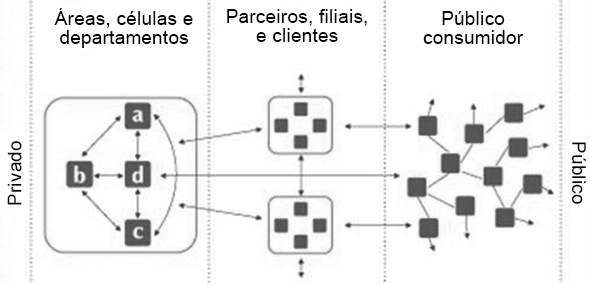

# PROVA — CÂMARA MUNICIPAL DE ARARAQUARA – SP — CONCURSO PÚBLICO 2017 — AGENTE ADMINISTRATIVO (NÍVEL MÉDIO)

## 1. Análise geral da prova

**Identificação da prova:**

- **Concurso:** Concurso Público — Câmara Municipal de Araraquara – SP (Edital Nº 01/2017 — Nível Médio)
- **Cargo:** Agente Administrativo (caderno IBFC_01)
- **Banca:** IBFC
- **Estrutura:** 60 questões objetivas (A–D): Língua Portuguesa (01–20), Raciocínio Lógico (21–35), Noções de Informática (36–45), Legislação Específica (46–60); questão 50 ANULADA

**Composição quantitativa:**

| Item | Quantidade |
|---|---|
| Total de questões | 60 (sendo a 50 ANULADA) |
| Textos de apoio compartilhados (grupos) | 3 (Texto I: Q01–Q13; Texto II — propaganda: Q14–Q17; Texto III: Q18–Q20) |
| Imagens de conteúdo | 2 (propaganda do Texto II; figura de redes Q40) |
| Gráficos e tabelas | 1 planilha MS-Excel transcrita (Q41) |
| Grupos identificados | 3 |
| Questões independentes | 40 |

**Composição por bloco:**

| Bloco | Questões | Quantidade |
|---|---|---|
| Língua Portuguesa | 01–20 | 20 |
| Raciocínio Lógico | 21–35 | 15 |
| Noções de Informática | 36–45 | 10 |
| Legislação Específica | 46–60 | 15 |

**Observações sobre a estrutura original:**

- As alternativas originais usam o formato “a)” (minúsculo); na organização foram normalizadas para maiúsculas (A–D), sem alteração de conteúdo.
- A questão 50 foi ANULADA conforme gabarito oficial após recursos do IBFC.
- Os segmentos “Considere o fragmento/trecho abaixo para responder às questões…” (Q05–Q07 e Q11–Q12) foram reproduzidos integralmente nos enunciados correspondentes; o Texto I completo também acompanha cada questão de 01 a 13.
- A planilha da questão 41 era uma tabela vetorial do PDF e foi transcrita integralmente.
- Imagens não vinculadas a questões (logotipos da capa e grades de rascunho do cartão-resposta) foram descartadas.

> **Transcrição integral da capa e das instruções (conforme extraída do PDF):**
> 
> > 
> > 
> > 
> > DESTAQUE AQUI
> > GABARITO DO CANDIDATO - RASCUNHO
> > Nome:
> > Assinatura do Candidato:
> > Inscrição:
> > 
> > 
> > CÂMARA MUNICIPAL DE ARARAQUARA
> > CONCURSO PÚBLICO - EDITAL 01/2017 - NÍVEL MÉDIO
> > AGENTE ADMINISTRATIVO
> > NOME DO CANDIDATO
> > ASSINATURA DO CANDIDATO
> > RG DO CANDIDATO
> > INSTRUÇÕES GERAIS
> > I.
> > Nesta prova, você encontrará 06 (seis) páginas numeradas sequencialmente, contendo 60 (sessenta) questões
> > correspondentes às seguintes disciplinas: Língua Portuguesa (20 questões), Raciocínio Lógico (15 questões), Noções de
> > Informática (10 questões) e Legisação Específica (15 questões).
> > II. Verifique se seu nome e número de inscrição estão corretos no cartão de respostas. Se houver erro, notifique o fiscal.
> > III. Verifique se o caderno de provas se refere ao cargo para o qual você se inscreveu. Caso o cargo esteja divergente,
> > solicite ao fiscal de sala para que tome as providências cabíveis, pois não serão aceitas reclamações posteriores nesse
> > sentido.
> > IV. Assine e preencha o cartão de respostas nos locais indicados, com caneta azul ou preta.
> > V. Verifique se a impressão, a paginação e a numeração das questões estão corretas. Caso observe qualquer erro, notifique
> > o fiscal.
> > VI.  Você dispõe de 04 (quatro) horas para fazer esta prova. Reserve os 20 (vinte) minutos finais para marcar o cartão de
> > respostas.
> > VII. O candidato só poderá retirar-se do setor de prova 01 (uma) hora após seu início.
> > VIII. O candidato não poderá levar o caderno de questões. O caderno de questões será publicado no site do IBFC, no prazo
> > recursal contra gabarito.
> > IX. Marque o cartão de respostas cobrindo fortemente o espaço correspondente à letra a ser assinalada, conforme o exemplo
> > no próprio cartão de respostas.
> > X. A leitora óptica não registrará as respostas em que houver falta de nitidez e/ou marcação de mais de uma alternativa.
> > XI. O cartão de respostas não pode ser dobrado, amassado, rasurado ou manchado. Exceto sua assinatura, nada deve ser
> > escrito ou registrado fora dos locais destinados às respostas.
> > XII. Ao terminar a prova, entregue ao fiscal o cartão de respostas e este caderno. As observações ou marcações registradas
> > no caderno não serão levadas em consideração.
> > XIII. É terminantemente proibido o uso de telefone celular, pager ou similares.
> > Boa Prova!
> > LEIA COM  ATENÇÃO AS INSTRUÇÕES ABAIXO
> > 
> > 
> > 
> > 31
> > 26
> > 32
> > 27
> > 33
> > 28
> > 34
> > 29
> > 35
> > 30
> > 36
> > 37 38
> > 39 40 41
> > 42
> > 43
> > 44
> > 45
> > 46 47
> > 48 49 50
> > 10
> > 11
> > 12
> > 13
> > 14
> > 15
> > 16
> > 21
> > 17
> > 22
> > 18
> > 23
> > 19
> > 24
> > 20
> > 25
> > 51
> > 52
> > 53
> > 54 55
> > 56
> > 57 58
> > 59 60

**Gabarito oficial — tabela "Gabarito oficial após recursos — IBFC":**

| Questão | Resposta | Questão | Resposta | Questão | Resposta | Questão | Resposta | Questão | Resposta |
|---|---|---|---|---|---|---|---|---|---|
| 01 | **C** | 02 | **B** | 03 | **D** | 04 | **C** | 05 | **D** |
| 06 | **A** | 07 | **C** | 08 | **B** | 09 | **A** | 10 | **C** |
| 11 | **B** | 12 | **A** | 13 | **D** | 14 | **B** | 15 | **C** |
| 16 | **A** | 17 | **A** | 18 | **D** | 19 | **B** | 20 | **B** |
| 21 | **D** | 22 | **C** | 23 | **A** | 24 | **C** | 25 | **B** |
| 26 | **A** | 27 | **D** | 28 | **B** | 29 | **B** | 30 | **C** |
| 31 | **D** | 32 | **A** | 33 | **C** | 34 | **D** | 35 | **A** |
| 36 | **C** | 37 | **A** | 38 | **B** | 39 | **D** | 40 | **D** |
| 41 | **B** | 42 | **C** | 43 | **B** | 44 | **D** | 45 | **A** |
| 46 | **D** | 47 | **A** | 48 | **C** | 49 | **B** | 50 | **ANULADA** |
| 51 | **A** | 52 | **C** | 53 | **B** | 54 | **D** | 55 | **C** |
| 56 | **D** | 57 | **A** | 58 | **B** | 59 | **A** | 60 | **C** |

> 📌 Fonte: Gabarito oficial após recursos — IBFC

---

## 2. Questões agrupadas

### GRUPO 01 — Texto I — “O vencedor: uma visão alternativa” (Moacyr Scliar) — questões 01 a 13

**Questões relacionadas:** 01, 02, 03, 04, 05, 06, 07, 08, 09, 10, 11, 12, 13.

**Material de apoio compartilhado:**

> O vencedor: uma visão alternativa
> Nos sete primeiros assaltos, Raul foi duramente castigado.
> Não era de espantar: estava inteiramente fora de forma. Meses
> de indolência e até de devassidão tinham produzido seus
> efeitos. O combativo boxeador de outrora, o homem que, para
> muitos, fora estrela do pugilismo mundial, estava reduzido a um
> verdadeiro trapo. O público não tinha a menor complacência
> com ele: sucediam-se as vaias e os palavrões.
> 
> De repente, algo aconteceu. Caído na lona, depois de ter
> recebido um cruzado devastador, Raul ergueu a cabeça e viu,
> sentada na primeira fila, sua sobrinha Dóris, filha do falecido
> Alberto. A menina fitava-o com o olhos cheios de lágrimas.
> Um olhar que trespassou Raul como uma punhalada. Algo
> rompeu-se dentro dele. Sentiu renascer em si a energia que
> fizera dele a fera do ringue. De um salto, pôs-se de pé e partiu
> como um touro para cima do adversário. A princípio o público
> não se deu conta do que estava acontecendo. Mas quando
> os fãs perceberam que uma verdadeira ressurreição se tinha
> operado, passaram a incentivá-lo. Depois de uma saraivada
> de golpes certeiros e violentíssimos, o adversário foi ao chão.
> O juiz procedeu à contagem regulamentar e proclamou Raul o
> vencedor.
> 
> Todos aplaudiram. Todos deliraram de alegria. Menos este
> que conta a história. Este que conta a história era o adversário.
> Este que conta a história era o que estava caído. Este que
> conta a história era o derrotado. Ai, Deus.
> (SCLIAR, Moacyr. Contos reunidos. São Paulo: Companhia das
> Letras, 1995. p.58-59)

---

#### QUESTÃO 01

✅ **Gabarito: C** (gabarito oficial APÓS RECURSOS — IBFC (Edital Nº 01/2017))

**Material de apoio:**

> **Texto I**
> 
> O vencedor: uma visão alternativa
> Nos sete primeiros assaltos, Raul foi duramente castigado.
> Não era de espantar: estava inteiramente fora de forma. Meses
> de indolência e até de devassidão tinham produzido seus
> efeitos. O combativo boxeador de outrora, o homem que, para
> muitos, fora estrela do pugilismo mundial, estava reduzido a um
> verdadeiro trapo. O público não tinha a menor complacência
> com ele: sucediam-se as vaias e os palavrões.
> 
> De repente, algo aconteceu. Caído na lona, depois de ter
> recebido um cruzado devastador, Raul ergueu a cabeça e viu,
> sentada na primeira fila, sua sobrinha Dóris, filha do falecido
> Alberto. A menina fitava-o com o olhos cheios de lágrimas.
> Um olhar que trespassou Raul como uma punhalada. Algo
> rompeu-se dentro dele. Sentiu renascer em si a energia que
> fizera dele a fera do ringue. De um salto, pôs-se de pé e partiu
> como um touro para cima do adversário. A princípio o público
> não se deu conta do que estava acontecendo. Mas quando
> os fãs perceberam que uma verdadeira ressurreição se tinha
> operado, passaram a incentivá-lo. Depois de uma saraivada
> de golpes certeiros e violentíssimos, o adversário foi ao chão.
> O juiz procedeu à contagem regulamentar e proclamou Raul o
> vencedor.
> 
> Todos aplaudiram. Todos deliraram de alegria. Menos este
> que conta a história. Este que conta a história era o adversário.
> Este que conta a história era o que estava caído. Este que
> conta a história era o derrotado. Ai, Deus.
> (SCLIAR, Moacyr. Contos reunidos. São Paulo: Companhia das
> Letras, 1995. p.58-59)

**Enunciado:**

De acordo com o entendimento do texto, pode se afirmar
que a expressão “uma visão alternativa”, presente no
título, justifica-se:

**Alternativas:**

A) pela descrição da superação das adversidades enfrentadas pelo vencedor.

B) por sugerir ao leitor que vencer nem sempre é o mais importante em uma luta.

C) pelo fato de a narrativa ter sido apresentada a partir da perspectiva do vencido.

D) por evidenciar que as pessoas sempre compreendem as fraquezas dos lutadores.

**Referências visuais:**

Nenhuma.

---

#### QUESTÃO 02

✅ **Gabarito: B** (gabarito oficial APÓS RECURSOS — IBFC (Edital Nº 01/2017))

**Material de apoio:**

> **Texto I**
> 
> O vencedor: uma visão alternativa
> Nos sete primeiros assaltos, Raul foi duramente castigado.
> Não era de espantar: estava inteiramente fora de forma. Meses
> de indolência e até de devassidão tinham produzido seus
> efeitos. O combativo boxeador de outrora, o homem que, para
> muitos, fora estrela do pugilismo mundial, estava reduzido a um
> verdadeiro trapo. O público não tinha a menor complacência
> com ele: sucediam-se as vaias e os palavrões.
> 
> De repente, algo aconteceu. Caído na lona, depois de ter
> recebido um cruzado devastador, Raul ergueu a cabeça e viu,
> sentada na primeira fila, sua sobrinha Dóris, filha do falecido
> Alberto. A menina fitava-o com o olhos cheios de lágrimas.
> Um olhar que trespassou Raul como uma punhalada. Algo
> rompeu-se dentro dele. Sentiu renascer em si a energia que
> fizera dele a fera do ringue. De um salto, pôs-se de pé e partiu
> como um touro para cima do adversário. A princípio o público
> não se deu conta do que estava acontecendo. Mas quando
> os fãs perceberam que uma verdadeira ressurreição se tinha
> operado, passaram a incentivá-lo. Depois de uma saraivada
> de golpes certeiros e violentíssimos, o adversário foi ao chão.
> O juiz procedeu à contagem regulamentar e proclamou Raul o
> vencedor.
> 
> Todos aplaudiram. Todos deliraram de alegria. Menos este
> que conta a história. Este que conta a história era o adversário.
> Este que conta a história era o que estava caído. Este que
> conta a história era o derrotado. Ai, Deus.
> (SCLIAR, Moacyr. Contos reunidos. São Paulo: Companhia das
> Letras, 1995. p.58-59)

**Enunciado:**

Em relação às características da tipologia narrativa da
qual o texto é um exemplo, só NÃO se verifica no conto
de Scliar:

**Alternativas:**

A) indicação da percepção temporal, sugerindo ao leitor a duração do fato narrado.

B) ausência de narrador uma vez que a história é apresentada de modo impessoal.

C) sugestão do espaço em que o episódio ocorre por meio de elementos como “na lona”.

D) presença de personagens com atuações distintas como a sobrinha, os fãs e o juiz.

**Referências visuais:**

Nenhuma.

---

#### QUESTÃO 03

✅ **Gabarito: D** (gabarito oficial APÓS RECURSOS — IBFC (Edital Nº 01/2017))

**Material de apoio:**

> **Texto I**
> 
> O vencedor: uma visão alternativa
> Nos sete primeiros assaltos, Raul foi duramente castigado.
> Não era de espantar: estava inteiramente fora de forma. Meses
> de indolência e até de devassidão tinham produzido seus
> efeitos. O combativo boxeador de outrora, o homem que, para
> muitos, fora estrela do pugilismo mundial, estava reduzido a um
> verdadeiro trapo. O público não tinha a menor complacência
> com ele: sucediam-se as vaias e os palavrões.
> 
> De repente, algo aconteceu. Caído na lona, depois de ter
> recebido um cruzado devastador, Raul ergueu a cabeça e viu,
> sentada na primeira fila, sua sobrinha Dóris, filha do falecido
> Alberto. A menina fitava-o com o olhos cheios de lágrimas.
> Um olhar que trespassou Raul como uma punhalada. Algo
> rompeu-se dentro dele. Sentiu renascer em si a energia que
> fizera dele a fera do ringue. De um salto, pôs-se de pé e partiu
> como um touro para cima do adversário. A princípio o público
> não se deu conta do que estava acontecendo. Mas quando
> os fãs perceberam que uma verdadeira ressurreição se tinha
> operado, passaram a incentivá-lo. Depois de uma saraivada
> de golpes certeiros e violentíssimos, o adversário foi ao chão.
> O juiz procedeu à contagem regulamentar e proclamou Raul o
> vencedor.
> 
> Todos aplaudiram. Todos deliraram de alegria. Menos este
> que conta a história. Este que conta a história era o adversário.
> Este que conta a história era o que estava caído. Este que
> conta a história era o derrotado. Ai, Deus.
> (SCLIAR, Moacyr. Contos reunidos. São Paulo: Companhia das
> Letras, 1995. p.58-59)

**Enunciado:**

No último parágrafo do texto, ocorre a reiteração do
pronome “este” que, além de um papel coesivo, cumpre
função expressiva pois:

**Alternativas:**

A) cumpre papel catafórico indicando informações que ainda serão apresentadas.

B) indica tratar-se de uma referência temporal apontando para um tempo futuro.

C) sinaliza a limitação da escolha lexical do autor que deveria ter variado os termos.

D) reforça a localização espacial do narrador sinalizando seu lugar de fala.

**Referências visuais:**

Nenhuma.

---

#### QUESTÃO 04

✅ **Gabarito: C** (gabarito oficial APÓS RECURSOS — IBFC (Edital Nº 01/2017))

**Material de apoio:**

> **Texto I**
> 
> O vencedor: uma visão alternativa
> Nos sete primeiros assaltos, Raul foi duramente castigado.
> Não era de espantar: estava inteiramente fora de forma. Meses
> de indolência e até de devassidão tinham produzido seus
> efeitos. O combativo boxeador de outrora, o homem que, para
> muitos, fora estrela do pugilismo mundial, estava reduzido a um
> verdadeiro trapo. O público não tinha a menor complacência
> com ele: sucediam-se as vaias e os palavrões.
> 
> De repente, algo aconteceu. Caído na lona, depois de ter
> recebido um cruzado devastador, Raul ergueu a cabeça e viu,
> sentada na primeira fila, sua sobrinha Dóris, filha do falecido
> Alberto. A menina fitava-o com o olhos cheios de lágrimas.
> Um olhar que trespassou Raul como uma punhalada. Algo
> rompeu-se dentro dele. Sentiu renascer em si a energia que
> fizera dele a fera do ringue. De um salto, pôs-se de pé e partiu
> como um touro para cima do adversário. A princípio o público
> não se deu conta do que estava acontecendo. Mas quando
> os fãs perceberam que uma verdadeira ressurreição se tinha
> operado, passaram a incentivá-lo. Depois de uma saraivada
> de golpes certeiros e violentíssimos, o adversário foi ao chão.
> O juiz procedeu à contagem regulamentar e proclamou Raul o
> vencedor.
> 
> Todos aplaudiram. Todos deliraram de alegria. Menos este
> que conta a história. Este que conta a história era o adversário.
> Este que conta a história era o que estava caído. Este que
> conta a história era o derrotado. Ai, Deus.
> (SCLIAR, Moacyr. Contos reunidos. São Paulo: Companhia das
> Letras, 1995. p.58-59)

**Enunciado:**

Assinale a alternativa na qual o pronome oblíquo
átono esteja empregado em desacordo com as normas
gramaticais.

**Alternativas:**

A) “sucediam-se as vaias e os palavrões.” (1º§).

B) “A menina fitava-o com o olhos cheios de lágrimas.” (2º§).

C) “Algo rompeu-se dentro dele” (2º§).

D) “passaram a incentivá-lo.” (2º§). “Nos sete primeiros assaltos, Raul foi duramente castigado. Não era de espantar: estava inteiramente fora de forma.” (1º§)

**Referências visuais:**

Nenhuma.

---

#### QUESTÃO 05

✅ **Gabarito: D** (gabarito oficial APÓS RECURSOS — IBFC (Edital Nº 01/2017))

**Material de apoio:**

> **Texto I**
> 
> O vencedor: uma visão alternativa
> Nos sete primeiros assaltos, Raul foi duramente castigado.
> Não era de espantar: estava inteiramente fora de forma. Meses
> de indolência e até de devassidão tinham produzido seus
> efeitos. O combativo boxeador de outrora, o homem que, para
> muitos, fora estrela do pugilismo mundial, estava reduzido a um
> verdadeiro trapo. O público não tinha a menor complacência
> com ele: sucediam-se as vaias e os palavrões.
> 
> De repente, algo aconteceu. Caído na lona, depois de ter
> recebido um cruzado devastador, Raul ergueu a cabeça e viu,
> sentada na primeira fila, sua sobrinha Dóris, filha do falecido
> Alberto. A menina fitava-o com o olhos cheios de lágrimas.
> Um olhar que trespassou Raul como uma punhalada. Algo
> rompeu-se dentro dele. Sentiu renascer em si a energia que
> fizera dele a fera do ringue. De um salto, pôs-se de pé e partiu
> como um touro para cima do adversário. A princípio o público
> não se deu conta do que estava acontecendo. Mas quando
> os fãs perceberam que uma verdadeira ressurreição se tinha
> operado, passaram a incentivá-lo. Depois de uma saraivada
> de golpes certeiros e violentíssimos, o adversário foi ao chão.
> O juiz procedeu à contagem regulamentar e proclamou Raul o
> vencedor.
> 
> Todos aplaudiram. Todos deliraram de alegria. Menos este
> que conta a história. Este que conta a história era o adversário.
> Este que conta a história era o que estava caído. Este que
> conta a história era o derrotado. Ai, Deus.
> (SCLIAR, Moacyr. Contos reunidos. São Paulo: Companhia das
> Letras, 1995. p.58-59)

**Enunciado:**

Considere o fragmento abaixo para responder às questões
5, 6 e 7.

“Nos sete primeiros assaltos, Raul foi duramente castigado.
Não era de espantar: estava inteiramente fora de forma.”
(1º§)

Os advérbios destacados expressam, respectivamente,
as seguintes circunstâncias:

**Alternativas:**

A) modo e modo.

B) intensidade e tempo.

C) intensidade e intensidade.

D) modo e intensidade.

**Referências visuais:**

Nenhuma.

---

#### QUESTÃO 06

✅ **Gabarito: A** (gabarito oficial APÓS RECURSOS — IBFC (Edital Nº 01/2017))

**Material de apoio:**

> **Texto I**
> 
> O vencedor: uma visão alternativa
> Nos sete primeiros assaltos, Raul foi duramente castigado.
> Não era de espantar: estava inteiramente fora de forma. Meses
> de indolência e até de devassidão tinham produzido seus
> efeitos. O combativo boxeador de outrora, o homem que, para
> muitos, fora estrela do pugilismo mundial, estava reduzido a um
> verdadeiro trapo. O público não tinha a menor complacência
> com ele: sucediam-se as vaias e os palavrões.
> 
> De repente, algo aconteceu. Caído na lona, depois de ter
> recebido um cruzado devastador, Raul ergueu a cabeça e viu,
> sentada na primeira fila, sua sobrinha Dóris, filha do falecido
> Alberto. A menina fitava-o com o olhos cheios de lágrimas.
> Um olhar que trespassou Raul como uma punhalada. Algo
> rompeu-se dentro dele. Sentiu renascer em si a energia que
> fizera dele a fera do ringue. De um salto, pôs-se de pé e partiu
> como um touro para cima do adversário. A princípio o público
> não se deu conta do que estava acontecendo. Mas quando
> os fãs perceberam que uma verdadeira ressurreição se tinha
> operado, passaram a incentivá-lo. Depois de uma saraivada
> de golpes certeiros e violentíssimos, o adversário foi ao chão.
> O juiz procedeu à contagem regulamentar e proclamou Raul o
> vencedor.
> 
> Todos aplaudiram. Todos deliraram de alegria. Menos este
> que conta a história. Este que conta a história era o adversário.
> Este que conta a história era o que estava caído. Este que
> conta a história era o derrotado. Ai, Deus.
> (SCLIAR, Moacyr. Contos reunidos. São Paulo: Companhia das
> Letras, 1995. p.58-59)

**Enunciado:**

Os dois pontos que seguem o verbo "espantar"
contribuem para a coesão textual e poderiam ser
substituídos por um conectivo de valor:

**Alternativas:**

A) causal.

B) concessivo.

C) consecutivo.

D) condicional.

**Referências visuais:**

Nenhuma.

---

#### QUESTÃO 07

✅ **Gabarito: C** (gabarito oficial APÓS RECURSOS — IBFC (Edital Nº 01/2017))

**Material de apoio:**

> **Texto I**
> 
> O vencedor: uma visão alternativa
> Nos sete primeiros assaltos, Raul foi duramente castigado.
> Não era de espantar: estava inteiramente fora de forma. Meses
> de indolência e até de devassidão tinham produzido seus
> efeitos. O combativo boxeador de outrora, o homem que, para
> muitos, fora estrela do pugilismo mundial, estava reduzido a um
> verdadeiro trapo. O público não tinha a menor complacência
> com ele: sucediam-se as vaias e os palavrões.
> 
> De repente, algo aconteceu. Caído na lona, depois de ter
> recebido um cruzado devastador, Raul ergueu a cabeça e viu,
> sentada na primeira fila, sua sobrinha Dóris, filha do falecido
> Alberto. A menina fitava-o com o olhos cheios de lágrimas.
> Um olhar que trespassou Raul como uma punhalada. Algo
> rompeu-se dentro dele. Sentiu renascer em si a energia que
> fizera dele a fera do ringue. De um salto, pôs-se de pé e partiu
> como um touro para cima do adversário. A princípio o público
> não se deu conta do que estava acontecendo. Mas quando
> os fãs perceberam que uma verdadeira ressurreição se tinha
> operado, passaram a incentivá-lo. Depois de uma saraivada
> de golpes certeiros e violentíssimos, o adversário foi ao chão.
> O juiz procedeu à contagem regulamentar e proclamou Raul o
> vencedor.
> 
> Todos aplaudiram. Todos deliraram de alegria. Menos este
> que conta a história. Este que conta a história era o adversário.
> Este que conta a história era o que estava caído. Este que
> conta a história era o derrotado. Ai, Deus.
> (SCLIAR, Moacyr. Contos reunidos. São Paulo: Companhia das
> Letras, 1995. p.58-59)

**Enunciado:**

A vírgula do primeiro período tem seu emprego
justificado em função de:

**Alternativas:**

A) cumprir apenas papel estilístico podendo ser retirada da oração.

B) sinalizar uma enumeração de termos de mesma função sintática.

C) acompanhar um termo deslocado da ordem direta da oração.

D) indicar um aposto que se refere ao conteúdo posterior.

**Referências visuais:**

Nenhuma.

---

#### QUESTÃO 08

✅ **Gabarito: B** (gabarito oficial APÓS RECURSOS — IBFC (Edital Nº 01/2017))

**Material de apoio:**

> **Texto I**
> 
> O vencedor: uma visão alternativa
> Nos sete primeiros assaltos, Raul foi duramente castigado.
> Não era de espantar: estava inteiramente fora de forma. Meses
> de indolência e até de devassidão tinham produzido seus
> efeitos. O combativo boxeador de outrora, o homem que, para
> muitos, fora estrela do pugilismo mundial, estava reduzido a um
> verdadeiro trapo. O público não tinha a menor complacência
> com ele: sucediam-se as vaias e os palavrões.
> 
> De repente, algo aconteceu. Caído na lona, depois de ter
> recebido um cruzado devastador, Raul ergueu a cabeça e viu,
> sentada na primeira fila, sua sobrinha Dóris, filha do falecido
> Alberto. A menina fitava-o com o olhos cheios de lágrimas.
> Um olhar que trespassou Raul como uma punhalada. Algo
> rompeu-se dentro dele. Sentiu renascer em si a energia que
> fizera dele a fera do ringue. De um salto, pôs-se de pé e partiu
> como um touro para cima do adversário. A princípio o público
> não se deu conta do que estava acontecendo. Mas quando
> os fãs perceberam que uma verdadeira ressurreição se tinha
> operado, passaram a incentivá-lo. Depois de uma saraivada
> de golpes certeiros e violentíssimos, o adversário foi ao chão.
> O juiz procedeu à contagem regulamentar e proclamou Raul o
> vencedor.
> 
> Todos aplaudiram. Todos deliraram de alegria. Menos este
> que conta a história. Este que conta a história era o adversário.
> Este que conta a história era o que estava caído. Este que
> conta a história era o derrotado. Ai, Deus.
> (SCLIAR, Moacyr. Contos reunidos. São Paulo: Companhia das
> Letras, 1995. p.58-59)

**Enunciado:**

O vocábulo destacado, em “Meses de indolência e até
de devassidão” (1º§), pode ser substituído por outro de
mesmo valor semântico. Indique-o.

**Alternativas:**

A) revolta.

B) indiferença.

C) descanso.

D) namoro.

**Referências visuais:**

Nenhuma.

---

#### QUESTÃO 09

✅ **Gabarito: A** (gabarito oficial APÓS RECURSOS — IBFC (Edital Nº 01/2017))

**Material de apoio:**

> **Texto I**
> 
> O vencedor: uma visão alternativa
> Nos sete primeiros assaltos, Raul foi duramente castigado.
> Não era de espantar: estava inteiramente fora de forma. Meses
> de indolência e até de devassidão tinham produzido seus
> efeitos. O combativo boxeador de outrora, o homem que, para
> muitos, fora estrela do pugilismo mundial, estava reduzido a um
> verdadeiro trapo. O público não tinha a menor complacência
> com ele: sucediam-se as vaias e os palavrões.
> 
> De repente, algo aconteceu. Caído na lona, depois de ter
> recebido um cruzado devastador, Raul ergueu a cabeça e viu,
> sentada na primeira fila, sua sobrinha Dóris, filha do falecido
> Alberto. A menina fitava-o com o olhos cheios de lágrimas.
> Um olhar que trespassou Raul como uma punhalada. Algo
> rompeu-se dentro dele. Sentiu renascer em si a energia que
> fizera dele a fera do ringue. De um salto, pôs-se de pé e partiu
> como um touro para cima do adversário. A princípio o público
> não se deu conta do que estava acontecendo. Mas quando
> os fãs perceberam que uma verdadeira ressurreição se tinha
> operado, passaram a incentivá-lo. Depois de uma saraivada
> de golpes certeiros e violentíssimos, o adversário foi ao chão.
> O juiz procedeu à contagem regulamentar e proclamou Raul o
> vencedor.
> 
> Todos aplaudiram. Todos deliraram de alegria. Menos este
> que conta a história. Este que conta a história era o adversário.
> Este que conta a história era o que estava caído. Este que
> conta a história era o derrotado. Ai, Deus.
> (SCLIAR, Moacyr. Contos reunidos. São Paulo: Companhia das
> Letras, 1995. p.58-59)

**Enunciado:**

Dos adjetivos presentes em “Depois de uma saraivada
de golpes certeiros e violentíssimos” (2º§), apenas o
segundo está apresentando uma alteração de grau.
Trata-se do grau:

**Alternativas:**

A) superlativo absoluto.

B) comparativo de superioridade.

C) superlativo relativo.

D) comparativo de igualdade.

**Referências visuais:**

Nenhuma.

---

#### QUESTÃO 10

✅ **Gabarito: C** (gabarito oficial APÓS RECURSOS — IBFC (Edital Nº 01/2017))

**Material de apoio:**

> **Texto I**
> 
> O vencedor: uma visão alternativa
> Nos sete primeiros assaltos, Raul foi duramente castigado.
> Não era de espantar: estava inteiramente fora de forma. Meses
> de indolência e até de devassidão tinham produzido seus
> efeitos. O combativo boxeador de outrora, o homem que, para
> muitos, fora estrela do pugilismo mundial, estava reduzido a um
> verdadeiro trapo. O público não tinha a menor complacência
> com ele: sucediam-se as vaias e os palavrões.
> 
> De repente, algo aconteceu. Caído na lona, depois de ter
> recebido um cruzado devastador, Raul ergueu a cabeça e viu,
> sentada na primeira fila, sua sobrinha Dóris, filha do falecido
> Alberto. A menina fitava-o com o olhos cheios de lágrimas.
> Um olhar que trespassou Raul como uma punhalada. Algo
> rompeu-se dentro dele. Sentiu renascer em si a energia que
> fizera dele a fera do ringue. De um salto, pôs-se de pé e partiu
> como um touro para cima do adversário. A princípio o público
> não se deu conta do que estava acontecendo. Mas quando
> os fãs perceberam que uma verdadeira ressurreição se tinha
> operado, passaram a incentivá-lo. Depois de uma saraivada
> de golpes certeiros e violentíssimos, o adversário foi ao chão.
> O juiz procedeu à contagem regulamentar e proclamou Raul o
> vencedor.
> 
> Todos aplaudiram. Todos deliraram de alegria. Menos este
> que conta a história. Este que conta a história era o adversário.
> Este que conta a história era o que estava caído. Este que
> conta a história era o derrotado. Ai, Deus.
> (SCLIAR, Moacyr. Contos reunidos. São Paulo: Companhia das
> Letras, 1995. p.58-59)

**Enunciado:**

Observe os seguintes fragmentos:
“o homem que, para muitos, fora estrela do pugilismo mundial,”(1º§)
“Um olhar que trespassou Raul como uma punhalada.” (2º§)
Sobre a linguagem figurada empregada, considere as
seguintes afirmativas:
I. No primeiro, percebe-se um exemplo de metáfora.
II. Nos dois casos, nota-se uma espécie de comparação
simbólica.
III. Ocorre entre “olhar” e “punhalada” uma relação
metonímica.

Assim, é correto o que se diz:

**Alternativas:**

A) Em todas as afirmativas.

B) Apenas em I e III.

C) Apenas em I e II.

D) Apenas em I. “Mas quando os fãs perceberam que uma verdadeira ressurreição se tinha operado, passaram a incentivá-lo.” (2º§)

**Referências visuais:**

Nenhuma.

---

#### QUESTÃO 11

✅ **Gabarito: B** (gabarito oficial APÓS RECURSOS — IBFC (Edital Nº 01/2017))

**Material de apoio:**

> **Texto I**
> 
> O vencedor: uma visão alternativa
> Nos sete primeiros assaltos, Raul foi duramente castigado.
> Não era de espantar: estava inteiramente fora de forma. Meses
> de indolência e até de devassidão tinham produzido seus
> efeitos. O combativo boxeador de outrora, o homem que, para
> muitos, fora estrela do pugilismo mundial, estava reduzido a um
> verdadeiro trapo. O público não tinha a menor complacência
> com ele: sucediam-se as vaias e os palavrões.
> 
> De repente, algo aconteceu. Caído na lona, depois de ter
> recebido um cruzado devastador, Raul ergueu a cabeça e viu,
> sentada na primeira fila, sua sobrinha Dóris, filha do falecido
> Alberto. A menina fitava-o com o olhos cheios de lágrimas.
> Um olhar que trespassou Raul como uma punhalada. Algo
> rompeu-se dentro dele. Sentiu renascer em si a energia que
> fizera dele a fera do ringue. De um salto, pôs-se de pé e partiu
> como um touro para cima do adversário. A princípio o público
> não se deu conta do que estava acontecendo. Mas quando
> os fãs perceberam que uma verdadeira ressurreição se tinha
> operado, passaram a incentivá-lo. Depois de uma saraivada
> de golpes certeiros e violentíssimos, o adversário foi ao chão.
> O juiz procedeu à contagem regulamentar e proclamou Raul o
> vencedor.
> 
> Todos aplaudiram. Todos deliraram de alegria. Menos este
> que conta a história. Este que conta a história era o adversário.
> Este que conta a história era o que estava caído. Este que
> conta a história era o derrotado. Ai, Deus.
> (SCLIAR, Moacyr. Contos reunidos. São Paulo: Companhia das
> Letras, 1995. p.58-59)

**Enunciado:**

Considere o trecho abaixo para responder às questões 11
e 12.

“Mas quando os fãs perceberam que uma verdadeira
ressurreição se tinha operado, passaram a incentivá-lo.”
(2º§)

Pode-se inferir que a mudança do comportamento dos
fãs deveu-se:

**Alternativas:**

A) à aproximação do final da luta e ao gritos do juiz.

B) à mudança de ânimo apresentada pelo lutador.

C) à fé do lutador que se tornaria vencedor.

D) ao apoio incondicional que o pugilista sempre recebeu.

**Referências visuais:**

Nenhuma.

---

#### QUESTÃO 12

✅ **Gabarito: A** (gabarito oficial APÓS RECURSOS — IBFC (Edital Nº 01/2017))

**Material de apoio:**

> **Texto I**
> 
> O vencedor: uma visão alternativa
> Nos sete primeiros assaltos, Raul foi duramente castigado.
> Não era de espantar: estava inteiramente fora de forma. Meses
> de indolência e até de devassidão tinham produzido seus
> efeitos. O combativo boxeador de outrora, o homem que, para
> muitos, fora estrela do pugilismo mundial, estava reduzido a um
> verdadeiro trapo. O público não tinha a menor complacência
> com ele: sucediam-se as vaias e os palavrões.
> 
> De repente, algo aconteceu. Caído na lona, depois de ter
> recebido um cruzado devastador, Raul ergueu a cabeça e viu,
> sentada na primeira fila, sua sobrinha Dóris, filha do falecido
> Alberto. A menina fitava-o com o olhos cheios de lágrimas.
> Um olhar que trespassou Raul como uma punhalada. Algo
> rompeu-se dentro dele. Sentiu renascer em si a energia que
> fizera dele a fera do ringue. De um salto, pôs-se de pé e partiu
> como um touro para cima do adversário. A princípio o público
> não se deu conta do que estava acontecendo. Mas quando
> os fãs perceberam que uma verdadeira ressurreição se tinha
> operado, passaram a incentivá-lo. Depois de uma saraivada
> de golpes certeiros e violentíssimos, o adversário foi ao chão.
> O juiz procedeu à contagem regulamentar e proclamou Raul o
> vencedor.
> 
> Todos aplaudiram. Todos deliraram de alegria. Menos este
> que conta a história. Este que conta a história era o adversário.
> Este que conta a história era o que estava caído. Este que
> conta a história era o derrotado. Ai, Deus.
> (SCLIAR, Moacyr. Contos reunidos. São Paulo: Companhia das
> Letras, 1995. p.58-59)

**Enunciado:**

As
duas
conjunções
destacadas
no
fragmento
introduzem, respectivamente, as seguintes orações:

**Alternativas:**

A) subordinada adverbial e subordinada substantiva.

B) coordenada sindética e subordinada adjetiva.

C) subordinada substantiva e subordinada adjetiva.

D) subordinada substantiva e coordenada sindética.

**Referências visuais:**

Nenhuma.

---

#### QUESTÃO 13

✅ **Gabarito: D** (gabarito oficial APÓS RECURSOS — IBFC (Edital Nº 01/2017))

**Material de apoio:**

> **Texto I**
> 
> O vencedor: uma visão alternativa
> Nos sete primeiros assaltos, Raul foi duramente castigado.
> Não era de espantar: estava inteiramente fora de forma. Meses
> de indolência e até de devassidão tinham produzido seus
> efeitos. O combativo boxeador de outrora, o homem que, para
> muitos, fora estrela do pugilismo mundial, estava reduzido a um
> verdadeiro trapo. O público não tinha a menor complacência
> com ele: sucediam-se as vaias e os palavrões.
> 
> De repente, algo aconteceu. Caído na lona, depois de ter
> recebido um cruzado devastador, Raul ergueu a cabeça e viu,
> sentada na primeira fila, sua sobrinha Dóris, filha do falecido
> Alberto. A menina fitava-o com o olhos cheios de lágrimas.
> Um olhar que trespassou Raul como uma punhalada. Algo
> rompeu-se dentro dele. Sentiu renascer em si a energia que
> fizera dele a fera do ringue. De um salto, pôs-se de pé e partiu
> como um touro para cima do adversário. A princípio o público
> não se deu conta do que estava acontecendo. Mas quando
> os fãs perceberam que uma verdadeira ressurreição se tinha
> operado, passaram a incentivá-lo. Depois de uma saraivada
> de golpes certeiros e violentíssimos, o adversário foi ao chão.
> O juiz procedeu à contagem regulamentar e proclamou Raul o
> vencedor.
> 
> Todos aplaudiram. Todos deliraram de alegria. Menos este
> que conta a história. Este que conta a história era o adversário.
> Este que conta a história era o que estava caído. Este que
> conta a história era o derrotado. Ai, Deus.
> (SCLIAR, Moacyr. Contos reunidos. São Paulo: Companhia das
> Letras, 1995. p.58-59)

**Enunciado:**

O verbo destacado em “O juiz procedeu à contagem
regulamentar e proclamou Raul o vencedor.” (2º§)
é transitivo indireto e rege a preposição “a”. Tal fato
justifica a ocorrência da crase no trecho. Dentre os
verbos destacados abaixo, assinale o que NÃO possui
mesma transitividade e regência de acordo com a
normal padrão.

**Alternativas:**

A) assistir (no sentido de ver).

B) obedecer.

C) querer (no sentido de ter afeto).

D) aspirar (no sentido de respirar).

**Referências visuais:**

Nenhuma.

---

### GRUPO 02 — Texto II — propaganda (imagem) — questões 14 a 17

**Questões relacionadas:** 14, 15, 16, 17.

**Material de apoio compartilhado:**

> 

---

#### QUESTÃO 14

✅ **Gabarito: B** (gabarito oficial APÓS RECURSOS — IBFC (Edital Nº 01/2017))

**Material de apoio:**

> **Texto II** (propaganda — imagem)
> 
> 

**Enunciado:**

A propaganda é um gênero textual que busca, por meio
de recursos verbais e não verbais, atingir, diretamente,
um público-alvo. Nesse sentido, o texto II propõe um
diálogo entre palavras e imagens pois:

**Alternativas:**

A) o menino representa o desejo do homem adulto de voltar à infância.

B) o homem empurra os problemas de saúde para aproveitar uma nova realidade.

C) as doenças revelam-se como obstáculos intransponíveis ao homem.

D) o adulto representa o futuro do menino caso não tenha cuidado com a saúde.

**Referências visuais:**

Nenhuma.

---

#### QUESTÃO 15

✅ **Gabarito: C** (gabarito oficial APÓS RECURSOS — IBFC (Edital Nº 01/2017))

**Material de apoio:**

> **Texto II** (propaganda — imagem)
> 
> 

**Enunciado:**

O pronome “se” presente em “O homem que se cuida”
deve ser classificado, em função do papel que exerce
como:

**Alternativas:**

A) pronome apassivador.

B) parte integrante do verbo.

C) pronome reflexivo.

D) índice de indeterminação do sujeito.

**Referências visuais:**

Nenhuma.

---

#### QUESTÃO 16

✅ **Gabarito: A** (gabarito oficial APÓS RECURSOS — IBFC (Edital Nº 01/2017))

**Material de apoio:**

> **Texto II** (propaganda — imagem)
> 
> 

**Enunciado:**

A propaganda presente no texto II pode ser vista como
detentora de todos os objetivos abaixo, EXCETO:

**Alternativas:**

A) explicar o funcionamento das doenças citadas.

B) provocar mudança de hábitos nos homens.

C) gerar reflexão acerca da qualidade de vida.

D) estimular a importância da prevenção.

**Referências visuais:**

Nenhuma.

---

#### QUESTÃO 17

✅ **Gabarito: A** (gabarito oficial APÓS RECURSOS — IBFC (Edital Nº 01/2017))

**Material de apoio:**

> **Texto II** (propaganda — imagem)
> 
> 

**Enunciado:**

O vocábulo “que” que segue a palavra “homem”
cumpre papel coesivo e deve ser classificado,
morfologicamente como:

**Alternativas:**

A) pronome relativo.

B) conjunção integrante.

C) conjunção explicativa.

D) pronome indefinido. O homem vive em média sete anos a menos que a mulher. A cada três mortes de adulto, duas são de homens. Segundo dados do Sistema de Informação de Mortalidade (SIM) do Ministério da Saúde, na faixa de 20 a 59 anos, os homens morrem mais por causas externas, como acidentes de trânsito, acidentes de trabalho e lesões por violência. O segundo motivo de morte entre homens nesta faixa etária são as doenças do aparelho circulatório, seguida das neoplasias. Comemorado neste sábado (15), o Dia Internacional do Homem traz para o debate os cuidados com a saúde masculina no país. Atualmente no Brasil 18% dos homens brasileiros são obesos e 57% apresentam sobrepeso. Com relação ao tabagismo, 12,7% fumam e sobre doenças crônicas, 7,8% dos homens têm diabetes e 23,6% têm hipertensão. Vinte e sete por cento dos homens consomem bebida alcóolica abusivamente e 12,9% dirigem após beber. Os dados fazem parte do Sistema de Vigilância de Fatores de Risco e Proteção para Doenças Crônicas por Inquérito Telefônico (Vigitel), realizado anualmente pelo governo federal. Disponível em: http://agenciabrasil.ebc.com.br/geral/noticia/2017-07/ dia-internacional-do-homem-chama-atencao-para-cuidados-com- saude-masculina. Acesso em 01/09/17)

**Referências visuais:**

Nenhuma.

---

### GRUPO 03 — Texto III — saúde masculina (Agência Brasil) — questões 18 a 20

**Questões relacionadas:** 18, 19, 20.

**Material de apoio compartilhado:**

> O homem vive em média sete anos a menos que a mulher.
> A cada três mortes de adulto, duas são de homens. Segundo
> dados do Sistema de Informação de Mortalidade (SIM) do
> Ministério da Saúde, na faixa de 20 a 59 anos, os homens
> morrem mais por causas externas, como acidentes de trânsito,
> acidentes de trabalho e lesões por violência. O segundo motivo
> de morte entre homens nesta faixa etária são as doenças do
> aparelho circulatório, seguida das neoplasias. Comemorado
> neste sábado (15), o Dia Internacional do Homem traz para o
> debate os cuidados com a saúde masculina no país.
> 
> Atualmente no Brasil 18% dos homens brasileiros são
> obesos e 57% apresentam sobrepeso. Com relação ao
> tabagismo, 12,7% fumam e sobre doenças crônicas, 7,8% dos
> homens têm diabetes e 23,6% têm hipertensão. Vinte e sete por
> cento dos homens consomem bebida alcóolica abusivamente e
> 12,9% dirigem após beber. Os dados fazem parte do Sistema
> de Vigilância de Fatores de Risco e Proteção para Doenças
> Crônicas por Inquérito Telefônico (Vigitel), realizado anualmente
> pelo governo federal.
> Disponível em:  http://agenciabrasil.ebc.com.br/geral/noticia/2017-07/
> dia-internacional-do-homem-chama-atencao-para-cuidados-com-
> saude-masculina. Acesso em 01/09/17)

---

#### QUESTÃO 18

✅ **Gabarito: D** (gabarito oficial APÓS RECURSOS — IBFC (Edital Nº 01/2017))

**Material de apoio:**

> **Texto III**
> 
> O homem vive em média sete anos a menos que a mulher.
> A cada três mortes de adulto, duas são de homens. Segundo
> dados do Sistema de Informação de Mortalidade (SIM) do
> Ministério da Saúde, na faixa de 20 a 59 anos, os homens
> morrem mais por causas externas, como acidentes de trânsito,
> acidentes de trabalho e lesões por violência. O segundo motivo
> de morte entre homens nesta faixa etária são as doenças do
> aparelho circulatório, seguida das neoplasias. Comemorado
> neste sábado (15), o Dia Internacional do Homem traz para o
> debate os cuidados com a saúde masculina no país.
> 
> Atualmente no Brasil 18% dos homens brasileiros são
> obesos e 57% apresentam sobrepeso. Com relação ao
> tabagismo, 12,7% fumam e sobre doenças crônicas, 7,8% dos
> homens têm diabetes e 23,6% têm hipertensão. Vinte e sete por
> cento dos homens consomem bebida alcóolica abusivamente e
> 12,9% dirigem após beber. Os dados fazem parte do Sistema
> de Vigilância de Fatores de Risco e Proteção para Doenças
> Crônicas por Inquérito Telefônico (Vigitel), realizado anualmente
> pelo governo federal.
> Disponível em:  http://agenciabrasil.ebc.com.br/geral/noticia/2017-07/
> dia-internacional-do-homem-chama-atencao-para-cuidados-com-
> saude-masculina. Acesso em 01/09/17)

**Enunciado:**

O texto III pertence ao gênero notícia e apresenta todas
as características descritas abaixo, EXCETO:

**Alternativas:**

A) referência a dados estatísticos que reforçam a credibilidade das informações.

B) proposição inicial clara de uma ideia a ser desenvolvida ao longo do texto.

C) emprego de linguagem específica relacionada ao assunto proposto.

D) linguagem subjetiva ilustrando a pessoalidade do discurso do autor.

**Referências visuais:**

Nenhuma.

---

#### QUESTÃO 19

✅ **Gabarito: B** (gabarito oficial APÓS RECURSOS — IBFC (Edital Nº 01/2017))

**Material de apoio:**

> **Texto III**
> 
> O homem vive em média sete anos a menos que a mulher.
> A cada três mortes de adulto, duas são de homens. Segundo
> dados do Sistema de Informação de Mortalidade (SIM) do
> Ministério da Saúde, na faixa de 20 a 59 anos, os homens
> morrem mais por causas externas, como acidentes de trânsito,
> acidentes de trabalho e lesões por violência. O segundo motivo
> de morte entre homens nesta faixa etária são as doenças do
> aparelho circulatório, seguida das neoplasias. Comemorado
> neste sábado (15), o Dia Internacional do Homem traz para o
> debate os cuidados com a saúde masculina no país.
> 
> Atualmente no Brasil 18% dos homens brasileiros são
> obesos e 57% apresentam sobrepeso. Com relação ao
> tabagismo, 12,7% fumam e sobre doenças crônicas, 7,8% dos
> homens têm diabetes e 23,6% têm hipertensão. Vinte e sete por
> cento dos homens consomem bebida alcóolica abusivamente e
> 12,9% dirigem após beber. Os dados fazem parte do Sistema
> de Vigilância de Fatores de Risco e Proteção para Doenças
> Crônicas por Inquérito Telefônico (Vigitel), realizado anualmente
> pelo governo federal.
> Disponível em:  http://agenciabrasil.ebc.com.br/geral/noticia/2017-07/
> dia-internacional-do-homem-chama-atencao-para-cuidados-com-
> saude-masculina. Acesso em 01/09/17)

**Enunciado:**

Os vocábulos devem ser analisados no contexto em que
estão inseridos. Desse modo, as palavras destacadas
no texto possuem:

**Alternativas:**

A) mesmo papel coesivo.

B) diferentes classes gramaticais.

C) funções sintáticas equivalentes.

D) identificação semântica.

**Referências visuais:**

Nenhuma.

---

#### QUESTÃO 20

✅ **Gabarito: B** (gabarito oficial APÓS RECURSOS — IBFC (Edital Nº 01/2017))

**Material de apoio:**

> **Texto III**
> 
> O homem vive em média sete anos a menos que a mulher.
> A cada três mortes de adulto, duas são de homens. Segundo
> dados do Sistema de Informação de Mortalidade (SIM) do
> Ministério da Saúde, na faixa de 20 a 59 anos, os homens
> morrem mais por causas externas, como acidentes de trânsito,
> acidentes de trabalho e lesões por violência. O segundo motivo
> de morte entre homens nesta faixa etária são as doenças do
> aparelho circulatório, seguida das neoplasias. Comemorado
> neste sábado (15), o Dia Internacional do Homem traz para o
> debate os cuidados com a saúde masculina no país.
> 
> Atualmente no Brasil 18% dos homens brasileiros são
> obesos e 57% apresentam sobrepeso. Com relação ao
> tabagismo, 12,7% fumam e sobre doenças crônicas, 7,8% dos
> homens têm diabetes e 23,6% têm hipertensão. Vinte e sete por
> cento dos homens consomem bebida alcóolica abusivamente e
> 12,9% dirigem após beber. Os dados fazem parte do Sistema
> de Vigilância de Fatores de Risco e Proteção para Doenças
> Crônicas por Inquérito Telefônico (Vigitel), realizado anualmente
> pelo governo federal.
> Disponível em:  http://agenciabrasil.ebc.com.br/geral/noticia/2017-07/
> dia-internacional-do-homem-chama-atencao-para-cuidados-com-
> saude-masculina. Acesso em 01/09/17)

**Enunciado:**

A concordância verbal que  envolve a indicação de
porcentagens pode causar confusão na escrita. Em
“Atualmente no Brasil 18% dos homens brasileiros
são obesos” (2º§), o verbo está no plural uma vez que
concorda com o seguinte termo:

**Alternativas:**

A) 18%.

B) homens.

C) brasileiros.

D) obesos.

**Referências visuais:**

Nenhuma.

---

## 3. Questões independentes

#### QUESTÃO 21

✅ **Gabarito: D** (gabarito oficial APÓS RECURSOS — IBFC (Edital Nº 01/2017))

**Enunciado:**

Se Carlos não faltou ao serviço, então Ana não
completou o arquivo. Se João não fala inglês, então
José é o intérprete. Beatriz é francesa ou Carlos não
faltou ao serviço. Ora, Ana completou o arquivo e João
não fala inglês. Logo:

**Alternativas:**

A) Carlos faltou ao serviço e José não é o intérprete

B) José é o intérprete e Beatriz não é francesa

C) Carlos não faltou ao serviço ou Beatriz não é francesa

D) Ana completou o arquivo e Beatriz é francesa

**Referências visuais:**

Nenhuma.

---

#### QUESTÃO 22

✅ **Gabarito: C** (gabarito oficial APÓS RECURSOS — IBFC (Edital Nº 01/2017))

**Enunciado:**

André, Bruno e César são amigos, um deles é paulista,
outro é mineiro e o outro é carioca. Sabe-se, ainda,
que um deles é contador, outro é professor e o outro é
advogado. São válidas as seguintes afirmativas:
I. “André não é professor nem advogado”.
II. “Bruno não é carioca nem mineiro”.
III. “César diz: nem eu nem o mineiro somos professores”.

Nessas condições, é correto afirmar que:

**Alternativas:**

A) André é carioca e advogado

B) César é carioca e professor

C) André é mineiro e contador

D) César é paulista e advogado

**Referências visuais:**

Nenhuma.

---

#### QUESTÃO 23

✅ **Gabarito: A** (gabarito oficial APÓS RECURSOS — IBFC (Edital Nº 01/2017))

**Enunciado:**

Se o concurso não é difícil, então Matemática é difícil.
Por outro lado, ou Matemática não é difícil, ou Paulo
não gosta de Matemática. Daí conclui-se que, se Paulo
gosta de Matemática, então:

**Alternativas:**

A) Matemática não é difícil e o concurso é difícil

B) Matemática não é difícil e o concurso não é difícil

C) Matemática é difícil e o concurso é difícil

D) Matemática é difícil e o concurso não é difícil

**Referências visuais:**

Nenhuma.

---

#### QUESTÃO 24

✅ **Gabarito: C** (gabarito oficial APÓS RECURSOS — IBFC (Edital Nº 01/2017))

**Enunciado:**

O valor lógico de uma proposição “p” é verdade e o
valor lógico de uma proposição “q” é falso. Desse
modo, é correto afirmar que:

**Alternativas:**

A) O valor lógico da negação da disjunção entre p e q é verdade

B) O valor lógico da negação da conjunção entre p e q é falso

C) O valor lógico do condicional entre p e q, nessa ordem, é falso

D) O valor lógico da negação do bicondicional entre p e q é falso

**Referências visuais:**

Nenhuma.

---

#### QUESTÃO 25

✅ **Gabarito: B** (gabarito oficial APÓS RECURSOS — IBFC (Edital Nº 01/2017))

**Enunciado:**

De acordo com o raciocínio lógico proposicional, a
negação da frase “Paulo é analista financeiro e Sheila
não é assistente contábil” é:

**Alternativas:**

A) Paulo não é analista financeiro e Sheila é assistente contábil

B) Paulo não é analista financeiro ou Sheila é assistente contábil

C) Paulo não é analista financeiro e Sheila não é assistente contábil

D) Paulo é analista financeiro e Sheila é assistente contábil

**Referências visuais:**

Nenhuma.

---

#### QUESTÃO 26

✅ **Gabarito: A** (gabarito oficial APÓS RECURSOS — IBFC (Edital Nº 01/2017))

**Enunciado:**

De acordo com o raciocínio lógico proposicional a
proposição composta [p v (~q ↔ r)] → ~p é uma:

**Alternativas:**

A) Contingência

B) Tautologia

C) Contradição

D) Equivalência

**Referências visuais:**

Nenhuma.

---

#### QUESTÃO 27

✅ **Gabarito: D** (gabarito oficial APÓS RECURSOS — IBFC (Edital Nº 01/2017))

**Enunciado:**

Um diretor administrativo verificou que: “Se os
funcionários são valorizados, então o balanço mensal
não registra queda”. Essa constatação é equivalente a:

**Alternativas:**

A) O balanço mensal não registra queda se, e somente se, os funcionários são valorizados

B) Se os funcionários não são valorizados, então o balanço geral registra queda

C) Os funcionários não são valorizados se, e somente se, o balanço geral registra queda

D) Se o balanço mensal registra queda, então os funcionários não são valorizados

**Referências visuais:**

Nenhuma.

---

#### QUESTÃO 28

✅ **Gabarito: B** (gabarito oficial APÓS RECURSOS — IBFC (Edital Nº 01/2017))

**Enunciado:**

Fernanda é filha de Carlos e de Ana e os três tiram
férias em maio, porém Fernanda tira férias de 2 a 23
de maio, Carlos tira 18 dias de férias a partir do dia
5 de maio, inclusive, e Ana do sexto dia ao vigésimo
quarto dia de maio. A soma dos algarismos do número
que representa o máximo de dias de maio que os três
poderiam viajar juntos é:

**Alternativas:**

A) 7

B) 8

C) 9

D) 10

**Referências visuais:**

Nenhuma.

---

#### QUESTÃO 29

✅ **Gabarito: B** (gabarito oficial APÓS RECURSOS — IBFC (Edital Nº 01/2017))

**Enunciado:**

Dentre 82 funcionários do departamento financeiro
de uma empresa sabe-se que 43 se formaram em
administração, 37 se formaram em contabilidade e 23
se formaram em administração e contabilidade. Nessas
condições, o total de funcionários dessa empresa que
se formaram em somente um desses dois cursos foi:

**Alternativas:**

A) 57

B) 34

C) 48

D) 25

**Referências visuais:**

Nenhuma.

---

#### QUESTÃO 30

✅ **Gabarito: C** (gabarito oficial APÓS RECURSOS — IBFC (Edital Nº 01/2017))

**Enunciado:**

Os 18 primeiros dias do mês de maio são os elementos
de um conjunto A e os 17 últimos dias do mesmo mês
são os elementos do conjunto B. Se os elementos do
conjunto B – A representam os dias que um assistente
administrativo participou de uma formação, então o
total de dias de formação desse assistente foi:

**Alternativas:**

A) 28

B) 14

C) 13

D) 15

**Referências visuais:**

Nenhuma.

---

#### QUESTÃO 31

✅ **Gabarito: D** (gabarito oficial APÓS RECURSOS — IBFC (Edital Nº 01/2017))

**Enunciado:**

A figura apresenta os elementos de uma sequencia
lógica formada por quadros e símbolos, sendo que
em cada um dos 50 quadros há sempre os mesmos 4
símbolos descritos numa mesma ordem.
@ * & #
@ * & #
@ * & #
@ * & #
@ * & #
@ * & #
Quadro 1
Quadro 2
Quadro 3
Quadro 4
...
Quadro 50
Observe que o 14º elemento da figura é o símbolo (*)
que está no quadro 4. Nessas circunstâncias o símbolo
e o quadro em que o 173º elemento da figura está são,
respectivamente:

**Alternativas:**

A) @, quadro 43

B) &, quadro 44

C) &, quadro 43

D) @, quadro 44

**Referências visuais:**

Nenhuma.

---

#### QUESTÃO 32

✅ **Gabarito: A** (gabarito oficial APÓS RECURSOS — IBFC (Edital Nº 01/2017))

**Enunciado:**

A soma entre o nono e décimo termos da sequencia
lógica 2, 23, 4, 19, 8, 15, 16, 11,..., representa a idade de
Carlos. Se Ana é a irmã de Carlos e é 4 anos mais nova
que ele, então a idade de Ana é:

**Alternativas:**

A) 35

B) 36

C) 37

D) 39

**Referências visuais:**

Nenhuma.

---

#### QUESTÃO 33

✅ **Gabarito: C** (gabarito oficial APÓS RECURSOS — IBFC (Edital Nº 01/2017))

**Enunciado:**

João verificou que a soma dos n primeiros termos de
uma P.A. (progressão aritmética) é dada pela fórmula
Sn = n2 + 3n. Desse modo, o vigésimo quarto termo
dessa P.A. é:

**Alternativas:**

A) 142

B) 73

C) 50

D) 82

**Referências visuais:**

Nenhuma.

---

#### QUESTÃO 34

✅ **Gabarito: D** (gabarito oficial APÓS RECURSOS — IBFC (Edital Nº 01/2017))

**Enunciado:**

O sexto termo de uma P.G. (progressão geométrica),
representa o valor, em reais, de tributos pagos sobre o
salário de Paulo. Se a soma entre o segundo e quarto
termos da P.G. é igual a 60 e a soma entre o terceiro e
quinto termos da P.G. é 180, então o valor de tributos
pagos por Paulo é igual a:

**Alternativas:**

A) R$ 768,00

B) R$ 532,00

C) R$ 972,00

D) R$ 486,00

**Referências visuais:**

Nenhuma.

---

#### QUESTÃO 35

✅ **Gabarito: A** (gabarito oficial APÓS RECURSOS — IBFC (Edital Nº 01/2017))

**Enunciado:**

As afirmações a seguir referem-se aos conjuntos A =
{0,1,{2},3} e B = {{0,1},2,3}:
I. {1} está contido no conjunto A.
II. {0,1} pertence ao conjunto B.
III. {2} pertence ao conjunto A.
IV. o conjunto vazio está contido no conjunto B.

Pode-se afirmar que são corretas:

**Alternativas:**

A) todas

B) somente três delas

C) somente duas delas

D) somente uma delas

**Referências visuais:**

Nenhuma.

---

#### QUESTÃO 36

✅ **Gabarito: C** (gabarito oficial APÓS RECURSOS — IBFC (Edital Nº 01/2017))

**Enunciado:**

Quanto ao histórico dos Sistemas de Informações,
o ERP (Enterprise Resource Planning) teve como
antecessor o (sigla em inglês):

**Alternativas:**

A) PRE

B) ERM

C) MRP

D) EMP

**Referências visuais:**

Nenhuma.

---

#### QUESTÃO 37

✅ **Gabarito: A** (gabarito oficial APÓS RECURSOS — IBFC (Edital Nº 01/2017))

**Enunciado:**

Toda a estrutura de arquivos e diretórios pode ser vista
como uma Topologia Hierárquica. Assim, o diretório
principal, que não tem nome, é conhecido como:

**Alternativas:**

A) raiz (root)

B) pai (father)

C) mãe (mother)

D) corpo (body)

**Referências visuais:**

Nenhuma.

---

#### QUESTÃO 38

✅ **Gabarito: B** (gabarito oficial APÓS RECURSOS — IBFC (Edital Nº 01/2017))

**Enunciado:**

Em uma rede de computadores, que é utilizada a
topologia em estrela, existe a necessidade de se utilizar
o equipamento de rede denominado em inglês como:

**Alternativas:**

A) gateway

B) switch

C) modem

D) bridge

**Referências visuais:**

Nenhuma.

---

#### QUESTÃO 39

✅ **Gabarito: D** (gabarito oficial APÓS RECURSOS — IBFC (Edital Nº 01/2017))

**Enunciado:**

Referente à digitalização de documentos, o hardware
responsável em fazer a conversão de uma imagem, ou
texto, em um código digital, num processo inverso ao
da impressora, é o:

**Alternativas:**

A) driver

B) joystick

C) pixel

D) scanner

**Referências visuais:**

Nenhuma.

---

#### QUESTÃO 40

✅ **Gabarito: D** (gabarito oficial APÓS RECURSOS — IBFC (Edital Nº 01/2017))

**Enunciado:**

Dada a figura abaixo selecione a única alternativa que
esteja tecnicamente correta:

**Alternativas:**

A) o lado esquerdo é uma Internet, e do lado direito é uma Intranet

B) o lado esquerdo é uma Internet, e o meio é uma Intranet

C) o lado esquerdo é uma Intranet, e o meio é uma Internet

D) o lado esquerdo é uma Intranet, e do lado direito é uma Internet

**Referências visuais:**

---

#### QUESTÃO 41

✅ **Gabarito: B** (gabarito oficial APÓS RECURSOS — IBFC (Edital Nº 01/2017))

**Enunciado:**

Com base na planilha do MS-Excel 2010 abaixo assinale
a alternativa que apresenta o resultado da fórmula:
=SOMA(B2;C1)/A2+A1*B1 na célula C2:

|   | A  | B  | C   |
|---|----|----|-----|
| 1 | 15 | 30 | 55  |
| 2 | 25 | 45 | ?!? |
A
B
C
15
30
55
25
45
?!?

**Alternativas:**

A) 870

B) 454

C) 570

D) 554

**Referências visuais:**

Nenhuma.

---

#### QUESTÃO 42

✅ **Gabarito: C** (gabarito oficial APÓS RECURSOS — IBFC (Edital Nº 01/2017))

**Enunciado:**

Atualmente na maioria dos teclados existe uma tecla
específica com o logotipo do Windows (tecla Windows).
Para visualizar a área de trabalho do Windows 7, quando
alguma janela (ou aplicativo) estiver aberta,  deve-se
pressionar simultaneamente a tecla Windows com a:

**Alternativas:**

A) seta para cima

B) tecla Tab

C) barra de espaço

D) tecla Ctrl

**Referências visuais:**

Nenhuma.

---

#### QUESTÃO 43

✅ **Gabarito: B** (gabarito oficial APÓS RECURSOS — IBFC (Edital Nº 01/2017))

**Enunciado:**

No MS-PowerPoint 2010 para iniciar uma apresentação
desde o começo deve-se pressionar especificamente a
tecla de função:

**Alternativas:**

A) F1

B) F5

C) F2

D) F11

**Referências visuais:**

Nenhuma.

---

#### QUESTÃO 44

✅ **Gabarito: D** (gabarito oficial APÓS RECURSOS — IBFC (Edital Nº 01/2017))

**Enunciado:**

Algumas contas usam um Arquivo de Dados do MS-
Outlook offline. Trata-se de uma cópia sincronizada das
mensagens salvas em um servidor e que podem ser
acessadas de vários dispositivos e aplicativos, como o
Outlook. Esse arquivo recebe a extensão:

**Alternativas:**

A) .olo

B) .bst

C) .moo

D) .ost

**Referências visuais:**

Nenhuma.

---

#### QUESTÃO 45

✅ **Gabarito: A** (gabarito oficial APÓS RECURSOS — IBFC (Edital Nº 01/2017))

**Enunciado:**

No MS-Word 2010 existe a necessidade de posicionar
o cursor no início das palavras de um longo texto.
Para tanto, deve-se pressionar simultaneamente, e por
várias vezes, as teclas:

**Alternativas:**

A) CTRL + seta para a direita

B) SHIFT + seta para a direita

C) TAB + seta para a direita

D) ALT + seta para a direita

**Referências visuais:**

Nenhuma.

---

#### QUESTÃO 46

✅ **Gabarito: D** (gabarito oficial APÓS RECURSOS — IBFC (Edital Nº 01/2017))

**Enunciado:**

Em conformidade com o disposto no Regimento Interno
da Câmara Municipal de Araraquara, o uso da sede da
Câmara é vedado para:

**Alternativas:**

A) realização de conferências de natureza política

B) realização de palestras de cunho cultural

C) reuniões de sindicatos para tratar de assuntos relacionados a seus integrantes

D) reuniões de empresários para tratar de assuntos privados

**Referências visuais:**

Nenhuma.

---

#### QUESTÃO 47

✅ **Gabarito: A** (gabarito oficial APÓS RECURSOS — IBFC (Edital Nº 01/2017))

**Enunciado:**

O Regimento Interno da Câmara Municipal de
Araraquara preceitua que as deliberações em Plenário
devem ser decididas por:

**Alternativas:**

A) maioria simples, compreendendo esta mais da metade dos Vereadores presentes à sessão

B) maioria absoluta, compreendendo esta, no mínimo, dois terços do número de Vereadores da Câmara Municipal, quer estejam presentes ou ausentes à sessão

C) maioria qualificada, compreendendo esta mais da metade da totalidade do número de Vereadores da Câmara, assim considerados os que se encontrem presentes à sessão

D) maioria qualificada, compreendendo esta mais da metade da totalidade do número de Vereadores da Câmara, assim considerados os que se encontrem ausentes à sessão

**Referências visuais:**

Nenhuma.

---

#### QUESTÃO 48

✅ **Gabarito: C** (gabarito oficial APÓS RECURSOS — IBFC (Edital Nº 01/2017))

**Enunciado:**

É assegurado ao Vereador:

**Alternativas:**

A) participar de todas as discussões e votar nas deliberações do Plenário, ainda que tenha interesse na matéria

B) apresentar proposições que visem ao interesse coletivo nas matérias de iniciativa exclusiva do Poder Executivo

C) votar na eleição da Mesa e das Comissões

D) sugerir medidas que visem ao interesse coletivo nas matérias de iniciativa exclusiva da Mesa

**Referências visuais:**

Nenhuma.

---

#### QUESTÃO 49

✅ **Gabarito: B** (gabarito oficial APÓS RECURSOS — IBFC (Edital Nº 01/2017))

**Enunciado:**

No que concerne ao tema das sessões extraordinárias
da Câmara Municipal de Araraquara, assinale a
alternativa incorreta:

**Alternativas:**

A) O Presidente da Câmara terá o prazo máximo de 24 (vinte e quatro) horas para expedir a convocação de sessão legislativa extraordinária

B) A sessão extraordinária terá duração máxima de 2 (duas) horas

C) Durante a sessão legislativa extraordinária, a Câmara deve deliberar exclusivamente sobre a matéria para a qual foi convocada

D) Durante o recesso, a convocação de sessão legislativa extraordinária dar-se-á, dentre outras hipóteses, pelo Prefeito, mediante ofício, sempre que entender necessário

**Referências visuais:**

Nenhuma.

---

#### QUESTÃO 50

⚠️ **Gabarito: ANULADA**

**Enunciado:**

De acordo com o previsto no Regimento Interno da
Câmara Municipal de Araraquara, apresentam-se como
requerimentos submetidos a aprovação em Plenário
sem discussão, dentre outros:

**Alternativas:**

A) o requerimento escrito que solicite prorrogação do tempo de sessão

B) o requerimento verbal que solicite preferência

C) o requerimento escrito que solicite dispensa da leitura de ata

D) o voto de apoio, desagravo, confiança, regozijo, protesto, repúdio entre outras moções

**Referências visuais:**

Nenhuma.

---

#### QUESTÃO 51

✅ **Gabarito: A** (gabarito oficial APÓS RECURSOS — IBFC (Edital Nº 01/2017))

**Enunciado:**

Relativo ao tema da disciplina dos debates, como tal
preceituado no Regimento Interno da Câmara Municipal
de Araraquara, o orador deverá inicialmente declarar
a que título se pronuncia (pró ou contra a matéria),
sendo-lhe admitido:

**Alternativas:**

A) atender às advertências do Presidente

B) falar sobre matéria vencida

C) ultrapassar o prazo que lhe competir

D) desviar-se da matéria em debate

**Referências visuais:**

Nenhuma.

---

#### QUESTÃO 52

✅ **Gabarito: C** (gabarito oficial APÓS RECURSOS — IBFC (Edital Nº 01/2017))

**Enunciado:**

Relativo ao tema dos princípios da licitação, assinale
a alternativa que possui estrita correlação com o
“princípio da vinculação ao instrumento convocatório”:

**Alternativas:**

A) Ao administrador é dada a tarefa de zelar pelos interesses da coletividade. Assim, esse gerenciador não pode dispor daqueles interesses em detrimento da proteção aos dos particulares

B) A boa-fé deve consubstanciar os atos praticados pelo Administrador; nesse sentido, o princípio deve ser observado não apenas pelo administrador, mas também pelo particular que se relaciona com a Administração Pública

C) Este princípio constitui a lei interna da licitação; trata- se de princípio essencial cuja inobservância enseja nulidade do procedimento

D) À Administração só é dado o direito de agir de acordo com o determinado pela lei. Este é o principal corolário do princípio da legalidade e constitui um das principais garantias de respeito aos direitos individuais

**Referências visuais:**

Nenhuma.

---

#### QUESTÃO 53

✅ **Gabarito: B** (gabarito oficial APÓS RECURSOS — IBFC (Edital Nº 01/2017))

**Enunciado:**

“Quando, por limitações do mercado ou manifesto
desinteresse dos convidados, for impossível a obtenção
do número mínimo de licitantes exigidos pela lei, essas
circunstâncias deverão ser devidamente justificadas no
processo, sob pena de repetição do certame”. A frase
em menção diz respeito a modalidade de licitação:

**Alternativas:**

A) Consulta

B) Convite

C) Concorrência

D) Tomada de Preços

**Referências visuais:**

Nenhuma.

---

#### QUESTÃO 54

✅ **Gabarito: D** (gabarito oficial APÓS RECURSOS — IBFC (Edital Nº 01/2017))

**Enunciado:**

Assinale a alternativa que apresenta a situação em que
a licitação será dispensável:

**Alternativas:**

A) na contratação de serviços técnicos de natureza singular, com profissionais ou empresas de notória especialização, vedada a inexigibilidade para serviços de publicidade e divulgação

B) na aquisição de materiais, equipamentos, ou gêneros que só possam ser fornecidos por produtor, empresa ou representante comercial exclusivo, vedada a preferência de marca

C) na contratação de profissional de qualquer setor artístico, diretamente ou através de empresário exclusivo, desde que consagrado pela crítica especializada ou pela opinião pública

D) quando a União tiver que intervir no domínio econômico para regular preços ou normalizar o abastecimento

**Referências visuais:**

Nenhuma.

---

#### QUESTÃO 55

✅ **Gabarito: C** (gabarito oficial APÓS RECURSOS — IBFC (Edital Nº 01/2017))

**Enunciado:**

Constitui tipo de licitação:

**Alternativas:**

A) a de melhor lance e preço

B) a de menor lance no caso de concessão de direito real de uso

C) a de melhor técnica

D) a de menor oferta nos casos de alienação de bens

**Referências visuais:**

Nenhuma.

---

#### QUESTÃO 56

✅ **Gabarito: D** (gabarito oficial APÓS RECURSOS — IBFC (Edital Nº 01/2017))

**Enunciado:**

Relativo ao tema da “improbidade administrativa”,
assinale a alternativa incorreta:

**Alternativas:**

A) Ocorrendo lesão ao patrimônio público por ação ou omissão, dolosa ou culposa, do agente ou de terceiro, dar-se-á o integral ressarcimento do dano

B) Quando o ato de improbidade causar lesão ao patrimônio público, caberá a autoridade administrativa responsável pelo inquérito representar ao Ministério Público, para a indisponibilidade dos bens do indiciado

C) O sucessor daquele que causar lesão ao patrimônio público ou se enriquecer ilicitamente está sujeito às cominações da lei de improbidade administrativa até o limite do valor da herança

D) A lei de improbidade administrativa não se aplica a terceiro, mas se destina exclusivamente a agente público que tenha cometido ato irregular ou concorrido para a prática de conduta ilícita

**Referências visuais:**

Nenhuma.

---

#### QUESTÃO 57

✅ **Gabarito: A** (gabarito oficial APÓS RECURSOS — IBFC (Edital Nº 01/2017))

**Enunciado:**

Para os efeitos do disposto na Lei de Responsabilidade
Fiscal, assinale a alternativa que apresenta uma
definição que se encontra em perfeita concordância
com o referido diploma legal:

**Alternativas:**

A) refinanciamento da dívida mobiliária: emissão de títulos para pagamento do principal acrescido da atualização monetária

B) dívida pública mobiliária: montante total, apurado sem duplicidade, das obrigações financeiras do ente da Federação, assumidas em virtude de leis, contratos, convênios ou tratados e da realização de operações de crédito, para amortização em prazo superior a doze meses

C) operação de crédito: compromisso de adimplência de obrigação financeira ou contratual assumida por ente da Federação ou entidade a ele vinculada

D) dívida pública consolidada ou fundada: dívida pública representada por títulos emitidos pela União, inclusive os do Banco Central do Brasil, Estados e Municípios

**Referências visuais:**

Nenhuma.

---

#### QUESTÃO 58

✅ **Gabarito: B** (gabarito oficial APÓS RECURSOS — IBFC (Edital Nº 01/2017))

**Enunciado:**

A República Federativa do Brasil, formada pela união
indissolúvel dos Estados e Municípios e do Distrito
Federal, constitui-se em Estado Democrático de Direito
e tem como fundamentos, dentre outros:

**Alternativas:**

A) a dignidade da pessoa humana e a tutela do meio ambiente

B) a cidadania e o o pluralismo político

C) os valores sociais da livre concorrencia e a roteção ao consumidor

D) a soberania e a solução pacífica dos conflitos

**Referências visuais:**

Nenhuma.

---

#### QUESTÃO 59

✅ **Gabarito: A** (gabarito oficial APÓS RECURSOS — IBFC (Edital Nº 01/2017))

**Enunciado:**

Assinale a alternativa que apresenta o direito individual
fundamental, como tal mencionado expressamente no
art. 5º da Constituição Federal da República:

**Alternativas:**

A) o direito de propriedade

B) o direito à licença gestante

C) o direito à aposentadoria

D) o direito às férias remuneradas

**Referências visuais:**

Nenhuma.

---

#### QUESTÃO 60

✅ **Gabarito: C** (gabarito oficial APÓS RECURSOS — IBFC (Edital Nº 01/2017))

**Enunciado:**

Assinale a alternativa que apresenta exceção à vedação
de acumulação remunerada de cargos públicos:

**Alternativas:**

A) a de dois cargos de agentes politicos

B) a de dois cargos privativos de profissionais de engenharia

C) a de dois cargos de professor

D) a de dois empregos privativos de profissionais de agronomia

**Referências visuais:**

Nenhuma.

---

## 4. Observações e limitações da extração

