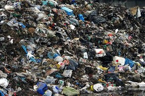
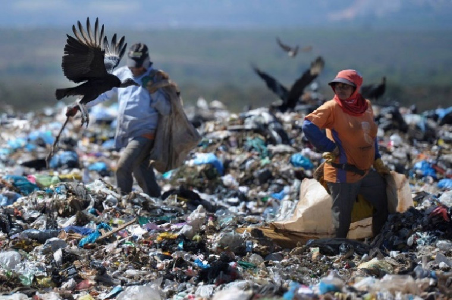
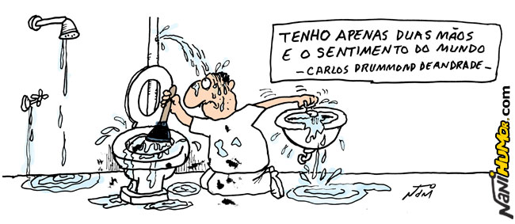

# PROVA — CÂMARA MUNICIPAL DE ARARAQUARA/SP — CONCURSO PÚBLICO EDITAL Nº 01/2018 — CERIMONIALISTA (IBFC_07)

## 1. Análise geral da prova

**Identificação da prova:**

- **Concurso:** Concurso Público — Câmara Municipal de Araraquara/SP — Edital nº 01/2018 (IBFC)
- **Cargo:** Cerimonialista (Nível Superior)
- **Tipo de prova:** IBFC_07 — TARDE
- **Estrutura:** 60 questões objetivas (A–E): Língua Portuguesa (01–15), Raciocínio Lógico (16–20), Informática (21–25), Legislação Municipal (26–30), Conhecimentos Específicos (31–60)

**Composição quantitativa:**

| Item | Quantidade |
|---|---|
| Total de questões | 60 |
| Textos de apoio compartilhados (grupos) | 6 (conto “Muribeca” + 2 imagens: Q01–Q04; conto de Mia Couto: Q05–Q06; poema de Drummond + charge: Q07–Q09; reportagem do G1: Q10–Q11; cartaz de campanha: Q12–Q13; charge de Sarah Andersen: Q14–Q15) |
| Imagens de conteúdo | 5 (Imagens 1 e 2 do conto Muribeca Q01–Q04, charge de Nani Q07–Q09, cartaz de campanha Q12–Q13, charge de Sarah Andersen Q14–Q15) |
| Gráficos e tabelas | 0 |
| Grupos identificados | 6 |
| Questões independentes | 45 |

**Composição por bloco:**

| Bloco | Questões | Quantidade |
|---|---|---|
| Língua Portuguesa | 01–15 | 15 |
| Raciocínio Lógico | 16–20 | 5 |
| Informática | 21–25 | 5 |
| Legislação Municipal | 26–30 | 5 |
| Conhecimentos Específicos | 31–60 | 30 |

**Observações sobre a estrutura original:**

- Todas as questões de Língua Portuguesa (01–15) estão organizadas em 6 grupos com materiais compartilhados, reproduzidos integralmente em cada questão.
- Imagens não vinculadas a questões (logotipos e elementos gráficos da capa e do cartão de rascunho) foram descartadas.

> **Transcrição integral da capa, das instruções e do cartão de rascunho (conforme extraída do PDF):**
> 
> > 
> > 
> > IBFC_07
> > 
> > 
> > DESTAQUE AQUI
> > GABARITO DO CANDIDATO - RASCUNHO
> > Nome:
> > Assinatura do Candidato:
> > Inscrição:
> > 
> > 
> > CÂMARA MUNICIPAL DE ARARAQUARA
> > CERIMONIALISTA
> > NOME DO CANDIDATO
> > ASSINATURA DO CANDIDATO
> > RG DO CANDIDATO
> > INSTRUÇÕES GERAIS
> > I.
> > Nesta prova, você encontrará 10 (dez) páginas numeradas sequencialmente, contendo 60 (sessenta) questões
> > objetivas correspondentes às seguintes disciplinas: Língua Portuguesa (15 questões), Raciocínio Lógico (05 questões),
> > Informática (05 questões), Legislação Municipal (05 questões) e Conhecimentos Específicos (30 questões).
> > II. Verifique se seu nome e número de inscrição estão corretos no cartão de respostas. Se houver erro, notifique o fiscal.
> > III. Verifique se o caderno de provas se refere ao cargo para o qual você se inscreveu. Caso o cargo esteja divergente,
> > solicite ao fiscal de sala para que tome as providências cabíveis, pois não serão aceitas reclamações posteriores nesse
> > sentido.
> > IV. Assine e preencha o cartão de respostas nos locais indicados, com caneta azul ou preta.
> > V. Verifique se a impressão, a paginação e a numeração das questões estão corretas. Caso observe qualquer erro, notifique
> > o fiscal.
> > VI. Marque o cartão de respostas cobrindo fortemente o espaço correspondente à letra a ser assinalada, conforme o
> > exemplo no próprio cartão de respostas.
> > VII. O sistema de leitura e processamento das folhas de resposta não registrará a resposta em que houver falta de nitidez
> > na marcação e/ou marcação de mais de uma alternativa.
> > VIII. O cartão de respostas não pode ser dobrado, amassado, rasurado ou manchado. Exceto sua assinatura, nada deve ser
> > escrito ou registrado fora dos locais destinados às respostas.
> > IX. Ao terminar a prova, entregue ao fiscal o cartão de respostas e este caderno. As observações ou marcações registradas
> > no caderno não serão levadas em consideração.
> > X.  Você dispõe de 04 (quatro) horas para fazer esta prova. Reserve os 20 (vinte) minutos finais para marcar o cartão de
> > respostas.
> > XI. O candidato só poderá retirar-se do setor de prova 01 (uma) hora após seu início.
> > XII. É terminantemente proibido o uso de telefone celular, e demais aparelhos eletrônicos.
> > Boa Prova!
> > LEIA COM  ATENÇÃO AS INSTRUÇÕES ABAIXO
> > 
> > 
> > 
> > 1
> > 2
> > 3
> > 4
> > 5
> > 6
> > 7
> > 8
> > 9
> > 10 11
> > 12
> > 13 14 15 16
> > 21
> > 17
> > 22
> > 18
> > 23
> > 19
> > 24
> > 20
> > 25
> > 26
> > 27
> > 28
> > 29 30 31 32
> > 33
> > 34 35 36
> > 37 38
> > 39 40
> > 41
> > 51
> > 46
> > 56
> > 42
> > 52
> > 47
> > 57
> > 43
> > 53
> > 48
> > 58
> > 44
> > 54
> > 49
> > 59
> > 45
> > 55
> > 50
> > 60
> > CONCURSO PÚBLICO - EDITAL Nº 01/2018
> > 
> > RASCUNHO

**Gabarito oficial — tabela "Gabarito oficial após recursos — IBFC_07 – CERIMONIALISTA":**

| Questão | Resposta | Questão | Resposta | Questão | Resposta | Questão | Resposta | Questão | Resposta |
|---|---|---|---|---|---|---|---|---|---|
| 01 | **D** | 02 | **A** | 03 | **B** | 04 | **C** | 05 | **E** |
| 06 | **B** | 07 | **D** | 08 | **C** | 09 | **B** | 10 | **E** |
| 11 | **C** | 12 | **A** | 13 | **E** | 14 | **A** | 15 | **B** |
| 16 | **B** | 17 | **E** | 18 | **B** | 19 | **A** | 20 | **C** |
| 21 | **C** | 22 | **B** | 23 | **E** | 24 | **D** | 25 | **A** |
| 26 | **C** | 27 | **B** | 28 | **E** | 29 | **D** | 30 | **A** |
| 31 | **C** | 32 | **A** | 33 | **B** | 34 | **E** | 35 | **D** |
| 36 | **B** | 37 | **E** | 38 | **A** | 39 | **B** | 40 | **A** |
| 41 | **E** | 42 | **C** | 43 | **D** | 44 | **A** | 45 | **B** |
| 46 | **E** | 47 | **C** | 48 | **E** | 49 | **D** | 50 | **A** |
| 51 | **E** | 52 | **D** | 53 | **A** | 54 | **E** | 55 | **C** |
| 56 | **E** | 57 | **B** | 58 | **D** | 59 | **A** | 60 | **C** |

> 📌 Fonte: Gabarito oficial após recursos — IBFC_07 – CERIMONIALISTA

---

## 2. Questões agrupadas

### GRUPO 01 — Conto “Muribeca” (Marcelino Freire) + Imagens 1 e 2 — questões 01 a 04

**Questões relacionadas:** 01, 02, 03 e 04.

**Material de apoio compartilhado:**

> Leia o trecho inicial do conto “Muribeca” de Marcelino
> Freire e observe as duas imagens abaixo para responder
> as questões 1, 2, 3 e 4 a seguir:
> Lixo? Lixo serve pra tudo. A gente encontra a mobília da casa,
> cadeira pra pôr uns pregos e ajeitar, sentar. Lixo pra poder
> ter sofá, costurado, cama, colchão. Até televisão.  É a vida
> da gente o lixão. E por que é que agora querem tirar ele da
> gente? O que é que eu vou dizer pras crianças? Que não tem
> mais brinquedo? Que acabou o calçado? Que não tem mais
> história, livro, desenho?   E o meu marido, o que vai fazer?
> Nada? Como ele vai viver sem as garrafas, sem as latas, sem
> as caixas? Vai perambular pelas ruas, roubar pra comer?  E o
> que eu vou cozinhar agora? Onde vou procurar tomate, alho,
> cebola? Com que dinheiro vou fazer sopa, vou fazer caldo,
> vou inventar farofa?  Fale, fale. Explique o que é que a gente
> vai fazer da vida? O que a gente vai fazer da vida? Não pense
> que é fácil.
> Fonte: Armazém de Texto - Blogspot
> Imagem 1
> 
> 
> Fonte: Mundo Educação
> Imagem 2
> 
> 
> Fonte: CDN-CV

---

#### QUESTÃO 01

✅ **Gabarito: D** (gabarito oficial após recursos — Edital nº 01/2018, Nível Superior – TARDE, IBFC_07 – CERIMONIALISTA)

**Material de apoio:**

> Leia o trecho inicial do conto “Muribeca” de Marcelino
> Freire e observe as duas imagens abaixo para responder
> as questões 1, 2, 3 e 4 a seguir:
> Lixo? Lixo serve pra tudo. A gente encontra a mobília da casa,
> cadeira pra pôr uns pregos e ajeitar, sentar. Lixo pra poder
> ter sofá, costurado, cama, colchão. Até televisão.  É a vida
> da gente o lixão. E por que é que agora querem tirar ele da
> gente? O que é que eu vou dizer pras crianças? Que não tem
> mais brinquedo? Que acabou o calçado? Que não tem mais
> história, livro, desenho?   E o meu marido, o que vai fazer?
> Nada? Como ele vai viver sem as garrafas, sem as latas, sem
> as caixas? Vai perambular pelas ruas, roubar pra comer?  E o
> que eu vou cozinhar agora? Onde vou procurar tomate, alho,
> cebola? Com que dinheiro vou fazer sopa, vou fazer caldo,
> vou inventar farofa?  Fale, fale. Explique o que é que a gente
> vai fazer da vida? O que a gente vai fazer da vida? Não pense
> que é fácil.
> Fonte: Armazém de Texto - Blogspot
> Imagem 1
> 
> 
> Fonte: Mundo Educação
> Imagem 2
> 
> 
> Fonte: CDN-CV

**Enunciado:**

A partir da leitura atenta do texto e das duas imagens
acima, analise as afirmativas abaixo e assinale a
alternativa correta.
I. Tanto as imagens como o texto de Marcelino Freire são
formas de sensibilizar as pessoas para a importância
de separar o lixo antes dele chegar aos aterros.
II. O estranhamento gerado no início do texto se deve ao
fato de ele apresentar o lixo como uma necessidade
da personagem ao invés de algo que precisa ser
descartado e eliminado.
III. As imagens reforçam o apelo do trecho literário
ao evidenciar a utilidade dos objetos contidos nos
chamados lixões.
IV. O texto e a imagem 2 registram como o lixo é fonte de
trabalho e subsistência para algumas pessoas.

**Alternativas:**

A) Apenas as afirmativas I e IV, estão corretas.

B) Apenas as afirmativas II e III, estão apenas.

C) Apenas as afirmativas II, III e IV, estão apenas.

D) Apenas as afirmativas II e IV, estão apenas.

E) Apenas as afirmativas III e IV estão corretas.

**Referências visuais:**

---

#### QUESTÃO 02

✅ **Gabarito: A** (gabarito oficial após recursos — Edital nº 01/2018, Nível Superior – TARDE, IBFC_07 – CERIMONIALISTA)

**Material de apoio:**

> Leia o trecho inicial do conto “Muribeca” de Marcelino
> Freire e observe as duas imagens abaixo para responder
> as questões 1, 2, 3 e 4 a seguir:
> Lixo? Lixo serve pra tudo. A gente encontra a mobília da casa,
> cadeira pra pôr uns pregos e ajeitar, sentar. Lixo pra poder
> ter sofá, costurado, cama, colchão. Até televisão.  É a vida
> da gente o lixão. E por que é que agora querem tirar ele da
> gente? O que é que eu vou dizer pras crianças? Que não tem
> mais brinquedo? Que acabou o calçado? Que não tem mais
> história, livro, desenho?   E o meu marido, o que vai fazer?
> Nada? Como ele vai viver sem as garrafas, sem as latas, sem
> as caixas? Vai perambular pelas ruas, roubar pra comer?  E o
> que eu vou cozinhar agora? Onde vou procurar tomate, alho,
> cebola? Com que dinheiro vou fazer sopa, vou fazer caldo,
> vou inventar farofa?  Fale, fale. Explique o que é que a gente
> vai fazer da vida? O que a gente vai fazer da vida? Não pense
> que é fácil.
> Fonte: Armazém de Texto - Blogspot
> Imagem 1
> 
> 
> Fonte: Mundo Educação
> Imagem 2
> 
> 
> Fonte: CDN-CV

**Enunciado:**

Leia o texto atentamente e assinale a alternativa correta.

**Alternativas:**

A) Por meio de uma sequência de perguntas a narradora personagem cria uma interlocução com o leitor.

B) Sendo do gênero poético o trecho apela de modo sentimentalista para sensibilizar o leitor sobre o drama da personagem.

C) O uso de verbos no imperativo, como “fale, fale” e “não pense” caracteriza a informalidade presente no texto.

D) A afirmação “lixo serve pra tudo” é contraditória a toda a sequência narrativa que a sucede.

E) A narradora-personagem associa o trabalho com lixo ao roubo.

**Referências visuais:**

---

#### QUESTÃO 03

✅ **Gabarito: B** (gabarito oficial após recursos — Edital nº 01/2018, Nível Superior – TARDE, IBFC_07 – CERIMONIALISTA)

**Material de apoio:**

> Leia o trecho inicial do conto “Muribeca” de Marcelino
> Freire e observe as duas imagens abaixo para responder
> as questões 1, 2, 3 e 4 a seguir:
> Lixo? Lixo serve pra tudo. A gente encontra a mobília da casa,
> cadeira pra pôr uns pregos e ajeitar, sentar. Lixo pra poder
> ter sofá, costurado, cama, colchão. Até televisão.  É a vida
> da gente o lixão. E por que é que agora querem tirar ele da
> gente? O que é que eu vou dizer pras crianças? Que não tem
> mais brinquedo? Que acabou o calçado? Que não tem mais
> história, livro, desenho?   E o meu marido, o que vai fazer?
> Nada? Como ele vai viver sem as garrafas, sem as latas, sem
> as caixas? Vai perambular pelas ruas, roubar pra comer?  E o
> que eu vou cozinhar agora? Onde vou procurar tomate, alho,
> cebola? Com que dinheiro vou fazer sopa, vou fazer caldo,
> vou inventar farofa?  Fale, fale. Explique o que é que a gente
> vai fazer da vida? O que a gente vai fazer da vida? Não pense
> que é fácil.
> Fonte: Armazém de Texto - Blogspot
> Imagem 1
> 
> 
> Fonte: Mundo Educação
> Imagem 2
> 
> 
> Fonte: CDN-CV

**Enunciado:**

De acordo com a gramática normativa da Língua
Portuguesa,
assinale
a
alternativa
em
que
a
classificação da palavra “que” está incorreta.

**Alternativas:**

A) O que é que eu vou dizer pras crianças? – Pronome interrogativo

B) Que não tem mais brinquedo? – Pronome relativo

C) Explique o que é que a gente vai fazer da vida? – Partícula expletiva

D) Não pense que é fácil. – Conjunção integrante

E) E o meu marido, o que vai fazer? – Pronome interrogativo

**Referências visuais:**

---

#### QUESTÃO 04

✅ **Gabarito: C** (gabarito oficial após recursos — Edital nº 01/2018, Nível Superior – TARDE, IBFC_07 – CERIMONIALISTA)

**Material de apoio:**

> Leia o trecho inicial do conto “Muribeca” de Marcelino
> Freire e observe as duas imagens abaixo para responder
> as questões 1, 2, 3 e 4 a seguir:
> Lixo? Lixo serve pra tudo. A gente encontra a mobília da casa,
> cadeira pra pôr uns pregos e ajeitar, sentar. Lixo pra poder
> ter sofá, costurado, cama, colchão. Até televisão.  É a vida
> da gente o lixão. E por que é que agora querem tirar ele da
> gente? O que é que eu vou dizer pras crianças? Que não tem
> mais brinquedo? Que acabou o calçado? Que não tem mais
> história, livro, desenho?   E o meu marido, o que vai fazer?
> Nada? Como ele vai viver sem as garrafas, sem as latas, sem
> as caixas? Vai perambular pelas ruas, roubar pra comer?  E o
> que eu vou cozinhar agora? Onde vou procurar tomate, alho,
> cebola? Com que dinheiro vou fazer sopa, vou fazer caldo,
> vou inventar farofa?  Fale, fale. Explique o que é que a gente
> vai fazer da vida? O que a gente vai fazer da vida? Não pense
> que é fácil.
> Fonte: Armazém de Texto - Blogspot
> Imagem 1
> 
> 
> Fonte: Mundo Educação
> Imagem 2
> 
> 
> Fonte: CDN-CV

**Enunciado:**

Em relação ao texto e à gramática normativa da Língua
Portuguesa, analise as afirmativas abaixo e assinale a
alternativa correta.
I. O sujeito da oração “É a vida da gente o lixão.” é
simples e posposto.
II. Nesse trecho “E por que é que agora querem tirar ele
da gente?” há um erro de colocação pronominal.
III. A oração destacada em negrito “Não pense que é fácil.”
é classificada como Oração Subordinada Substantiva
Objetiva Direta.
IV. “(...) vou fazer sopa, vou fazer caldo, vou inventar
farofa?” as orações desse período são classificadas
como Orações Coordenadas Sindéticas Aditivas.

**Alternativas:**

A) Apenas as afirmativas I e II estão corretas.

B) Apenas a afirmativa III está correta.

C) Apenas as afirmativas I, II e III estão corretas.

D) Apenas as afirmativas III e IV estão corretas.

E) Apenas a afirmativa IV está correta. Leia com atenção o trecho inicial do conto “O dia em que explodiu Mabata-Bata” do escritor angolano Mia Couto, e responda as questões 5 e 6 a seguir. De repente, o boi explodiu. Rebentou sem um múúú. No capim em volta choveram pedaços e fatias, grão e folhas de boi. A carne eram já borboletas vermelhas. Os ossos eram moedas espalhadas. Os chifres ficaram num qualquer ramo, balouçando a imitar a vida, no invisível do vento. O espanto não cabia em Azarias, o pequeno pastor. Ainda há um instante ele admirava o grande boi malhado, chamado de Mabata-bata. O bicho pastava mais vagaroso que a preguiça. Era o maior da manada, régulo da chifraria, e estava destinado como prenda de lobolo do tio Raul, dono da criação. Azarias trabalhava para ele desde que era órfão. Despegava antes da luz para que os bois comessem o cacimbo das primeiras horas. Olhou a desgraça: o boi poeirado, eco de silêncio, sombra de nada. “Deve ser foi um relâmpago”, pensou. Mas relâmpago não podia. O céu estava liso, azul sem mancha. De onde saíra o raio? Ou foi a terra que relampejou? Fonte: Ms - Camp, 10/10/2008

**Referências visuais:**

---

### GRUPO 02 — Conto “O dia em que explodiu Mabata-Bata” (Mia Couto) — questões 05 e 06

**Questões relacionadas:** 05 e 06.

**Material de apoio compartilhado:**

> Leia com atenção o trecho inicial do conto “O dia em que
> explodiu Mabata-Bata” do escritor angolano Mia Couto, e
> responda as questões 5 e 6 a seguir.
> De repente, o boi explodiu. Rebentou sem um múúú. No
> capim em volta choveram pedaços e fatias, grão e folhas de
> boi. A carne eram já borboletas vermelhas. Os ossos eram
> moedas espalhadas. Os chifres ficaram num qualquer ramo,
> balouçando a imitar a vida, no invisível do vento.
> O espanto não cabia em Azarias, o pequeno pastor. Ainda há
> um instante ele admirava o grande boi malhado, chamado de
> Mabata-bata. O bicho pastava mais vagaroso que a preguiça.
> Era o maior da manada, régulo da chifraria, e estava destinado
> como prenda de lobolo do tio Raul, dono da criação. Azarias
> trabalhava para ele desde que era órfão. Despegava antes da
> luz para que os bois comessem o cacimbo das primeiras horas.
> Olhou a desgraça: o boi poeirado, eco de silêncio, sombra de
> nada.
> “Deve ser foi um relâmpago”, pensou.
> Mas relâmpago não podia. O céu estava liso, azul sem
> mancha. De onde saíra o raio? Ou foi a terra que relampejou?
> Fonte: Ms - Camp, 10/10/2008

---

#### QUESTÃO 05

✅ **Gabarito: E** (gabarito oficial após recursos — Edital nº 01/2018, Nível Superior – TARDE, IBFC_07 – CERIMONIALISTA)

**Material de apoio:**

> Leia com atenção o trecho inicial do conto “O dia em que
> explodiu Mabata-Bata” do escritor angolano Mia Couto, e
> responda as questões 5 e 6 a seguir.
> De repente, o boi explodiu. Rebentou sem um múúú. No
> capim em volta choveram pedaços e fatias, grão e folhas de
> boi. A carne eram já borboletas vermelhas. Os ossos eram
> moedas espalhadas. Os chifres ficaram num qualquer ramo,
> balouçando a imitar a vida, no invisível do vento.
> O espanto não cabia em Azarias, o pequeno pastor. Ainda há
> um instante ele admirava o grande boi malhado, chamado de
> Mabata-bata. O bicho pastava mais vagaroso que a preguiça.
> Era o maior da manada, régulo da chifraria, e estava destinado
> como prenda de lobolo do tio Raul, dono da criação. Azarias
> trabalhava para ele desde que era órfão. Despegava antes da
> luz para que os bois comessem o cacimbo das primeiras horas.
> Olhou a desgraça: o boi poeirado, eco de silêncio, sombra de
> nada.
> “Deve ser foi um relâmpago”, pensou.
> Mas relâmpago não podia. O céu estava liso, azul sem
> mancha. De onde saíra o raio? Ou foi a terra que relampejou?
> Fonte: Ms - Camp, 10/10/2008

**Enunciado:**

Sobre as figuras de linguagem presentes no trecho
acima, assinale a alternativa incorreta:

**Alternativas:**

A) “Rebentou sem um múúú” contém uma onomatopeia.

B) “Os ossos eram moedas espalhadas” figura-se como uma metáfora.

C) “No invisível do vento” configura-se como um recurso sinestésico.

D) “Pastava mais vagaroso que a preguiça” mostra-se uma comparação.

E) “Lobolo” e “cacimbo” são variantes linguísticas regionais.

**Referências visuais:**

Nenhuma.

---

#### QUESTÃO 06

✅ **Gabarito: B** (gabarito oficial após recursos — Edital nº 01/2018, Nível Superior – TARDE, IBFC_07 – CERIMONIALISTA)

**Material de apoio:**

> Leia com atenção o trecho inicial do conto “O dia em que
> explodiu Mabata-Bata” do escritor angolano Mia Couto, e
> responda as questões 5 e 6 a seguir.
> De repente, o boi explodiu. Rebentou sem um múúú. No
> capim em volta choveram pedaços e fatias, grão e folhas de
> boi. A carne eram já borboletas vermelhas. Os ossos eram
> moedas espalhadas. Os chifres ficaram num qualquer ramo,
> balouçando a imitar a vida, no invisível do vento.
> O espanto não cabia em Azarias, o pequeno pastor. Ainda há
> um instante ele admirava o grande boi malhado, chamado de
> Mabata-bata. O bicho pastava mais vagaroso que a preguiça.
> Era o maior da manada, régulo da chifraria, e estava destinado
> como prenda de lobolo do tio Raul, dono da criação. Azarias
> trabalhava para ele desde que era órfão. Despegava antes da
> luz para que os bois comessem o cacimbo das primeiras horas.
> Olhou a desgraça: o boi poeirado, eco de silêncio, sombra de
> nada.
> “Deve ser foi um relâmpago”, pensou.
> Mas relâmpago não podia. O céu estava liso, azul sem
> mancha. De onde saíra o raio? Ou foi a terra que relampejou?
> Fonte: Ms - Camp, 10/10/2008

**Enunciado:**

Sobre o discurso direto presente no texto, assinale a
alternativa correta.

**Alternativas:**

A) Ele aparece no decorrer de todo o trecho pela voz onisciente do narrador.

B) Ele é destacado entre aspas e seguido do verbo de elocução “pensou”.

C) Está presente no trecho em que a voz do narrador se mistura com o pensamento de Azarias “De onde saíra o raio? Ou foi a terra que relampejou?

D) Ele é introduzido já no início do trecho pela expressão “de repente”.

E) Não se utiliza a distinção entre discurso direto e indireto em narrativas curtas como o conto em questão. A partir da leitura do trecho inicial do poema “Sentimento do Mundo” de Carlos Drummond de Andrade e da charge do chargista Nani responda as questões 7, 8 e 9. Tenho apenas duas mãos e o sentimento do mundo, mas estou cheio de escravos, minhas lembranças escorrem e o corpo transige na confluência do amor. Quando me levantar, o céu estará morto e saqueado, eu mesmo estarei morto, morto meu desejo, morto o pântano sem acordes. (Drummond, Carlos) Fonte: BP - Blogspot

**Referências visuais:**

Nenhuma.

---

### GRUPO 03 — Poema “Sentimento do Mundo” (Carlos Drummond de Andrade) + charge de Nani — questões 07 a 09

**Questões relacionadas:** 07, 08 e 09.

**Material de apoio compartilhado:**

> A partir da leitura do trecho inicial do poema “Sentimento
> do Mundo” de Carlos Drummond de Andrade e da charge
> do chargista Nani responda as questões 7, 8 e 9.
> Tenho apenas duas mãos
> e o sentimento do mundo,
> mas estou cheio de escravos,
> minhas lembranças escorrem
> e o corpo transige na confluência do amor.
> Quando me levantar, o céu
> estará morto e saqueado,
> eu mesmo estarei morto,
> morto meu desejo, morto
> o pântano sem acordes.
> (Drummond, Carlos)
> 
> 
> Fonte: BP - Blogspot

---

#### QUESTÃO 07

✅ **Gabarito: D** (gabarito oficial após recursos — Edital nº 01/2018, Nível Superior – TARDE, IBFC_07 – CERIMONIALISTA)

**Material de apoio:**

> A partir da leitura do trecho inicial do poema “Sentimento
> do Mundo” de Carlos Drummond de Andrade e da charge
> do chargista Nani responda as questões 7, 8 e 9.
> Tenho apenas duas mãos
> e o sentimento do mundo,
> mas estou cheio de escravos,
> minhas lembranças escorrem
> e o corpo transige na confluência do amor.
> Quando me levantar, o céu
> estará morto e saqueado,
> eu mesmo estarei morto,
> morto meu desejo, morto
> o pântano sem acordes.
> (Drummond, Carlos)
> 
> 
> Fonte: BP - Blogspot

**Enunciado:**

Com base na leitura e interpretação do poema e da
charge, assinale a alternativa correta:

**Alternativas:**

A) Tanto o poema, como a charge sustentam a ideia de que para sentir é necessário ter as mãos livres.

B) A expressão “sentimento do mundo” é um hipérbato.

C) Ao usar o verbo transigir, o poeta assume sua responsabilidade em ter seus desejos mortos, assim como o personagem da charge que também é culpado por sua impossibilidade de agir.

D) Mesmo contendo o mesmo verso que o poema, a charge produz um sentido humorístico ao somar texto e imagem, mudando o tom lírico do texto original.

E) Tanto o chargista como o poeta fazem explicitamente uma crítica social à precarização do trabalho.

**Referências visuais:**

---

#### QUESTÃO 08

✅ **Gabarito: C** (gabarito oficial após recursos — Edital nº 01/2018, Nível Superior – TARDE, IBFC_07 – CERIMONIALISTA)

**Material de apoio:**

> A partir da leitura do trecho inicial do poema “Sentimento
> do Mundo” de Carlos Drummond de Andrade e da charge
> do chargista Nani responda as questões 7, 8 e 9.
> Tenho apenas duas mãos
> e o sentimento do mundo,
> mas estou cheio de escravos,
> minhas lembranças escorrem
> e o corpo transige na confluência do amor.
> Quando me levantar, o céu
> estará morto e saqueado,
> eu mesmo estarei morto,
> morto meu desejo, morto
> o pântano sem acordes.
> (Drummond, Carlos)
> 
> 
> Fonte: BP - Blogspot

**Enunciado:**

De acordo com a leitura do texto e da gramática
normativa da Língua Portuguesa, assinale a alternativa
incorreta.

**Alternativas:**

A) O verbo ter no trecho “tenho apenas duas mãos” é um verbo transitivo direto.

B) No verso “E o sentimento do mundo” há a elipse do verbo “ter”.

C) A palavra “mas” no trecho “mas estou cheio de escravos” tem sentido de conclusão.

D) A oração “Quando me levantar” é uma Oração Subordinada Adverbial Temporal

E) O poema aparece na charge destacado por uma caixa de texto para distinguir as autorias do poema e da própria charge.

**Referências visuais:**

---

#### QUESTÃO 09

✅ **Gabarito: B** (gabarito oficial após recursos — Edital nº 01/2018, Nível Superior – TARDE, IBFC_07 – CERIMONIALISTA)

**Material de apoio:**

> A partir da leitura do trecho inicial do poema “Sentimento
> do Mundo” de Carlos Drummond de Andrade e da charge
> do chargista Nani responda as questões 7, 8 e 9.
> Tenho apenas duas mãos
> e o sentimento do mundo,
> mas estou cheio de escravos,
> minhas lembranças escorrem
> e o corpo transige na confluência do amor.
> Quando me levantar, o céu
> estará morto e saqueado,
> eu mesmo estarei morto,
> morto meu desejo, morto
> o pântano sem acordes.
> (Drummond, Carlos)
> 
> 
> Fonte: BP - Blogspot

**Enunciado:**

Em relação aos tempos verbais presentes do poema,
analise as afirmativas abaixo e assinale a alternativa
correta.
I. No verso “E o corpo transige na confluência do amor” o
verbo está no presente do Indicativo.
II. Em “Quando me levantar” o verbo está no futuro do
subjuntivo.
III. Em “Estará morto” e “Estarei morto” os verbos estão no
futuro do pretérito.
IV. Em “Morto meu desejo” o verbo está no modo
imperativo.

**Alternativas:**

A) Apenas a afirmativa I está correta.

B) Apenas as afirmativas I e II estão corretas.

C) Apenas as afirmativas II e IV estão corretas.

D) Apenas as afirmativas III e IV estão corretas.

E) Apenas as afirmativas I, III e IV estão corretas. Leia com atenção um trecho da reportagem do Portal G1 “Depressão cresce no mundo, segundo OMS” abaixo, e responda as questões 10 e 11. A depressão afeta 322 milhões de pessoas no mundo, segundo dados divulgados pela Organização Mundial da Saúde (OMS) nesta quinta-feira (23) referentes a 2015. Em 10 anos, de 2005 a 2015, esse número cresceu 18,4%. A prevalência do transtorno na população mundial é de 4,4%. Já no Brasil, 5,8% da população sofre com esse problema, que afeta um total de 11,5 milhões de brasileiros. Segundo os dados da OMS, o Brasil é o país com maior prevalência de depressão da América Latina e o segundo com maior prevalência nas Américas, ficando atrás somente dos Estados Unidos, que têm 5,9% de depressivos. O país com menor prevalência de depressão nas Américas é a Guatemala, onde 3,7% da população tem o transtorno. Já o país com menor prevalência de depressão no mundo, segundo o relatório, são as Ilhas Salomão, na Oceania, onde a depressão atinge 2,9% da população. Além dos Estados Unidos, os países que têm prevalência de depressão maior do que o Brasil são Austrália (5,9%), Estônia (5,9%) e Ucrânia (6,3%). Fonte: G1

**Referências visuais:**

---

### GRUPO 04 — Reportagem do Portal G1 “Depressão cresce no mundo, segundo OMS” — questões 10 e 11

**Questões relacionadas:** 10 e 11.

**Material de apoio compartilhado:**

> Leia com atenção um trecho da reportagem do Portal G1
> “Depressão cresce no mundo, segundo OMS” abaixo, e
> responda as questões 10 e 11.
> A depressão afeta 322 milhões de pessoas no mundo, segundo
> dados divulgados pela Organização Mundial da Saúde (OMS)
> nesta quinta-feira (23) referentes a 2015. Em 10 anos, de
> 2005 a 2015, esse número cresceu 18,4%. A prevalência do
> transtorno na população mundial é de 4,4%.
> Já no Brasil, 5,8% da população sofre com esse problema,
> que afeta um total de 11,5 milhões de brasileiros. Segundo
> os dados da OMS, o Brasil é o país com maior prevalência
> de depressão da América Latina e o segundo com maior
> prevalência nas Américas, ficando atrás somente dos Estados
> Unidos, que têm 5,9% de depressivos.
> O país com menor prevalência de depressão nas Américas
> é a Guatemala, onde 3,7% da população tem o transtorno.
> Já o país com menor prevalência de depressão no mundo,
> segundo o relatório, são as Ilhas Salomão, na Oceania, onde
> a depressão atinge 2,9% da população.
> Além dos Estados Unidos, os países que têm prevalência de
> depressão maior do que o Brasil são Austrália (5,9%), Estônia
> (5,9%) e Ucrânia (6,3%).
> Fonte: G1

---

#### QUESTÃO 10

✅ **Gabarito: E** (gabarito oficial após recursos — Edital nº 01/2018, Nível Superior – TARDE, IBFC_07 – CERIMONIALISTA)

**Material de apoio:**

> Leia com atenção um trecho da reportagem do Portal G1
> “Depressão cresce no mundo, segundo OMS” abaixo, e
> responda as questões 10 e 11.
> A depressão afeta 322 milhões de pessoas no mundo, segundo
> dados divulgados pela Organização Mundial da Saúde (OMS)
> nesta quinta-feira (23) referentes a 2015. Em 10 anos, de
> 2005 a 2015, esse número cresceu 18,4%. A prevalência do
> transtorno na população mundial é de 4,4%.
> Já no Brasil, 5,8% da população sofre com esse problema,
> que afeta um total de 11,5 milhões de brasileiros. Segundo
> os dados da OMS, o Brasil é o país com maior prevalência
> de depressão da América Latina e o segundo com maior
> prevalência nas Américas, ficando atrás somente dos Estados
> Unidos, que têm 5,9% de depressivos.
> O país com menor prevalência de depressão nas Américas
> é a Guatemala, onde 3,7% da população tem o transtorno.
> Já o país com menor prevalência de depressão no mundo,
> segundo o relatório, são as Ilhas Salomão, na Oceania, onde
> a depressão atinge 2,9% da população.
> Além dos Estados Unidos, os países que têm prevalência de
> depressão maior do que o Brasil são Austrália (5,9%), Estônia
> (5,9%) e Ucrânia (6,3%).
> Fonte: G1

**Enunciado:**

Com base na leitura atenta da reportagem acima,
assinale a alternativa correta:

**Alternativas:**

A) Dos 11,5 milhões de brasileiros, 5,8% sofrem de depressão.

B) O Brasil é o país com maior prevalência de depressão em toda América.

C) Guatemala é o país que só perde para o Brasil em número de casos de depressão em toda América Latina.

D) A influência estadunidense nas ações políticas e culturais do Brasil agravam o alto índice de depressão existente em nosso país.

E) No continente americano os Estados Unidos é o país com a maior porcentagem de depressivos.

**Referências visuais:**

Nenhuma.

---

#### QUESTÃO 11

✅ **Gabarito: C** (gabarito oficial após recursos — Edital nº 01/2018, Nível Superior – TARDE, IBFC_07 – CERIMONIALISTA)

**Material de apoio:**

> Leia com atenção um trecho da reportagem do Portal G1
> “Depressão cresce no mundo, segundo OMS” abaixo, e
> responda as questões 10 e 11.
> A depressão afeta 322 milhões de pessoas no mundo, segundo
> dados divulgados pela Organização Mundial da Saúde (OMS)
> nesta quinta-feira (23) referentes a 2015. Em 10 anos, de
> 2005 a 2015, esse número cresceu 18,4%. A prevalência do
> transtorno na população mundial é de 4,4%.
> Já no Brasil, 5,8% da população sofre com esse problema,
> que afeta um total de 11,5 milhões de brasileiros. Segundo
> os dados da OMS, o Brasil é o país com maior prevalência
> de depressão da América Latina e o segundo com maior
> prevalência nas Américas, ficando atrás somente dos Estados
> Unidos, que têm 5,9% de depressivos.
> O país com menor prevalência de depressão nas Américas
> é a Guatemala, onde 3,7% da população tem o transtorno.
> Já o país com menor prevalência de depressão no mundo,
> segundo o relatório, são as Ilhas Salomão, na Oceania, onde
> a depressão atinge 2,9% da população.
> Além dos Estados Unidos, os países que têm prevalência de
> depressão maior do que o Brasil são Austrália (5,9%), Estônia
> (5,9%) e Ucrânia (6,3%).
> Fonte: G1

**Enunciado:**

Baseado do trecho da reportagem acima, sobre o
gênero textual, assinale a alternativa correta:

**Alternativas:**

A) É um artigo de opinião visto que, nitidamente, o portal deixa claro os porquês dos altos índices de depressão no território brasileiro.

B) É um texto híbrido, pois mescla ficção e dados objetivados por pesquisas.

C) É uma reportagem expositiva que traz dados numéricos sobre o índice de depressão no mundo segundo a Organização Mundial de Saúde.

D) É um gênero narrativo em que se compreende com facilidade a onisciência do autor sobre os fatos narrados.

E) É um texto informativo que busca ajudar o leitor brasileiro a prevenir-se de uma epidemia depressiva mundial. Observe o cartaz de uma campanha contra o assédio sexual nos metrôs e responda as questões 12 e 13 a seguir. Fonte: Folha verdejal

**Referências visuais:**

Nenhuma.

---

### GRUPO 05 — Cartaz de campanha contra o assédio sexual nos metrôs — questões 12 e 13

**Questões relacionadas:** 12 e 13.

**Material de apoio compartilhado:**

> Observe o cartaz de uma campanha contra o assédio
> sexual nos metrôs e responda as questões 12 e 13 a seguir.
> 
> 
> Fonte: Folha verdejal

---

#### QUESTÃO 12

✅ **Gabarito: A** (gabarito oficial após recursos — Edital nº 01/2018, Nível Superior – TARDE, IBFC_07 – CERIMONIALISTA)

**Material de apoio:**

> Observe o cartaz de uma campanha contra o assédio
> sexual nos metrôs e responda as questões 12 e 13 a seguir.
> 
> 
> Fonte: Folha verdejal

**Enunciado:**

A partir da leitura atenta do cartaz acima, levando
em consideração sua linguagem verbal e não verbal,
assinale a alternativa correta:

**Alternativas:**

A) Os canais de denúncia são órgãos de assistência à vítima.

B) As informações contidas no cartaz instruem a vítima ou quem presenciar o abuso a não encarar o agressor para não gerar mais enfrentamentos.

C) A lei número 7.856 de 15/01/2018 é uma Lei Federal contra o assédio sexual nos metrôs.

D) A campanha instrui quem presenciar ou vivenciar o assédio a denunciá-lo somente se guardar dados sobre local, horário e características do agressor.

E) A imagem como plano de fundo, ao ter uma pessoa com o rosto tampado, contradiz a parte textual que pede para que a agredida “não tenha vergonha”.

**Referências visuais:**

---

#### QUESTÃO 13

✅ **Gabarito: E** (gabarito oficial após recursos — Edital nº 01/2018, Nível Superior – TARDE, IBFC_07 – CERIMONIALISTA)

**Material de apoio:**

> Observe o cartaz de uma campanha contra o assédio
> sexual nos metrôs e responda as questões 12 e 13 a seguir.
> 
> 
> Fonte: Folha verdejal

**Enunciado:**

Observe o cartaz e assinale a alternativa correta:

**Alternativas:**

A) O cartaz é formado por textos que utilizam exclusivamente a linguagem verbal

B) Em “Atendimento à mulher” o sinal indicativo de crase é utilizado, pois “à mulher” é objeto indireto”

C) O enunciado “Rompa o silêncio e DENUNCIE” contém duas orações, uma com o verbo conjugado no modo indicativo e outra no modo imperativo

D) Na expressão “Assédio sexual é crime”, o verbo destacado é intransitivo

E) Na expressão “Não tenha vergonha ou medo”, o termo destacado é objeto direto Observe o quadrinho da chargista Sarah Andersen e responda as questões 14 e 15 a seguir. Fonte: BP - Blogspot

**Referências visuais:**

---

### GRUPO 06 — Charge de Sarah Andersen — questões 14 e 15

**Questões relacionadas:** 14 e 15.

**Material de apoio compartilhado:**

> Observe o quadrinho da chargista Sarah Andersen e
> responda as questões 14 e 15 a seguir.
> 
> 
> Fonte: BP - Blogspot

---

#### QUESTÃO 14

✅ **Gabarito: A** (gabarito oficial após recursos — Edital nº 01/2018, Nível Superior – TARDE, IBFC_07 – CERIMONIALISTA)

**Material de apoio:**

> Observe o quadrinho da chargista Sarah Andersen e
> responda as questões 14 e 15 a seguir.
> 
> 
> Fonte: BP - Blogspot

**Enunciado:**

Assinale a alternativa incorreta:

**Alternativas:**

A) A insatisfação da personagem aparece por sua impossibilidade de comprar os produtos que são propagandeados pela televisão.

B) A comunicação do quadrinho acontece por meio de linguagem verbal e não verbal.

C) As reticências que aparecem no quarto quadrinho representam a suspensão do discurso televisivo.

D) Ao desligar a televisão, a personagem passa, numa gradação, a expressar satisfação.

E) “Isso” aparece no quadrinho substituindo, de modo genérico, os objetos a serem comprados.

**Referências visuais:**

---

#### QUESTÃO 15

✅ **Gabarito: B** (gabarito oficial após recursos — Edital nº 01/2018, Nível Superior – TARDE, IBFC_07 – CERIMONIALISTA)

**Material de apoio:**

> Observe o quadrinho da chargista Sarah Andersen e
> responda as questões 14 e 15 a seguir.
> 
> 
> Fonte: BP - Blogspot

**Enunciado:**

Analise sintaticamente as palavras “isso” e “te” na
oração: “Isso te fará feliz” e assinale a alternativa que
classifica, respectivamente, de forma correta essas
palavras.

**Alternativas:**

A) Vocativo e Objeto indireto.

B) Sujeito e Objeto direto.

C) Objeto Direto e Objeto Indireto.

D) Sujeito e Objeto Indireto.

E) Aposto e Complemento Nominal.

**Referências visuais:**

---

## 3. Questões independentes

#### QUESTÃO 16

✅ **Gabarito: B** (gabarito oficial após recursos — Edital nº 01/2018, Nível Superior – TARDE, IBFC_07 – CERIMONIALISTA)

**Enunciado:**

Considere a proposição condicional
“Se eu trabalho sem descanso, então sou uma máquina”

Sobre ela são feitas as seguintes afirmações em termos
da lógica propositiva:
I. “Se eu não sou uma máquina, então não trabalho sem
descanso” é uma proposição equivalente.
II. “Se eu não trabalho sem descanso então sou uma
máquina” é a negação.
III. “Eu trabalho sem descanso e não sou máquina” é a
negação.
IV. A tabela verdade da proposição contém apenas um
valor falso para a condicional

Assinale a alternativa que apresenta apenas afirmações
corretas:

**Alternativas:**

A) I, II e IV, apenas

B) I, III e IV, apenas

C) II e IV, apenas

D) I e III, apenas

E) II, apenas

**Referências visuais:**

Nenhuma.

---

#### QUESTÃO 17

✅ **Gabarito: E** (gabarito oficial após recursos — Edital nº 01/2018, Nível Superior – TARDE, IBFC_07 – CERIMONIALISTA)

**Enunciado:**

Uma acalorada discussão entre duas pessoas inspirou
em uma pessoa a composição da afirmação “José é de
direita ou Joana é de esquerda”. Se essa afirmação for
verificada falsa, assinale a alternativa que apresenta
corretamente a negação desta proposição.

**Alternativas:**

A) José é de direita e Joana não é de esquerda

B) José não é de direita ou Joana não é de esquerda

C) Se José não é de direita então Joana não é de esquerda

D) José é de direita se e somente se Joana é de esquerda

E) José não é de direita e Joana não é esquerda

**Referências visuais:**

Nenhuma.

---

#### QUESTÃO 18

✅ **Gabarito: B** (gabarito oficial após recursos — Edital nº 01/2018, Nível Superior – TARDE, IBFC_07 – CERIMONIALISTA)

**Enunciado:**

Considere as proposições A, B e C:
A: “Jorge e Bruno não são os responsáveis ”.
B: “Anderson não disse mentira”.
C: “Rodrigo é o responsável ”.

Avalie as afirmações abaixo e dê valores verdadeiro
(V) ou falso (F) com respeito à proposição composta:
A∧(~B)→(~C): “Se Jorge e Bruno não são os
responsáveis e Anderson disse mentira então Rodrigo
não é o responsável”.
I. As proposições A∧(~B)→(~C) e C→ B∧(~A) são
equivalentes.
II. Se Rodrigo é o responsável então Anderson disse
mentira e Jorge e Bruno não são os responsáveis é
equivalente a A∧(~B)→C.
III. A negação da proposição A∧(~B)  é “Jorge e Bruno são
os responsáveis ou Anderson não disse mentira”

Assinale a alternativa que apresenta a sequência
correta de cima para baixo.

**Alternativas:**

A) F; F; F

B) F; F; V

C) F; V; V

D) V; F; V

E) V; V; V

**Referências visuais:**

Nenhuma.

---

#### QUESTÃO 19

✅ **Gabarito: A** (gabarito oficial após recursos — Edital nº 01/2018, Nível Superior – TARDE, IBFC_07 – CERIMONIALISTA)

**Enunciado:**

Em uma pesquisa com 2000 pessoas sobre a
popularidade de duas revistas A e B identificou-
se que 1200 pessoas eram leitores da revista A, 200
entrevistados eram leitores da revista A e também
da B e 300 pessoas não as liam. Assinale dentre as
alternativas aquela que representa corretamente o
número de leitores que responderam ler a revista B:

**Alternativas:**

A) 700

B) 600

C) 500

D) 800

E) 900

**Referências visuais:**

Nenhuma.

---

#### QUESTÃO 20

✅ **Gabarito: C** (gabarito oficial após recursos — Edital nº 01/2018, Nível Superior – TARDE, IBFC_07 – CERIMONIALISTA)

**Enunciado:**

Um grupo de amigos inventa uma pequena loteria
para apostar entre eles. Cada pessoa joga com uma
sequência de 2 números (dezena) que podem ser
formadas com {1, 2, 3},  podendo-se compor a dezena
com números repetidos. Os números são sorteados e
importa a ordem, ou seja: 31 é diferente de 13. Ganha
quem acertar a dezena que for sorteada.

Na discussão entre os amigos sobre as regras do
jogo, um dos participantes nota que:  somando os dois
números que escolhe, existem mais chances de obter
o número 4 do que demais somas. Ele apresenta para
os colegas uma tabela onde se lê a sequência:
2 3 4
3 4 5
4 5 6

A discussão segue e são feitas as afirmações seguintes
pelos amigos:
I. Existem 9 jogos possíveis todos igualmente prováveis
se o sorteio for honesto.
II. A sequência na tabela incorpora todas as possíveis
somas do jogo, a diagonal com valores 2-4-6 indicam
os jogos 11, 22 e 33.
III. É mais provável ganhar um jogo com a soma 4 e
portanto tem vantagem quem apostar em um deles.
IV. Os jogos 11, 22 e 33 são menos prováveis de ocorrer.

Dentre as alternativas abaixo, assinale aquela que
apresenta as afirmações corretas.

**Alternativas:**

A) III e IV, apenas

B) I, III e IV, apenas

C) I e II, apenas

D) II e III, apenas

E) I, II e III, apenas

**Referências visuais:**

Nenhuma.

---

#### QUESTÃO 21

✅ **Gabarito: C** (gabarito oficial após recursos — Edital nº 01/2018, Nível Superior – TARDE, IBFC_07 – CERIMONIALISTA)

**Enunciado:**

Quanto aos conceitos básicos sobre redes de
computadores, analise as afirmativas abaixo, dê
valores Verdadeiro (V) ou Falso (F):
(  ) uma das topologias mais utilizadas em redes é
denominada de estrela.
(  ) um dos maiores problemas das redes é compartilhar
recursos físicos e lógicos.
(  ) o switch e o roteador são dois dispositivos muito
utilizados em redes.

Assinale a alternativa que apresenta a sequência
correta de cima para baixo:

**Alternativas:**

A) V - V - V

B) V - V - F

C) V - F - V

D) F - F - V

E) F - F - F

**Referências visuais:**

Nenhuma.

---

#### QUESTÃO 22

✅ **Gabarito: B** (gabarito oficial após recursos — Edital nº 01/2018, Nível Superior – TARDE, IBFC_07 – CERIMONIALISTA)

**Enunciado:**

Na grade de linhas e colunas de um editor de planilhas,
identificamos tecnicamente, que na sétima linha e
quinta coluna denominamos como sendo a célula:

**Alternativas:**

A) 5C7L

B) E7

C) 7L5C

D) F8

E) 7E

**Referências visuais:**

Nenhuma.

---

#### QUESTÃO 23

✅ **Gabarito: E** (gabarito oficial após recursos — Edital nº 01/2018, Nível Superior – TARDE, IBFC_07 – CERIMONIALISTA)

**Enunciado:**

Dada a seguinte definição: “construção e análise de
protocolos que impedem terceiros, ou o público, de
lerem mensagens privadas”. Esse conceito técnico
básico refere-se especificamente a:

**Alternativas:**

A) modelo OSI

B) rede de computadores

C) correio eletrônico

D) TCP\IP

E) criptografia

**Referências visuais:**

Nenhuma.

---

#### QUESTÃO 24

✅ **Gabarito: D** (gabarito oficial após recursos — Edital nº 01/2018, Nível Superior – TARDE, IBFC_07 – CERIMONIALISTA)

**Enunciado:**

Quanto aos conceitos básicos sobre firewall, analise
as afirmativas abaixo, dê valores Verdadeiro (V) ou
Falso (F):
(  ) o firewall monitora somente o tráfego de saída em uma
rede de computadores.
(  ) o firewall é um dispositivo de segurança pouco utilizado
atualmente nas redes corporativas.
(  ) um firewall pode ser hardware, software ou a
combinação de ambos.

Assinale a alternativa que apresenta a sequência
correta de cima para baixo:

**Alternativas:**

A) V - V - V

B) V - V - F

C) V - F - V

D) F - F - V

E) F - F - F

**Referências visuais:**

Nenhuma.

---

#### QUESTÃO 25

✅ **Gabarito: A** (gabarito oficial após recursos — Edital nº 01/2018, Nível Superior – TARDE, IBFC_07 – CERIMONIALISTA)

**Enunciado:**

Quanto aos conceitos básicos sobre os browsers,
analise as afirmativas abaixo e assinale a alternativa
correta:
I. os browsers não tem a capacidade de ler alguns
tipos de arquivos, como por exemplo as extensões de
arquivo: XML, JPEG, GIF e PNG.
II. os browsers permitem potencializar o conceito de
hipertexto que é uma ligação que facilita a navegação
dos internautas.
III. o conceito de abas ainda não foi explorado pelos
principais browsers existentes atualmente no mercado
internacional.
IV. o browser é um programa que habilita seus usuários
a interagirem com documentos HTML hospedados em
um servidor da rede.

**Alternativas:**

A) somente as afirmativas II e IV são tecnicamente verdadeiras

B) somente as afirmativas II e III são tecnicamente verdadeiras

C) somente as afirmativas III e IV são tecnicamente verdadeiras

D) somente as afirmativas I e III são tecnicamente verdadeiras

E) somente as afirmativas I e II são tecnicamente verdadeiras

**Referências visuais:**

Nenhuma.

---

#### QUESTÃO 26

✅ **Gabarito: C** (gabarito oficial após recursos — Edital nº 01/2018, Nível Superior – TARDE, IBFC_07 – CERIMONIALISTA)

**Enunciado:**

A Lei Municipal n° 6.646, de 31 de outubro de 2007
traz algumas disposições a respeito do processo
administrativo disciplinar. Sobre o assunto, assinale a
alternativa incorreta:

**Alternativas:**

A) As penas de demissão de servidor do legislativo, de cassação de aposentadoria ou de disponibilidade só poderão ser aplicadas em processo administrativo, em que se assegure plena defesa do processado

B) O Processo Administrativo será instaurado pelo Presidente da Câmara mediante Portaria, em que especifique o seu objeto e designe a autoridade processante

C) O prazo para a realização do processo administrativo será de 60 (sessenta) dias, prorrogável por mais 60 (sessenta) dias, mediante autorização de autoridade que determinou sua instauração e nos casos de força maior

D) A autoridade processante, sempre que necessário, dedicará todo o tempo aos trabalhos do processo, ficando seus membros, em tal caso dispensados dos serviços na repartição, durante o curso das diligências e a elaboração do relatório

E) A autoridade processante procederá a todas as diligencias necessárias ao esclarecimento do fato, recorrendo quando preciso for a técnicos e peritos

**Referências visuais:**

Nenhuma.

---

#### QUESTÃO 27

✅ **Gabarito: B** (gabarito oficial após recursos — Edital nº 01/2018, Nível Superior – TARDE, IBFC_07 – CERIMONIALISTA)

**Enunciado:**

Leia abaixo algumas definições da Lei Municipal
n° 9.153/2017, em seu Art. 2º. Para os fins desta Lei
considera-se, dentre outros, que:
VIII -__________: conjunto de algarismos que designa o
salário dos servidores, formado por:

**Alternativas:**

A) ___________: o conjunto de cargos públicos vinculado a uma mesma tabela de vencimento, representado por algarismos arábicos;

B) ___________: indicativo, representado por números romanos, de posição vertical na Carreira em que o servidor poderá estar enquadrado, segundo critérios de desempenho e capacitação;

C) ___________: indicativo, representado por letras, de cada posição horizontal na Carreira em que o servidor poderá estar enquadrado, segundo critérios de desempenho.” Assinale a alternativa que completa correta e respectivamente as lacunas.

A) vencimento; padrão; grau; nível

B) padrão; grupo salarial; nível; grau

C) grupo; padrão; grau; nível

D) vencimento; grupo salarial; grau; nível

E) padrão; grupo salarial; vencimento; grau

**Referências visuais:**

Nenhuma.

---

#### QUESTÃO 28

✅ **Gabarito: E** (gabarito oficial após recursos — Edital nº 01/2018, Nível Superior – TARDE, IBFC_07 – CERIMONIALISTA)

**Enunciado:**

Sobre a Comissão de Gestão de Carreiras, criada pela
Lei Municipal nº 9.153/2007, assinale a alternativa
incorreta:

**Alternativas:**

A) A Comissão de Gestão de Carreiras é composta por 5 (cinco) servidores efetivos, a serem nomeados pelo Presidente da Câmara

B) Na Comissão de Gestão de Carreiras há o Diretor de Suporte Administrativo, atuando como Presidente

C) Na Comissão de Gestão de Carreiras há 4 (quatro) servidores efetivos, indicados pelo Secretário Geral e nomeados pelo Presidente da Câmara

D) A Comissão de Gestão de Carreiras pode deliberar sobre os assuntos de sua competência sempre que estiverem presentes ao menos 3 (três) de seus membros

E) A Comissão de Gestão de Carreiras deliberará por maioria qualificada e seu presidente votará nos casos que figure ao menos um vereador na demanda

**Referências visuais:**

Nenhuma.

---

#### QUESTÃO 29

✅ **Gabarito: D** (gabarito oficial após recursos — Edital nº 01/2018, Nível Superior – TARDE, IBFC_07 – CERIMONIALISTA)

**Enunciado:**

O Estatuto dos Funcionários Públicos do Município
de Araraquara (Lei 1939/1972) traz as hipóteses de
Reintegração, Readmissão e Reversão. Considerando o
disposto na legislação em pauta, analise as afirmativas
abaixo, dê valores Verdadeiro (V) ou Falso (F).
(  ) A reversão que decorrerá de decisão judicial passada
em julgado, é o reingresso no serviço público com
ressarcimento das vantagens atinentes ao cargo.
(  ) Aproveitamento é o reingresso no serviço público, do
funcionário em disponibilidade.
(  ) Reintegração é o reingresso do aposentado no serviço
público municipal, após verificação, em processo,
de que não subsistem os motivos determinantes da
aposentadoria.

Assinale a alternativa que apresenta a sequência
correta de cima para baixo.

**Alternativas:**

A) F, F, V

B) V, F, V

C) V, F, F

D) F, V, F

E) V, V, V

**Referências visuais:**

Nenhuma.

---

#### QUESTÃO 30

✅ **Gabarito: A** (gabarito oficial após recursos — Edital nº 01/2018, Nível Superior – TARDE, IBFC_07 – CERIMONIALISTA)

**Enunciado:**

A Lei Municipal 1939/1972 (Estatuto dos Funcionários
Públicos do Município de Araraquara) trata da
responsabilidade do funcionário público municipal.
Acerca do assunto, assinale a alternativa correta.

**Alternativas:**

A) O funcionário será obrigado a repor, de uma só vez, a importância do prejuízo causado à Fazenda Municipal, em virtude de omissão em efetuar recolhimento ou entradas nos prazos legais

B) A indenização de prejuízos causados à Fazenda Municipal, em virtude de remissão de recolhimento legalmente devido, poderá ser liquidado mediante o desconto em folha, nunca excedente a 1/3 do vencimento ou remuneração, na falta de outros bens que respondam pela indenização

C) Tratando-se de danos causados a terceiros, o funcionário público e a Fazenda Municipal deverão responder a ação em litisconsórcio passivo necessário

D) A responsabilidade administrativa exime o funcionário das responsabilidades civil e penal

E) A responsabilidade civil do funcionário público municipal não pode decorrer de ato culposo

**Referências visuais:**

Nenhuma.

---

#### QUESTÃO 31

✅ **Gabarito: C** (gabarito oficial após recursos — Edital nº 01/2018, Nível Superior – TARDE, IBFC_07 – CERIMONIALISTA)

**Enunciado:**

O Cerimonial Oficial ou Público se fundamenta em
Decretos, Leis, Resoluções e Portarias. Estas normas
jurídicas compõem o Protocolo Oficial. Sobre um anexo
ao Protocolo Oficial, assinale a alternativa correta.

**Alternativas:**

A) As Normas Gerais Públicas

B) A Ordem Geral Castrense

C) A Ordem Geral de Precedência

D) As Normas de Cerimonial Oficial Mista

E) Os Protocolos Oficiais Públicos

**Referências visuais:**

Nenhuma.

---

#### QUESTÃO 32

✅ **Gabarito: A** (gabarito oficial após recursos — Edital nº 01/2018, Nível Superior – TARDE, IBFC_07 – CERIMONIALISTA)

**Enunciado:**

Em relação aos tipos de eventos, analise as afirmativas
abaixo, e de valores Verdadeiro (V) ou Falso (F):
(  ) Eventos Científicos: Encontros, Assembleias, Colóquios,
Workshop, Oficinas, Estudo de Caso, Debate, Conclave,
Painel,
Palestra,
Mesa
Redonda,
Brainstorming,
Transmissão de Cargo, Colação de Grau.
(  ) Eventos
Institucionais:
Comemoração,
Jubileu,
Entrevista Coletiva, Feira, Exposições, Salões e
Mostras, Homenagem, Inauguração, Lançamentos de
Projetos, Posse Oficial, Programa de Visitas.
(  ) Eventos Culturais: Concursos, Exposição de Artes,
Festival,  Lançamentos de Livro, Show, Pré-Estreia.
(  ) Eventos Esportivos: Premiações, Excursão, Competição,
Torneios, Desafios, Olimpiadas, Taça ou Copa.
(  ) Eventos
Públicos
Oficiais: Audiências
Públicas,
Recepções e Visitas Oficial de Autoridades, Sessões
Solenes e Ordinárias.

Assinale a alternativa que apresenta a sequência
correta de cima para baixo.

**Alternativas:**

A) F, F, V, V, V

B) F, V, V, F, V

C) V, V, V, F, F

D) F, F, F, V, F

E) V, V, V, V, F

**Referências visuais:**

Nenhuma.

---

#### QUESTÃO 33

✅ **Gabarito: B** (gabarito oficial após recursos — Edital nº 01/2018, Nível Superior – TARDE, IBFC_07 – CERIMONIALISTA)

**Enunciado:**

Cerimoniais podem ser de diversos tipos. Para tanto,
faz-se necessário saber o que remete a acepção do
termo. Nesse sentido, assinale a alternativa incorreta.

**Alternativas:**

A) Cerimonial é um conjunto de normas que tem por finalidade ordenar corretamente o desenvolvimento do ato solene. Inclui procedimentos como disciplina, hierarquia, ordem, elegância, respeito, bom senso, bom gosto e simplicidade

B) O cerimonial existe desde a antiguidade, suas características e, importância nunca foram modificados em ritos, ainda são os mesmos entre as Nações, de modo a preservar sua formalização através dos séculos

C) O Cerimonial é a rigorosa observância de certas formalidades em eventos oficiais, entre autoridades nacionais e estrangeiras

D) Cerimonial é um conjunto de formalidades de atos solenes e festas públicas, relacionado diretamente ao protocolo. Ordem hierárquica que determina normas de conduta dos governos e seus representantes em ocasiões oficiais ou particulares

E) O termo Cerimonial provém do latim tardio caerimonialis e significava um ritual religioso, divino, sagrado. Deu origem à palavra caerimonia que detinha o significado de culto, de prática religiosa

**Referências visuais:**

Nenhuma.

---

#### QUESTÃO 34

✅ **Gabarito: E** (gabarito oficial após recursos — Edital nº 01/2018, Nível Superior – TARDE, IBFC_07 – CERIMONIALISTA)

**Enunciado:**

Quanto a tipologia do evento, leia atentamente as
alternativas abaixo:
I. Reunião em que representantes de grupos oficiais
debatem
assuntos
de
importância
para
seus
representados. Cada representação ocupa lugar
determinado no plenário.
II. Evento público de interesse de grupos específicos,
informativa, feita por pessoa altamente conceituada
em determinado assunto, profundo conhecedor do
mesmo. Tempo limitado e, ao final, abre debate com
a participação do público. As perguntas acontecem
somente por escrito e devidamente identificadas.
III. Encontro de pessoas com interesses comuns, onde
o palestrante coloca sua experiência e trabalha, com
os participantes, tópicos escolhidos. É voltado para a
aprendizagem, através da concretização de atividades
práticas sobre o tema desenvolvido.
IV. Com grande diversidade de jogos, comidas, bebidas
e atrações tem como principal objetivo reunir e
mobilizar a comunidade para angariar fundos em prol
de uma causa comunitária, uma instituição ou até uma
associação de bairro.
V. Ato formal pré-estabelecido, em comemoração de uma
data, exige maior rigor e precedência.

Assinale a sequência correta que identifica a tipologia
do evento.

**Alternativas:**

A) Seminário, Encontro, Aula Magna, Feira Beneficente, Cerimonia

B) Fórum, Hackathon, Q&A, Festa de Rua, Encontro Fandon

C) Simposio, Encontro, Vernissage, Roasts, Mesa Redonda

D) Debate, ConFex, Entrevista, Feira de Negócios, Corte de Fita

E) Assembleia, Conferência, Workshop, Feira Beneficente, Solenidade

**Referências visuais:**

Nenhuma.

---

#### QUESTÃO 35

✅ **Gabarito: D** (gabarito oficial após recursos — Edital nº 01/2018, Nível Superior – TARDE, IBFC_07 – CERIMONIALISTA)

**Enunciado:**

A precedência entre os Governadores dos Estados
e do Distrito Federal é determinada pela ordem de
constituição histórica. Nesse sentido, assinale a
alternativa em sua sequência correta.

**Alternativas:**

A) Bahia, Rio de Janeiro, Maranhão, Pernambuco, São Paulo, Minas Gerais, Goias, Mato Grosso, Rio Grande do Sul, Ceará, Paraíba, Espírito Santo, Piaui, Rio Grande do Norte, Pará, Santa Catarina, Alagoas, Sergipe, Amazonas, Guanabara, Acre, Mato Grosso do Sul, Distrito Federal, Amapá, Rondonia, Tocantins, Roraima e Território de Fernando de Noronha

B) Rio de Janeiro, Bahia, Maranhão, São Paulo, Pernambuco, Minas Gerais, Goias, Mato Grosso, Rio Grande do Sul, Ceará, Paraíba, Espírito Santo, Piaui, Rio Grande do Norte, Pará, Santa Catarina, Alagoas, Sergipe, Amapá Amazonas, Guanabara, Acre, Mato Grosso do Sul, Distrito Federal, Rondonia, Tocantins, Roraima e Território de Fernando de Noronha

C) São Paulo, Bahia, , Maranhão, Pará, Pernambuco, Minas Gerais, Goias, Mato Grosso, Rio Grande do Sul, Ceará, Paraíba, Espírito Santo, Piaui, Rio Grande do Norte, Santa Catarina, Alagoas, Sergipe, Amazonas, Guanabara, Acre, Mato Grosso do Sul, Distrito Federal, Amapá, Rondonia, Tocantins, Roraima e Território de Fernando de Noronha

D) Bahia, Rio de Janeiro, Maranhão, Pará, Pernambuco, São Paulo, Minas Gerais, Goias, Mato Grosso, Rio Grande do Sul, Ceará, Paraiba, Espírito Santo, Piauí, Rio Grande do Norte, Santa Catarina, Alagoas, Sergipe, Amazonas, Paraná, Acre, Distrito Federal, Mato Grosso do Sul, Rondônia, Tocantins, Amapá e Roraima

E) São Paulo, Pernambuco, Bahia, Maranhão, Pará, , Minas Gerais, Goias, Mato Grosso, Rio Grande do Sul, Ceará, Paraíba, Espírito Santo, Piaui, Rio Grande do Norte, Santa Catarina, Alagoas, Sergipe, Amazonas, Guanabara, Acre, Mato Grosso do Sul, Distrito Federal, Amapá, Rondonia,Tocantins, Roraima

**Referências visuais:**

Nenhuma.

---

#### QUESTÃO 36

✅ **Gabarito: B** (gabarito oficial após recursos — Edital nº 01/2018, Nível Superior – TARDE, IBFC_07 – CERIMONIALISTA)

**Enunciado:**

Dentro do conjunto de importância do Decreto nº 70.274,
de 9 de março de 1972, assinale a alternativa correta:

**Alternativas:**

A) Cada Estado da Federação e cada Município poderá elaborar sua própria legislação Cerimonial Público, e estas devem estar em sintonia com a sua legislação local, não sendo necessária a consonância com a norma jurídica federal

B) Em seu Município, o Prefeito presidirá as solenidades municipais

C) O Presidente da República não será considerado convidado de honra sempre que vier a comparecer em cerimônias do Judiciário

D) Os antigos Chefes de Estado passarão logo após o Presidente da República, desde que não exerçam qualquer função pública

E) A precedência entre Ministros de Estado, ainda que interinos, não é determinada pelo critério histórico de criação do respectivo Ministério

**Referências visuais:**

Nenhuma.

---

#### QUESTÃO 37

✅ **Gabarito: E** (gabarito oficial após recursos — Edital nº 01/2018, Nível Superior – TARDE, IBFC_07 – CERIMONIALISTA)

**Enunciado:**

“O cerimonial possui uma característica _______, já
que confere à autoridade _______, importância, que
sublinham a ______, e trata de um conjunto de normas
oficiais que fixam as ______ a serem observadas por
ocasião de um ato _______, estando, dessa maneira,
balizado em legislação específica que dispõe sobre a
matéria”.
(Carlos Takahashi)

Assinale a alternativa que completa corretamente a
lacuna.

**Alternativas:**

A) Ritualística, legal, honra, notas, público

B) Pública, respeito, posição, informalidades, público

C) Protocolar, reverência, posição, informalidades, cerimonial

D) Instrutiva, legal, categoria, leis, solene

E) Pedagógica, reverência, hierarquia, formalidades, solene

**Referências visuais:**

Nenhuma.

---

#### QUESTÃO 38

✅ **Gabarito: A** (gabarito oficial após recursos — Edital nº 01/2018, Nível Superior – TARDE, IBFC_07 – CERIMONIALISTA)

**Enunciado:**

No Brasil, a consolidação das práticas e disposições
existentes sobre cerimonial e precedência foram
objeto de um livro, editado em 1918 pelo Cerimonial da
Presidência da República. Quanto à autoria, assinale a
alternativa correta:

**Alternativas:**

A) Helio Lobo e Thiers Fleming

B) Mathias Aires e Francisco do Monte Alverne

C) Iside M. Bonini e Marcílio Reinaux

D) José Lopez Guerrero e Marcílio Reinaux

E) Flavio B. Viana e Nelson Speers

**Referências visuais:**

Nenhuma.

---

#### QUESTÃO 39

✅ **Gabarito: B** (gabarito oficial após recursos — Edital nº 01/2018, Nível Superior – TARDE, IBFC_07 – CERIMONIALISTA)

**Enunciado:**

O cerimonialista Murilo Antunes Alves, dizia que “o
cerimonial é semelhante ao céu visto à noite, no qual
os astros convivem em perfeita harmonia, cada qual
em sua órbita, de acordo com a sua densidade. Se
imaginarmos as autoridades como astros e o poder
de gravidade de cada um como sua precedência,
perceberemos que astros mais densos atraem os de
menor densidade. Não há colisões, pois há uma lei, uma
ordem, uma regra que garante a harmonia entre eles”.
Advogado e jornalista (São Paulo, 1919 - 2010), formou
o cerimonial da Assembléia Legislativa do Estado de
São Paulo e chefiou o cerimonial do Prefeito Jânio da
Silva Quadros. A esse respeito, assinale a alternativa
incorreta.

**Alternativas:**

A) Quando estiverem presentes personalidades estrangeiras, o Ministro de Estado das Relações Exteriores terá precedência sobre seus colegas, observando-se critério análogo com relação ao Secretário-Geral de Política Exterior do Ministério das Relações Exteriores, que terá precedência sobre os Chefes dos Estados-Maior da Armada e do Exército. O disposto no presente parágrafo não se aplica ao Ministro de Estado em cuja jurisdição ocorrer a cerimônia

B) Tem honras, prerrogativas e direitos de Ministro de Estado o Chefe de Gabinete Militar da Presidência da República, o Chefe do Gabinete Civil da Presidência, o Chefe do Serviço Nacional de Informações e o Chefe do Estado-Maior das Forças Armadas e, nessa ordem, passarão após o Presidente da República

C) O Consultor-Geral da República tem para efeitos protocolares e de correspondência, o tratamento devido aos Ministros de Estado

D) Os antigos Ministros de Estado, Chefes do Gabinete Militar da Presidência da República, Chefes do Gabinete Civil da Presidência da República, Chefes do Serviço Nacional de Informações e Chefes do Estado Maior das Forças Armadas, que hajam exercido as funções em caráter efetivo, passarão logo após os titulares em exercício, desde que não exerçam qualquer função pública, sendo, neste caso, a sua precedência determinada pela função que estiverem exercendo

E) Os Cardeais da Igreja Católica, como possíveis sucessores do Papa, têm situação correspondente à dos Príncipes herdeiros

**Referências visuais:**

Nenhuma.

---

#### QUESTÃO 40

✅ **Gabarito: A** (gabarito oficial após recursos — Edital nº 01/2018, Nível Superior – TARDE, IBFC_07 – CERIMONIALISTA)

**Enunciado:**

As atividades do cerimonialista ainda não são
regulamentadas, mas este profissional é fundamental
para a realização do evento. Em muitos órgãos públicos,
o relações públicas tem atuado como cerimonialista.
A profissão de relações públicas é regulamentada
pela Lei Federal no 5.377/1967 e, dentre as diversas
atividades, está a organização de eventos.

Nesse
contexto,
dentre
atribuições
dadas
ao
cerimonialista, assinale a alternativa incorreta.

**Alternativas:**

A) Propor normas de cerimonial a serem aplicadas, expedir convites para as solenidades, e, sua respectiva divulgação em redes sociais privadas

B) Fazer a programação anual dos eventos a serem realizados no âmbito do órgão

C) Prestar apoio logístico a autoridades quando em viagem oficial: reserva de aeronave, sala VIP, carros para traslados, reserva em hotéis, segurança, Polícia Federal, Infraero

D) Orientar e acompanhar as autoridades do órgão em relação a solenidades a que compareçam como convidados

E) Organizar, planejar, implementar e acompanhar todas as solenidades promovidas pelo órgão

**Referências visuais:**

Nenhuma.

---

#### QUESTÃO 41

✅ **Gabarito: E** (gabarito oficial após recursos — Edital nº 01/2018, Nível Superior – TARDE, IBFC_07 – CERIMONIALISTA)

**Enunciado:**

Analise as afirmações abaixo, dê valores Verdadeiro
(V) ou Falso (F).
(  ) Protocolo é a regra cerimonial diplomática estabelecida
por decreto ou pelos costumes. A palavra vem do grego
protókolon. O protocolo é considerado a norma, e o
cerimonial, a forma.
(  ) Etiqueta refere-se a estilos e costumes que fazem
parte de atos públicos, solenes e, principalmente os
relacionados aos atos afetivos expressos em ambiente
profissional.
(  ) Cortesia é a demonstração ou o ato para se demonstrar
atenção e respeito pelas pessoas.
(  ) Tratamento é também um privilégio especial, dado ao
corpo diplomático, em solenidades fúnebres, na qual
há a prerrogativa da imunidade.
(  ) Precedência determina a ordem ou a hierarquia de
uma pessoa sobre outra e/ou de um estado sobre
outro. É o conceito ou a ordem, pela qual se estabelece
a estrutura máxima do Estado, na medida em que
determina a ordem hierárquica.

Assinale a alternativa que apresenta a sequência
correta de cima para baixo.

**Alternativas:**

A) F, F, V, F, F

B) V, F, V, V, V

C) V, F, F, V, F

D) F, V, V, V, F

E) V, F, V, F, V

**Referências visuais:**

Nenhuma.

---

#### QUESTÃO 42

✅ **Gabarito: C** (gabarito oficial após recursos — Edital nº 01/2018, Nível Superior – TARDE, IBFC_07 – CERIMONIALISTA)

**Enunciado:**

O ato de recepcionar pessoas exige cordialidade,
postura, paciência, e uma percepção rápida de todo o
movimento que esteja a sua volta. É fundamental que
aquele que é recepcionado (visitante ou convidado),
seja tratado com respeito, agilidade e que seja
dispensado a ele a devida atenção durante todo o
período em que estiver no local. A esse respeito,
analise as alternativas abaixo e assinale a correta.

**Alternativas:**

A) O aperto de mão é um cumprimento correto, mas já são aceitos “beijos e abraços”, em cerimonial público, quando há “intimidade” entre quem recepciona e o convidado

B) O tratamento de Senhor, Senhora, Excelência são as formas mais adequadas a se dirigir ao convidado, entretanto o uso do pronome pessoal “você”, já vem sendo incorporado a comunicação cotidiana, no século XXI

C) Deve-se dar prioridade aos mais idosos, aos com necessidades especiais e às mulheres grávidas, estes visitantes ou convidados recebem uma atenção diferenciada desde a sua chegada

D) Cochichos e comentários relativos a informações referentes aos participantes ou autoridades presentes são comuns e podem ser transmitidas aos membros da equipe para que eles possam ficar atentos e atualizados

E) O uso adequado e correto da linguagem é muito importante contudo nas últimas 3 (três) décadas, com o advento da internet, expressões mais simples, denominadas gírias coloquiais passaram a fazer parte do vocabulário cotidiano e são aceitas sem restrições em cerimônias públicas e privadas

**Referências visuais:**

Nenhuma.

---

#### QUESTÃO 43

✅ **Gabarito: D** (gabarito oficial após recursos — Edital nº 01/2018, Nível Superior – TARDE, IBFC_07 – CERIMONIALISTA)

**Enunciado:**

Analise as alternativas abaixo e assinale a incorreta.

**Alternativas:**

A) Em solenidades ou cerimônias, quando o Governador se fizer representar, o seu representante será colocado à direita da autoridade que a elas presidir

B) Durante o deslocamento de dois militares juntos, o de menor antiguidade, dá a direita ao seu superior

C) A Conferência de Viena (1815) estabeleceu regras de protocolo internacional, neste encontro, a precedência entre chefes de missão foi regulada pela sua respectiva antiguidade, ou seja, segundo a data de entrada de credenciais

D) As normas pertinentes ao cerimonial e a ordem de precedência do Decreto 11.074, com retificações publicadas em 10 de janeiro de 1978, não se encontram mais em vigor, estando os Municípios a partir desta data, livres para instituir suas próprias regras quanto aos cerimoniais públicos

E) A precedência define critérios para a colocação de autoridades, personalidades, composição e plano de mesas, citações em discursos, filas de cumprimentos protocolares, banquetes e cerimônias com pessoas sentadas ou em pé

**Referências visuais:**

Nenhuma.

---

#### QUESTÃO 44

✅ **Gabarito: A** (gabarito oficial após recursos — Edital nº 01/2018, Nível Superior – TARDE, IBFC_07 – CERIMONIALISTA)

**Enunciado:**

Nas mesas com número ímpar de lugares, deve-se
observar de onde parte a colocação. A esse respeito,
assinale a alternativa correta.

**Alternativas:**

A) Centro à direita, alternando com a esquerda

B) À direita, sem alternar com a esquerda

C) A esquerda, alternando com direita

D) Centro à esquerda, alternando com a direita

E) À direita, preservando a ordem de chegada

**Referências visuais:**

Nenhuma.

---

#### QUESTÃO 45

✅ **Gabarito: B** (gabarito oficial após recursos — Edital nº 01/2018, Nível Superior – TARDE, IBFC_07 – CERIMONIALISTA)

**Enunciado:**

As autoridades são instaladas no palco em pé ou
acomodadas nas cadeiras. Assinale a alternativa
correta quanto ao nome desse tipo de organização.

**Alternativas:**

A) Composição

B) Dispositivo

C) Repositório

D) Espaço Reservado

E) Reservado

**Referências visuais:**

Nenhuma.

---

#### QUESTÃO 46

✅ **Gabarito: E** (gabarito oficial após recursos — Edital nº 01/2018, Nível Superior – TARDE, IBFC_07 – CERIMONIALISTA)

**Enunciado:**

É fundamental conhecer certas regras à organização
de eventos em geral. Nesse contexto, assinale a
alternativa incorreta:

**Alternativas:**

A) Toda cerimônia que vier a ocorrer com composição de mesa, faz-se necessário a elaboração de croqui, assim os participantes serão acomodados de acordo com a hierarquia

B) Um convidado que deveria participar da composição de mesa se atrasou, e é indicado a ele, acomodação na primeira fileira de convidados (público)

C) Autoridade convidada para participar de composição de mesa, o seu lugar só deve ficar vago em se tratando de autoridade de alta precedência

D) Uma boa composição de mesa não deve ser extensa, de modo a valorizar seus convidados

E) A chamada dos convidados para a composição da mesa diretora dos trabalhos deve ser da menor para a maior hierarquia

**Referências visuais:**

Nenhuma.

---

#### QUESTÃO 47

✅ **Gabarito: C** (gabarito oficial após recursos — Edital nº 01/2018, Nível Superior – TARDE, IBFC_07 – CERIMONIALISTA)

**Enunciado:**

Ao se compor uma mesa é necessário que se esteja
atento a algumas normas cerimoniais. Em relação ao
presidente da mesa, assinale a alternativa correta.

**Alternativas:**

A) Abre e encerra a cerimônia e, é o primeiro no encerramento a falar

B) Senta-se à esquerda da maior autoridade presente, abre a cerimônia, mas não a encerra

C) É designado ao centro da mesa, abre e encerra a cerimônia e, fala por último

D) O presidente da mesa, não fica na mesa, apenas abre a cerimônia

E) Senta-se à direita da maior autoridade presente, abre a cerimônia, mas não a encerra

**Referências visuais:**

Nenhuma.

---

#### QUESTÃO 48

✅ **Gabarito: E** (gabarito oficial após recursos — Edital nº 01/2018, Nível Superior – TARDE, IBFC_07 – CERIMONIALISTA)

**Enunciado:**

Dentro do conjunto de ações e responsabilidades, leia
atentamente as afirmações abaixo.
I. É o responsável pela organização/assessoramento
do evento, suas principais atribuições são escrever
script em conjunto com o responsável, conferir a
posição e ordem das bandeiras, checar a presença de
autoridades, organizar a ordem dos pronunciamentos.
II. É o responsável pela condução do evento, deve ter
conhecimento das normas e regras que regem as
solenidades, boa dicção, discrição e tranquilidade,
senso de comando, responsabilidade, pontualidade e
um visual e comportamento compatíveis com o trabalho
que está realizando.
III. É o responsável por apoiar o evento de forma
institucional para conferir credibilidade, algumas vezes,
também assume serviços do evento, cede espaços ou,
ainda, aporta recursos financeiros.
IV. É o responsável por receber e cumprimentar os
convidados do evento, além de realizar a fala de boas-
vindas no ato solene de abertura.
V. É o responsável por supervisionar os fornecedores
contratados, organizando a execução e acompanhando
a preparação da infraestrutura física, da logística, além
de prestar assessoria antes e durante os eventos.

Assinale a alternativa que apresenta a sequência correta.

**Alternativas:**

A) Realizador, Cerimonialista, Anfitrião, Apoiador, Mestre de Cerimônia

B) Produtor, Mestre de Cerimônia, Cerimonialista, Patrocinador, Realizador

C) Mestre de Cerimônia, Anfitrião, Apoiador, Cerimonialista, Patrocinador

D) Anfitrião, Realizador, Patrocinador, Cerimonialista, Apoiador

E) Cerimonialista, Mestre de Cerimônia, Apoiador, Anfitrião, Produtor

**Referências visuais:**

Nenhuma.

---

#### QUESTÃO 49

✅ **Gabarito: D** (gabarito oficial após recursos — Edital nº 01/2018, Nível Superior – TARDE, IBFC_07 – CERIMONIALISTA)

**Enunciado:**

Analise as alternativas abaixo e assinale a incorreta.

**Alternativas:**

A) Em ato de descerramento de placas, deverá ser convidada a pessoa de maior hierarquia ou ligada ao tema central do evento ou à família homenageada

B) A placa de inauguração deverá conter, além do nome do espaço que será inaugurado, a data, em algarismos arábicos, e o nome dos órgãos envolvidos

C) A fixação deverá ser feita em local visível e próxima à área inaugurada

D) Antes da inauguração, o pano de cobertura da placa deve ter as cores da Instituição, ou se a conotação for cívica, a opção será cobrir com a Bandeira Nacional

E) Conforme Lei 6.454/77, não é permitido atribuir nomes de pessoas vivas a logradouros, obras ou monumentos

**Referências visuais:**

Nenhuma.

---

#### QUESTÃO 50

✅ **Gabarito: A** (gabarito oficial após recursos — Edital nº 01/2018, Nível Superior – TARDE, IBFC_07 – CERIMONIALISTA)

**Enunciado:**

Quanto a Elaboração Básica do Roteiro de Cerimônia,
assinale a alternativa que apresenta a sequência
correta:

**Alternativas:**

A) Boas Vindas, Lembretes, Objetivo da Cerimônia, Composição da Mesa de Honra, Hino Nacional, Procedimentos referentes à Cerimônia, Fala de Autoridades, Considerações Finais

B) Objetivo da Cerimônia, Boas Vindas, Composição da Mesa de Honra, Lembretes, Hino Nacional, Procedimentos referentes à Cerimônia, Considerações Finais, Fala de Autoridades

C) Lembretes, Objetivo da Cerimônia, Boas Vindas, Composição da Mesa de Honra, Procedimentos referentes à Cerimônia, Fala de Autoridades, Considerações Finais, Hino Nacional

D) Composição da Mesa de Honra, Boas Vindas, Lembretes, Objetivos da Cerimônia, Hino Nacional, Fala de Autoridades, Procedimentos referentes à Cerimônia, Considerações Finais

E) Hino Nacional, Procedimentos referentes à Cerimônia, Boas Vindas, Lembretes, Objetivos da Cerimônia, Composição da Mesa de Honra, Fala de Autoridades, Considerações Finais

**Referências visuais:**

Nenhuma.

---

#### QUESTÃO 51

✅ **Gabarito: E** (gabarito oficial após recursos — Edital nº 01/2018, Nível Superior – TARDE, IBFC_07 – CERIMONIALISTA)

**Enunciado:**

Dentro do âmbito da nominata, assinale a alternativa
incorreta.

**Alternativas:**

A) Nominata é a lista que contém o nome e o cargo de todos os componentes da mesa ou de todas as autoridades convidadas

B) O Mestre de Cerimônia deve ter em mãos o nome de todas as autoridades presentes, caso seja necessário, citá-las

C) O uso de nominatas tem-se reduzido, pois as autoridades preferem se dirigir às outras autoridades que compõem a mesa de honra para cumprimento sem citá-las, tendo em vista que ao serem chamadas para composição da mesa, já foram identificadas

D) Autoridades que não compõem a mesa, mas que estão acomodadas na primeira fileira do auditório, se forem muitas, quando dos agradecimentos da presença é indicado generalizar citando por setor

E) Em obediência a Lei nº 8.421/1992, fica facultativo o uso de nominata em cerimônias oficiais

**Referências visuais:**

Nenhuma.

---

#### QUESTÃO 52

✅ **Gabarito: D** (gabarito oficial após recursos — Edital nº 01/2018, Nível Superior – TARDE, IBFC_07 – CERIMONIALISTA)

**Enunciado:**

Assinale a alternativa incorreta.

O pronome de tratamento Vossa Excelência é dirigido
às seguintes autoridades do Poder Executivo:

**Alternativas:**

A) Ministros de Estado

B) Governadores e Vice-Governadores de Estado e do Distrito Federal

C) Prefeitos Municipais

D) Auditores da Justiça Militar

E) Embaixadores

**Referências visuais:**

Nenhuma.

---

#### QUESTÃO 53

✅ **Gabarito: A** (gabarito oficial após recursos — Edital nº 01/2018, Nível Superior – TARDE, IBFC_07 – CERIMONIALISTA)

**Enunciado:**

A _______ da equipe do cerimonial deve ser uma das
preocupações do chefe do cerimonial. A ______ usada
é importante, pois facilita a ______ dos recepcionistas
do evento bem como evidencia ao público uma equipe
organizada. Não é apropriado o chefe do _______ e sua
equipe se apresentarem com trajes de festa ou esporte.

Assinale a alternativa que completa correta e
respectivamente a lacuna.

**Alternativas:**

A) Aparência, indumentária, identificação, cerimonial

B) Cor, cor, apresentação, ritual

C) Vestimenta, cor, apresentação, cerimonial

D) Presença, indumentária, identificação, ato

E) Configuração, indumentária, cor, cerimonial

**Referências visuais:**

Nenhuma.

---

#### QUESTÃO 54

✅ **Gabarito: E** (gabarito oficial após recursos — Edital nº 01/2018, Nível Superior – TARDE, IBFC_07 – CERIMONIALISTA)

**Enunciado:**

Para composição de mesa de honra, analise as figuras
abaixo e assinale a alternativa com a sequência correta.
Mesa de Honra
Público

**Alternativas:**

A) 3, 2, 4, 1

B) 2, 3, 1, 4

C) 1, 2, 4, 3

D) 4, 2, 1, 3

E) 3, 1, 2, 4

**Referências visuais:**

Nenhuma.

---

#### QUESTÃO 55

✅ **Gabarito: C** (gabarito oficial após recursos — Edital nº 01/2018, Nível Superior – TARDE, IBFC_07 – CERIMONIALISTA)

**Enunciado:**

A respeito dos convites, tem-se que observar
determinados detalhes. Dentro desse contexto, assinale
a alternativa incorreta:

**Alternativas:**

A) O convite pode ser feito de diferentes formas: convite impresso totalmente, convite semi-impresso, ofício, telegrama, telefone, fax, e-mail. A escolha cabe ao responsável pelo cerimonial

B) Os convites devem conter os elementos essenciais: quem convida, a finalidade do convite, local, data, hora e, se for o caso, pedir confirmação e indicar o traje

C) O convite impresso é assinado e pode-se incluir no convite: “pessoal e intransferível”

D) O convite é um instrumento de comunicação, deste modo torna-se aconselhável usar somente expressões na língua portuguesa, para que a comunicação se complete

E) Os convites devem ser enviados com antecedência de 10 a 15 dias, para cerimônias de pequeno porte, para grandes eventos é indicado 30 dias

**Referências visuais:**

Nenhuma.

---

#### QUESTÃO 56

✅ **Gabarito: E** (gabarito oficial após recursos — Edital nº 01/2018, Nível Superior – TARDE, IBFC_07 – CERIMONIALISTA)

**Enunciado:**

Analise as afirmativas abaixo, dê valores Verdadeiro
(V) ou Falso (F).
(  ) A autoridade empossanda deve entrar com seu vice
ou sua diretoria, assentando nos primeiros lugares do
plenário.
(  ) Em solenidade de posse estando presente governador,
ministro, prefeito ou outras autoridades, estes podem
compor a mesa e ter o uso da palavra, obedecendo à
ordem de precedência.
(  ) Após o término da cerimônia, caso o antigo presidente
não participe das comemorações e do coquetel, este
deve ser acompanhado até a porta da entidade pelo
novo presidente ou vice-presidente.
(  ) A solenidade para transmissão de cargo é feita quando
a autoridade já tomou posse, de fato, no cargo, inclusive
assinando o termo de posse, mas não foi realizado um
evento solene para registrar o fato, o que pode ser feito
após a posse, em data a ser marcada pelo dirigente
que dá a posse.
(  ) O primeiro pronunciamento é realizado pelo presidente
que assume o cargo e, na sequência, o que deixa o
cargo.

**Alternativas:**

A) V, V, V, V, F

B) F, V, V, V, F

C) F, F, V, V, V

D) F, F, F, F, V

E) V, F, V, F, V

**Referências visuais:**

Nenhuma.

---

#### QUESTÃO 57

✅ **Gabarito: B** (gabarito oficial após recursos — Edital nº 01/2018, Nível Superior – TARDE, IBFC_07 – CERIMONIALISTA)

**Enunciado:**

O uso e disposição da Bandeira e outros Símbolos
Nacionais são regulamentados pela Lei nº 5.700/71. A
Bandeira Nacional ocupa lugar de honra, em tribunas,
mesas de reunião ou de trabalho, seu uso é obrigatório
em cerimônias oficiais, em lugar de destaque e de fácil
visualização. A esse respeito, assinale a alternativa
com sequência incorreta.

**Alternativas:**

A) Número ímpar de Bandeiras: a Bandeira Nacional ao centro, a do Estado à direita, à do Município ou Instituição à esquerda

B) Número par de Bandeiras: a Bandeira Nacional ao centro-direita, a do Estado na posição centro-esquerda, a do Município na extrema esquerda e, a da Instituição na extrema direita

C) Número ímpar de Bandeiras, com composição de duas bandeiras estrangeiras: a Bandeira Nacional ao centro e, as bandeiras estrangeiras, alternadamente, à direita e à esquerda da Bandeira Nacional, sempre em ordem alfabética de seus nomes em português

D) Número par de Bandeiras, com composição de três bandeiras estrangeiras: a Bandeira Nacional fica no mastro da centro-direita, as próximas alternarão suas posições, iniciando pelo mastro à esquerda da Bandeira Nacional e, depois à direita e assim sucessivamente, sempre em ordem alfabética de seus nomes em português

E) O Mercosul (Mercado Comum do Sul) foi criado para integrar os Estados Partes por meio de política de comércio comum, como se trata de um bloco econômico esta bandeira que representa essa coligação não deveria estar integrada a mesma legislação dos símbolos nacionais brasileiros

**Referências visuais:**

Nenhuma.

---

#### QUESTÃO 58

✅ **Gabarito: D** (gabarito oficial após recursos — Edital nº 01/2018, Nível Superior – TARDE, IBFC_07 – CERIMONIALISTA)

**Enunciado:**

A necessidade de empregar determinado nível de
linguagem nos atos e expedientes oficiais decorre,
de um lado, do próprio caráter público desses atos
e comunicações, de outro, de sua finalidade. Os
atos oficiais, aqui entendidos como atos de caráter
normativo, ou estabelecem regras para a conduta dos
cidadãos, ou regulam o funcionamento dos órgãos
públicos, o que só é alcançado se em sua elaboração
for empregada a linguagem adequada. O mesmo se dá
com os expedientes oficiais, cuja finalidade precípua é
a de informar com clareza e objetividade.

Assinale a alternativa incorreta.

**Alternativas:**

A) As comunicações que partem dos órgãos públicos federais devem ser compreendidas por todo e qualquer cidadão brasileiro

B) Os textos oficiais, por seu caráter impessoal, por sua finalidade de informar com o máximo de clareza e concisão, eles requerem o uso do padrão culto da língua

C) Não existe um “padrão oficial de linguagem”, o que há é o uso do padrão culto nos atos e comunicações oficiais

D) O uso do padrão culto implica emprego de linguagem rebuscada, com contorcionismos sintáticos e figuras de linguagem próprios. Faz-se necessário seu uso como regra instituída desde a Proclamação da República para as comunicações oficiais

E) O uso do padrão culto nos atos e comunicações oficiais dá preferência ao emprego de determinadas expressões, que obedecem a certa tradição no emprego das formas sintáticas, mas isso não implica, necessariamente, que se consagre a utilização de uma forma de linguagem burocrática

**Referências visuais:**

Nenhuma.

---

#### QUESTÃO 59

✅ **Gabarito: A** (gabarito oficial após recursos — Edital nº 01/2018, Nível Superior – TARDE, IBFC_07 – CERIMONIALISTA)

**Enunciado:**

Existem procedimentos para a rotina de expedição
de convites. Nesse sentido, analise as alternativas e
assinale a correta.

**Alternativas:**

A) Definição de modelo, Redação do texto, Anexos, Lista de convidados, Quantidade de convites impressos, Etiquetas com nomes e endereços, Expedição dos convites, Lista de confirmação de presença

B) Definição de modelo, Redação do Texto, Lista de Convidados, Etiquetas com nomes e endereços, Expedição de convites impressos, Lista de Confirmação de presença

C) Redação do Texto, Lista de Convidados, Expedição de Convites, Lista de Confirmação de presença

D) Redação do Texto, Anexos, Quantidade de Convites, Etiquetas com nomes e endereços, Lista de Confirmação de Presença

E) Definição de modelo, Redação do Texto, Anexos, Lista de convidados, Expedição dos convites, Lista de confirmação de presença

**Referências visuais:**

Nenhuma.

---

#### QUESTÃO 60

✅ **Gabarito: C** (gabarito oficial após recursos — Edital nº 01/2018, Nível Superior – TARDE, IBFC_07 – CERIMONIALISTA)

**Enunciado:**

De acordo com a Lei nº 5.700, de 1º de setembro de
1971, quanto aos Símbolos Nacionais, assinale a
alternativa correta.

**Alternativas:**

A) A Bandeira Nacional, Hino Nacional, Bandeira Estadual, Bandeira Municipal

B) O Hino Nacional, o Selo Nacional, Retrato Oficial do Presidente, Bandeira Estadual

C) A Bandeira Nacional, o Hino Nacional, as Armas Nacionais e o Selo Nacional

D) A Bandeira Nacional, o Hino Nacional, o Selo Nacional, Retrato Oficial do Presidente

E) A Bandeira Nacional, o Retrato do Presidente da República, Bandeira Estadual, a Bandeira Municipal

**Referências visuais:**

Nenhuma.

---

## 4. Observações e limitações da extração

- O arquivo de origem da prova estava nomeado “2008”, mas a capa da prova e o gabarito oficial comprovam tratar-se do Concurso Público — Edital nº 01/2018 (IBFC), código IBFC_07 – CERIMONIALISTA.
- Logotipos e elementos gráficos da capa e do cartão de rascunho descartados (não são conteúdo de questão).
