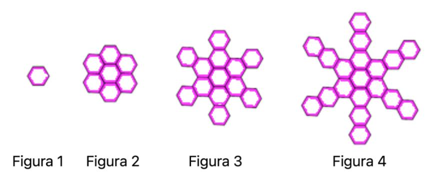
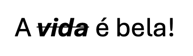
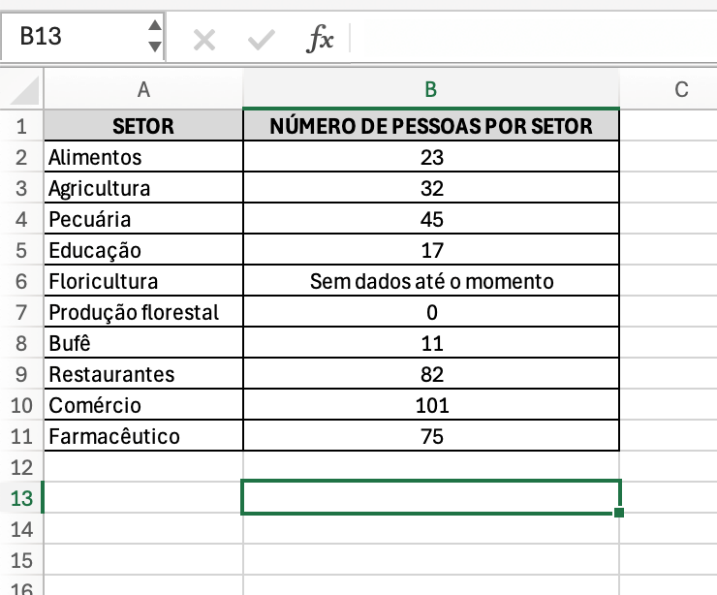

# PROVA — CÂMARA MUNICIPAL DE AREAL – RJ — CONCURSO PÚBLICO Nº 001/2024 — AGENTE LEGISLATIVO

## 1. Análise geral da prova

**Identificação da prova:**

- **Concurso:** Concurso Público nº 001/2024 — Câmara Municipal de Areal – RJ
- **Cargo:** Agente Legislativo (Ensino Médio/Técnico)
- **Data da prova:** 04/08/2024
- **Estrutura:** 40 questões objetivas (A–D): Língua Portuguesa (01–10), Matemática (11–20), Informática (21–30), Conhecimentos Específicos (31–40)

**Composição quantitativa:**

| Item | Quantidade |
|---|---|
| Total de questões | 40 |
| Textos de apoio compartilhados (grupos) | 1 (crônica “Para manter a sanidade, não me afasto de onde estou”: Q01–Q10) |
| Imagens de conteúdo | 4 (figuras de hexágonos Q11, frase no Word Q21, planilha Excel Q25, barra do Gmail Q26) |
| Gráficos e tabelas | 0 |
| Grupos identificados | 1 |
| Questões independentes | 30 |

**Composição por bloco:**

| Bloco | Questões | Quantidade |
|---|---|---|
| Língua Portuguesa | 01–10 | 10 |
| Matemática | 11–20 | 10 |
| Informática | 21–30 | 10 |
| Conhecimentos Específicos | 31–40 | 10 |

**Observações sobre a estrutura original:**

- As imagens das questões 11, 21, 25 e 26 aparecem no PDF original deslocadas no fluxo (fim/início de página); foram vinculadas às questões que as referenciam.
- Imagens não vinculadas a questões (logotipos da capa e cartão de respostas de rascunho) foram descartadas.

> **Transcrição integral da capa e das instruções (conforme extraída do PDF):**
> 
> > 
> > 
> > 
> > 
> > Caderno de Prova
> > AGENTE LEGISLATIVO
> > Data da prova:  04 de agosto de 2024.
> > Duração máxima da prova: 3(três) horas, incluído o tempo para o preenchimento do cartão resposta.
> > INSTRUÇÕES:
> > 1. Este caderno contém 40 (quarenta) questões objetivas com 04 (quatro) opções (A, B, C, D). A prova terá duração máxima
> > de 03 (três) horas. A prova terá seu horário de início em sala, a contar após a distribuição dos cadernos de prova e
> > autorização do aplicador(a).
> > 2. Confira em seu caderno de provas a sequência de questões. Você tem até 10 (dez) minutos do início das provas para
> > solicitar a troca do caderno de provas que apresentar algum problema de impressão ou qualquer outro que inviabilize a
> > realização da mesma, pois não serão aceitas reclamações posteriores nesse sentido.
> > 3. A interpretação das questões, bem como das instruções, faz parte da prova. Portanto, ao aplicador(a) de sala e fiscais não
> > há autorização para fornecer esclarecimentos sobre o conteúdo das provas, sendo esta atribuição de única e exclusiva
> > responsabilidade do(a) candidato(a).
> > 4. Você receberá do aplicador o cartão de respostas 30 (trinta) minutos após o início da prova, o cartão de respostas deverá
> > obrigatoriamente ser assinado pelo(a) candidato(a) no local em que há a indicação: “ASSINATURA”, utilizando sempre
> > caneta esferográfica de tinta preta ou azul.
> > 5. Caso realmente precise, utilize como rascunho os espaços em branco nas folhas do caderno de prova. Sugerimos que você
> > assinale, inicialmente, no próprio caderno de provas, todas as respostas que julgar correta. Depois, passe-as para o cartão
> > de respostas.
> > 6. Questões com mais de uma alternativa assinalada, rasurada ou em branco serão ANULADAS. Portanto, ao preencher o
> > cartão de respostas faça-o cuidadosamente. Evite erros, pois em hipótese alguma haverá substituição do cartão de
> > respostas por erro do(a) candidato(a).
> > 7. Ao terminar a prova ou findo o horário limite para sua realização, o candidato deverá OBRIGATORIAMENTE entregar seu
> > cartão de respostas “ASSINADO”, ao aplicador(a) de sala. O(a) candidato(a) que não devolver seu cartão de respostas
> > será automaticamente eliminado(a) e não terá classificação alguma no processo seletivo.
> > 8. Atenção! Preencha o cartão-resposta na mesma sequência numérica das questões do caderno de provas.
> > 9. Somente será permitido levar o caderno de prova, depois de decorrido o período de 120 (cento e vinte) minutos do início
> > das provas.
> > 10. Não serão permitidas consultas a quaisquer materiais, uso de telefone celular ou outros aparelhos eletrônicos, assim como
> > os demais procedimentos constantes no subitem 12.11 e no subitem 12.13 do Edital nº 001/2024.
> > 11. Após o término da prova, o(a) candidato(a) deverá deixar imediatamente o recinto da mesma, sendo terminantemente
> > proibido fazer contato com os(as) candidatos(as) que ainda não terminaram a prova sob pena de ser excluído do processo
> > seletivo.
> > 12. O desrespeito às normas que regem o presente concurso público, bem como, a desobediência às exigências registradas
> > no edital, além de sanções legais cabíveis implica na desclassificação do(a) candidato(a).
> > 13. Os dois últimos candidatos ao terminarem as provas deverão retirar-se da sala simultaneamente, após testemunharem o
> > fechamento (lacre) do envelope de provas, assinando a Ata Relatório.
> > 14. O candidato, após a divulgação dos gabaritos preliminares da prova objetiva, que será feita na página do processo seletivo
> > acessível através do site  www.idesg.org.br, na data prevista no QUADRO I – Cronograma geral de datas e eventos do
> > Edital nº 001/2024, poderá peticionar RECURSO à banca examinadora, quando julgar que ocorreu erro na formulação das
> > questões e divulgação do gabarito preliminar, observado o item 16 do Edital nº 001/2024.
> > BOA PROVA!!!
> > 
> > 
> > O CARTÃO DE RESPOSTAS ABAIXO É PARA SER UTILIZADO SOMENTE COMO RASCUNHO.
> > AO RECEBER O CARTÃO DE RESPOSTAS DEFINITIVO CONFIRA OS DADOS DE IDENTIFICAÇÃO
> > (NOME, CARGO/EMPREGO, NÚMERO DE INSCRIÇÃO) E EM SEGUIDA ASSINE NO LOCAL INDICADO.
> > ATENÇÃO:
> > • O(a) candidato(a) deverá OBRIGATORIAMENTE, entregar seu cartão de repostas definitivo preenchido
> > e ASSINADO, sob pena de ter seu cartão de respostas ANULADO. (item 12.22 do edital nº 001/2024).
> > • Preencha o cartão-resposta na mesma sequência numérica das questões do caderno de provas.
> > 

**Gabarito oficial — tabela "Gabarito oficial preliminar — Agente Legislativo":**

| Questão | Resposta | Questão | Resposta | Questão | Resposta | Questão | Resposta | Questão | Resposta |
|---|---|---|---|---|---|---|---|---|---|
| 01 | **C** | 02 | **A** | 03 | **B** | 04 | **D** | 05 | **A** |
| 06 | **B** | 07 | **C** | 08 | **B** | 09 | **D** | 10 | **C** |
| 11 | **C** | 12 | **A** | 13 | **C** | 14 | **B** | 15 | **B** |
| 16 | **D** | 17 | **C** | 18 | **B** | 19 | **C** | 20 | **D** |
| 21 | **D** | 22 | **B** | 23 | **C** | 24 | **A** | 25 | **B** |
| 26 | **C** | 27 | **D** | 28 | **A** | 29 | **B** | 30 | **A** |
| 31 | **C** | 32 | **B** | 33 | **A** | 34 | **C** | 35 | **D** |
| 36 | **B** | 37 | **D** | 38 | **A** | 39 | **A** | 40 | **C** |

> 📌 Fonte: Gabarito oficial preliminar — Agente Legislativo

---

## 2. Questões agrupadas

### GRUPO 01 — Crônica “Para manter a sanidade, não me afasto de onde estou” — questões 01 a 10

**Questões relacionadas:** 01, 02, 03, 04, 05, 06, 07, 08, 09, 10.

**Material de apoio compartilhado:**

> Atenção: Leia atentamente o texto a seguir e responda as questões de 01 a 10:
> Para manter a sanidade, não me afasto de onde estou
> Um dos filmes mais tocantes dos últimos tempos, Dias Perfeitos, de Wim Wenders, é de
> uma simplicidade repleta de sentidos. Quem achou o filme um tédio não percebeu o quanto a vida
> acontece a cada cena. Todo dia, o personagem Hirayama faz tudo sempre igual: escova os dentes, coloca
> o uniforme, pega um café na máquina automática e sai com o carro a fim de realizar seu trabalho como
> limpador de banheiros de parques públicos em Tóquio. No trajeto, escuta música em fitas K-7. À noite,
> lê um pouco, dorme e no dia seguinte retoma a mesma rotina, aparentemente idêntica.
> O filme concorreu ao Oscar e já foi mais que comentado. Assisti em janeiro, mas só agora,
> revendo a antológica cena final, em que o ator Koji Yakusho dirige escutando Feeling Good, de Nina
> Simone, permiti que o choro e o riso do personagem, ambos simultâneos naquele close poderoso, se
> misturassem aos meus.
> Janeiro parece que foi em outra vida. Em minha rotina, nada se mantém igual: há um sul em
> mim que adoece e um norte em mim que se expande – dentro do mesmo corpo. Caio, levanto, me deito,
> danço, alternando reações, conforme sou atingida pelas notícias do mundo ou pelos silêncios que
> encontro ao abrir minhas gavetas internas. Tudo é muito – e muito intenso. Alguém chamou de “tempo
> de desorientação”. Não tenho o nome do autor para dar o crédito, mas o parabenizo: que definição
> precisa.
> Para manter a sanidade, não me afasto de onde estou. Nada de me socorrer no passado ou
> projetar um futuro que desconheço, este balé escapista que tonteia. Grudo no livro que estou lendo,
> absorvo a música que está tocando e fico atenta ao que me acontece agora, e do jeito que me atinge, de
> frente e por dentro. A vida mirou em mim e me acertou.
> Com tanta presença, a solidão não entra. É o que Hirayama nos transmite no filme. Ele não
> passa os olhos: ele enxerga. Ele não finge que ouve: ele escuta. Ele sabe onde estão suas chaves, ele
> desce e sobe com cuidado os seus degraus, ele torna nobre o seu ofício desprezado, ele até disputa um
> jogo da velha contra um adversário invisível. Pertence ao mundo com inteireza, não aos pedaços. Quanto
> à questão digital, o filme é claro: não precisamos de mil, 10 mil, um milhão. Precisamos de um. De uma.
> A cada vez. Calmamente. É o que nos torna um planeta habitado.
> Temos sido sugados por ralos tecnológicos que nos despejam em valas comuns, onde
> viramos números, algoritmos, seguidores sem rostos. Que essa bagunça virtual não corrompa nossa
> casa e nossa mente, os dois espaços sagrados da existência. E que a alma da gente não seja pulverizada
> pelos gigabytes. É uma luta diária não se deixar desorientar. A gente chora porque é difícil. E, ao mesmo
> tempo, ri porque consegue.
> Autora: Martha Medeiros – GZH (adaptado).

---

#### QUESTÃO 01

✅ **Gabarito: C** (gabarito oficial preliminar — cargo AGENTE LEGISLATIVO ( Ensino Médio/Técnico))

**Material de apoio:**

> Atenção: Leia atentamente o texto a seguir e responda as questões de 01 a 10:
> Para manter a sanidade, não me afasto de onde estou
> Um dos filmes mais tocantes dos últimos tempos, Dias Perfeitos, de Wim Wenders, é de
> uma simplicidade repleta de sentidos. Quem achou o filme um tédio não percebeu o quanto a vida
> acontece a cada cena. Todo dia, o personagem Hirayama faz tudo sempre igual: escova os dentes, coloca
> o uniforme, pega um café na máquina automática e sai com o carro a fim de realizar seu trabalho como
> limpador de banheiros de parques públicos em Tóquio. No trajeto, escuta música em fitas K-7. À noite,
> lê um pouco, dorme e no dia seguinte retoma a mesma rotina, aparentemente idêntica.
> O filme concorreu ao Oscar e já foi mais que comentado. Assisti em janeiro, mas só agora,
> revendo a antológica cena final, em que o ator Koji Yakusho dirige escutando Feeling Good, de Nina
> Simone, permiti que o choro e o riso do personagem, ambos simultâneos naquele close poderoso, se
> misturassem aos meus.
> Janeiro parece que foi em outra vida. Em minha rotina, nada se mantém igual: há um sul em
> mim que adoece e um norte em mim que se expande – dentro do mesmo corpo. Caio, levanto, me deito,
> danço, alternando reações, conforme sou atingida pelas notícias do mundo ou pelos silêncios que
> encontro ao abrir minhas gavetas internas. Tudo é muito – e muito intenso. Alguém chamou de “tempo
> de desorientação”. Não tenho o nome do autor para dar o crédito, mas o parabenizo: que definição
> precisa.
> Para manter a sanidade, não me afasto de onde estou. Nada de me socorrer no passado ou
> projetar um futuro que desconheço, este balé escapista que tonteia. Grudo no livro que estou lendo,
> absorvo a música que está tocando e fico atenta ao que me acontece agora, e do jeito que me atinge, de
> frente e por dentro. A vida mirou em mim e me acertou.
> Com tanta presença, a solidão não entra. É o que Hirayama nos transmite no filme. Ele não
> passa os olhos: ele enxerga. Ele não finge que ouve: ele escuta. Ele sabe onde estão suas chaves, ele
> desce e sobe com cuidado os seus degraus, ele torna nobre o seu ofício desprezado, ele até disputa um
> jogo da velha contra um adversário invisível. Pertence ao mundo com inteireza, não aos pedaços. Quanto
> à questão digital, o filme é claro: não precisamos de mil, 10 mil, um milhão. Precisamos de um. De uma.
> A cada vez. Calmamente. É o que nos torna um planeta habitado.
> Temos sido sugados por ralos tecnológicos que nos despejam em valas comuns, onde
> viramos números, algoritmos, seguidores sem rostos. Que essa bagunça virtual não corrompa nossa
> casa e nossa mente, os dois espaços sagrados da existência. E que a alma da gente não seja pulverizada
> pelos gigabytes. É uma luta diária não se deixar desorientar. A gente chora porque é difícil. E, ao mesmo
> tempo, ri porque consegue.
> Autora: Martha Medeiros – GZH (adaptado).

**Enunciado:**

No texto, a autora menciona que "Para manter a sanidade, não me afasto de onde
estou". Qual é a estratégia que ela utiliza para alcançar esse objetivo?

**Alternativas:**

A) Focar no passado e lembrar momentos felizes.

B) Planejar detalhadamente o futuro.

C) Estar presente e atenta ao momento atual.

D) Evitar qualquer tipo de interação social.

**Referências visuais:**

Nenhuma.

---

#### QUESTÃO 02

✅ **Gabarito: A** (gabarito oficial preliminar — cargo AGENTE LEGISLATIVO ( Ensino Médio/Técnico))

**Material de apoio:**

> Atenção: Leia atentamente o texto a seguir e responda as questões de 01 a 10:
> Para manter a sanidade, não me afasto de onde estou
> Um dos filmes mais tocantes dos últimos tempos, Dias Perfeitos, de Wim Wenders, é de
> uma simplicidade repleta de sentidos. Quem achou o filme um tédio não percebeu o quanto a vida
> acontece a cada cena. Todo dia, o personagem Hirayama faz tudo sempre igual: escova os dentes, coloca
> o uniforme, pega um café na máquina automática e sai com o carro a fim de realizar seu trabalho como
> limpador de banheiros de parques públicos em Tóquio. No trajeto, escuta música em fitas K-7. À noite,
> lê um pouco, dorme e no dia seguinte retoma a mesma rotina, aparentemente idêntica.
> O filme concorreu ao Oscar e já foi mais que comentado. Assisti em janeiro, mas só agora,
> revendo a antológica cena final, em que o ator Koji Yakusho dirige escutando Feeling Good, de Nina
> Simone, permiti que o choro e o riso do personagem, ambos simultâneos naquele close poderoso, se
> misturassem aos meus.
> Janeiro parece que foi em outra vida. Em minha rotina, nada se mantém igual: há um sul em
> mim que adoece e um norte em mim que se expande – dentro do mesmo corpo. Caio, levanto, me deito,
> danço, alternando reações, conforme sou atingida pelas notícias do mundo ou pelos silêncios que
> encontro ao abrir minhas gavetas internas. Tudo é muito – e muito intenso. Alguém chamou de “tempo
> de desorientação”. Não tenho o nome do autor para dar o crédito, mas o parabenizo: que definição
> precisa.
> Para manter a sanidade, não me afasto de onde estou. Nada de me socorrer no passado ou
> projetar um futuro que desconheço, este balé escapista que tonteia. Grudo no livro que estou lendo,
> absorvo a música que está tocando e fico atenta ao que me acontece agora, e do jeito que me atinge, de
> frente e por dentro. A vida mirou em mim e me acertou.
> Com tanta presença, a solidão não entra. É o que Hirayama nos transmite no filme. Ele não
> passa os olhos: ele enxerga. Ele não finge que ouve: ele escuta. Ele sabe onde estão suas chaves, ele
> desce e sobe com cuidado os seus degraus, ele torna nobre o seu ofício desprezado, ele até disputa um
> jogo da velha contra um adversário invisível. Pertence ao mundo com inteireza, não aos pedaços. Quanto
> à questão digital, o filme é claro: não precisamos de mil, 10 mil, um milhão. Precisamos de um. De uma.
> A cada vez. Calmamente. É o que nos torna um planeta habitado.
> Temos sido sugados por ralos tecnológicos que nos despejam em valas comuns, onde
> viramos números, algoritmos, seguidores sem rostos. Que essa bagunça virtual não corrompa nossa
> casa e nossa mente, os dois espaços sagrados da existência. E que a alma da gente não seja pulverizada
> pelos gigabytes. É uma luta diária não se deixar desorientar. A gente chora porque é difícil. E, ao mesmo
> tempo, ri porque consegue.
> Autora: Martha Medeiros – GZH (adaptado).

**Enunciado:**

No texto, o que a autora sugere sobre a relação das pessoas com a tecnologia?

**Alternativas:**

A) A digitalização excessiva pode desorientar e desumanizar.

B) A tecnologia é indispensável para a felicidade humana.

C) As pessoas precisam de muitas conexões digitais para se sentirem completas.

D) A presença digital não afeta a sanidade mental das pessoas.

**Referências visuais:**

Nenhuma.

---

#### QUESTÃO 03

✅ **Gabarito: B** (gabarito oficial preliminar — cargo AGENTE LEGISLATIVO ( Ensino Médio/Técnico))

**Material de apoio:**

> Atenção: Leia atentamente o texto a seguir e responda as questões de 01 a 10:
> Para manter a sanidade, não me afasto de onde estou
> Um dos filmes mais tocantes dos últimos tempos, Dias Perfeitos, de Wim Wenders, é de
> uma simplicidade repleta de sentidos. Quem achou o filme um tédio não percebeu o quanto a vida
> acontece a cada cena. Todo dia, o personagem Hirayama faz tudo sempre igual: escova os dentes, coloca
> o uniforme, pega um café na máquina automática e sai com o carro a fim de realizar seu trabalho como
> limpador de banheiros de parques públicos em Tóquio. No trajeto, escuta música em fitas K-7. À noite,
> lê um pouco, dorme e no dia seguinte retoma a mesma rotina, aparentemente idêntica.
> O filme concorreu ao Oscar e já foi mais que comentado. Assisti em janeiro, mas só agora,
> revendo a antológica cena final, em que o ator Koji Yakusho dirige escutando Feeling Good, de Nina
> Simone, permiti que o choro e o riso do personagem, ambos simultâneos naquele close poderoso, se
> misturassem aos meus.
> Janeiro parece que foi em outra vida. Em minha rotina, nada se mantém igual: há um sul em
> mim que adoece e um norte em mim que se expande – dentro do mesmo corpo. Caio, levanto, me deito,
> danço, alternando reações, conforme sou atingida pelas notícias do mundo ou pelos silêncios que
> encontro ao abrir minhas gavetas internas. Tudo é muito – e muito intenso. Alguém chamou de “tempo
> de desorientação”. Não tenho o nome do autor para dar o crédito, mas o parabenizo: que definição
> precisa.
> Para manter a sanidade, não me afasto de onde estou. Nada de me socorrer no passado ou
> projetar um futuro que desconheço, este balé escapista que tonteia. Grudo no livro que estou lendo,
> absorvo a música que está tocando e fico atenta ao que me acontece agora, e do jeito que me atinge, de
> frente e por dentro. A vida mirou em mim e me acertou.
> Com tanta presença, a solidão não entra. É o que Hirayama nos transmite no filme. Ele não
> passa os olhos: ele enxerga. Ele não finge que ouve: ele escuta. Ele sabe onde estão suas chaves, ele
> desce e sobe com cuidado os seus degraus, ele torna nobre o seu ofício desprezado, ele até disputa um
> jogo da velha contra um adversário invisível. Pertence ao mundo com inteireza, não aos pedaços. Quanto
> à questão digital, o filme é claro: não precisamos de mil, 10 mil, um milhão. Precisamos de um. De uma.
> A cada vez. Calmamente. É o que nos torna um planeta habitado.
> Temos sido sugados por ralos tecnológicos que nos despejam em valas comuns, onde
> viramos números, algoritmos, seguidores sem rostos. Que essa bagunça virtual não corrompa nossa
> casa e nossa mente, os dois espaços sagrados da existência. E que a alma da gente não seja pulverizada
> pelos gigabytes. É uma luta diária não se deixar desorientar. A gente chora porque é difícil. E, ao mesmo
> tempo, ri porque consegue.
> Autora: Martha Medeiros – GZH (adaptado).

**Enunciado:**

O que a autora entende por "um sul em mim que adoece e um norte em mim que se
expande"?

**Alternativas:**

A) Uma referência à geografia emocional que define suas interações sociais.

B) Uma metáfora para os altos e baixos emocionais que ela experimenta.

C) Uma descrição literal de suas viagens pelo hemisfério sul e norte.

D) Uma indicação das suas preferências por diferentes regiões do mundo.

**Referências visuais:**

Nenhuma.

---

#### QUESTÃO 04

✅ **Gabarito: D** (gabarito oficial preliminar — cargo AGENTE LEGISLATIVO ( Ensino Médio/Técnico))

**Material de apoio:**

> Atenção: Leia atentamente o texto a seguir e responda as questões de 01 a 10:
> Para manter a sanidade, não me afasto de onde estou
> Um dos filmes mais tocantes dos últimos tempos, Dias Perfeitos, de Wim Wenders, é de
> uma simplicidade repleta de sentidos. Quem achou o filme um tédio não percebeu o quanto a vida
> acontece a cada cena. Todo dia, o personagem Hirayama faz tudo sempre igual: escova os dentes, coloca
> o uniforme, pega um café na máquina automática e sai com o carro a fim de realizar seu trabalho como
> limpador de banheiros de parques públicos em Tóquio. No trajeto, escuta música em fitas K-7. À noite,
> lê um pouco, dorme e no dia seguinte retoma a mesma rotina, aparentemente idêntica.
> O filme concorreu ao Oscar e já foi mais que comentado. Assisti em janeiro, mas só agora,
> revendo a antológica cena final, em que o ator Koji Yakusho dirige escutando Feeling Good, de Nina
> Simone, permiti que o choro e o riso do personagem, ambos simultâneos naquele close poderoso, se
> misturassem aos meus.
> Janeiro parece que foi em outra vida. Em minha rotina, nada se mantém igual: há um sul em
> mim que adoece e um norte em mim que se expande – dentro do mesmo corpo. Caio, levanto, me deito,
> danço, alternando reações, conforme sou atingida pelas notícias do mundo ou pelos silêncios que
> encontro ao abrir minhas gavetas internas. Tudo é muito – e muito intenso. Alguém chamou de “tempo
> de desorientação”. Não tenho o nome do autor para dar o crédito, mas o parabenizo: que definição
> precisa.
> Para manter a sanidade, não me afasto de onde estou. Nada de me socorrer no passado ou
> projetar um futuro que desconheço, este balé escapista que tonteia. Grudo no livro que estou lendo,
> absorvo a música que está tocando e fico atenta ao que me acontece agora, e do jeito que me atinge, de
> frente e por dentro. A vida mirou em mim e me acertou.
> Com tanta presença, a solidão não entra. É o que Hirayama nos transmite no filme. Ele não
> passa os olhos: ele enxerga. Ele não finge que ouve: ele escuta. Ele sabe onde estão suas chaves, ele
> desce e sobe com cuidado os seus degraus, ele torna nobre o seu ofício desprezado, ele até disputa um
> jogo da velha contra um adversário invisível. Pertence ao mundo com inteireza, não aos pedaços. Quanto
> à questão digital, o filme é claro: não precisamos de mil, 10 mil, um milhão. Precisamos de um. De uma.
> A cada vez. Calmamente. É o que nos torna um planeta habitado.
> Temos sido sugados por ralos tecnológicos que nos despejam em valas comuns, onde
> viramos números, algoritmos, seguidores sem rostos. Que essa bagunça virtual não corrompa nossa
> casa e nossa mente, os dois espaços sagrados da existência. E que a alma da gente não seja pulverizada
> pelos gigabytes. É uma luta diária não se deixar desorientar. A gente chora porque é difícil. E, ao mesmo
> tempo, ri porque consegue.
> Autora: Martha Medeiros – GZH (adaptado).

**Enunciado:**

Qual é a principal crítica que a autora faz à vida moderna no trecho "Temos sido
sugados por ralos tecnológicos que nos despejam em valas comuns, onde viramos números, algoritmos,
seguidores sem rostos"?

**Alternativas:**

A) A falta de avanços tecnológicos nas redes sociais.

B) O aumento do uso de tecnologias para o trabalho remoto.

C) A necessidade de mais algoritmos para organizar as informações digitais.

D) A dependência excessiva das redes sociais e a perda de individualidade.

**Referências visuais:**

Nenhuma.

---

#### QUESTÃO 05

✅ **Gabarito: A** (gabarito oficial preliminar — cargo AGENTE LEGISLATIVO ( Ensino Médio/Técnico))

**Material de apoio:**

> Atenção: Leia atentamente o texto a seguir e responda as questões de 01 a 10:
> Para manter a sanidade, não me afasto de onde estou
> Um dos filmes mais tocantes dos últimos tempos, Dias Perfeitos, de Wim Wenders, é de
> uma simplicidade repleta de sentidos. Quem achou o filme um tédio não percebeu o quanto a vida
> acontece a cada cena. Todo dia, o personagem Hirayama faz tudo sempre igual: escova os dentes, coloca
> o uniforme, pega um café na máquina automática e sai com o carro a fim de realizar seu trabalho como
> limpador de banheiros de parques públicos em Tóquio. No trajeto, escuta música em fitas K-7. À noite,
> lê um pouco, dorme e no dia seguinte retoma a mesma rotina, aparentemente idêntica.
> O filme concorreu ao Oscar e já foi mais que comentado. Assisti em janeiro, mas só agora,
> revendo a antológica cena final, em que o ator Koji Yakusho dirige escutando Feeling Good, de Nina
> Simone, permiti que o choro e o riso do personagem, ambos simultâneos naquele close poderoso, se
> misturassem aos meus.
> Janeiro parece que foi em outra vida. Em minha rotina, nada se mantém igual: há um sul em
> mim que adoece e um norte em mim que se expande – dentro do mesmo corpo. Caio, levanto, me deito,
> danço, alternando reações, conforme sou atingida pelas notícias do mundo ou pelos silêncios que
> encontro ao abrir minhas gavetas internas. Tudo é muito – e muito intenso. Alguém chamou de “tempo
> de desorientação”. Não tenho o nome do autor para dar o crédito, mas o parabenizo: que definição
> precisa.
> Para manter a sanidade, não me afasto de onde estou. Nada de me socorrer no passado ou
> projetar um futuro que desconheço, este balé escapista que tonteia. Grudo no livro que estou lendo,
> absorvo a música que está tocando e fico atenta ao que me acontece agora, e do jeito que me atinge, de
> frente e por dentro. A vida mirou em mim e me acertou.
> Com tanta presença, a solidão não entra. É o que Hirayama nos transmite no filme. Ele não
> passa os olhos: ele enxerga. Ele não finge que ouve: ele escuta. Ele sabe onde estão suas chaves, ele
> desce e sobe com cuidado os seus degraus, ele torna nobre o seu ofício desprezado, ele até disputa um
> jogo da velha contra um adversário invisível. Pertence ao mundo com inteireza, não aos pedaços. Quanto
> à questão digital, o filme é claro: não precisamos de mil, 10 mil, um milhão. Precisamos de um. De uma.
> A cada vez. Calmamente. É o que nos torna um planeta habitado.
> Temos sido sugados por ralos tecnológicos que nos despejam em valas comuns, onde
> viramos números, algoritmos, seguidores sem rostos. Que essa bagunça virtual não corrompa nossa
> casa e nossa mente, os dois espaços sagrados da existência. E que a alma da gente não seja pulverizada
> pelos gigabytes. É uma luta diária não se deixar desorientar. A gente chora porque é difícil. E, ao mesmo
> tempo, ri porque consegue.
> Autora: Martha Medeiros – GZH (adaptado).

**Enunciado:**

Na oração "Com tanta presença, a solidão não entra", a palavra "presença" é
classificada, gramaticalmente, como ____________. Por sua vez, “tanta” é classificada como
_____________.
Qual alternativa preenche, CORRETA e respectivamente, as lacunas acima?

**Alternativas:**

A) substantivo; advérbio.

B) advérbio; substantivo.

C) adjetivo; advérbio.

D) substantivo; adjetivo.

**Referências visuais:**

Nenhuma.

---

#### QUESTÃO 06

✅ **Gabarito: B** (gabarito oficial preliminar — cargo AGENTE LEGISLATIVO ( Ensino Médio/Técnico))

**Material de apoio:**

> Atenção: Leia atentamente o texto a seguir e responda as questões de 01 a 10:
> Para manter a sanidade, não me afasto de onde estou
> Um dos filmes mais tocantes dos últimos tempos, Dias Perfeitos, de Wim Wenders, é de
> uma simplicidade repleta de sentidos. Quem achou o filme um tédio não percebeu o quanto a vida
> acontece a cada cena. Todo dia, o personagem Hirayama faz tudo sempre igual: escova os dentes, coloca
> o uniforme, pega um café na máquina automática e sai com o carro a fim de realizar seu trabalho como
> limpador de banheiros de parques públicos em Tóquio. No trajeto, escuta música em fitas K-7. À noite,
> lê um pouco, dorme e no dia seguinte retoma a mesma rotina, aparentemente idêntica.
> O filme concorreu ao Oscar e já foi mais que comentado. Assisti em janeiro, mas só agora,
> revendo a antológica cena final, em que o ator Koji Yakusho dirige escutando Feeling Good, de Nina
> Simone, permiti que o choro e o riso do personagem, ambos simultâneos naquele close poderoso, se
> misturassem aos meus.
> Janeiro parece que foi em outra vida. Em minha rotina, nada se mantém igual: há um sul em
> mim que adoece e um norte em mim que se expande – dentro do mesmo corpo. Caio, levanto, me deito,
> danço, alternando reações, conforme sou atingida pelas notícias do mundo ou pelos silêncios que
> encontro ao abrir minhas gavetas internas. Tudo é muito – e muito intenso. Alguém chamou de “tempo
> de desorientação”. Não tenho o nome do autor para dar o crédito, mas o parabenizo: que definição
> precisa.
> Para manter a sanidade, não me afasto de onde estou. Nada de me socorrer no passado ou
> projetar um futuro que desconheço, este balé escapista que tonteia. Grudo no livro que estou lendo,
> absorvo a música que está tocando e fico atenta ao que me acontece agora, e do jeito que me atinge, de
> frente e por dentro. A vida mirou em mim e me acertou.
> Com tanta presença, a solidão não entra. É o que Hirayama nos transmite no filme. Ele não
> passa os olhos: ele enxerga. Ele não finge que ouve: ele escuta. Ele sabe onde estão suas chaves, ele
> desce e sobe com cuidado os seus degraus, ele torna nobre o seu ofício desprezado, ele até disputa um
> jogo da velha contra um adversário invisível. Pertence ao mundo com inteireza, não aos pedaços. Quanto
> à questão digital, o filme é claro: não precisamos de mil, 10 mil, um milhão. Precisamos de um. De uma.
> A cada vez. Calmamente. É o que nos torna um planeta habitado.
> Temos sido sugados por ralos tecnológicos que nos despejam em valas comuns, onde
> viramos números, algoritmos, seguidores sem rostos. Que essa bagunça virtual não corrompa nossa
> casa e nossa mente, os dois espaços sagrados da existência. E que a alma da gente não seja pulverizada
> pelos gigabytes. É uma luta diária não se deixar desorientar. A gente chora porque é difícil. E, ao mesmo
> tempo, ri porque consegue.
> Autora: Martha Medeiros – GZH (adaptado).

**Enunciado:**

No trecho "Temos sido sugados por ralos tecnológicos que nos despejam em valas
comuns", a expressão "ralos tecnológicos" sugere:

**Alternativas:**

A) Ferramentas tecnológicas modernas.

B) Dispositivos que consomem nosso tempo e atenção.

C) Tecnologia inovadora e indispensável.

D) Equipamentos tecnológicos avançados para o dia a dia.

**Referências visuais:**

Nenhuma.

---

#### QUESTÃO 07

✅ **Gabarito: C** (gabarito oficial preliminar — cargo AGENTE LEGISLATIVO ( Ensino Médio/Técnico))

**Material de apoio:**

> Atenção: Leia atentamente o texto a seguir e responda as questões de 01 a 10:
> Para manter a sanidade, não me afasto de onde estou
> Um dos filmes mais tocantes dos últimos tempos, Dias Perfeitos, de Wim Wenders, é de
> uma simplicidade repleta de sentidos. Quem achou o filme um tédio não percebeu o quanto a vida
> acontece a cada cena. Todo dia, o personagem Hirayama faz tudo sempre igual: escova os dentes, coloca
> o uniforme, pega um café na máquina automática e sai com o carro a fim de realizar seu trabalho como
> limpador de banheiros de parques públicos em Tóquio. No trajeto, escuta música em fitas K-7. À noite,
> lê um pouco, dorme e no dia seguinte retoma a mesma rotina, aparentemente idêntica.
> O filme concorreu ao Oscar e já foi mais que comentado. Assisti em janeiro, mas só agora,
> revendo a antológica cena final, em que o ator Koji Yakusho dirige escutando Feeling Good, de Nina
> Simone, permiti que o choro e o riso do personagem, ambos simultâneos naquele close poderoso, se
> misturassem aos meus.
> Janeiro parece que foi em outra vida. Em minha rotina, nada se mantém igual: há um sul em
> mim que adoece e um norte em mim que se expande – dentro do mesmo corpo. Caio, levanto, me deito,
> danço, alternando reações, conforme sou atingida pelas notícias do mundo ou pelos silêncios que
> encontro ao abrir minhas gavetas internas. Tudo é muito – e muito intenso. Alguém chamou de “tempo
> de desorientação”. Não tenho o nome do autor para dar o crédito, mas o parabenizo: que definição
> precisa.
> Para manter a sanidade, não me afasto de onde estou. Nada de me socorrer no passado ou
> projetar um futuro que desconheço, este balé escapista que tonteia. Grudo no livro que estou lendo,
> absorvo a música que está tocando e fico atenta ao que me acontece agora, e do jeito que me atinge, de
> frente e por dentro. A vida mirou em mim e me acertou.
> Com tanta presença, a solidão não entra. É o que Hirayama nos transmite no filme. Ele não
> passa os olhos: ele enxerga. Ele não finge que ouve: ele escuta. Ele sabe onde estão suas chaves, ele
> desce e sobe com cuidado os seus degraus, ele torna nobre o seu ofício desprezado, ele até disputa um
> jogo da velha contra um adversário invisível. Pertence ao mundo com inteireza, não aos pedaços. Quanto
> à questão digital, o filme é claro: não precisamos de mil, 10 mil, um milhão. Precisamos de um. De uma.
> A cada vez. Calmamente. É o que nos torna um planeta habitado.
> Temos sido sugados por ralos tecnológicos que nos despejam em valas comuns, onde
> viramos números, algoritmos, seguidores sem rostos. Que essa bagunça virtual não corrompa nossa
> casa e nossa mente, os dois espaços sagrados da existência. E que a alma da gente não seja pulverizada
> pelos gigabytes. É uma luta diária não se deixar desorientar. A gente chora porque é difícil. E, ao mesmo
> tempo, ri porque consegue.
> Autora: Martha Medeiros – GZH (adaptado).

**Enunciado:**

No trecho "A vida acontece a cada cena", a palavra "acontece" pode ser substituída,
sem alterar o sentido expresso no texto, por:

**Alternativas:**

A) Conclui-se.

B) Desaparece.

C) Manifesta-se.

D) Interrompe-se.

**Referências visuais:**

Nenhuma.

---

#### QUESTÃO 08

✅ **Gabarito: B** (gabarito oficial preliminar — cargo AGENTE LEGISLATIVO ( Ensino Médio/Técnico))

**Material de apoio:**

> Atenção: Leia atentamente o texto a seguir e responda as questões de 01 a 10:
> Para manter a sanidade, não me afasto de onde estou
> Um dos filmes mais tocantes dos últimos tempos, Dias Perfeitos, de Wim Wenders, é de
> uma simplicidade repleta de sentidos. Quem achou o filme um tédio não percebeu o quanto a vida
> acontece a cada cena. Todo dia, o personagem Hirayama faz tudo sempre igual: escova os dentes, coloca
> o uniforme, pega um café na máquina automática e sai com o carro a fim de realizar seu trabalho como
> limpador de banheiros de parques públicos em Tóquio. No trajeto, escuta música em fitas K-7. À noite,
> lê um pouco, dorme e no dia seguinte retoma a mesma rotina, aparentemente idêntica.
> O filme concorreu ao Oscar e já foi mais que comentado. Assisti em janeiro, mas só agora,
> revendo a antológica cena final, em que o ator Koji Yakusho dirige escutando Feeling Good, de Nina
> Simone, permiti que o choro e o riso do personagem, ambos simultâneos naquele close poderoso, se
> misturassem aos meus.
> Janeiro parece que foi em outra vida. Em minha rotina, nada se mantém igual: há um sul em
> mim que adoece e um norte em mim que se expande – dentro do mesmo corpo. Caio, levanto, me deito,
> danço, alternando reações, conforme sou atingida pelas notícias do mundo ou pelos silêncios que
> encontro ao abrir minhas gavetas internas. Tudo é muito – e muito intenso. Alguém chamou de “tempo
> de desorientação”. Não tenho o nome do autor para dar o crédito, mas o parabenizo: que definição
> precisa.
> Para manter a sanidade, não me afasto de onde estou. Nada de me socorrer no passado ou
> projetar um futuro que desconheço, este balé escapista que tonteia. Grudo no livro que estou lendo,
> absorvo a música que está tocando e fico atenta ao que me acontece agora, e do jeito que me atinge, de
> frente e por dentro. A vida mirou em mim e me acertou.
> Com tanta presença, a solidão não entra. É o que Hirayama nos transmite no filme. Ele não
> passa os olhos: ele enxerga. Ele não finge que ouve: ele escuta. Ele sabe onde estão suas chaves, ele
> desce e sobe com cuidado os seus degraus, ele torna nobre o seu ofício desprezado, ele até disputa um
> jogo da velha contra um adversário invisível. Pertence ao mundo com inteireza, não aos pedaços. Quanto
> à questão digital, o filme é claro: não precisamos de mil, 10 mil, um milhão. Precisamos de um. De uma.
> A cada vez. Calmamente. É o que nos torna um planeta habitado.
> Temos sido sugados por ralos tecnológicos que nos despejam em valas comuns, onde
> viramos números, algoritmos, seguidores sem rostos. Que essa bagunça virtual não corrompa nossa
> casa e nossa mente, os dois espaços sagrados da existência. E que a alma da gente não seja pulverizada
> pelos gigabytes. É uma luta diária não se deixar desorientar. A gente chora porque é difícil. E, ao mesmo
> tempo, ri porque consegue.
> Autora: Martha Medeiros – GZH (adaptado).

**Enunciado:**

No período "O filme concorreu ao Oscar e já foi mais que comentado", os termos "ao
Oscar" exercem a função sintática de:

**Alternativas:**

A) Objeto direto.

B) Objeto indireto.

C) Complemento nominal.

D) Adjunto adverbial.

**Referências visuais:**

Nenhuma.

---

#### QUESTÃO 09

✅ **Gabarito: D** (gabarito oficial preliminar — cargo AGENTE LEGISLATIVO ( Ensino Médio/Técnico))

**Material de apoio:**

> Atenção: Leia atentamente o texto a seguir e responda as questões de 01 a 10:
> Para manter a sanidade, não me afasto de onde estou
> Um dos filmes mais tocantes dos últimos tempos, Dias Perfeitos, de Wim Wenders, é de
> uma simplicidade repleta de sentidos. Quem achou o filme um tédio não percebeu o quanto a vida
> acontece a cada cena. Todo dia, o personagem Hirayama faz tudo sempre igual: escova os dentes, coloca
> o uniforme, pega um café na máquina automática e sai com o carro a fim de realizar seu trabalho como
> limpador de banheiros de parques públicos em Tóquio. No trajeto, escuta música em fitas K-7. À noite,
> lê um pouco, dorme e no dia seguinte retoma a mesma rotina, aparentemente idêntica.
> O filme concorreu ao Oscar e já foi mais que comentado. Assisti em janeiro, mas só agora,
> revendo a antológica cena final, em que o ator Koji Yakusho dirige escutando Feeling Good, de Nina
> Simone, permiti que o choro e o riso do personagem, ambos simultâneos naquele close poderoso, se
> misturassem aos meus.
> Janeiro parece que foi em outra vida. Em minha rotina, nada se mantém igual: há um sul em
> mim que adoece e um norte em mim que se expande – dentro do mesmo corpo. Caio, levanto, me deito,
> danço, alternando reações, conforme sou atingida pelas notícias do mundo ou pelos silêncios que
> encontro ao abrir minhas gavetas internas. Tudo é muito – e muito intenso. Alguém chamou de “tempo
> de desorientação”. Não tenho o nome do autor para dar o crédito, mas o parabenizo: que definição
> precisa.
> Para manter a sanidade, não me afasto de onde estou. Nada de me socorrer no passado ou
> projetar um futuro que desconheço, este balé escapista que tonteia. Grudo no livro que estou lendo,
> absorvo a música que está tocando e fico atenta ao que me acontece agora, e do jeito que me atinge, de
> frente e por dentro. A vida mirou em mim e me acertou.
> Com tanta presença, a solidão não entra. É o que Hirayama nos transmite no filme. Ele não
> passa os olhos: ele enxerga. Ele não finge que ouve: ele escuta. Ele sabe onde estão suas chaves, ele
> desce e sobe com cuidado os seus degraus, ele torna nobre o seu ofício desprezado, ele até disputa um
> jogo da velha contra um adversário invisível. Pertence ao mundo com inteireza, não aos pedaços. Quanto
> à questão digital, o filme é claro: não precisamos de mil, 10 mil, um milhão. Precisamos de um. De uma.
> A cada vez. Calmamente. É o que nos torna um planeta habitado.
> Temos sido sugados por ralos tecnológicos que nos despejam em valas comuns, onde
> viramos números, algoritmos, seguidores sem rostos. Que essa bagunça virtual não corrompa nossa
> casa e nossa mente, os dois espaços sagrados da existência. E que a alma da gente não seja pulverizada
> pelos gigabytes. É uma luta diária não se deixar desorientar. A gente chora porque é difícil. E, ao mesmo
> tempo, ri porque consegue.
> Autora: Martha Medeiros – GZH (adaptado).

**Enunciado:**

Em termos morfológicos, assinale a alternativa que apresenta o processo de formação
da palavra "silencioso", presente no texto.

**Alternativas:**

A) Derivação prefixal.

B) Derivação parassintética.

C) Composição por aglutinação.

D) Derivação sufixal.

**Referências visuais:**

Nenhuma.

---

#### QUESTÃO 10

✅ **Gabarito: C** (gabarito oficial preliminar — cargo AGENTE LEGISLATIVO ( Ensino Médio/Técnico))

**Material de apoio:**

> Atenção: Leia atentamente o texto a seguir e responda as questões de 01 a 10:
> Para manter a sanidade, não me afasto de onde estou
> Um dos filmes mais tocantes dos últimos tempos, Dias Perfeitos, de Wim Wenders, é de
> uma simplicidade repleta de sentidos. Quem achou o filme um tédio não percebeu o quanto a vida
> acontece a cada cena. Todo dia, o personagem Hirayama faz tudo sempre igual: escova os dentes, coloca
> o uniforme, pega um café na máquina automática e sai com o carro a fim de realizar seu trabalho como
> limpador de banheiros de parques públicos em Tóquio. No trajeto, escuta música em fitas K-7. À noite,
> lê um pouco, dorme e no dia seguinte retoma a mesma rotina, aparentemente idêntica.
> O filme concorreu ao Oscar e já foi mais que comentado. Assisti em janeiro, mas só agora,
> revendo a antológica cena final, em que o ator Koji Yakusho dirige escutando Feeling Good, de Nina
> Simone, permiti que o choro e o riso do personagem, ambos simultâneos naquele close poderoso, se
> misturassem aos meus.
> Janeiro parece que foi em outra vida. Em minha rotina, nada se mantém igual: há um sul em
> mim que adoece e um norte em mim que se expande – dentro do mesmo corpo. Caio, levanto, me deito,
> danço, alternando reações, conforme sou atingida pelas notícias do mundo ou pelos silêncios que
> encontro ao abrir minhas gavetas internas. Tudo é muito – e muito intenso. Alguém chamou de “tempo
> de desorientação”. Não tenho o nome do autor para dar o crédito, mas o parabenizo: que definição
> precisa.
> Para manter a sanidade, não me afasto de onde estou. Nada de me socorrer no passado ou
> projetar um futuro que desconheço, este balé escapista que tonteia. Grudo no livro que estou lendo,
> absorvo a música que está tocando e fico atenta ao que me acontece agora, e do jeito que me atinge, de
> frente e por dentro. A vida mirou em mim e me acertou.
> Com tanta presença, a solidão não entra. É o que Hirayama nos transmite no filme. Ele não
> passa os olhos: ele enxerga. Ele não finge que ouve: ele escuta. Ele sabe onde estão suas chaves, ele
> desce e sobe com cuidado os seus degraus, ele torna nobre o seu ofício desprezado, ele até disputa um
> jogo da velha contra um adversário invisível. Pertence ao mundo com inteireza, não aos pedaços. Quanto
> à questão digital, o filme é claro: não precisamos de mil, 10 mil, um milhão. Precisamos de um. De uma.
> A cada vez. Calmamente. É o que nos torna um planeta habitado.
> Temos sido sugados por ralos tecnológicos que nos despejam em valas comuns, onde
> viramos números, algoritmos, seguidores sem rostos. Que essa bagunça virtual não corrompa nossa
> casa e nossa mente, os dois espaços sagrados da existência. E que a alma da gente não seja pulverizada
> pelos gigabytes. É uma luta diária não se deixar desorientar. A gente chora porque é difícil. E, ao mesmo
> tempo, ri porque consegue.
> Autora: Martha Medeiros – GZH (adaptado).

**Enunciado:**

No período "A gente chora porque é difícil", a oração sublinhada é classificada como:

**Alternativas:**

A) Oração subordinada substantiva subjetiva.

B) Oração subordinada adjetiva explicativa.

C) Oração subordinada adverbial causal.

D) Oração coordenada sindética explicativa.

**Referências visuais:**

Nenhuma.

---

## 3. Questões independentes

#### QUESTÃO 11

✅ **Gabarito: C** (gabarito oficial preliminar — cargo AGENTE LEGISLATIVO ( Ensino Médio/Técnico))

**Enunciado:**

A imagem a seguir mostra 4 figuras criadas utilizando hexágonos, seguindo um
determinado padrão.
Seguindo esse mesmo padrão, quantos hexágonos são necessários para formar a Figura 20?

**Alternativas:**

A) 110.

B) 113.

C) 115.

D) 117.

**Referências visuais:**

---

#### QUESTÃO 12

✅ **Gabarito: A** (gabarito oficial preliminar — cargo AGENTE LEGISLATIVO ( Ensino Médio/Técnico))

**Enunciado:**

Carlos escreveu uma P.A. decrescente com 4 termos, apenas com números inteiros.
Em seguida, ele somou esses termos e o resultado deu 32. Depois multiplicou esses números e o
resultado deu 3465. Podemos afirmar que:

**Alternativas:**

A) O terceiro termo dessa P.A. é um número primo.

B) O primeiro termo dessa P.A. é um número quadrado perfeito.

C) O segundo termo dessa P.A. é um número primo.

D) O quarto termo dessa P.A. é um número quadrado perfeito.

**Referências visuais:**

Nenhuma.

---

#### QUESTÃO 13

✅ **Gabarito: C** (gabarito oficial preliminar — cargo AGENTE LEGISLATIVO ( Ensino Médio/Técnico))

**Enunciado:**

A Recepcionista Carla precisa resolver um problema lógico para organizar a ordem de
atendimento dos visitantes na Câmara Municipal. Carla recebeu três visitantes: João, Maria e Pedro. Ela
sabe que:
1. João chegou antes de Pedro.
2. Maria chegou depois de Pedro.
3. Pedro não foi o primeiro a chegar.
Qual é a ordem correta de chegada dos visitantes?

**Alternativas:**

A) Pedro, João, Maria.

B) João, Maria, Pedro.

C) João, Pedro, Maria.

D) Maria, João, Pedro.

**Referências visuais:**

Nenhuma.

---

#### QUESTÃO 14

✅ **Gabarito: B** (gabarito oficial preliminar — cargo AGENTE LEGISLATIVO ( Ensino Médio/Técnico))

**Enunciado:**

O Motorista está calculando o tempo necessário para uma viagem oficial. Se ele sabe
que leva 2 horas para percorrer 120 km, quanto tempo levará para percorrer 300 km na mesma
velocidade?

**Alternativas:**

A) 4 horas.

B) 5 horas.

C) 6 horas.

D) 7 horas.

**Referências visuais:**

Nenhuma.

---

#### QUESTÃO 15

✅ **Gabarito: B** (gabarito oficial preliminar — cargo AGENTE LEGISLATIVO ( Ensino Médio/Técnico))

**Enunciado:**

Ana e Bruna possuem duas caixas. A caixa da Ana contém 4 bolas numeradas de 1 a 4
e a caixa da Bruna contém 3 bolas numeradas de 7 a 9. Primeiramente, duas bolas são retiradas da caixa
da Ana, uma após a outra, sem reposição. Em seguida, duas bolas são retiradas da caixa da Bruna, uma
após a outra, também sem reposição. Quantos números de 4 dígitos podem ser formados com esses
números sorteados?

**Alternativas:**

A) 200.

B) 240.

C) 120.

D) 260.

**Referências visuais:**

Nenhuma.

---

#### QUESTÃO 16

✅ **Gabarito: D** (gabarito oficial preliminar — cargo AGENTE LEGISLATIVO ( Ensino Médio/Técnico))

**Enunciado:**

Considerando que a expressão
(𝒄−𝟑)𝒙+(𝒂−𝟏)𝒙𝟑+𝟖+(𝒃−𝟐)𝒙𝟐
𝟑𝒙+𝟐𝒙𝟐+𝟒
seja independente na variável
x, então podemos afirmar que:

**Alternativas:**

A) A soma 𝑎+ 𝑏+ 𝑐 é um número primo.

B) A soma 𝑎+ 𝑏+ 𝑐 é um número par de 3 algarismos distintos.

C) A soma 𝑎+ 𝑏+ 𝑐 é um número ímpar de 3 algarismos distintos.

D) A soma 𝑎+ 𝑏+ 𝑐 é um quadrado perfeito.

**Referências visuais:**

Nenhuma.

---

#### QUESTÃO 17

✅ **Gabarito: C** (gabarito oficial preliminar — cargo AGENTE LEGISLATIVO ( Ensino Médio/Técnico))

**Enunciado:**

Em um triângulo PQR foi inscrito um quadrado WXYZ, com o lado WX sobre o lado PR.
Sabe-se que o lado PR mede 30 cm e a altura do triângulo relativa ao lado PR mede 20 cm. Podemos
afirmar que:

**Alternativas:**

A) O perímetro do quadrado é 36 cm.

B) A área do quadrado é a metade da área do triângulo.

C) A área do quadrado é 144 cm2.

D) O perímetro do triângulo é o dobro do perímetro do quadrado.

**Referências visuais:**

Nenhuma.

---

#### QUESTÃO 18

✅ **Gabarito: B** (gabarito oficial preliminar — cargo AGENTE LEGISLATIVO ( Ensino Médio/Técnico))

**Enunciado:**

O Técnico em Contabilidade Ricardo está organizando os funcionários da Câmara em
conjuntos conforme suas habilidades. Se A = {Assistentes, Secretários} e B = {Técnicos, Motoristas},
quais são os elementos da união dos conjuntos A e B?

**Alternativas:**

A) {Assistentes, Secretários}

B) {Assistentes, Secretários, Técnicos, Motoristas}

C) {Técnicos, Motoristas}

D) {Assistentes, Técnicos}

**Referências visuais:**

Nenhuma.

---

#### QUESTÃO 19

✅ **Gabarito: C** (gabarito oficial preliminar — cargo AGENTE LEGISLATIVO ( Ensino Médio/Técnico))

**Enunciado:**

Em uma sessão da Câmara Municipal, o Agente Legislativo Marcos está organizando
uma votação para decidir sobre a construção de um novo centro comunitário. Ele planeja a votação em
três etapas para garantir que todos os votos sejam contabilizados corretamente. Marcos recebeu um total
de 180 votos ao final da contagem. Na primeira etapa, ele contabilizou 60 votos. Na segunda etapa, ele
contabilizou mais 70 votos. Quantos votos ele contabilizou na terceira etapa?

**Alternativas:**

A) 30 votos.

B) 40 votos.

C) 50 votos.

D) 60 votos.

**Referências visuais:**

Nenhuma.

---

#### QUESTÃO 20

✅ **Gabarito: D** (gabarito oficial preliminar — cargo AGENTE LEGISLATIVO ( Ensino Médio/Técnico))

**Enunciado:**

A Assessora de Comunicação Ana precisa calcular a proporção entre os diferentes
meios de comunicação usados na divulgação de uma campanha. Se ela usou 60% do orçamento em
redes sociais, 25% em mídia impressa e o restante em rádio, qual é a razão entre o valor gasto em redes
sociais e o valor gasto em rádio?

**Alternativas:**

A) 2:1.

B) 3:1.

C) 3:2.

D) 4:1.

**Referências visuais:**

Nenhuma.

---

#### QUESTÃO 21

✅ **Gabarito: D** (gabarito oficial preliminar — cargo AGENTE LEGISLATIVO ( Ensino Médio/Técnico))

**Enunciado:**

A figura a seguir mostra uma frase escrita no Word 2016 (em sua versão em português
e nas configurações padrão).
Observando essa frase, podemos afirmar que a palavra “vida” teve as seguintes formatações:

**Alternativas:**

A) Negrito, itálico e subscrito.

B) Negrito, sublinhado e tachado.

C) Negrito, itálico e sublinhado.

D) Negrito, itálico e tachado.

**Referências visuais:**

---

#### QUESTÃO 22

✅ **Gabarito: B** (gabarito oficial preliminar — cargo AGENTE LEGISLATIVO ( Ensino Médio/Técnico))

**Enunciado:**

João é Assistente Legislativo na Câmara Municipal e precisa criar um documento oficial
utilizando o Microsoft Word 2016 (em sua versão em português e nas configurações padrão). Ele quer
saber como inserir uma tabela no documento. Qual é o procedimento correto para inserir uma tabela no
Microsoft Word 2016?

**Alternativas:**

A) Ir para a guia "Inserir", clicar em "Gráfico" e selecionar o tipo de tabela.

B) Ir para a guia "Inserir", clicar em "Tabela" e selecionar o número de colunas e linhas desejado.

C) Ir para a guia "Design", clicar em "Tabela" e escolher o estilo de tabela.

D) Ir para a guia "Layout", clicar em "Tabela" e selecionar o número de colunas e linhas desejado.

**Referências visuais:**

Nenhuma.

---

#### QUESTÃO 23

✅ **Gabarito: C** (gabarito oficial preliminar — cargo AGENTE LEGISLATIVO ( Ensino Médio/Técnico))

**Enunciado:**

Em um plano de backup robusto e eficaz, é essencial incluir diferentes tipos de backups
e estratégias de armazenamento. Qual das seguintes afirmações sobre procedimentos de backup está
INCORRETA?

**Alternativas:**

A) O backup completo garante a restauração de todos os dados de uma única vez, mas consome muito tempo e espaço de armazenamento.

B) O backup incremental é mais rápido e consome menos espaço de armazenamento, mas a recuperação pode ser mais complexa, pois envolve múltiplos conjuntos de backup.

C) O backup diferencial facilita a recuperação ao exigir apenas o último backup completo e o último diferencial, mas consome menos espaço de armazenamento do que os incrementais ao longo do tempo.

D) Armazenar os backups em diferentes locais protege os dados contra desastres que possam afetar um único local físico.

**Referências visuais:**

Nenhuma.

---

#### QUESTÃO 24

✅ **Gabarito: A** (gabarito oficial preliminar — cargo AGENTE LEGISLATIVO ( Ensino Médio/Técnico))

**Enunciado:**

O que acontece em um documento do Excel/2016 (em sua versão em português e nas
configurações padrão) quando as teclas de atalho “Ctrl” + “0” (zero) são pressionadas simultaneamente?

**Alternativas:**

A) Oculta as colunas selecionadas.

B) Aplica a formatação Negrito nos textos das células selecionadas.

C) Expande a seleção de células até a última célula usada na planilha.

D) Move para o começo de uma planilha.

**Referências visuais:**

Nenhuma.

---

#### QUESTÃO 25

✅ **Gabarito: B** (gabarito oficial preliminar — cargo AGENTE LEGISLATIVO ( Ensino Médio/Técnico))

**Enunciado:**

A imagem abaixo mostra uma planilha feita no Excel 2016 (em sua versão em português
e nas configurações padrão), com alguns dados inseridos.
Na célula B13 foi inserida a fórmula =CONT.NÚM(B2:B11)
Qual o resultado apareceu na célula B13 após a célula ser inserida?

**Alternativas:**

A) 10.

B) 9.

C) 8.

D) 386.

**Referências visuais:**

---

#### QUESTÃO 26

✅ **Gabarito: C** (gabarito oficial preliminar — cargo AGENTE LEGISLATIVO ( Ensino Médio/Técnico))

**Enunciado:**

Um usuário do correio eletrônico Gmail observou a barra de ferramentas abaixo:
Considerando essa barra de ferramentas, quais são, respectivamente, as funções dos botões indicados
como I e II? Assinale a opção correta:

**Alternativas:**

A) Salvar uma cópia da mensagem no GoogleDrive. / Inserir assinatura.

B) Compartilhar a mensagem no GoogleDrive. / Editar a cor do texto.

C) Inserir arquivos com uso do GoogleDrive. / Inserir assinatura.

D) Inserir arquivos com uso do GoogleDrive. / Editar a cor do texto.

**Referências visuais:**

---

#### QUESTÃO 27

✅ **Gabarito: D** (gabarito oficial preliminar — cargo AGENTE LEGISLATIVO ( Ensino Médio/Técnico))

**Enunciado:**

O Microsoft Edge é um navegador web desenvolvido pela Microsoft, que oferece
diversos recursos para melhorar a experiência do usuário. Qual das seguintes afirmativas está correta
sobre um recurso básico do Microsoft Edge?

**Alternativas:**

A) O Microsoft Edge permite que os usuários façam anotações diretamente em quaisquer páginas da web e as salvem para referência futura.

B) O Microsoft Edge não possui suporte para extensões, limitando a personalização do navegador.

C) O Microsoft Edge não permite sincronizar os favoritos e senhas entre diferentes dispositivos.

D) O Microsoft Edge possui um modo de leitura que facilita a visualização de páginas da web ao remover anúncios e outros elementos distrativos.

**Referências visuais:**

Nenhuma.

---

#### QUESTÃO 28

✅ **Gabarito: A** (gabarito oficial preliminar — cargo AGENTE LEGISLATIVO ( Ensino Médio/Técnico))

**Enunciado:**

Qual dos recursos a seguir não está presente na guia Exibir do PowerPoint 2016 (em
sua versão em português e nas configurações padrão)?

**Alternativas:**

A) Mostrar Comentários.

B) Slide Mestre.

C) Anotações.

D) Classificador de Slides.

**Referências visuais:**

Nenhuma.

---

#### QUESTÃO 29

✅ **Gabarito: B** (gabarito oficial preliminar — cargo AGENTE LEGISLATIVO ( Ensino Médio/Técnico))

**Enunciado:**

No âmbito da inserção de figuras no Microsoft Word 2016 (em sua versão em português
e nas configurações padrão), a guia INSERIR possui o grupo Ilustrações, o qual categoriza algumas
opções de inserção. Entre tais opções estão, EXCETO:

**Alternativas:**

A) Imagens.

B) Tabela.

C) Formas.

D) Ícone.

**Referências visuais:**

Nenhuma.

---

#### QUESTÃO 30

✅ **Gabarito: A** (gabarito oficial preliminar — cargo AGENTE LEGISLATIVO ( Ensino Médio/Técnico))

**Enunciado:**

Qual a função do botão apresentado abaixo, presente no PowerPoint 2016 (em sua
versão em português e nas configurações padrão)?

**Alternativas:**

A) Alinhar Texto.

B) Centralizar Texto.

C) Espaçamento entre Linhas.

D) Espaçamento entre Caracteres.

**Referências visuais:**

Nenhuma.

---

#### QUESTÃO 31

✅ **Gabarito: C** (gabarito oficial preliminar — cargo AGENTE LEGISLATIVO ( Ensino Médio/Técnico))

**Enunciado:**

O funcionamento da Câmara Municipal de Areal/RJ perpassa pelas comissões
permanentes e especiais. A Lei Orgânica Municipal de Areal/RJ determina que as comissões especiais
são criadas por:

**Alternativas:**

A) Moção.

B) Decreto.

C) Deliberação do plenário.

D) Requerimento da sociedade civil.

**Referências visuais:**

Nenhuma.

---

#### QUESTÃO 32

✅ **Gabarito: B** (gabarito oficial preliminar — cargo AGENTE LEGISLATIVO ( Ensino Médio/Técnico))

**Enunciado:**

O processo legislativo da Câmara Municipal de Areal/RJ compreende a elaboração de:
I- Emendas à Lei Orgânica Municipal.
II- Leis ordinárias e complementares.
III- Conjunto de jurisprudências.
IV- Leis delegadas.
V- Decretos estaduais e resoluções.
Estão corretas as afirmativas:

**Alternativas:**

A) I, III e V, apenas.

B) I, II e IV, apenas.

C) III, IV e V, apenas.

D) II e III, apenas.

**Referências visuais:**

Nenhuma.

---

#### QUESTÃO 33

✅ **Gabarito: A** (gabarito oficial preliminar — cargo AGENTE LEGISLATIVO ( Ensino Médio/Técnico))

**Enunciado:**

Transcorrido o prazo previsto em normativa, o vereador fará declaração de bens, que
será repetida no término do mandato, sendo ambas transcritas em livro próprio.
A afirmação acima está:

**Alternativas:**

A) Correta.

B) Incorreta.

C) Parcialmente correta.

D) Ausente de fundamentação legal.

**Referências visuais:**

Nenhuma.

---

#### QUESTÃO 34

✅ **Gabarito: C** (gabarito oficial preliminar — cargo AGENTE LEGISLATIVO ( Ensino Médio/Técnico))

**Enunciado:**

A organização adequada de documentos é essencial para a eficiência administrativa.
Nessa direção, a técnica de arquivamento por assunto é amplamente utilizada na administração pública.
Qual das alternativas a seguir melhor descreve esta técnica?

**Alternativas:**

A) Documentos são organizados em ordem cronológica, de acordo com a data de criação.

B) Documentos são organizados com base na sua importância e urgência.

C) Documentos são organizados por temas ou categorias específicas, facilitando a localização e o acesso.

D) Documentos são organizados de acordo com o nome do remetente ou destinatário.

**Referências visuais:**

Nenhuma.

---

#### QUESTÃO 35

✅ **Gabarito: D** (gabarito oficial preliminar — cargo AGENTE LEGISLATIVO ( Ensino Médio/Técnico))

**Enunciado:**

É essencial para o Agente Legislativo conhecer os princípios da administração pública
para exercer suas funções de maneira eficiente. Nesse contexto, o princípio da legalidade é um dos
pilares da administração pública. Qual das seguintes afirmativas descreve corretamente este princípio?

**Alternativas:**

A) Permite à administração pública agir de acordo com a conveniência e oportunidade, independente da lei.

B) Obriga a administração pública a agir conforme a lei, mesmo que esta não seja a melhor solução para o problema.

C) Permite que a administração pública interprete e adapte a lei conforme as necessidades específicas de cada caso.

D) Obriga a administração pública a agir exclusivamente conforme a lei, sem qualquer margem de discricionariedade.

**Referências visuais:**

Nenhuma.

---

#### QUESTÃO 36

✅ **Gabarito: B** (gabarito oficial preliminar — cargo AGENTE LEGISLATIVO ( Ensino Médio/Técnico))

**Enunciado:**

No que se refere às técnicas de arquivo, a preservação de documentos é um aspecto
crucial. Dessa forma, associe corretamente as técnicas de preservação na Coluna 1 com seus respectivos
objetivos na Coluna 2.
COLUNA 1: Técnicas de Preservação
1. Controle de temperatura e umidade.
2. Uso de embalagens especiais.
3. Limpeza periódica.
4. Digitalização de documentos.
COLUNA 2: Objetivos
a) Prevenir o acúmulo de poeira e sujeira.
b) Proteger documentos contra deterioração física.
c) Garantir a preservação de documentos eletronicamente.
d) Manter condições ambientais adequadas para a conservação.
Qual alternativa apresenta a correta associação entre as colunas?

**Alternativas:**

A) 1-a, 2-c, 3-d, 4-b.

B) 1-d, 2-b, 3-a, 4-c.

C) 1-b, 2-a, 3-c, 4-d.

D) 1-c, 2-d, 3-b, 4-a.

**Referências visuais:**

Nenhuma.

---

#### QUESTÃO 37

✅ **Gabarito: D** (gabarito oficial preliminar — cargo AGENTE LEGISLATIVO ( Ensino Médio/Técnico))

**Enunciado:**

A composição da mesa da Câmara Municipal de Areal/RJ, no estado do Rio de Janeiro,
é uma parte fundamental da organização legislativa local. Em geral, a mesa da Câmara Municipal é
composta por cargos chave que incluem, EXCETO:

**Alternativas:**

A) Presidente.

B) Vice-presidente.

C) Primeiro e segundo secretários.

D) Líder de bancada.

**Referências visuais:**

Nenhuma.

---

#### QUESTÃO 38

✅ **Gabarito: A** (gabarito oficial preliminar — cargo AGENTE LEGISLATIVO ( Ensino Médio/Técnico))

**Enunciado:**

Conforme estabelecido no regimento interno da Câmara Municipal de Areal/RJ, é da
competência específica da Comissão de Justiça e Redação:

**Alternativas:**

A) Dar parecer sobre os recursos contra decisão da Presidência.

B) Examinar e emitir parecer sobre abertura de crédito, matéria tributária, patrimonial, dívida pública e operações de crédito, bem como veto que envolva matéria de ordem financeira.

C) Elaborar a redação final do Orçamento.

D) Acompanhar a execução orçamentária da Câmara propondo as medidas necessárias ao seu bom andamento.

**Referências visuais:**

Nenhuma.

---

#### QUESTÃO 39

✅ **Gabarito: A** (gabarito oficial preliminar — cargo AGENTE LEGISLATIVO ( Ensino Médio/Técnico))

**Enunciado:**

A gestão eficaz de documentos inclui a preservação e o acesso adequado às
informações. Para garantir a preservação e o acesso adequado aos documentos administrativos,
recomenda-se:
I. Utilizar um sistema de classificação e indexação padronizado, facilitando a recuperação de
informações.
II. Permitir acesso irrestrito a todos os documentos para todos os funcionários da organização.
III. Descartar documentos antigos após um ano de armazenamento, independentemente de sua
relevância.
Está(ão) CORRETA(S):

**Alternativas:**

A) Apenas I.

B) Apenas II e III.

C) I, II e III.

D) Apenas III.

**Referências visuais:**

Nenhuma.

---

#### QUESTÃO 40

✅ **Gabarito: C** (gabarito oficial preliminar — cargo AGENTE LEGISLATIVO ( Ensino Médio/Técnico))

**Enunciado:**

As técnicas de redação oficial são essenciais para a clareza e formalidade dos
documentos administrativos. Qual alternativa apresenta características fundamentais da redação oficial
que garantem a eficiência na comunicação administrativa?

**Alternativas:**

A) Uso de linguagem coloquial, subjetiva e personalizada, permitindo variações de estilo.

B) Repetição frequente de informações, uso de termos complexos e jargões técnicos, garantindo riqueza de detalhamento.

C) Clareza, coesão, coerência e objetividade, evitando ambiguidade e redundância.

D) Estilo pessoal do redator, adaptação ao humor do destinatário, e criatividade, permitindo liberdade de expressão.

**Referências visuais:**

Nenhuma.

---

## 4. Observações e limitações da extração

