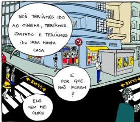
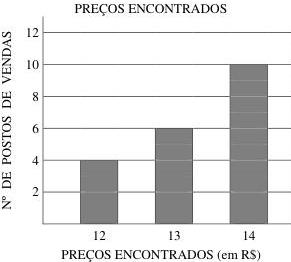

# PROVA — Camara_Asis_2014_Agente_Legislativo

## 1. Análise geral da prova

- **Identificação:** Camara_Asis_2014_Agente_Legislativo
- **Quantidade total de questões:** 50
- **Quantidade de textos de apoio (grupos):** 3
- **Quantidade de imagens:** 3
- **Quantidade de gráficos e tabelas:** incluídos nas imagens e no texto extraído, quando presentes no PDF original
- **Quantidade de grupos identificados:** 3
- **Quantidade de questões independentes:** 43
- **Questões que compartilham materiais:** texto-base das questões 12 a 14 → questões 12, 13, 14; texto-base das questões 18 a 19 → questões 18, 19; texto-base das questões 22 a 23 → questões 22, 23

### Transcrição integral da capa/instruções (conforme extraída do PDF)

> [!NOTE]
> Conteúdo integral das páginas anteriores à primeira questão, sem cortes.

> CÂMARA MUNICIPAL DE ASSIS
> ESTADO DE SÃO PAULO
>
> EDITAL Nº 008/2014 - CONCURSO PÚBLICO Nº 001/2014
>
> EDITAL DE DIVULGAÇÃO DA PROVA
>
> # PROVA - AGENTE LEGISLATIVO
>
> # EDITAL DE CONCURSO PÚBLICO Nº 01/2014
>
> # INSTRUÇÕES
>
> Você está recebendo a FOLHA DEFINITIVA DE RESPOSTAS e o CADERNO com 50 (cinquenta) questões. Leia cuidadosamente cada questão e escolha a resposta que você considera válida.
>
> Preencha com seu NOME e número do RG os espaços indicados na capa deste caderno. Assine a FOLHA DEFINITIVA DE RESPOSTAS com caneta de tinta azul ou preta.
>
> Marque, na FOLHA DEFINITIVA DE RESPOSTAS, com caneta de tinta azul ou preta, a letra correspondente à alternativa que você escolheu para cada uma das questões.
>
> A duração da prova é de 04 (quatro) horas.
>
> Você só poderá entregar a FOLHA DEFINITIVA DE RESPOSTAS e sair do prédio depois de transcorrida 01 (uma) hora do início da prova.
>
> O encerramento da prova dar-se-á na presença dos 03 (três) últimos candidatos.
>
> Ao sair, você NÃO levará este caderno de questões.
>
> Nome do candidato:
>
> RG:
>
>
>
>
>
>
>
> CÂMARA MUNICIPAL DE ASSIS
> ESTADO DE SÃO PAULO
>
> # FOLHA INTERMEDIÁRIA DE RESPOSTAS
>
> | | A | B | C | D |
> | --- | --- | --- | --- | --- |
> | 01 | ☐ | ☐ | ☐ | ☐ |
> | 02 | ☐ | ☐ | ☐ | ☐ |
> | 03 | ☐ | ☐ | ☐ | ☐ |
> | 04 | ☐ | ☐ | ☐ | ☐ |
> | 05 | ☐ | ☐ | ☐ | ☐ |
> | 06 | ☐ | ☐ | ☐ | ☐ |
> | 07 | ☐ | ☐ | ☐ | ☐ |
> | 08 | ☐ | ☐ | ☐ | ☐ |
> | 09 | ☐ | ☐ | ☐ | ☐ |
> | 10 | ☐ | ☐ | ☐ | ☐ |
> | 11 | ☐ | ☐ | ☐ | ☐ |
> | 12 | ☐ | ☐ | ☐ | ☐ |
> | 13 | ☐ | ☐ | ☐ | ☐ |
> | 14 | ☐ | ☐ | ☐ | ☐ |
> | 15 | ☐ | ☐ | ☐ | ☐ |
> | 16 | ☐ | ☐ | ☐ | ☐ |
> | 17 | ☐ | ☐ | ☐ | ☐ |
> | 18 | ☐ | ☐ | ☐ | ☐ |
> | 19 | ☐ | ☐ | ☐ | ☐ |
> | 20 | ☐ | ☐ | ☐ | ☐ |
> | 21 | ☐ | ☐ | ☐ | ☐ |
> | 22 | ☐ | ☐ | ☐ | ☐ |
> | 23 | ☐ | ☐ | ☐ | ☐ |
> | 24 | ☐ | ☐ | ☐ | ☐ |
> | 25 | ☐ | ☐ | ☐ | ☐ |
>
> | | A | B | C | D |
> | --- | --- | --- | --- | --- |
> | 26 | ☐ | ☐ | ☐ | ☐ |
> | 27 | ☐ | ☐ | ☐ | ☐ |
> | 28 | ☐ | ☐ | ☐ | ☐ |
> | 29 | ☐ | ☐ | ☐ | ☐ |
> | 30 | ☐ | ☐ | ☐ | ☐ |
> | 31 | ☐ | ☐ | ☐ | ☐ |
> | 32 | ☐ | ☐ | ☐ | ☐ |
> | 33 | ☐ | ☐ | ☐ | ☐ |
> | 34 | ☐ | ☐ | ☐ | ☐ |
> | 35 | ☐ | ☐ | ☐ | ☐ |
> | 36 | ☐ | ☐ | ☐ | ☐ |
> | 37 | ☐ | ☐ | ☐ | ☐ |
> | 38 | ☐ | ☐ | ☐ | ☐ |
> | 39 | ☐ | ☐ | ☐ | ☐ |
> | 40 | ☐ | ☐ | ☐ | ☐ |
> | 41 | ☐ | ☐ | ☐ | ☐ |
> | 42 | ☐ | ☐ | ☐ | ☐ |
> | 43 | ☐ | ☐ | ☐ | ☐ |
> | 44 | ☐ | ☐ | ☐ | ☐ |
> | 45 | ☐ | ☐ | ☐ | ☐ |
> | 46 | ☐ | ☐ | ☐ | ☐ |
> | 47 | ☐ | ☐ | ☐ | ☐ |
> | 48 | ☐ | ☐ | ☐ | ☐ |
> | 49 | ☐ | ☐ | ☐ | ☐ |
> | 50 | ☐ | ☐ | ☐ | ☐ |
>
>
>
>
>
>
>
>
> **CÂMARA MUNICIPAL DE ASSIS**
> **ESTADO DE SÃO PAULO**
>
> E para que chegue ao conhecimento de todos, expediu-se o presente Edital que será publicado e afixado nos locais públicos de costume, em cumprimento as exigências contidas no Edital 001/2014.
>
> Assis, 26 de maio de 2014.
>
> **DR. ARGEMIRO JOÃO RAZERA**
>
> *Presidente da Comissão Especial de Concurso Público*

### Gabarito

| Questão | 01 | 02 | 03 | 04 | 05 |
|---|---|---|---|---|---|
| Resposta | C | D | C | D | B |

| Questão | 06 | 07 | 08 | 09 | 10 |
|---|---|---|---|---|---|
| Resposta | D | C | D | A | C |

| Questão | 11 | 12 | 13 | 14 | 15 |
|---|---|---|---|---|---|
| Resposta | C | C | B | D | C |

| Questão | 16 | 17 | 18 | 19 | 20 |
|---|---|---|---|---|---|
| Resposta | B | ANULADA | D | B | A |

| Questão | 21 | 22 | 23 | 24 | 25 |
|---|---|---|---|---|---|
| Resposta | C | B | D | D | D |

| Questão | 26 | 27 | 28 | 29 | 30 |
|---|---|---|---|---|---|
| Resposta | C | B | B | A | A |

| Questão | 31 | 32 | 33 | 34 | 35 |
|---|---|---|---|---|---|
| Resposta | B | A | B | D | C |

| Questão | 36 | 37 | 38 | 39 | 40 |
|---|---|---|---|---|---|
| Resposta | B | A | C | A | ANULADA |

| Questão | 41 | 42 | 43 | 44 | 45 |
|---|---|---|---|---|---|
| Resposta | B | A | ANULADA | A | A |

| Questão | 46 | 47 | 48 | 49 | 50 |
|---|---|---|---|---|---|
| Resposta | D | C | B | C | D |

## 2. Questões agrupadas

### GRUPO 01 — Texto-base compartilhado pelas questões 12 a 14

**Questões relacionadas:** 12, 13, 14.

#### QUESTÃO 12

✅ **Gabarito: C** (gabarito oficial pareado — GABARITO OFICIAL - AGENTE LEGISLATIVO (Edital de Divulgação do Gabarito da Prova Objetiva Após Recurso, Concurso Público nº 001/2014))

**Material de apoio:**

Leia o texto abaixo para responder as questões 12, 13 e 14:

Solidão

Abri o livro e caiu dele uma flor seca. A julgar pelo tamanho das outras, faltavam duas pétalas. Que sofrimento levaria alguém a desistir no malmequer e sepultar esse destino num livro velho da Biblioteca Pública? Me deu vontade de olhar o nome na ficha de retiradas, talvez procurá-lo. Mas pensando bem, conhecer a sua dor para somar-se à minha não ajudaria a nenhum de nós. Arranquei mais uma pétala e guardei a flor no meio do livro. Seja feliz, meu amigo anônimo. (Disponível em: http://www.marcioabc.com.br/2009/07/14/ solidão-texto-de-leonardo-brasiliense/. Acesso em: 27 abr. 2014)

**Enunciado:**

Classifique o texto acima de acordo com o gênero textual a que pertence:

**Alternativas:**

A) relatório
B) descrição.
C) narração.
D) dissertação.

**Referências visuais:**

Nenhuma.

---

#### QUESTÃO 13

✅ **Gabarito: B** (gabarito oficial pareado — GABARITO OFICIAL - AGENTE LEGISLATIVO (Edital de Divulgação do Gabarito da Prova Objetiva Após Recurso, Concurso Público nº 001/2014))

**Material de apoio:**

Leia o texto abaixo para responder as questões 12, 13 e 14:

Solidão

Abri o livro e caiu dele uma flor seca. A julgar pelo tamanho das outras, faltavam duas pétalas. Que sofrimento levaria alguém a desistir no malmequer e sepultar esse destino num livro velho da Biblioteca Pública? Me deu vontade de olhar o nome na ficha de retiradas, talvez procurá-lo. Mas pensando bem, conhecer a sua dor para somar-se à minha não ajudaria a nenhum de nós. Arranquei mais uma pétala e guardei a flor no meio do livro. Seja feliz, meu amigo anônimo. (Disponível em: http://www.marcioabc.com.br/2009/07/14/ solidão-texto-de-leonardo-brasiliense/. Acesso em: 27 abr. 2014)

**Enunciado:**

De acordo com esse texto, assinale a resposta INCORRETA:

**Alternativas:**

A) As palavras “seca, velho, anônimo” são adjetivos.
B) As palavras “livro, retiradas, seja” são verbos.
C) As palavras “dele, alguém, esse, minha” são pronomes.
D) As palavras “livro, ficha, dor, amigo” são substantivos.

**Referências visuais:**

Nenhuma.

---

#### QUESTÃO 14

✅ **Gabarito: D** (gabarito oficial pareado — GABARITO OFICIAL - AGENTE LEGISLATIVO (Edital de Divulgação do Gabarito da Prova Objetiva Após Recurso, Concurso Público nº 001/2014))

**Material de apoio:**

Leia o texto abaixo para responder as questões 12, 13 e 14:

Solidão

Abri o livro e caiu dele uma flor seca. A julgar pelo tamanho das outras, faltavam duas pétalas. Que sofrimento levaria alguém a desistir no malmequer e sepultar esse destino num livro velho da Biblioteca Pública? Me deu vontade de olhar o nome na ficha de retiradas, talvez procurá-lo. Mas pensando bem, conhecer a sua dor para somar-se à minha não ajudaria a nenhum de nós. Arranquei mais uma pétala e guardei a flor no meio do livro. Seja feliz, meu amigo anônimo. (Disponível em: http://www.marcioabc.com.br/2009/07/14/ solidão-texto-de-leonardo-brasiliense/. Acesso em: 27 abr. 2014)

**Enunciado:**

A expressão destacada em: “Seja feliz, meu amigo anônimo” é:

**Alternativas:**

A) um aposto.
B) um objeto direto.
C) um adjunto adnominal.
D) um vocativo.

**Referências visuais:**

Nenhuma.

---

### GRUPO 02 — Texto-base compartilhado pelas questões 18 a 19

**Questões relacionadas:** 18, 19.

#### QUESTÃO 18

✅ **Gabarito: D** (gabarito oficial pareado — GABARITO OFICIAL - AGENTE LEGISLATIVO (Edital de Divulgação do Gabarito da Prova Objetiva Após Recurso, Concurso Público nº 001/2014))

**Material de apoio:**

Observe o cartum abaixo (PENNA, Luli. Aqui na esquina. Folha de S. Paulo, 28 abr.2014, online) para responder as questões 18 e 19.

**Enunciado:**

O tempo verbal da frase “Nós teríamos ido ao cinema, teríamos jantado e teríamos ido para minha casa”, no cartum abaixo, está no:

**Alternativas:**

A) pretérito perfeito do indicativo.
B) pretérito imperfeito do subjuntivo.
C) pretérito mais que imperfeito do indicativo.
D) futuro do pretérito do indicativo.

**Referências visuais:**

Nenhuma.

---

#### QUESTÃO 19

✅ **Gabarito: B** (gabarito oficial pareado — GABARITO OFICIAL - AGENTE LEGISLATIVO (Edital de Divulgação do Gabarito da Prova Objetiva Após Recurso, Concurso Público nº 001/2014))

**Material de apoio:**

Observe o cartum abaixo (PENNA, Luli. Aqui na esquina. Folha de S. Paulo, 28 abr.2014, online) para responder as questões 18 e 19.

**Enunciado:**

A expressão destacada na frase “E por que não foram?” está escrita de modo:

**Alternativas:**

A) incorreto, porque é uma pergunta direta.
B) correto, porque é uma pergunta direta.
C) incorreto, porque faltou acento circunflexo na palavra “que”.
D) correto, porque expressa ideia de incerteza.

**Referências visuais:**

Nenhuma.

---

### GRUPO 03 — Texto-base compartilhado pelas questões 22 a 23

**Questões relacionadas:** 22, 23.

#### QUESTÃO 22

✅ **Gabarito: B** (gabarito oficial pareado — GABARITO OFICIAL - AGENTE LEGISLATIVO (Edital de Divulgação do Gabarito da Prova Objetiva Após Recurso, Concurso Público nº 001/2014))

**Material de apoio:**

Com base no texto abaixo “Mamãezinha querida”, de Fernando Bonassi (Folha de S. Paulo, 17 jan. 1998, cad. 4, col. Da rua, p.2), responda as questões 22 e 23.

As dores da mãe. Os choros da mãe. Os churros da mãe. As rugas da mãe. As rusgas da mãe.
O feijão da mãe. O irmão da mãe. As descargas da mãe. As anáguas da mãe. As saias da mãe. Os seios da mãe.
A comida da mãe. A cômoda da mãe. Os períodos da mãe. Os parágrafos da mãe. As manhas da mãe. As manhãs da mãe. A culpa da mãe.
A capa da mãe. O homem da mãe. Os outros homens da mãe. Os segredos da mãe. Os sagrados da mãe. A fruta da mãe. Os frutos da mãe...filhos, espíritos soltos.

**Enunciado:**

Os conjuntos de palavras choros/churros; rugas/rusgas; manhas/manhãs; segredos/ sagrados são:

**Alternativas:**

A) adjetivos.
B) substantivos.
C) verbos.
D) sujeitos.

**Referências visuais:**

Nenhuma.

---

#### QUESTÃO 23

✅ **Gabarito: D** (gabarito oficial pareado — GABARITO OFICIAL - AGENTE LEGISLATIVO (Edital de Divulgação do Gabarito da Prova Objetiva Após Recurso, Concurso Público nº 001/2014))

**Material de apoio:**

Com base no texto abaixo “Mamãezinha querida”, de Fernando Bonassi (Folha de S. Paulo, 17 jan. 1998, cad. 4, col. Da rua, p.2), responda as questões 22 e 23.

As dores da mãe. Os choros da mãe. Os churros da mãe. As rugas da mãe. As rusgas da mãe.
O feijão da mãe. O irmão da mãe. As descargas da mãe. As anáguas da mãe. As saias da mãe. Os seios da mãe.
A comida da mãe. A cômoda da mãe. Os períodos da mãe. Os parágrafos da mãe. As manhas da mãe. As manhãs da mãe. A culpa da mãe.
A capa da mãe. O homem da mãe. Os outros homens da mãe. Os segredos da mãe. Os sagrados da mãe. A fruta da mãe. Os frutos da mãe...filhos, espíritos soltos.

**Enunciado:**

Ainda com base no texto acima, aponte o tipo de relação que há entre as seguintes expressões: “As anáguas da mãe. As saias da mãe. (...) A comida da mãe. A cômoda da mãe”.

**Alternativas:**

A) ideia de consumismo.
B) ideia de amor.
C) ideia de maternidade.
D) ideia de posse.

**Referências visuais:**

Nenhuma.

---

## 3. Questões independentes

#### QUESTÃO 01

✅ **Gabarito: C** (gabarito oficial pareado — GABARITO OFICIAL - AGENTE LEGISLATIVO (Edital de Divulgação do Gabarito da Prova Objetiva Após Recurso, Concurso Público nº 001/2014))

**Enunciado:**

Dentre as seguintes frases, assinale aquela que não contém ambiguidade:

**Alternativas:**

A) Peguei o ônibus correndo.
B) O guarda deteve o suspeito em sua casa.
C) Esta palavra pode ter mais de um sentido.
D) O menino viu o incêndio do prédio.

**Referências visuais:**

Nenhuma.

---

#### QUESTÃO 02

✅ **Gabarito: D** (gabarito oficial pareado — GABARITO OFICIAL - AGENTE LEGISLATIVO (Edital de Divulgação do Gabarito da Prova Objetiva Após Recurso, Concurso Público nº 001/2014))

**Enunciado:**

Marque a alternativa que complete CORRETAMENTE a seguinte frase:

Diga ____ elas que estejam daqui ____ pouco ____ porta da biblioteca.

**Alternativas:**

A) à - há - a.
B) a - há - à.
C) à - a - a.
D) a - a - à.

**Referências visuais:**

Nenhuma.

---

#### QUESTÃO 03

✅ **Gabarito: C** (gabarito oficial pareado — GABARITO OFICIAL - AGENTE LEGISLATIVO (Edital de Divulgação do Gabarito da Prova Objetiva Após Recurso, Concurso Público nº 001/2014))

**Enunciado:**

O Português é a língua oficial do Brasil e de países como Portugal e Angola. Evidentemente, observam-se variações não apenas de país para país, mas dentro do próprio Brasil. Além disso, as variações não se dão apenas em função da localização geográfica. Identifique, no texto abaixo, retirado da música Só o Ôme, de Noriel Vilela, qual o tipo de variação linguística.

Ah mô fio do jeito que suncê tá
Só o ôme é que pode ti ajudá
Ah mô fio do jeito que suncê tá
Só o ôme é que pode ti ajuda.

**Alternativas:**

A) variação regional.
B) variação estilística.
C) variação social.
D) variação situacional.

**Referências visuais:**

Nenhuma.

---

#### QUESTÃO 04

✅ **Gabarito: D** (gabarito oficial pareado — GABARITO OFICIAL - AGENTE LEGISLATIVO (Edital de Divulgação do Gabarito da Prova Objetiva Após Recurso, Concurso Público nº 001/2014))

**Enunciado:**

O que faz com que a palavra “porque” se torne um substantivo e seja acentuada na frase “ Dê-me um porquê de sua falta ao trabalho ontem” é um:

**Alternativas:**

A) verbo.
B) pronome.
C) artigo definido.
D) artigo indefinido.

**Referências visuais:**

Nenhuma.

---

#### QUESTÃO 05

✅ **Gabarito: B** (gabarito oficial pareado — GABARITO OFICIAL - AGENTE LEGISLATIVO (Edital de Divulgação do Gabarito da Prova Objetiva Após Recurso, Concurso Público nº 001/2014))

**Enunciado:**

Em que alternativa o termo destacado indica aproximação:

**Alternativas:**

A) Ao visitar uma cidade desconhecida, vibrava.
B) Tinha, na época, uns dezoito anos.
C) Ao aproximar de uma garota bonita, seus olhos brilhavam.
D) Não havia um só homem corajoso naquela guerra.

**Referências visuais:**

Nenhuma.

---

#### QUESTÃO 06

✅ **Gabarito: D** (gabarito oficial pareado — GABARITO OFICIAL - AGENTE LEGISLATIVO (Edital de Divulgação do Gabarito da Prova Objetiva Após Recurso, Concurso Público nº 001/2014))

**Enunciado:**

Assinale a alternativa que complete CORRETAMENTE as frases abaixo:

I- Espero que se _______ as taxas de juro.
II- É importante que se _______ outras soluções para o problema.
III- Não se _______ em pessoas que não nos olham nos olhos.
IV- A verdade é que _______ certos pormenores pouco convincentes.

**Alternativas:**

A) mantenha; busque; confiam; observaram.
B) mantenham; busquem; confiam; observou.
C) mantenham; busque; confiam; observaram.
D) mantenham; busque; confia; observaram.

**Referências visuais:**

Nenhuma.

---

#### QUESTÃO 07

✅ **Gabarito: C** (gabarito oficial pareado — GABARITO OFICIAL - AGENTE LEGISLATIVO (Edital de Divulgação do Gabarito da Prova Objetiva Após Recurso, Concurso Público nº 001/2014))

**Enunciado:**

O texto abaixo tem sido muito divulgado na internet, em vários sites.

“Um homem rico estava muito mal, agonizando. Pediu papel e caneta. Escreveu assim: 'Deixo meus bens a minha irmã não a meu sobrinho jamais será paga a conta do padeiro nada dou aos pobres'. Ele morreu antes de fazer a pontuação”.

Para ele deixar ao padeiro, o texto deverá ser pontuado assim:

**Alternativas:**

A) Deixo meus bens à minha irmã? Não! A meu sobrinho. Jamais será paga a conta do padeiro. Nada dou aos pobres.
B) Deixo meus bens à minha irmã. Não a meu sobrinho. Jamais será paga a conta do padeiro. Nada dou aos pobres.
C) Deixo meus bens à minha irmã? Não! A meu sobrinho? Jamais! Será paga a conta do padeiro. Nada dou aos pobres.
D) Deixo meus bens à minha irmã? Não! A meu sobrinho? Jamais será paga a conta do padeiro. Nada dou aos pobres.

**Referências visuais:**

Nenhuma.

---

#### QUESTÃO 08

✅ **Gabarito: D** (gabarito oficial pareado — GABARITO OFICIAL - AGENTE LEGISLATIVO (Edital de Divulgação do Gabarito da Prova Objetiva Após Recurso, Concurso Público nº 001/2014))

**Enunciado:**

Na coesão sequencial temporal, a informação progride por meio de conectores que estabelecem a marcação de tempo. Sendo assim, marque a alternativa em que os conectores destacados promovem este tipo de coesão.

**Alternativas:**

A) Na 2ª feira, irei a faculdade. Lá, direi ao coordenador do curso que trancarei a matrícula.
B) Embora tenha estudado, não me sinto preparado para fazer a prova agora.
C) Fui à feira no domingo. Lá, comprei verduras.
D) Antes, eu estava preocupado com a nota da prova. Agora, estou tentando ficar mais calmo.

**Referências visuais:**

Nenhuma.

---

#### QUESTÃO 09

✅ **Gabarito: A** (gabarito oficial pareado — GABARITO OFICIAL - AGENTE LEGISLATIVO (Edital de Divulgação do Gabarito da Prova Objetiva Após Recurso, Concurso Público nº 001/2014))

**Enunciado:**

Que processo linguístico aparece nesta frase: “O português é uma língua muito difícil, tanto que calça é uma coisa que se bota, e bota é uma coisa que se calça”. (Barão de Itararé, 1895-1971).

**Alternativas:**

A) polissemia
B) antônimo
C) formação ideológica
D) intertextualidade

**Referências visuais:**

Nenhuma.

---

#### QUESTÃO 10

✅ **Gabarito: C** (gabarito oficial pareado — GABARITO OFICIAL - AGENTE LEGISLATIVO (Edital de Divulgação do Gabarito da Prova Objetiva Após Recurso, Concurso Público nº 001/2014))

**Enunciado:**

“Uma pessoa é também uma sala em que se entra – às vezes para sair com a esperança de um dia encontrar a porta aberta.” (CUENCA, J. P. Duas salas de museu, Folha de S. Paulo, 01 maio 2014, cad. Turismo, p.6)

O texto acima:

I. é uma metáfora.
II. relaciona-se com casamento bem-sucedido
III. é uma comparação.
IV. IV-relaciona-se predominantemente com a possibilidade de um divórcio.
V. relaciona-se com uma paixão avassaladora.

Estão corretas as seguintes afirmações:

**Alternativas:**

A) I, II e IV.
B) I e V.
C) I e IV.
D) II e III.

**Referências visuais:**

Nenhuma.

---

#### QUESTÃO 11

✅ **Gabarito: C** (gabarito oficial pareado — GABARITO OFICIAL - AGENTE LEGISLATIVO (Edital de Divulgação do Gabarito da Prova Objetiva Após Recurso, Concurso Público nº 001/2014))

**Enunciado:**

Observe o texto abaixo (Folha de S. Paulo, 28 ago. 2012, cad. Ilustríssima, p.6).

Em seu título “Processo criativo”, ocorre uma:

**Alternativas:**

A) intertextualidade.
B) paródia.
C) ironia.
D) polissemia.

**Referências visuais:**

---

#### QUESTÃO 15

✅ **Gabarito: C** (gabarito oficial pareado — GABARITO OFICIAL - AGENTE LEGISLATIVO (Edital de Divulgação do Gabarito da Prova Objetiva Após Recurso, Concurso Público nº 001/2014))

**Enunciado:**

“MATTE A VONTADE. MATTE LEÃO”

Esse enunciado faz parte de uma propaganda afixada

em lugares nos quais se vende o chá Matte Leão. Observe as construções a seguir, feitas a partir do enunciado em questão.

I – Matte à vontade.
II – Mate a vontade.
III – Mate à vontade.

Leia agora estas proposições a fim de responder a questão 15:

1- No item I, a expressão indica que o leitor pode tomar chá Matte o quanto quiser.
2- Nos itens II e III possuem o mesmo sentido, indicando que o leitor deve consumir bastante o chá mate.
3- Os itens I e III são categóricos ao afirmar que o leitor precisa matar o desejo de ingerir o chá.
4- No item II, a frase sugere que o leitor realize o seu desejo, que mate essa vontade que o martiriza.
5- O item III diz respeito ao ato de matar, ou seja, tirar a vida de um ser vivo.

Assinale a proposição CORRETA:

**Alternativas:**

A) Só a proposição 1 é correta.
B) Só a proposição 4 é correta.
C) São corretas as proposições 1, 4 e 5.
D) São corretas as proposições 1 e 5.

**Referências visuais:**

Nenhuma.

---

#### QUESTÃO 16

✅ **Gabarito: B** (gabarito oficial pareado — GABARITO OFICIAL - AGENTE LEGISLATIVO (Edital de Divulgação do Gabarito da Prova Objetiva Após Recurso, Concurso Público nº 001/2014))

**Enunciado:**

Leia o texto abaixo e assinale a questão que tenha relação com a sua mensagem:

“Toda pessoa sempre é a marca
Das lições diárias de outras tantas pessoas
E é tão bonito quando a gente entende que a gente é tanta gente
aonde quer que vá.
É tão bonito quando a gente sente
Que nunca está sozinho por mais que pense estar...”
(Música Caminhos do coração, de Gonzaguinha)

**Alternativas:**

A) “A união faz a força.”
B) “Nenhum homem é uma ilha.”
C) “Água mole em pedra dura tanto bate até que fura.”
D) “Vamos pra frente que atrás vem gente.”

**Referências visuais:**

Nenhuma.

---

#### QUESTÃO 17

⚠️ **Gabarito: ANULADA**

**Enunciado:**

Aponte a opção que completa CORRETAMENTE as lacunas da frase abaixo:

A ocorrência de interferências _____ -nos a concluir que _____ uma relação profunda entre homem e sociedade que os torna _____ mutuamente dependentes.

**Alternativas:**

A) leva – existe – torna.
B) levam – existe – tornam.
C) levam – existem – tornam.
D) leva – existe – tornam.

**Referências visuais:**

Nenhuma.

---

#### QUESTÃO 20

✅ **Gabarito: A** (gabarito oficial pareado — GABARITO OFICIAL - AGENTE LEGISLATIVO (Edital de Divulgação do Gabarito da Prova Objetiva Após Recurso, Concurso Público nº 001/2014))

**Enunciado:**

Complete a frase abaixo, de modo que ela fique correta:

Os meios de comunicação evoluíram rapidamente a partir do século XX. Daqui _____ alguns anos, os homens ainda se lembrarão do bate-papo, das conversas informais que, _____ muito tempo, _____ sendo importantes formas de comunicação?

**Alternativas:**

A) a - há – vêm.
B) há - há - veem.
C) há - a - vêm.
D) à - a - vem.

**Referências visuais:**

Nenhuma.

---

#### QUESTÃO 21

✅ **Gabarito: C** (gabarito oficial pareado — GABARITO OFICIAL - AGENTE LEGISLATIVO (Edital de Divulgação do Gabarito da Prova Objetiva Após Recurso, Concurso Público nº 001/2014))

**Enunciado:**

Em que conjunto de palavras a letra X apresenta o mesmo valor fonético?

**Alternativas:**

A) exame – exíguo – xale – exceção.
B) exilar – exorbitar – próximo – excêntrico.
C) sexo – tóxico – axilas – nexo.
D) trouxe- texto – sintaxe - léxico.

**Referências visuais:**

Nenhuma.

---

#### QUESTÃO 24

✅ **Gabarito: D** (gabarito oficial pareado — GABARITO OFICIAL - AGENTE LEGISLATIVO (Edital de Divulgação do Gabarito da Prova Objetiva Após Recurso, Concurso Público nº 001/2014))

**Enunciado:**

Complete a frase abaixo, de modo que ela fique CORRETA:

_____ 7h, Paulo chegou _____ loja. Somente _____ 7h30m, que ficou sabendo que _____ partir de hoje, estavam suspensas todas _____ compras, _____ prazo ou _____ vista.

**Alternativas:**

A) Ás- a – às – à – as – a – à.
B) As- à – às – a – as – à – à.
C) Às- a – às – a – as – à – à.
D) Às- à – às – a – as – a – à.

**Referências visuais:**

Nenhuma.

---

#### QUESTÃO 25

✅ **Gabarito: D** (gabarito oficial pareado — GABARITO OFICIAL - AGENTE LEGISLATIVO (Edital de Divulgação do Gabarito da Prova Objetiva Após Recurso, Concurso Público nº 001/2014))

**Enunciado:**

Assinale a alternativa em que todas as palavras devem ser escritas com a letra indicada entre parênteses:

**Alternativas:**

A) ...afariz - pra...e - me...er - en...ada (x).
B) pr...vilégio - discr...ção - ...mpecilho (i).
C) obse...ão - a...ucena - distor...ão - inso...o (ç).
D) ojeri...a - finali...ar - prima...ia - bu...ina (z).

**Referências visuais:**

Nenhuma.

---

#### QUESTÃO 26

✅ **Gabarito: C** (gabarito oficial pareado — GABARITO OFICIAL - AGENTE LEGISLATIVO (Edital de Divulgação do Gabarito da Prova Objetiva Após Recurso, Concurso Público nº 001/2014))

**Enunciado:**

Qual a alternativa que completa CORRETAMENTE os períodos abaixo?

Não sei de onde _____ os recursos a serem aplicados na solução do problema. É preciso que aquele que _____ o poder de decidir como e onde aplicar tão grande soma de dinheiro saiba discernir os aspectos que _____ prioridade. (provir - deter - ter)

**Alternativas:**

A) provém; detém; têm.
B) provém; detem; têm.
C) provêm; detém; têm.
D) provém; detêm; têm.

**Referências visuais:**

Nenhuma.

---

#### QUESTÃO 27

✅ **Gabarito: B** (gabarito oficial pareado — GABARITO OFICIAL - AGENTE LEGISLATIVO (Edital de Divulgação do Gabarito da Prova Objetiva Após Recurso, Concurso Público nº 001/2014))

**Enunciado:**

Marcelo decide enviar um e-mail de boas-vindas ao novo diretor de marketing do Grupo Oregan, empresa em que trabalha. Ele será simpático e correto no uso do idioma se escrever:

**Alternativas:**

A) Comprimento a vinda ao Grupo.
B) Bem-vindo ao Grupo Oregan.
C) Seja benvindo ao Oregan.
D) Benvindo ao Oregan.

**Referências visuais:**

Nenhuma.

---

#### QUESTÃO 28

✅ **Gabarito: B** (gabarito oficial pareado — GABARITO OFICIAL - AGENTE LEGISLATIVO (Edital de Divulgação do Gabarito da Prova Objetiva Após Recurso, Concurso Público nº 001/2014))

**Enunciado:**

Os sinônimos de seção, sessão e cessão são, respectivamente:

**Alternativas:**

A) espaço de tempo; divisão; ato de ceder.
B) divisão; espaço de tempo; ato de ceder.
C) espaço de tempo; corte em um objeto; divisão.
D) corte em um objeto; divisão; ato de ceder.

**Referências visuais:**

Nenhuma.

---

#### QUESTÃO 29

✅ **Gabarito: A** (gabarito oficial pareado — GABARITO OFICIAL - AGENTE LEGISLATIVO (Edital de Divulgação do Gabarito da Prova Objetiva Após Recurso, Concurso Público nº 001/2014))

**Enunciado:**

Em uma reunião, uma estagiária não entende a conversa entre advogados sobre um tipo de comportamento. Uns falam em **discriminação**, e outros em **descriminação**. Em relação a essas palavras de grafia tão parecida, pode-se afirmar que:

**Alternativas:**

A) a primeira se refere a segregar, e a segunda a não considerar alguma atitude como crime.
B) as duas têm o mesmo sentido, mas os mais cultos preferem descriminação.
C) a primeira está errada; o certo é discriminalização.
D) discriminação é o termo que os advogados usam em lugar de discrição.

**Referências visuais:**

Nenhuma.

---

#### QUESTÃO 30

✅ **Gabarito: A** (gabarito oficial pareado — GABARITO OFICIAL - AGENTE LEGISLATIVO (Edital de Divulgação do Gabarito da Prova Objetiva Após Recurso, Concurso Público nº 001/2014))

**Enunciado:**

Assinale a alternativa que complete corretamente as frases abaixo:

- I- Após ____ discussão, todos se reconciliaram e saíram juntos para assistir ____ apresentação de dança.
- II- ____ partir de hoje, estão suspensas todas ____ compras, ____ prazo ou ____ vista.

**Alternativas:**

A) a – à – a – as – a – à.
B) a – à – a – as – à – a.
C) a – à – à – as – a – à.
D) a – à – a – às – a – a.

**Referências visuais:**

Nenhuma.

---

#### QUESTÃO 31

✅ **Gabarito: B** (gabarito oficial pareado — GABARITO OFICIAL - AGENTE LEGISLATIVO (Edital de Divulgação do Gabarito da Prova Objetiva Após Recurso, Concurso Público nº 001/2014))

**Enunciado:**

Para não esquecer a senha de seu cartão de crédito que é formada por quatro algarismos, uma pessoa escreveu os números, da senha, do seguinte modo:

( x + 1 ) ( x + 2 ) x ( 2 x – 1 )
1º número 2º número 3º número 4º número

Sabendo-se que o valor de x é dado pela expressão:

$$\left( \sqrt{\frac{\sqrt{25 - (-3)^2}}{\sqrt[3]{8} \cdot \left(-\frac{1}{5}\right)^{-2} \cdot 2}} \right)^{-1}$$

Então a senha dessa pessoa é:

**Alternativas:**

A) 5679
B) 6759
C) 7956
D) 9756

**Referências visuais:**

Nenhuma.

---

#### QUESTÃO 32

✅ **Gabarito: A** (gabarito oficial pareado — GABARITO OFICIAL - AGENTE LEGISLATIVO (Edital de Divulgação do Gabarito da Prova Objetiva Após Recurso, Concurso Público nº 001/2014))

**Enunciado:**

Camila deseja aplicar um determinado valor, em uma aplicação que paga uma taxa de juros simples de 30% ao ano e quer resgatar, ao final dessa aplicação, um valor 50% maior do que ela aplicou. Para que isso ocorra, Camila deverá deixar esse valor aplicado por:

**Alternativas:**

A) 20 meses
B) 12 meses
C) 24 meses
D) 18 meses

**Referências visuais:**

Nenhuma.

---

#### QUESTÃO 33

✅ **Gabarito: B** (gabarito oficial pareado — GABARITO OFICIAL - AGENTE LEGISLATIVO (Edital de Divulgação do Gabarito da Prova Objetiva Após Recurso, Concurso Público nº 001/2014))

**Enunciado:**

Um relógio bate a cada 15 minutos, outro relógio bate a cada 25 minutos e um terceiro relógio bate a cada 40 minutos. Se num certo instante os três relógios baterem ao mesmo tempo, após quanto tempo os três irão bater outra vez simultaneamente?

**Alternativas:**

A) 1 hora
B) 10 horas
C) 20 horas
D) 30 horas

**Referências visuais:**

Nenhuma.

---

#### QUESTÃO 34

✅ **Gabarito: D** (gabarito oficial pareado — GABARITO OFICIAL - AGENTE LEGISLATIVO (Edital de Divulgação do Gabarito da Prova Objetiva Após Recurso, Concurso Público nº 001/2014))

**Enunciado:**

Ao pesquisar o preço de um determinado produto em 20 postos de vendas, encontraram-se 3 preços diferentes, sendo a distribuição representada em um gráfico:

Considerando esses 20 postos de vendas, o preço médio do produto é igual a:

**Alternativas:**

A) R$ 13,00
B) R$ 13,10
C) R$ 13,20
D) R$ 13,30

**Referências visuais:**

---

#### QUESTÃO 35

✅ **Gabarito: C** (gabarito oficial pareado — GABARITO OFICIAL - AGENTE LEGISLATIVO (Edital de Divulgação do Gabarito da Prova Objetiva Após Recurso, Concurso Público nº 001/2014))

**Enunciado:**

Uma torneira despejando água numa vazão 60 litros por minuto leva 3 horas para encher um reservatório. Quanto tempo essa torneira levaria para encher esse reservatório se a vazão fosse de 80 litros por minuto?

**Alternativas:**

A) 4 horas
B) 2 horas e 25 minutos
C) 2 horas e 15 minutos
D) 2 horas

**Referências visuais:**

Nenhuma.

---

#### QUESTÃO 36

✅ **Gabarito: B** (gabarito oficial pareado — GABARITO OFICIAL - AGENTE LEGISLATIVO (Edital de Divulgação do Gabarito da Prova Objetiva Após Recurso, Concurso Público nº 001/2014))

**Enunciado:**

Uma professora deu aos seus alunos uma folha de papel retangular com 1 m de comprimento e 80 cm de largura, para que seja recortada em quadrados iguais, de sorte que não haja sobra de papel e que os quadrados, recortados, tenham o maior tamanho possível. Qual será a área de cada um destes quadrados?

**Alternativas:**

A) 200 cm²
B) 400 cm²
C) 600 cm²
D) 800 cm²

**Referências visuais:**

Nenhuma.

---

#### QUESTÃO 37

✅ **Gabarito: A** (gabarito oficial pareado — GABARITO OFICIAL - AGENTE LEGISLATIVO (Edital de Divulgação do Gabarito da Prova Objetiva Após Recurso, Concurso Público nº 001/2014))

**Enunciado:**

Na maquete de uma praça pública construída na escala 1:75, o edifício da prefeitura, de 13,5 m de altura, está representado com uma altura de:

**Alternativas:**

A) 18 cm
B) 20 cm
C) 22 cm
D) 24 cm

**Referências visuais:**

Nenhuma.

---

#### QUESTÃO 38

✅ **Gabarito: C** (gabarito oficial pareado — GABARITO OFICIAL - AGENTE LEGISLATIVO (Edital de Divulgação do Gabarito da Prova Objetiva Após Recurso, Concurso Público nº 001/2014))

**Enunciado:**

Três homens, Carlos, Luís e Paulo, são casados com Lúcia, Maria e Patrícia, mas não sabemos quem é casado com quem. Eles trabalham com Engenharia, Advocacia e Medicina, mas também não sabemos quem faz o quê. Só sabemos que:

- o médico é casado com Maria.
- Paulo é advogado.
- Patrícia não é casada com Paulo
- Carlos não é médico.

Com base nestas informações, podemos afirmar que:

**Alternativas:**

A) Carlos é casado com Lúcia.
B) Luís é casado com Patrícia.
C) Carlos é engenheiro.
D) Luís é engenheiro.

**Referências visuais:**

Nenhuma.

---

#### QUESTÃO 39

✅ **Gabarito: A** (gabarito oficial pareado — GABARITO OFICIAL - AGENTE LEGISLATIVO (Edital de Divulgação do Gabarito da Prova Objetiva Após Recurso, Concurso Público nº 001/2014))

**Enunciado:**

Maria comprou 30 balas e 18 chocolates para distribuir entre seus três filhos, mas não os distribuiu igualmente. O filho mais velho recebeu igual número de balas e chocolates, enquanto que o filho do meio ganhou 5 balas a mais do que chocolates. O número de balas que o filho caçula ganhou correspondeu ao dobro do número de chocolates. Sabendo-se que os dois filhos mais novos de Maria ganharam a mesma quantidade de chocolates, quantas balas couberam ao filho mais velho?

**Alternativas:**

A) 4
B) 7
C) 8
D) 11

**Referências visuais:**

Nenhuma.

---

#### QUESTÃO 40

⚠️ **Gabarito: ANULADA**

**Enunciado:**

Uma escola lançou uma campanha para seus alunos arrecadarem, durante 30 dias, alimentos não perecíveis para doar a uma comunidade carente da região. Vinte alunos aceitaram a tarefa e nos primeiros 10 dias trabalharam 3 horas diárias, arrecadando 120 kg de alimentos por dia. Animados com os resultados, 30 novos alunos somaram-se ao grupo e passaram a trabalhar 4 horas por dia nos dias seguintes até o término campanha.

Admitindo-se que o ritmo de coleta tenha se mantido constante, a quantidade de alimentos arrecadados ao final do prazo estipulado seria de:

**Alternativas:**

A) 720 kg
B) 600 kg
C) 800 kg
D) 920 kg

**Referências visuais:**

Nenhuma.

---

#### QUESTÃO 41

✅ **Gabarito: B** (gabarito oficial pareado — GABARITO OFICIAL - AGENTE LEGISLATIVO (Edital de Divulgação do Gabarito da Prova Objetiva Após Recurso, Concurso Público nº 001/2014))

**Enunciado:**

Veja a letra da música **Cálice**, de Chico Buarque (Disponível em: http://letras.mus.br/chico-buarque/45121. Acesso em: 02 maio 2014)

*[...] Como é difícil acordar calado
Se na calada da noite eu me dano
Quero lançar um grito desumano
Que é uma maneira de ser escutado
Esse silêncio todo me atordoa
Atordoado eu permaneço atento
Na arquibancada, pra a qualquer momento
Ver emergir o monstro da lagoa
Pai! Afasta de mim esse cálice
Pai! Afasta de mim esse cálice
Pai! Afasta de mim esse cálice
De vinho tinto de sangue [...]*

Pode-se relacionar esse trecho musical com:

**Alternativas:**

A) o preconceito homofóbico existente em certas regiões do Brasil.
B) a participação dos brasileiros nas passeadas ocorridas no final do 1º semestre e início do segundo semestre de 2013.
C) a falta de fé em Deus de muitas pessoas.
D) o movimento “Revalida, sim!”

**Referências visuais:**

Nenhuma.

---

#### QUESTÃO 42

✅ **Gabarito: A** (gabarito oficial pareado — GABARITO OFICIAL - AGENTE LEGISLATIVO (Edital de Divulgação do Gabarito da Prova Objetiva Após Recurso, Concurso Público nº 001/2014))

**Enunciado:**

A explosão às 6h da manhã arranca uma camada de 9 m de espessura do bloco de migmatito numa área de 750 m² que já foi a morada de árvores centenárias na zona rural de Altamira e Vitória do Xingu (PA). Assentada a poeira, resta uma montanha de fragmentos dessa rocha dura, aparentada com o granito. À meia-noite, nem um pedregulho estará mais ali.

O ritmo frenético de homens e máquinas marca a construção de um canal de 20 km de comprimento, para dar passagem aos 14 milhões de litros de água por segundo desviados do rio _______ – vazão quase 530 vezes maior que a do canal principal de transposição do _______ – que vão movimentar as turbinas da terceira maior hidrelétrica do mundo, e também uma das mais controversas: _______, da empresa Norte Energia S.A. (Disponível em: http://arte.folha.uol.com.br/especiais/2013/12/16/XXXXXX-adaptado. Acesso em: 28 abr. 2014)

A alternativa que completa CORRETAMENTE o texto acima é:

**Alternativas:**

A) Xingu, São Francisco, Belo Monte, respectivamente.
B) Madeira, São Francisco, Belo Monte, respectivamente.
C) Xingu, São Francisco, Belmonte, respectivamente.
D) São Francisco, Madeira, Belo Monte, respectivamente.

**Referências visuais:**

Nenhuma.

---

#### QUESTÃO 43

⚠️ **Gabarito: ANULADA**

**Enunciado:**

A presidente Dilma Rousseff disse no dia 25/04/2014 que, em seu governo, "a carne de pernil está muito bem distribuída no Brasil". A declaração foi dada em evento na cidade de Barcarena (a 106 km de Belém), após o governador Simão Jatene (PSDB) ter afirmado que tinha passado da hora de o Norte do país receber "apenas o osso". (Disponível em: http://www1.folha.uol.com.br/poder/2014/04/1445435-carne-de-pernil-e-bem-distribuida-diz-dilma-em-resposta-a-tucano.shtml-adaptado. Acesso em: 28 abr. 2014)

A expressão “carne de pernil” sugere que:

**Alternativas:**

A) A presidente Dilma afirmou que vem de uma região que tem a carne por excelência [Rio Grande do Sul]. E “que lá se sabe que a carne com osso é boa”.
B) A presidente Dilma afirmou que no Rio Grande do Sul, sua terra, churrasco se faz com carne muito boa.
C) A afirmação do governador Simão Jatene se refere à semelhança do mapa do Brasil a um pernil.
D) Na cidade de Barcarena, a presidente Dilma afirmou que tinha passado da hora de o Norte do país receber "apenas o osso".

**Referências visuais:**

Nenhuma.

---

#### QUESTÃO 44

✅ **Gabarito: A** (gabarito oficial pareado — GABARITO OFICIAL - AGENTE LEGISLATIVO (Edital de Divulgação do Gabarito da Prova Objetiva Após Recurso, Concurso Público nº 001/2014))

**Enunciado:**

O Paço Municipal de Assis recebe o seguinte nome:

**Alternativas:**

A) “Profª Judith de Oliveira Garcez”.
B) “José Bolfarini”.
C) “Jorge Alves de Oliveira”.
D) “José Santilli Sobrinho”.

**Referências visuais:**

Nenhuma.

---

#### QUESTÃO 45

✅ **Gabarito: A** (gabarito oficial pareado — GABARITO OFICIAL - AGENTE LEGISLATIVO (Edital de Divulgação do Gabarito da Prova Objetiva Após Recurso, Concurso Público nº 001/2014))

**Enunciado:**

Os grandes inimigos da ditadura, _______ e _______, foram assassinados friamente pela repressão quando poderiam ter sido presos. Marighella, inclusive, estava desarmado quando foi emboscado pela equipe do _______, com cerca de 30 policiais, em novembro de 1969. Lamarca estava subnutrido e sem nenhuma condição de combate quando foi executado no sertão da Bahia, em 1971. (Disponível em: http://noticias.universia.com.br/ en-portada/noticia/2014/03/31/1092346/50-coisas-todo-estudante-deve-saber-ditadura-militar.html- adaptado. Acesso em: 28 abr. 2014).

Qual a alternativa que completa CORRETAMENTE o período acima?

**Alternativas:**

A) Carlos Marighella e Carlos Lamarca; delegado Sérgio Fleury.
B) Carlos Lamarca e Rubens Paiva; delegado Sérgio Fleury.
C) Vladimir Herzog e Carlos Lamarca; delegado Sérgio Fleury.
D) Carlos Marighella e Celso Lamarca; delegado Sérgio Fleury Filho.

**Referências visuais:**

Nenhuma.

---

#### QUESTÃO 46

✅ **Gabarito: D** (gabarito oficial pareado — GABARITO OFICIAL - AGENTE LEGISLATIVO (Edital de Divulgação do Gabarito da Prova Objetiva Após Recurso, Concurso Público nº 001/2014))

**Enunciado:**

A Lei Orgânica do Município de Assis é promulgada:

**Alternativas:**

A) Pelo Prefeito Municipal.
B) Pelos vereadores da Câmara Municipal e pelo Prefeito Municipal.
C) Pelo Presidente da Câmara Municipal.
D) Pelos vereadores da Câmara Municipal.

**Referências visuais:**

Nenhuma.

---

#### QUESTÃO 47

✅ **Gabarito: C** (gabarito oficial pareado — GABARITO OFICIAL - AGENTE LEGISLATIVO (Edital de Divulgação do Gabarito da Prova Objetiva Após Recurso, Concurso Público nº 001/2014))

**Enunciado:**

O Ato Institucional que proibiu manifestações, suspendeu direitos políticos e deu ao presidente o poder de intervir em estados e municípios. Também vetou o habeas corpus para crimes políticos e instalou a censura militar foi o:

**Alternativas:**

A) AI- 2.
B) AI- 3.
C) AI- 5.
D) AI- 4.

**Referências visuais:**

Nenhuma.

---

#### QUESTÃO 48

✅ **Gabarito: B** (gabarito oficial pareado — GABARITO OFICIAL - AGENTE LEGISLATIVO (Edital de Divulgação do Gabarito da Prova Objetiva Após Recurso, Concurso Público nº 001/2014))

**Enunciado:**

Desde que virou mascote da Copa de 2014, um animal estampa o material promocional da Fifa e de seus parceiros, posa ao lado de celebridades e tem sua imagem comercializada em vários produtos. Tudo isso, porém, trouxe poucos resultados - e, principalmente, recursos- para a conservação da espécie, dizem ambientalistas. (Disponível em: http://www1.folha.uol.com.br/ambiente/2014/04/1439007. Acesso em: 26 abr. 2014)

Esse animal é o:

**Alternativas:**

A) Tatupeba.
B) Tatu-bola.
C) Tatu-galinha.
D) Tatu-de-rabo-mole.

**Referências visuais:**

Nenhuma.

---

#### QUESTÃO 49

✅ **Gabarito: C** (gabarito oficial pareado — GABARITO OFICIAL - AGENTE LEGISLATIVO (Edital de Divulgação do Gabarito da Prova Objetiva Após Recurso, Concurso Público nº 001/2014))

**Enunciado:**

O economista Alberto Salvo, brasileiro, da Universidade Nacional de Singapura, e Franz Geiger, da Universidade Northwestern, de Chicago, em uma pesquisa sobre a poluição de carros, entre 2009 e 2011, compilaram uma grande quantidade de dados de venda de combustível, meteorologia, extensão de congestionamentos e controle de qualidade do ar. (Disponível em: http://www1.folha.uol.com.br/ambiente/2014/04/1446862-XYZXYZXYZXXXX-em-sp-indica-estudo.shtml. Acesso em: 06 maio 2014). Esse estudo mostrou que:

**Alternativas:**

A) A poluição de carros consumindo gasolina pode ser tão nociva ou mais do que a daqueles rodando com álcool.
B) A poluição de carros consumindo diesel pode ser tão nociva ou mais do que a daqueles rodando com gasolina.
C) A poluição de carros consumindo álcool pode ser tão nociva ou mais do que a daqueles rodando com gasolina.
D) A poluição de carros consumindo diesel pode ser tão nociva ou mais do que a daqueles rodando com álcool.

**Referências visuais:**

Nenhuma.

---

#### QUESTÃO 50

✅ **Gabarito: D** (gabarito oficial pareado — GABARITO OFICIAL - AGENTE LEGISLATIVO (Edital de Divulgação do Gabarito da Prova Objetiva Após Recurso, Concurso Público nº 001/2014))

**Enunciado:**

De acordo com a Emenda nº 40, de 11/12/2001, ao artigo 6º da lei Orgânica do Município de Assis, as cores oficiais desse Município são:

**Alternativas:**

A) Azul e branco.
B) Azul anil e branco.
C) Azul índigo e branco.
D) Azul celeste e branco.

**Referências visuais:**

Nenhuma.

---

## 4. Observações e limitações da extração

- Conteúdo extraído via OCR de PDF escaneado (imagem), transcrito integralmente e conferido contra o original.
- Imagens repetidas (logos/marcas d'água) foram descartadas; as imagens de conteúdo foram salvas em `imagens/` com nomenclatura `imagem_00N`.
- A detecção de grupos usa os avisos padrão das bancas ("o texto seguinte servirá de base..."). Bancas sem esse aviso podem ter grupos não identificados — o conteúdo, porém, permanece integral.
- Se houver divergência entre esta versão e o PDF original, vale o PDF original; corrija manualmente o Markdown.
- Conteúdo transcrito via OCR de PDF escaneado e conferido integralmente contra o original (páginas renderizadas em alta resolução).
- A prova original apresenta 4 alternativas por questão (a a d); o formato foi preservado.
- As questões 17, 40 e 43 constam como ANULADAS no gabarito oficial definitivo (após recurso).
- Na questão 10, o OCR havia duplicado a numeração do item IV ("IV. IV-relaciona-se"); a conferência visual da página original confirmou "IV. relaciona-se predominantemente com a possibilidade de um divórcio.", que foi a grafia adotada.
- A capa, a FOLHA INTERMEDIÁRIA DE RESPOSTAS e o encerramento do edital estão transcritos integralmente na seção de capa/instruções; as imagens de brasão/logo e a assinatura manuscrita do edital foram descartadas por não conterem conteúdo das questões.
- O PDF original é um "Edital de Divulgação da Prova" (Edital nº 008/2014) que contém o caderno completo de questões do cargo AGENTE LEGISLATIVO.
