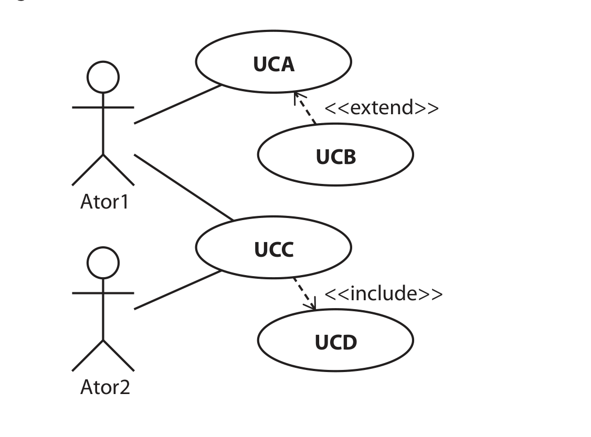
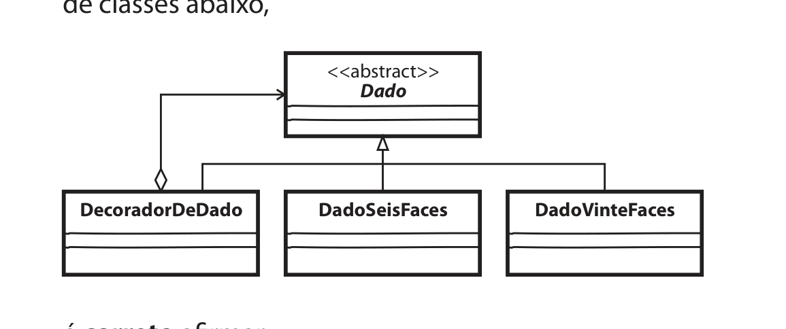
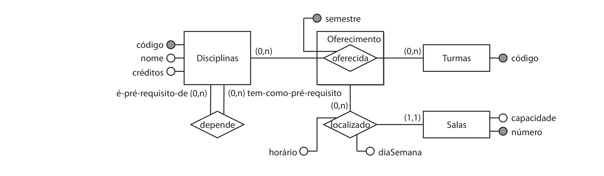

# PROVA — CÂMARA DE VEREADORES DE BALNEÁRIO CAMBORIÚ (SC) — 2010 — S1 ANALISTA DE SISTEMAS

## 1. Análise geral da prova

**Identificação da prova:**

- **Órgão:** Câmara de Vereadores de Balneário Camboriú — Estado de Santa Catarina (SC)
- **Cargo:** **S1 Analista de Sistemas**
- **Banca:** FEPESE — Fundação de Estudos e Pesquisas Sócio-Econômicos (http://camarabalneario.fepese.org.br)
- **Concurso:** Edital de Concurso Público 01/2010 (Edital nº 01/2010 • Processo nº 16/2010 • 14 de novembro de 2010, das 15 às 19 h)
- **Ano:** 2010
- **Gabarito aplicado:** gabarito oficial do cargo S1 Analista de Sistemas (arquivo de gabarito enviado), que coincide integralmente com as marcações "( X )" impressas no PDF da prova — verificação automática: 40/40 alternativas conferem

**Composição quantitativa:**

| Item | Quantidade |
|---|---|
| Total de questões | 40 (todas objetivas, **5 alternativas: A, B, C, D, E**) |
| Textos-base | 1 (texto "Em São Roque de Minas, volta e meia desce a rua um carro de boi..." — Questões 01 a 08) |
| Imagens | 4 (mapa — Q09; diagrama de casos de uso UML — Q18; diagrama de classes UML — Q19; modelagem Entidade-Relacionamento — Q36) |
| Gráficos e tabelas | 0 |
| Grupos identificados | 1 (Questões 01 a 08) |
| Questões independentes | 32 (Questões 09 a 40; destas, 09, 18, 19 e 36 contêm figura própria reproduzida dentro da questão) |
| Questões anuladas | 0 |

**Composição por bloco (títulos originais do caderno):**

| Bloco | Questões | Quantidade |
|---|---|---|
| Língua Portuguesa | 01 a 08 | 8 |
| Estudos Sociais | 09 a 15 | 7 |
| Conhecimentos Específicos | 16 a 40 | 25 |

**Observações sobre a estrutura original:**

- A capa com as instruções gerais da banca FEPESE está transcrita integralmente abaixo; o caderno organiza-se em "Conhecimentos Gerais (15 questões)" — que reúne as subseções "Língua Portuguesa (8 questões)" e "Estudos Sociais (7 questões)" — e "Conhecimentos Específicos (25 questões)".
- O PDF da prova distribuído já contém as marcações de resposta "( X )" impressas junto às alternativas (cartão de respostas preenchido, correspondentes ao gabarito oficial). Na versão organizada, essa informação está representada pela indicação "✅ Gabarito" no topo de cada questão — correspondência verificada automaticamente (40/40).
- As 4 figuras da prova (Questões 09, 18, 19 e 36) são desenhos vetoriais; foram extraídas por recorte de renderização em 300 dpi, salvas em `imagens/imagem_001.png` a `imagem_004.png` e reproduzidas dentro de cada questão correspondente.

**Capa do caderno — instruções originais (transcrição integral):**

> Câmara de Vereadores de Balneário Camboriú  
> Edital de Concurso Público 01/2010  
> Edital no 01/2010 • Processo no 16/2010  
> http://camarabalneario.fepese.org.br  
> Caderno de Prova  
> S1 Analista de Sistemas  
> Confira o número que você obteve no ato da inscrição com o que está indicado no cartão-resposta.  
> * A duração da prova inclui o tempo para o preenchimento do cartão-resposta.  
> Instruções  
> Para fazer a prova você usará:  
> - este caderno de prova;  
> - um cartão-resposta que contém o seu nome, número de inscri- ção e espaço para assinatura.  
> Verifique, no caderno de prova, se:  
> - faltam folhas e a sequência de questões está correta.  
> - há imperfeições gráficas que possam causar dúvidas.  
> Comunique imediatamente ao fiscal qualquer irregularidade.  
> novembro  
> 14  
> 14 de novembro  
> das 15 às 19 h  
> 4 h*  
> 40 questões  
> Atenção!  
> - Não é permitido qualquer tipo de consulta durante a realização da prova.  
> - Para cada questão são apresentadas 5 (cinco) alternativas dife- rentes de respostas (a, b, c, d, e). Apenas uma delas constitui a resposta correta em relação ao enunciado da questão.  
> - A interpretação das questões é parte integrante da prova, não sendo permitidas perguntas aos fiscais.  
> - Não destaque folhas da prova.  
> Ao terminar a prova, entregue ao fiscal o caderno de prova comple- to e o cartão-resposta devidamente preenchido e assinado.

**Contracapa (página final do caderno — transcrição integral):**

> FEPESE • Fundação de Estudos e Pesquisas Sócio-Econômicos  
> Campus Universitário • UFSC  
> 88040-900 • Florianópolis • SC  
> Fone/Fax: (48) 3953-1000  
> http://www.fepese.org.br

**Gabarito oficial — tabela "S1 ANALISTA DE SISTEMAS":**

| Questão | Resposta | Questão | Resposta | Questão | Resposta | Questão | Resposta | Questão | Resposta |
|---|---|---|---|---|---|---|---|---|---|
| 01 | **A** | 02 | **C** | 03 | **E** | 04 | **D** | 05 | **E** |
| 06 | **B** | 07 | **D** | 08 | **A** | 09 | **D** | 10 | **B** |
| 11 | **C** | 12 | **A** | 13 | **B** | 14 | **E** | 15 | **C** |
| 16 | **E** | 17 | **B** | 18 | **A** | 19 | **C** | 20 | **A** |
| 21 | **C** | 22 | **B** | 23 | **E** | 24 | **D** | 25 | **E** |
| 26 | **D** | 27 | **B** | 28 | **C** | 29 | **A** | 30 | **D** |
| 31 | **E** | 32 | **B** | 33 | **C** | 34 | **A** | 35 | **E** |
| 36 | **D** | 37 | **A** | 38 | **C** | 39 | **D** | 40 | **B** |

> 📌 Fonte: Gabarito oficial — Câmara de Vereadores de Balneário Camboriú (SC), Concurso Público Edital 01/2010, cargo S1 Analista de Sistemas (PDF de gabarito enviado; o arquivo traz também os gabaritos dos demais cargos do concurso).

---
## 2. Questões agrupadas

### GRUPO 01 — Texto "Em São Roque de Minas, volta e meia desce a rua um carro de boi..." (adaptado da revista PIAUÍ, set. 2010)

**Questões relacionadas:** 01, 02, 03, 04, 05, 06, 07 e 08.

**Material de apoio compartilhado:** o texto é apresentado uma única vez no caderno, na abertura da seção "Língua Portuguesa — 8 questões", antes da Questão 01, sob o título "Texto"; está reproduzido integralmente dentro de cada questão abaixo.

#### QUESTÃO 01

✅ **Gabarito: A** (gabarito oficial do cargo S1 Analista de Sistemas, conferido com as marcações ( X ) do PDF)
**Material de apoio:**

> Em São Roque de Minas, volta e meia desce a rua um carro de boi, rangendo as rodas como
> manda o figurino. As casas são simples, com assoalho de madeira, fogão a lenha e pequenas jane-
> las coloridas que se abrem para as montanhas da Serra da Canastra. Fazendo o seu papel nesse
> pitoresco quase inverossímil, pessoas na soleira da porta sorriem para qualquer forasteiro.
> A cidadezinha no sudoeste de Minas, a cerca de 300 quilômetros de Belo Horizonte, foi primeiro
> um povoado que, em 1938, emancipou-se com o nome de Guia Lopes. Era uma homenagem
> a um filho da região, o herói que ajudara o estropiado Exército brasileiro a voltar da guerra do
> Paraguai, no episódio da Retirada da Laguna. Mas a população julgou que depositar o destino
> nas mãos de um herói secular era brincar com a sorte, de modo que, em 1962, graças ao Senhor,
> um plebiscito pôs o pingo nos is e o vilarejo passou a viver sob as bênçãos de Roque, santo do
> século XIV, protetor contra a peste e doenças contagiosas em geral, inclusive do gado, padro-
> eiro de inválidos e cirurgiões. A troca foi sábia.
> Acontece que, mesmo com atributos tão superiores aos do guia Lopes, São Roque não passa
> de um coadjuvante na cidade que leva seu nome. O município guarda a nascente do rio São
> Francisco, que brota no alto da serra. São suas águas que abastecem torneiras, bicas e córregos.
> Em homenagem ao rio e por devoção ao santo, a população faz o que pode. Para não correr o
> risco de ficar sem água para a família, para os animais e para a lavoura, sem falar no desconforto
> de ter o corpo possuído pelo diabo, melhor não desgrudar do santo de Assis.
> Muitos afirmam que em São Roque de Minas todo mundo tem Francisco na família. Francisco
> Cota, Francisca Silva, Francisco José. Eles representariam cerca de 10% da população de 6 301
> moradores, segundo cálculos à moda da casa realizados pelos próprios Franciscos.
> Esclareça-se que os tais 10% dizem respeito apenas aos que levam Francisco na carteira de
> identidade. Isso jamais impediu que os 90% restantes, desafortunados todos eles, não dessem
> um jeito. No caso de pais que tenham se comprometido a batizar o filho com o nome de outro
> cristão, desprotegido é que o recém-nascido não fica. O coitadinho recebe o apelido de Chico
> ou Chica, mesmo não se chamando Francisco.
> O povo deve ter razão, porque se passam as gerações e a multidão de Franciscos só aumenta.
> De outra parte, o lugar está livre de Toncruzes, Bredepites e Henricastelis. Se bem que aqui o
> santo é outro. Se a cidade é imune a essa praga onomástica, o mérito é de São Roque. Que, aliás,
> era franciscano.
> Texto adaptado da revista PIAUÍ: p. 11, n. 48, ano 4, set. 2010.

**Enunciado:**

Assinale a alternativa que apresenta um título ade- quado ao texto.

**Alternativas:**

A) Franciscolândia.

B) Os religiosos franciscanos.

C) As águas do Rio São Francisco.

D) A vida difícil em São Roque de Minas.

E) O guia Lopes, um herói da Guerra do Paraguai.

---

#### QUESTÃO 02

✅ **Gabarito: C** (gabarito oficial do cargo S1 Analista de Sistemas, conferido com as marcações ( X ) do PDF)
**Material de apoio:**

> Em São Roque de Minas, volta e meia desce a rua um carro de boi, rangendo as rodas como
> manda o figurino. As casas são simples, com assoalho de madeira, fogão a lenha e pequenas jane-
> las coloridas que se abrem para as montanhas da Serra da Canastra. Fazendo o seu papel nesse
> pitoresco quase inverossímil, pessoas na soleira da porta sorriem para qualquer forasteiro.
> A cidadezinha no sudoeste de Minas, a cerca de 300 quilômetros de Belo Horizonte, foi primeiro
> um povoado que, em 1938, emancipou-se com o nome de Guia Lopes. Era uma homenagem
> a um filho da região, o herói que ajudara o estropiado Exército brasileiro a voltar da guerra do
> Paraguai, no episódio da Retirada da Laguna. Mas a população julgou que depositar o destino
> nas mãos de um herói secular era brincar com a sorte, de modo que, em 1962, graças ao Senhor,
> um plebiscito pôs o pingo nos is e o vilarejo passou a viver sob as bênçãos de Roque, santo do
> século XIV, protetor contra a peste e doenças contagiosas em geral, inclusive do gado, padro-
> eiro de inválidos e cirurgiões. A troca foi sábia.
> Acontece que, mesmo com atributos tão superiores aos do guia Lopes, São Roque não passa
> de um coadjuvante na cidade que leva seu nome. O município guarda a nascente do rio São
> Francisco, que brota no alto da serra. São suas águas que abastecem torneiras, bicas e córregos.
> Em homenagem ao rio e por devoção ao santo, a população faz o que pode. Para não correr o
> risco de ficar sem água para a família, para os animais e para a lavoura, sem falar no desconforto
> de ter o corpo possuído pelo diabo, melhor não desgrudar do santo de Assis.
> Muitos afirmam que em São Roque de Minas todo mundo tem Francisco na família. Francisco
> Cota, Francisca Silva, Francisco José. Eles representariam cerca de 10% da população de 6 301
> moradores, segundo cálculos à moda da casa realizados pelos próprios Franciscos.
> Esclareça-se que os tais 10% dizem respeito apenas aos que levam Francisco na carteira de
> identidade. Isso jamais impediu que os 90% restantes, desafortunados todos eles, não dessem
> um jeito. No caso de pais que tenham se comprometido a batizar o filho com o nome de outro
> cristão, desprotegido é que o recém-nascido não fica. O coitadinho recebe o apelido de Chico
> ou Chica, mesmo não se chamando Francisco.
> O povo deve ter razão, porque se passam as gerações e a multidão de Franciscos só aumenta.
> De outra parte, o lugar está livre de Toncruzes, Bredepites e Henricastelis. Se bem que aqui o
> santo é outro. Se a cidade é imune a essa praga onomástica, o mérito é de São Roque. Que, aliás,
> era franciscano.
> Texto adaptado da revista PIAUÍ: p. 11, n. 48, ano 4, set. 2010.

**Enunciado:**

Assinale a alternativa correta, de acordo com o texto.

**Alternativas:**

A) Embora uma cidadezinha no sudoeste de Minas se chame Guia Lopes, muitos habitan- tes são devotos de São Francisco e de São Roque e, para pedir graças aos santos cristãos, batizam os filhos com os nomes deles.

B) Um povoado a cerca de 300 quilômetros de Belo Horizonte tem uma característica origi- nal: todas as pessoas têm Francisco no nome, menos os que são devotos de São Roque ou de Guia Lopes.

C) Em uma pequena cidade do interior de Minas Gerais, grande parte dos moradores chama- -se Francisco ou tem como apelido Chico ou Chica, em homenagem ao santo que dá nome ao rio cuja nascente situa-se nas proximidades do município.

D) As crianças que nascem em São Roque de Minas são desafortunadas porque têm obri- gatoriamente que se chamar Francisco ou Francisca, caso contrário não serão protegidas pelo santo que dá nome à cidade.

E) A cidade está imune a pragas, como peste ou doenças contagiosas, porque é protegida por São Roque. Só não está protegida da praga onomástica, que é dar nomes aos filhos por influência de santos e artistas.

---

#### QUESTÃO 03

✅ **Gabarito: E** (gabarito oficial do cargo S1 Analista de Sistemas, conferido com as marcações ( X ) do PDF)
**Material de apoio:**

> Em São Roque de Minas, volta e meia desce a rua um carro de boi, rangendo as rodas como
> manda o figurino. As casas são simples, com assoalho de madeira, fogão a lenha e pequenas jane-
> las coloridas que se abrem para as montanhas da Serra da Canastra. Fazendo o seu papel nesse
> pitoresco quase inverossímil, pessoas na soleira da porta sorriem para qualquer forasteiro.
> A cidadezinha no sudoeste de Minas, a cerca de 300 quilômetros de Belo Horizonte, foi primeiro
> um povoado que, em 1938, emancipou-se com o nome de Guia Lopes. Era uma homenagem
> a um filho da região, o herói que ajudara o estropiado Exército brasileiro a voltar da guerra do
> Paraguai, no episódio da Retirada da Laguna. Mas a população julgou que depositar o destino
> nas mãos de um herói secular era brincar com a sorte, de modo que, em 1962, graças ao Senhor,
> um plebiscito pôs o pingo nos is e o vilarejo passou a viver sob as bênçãos de Roque, santo do
> século XIV, protetor contra a peste e doenças contagiosas em geral, inclusive do gado, padro-
> eiro de inválidos e cirurgiões. A troca foi sábia.
> Acontece que, mesmo com atributos tão superiores aos do guia Lopes, São Roque não passa
> de um coadjuvante na cidade que leva seu nome. O município guarda a nascente do rio São
> Francisco, que brota no alto da serra. São suas águas que abastecem torneiras, bicas e córregos.
> Em homenagem ao rio e por devoção ao santo, a população faz o que pode. Para não correr o
> risco de ficar sem água para a família, para os animais e para a lavoura, sem falar no desconforto
> de ter o corpo possuído pelo diabo, melhor não desgrudar do santo de Assis.
> Muitos afirmam que em São Roque de Minas todo mundo tem Francisco na família. Francisco
> Cota, Francisca Silva, Francisco José. Eles representariam cerca de 10% da população de 6 301
> moradores, segundo cálculos à moda da casa realizados pelos próprios Franciscos.
> Esclareça-se que os tais 10% dizem respeito apenas aos que levam Francisco na carteira de
> identidade. Isso jamais impediu que os 90% restantes, desafortunados todos eles, não dessem
> um jeito. No caso de pais que tenham se comprometido a batizar o filho com o nome de outro
> cristão, desprotegido é que o recém-nascido não fica. O coitadinho recebe o apelido de Chico
> ou Chica, mesmo não se chamando Francisco.
> O povo deve ter razão, porque se passam as gerações e a multidão de Franciscos só aumenta.
> De outra parte, o lugar está livre de Toncruzes, Bredepites e Henricastelis. Se bem que aqui o
> santo é outro. Se a cidade é imune a essa praga onomástica, o mérito é de São Roque. Que, aliás,
> era franciscano.
> Texto adaptado da revista PIAUÍ: p. 11, n. 48, ano 4, set. 2010.

**Enunciado:**

Considere as afirmativas abaixo, relativas ao texto.
  
1. No primeiro parágrafo há uma descrição da cidade, no qual a expressão “nesse pitoresco quase inverossímil” quer dizer que tão pito- resca é a cidade que é difícil de acreditar que seja verdade.
  
2. No segundo parágrafo, a frase: “o herói que ajudara o estropiado Exército brasileiro a voltar da guerra do Paraguai”, diz que o guia Lopes tornou-se um herói no povoado mineiro porque ajudou os soldados que luta- ram na Retirada da Laguna a voltarem sãos e salvos para casa.
  
3. No terceiro parágrafo, a frase: “São Roque não passa de um coadjuvante na cidade que leva seu nome” significa que o santo que dá nome à cidade não é o mais venerado pelos seus moradores, tem um papel secundário.
  
4. No último parágrafo, o autor do texto dá importância a São Roque, pois atribui a ele o fato de que a cidade está livre de um certo tipo de praga: a onomástica, que seria a atri- buição às crianças que nascem ali de nomes inspirados em artistas conhecidos .
  
Assinale a alternativa que indica todas as afirmativas corretas.

**Alternativas:**

A) São corretas apenas as afirmativas 1 e 3.

B) São corretas apenas as afirmativas 1 e 4.

C) São corretas apenas as afirmativas 3 e 4.

D) São corretas apenas as afirmativas 1, 2 e 3.

E) São corretas apenas as afirmativas 1, 3 e 4.

---

#### QUESTÃO 04

✅ **Gabarito: D** (gabarito oficial do cargo S1 Analista de Sistemas, conferido com as marcações ( X ) do PDF)
**Material de apoio:**

> Em São Roque de Minas, volta e meia desce a rua um carro de boi, rangendo as rodas como
> manda o figurino. As casas são simples, com assoalho de madeira, fogão a lenha e pequenas jane-
> las coloridas que se abrem para as montanhas da Serra da Canastra. Fazendo o seu papel nesse
> pitoresco quase inverossímil, pessoas na soleira da porta sorriem para qualquer forasteiro.
> A cidadezinha no sudoeste de Minas, a cerca de 300 quilômetros de Belo Horizonte, foi primeiro
> um povoado que, em 1938, emancipou-se com o nome de Guia Lopes. Era uma homenagem
> a um filho da região, o herói que ajudara o estropiado Exército brasileiro a voltar da guerra do
> Paraguai, no episódio da Retirada da Laguna. Mas a população julgou que depositar o destino
> nas mãos de um herói secular era brincar com a sorte, de modo que, em 1962, graças ao Senhor,
> um plebiscito pôs o pingo nos is e o vilarejo passou a viver sob as bênçãos de Roque, santo do
> século XIV, protetor contra a peste e doenças contagiosas em geral, inclusive do gado, padro-
> eiro de inválidos e cirurgiões. A troca foi sábia.
> Acontece que, mesmo com atributos tão superiores aos do guia Lopes, São Roque não passa
> de um coadjuvante na cidade que leva seu nome. O município guarda a nascente do rio São
> Francisco, que brota no alto da serra. São suas águas que abastecem torneiras, bicas e córregos.
> Em homenagem ao rio e por devoção ao santo, a população faz o que pode. Para não correr o
> risco de ficar sem água para a família, para os animais e para a lavoura, sem falar no desconforto
> de ter o corpo possuído pelo diabo, melhor não desgrudar do santo de Assis.
> Muitos afirmam que em São Roque de Minas todo mundo tem Francisco na família. Francisco
> Cota, Francisca Silva, Francisco José. Eles representariam cerca de 10% da população de 6 301
> moradores, segundo cálculos à moda da casa realizados pelos próprios Franciscos.
> Esclareça-se que os tais 10% dizem respeito apenas aos que levam Francisco na carteira de
> identidade. Isso jamais impediu que os 90% restantes, desafortunados todos eles, não dessem
> um jeito. No caso de pais que tenham se comprometido a batizar o filho com o nome de outro
> cristão, desprotegido é que o recém-nascido não fica. O coitadinho recebe o apelido de Chico
> ou Chica, mesmo não se chamando Francisco.
> O povo deve ter razão, porque se passam as gerações e a multidão de Franciscos só aumenta.
> De outra parte, o lugar está livre de Toncruzes, Bredepites e Henricastelis. Se bem que aqui o
> santo é outro. Se a cidade é imune a essa praga onomástica, o mérito é de São Roque. Que, aliás,
> era franciscano.
> Texto adaptado da revista PIAUÍ: p. 11, n. 48, ano 4, set. 2010.

**Enunciado:**

Assinale a alternativa que apresenta expressão em sentido figurado.

**Alternativas:**

A) A troca foi sábia.

B) São suas águas que abastecem torneiras, bicas e córregos.

C) O povo deve ter razão, porque se passam as gerações e a multidão de Franciscos só aumenta.

D) Em São Roque de Minas, volta e meia desce a rua um carro de boi, rangendo as rodas como manda o figurino.

E) No caso de pais que tenham se comprome- tido a batizar o filho com o nome de outro cristão, desprotegido é que o recém-nascido não fica.

---

#### QUESTÃO 05

✅ **Gabarito: E** (gabarito oficial do cargo S1 Analista de Sistemas, conferido com as marcações ( X ) do PDF)
**Material de apoio:**

> Em São Roque de Minas, volta e meia desce a rua um carro de boi, rangendo as rodas como
> manda o figurino. As casas são simples, com assoalho de madeira, fogão a lenha e pequenas jane-
> las coloridas que se abrem para as montanhas da Serra da Canastra. Fazendo o seu papel nesse
> pitoresco quase inverossímil, pessoas na soleira da porta sorriem para qualquer forasteiro.
> A cidadezinha no sudoeste de Minas, a cerca de 300 quilômetros de Belo Horizonte, foi primeiro
> um povoado que, em 1938, emancipou-se com o nome de Guia Lopes. Era uma homenagem
> a um filho da região, o herói que ajudara o estropiado Exército brasileiro a voltar da guerra do
> Paraguai, no episódio da Retirada da Laguna. Mas a população julgou que depositar o destino
> nas mãos de um herói secular era brincar com a sorte, de modo que, em 1962, graças ao Senhor,
> um plebiscito pôs o pingo nos is e o vilarejo passou a viver sob as bênçãos de Roque, santo do
> século XIV, protetor contra a peste e doenças contagiosas em geral, inclusive do gado, padro-
> eiro de inválidos e cirurgiões. A troca foi sábia.
> Acontece que, mesmo com atributos tão superiores aos do guia Lopes, São Roque não passa
> de um coadjuvante na cidade que leva seu nome. O município guarda a nascente do rio São
> Francisco, que brota no alto da serra. São suas águas que abastecem torneiras, bicas e córregos.
> Em homenagem ao rio e por devoção ao santo, a população faz o que pode. Para não correr o
> risco de ficar sem água para a família, para os animais e para a lavoura, sem falar no desconforto
> de ter o corpo possuído pelo diabo, melhor não desgrudar do santo de Assis.
> Muitos afirmam que em São Roque de Minas todo mundo tem Francisco na família. Francisco
> Cota, Francisca Silva, Francisco José. Eles representariam cerca de 10% da população de 6 301
> moradores, segundo cálculos à moda da casa realizados pelos próprios Franciscos.
> Esclareça-se que os tais 10% dizem respeito apenas aos que levam Francisco na carteira de
> identidade. Isso jamais impediu que os 90% restantes, desafortunados todos eles, não dessem
> um jeito. No caso de pais que tenham se comprometido a batizar o filho com o nome de outro
> cristão, desprotegido é que o recém-nascido não fica. O coitadinho recebe o apelido de Chico
> ou Chica, mesmo não se chamando Francisco.
> O povo deve ter razão, porque se passam as gerações e a multidão de Franciscos só aumenta.
> De outra parte, o lugar está livre de Toncruzes, Bredepites e Henricastelis. Se bem que aqui o
> santo é outro. Se a cidade é imune a essa praga onomástica, o mérito é de São Roque. Que, aliás,
> era franciscano.
> Texto adaptado da revista PIAUÍ: p. 11, n. 48, ano 4, set. 2010.

**Enunciado:**

Relacione a classificação da coluna 1 com os ter- mos sublinhados na coluna 2, de acordo com as fun- ções sintáticas que desempenham no texto.
  
Coluna 1
  
1. adjunto adverbial
  
2. predicativo do sujeito
  
3. sujeito simples
  
4. objeto direto
  
Coluna 2
  
( ) As casas são simples…
  
( ) O município guarda a nascente do rio São Francisco…
  
( ) Muitos afirmam que em São Roque de Minas todo mundo tem Francisco na família.
  
( ) Se a cidade é imune a essa praga onomástica…
  
Assinale a alternativa que indica a sequência correta, de cima para baixo.

**Alternativas:**

A) 2 – 3 – 4 – 1

B) 2 – 4 – 1 – 3

C) 3 – 1 – 2 – 4

D) 3 – 1 – 4 – 2

E) 3 – 4 – 1 – 2

---

#### QUESTÃO 06

✅ **Gabarito: B** (gabarito oficial do cargo S1 Analista de Sistemas, conferido com as marcações ( X ) do PDF)
**Material de apoio:**

> Em São Roque de Minas, volta e meia desce a rua um carro de boi, rangendo as rodas como
> manda o figurino. As casas são simples, com assoalho de madeira, fogão a lenha e pequenas jane-
> las coloridas que se abrem para as montanhas da Serra da Canastra. Fazendo o seu papel nesse
> pitoresco quase inverossímil, pessoas na soleira da porta sorriem para qualquer forasteiro.
> A cidadezinha no sudoeste de Minas, a cerca de 300 quilômetros de Belo Horizonte, foi primeiro
> um povoado que, em 1938, emancipou-se com o nome de Guia Lopes. Era uma homenagem
> a um filho da região, o herói que ajudara o estropiado Exército brasileiro a voltar da guerra do
> Paraguai, no episódio da Retirada da Laguna. Mas a população julgou que depositar o destino
> nas mãos de um herói secular era brincar com a sorte, de modo que, em 1962, graças ao Senhor,
> um plebiscito pôs o pingo nos is e o vilarejo passou a viver sob as bênçãos de Roque, santo do
> século XIV, protetor contra a peste e doenças contagiosas em geral, inclusive do gado, padro-
> eiro de inválidos e cirurgiões. A troca foi sábia.
> Acontece que, mesmo com atributos tão superiores aos do guia Lopes, São Roque não passa
> de um coadjuvante na cidade que leva seu nome. O município guarda a nascente do rio São
> Francisco, que brota no alto da serra. São suas águas que abastecem torneiras, bicas e córregos.
> Em homenagem ao rio e por devoção ao santo, a população faz o que pode. Para não correr o
> risco de ficar sem água para a família, para os animais e para a lavoura, sem falar no desconforto
> de ter o corpo possuído pelo diabo, melhor não desgrudar do santo de Assis.
> Muitos afirmam que em São Roque de Minas todo mundo tem Francisco na família. Francisco
> Cota, Francisca Silva, Francisco José. Eles representariam cerca de 10% da população de 6 301
> moradores, segundo cálculos à moda da casa realizados pelos próprios Franciscos.
> Esclareça-se que os tais 10% dizem respeito apenas aos que levam Francisco na carteira de
> identidade. Isso jamais impediu que os 90% restantes, desafortunados todos eles, não dessem
> um jeito. No caso de pais que tenham se comprometido a batizar o filho com o nome de outro
> cristão, desprotegido é que o recém-nascido não fica. O coitadinho recebe o apelido de Chico
> ou Chica, mesmo não se chamando Francisco.
> O povo deve ter razão, porque se passam as gerações e a multidão de Franciscos só aumenta.
> De outra parte, o lugar está livre de Toncruzes, Bredepites e Henricastelis. Se bem que aqui o
> santo é outro. Se a cidade é imune a essa praga onomástica, o mérito é de São Roque. Que, aliás,
> era franciscano.
> Texto adaptado da revista PIAUÍ: p. 11, n. 48, ano 4, set. 2010.

**Enunciado:**

Assinale a alternativa na qual ocorreria crase se a palavra sublinhada fosse substituída pela que está entre parênteses.

**Alternativas:**

A) …o herói que ajudara o estropiado Exército brasileiro… (tropa)

B) Acontece que, mesmo com atributos tão superiores aos do guia Lopes, São Roque não passa de um coadjuvante… (virtudes)

C) Era uma homenagem a um filho da região… (filha)

D) No caso de pais que tenham se comprome- tido a batizar o filho com o nome de outro cristão… (apelidar)

E) Se a cidade é imune a essa praga onomás- tica… (peste)

---

#### QUESTÃO 07

✅ **Gabarito: D** (gabarito oficial do cargo S1 Analista de Sistemas, conferido com as marcações ( X ) do PDF)
**Material de apoio:**

> Em São Roque de Minas, volta e meia desce a rua um carro de boi, rangendo as rodas como
> manda o figurino. As casas são simples, com assoalho de madeira, fogão a lenha e pequenas jane-
> las coloridas que se abrem para as montanhas da Serra da Canastra. Fazendo o seu papel nesse
> pitoresco quase inverossímil, pessoas na soleira da porta sorriem para qualquer forasteiro.
> A cidadezinha no sudoeste de Minas, a cerca de 300 quilômetros de Belo Horizonte, foi primeiro
> um povoado que, em 1938, emancipou-se com o nome de Guia Lopes. Era uma homenagem
> a um filho da região, o herói que ajudara o estropiado Exército brasileiro a voltar da guerra do
> Paraguai, no episódio da Retirada da Laguna. Mas a população julgou que depositar o destino
> nas mãos de um herói secular era brincar com a sorte, de modo que, em 1962, graças ao Senhor,
> um plebiscito pôs o pingo nos is e o vilarejo passou a viver sob as bênçãos de Roque, santo do
> século XIV, protetor contra a peste e doenças contagiosas em geral, inclusive do gado, padro-
> eiro de inválidos e cirurgiões. A troca foi sábia.
> Acontece que, mesmo com atributos tão superiores aos do guia Lopes, São Roque não passa
> de um coadjuvante na cidade que leva seu nome. O município guarda a nascente do rio São
> Francisco, que brota no alto da serra. São suas águas que abastecem torneiras, bicas e córregos.
> Em homenagem ao rio e por devoção ao santo, a população faz o que pode. Para não correr o
> risco de ficar sem água para a família, para os animais e para a lavoura, sem falar no desconforto
> de ter o corpo possuído pelo diabo, melhor não desgrudar do santo de Assis.
> Muitos afirmam que em São Roque de Minas todo mundo tem Francisco na família. Francisco
> Cota, Francisca Silva, Francisco José. Eles representariam cerca de 10% da população de 6 301
> moradores, segundo cálculos à moda da casa realizados pelos próprios Franciscos.
> Esclareça-se que os tais 10% dizem respeito apenas aos que levam Francisco na carteira de
> identidade. Isso jamais impediu que os 90% restantes, desafortunados todos eles, não dessem
> um jeito. No caso de pais que tenham se comprometido a batizar o filho com o nome de outro
> cristão, desprotegido é que o recém-nascido não fica. O coitadinho recebe o apelido de Chico
> ou Chica, mesmo não se chamando Francisco.
> O povo deve ter razão, porque se passam as gerações e a multidão de Franciscos só aumenta.
> De outra parte, o lugar está livre de Toncruzes, Bredepites e Henricastelis. Se bem que aqui o
> santo é outro. Se a cidade é imune a essa praga onomástica, o mérito é de São Roque. Que, aliás,
> era franciscano.
> Texto adaptado da revista PIAUÍ: p. 11, n. 48, ano 4, set. 2010.

**Enunciado:**

Relacione a classificação quanto à predicação verbal, da coluna 1, com os verbos sublinhados nas orações da coluna 2.
  
Coluna 1
  
1. Verbo transitivo direto
  
2. Verbo intransitivo
  
3. Verbo transitivo direto e indireto
  
Coluna 2
  
( ) “depositar o destino nas mãos de um herói secular”
  
( ) “o coitadinho recebe o apelido de Chico ou Chica”
  
( ) “a multidão de Franciscos só aumenta”
  
Assinale a alternativa que indica a sequência correta, de cima para baixo.

**Alternativas:**

A) 1 – 2 – 3

B) 2 – 3 – 1

C) 2 – 1 – 3

D) 3 – 1 – 2

E) 3 – 2 – 1

---

#### QUESTÃO 08

✅ **Gabarito: A** (gabarito oficial do cargo S1 Analista de Sistemas, conferido com as marcações ( X ) do PDF)
**Material de apoio:**

> Em São Roque de Minas, volta e meia desce a rua um carro de boi, rangendo as rodas como
> manda o figurino. As casas são simples, com assoalho de madeira, fogão a lenha e pequenas jane-
> las coloridas que se abrem para as montanhas da Serra da Canastra. Fazendo o seu papel nesse
> pitoresco quase inverossímil, pessoas na soleira da porta sorriem para qualquer forasteiro.
> A cidadezinha no sudoeste de Minas, a cerca de 300 quilômetros de Belo Horizonte, foi primeiro
> um povoado que, em 1938, emancipou-se com o nome de Guia Lopes. Era uma homenagem
> a um filho da região, o herói que ajudara o estropiado Exército brasileiro a voltar da guerra do
> Paraguai, no episódio da Retirada da Laguna. Mas a população julgou que depositar o destino
> nas mãos de um herói secular era brincar com a sorte, de modo que, em 1962, graças ao Senhor,
> um plebiscito pôs o pingo nos is e o vilarejo passou a viver sob as bênçãos de Roque, santo do
> século XIV, protetor contra a peste e doenças contagiosas em geral, inclusive do gado, padro-
> eiro de inválidos e cirurgiões. A troca foi sábia.
> Acontece que, mesmo com atributos tão superiores aos do guia Lopes, São Roque não passa
> de um coadjuvante na cidade que leva seu nome. O município guarda a nascente do rio São
> Francisco, que brota no alto da serra. São suas águas que abastecem torneiras, bicas e córregos.
> Em homenagem ao rio e por devoção ao santo, a população faz o que pode. Para não correr o
> risco de ficar sem água para a família, para os animais e para a lavoura, sem falar no desconforto
> de ter o corpo possuído pelo diabo, melhor não desgrudar do santo de Assis.
> Muitos afirmam que em São Roque de Minas todo mundo tem Francisco na família. Francisco
> Cota, Francisca Silva, Francisco José. Eles representariam cerca de 10% da população de 6 301
> moradores, segundo cálculos à moda da casa realizados pelos próprios Franciscos.
> Esclareça-se que os tais 10% dizem respeito apenas aos que levam Francisco na carteira de
> identidade. Isso jamais impediu que os 90% restantes, desafortunados todos eles, não dessem
> um jeito. No caso de pais que tenham se comprometido a batizar o filho com o nome de outro
> cristão, desprotegido é que o recém-nascido não fica. O coitadinho recebe o apelido de Chico
> ou Chica, mesmo não se chamando Francisco.
> O povo deve ter razão, porque se passam as gerações e a multidão de Franciscos só aumenta.
> De outra parte, o lugar está livre de Toncruzes, Bredepites e Henricastelis. Se bem que aqui o
> santo é outro. Se a cidade é imune a essa praga onomástica, o mérito é de São Roque. Que, aliás,
> era franciscano.
> Texto adaptado da revista PIAUÍ: p. 11, n. 48, ano 4, set. 2010.

**Enunciado:**

Identifique as afirmativas verdadeiras ( V ) e falsas ( F ), de acordo com as regras da gramática normativa.
  
( ) Quanto à colocação dos pronomes pessoais “se” destacados no texto, pode-se afirmar que há três ocorrências de ênclise.
  
( ) Os vocábulos “sábia”, “município” e “família” seguem a mesma regra de acentuação gráfica.
  
( ) Se a frase do texto for reescrita como segue: “Esclareço que os tais 10% diz respeito ape- nas aos que levam Francisco nas carteiras de identidades.” ela permanece correta quanto às concordâncias verbal e nominal.
  
Assinale a alternativa que indica a sequência correta, de cima para baixo.

**Alternativas:**

A) F – V – F

B) F – V – V

C) V – F – F

D) V – V – F

E) V – V – V

---

## 3. Questões independentes

#### QUESTÃO 09

✅ **Gabarito: D** (gabarito oficial do cargo S1 Analista de Sistemas, conferido com as marcações ( X ) do PDF)
**Enunciado:**

Analise o mapa abaixo:


Assinale a alternativa que indica a linha localizada no mapa com o número 4.

**Alternativas:**

A) Equador.

B) Círculo Polar Ártico.

C) Círculo Polar Antártico.

D) Trópico de Capricórnio.

E) Trópico de Câncer.

**Referências visuais:**


---

#### QUESTÃO 10

✅ **Gabarito: B** (gabarito oficial do cargo S1 Analista de Sistemas, conferido com as marcações ( X ) do PDF)
**Enunciado:**

Teve grande repercussão o debate em torno do projeto de instalação no litoral catarinense, na região de Biguaçu, de um grande estaleiro. Em um primeiro momento o empreendimento não obteve a necessária licença. Assinale a alternativa que indica o principal óbice para a construção do estaleiro.

**Alternativas:**

A) O impacto econômico. A obra traria grande desenvolvimento à região litorânea, mas faria crescer os problemas sociais.

B) O impacto ambiental. A licença ambiental foi negada em virtude de a obra estar próxima de unidades de conservação.

C) Os problemas de logística. A região não dis- põe de acesso terrestre a portos exportadores ou às demais regiões do Brasil.

D) A falta de recursos naturais. Não existem no local água potável, redes de distribuição de energia e matérias primas necessárias ao fun- cionamento do empreendimento.

E) Os problemas culturais. A população local e regional é avessa aos empreendimentos de grande escala por acreditar que, como atraem pessoas de outras regiões e do mundo, pode- rão descaracterizar a cultura açoriana.

---

#### QUESTÃO 11

✅ **Gabarito: C** (gabarito oficial do cargo S1 Analista de Sistemas, conferido com as marcações ( X ) do PDF)
**Enunciado:**

Quando os portugueses desembarcaram no Brasil encontraram os povos indígenas.
  
Assinale a alternativa correta a respeito desses povos.

**Alternativas:**

A) Embora divididos, organizavam-se em duas únicas grandes tribos: os tupis que habitavam o litoral e os tapuias que viviam no interior.

B) De caráter dócil e pacífico, desconheciam a guerra e viviam em perfeita harmonia com a natureza.

C) Formavam uma população heterogênea, divida em inúmeros povos que falavam lín- guas diferentes.

D) Viviam da caça, pesca e coleta de frutos e raí- zes, não possuindo técnicas agrícolas, mesmo as mais rudimentares.

E) Embora tivessem uma organização política diferente dos povos europeus, obedeciam a um chefe que lhes ditava as leis. Estas, no entanto, deviam ser aprovadas pela assem- bleia da tribo que se reunia na “coivara”.

---

#### QUESTÃO 12

✅ **Gabarito: A** (gabarito oficial do cargo S1 Analista de Sistemas, conferido com as marcações ( X ) do PDF)
**Enunciado:**

Assinale a alternativa correta em relação à admi- nistração das primeiras vilas e cidades brasileiras.

**Alternativas:**

A) A administração das primeiras vilas e cidades brasileiras era entregue às Câmaras, compos- tas por vereadores escolhidos pelos “homens bons”.

B) As vilas e cidades coloniais eram desprovi- das de qualquer autonomia e sua adminis- tração era totalmente vinculada à Casa de Contratação e ao Conselho do Rei que, de Lisboa, governavam o império português.

C) O governo português estendeu ao continente americano a estrutura absolutista metropo- litana e proibiu a participação de brasileiros, mesmo que nascidos no reino e de pai portu- guês, em qualquer instância administrativa na colônia.

D) Nas vilas e cidades coloniais, a administração era repartida entre o governador nomeado pelo rei, os clérigos (homens bons) e os juízes, entre os quais os “de Vara” detinham maior poder.

E) As vilas e cidades do período colonial não conheceram uma organização administra- tiva. Seu destino era confiado aos coronéis da Guarda Nacional que exerciam poder de polícia e aplicavam as leis, sem que lhes fosse imposto qualquer limite.

---

#### QUESTÃO 13

✅ **Gabarito: B** (gabarito oficial do cargo S1 Analista de Sistemas, conferido com as marcações ( X ) do PDF)
**Enunciado:**

A influência negra foi notável na formação da cul- tura brasileira. Assinale a alternativa que faz referência a algumas das suas contribuições.

**Alternativas:**

A) As polcas e marchinhas, produto da fusão dos ritmos europeus e africanos.

B) O frevo no Recife e o batuque que deu origem ao samba, no Rio de Janeiro.

C) A culinária com destaque para a golonka, prato em que se misturam o repolho e a carne de porco.

D) A arte concreta da qual é maior expressão hoje em dia o músico carioca Max Bill.

E) O sincretismo religioso, fonte em que se ins- pirou a “Cabala”, que tenta explicar a natureza divina.

---

#### QUESTÃO 14

✅ **Gabarito: E** (gabarito oficial do cargo S1 Analista de Sistemas, conferido com as marcações ( X ) do PDF)
**Enunciado:**

Nos anos 1920/30, com a ascensão do fascismo na Itália e do nazismo na Alemanha, movimentos con- gêneres surgiram em várias partes do mundo.
  
Assinale a alternativa que pode ser corretamente rela- cionada ao assunto.

**Alternativas:**

A) Luiz Carlos Prestes, inspirado nos ideais fascis- tas, criou a Aliança Nacional Libertadora.

B) Em Santa Catarina os nazistas tentaram tomar o poder criando na capital o chamado “Governicho do Desterro”.

C) Tropas vindas de Blumenau, comandadas por Hercílio Luz, invadiram a capital do Estado e derrubaram o governo em mãos dos Federalistas.

D) A República Catarinense, fundada em Laguna pelos revoltosos farroupilhas, pretendia esta- belecer um governo nacional socialista em terras brasileiras.

E) No Brasil, o escritor Plínio Salgado criou a Ação Integralista Brasileira (AIB), que apresen- tava semelhanças com o fascismo europeu.

---

#### QUESTÃO 15

✅ **Gabarito: C** (gabarito oficial do cargo S1 Analista de Sistemas, conferido com as marcações ( X ) do PDF)
**Enunciado:**

No mês de julho de 2004 ocorreu um fato de grande importância para a história de Balneário Camboriú.
  
Assinale a alternativa que indica esse acontecimento.

**Alternativas:**

A) Os primeiros moradores alemães do Vale do Itajaí mandaram construir as primeiras casas de veraneio na região da Avenida Atlântica.

B) Balneário Camboriú desmembrou-se de Itapema e foi incorporada ao município de Camboriú.

C) Balneário Camboriú emancipou-se politica- mente, tornando-se município.

D) O movimento revolucionário ordenou o bom- bardeio de Balneário Camboriú, acreditando que o presidente deposto pudesse organizar uma resistência na cidade.

E) Foi fundada a Vila da Barra, que deu origem à cidade.

---

#### QUESTÃO 16

✅ **Gabarito: E** (gabarito oficial do cargo S1 Analista de Sistemas, conferido com as marcações ( X ) do PDF)
**Enunciado:**

Analise o texto abaixo. Na programação orientada a objetos, uma mesma assinatura de método pode estar presente em mais de uma classe, podendo cada classe ter um algoritmo diferente associado a essa assinatura.
  
Assinale a alternativa que identifica corretamente a propriedade descrita.

**Alternativas:**

A) Herança

B) Delegação

C) Sobrecarga

D) Acoplamento

E) Polimorfismo

---

#### QUESTÃO 17

✅ **Gabarito: B** (gabarito oficial do cargo S1 Analista de Sistemas, conferido com as marcações ( X ) do PDF)
**Enunciado:**

Relacione corretamente as características de eta- pas do ciclo de vida de software, descritas na coluna 2, com a identificação das etapas, listadas na coluna 1.
  
Coluna 1
  
1. Análise
  
2. Projeto
  
3. Testes
  
4. Manutenção
  
Coluna 2
  
( ) Avaliação do resultado do processo de desenvolvimento.
  
( ) Modificação do resultado do processo de desenvolvimento.
  
( ) Foco no domínio da solução.
  
( ) Foco no domínio do negócio.
  
Assinale a alternativa que indica a sequência correta, de cima para baixo.

**Alternativas:**

A) 3 – 4 – 1 – 2

B) 3 – 4 – 2 – 1

C) 4 – 1 – 3 – 2

D) 4 – 3 – 1 – 2

E) 4 – 3 – 2 – 1

---

#### QUESTÃO 18

✅ **Gabarito: A** (gabarito oficial do cargo S1 Analista de Sistemas, conferido com as marcações ( X ) do PDF)
**Enunciado:**

Com base nas informações contidas na modela- gem de casos de uso abaixo,



é correto afirmar que:

**Alternativas:**

A) O elemento representado pelo ator Ator1 pode ter participação em ocorrências de todos os quatro casos de uso.

B) Ambos os elementos representados pelos ato- res Ator1 e Ator2 têm participação em todas as ocorrências do caso de uso UCC.

C) Apenas um dos elementos representados pelos atores (Ator1 ou Ator2) tem participa- ção em cada ocorrência do caso de uso UCC.

D) O elemento representado pelo ator Ator1 tem participação em todas as ocorrências dos casos de uso UCA, UCB e UCC.

E) Durante a ocorrência do caso de uso UCC é possível, mas não obrigatória, a ocorrência do caso de uso UCD.

**Referências visuais:**


---

#### QUESTÃO 19

✅ **Gabarito: C** (gabarito oficial do cargo S1 Analista de Sistemas, conferido com as marcações ( X ) do PDF)
**Enunciado:**

Com base nas informações contidas no diagrama de classes abaixo,



é correto afirmar:

**Alternativas:**

A) A classe Dado contém apenas métodos abstratos.

B) A classe DadoVinteFaces, que é concreta, não herda métodos abstratos.

C) Uma instância de DecoradorDeDado pode apontar para outra instância de DecoradorDeDado.

D) Uma instância de DecoradorDeDado pode apontar para uma instância de Dado, DecoradorDeDado, DadoSeisFaces ou DadoVinteFaces.

E) Uma variável declarada como de tipo Dado não pode apontar para uma instância de DadoSeisFaces, por incompatibilidade de tipo.

**Referências visuais:**


---

#### QUESTÃO 20

✅ **Gabarito: A** (gabarito oficial do cargo S1 Analista de Sistemas, conferido com as marcações ( X ) do PDF)
**Enunciado:**

Analise o texto abaixo. Teste conduzido na instalação do desenvolvedor, com o cliente. O software é usado num ambiente natural com o desenvolvedor “olhando sobre o ombro” do usuário e registrando erros e problemas de uso. Conduzido num ambiente controlado, mas sem planos de teste.
  
Assinale a alternativa que indica corretamente o con- ceito ao qual se refere a definição acima.

**Alternativas:**

A) Teste alpha

B) Teste beta

C) Teste de aceitação

D) Teste de regressão

E) Teste de usabilidade

---

#### QUESTÃO 21

✅ **Gabarito: C** (gabarito oficial do cargo S1 Analista de Sistemas, conferido com as marcações ( X ) do PDF)
**Enunciado:**

Relacione os conceitos da coluna 1 com as respec- tivas definições da coluna 2, de acordo com o PMBOK.
  
Coluna 1
  
1. Modelo (Template)
  
2. Projeto (Project)
  
3. Causa comum
  
4. Risco
  
5. Defeito
  
Coluna 2
  
( ) Um esforço temporário empreendido para criar um produto, serviço ou resultado exclusivo.
  
( ) Um evento ou condição incerta que, se ocor- rer, provocará um efeito positivo ou negativo nos objetivos de um projeto.
  
( ) Uma imperfeição ou deficiência em um com- ponente do projeto, na qual esse componente não atende aos seu requisitos ou especifica- ções e precisa ser reparado ou substituído.
  
( ) Um documento parcialmente completo em formato predefinido, que fornece uma estru- tura definida para coletar, organizar e apre- sentar informações e dados.
  
( ) Uma fonte de variação inerente ao sistema e previsível.
  
Assinale a alternativa que indica a sequência correta, de cima para baixo.

**Alternativas:**

A) 1 – 3 – 5 – 2 – 4

B) 1 – 5 – 3 – 2 – 4

C) 2 – 4 – 5 – 1 – 3

D) 2 – 5 – 3 – 1 – 4

E) 2 – 5 – 4 – 1 – 3

---

#### QUESTÃO 22

✅ **Gabarito: B** (gabarito oficial do cargo S1 Analista de Sistemas, conferido com as marcações ( X ) do PDF)
**Enunciado:**

Analise a lista numerada abaixo:
  
1. Decisão
  
2. Configuração
  
3. Encerramento
  
4. Execução
  
5. Garantia de qualidade
  
6. Monitoramento e controle
  
7. Planejamento
  
8. Validação
  
Assinale a alternativa que contém apenas números correspondentes a grupos de processos de gerencia- mento de projetos do PMBOK.

**Alternativas:**

A) 1 – 2 – 5 – 8

B) 3 – 4 – 6 – 7

C) 1 – 2 – 4 – 7 – 8

D) 1 – 3 – 5 – 6 – 7

E) 2 – 4 – 5 – 6 – 8

---

#### QUESTÃO 23

✅ **Gabarito: E** (gabarito oficial do cargo S1 Analista de Sistemas, conferido com as marcações ( X ) do PDF)
**Enunciado:**

Observe o seguinte trecho de código, escrito na linguagem Java:

```
for(String elemento : conjunto) {
if (elemento != null)
System.out.println(conjunto.
indexOf(elemento) + " . " + elemento);
}
```

Assinale a alternativa correta a respeito da classe do objeto refereciado pela variável conjunto, dado que se trata de uma classe definida no pacote java.util, que o código acima é compilado sem erros, e que sua execu- ção não resulta em exceções.

**Alternativas:**

A) É um Map com objetos do tipo String.

B) É um Set contendo objetos de qualquer classe Java.

C) É um Vector de objetos de qualquer classe Java.

D) É um ArrayList com objetos dos tipos String ou Object.

E) É uma coleção de objetos do tipo String.

---

#### QUESTÃO 24

✅ **Gabarito: D** (gabarito oficial do cargo S1 Analista de Sistemas, conferido com as marcações ( X ) do PDF)
**Enunciado:**

Assinale a alternativa correta a respeito dos códi- gos apresentados, escritos na linguagem PHP.

**Alternativas:**

A) A execução do código abaixo produz o valor 1.

```
$x = 2;
$y = ( ( $x++ ) > 2 );
echo (int) $y;
```

B) A execução do código abaixo produz o valor 1.

```
$x = 2;
$y = ( ( $x–– ) < 2 );
echo (int) $y;
```

C) A execução do código abaixo produz o valor 0.

```
$x = 2;
$y = ( ( ––$x ) < 2 );
echo (int) $y;
```

D) A execução do código abaixo produz o valor 1.

```
$x = 2;
$y = ( ( ++$x ) > 2 );
echo (int) $y;
```

E) A execução do código abaixo produz o valor 0.

```
$x = 2;
$y = ( ( $x–– ) >= 2 );
echo (int) $y;
```

---

#### QUESTÃO 25

✅ **Gabarito: E** (gabarito oficial do cargo S1 Analista de Sistemas, conferido com as marcações ( X ) do PDF)
**Enunciado:**

Assinale a alternativa correta a respeito do trata- mento de exceções na linguagem JavaScript.

**Alternativas:**

A) Exceções são tratadas por um bloco catch, opcional, adicionado ao final de cada método.

B) Exceções são do tipo string e são lançadas pela instrução throw.

C) Cada bloco try pode conter um ou mais blo- cos catch.

D) Cada bloco catch captura exceções produ- zidas pelo código contido no bloco que lhe segue, envolto por chaves.

E) Cada bloco try possui um único bloco catch no qual é feito o tratamento de exceções ocorridas no bloco try correspondente.

---

#### QUESTÃO 26

✅ **Gabarito: D** (gabarito oficial do cargo S1 Analista de Sistemas, conferido com as marcações ( X ) do PDF)
**Enunciado:**

Analise o comando abaixo, executado pelo usuá- rio root em um computador com sistema operacional Linux.

```
arp -s 10.1.1.10 00:11:22:33:44:55
```

Assinale a alternativa que descreve corretamente o resultado da execução do comando.

**Alternativas:**

A) Especifica o endereço IP e o endereço MAC do servidor ARP que será usado pelo computador para resolução de endereços.

B) Efetua uma busca no servidor ARP, identifi- cado pelo endereço IP 10.1.1.10, com o intuito de obter o endereço IP do computador cujo endereço MAC é 00:11:22:33:44:55.

C) Efetua uma busca pelo endereço MAC do computador identificado pelo endereço IP 10.1.1.10, utilizando o servidor ARP cujo ende- reço MAC é 00:11:22:33:44:55.

D) Adiciona uma entrada à tabela de resolução de endereços do computador, associando o endereço IP 10.1.1.10 ao endereço MAC 00:11:22:33:44:55.

E) A execução do comando resulta em erro.

---

#### QUESTÃO 27

✅ **Gabarito: B** (gabarito oficial do cargo S1 Analista de Sistemas, conferido com as marcações ( X ) do PDF)
**Enunciado:**

Em relação ao uso de formulários HTML e dos elementos (tags) utilizados para criá-los, é correto afirmar:

**Alternativas:**

A) dados de formulários enviados com o método POST são transmitidos pela rede utilizando um protocolo seguro.

B) dados de formulários enviados com o método GET aparecem como parâmetros na URL enviada ao destino.

C) dados de formulários são sempre enviados através de conexões seguras.

D) o endereço para o qual são enviados os dados do formulário é especificado no atributo tar- get do elemento form.

E) um elemento action com valor do atributo type igual a “submit” cria um botão para envio do formulário.

---

#### QUESTÃO 28

✅ **Gabarito: C** (gabarito oficial do cargo S1 Analista de Sistemas, conferido com as marcações ( X ) do PDF)
**Enunciado:**

Analise as afirmativas abaixo a respeito das tecno- logias de redes locais e de longa distância.
  
1. Devido a suas particularidades, redes locais empregam protocolos de camada de enlace diferentes dos utilizados em redes de longa distância.
  
2. Os protocolos da camada de transporte da arquitetura TCP/IP são utilizados tanto em redes de longa distância, como a Internet, quanto em redes locais.
  
3. As redes de fibra óptica de longa distância utilizam fibras multimodo, enquanto as redes locais utilizam fibras monomodo.
  
Assinale a alternativa que indica todas as afirmativas corretas.

**Alternativas:**

A) É correta apenas a afirmativa 2.

B) É correta apenas a afirmativa 3.

C) São corretas apenas as afirmativas 1 e 2.

D) São corretas apenas as afirmativas 1 e 3.

E) São corretas as afirmativas 1, 2 e 3.

---

#### QUESTÃO 29

✅ **Gabarito: A** (gabarito oficial do cargo S1 Analista de Sistemas, conferido com as marcações ( X ) do PDF)
**Enunciado:**

Suponha que os usuários X e Y possuem, cada um, um par de chaves criptográficas, sendo uma pública e outra privada, conhecida apenas pelo respectivo usuário. Indique o procedimento correto a ser executado pelo usuário X com o objetivo de garantir a confidenciali- dade de dados transmitidos pela rede para o usuário Y utilizando criptografia de chave pública (assimétrica).

**Alternativas:**

A) Cifrar os dados com a chave pública de Y.

B) Cifrar os dados com sua chave pública e, em seguida, com a chave privada de Y.

C) Cifrar os dados com a sua chave privada.

D) Gerar um resumo (hash) dos dados, cifrá-lo com a sua chave privada e enviá-lo junto com os dados.

E) Gerar um resumo (hash) dos dados, cifrá-lo com a chave pública de Y e enviá-lo junto com os dados.

---

#### QUESTÃO 30

✅ **Gabarito: D** (gabarito oficial do cargo S1 Analista de Sistemas, conferido com as marcações ( X ) do PDF)
**Enunciado:**

Assinale a alternativa correta a respeito do funcionamento e da configuração de redes de computadores.

**Alternativas:**

A) Ao configurar roteadores Wi-Fi compatíveis com o padrão IEEE 802.11b/g situados em um mesmo prédio de forma que estes utilizem canais de frequência diferentes, impede-se que haja interferência na comunicação, pois é alocada uma faixa de frequência exclusiva na banda de 5GHz para utilização de cada roteador.

B) Nos computadores que utilizam o protocolo NetBIOS sobre TCP/IP, o nome atribuído pelo NetBIOS ao computador é igual ao nome de hospedeiro (host) associado ao computador pelo servidor DNS (Domain Name System).

C) Um datagrama IP pode conter até 64KB de dados. No entanto, deve-se evitar enviar datagramas com este tamanho, pois caso o datagrama seja entregue a um roteador que não possui um enlace que suporte o envio de pacotes com o tamanho correspondente, o datagrama será descartado pelo roteador.

D) Um computador conectado a uma subrede identificada pelo endereço IP 192.168.0.128/26 deve ser configurado de modo a utilizar a máscara de subrede 255.255.255.192.

E) O datagrama IP possui campos em seu cabe- çalho para identificação do endereço IP e da porta de origem do datagrama, assim como do endereço IP e da porta de destino.

---

#### QUESTÃO 31

✅ **Gabarito: E** (gabarito oficial do cargo S1 Analista de Sistemas, conferido com as marcações ( X ) do PDF)
**Enunciado:**

Assinale a alternativa que apresenta o comando cuja execução em um computador com sistema ope- racional Windows XP cria uma credencial para acesso ao servidor ‘gama’ usando o nome de usuário ‘delta’.

**Alternativas:**

A) cacls /g gama:delta

B) dsadd user delta:gama

C) net user delta /add gama

D) userkey delta /target:gama

E) cmdkey /add:gama /user:delta

---

#### QUESTÃO 32

✅ **Gabarito: B** (gabarito oficial do cargo S1 Analista de Sistemas, conferido com as marcações ( X ) do PDF)
**Enunciado:**

Assinale a alternativa que relaciona corretamente as portas padrão utilizadas pelos serviços de rede:

**Alternativas:**

A) DNS: 53; FTP: 20; IMAP: 143; POP3: 110; SSH: 25.

B) DNS: 53; FTP: 20 e 21; IMAP: 143; POP3: 110; SSH: 22.

C) DNS: 25; FTP: 21; IMAP: 110; POP3: 53; SSH: 23.

D) DNS: 25; FTP: 21 e 22; IMAP: 110; POP3: 143; SSH: 20.

E) DNS: 23; FTP: 22; IMAP: 25; POP3: 143; SSH: 21.

---

#### QUESTÃO 33

✅ **Gabarito: C** (gabarito oficial do cargo S1 Analista de Sistemas, conferido com as marcações ( X ) do PDF)
**Enunciado:**

Sobre o modelo relacional de banco de dados, é correto afirmar:

**Alternativas:**

A) um atributo de uma tabela é considerado atômico se seu conteúdo admite tabelas aninhadas.

B) uma tabela com uma chave primária com- posta é uma tabela associativa, ou seja, uma tabela que relaciona dados de outras duas tabelas.

C) um atributo de uma tabela é considerado atô- mico se seu conteúdo admite apenas valores alfanuméricos.

D) um atributo não pode ser uma chave estran- geira e uma chave primária ao mesmo tempo.

E) uma tabela não pode conter mais de uma chave primária e não pode conter mais de uma chave estrangeira.

---

#### QUESTÃO 34

✅ **Gabarito: A** (gabarito oficial do cargo S1 Analista de Sistemas, conferido com as marcações ( X ) do PDF)
**Enunciado:**

Considere a tabela relacional Empregados (ID, nome, cargo, salario, ID-Departamento, data-Ingresso- -Departamento). O atributo ID é chave primária e o atributo ID-Departamento é chave estrangeira.
  
Assinale a alternativa que descreve a modelagem completa Entidade-Relacionamento capaz de gerar esta tabela relacional:

**Alternativas:**

A) Entidade Empregados com atributos ID, nome,  
cargo e salario;  
Entidade Departamentos com atributos ID e nome;  
Relacionamento Lotação que associa Empregados e Departamentos, com cardinali- dade muitos-para-um e atributo data-Ingresso.

B) Entidade Empregados com atributos ID, nome,  
cargo e salario;  
Entidade Departamentos com atributos ID e nome;  
Relacionamento Lotação que associa Empregados e Departamentos, com cardi- nalidade muitos-para-muitos e atributo data-Ingresso.

C) Entidade Empregados com atributos ID, nome,  
cargo, salario e data-Ingresso;  
Entidade Departamentos com atributos ID e nome.

D) Entidade Empregados com atributos ID, nome,  
cargo, salario e data-Ingresso;  
Entidade Departamentos com atributos ID, nome e ID-Empregado.

E) Entidade Empregados com atributos ID, nome,  
cargo e salario;  
Entidade Departamentos com atributos ID, nome e data-Ingresso;  
Relacionamento Lotação que associa Empregados e Departamentos, com cardinali- dade muitos-para-um.

---

#### QUESTÃO 35

✅ **Gabarito: E** (gabarito oficial do cargo S1 Analista de Sistemas, conferido com as marcações ( X ) do PDF)
**Enunciado:**

Considere as seguintes tabelas relacionais para um domínio Universitário: Turmas (ID, vagas, ID-Disciplina) e Disciplinas (ID, nome, creditos). O atri- buto ID em Turmas é chave primária e o atributo ID-Disciplina é chave estrangeira que faz referência à tabela Disciplinas. O atributo ID da tabela Disciplinas é a sua chave primária. O comando SQL que responde corretamente à con- sulta “Buscar os nomes das disciplinas de 4 créditos que possuem turmas com mais de 30 vagas” é:

**Alternativas:**

A)

```
SELECT nome
FROM Disciplinas, Turmas
WHERE vagas > 30
AND creditos = 4;
```

B)

```
SELECT d.nome
FROM Disciplinas d JOIN Turmas t ON
d.ID = t.ID-Disciplina
WHERE d.vagas > 30
AND t.creditos = 4;
```

C)

```
SELECT nome
FROM Disciplinas
WHERE creditos = 4
AND ID-Disciplina IN (SELECT ID
FROM Turmas
WHERE vagas > 30);
```

D)

```
SELECT nome
FROM Disciplinas, Turmas
WHERE Disciplinas.ID-Disciplina = Turmas.ID
AND vagas > 30
AND creditos = 4;
```

E)

```
SELECT nome
FROM Disciplinas
WHERE creditos = 4
AND EXISTS (SELECT *
FROM Turmas
WHERE vagas > 30
AND Disciplinas.ID = ID-Disciplina);
```

---

#### QUESTÃO 36

✅ **Gabarito: D** (gabarito oficial do cargo S1 Analista de Sistemas, conferido com as marcações ( X ) do PDF)
**Enunciado:**

Considere a modelagem Entidade-Relacionamento (ER) apresentada a seguir:



Um mapeamento válido desta modelagem ER para uma modelagem de banco de dados rela- cional, considerando que atributos sublinhados representam a chave primária de cada tabela, é:

*(No diagrama original, atributos sublinhados representam identificadores/chaves; o sublinhado é um recurso visual — ver imagem.)*


**Alternativas:**

A) Disciplinas (código, nome, créditos, depende)  
Turmas (código)  
Salas (número, capacidade, horário, diaSemana, código-Disciplina, código-Turma, vagas, semestre)

B) Disciplinas (código, nome, créditos, depende)  
Turmas (código)  
Oferecimento (código-Disciplina, código-Turma, semestre, vagas, número-Sala, diaSemana, horário)  
Salas (número, capacidade)

C) Disciplinas (código, nome, créditos)  
Depende (código-Disciplina-é-pré-requisito, código-Disciplina-tem-como-pré- requisito)  
Turmas (código)  
Salas (número, capacidade, horário, diaSemana, código-Disciplina, código-Turma, vagas, semestre)

D) Disciplinas (código, nome, créditos)  
Depende (código-Disciplina-é-pré-requisito, código-Disciplina-tem-como-pré- requisito)  
Turmas (código)  
Salas (número, capacidade)  
Oferecimento (código-Disciplina, código-Turma, semestre, vagas, número-Sala, diaSemana, horário)

E) Disciplinas (código, nome, créditos)  
Depende (código-Disciplina-é-pré-requisito, código-Disciplina-tem-como-pré- requisito)  
Turmas (código)  
Salas (número, capacidade)  
Oferecimento (código-Disciplina, código-Turma, semestre, vagas, número-Sala, diaSemana, horário)

**Referências visuais:**


---

#### QUESTÃO 37

✅ **Gabarito: A** (gabarito oficial do cargo S1 Analista de Sistemas, conferido com as marcações ( X ) do PDF)
**Enunciado:**

Considere uma tabela relacional Tab (a1, a2, a3, a4, a5), sendo a chave primária composta pelo par de atributos (a1, a2). Esta tabela apresenta as seguintes dependências funcionais: (a1, a2) → a3; (a1, a2) → a4; a1 → a5; e a3 → a4. A forma normal mais avançada em que Tab se encon- tra é:

**Alternativas:**

A) primeira forma normal.

B) segunda forma normal.

C) terceira forma normal.

D) quarta forma normal.

E) quinta forma normal.

---

#### QUESTÃO 38

✅ **Gabarito: C** (gabarito oficial do cargo S1 Analista de Sistemas, conferido com as marcações ( X ) do PDF)
**Enunciado:**

Sobre o gerenciamento de transações em bancos de dados, é correto afirmar:

**Alternativas:**

A) qualquer técnica de escalonamento de transa- ções gera escalonamentos passíveis de recu- peração íntegra do banco de dados em caso de falha.

B) técnicas de escalonamento de transações baseadas em bloqueio de duas fases per- mitem que uma transação possa liberar um dado X bloqueado por ela e, posteriormente, bloquear X novamente para realizar leitura ou atualização.

C) técnicas de escalonamento de transações baseadas em timestamp evitam deadlock de transações.

D) técnicas de recuperação de falhas de transa- ções baseadas em Log gravam as atualizações realizadas por transações em arquivos de Log após estas atualizações serem gravadas no banco de dados.

E) técnicas de recuperação de falhas de transa- ções baseadas em Log realizam uma varredura do início para o final do arquivo de Log com a finalidade de desfazer atualizações de transa- ções que não encerraram com sucesso.

---

#### QUESTÃO 39

✅ **Gabarito: D** (gabarito oficial do cargo S1 Analista de Sistemas, conferido com as marcações ( X ) do PDF)
**Enunciado:**

Assinale a alternativa correta, sobre Data Warehouse.

**Alternativas:**

A) Uma operação drill-down realiza agregação de dados de dimensões com o objetivo de mos- trar dados sumarizados destas dimensões aos usuários.

B) Uma operação slice-and-dice desagrega dados de dimensões com o objetivo de mostrar dados detalhados destas dimensões aos usuários.

C) Um banco de dados multidimensional deve conter apenas uma tabela fato com todas as medidas analíticas necessárias.

D) Um banco de dados multidimensional pode conter tabelas de dimensão que sejam refe- renciadas tanto por tabelas fato quanto por outras tabelas de dimensão.

E) Um banco de dados multidimensional per- mite que usuários consultem e atualizem dados em tabelas de dimensão.

---

#### QUESTÃO 40

✅ **Gabarito: B** (gabarito oficial do cargo S1 Analista de Sistemas, conferido com as marcações ( X ) do PDF)
**Enunciado:**

Sobre a tecnologia XML, é correto afirmar:

**Alternativas:**

A) um documento que descreve um esquema em XML Schema não é um documento XML.

B) a linguagem XPath não permite a atualização de fragmentos de documentos XML.

C) um documento XML que não respeita um esquema descrito em XML Schema não é considerado um documento bem formado.

D) um elemento XML não pode conter atributos e sub-elementos ao mesmo tempo.

E) um elemento XML não pode ter conteúdo vazio.

---


## 4. Observações e limitações da extração

- **Marcações "( X )"/"( )":** o PDF da prova distribuído já contém as marcações de resposta impressas ao lado das alternativas (cartão de respostas preenchido, correspondentes ao gabarito oficial do cargo S1 Analista de Sistemas). Na versão organizada, as marcações não foram reproduzidas nas alternativas; a informação está preservada na indicação "✅ Gabarito" no topo de cada questão, conferida automaticamente contra o gabarito oficial (40/40 alternativas conferem).
- **Figuras vetoriais:** as 4 figuras da prova (mapa da Questão 09, diagrama de casos de uso da Questão 18, diagrama de classes da Questão 19 e modelagem ER da Questão 36) não são imagens embutidas no PDF, e sim desenhos vetoriais. Foram extraídas por recorte de renderização em 300 dpi, salvas em `imagens/imagem_001.png` a `imagem_004.png` e referenciadas dentro de cada questão correspondente. Os rótulos de texto dessas figuras (ex.: "UCA", "<<extend>>", "Dado", "Disciplinas"), que apareciam embaralhados na extração de texto, foram substituídos pela referência à imagem — nenhum rótulo foi reescrito ou reorganizado manualmente.
- **Questão 36:** no diagrama ER original, alguns atributos aparecem sublinhados (identificadores). O sublinhado é um recurso visual não representável em texto puro; os atributos "código" (Disciplinas e Turmas) e "número" (Salas) e os relacionamentos aparecem sublinhados na imagem extraída (`imagens/imagem_004.png`). As alternativas D e E da questão 36 possuem o mesmo texto, diferindo apenas no sublinhado dos atributos no original; ambas foram reproduzidas integralmente.
- **Questão 37:** o símbolo de seta "→" das dependências funcionais era gravado no PDF como glifo de fonte de símbolo (Wingdings, caractere U+F096). Foi transcrito como "→": "(a1, a2) → a3; (a1, a2) → a4; a1 → a5; e a3 → a4".
- **Códigos-fonte:** os trechos de código das Questões 23 (Java), 24 (PHP), 26 (comando Linux) e 35 (SQL) foram reproduzidos em blocos de código, com quebras de linha e espaçamento fiéis ao original. Na Questão 24, os travessões de decremento aparecem no original como "–" (meia-risca/en dash) em "$x––" e "––$x", e foram mantidos exatamente assim.
- **Ortografia e acentuação do original, preservadas sem correção:** "refereciado" (Questão 23), "golonka" (Questão 13, alternativa C), "divida" (Questão 11, alternativa C), "data-Ingresso--Departamento" (Questão 34, hifenização de quebra de linha mantida), "Sócio-Econômicos" (contracapa), minúsculas iniciando alternativas na Questão 27 ("dados de formulários..."), entre outros.
- **Marcadores de tópico da capa:** os marcadores gráficos dos itens das instruções da capa eram glifos de fonte de símbolo (Wingdings, caractere U+F083) no PDF; foram representados por "-" na transcrição da capa.
- **Gabarito:** o gabarito oficial do cargo S1 Analista de Sistemas consta no arquivo de gabarito fornecido (que traz também os gabaritos dos demais cargos) e coincide integralmente com as marcações "( X )" presentes no PDF da prova. O gabarito está transcrito na seção 1 deste arquivo e no relatório de análise.
- Nenhum trecho ilegível foi encontrado. Nenhuma questão, alternativa, parágrafo, figura ou informação foi omitida, resumida ou simplificada.
