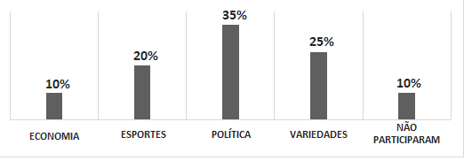
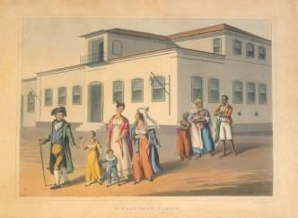

# PROVA — Camara_Barbacena_2022_Agente_Administrativo

## 1. Análise geral da prova

- **Identificação:** Camara_Barbacena_2022_Agente_Administrativo
- **Quantidade total de questões:** 50
- **Quantidade de textos de apoio (grupos):** 0
- **Quantidade de imagens:** 8
- **Quantidade de gráficos e tabelas:** incluídos nas imagens e no texto extraído, quando presentes no PDF original
- **Quantidade de grupos identificados:** 0
- **Quantidade de questões independentes:** 50
- **Questões que compartilham materiais:** nenhuma identificada automaticamente

### Transcrição integral da capa/instruções (conforme extraída do PDF)

> [!NOTE]
> Conteúdo integral das páginas anteriores à primeira questão, sem cortes.

> Agente Administrativo
> CONCURSO PÚBLICO
> Nº 01/2021
>
>
>
> Organizadora:
> Tipo 4 - AZUL
> Tarde
> CÂMARA MUNICIPAL DE BARBACENA/MG
>
>
>
>
>
>
>
>
>
> CONCURSO PÚBLICO – CÂMARA MUNICIPAL DE BARBACENA/MG
> CARGO: AGENTE ADMINISTRATIVO (T)
> – TIPO 4 – AZUL
> Џ
> CARGO: AGENTE ADMINISTRATIVO
> CONHECIMENTOS BÁSICOS
>
> LÍNGUA PORTUGUESA
> Para que ninguém a quisesse
> Porque os homens olhavam demais para a sua mulher,
> mandou que descesse a bainha dos vestidos e parasse de se
> pintar. Apesar disso, sua beleza chamava a atenção, e ele foi
> obrigado a exigir que eliminasse os decotes, jogasse fora os
> sapatos de saltos altos. Dos armários tirou as roupas de
> seda, das gavetas tirou todas as joias. E vendo que, ainda
> assim, um ou outro olhar viril se acendia à passagem dela,
> pegou a tesoura e tosquiou-lhe os longos cabelos.
> Agora podia viver descansado. Ninguém a olhava duas
> vezes, homem nenhum se interessava por ela. Esquiva como
> um gato, não mais atravessava praças. E evitava sair.
> Tão esquiva se fez, que ele foi deixando de ocupar-se
> dela, permitindo que fluísse em silêncio pelos cômodos,
> mimetizada com os móveis e as sombras.
> Uma fina saudade, porém, começou a alinhavar-se em
> seus dias. Não saudade da mulher. Mas do desejo inflamado
> que tivera por ela.
> Então lhe trouxe um batom. No outro dia um corte de
> seda. À noite tirou do bolso uma rosa de cetim para enfeitar-
> -lhe o que restava dos cabelos.
> Mas ela tinha desaprendido a gostar dessas coisas, nem
> pensava mais em lhe agradar. Largou o tecido numa gaveta,
> esqueceu o batom. E continuou andando pela casa de vestido
> de chita, enquanto a rosa desbotava sobre a cômoda.
> (Marina Colasanti. Livro “Um espinho de marfim e outras histórias”.
> Porto Alegre: L&PM, 1999.)

### Gabarito

| Questão | 01 | 02 | 03 | 04 | 05 |
|---|---|---|---|---|---|
| Resposta | C | B | D | A | C |

| Questão | 06 | 07 | 08 | 09 | 10 |
|---|---|---|---|---|---|
| Resposta | D | ANULADA | C | D | B |

| Questão | 11 | 12 | 13 | 14 | 15 |
|---|---|---|---|---|---|
| Resposta | D | C | A | C | D |

| Questão | 16 | 17 | 18 | 19 | 20 |
|---|---|---|---|---|---|
| Resposta | D | B | C | C | C |

| Questão | 21 | 22 | 23 | 24 | 25 |
|---|---|---|---|---|---|
| Resposta | B | C | A | A | A |

| Questão | 26 | 27 | 28 | 29 | 30 |
|---|---|---|---|---|---|
| Resposta | D | B | A | C | D |

| Questão | 31 | 32 | 33 | 34 | 35 |
|---|---|---|---|---|---|
| Resposta | A | B | D | A | C |

| Questão | 36 | 37 | 38 | 39 | 40 |
|---|---|---|---|---|---|
| Resposta | A | C | C | C | A |

| Questão | 41 | 42 | 43 | 44 | 45 |
|---|---|---|---|---|---|
| Resposta | B | B | C | B | B |

| Questão | 46 | 47 | 48 | 49 | 50 |
|---|---|---|---|---|---|
| Resposta | D | C | D | A | C |

## 2. Questões agrupadas

Nenhum grupo de questões compartilhando material foi identificado automaticamente nesta prova.

## 3. Questões independentes

#### QUESTÃO 01

✅ **Gabarito: C** (gabarito oficial pareado — cargo AGENTE ADMINISTRATIVO)

**Enunciado:**

De acordo com o conto, é possível inferir que a mulher:

**Alternativas:**

A) Costumava seduzir os homens.
B) Enfrentava o marido e não atendia às suas ordens.
C) Incitava, involuntariamente, a desconfiança do marido.
D) Despertava, propositadamente, o interesse e a curiosidade
dos homens.

**Referências visuais:**

Nenhuma.

---

#### QUESTÃO 02

✅ **Gabarito: B** (gabarito oficial pareado — cargo AGENTE ADMINISTRATIVO)

**Enunciado:**

“Uma fina saudade, porém, começou a alinhavar-se em seus
dias.” (4º§) O termo evidenciado pode ser substituído, sem
mudança de sentido, por:

**Alternativas:**

A) Não só.
B) Contudo.
C) Portanto.
D) À proporção que.

**Referências visuais:**

Nenhuma.

---

#### QUESTÃO 03

✅ **Gabarito: D** (gabarito oficial pareado — cargo AGENTE ADMINISTRATIVO)

**Enunciado:**

Considerando o trecho “Mas do desejo inflamado que tivera
por ela.” (4º§), é possível deduzir que a ação verbal expressa
um fato:

**Alternativas:**

A) Contínuo e constante.
B) Indefinido ou impreciso.
C) Que não se consegue provar; inacreditável.
D) Que aconteceu em um tempo mais longínquo.

**Referências visuais:**

Nenhuma.

---

#### QUESTÃO 04

✅ **Gabarito: A** (gabarito oficial pareado — cargo AGENTE ADMINISTRATIVO)

**Enunciado:**

De acordo com as ideias textuais, é possível depreender
que:

**Alternativas:**

A) As atitudes do homem demonstram a sua insegurança
com relação à mulher.
B) A mulher tinha o controle total de sua vida pessoal e isso
incomodava o homem.
C) A mulher era atraente e sedutora; por isso, os homens a
olhavam intensamente.
D) O comportamento do homem demonstrava todo o carinho
e respeito que tinha pela mulher.

**Referências visuais:**

Nenhuma.

---

#### QUESTÃO 05

✅ **Gabarito: C** (gabarito oficial pareado — cargo AGENTE ADMINISTRATIVO)

**Enunciado:**

Os termos destacados são referentes à mesma classe gra-
matical, EXCETO:

**Alternativas:**

A) “(...) jogasse fora os sapatos de saltos altos.” (1º§)
B) “(...) um ou outro olhar viril se acendia à passagem dela,
(...)” (1º§)
C) “Porque os homens olhavam demais para a sua mulher,
(...)” (1º§)
D) “Uma fina saudade, porém, começou a alinhavar-se em
seus dias.” (4º§)

**Referências visuais:**

Nenhuma.

---

#### QUESTÃO 06

✅ **Gabarito: D** (gabarito oficial pareado — cargo AGENTE ADMINISTRATIVO)

**Enunciado:**

“Tão esquiva se fez, que ele foi deixando de ocupar-se dela,
permitindo que fluísse em silêncio pelos cômodos, mimeti-
zada com os móveis e as sombras.” (3º§) A expressão “mime-
tizada”, segundo a conjuntura textual, significa:

**Alternativas:**

A) Ligada.
B) Cercada.
C) Imbuída.
D) Disfarçada.

**Referências visuais:**

Nenhuma.

---

#### QUESTÃO 07

⚠️ **Gabarito: ANULADA**

**Enunciado:**

“E vendo que, ainda assim, um ou outro olhar viril se acendia
à passagem dela, pegou a tesoura e tosquiou-lhe os longos
cabelos.” (1º§) Assinale, a seguir, a palavra que NÃO pode
substituir o termo “tosquiou”.

**Alternativas:**

A) Aparou.
B) Raparou.
C) Adornou.
D) Cortou rente.

**Referências visuais:**

Nenhuma.

---

#### QUESTÃO 08

✅ **Gabarito: C** (gabarito oficial pareado — cargo AGENTE ADMINISTRATIVO)

**Enunciado:**

Há ERRO de concordância verbal em:

**Alternativas:**

A) Faz anos que ele me maltrata.
B) Havia nesta casa alegrias e sonhos.
C) Tratavam-se de assuntos importantes.
D) Caso ela vá embora amanhã, deverá levar os seus vestidos.

**Referências visuais:**

Nenhuma.

---

#### QUESTÃO 09

✅ **Gabarito: D** (gabarito oficial pareado — cargo AGENTE ADMINISTRATIVO)

**Enunciado:**

No trecho “Ninguém a olhava duas vezes, homem nenhum se
interessava por ela.” (2º§), a vírgula tem como finalidade:

**Alternativas:**

A) Exprimir surpresa.
B) Surpreender o leitor.
C) Validar a opinião da autora.
D) Marcar uma pausa de curta duração.
CONCURSO PÚBLICO – CÂMARA MUNICIPAL DE BARBACENA/MG
CARGO: AGENTE ADMINISTRATIVO (T)
– TIPO 4 – AZUL
Џ

**Referências visuais:**

Nenhuma.

---

#### QUESTÃO 10

✅ **Gabarito: B** (gabarito oficial pareado — cargo AGENTE ADMINISTRATIVO)

**Enunciado:**

Considerando os trechos citados no texto, assinale o que
exprime circunstância de tempo.

**Alternativas:**

A) “Não saudade da mulher.” (4º§)
B) “Agora podia viver descansado.” (2º§)
C) “Largou o tecido numa gaveta, esqueceu o batom.” (6º§)
D) “Dos armários tirou as roupas de seda, das gavetas tirou
todas as joias.” (1º§)

**Referências visuais:**

Nenhuma.

---

#### QUESTÃO 11

✅ **Gabarito: D** (gabarito oficial pareado — cargo AGENTE ADMINISTRATIVO)

**Enunciado:**

Considerando o trecho “Esquiva como um gato, não mais
atravessava praças.” (2º§), a expressão destacada estabe-
lece ideia de:

**Alternativas:**

A) Causa.
B) Explicação.
C) Alternância.
D) Comparação.

**Referências visuais:**

Nenhuma.

---

#### QUESTÃO 12

✅ **Gabarito: C** (gabarito oficial pareado — cargo AGENTE ADMINISTRATIVO)

**Enunciado:**

Preposição é toda palavra variável que conecta dois ou
mais termos da oração. Nessa ligação, um termo fica subor-
dinado ao outro. Assinale, a seguir, a afirmativa na qual tal
classe gramatical está associada à ideia de posição superior
ou proximidade.

**Alternativas:**

A) “Dos armários tirou as roupas de seda (...)” (1º§)
B) “(...) mimetizada com os móveis e as sombras.” (3º§)
C) “(...) enquanto a rosa desbotava sobre a cômoda.” (6º§)
D) “Porque os homens olhavam demais para a sua mulher,
(...)” (1º§)

**Referências visuais:**

Nenhuma.

---

#### QUESTÃO 13

✅ **Gabarito: A** (gabarito oficial pareado — cargo AGENTE ADMINISTRATIVO)

**Enunciado:**

É possível afirmar que o título do texto “Para que ninguém
a quisesse” demonstra:

**Alternativas:**

A) Um desejo.
B) Uma incerteza.
C) A continuidade de um fato real.
D) Uma possibilidade compreensível.

**Referências visuais:**

Nenhuma.

---

#### QUESTÃO 14

✅ **Gabarito: C** (gabarito oficial pareado — cargo AGENTE ADMINISTRATIVO)

**Enunciado:**

No excerto “À noite tirou do bolso uma rosa de cetim para
enfeitar-lhe o que restava dos cabelos.” (5º§), o sinal indicativo
de crase foi empregado adequadamente. Tal fato NÃO ocorre
em:

**Alternativas:**

A) Refiro-me às atitudes rudes daquele homem.
B) Às vezes não podemos aceitar certos vínculos.
C) Submeteram o seu amor à provações dolorosas.
D) A mulher desobedeceu às limitações sentimentais.

**Referências visuais:**

Nenhuma.

---

#### QUESTÃO 15

✅ **Gabarito: D** (gabarito oficial pareado — cargo AGENTE ADMINISTRATIVO)

**Enunciado:**

Em “Apesar disso, sua beleza chamava a atenção, e ele foi
obrigado a exigir que eliminasse os decotes, jogasse fora os
sapatos de saltos altos.” (1º§), a expressão assinalada pode
ser substituída, sem alteração semântica, por, EXCETO:

**Alternativas:**

A) Todavia.
B) Entretanto.
C) Ainda assim.
D) Em vista disso.
RACIOCÍNIO LÓGICO MATEMÁTICO

**Referências visuais:**

Nenhuma.

---

#### QUESTÃO 16

✅ **Gabarito: D** (gabarito oficial pareado — cargo AGENTE ADMINISTRATIVO)

**Enunciado:**

No cardápio da pastelaria de José, há opções de pastéis doces
e salgados. Após um dia de trabalho, sabe-se que foram
vendidos 59 pastéis com uma arrecadação de R$ 992,00.
Considerando-se que um pastel doce custa R$ 18,00 e cada
pastel salgado tem o valor de R$ 16,00, quantos pastéis sal-
gados foram vendidos?

**Alternativas:**

A) 24
B) 27
C) 32
D) 35

**Referências visuais:**

Nenhuma.

---

#### QUESTÃO 17

✅ **Gabarito: B** (gabarito oficial pareado — cargo AGENTE ADMINISTRATIVO)

**Enunciado:**

Uma padaria possui 5 padeiros que conseguem produzir
140 pães em 4 dias. Percebendo que a demanda por pães
tem aumentado na região, o proprietário dessa padaria
decidiu contratar mais 2 padeiros. Com o novo quadro de
funcionários, quantos dias são necessários para produzir
294 pães?

**Alternativas:**

A) 5
B) 6
C) 7
D) 8

**Referências visuais:**

Nenhuma.

---

#### QUESTÃO 18

✅ **Gabarito: C** (gabarito oficial pareado — cargo AGENTE ADMINISTRATIVO)

**Enunciado:**

Os 500 leitores de um jornal foram questionados sobre a
seção favorita. Assuma que os leitores podiam escolher
apenas uma opção dentre as fornecidas. O gráfico a seguir
resume o resultado da enquete; observe.
Dentre os leitores que participaram da enquete, qual a
probabilidade aproximada de se escolher uma pessoa que
prefere a seção de variedades ou política?

**Alternativas:**

A) 55%
B) 60%
C) 67%
D) 72%

**Referências visuais:**

Nenhuma.

---

#### QUESTÃO 19

✅ **Gabarito: C** (gabarito oficial pareado — cargo AGENTE ADMINISTRATIVO)

**Enunciado:**

Adriana, Bruna e Cléo são professoras em uma escola pública
e lecionam as disciplinas de português, matemática e ciências,
mas não necessariamente nessa ordem. Verificando a idade
das três, a professora de português, que é prima de Bruna, é a
mais nova. Além disso, considere que a professora de ciências
é mais nova do que Cléo. Nesse contexto, é necessariamente
correto afirmar que:

**Alternativas:**

A) Cléo é professora de português.
B) Bruna é a professora mais velha.
C) Adriana é professora de português.
D) Cléo não é professora de matemática.

CONCURSO PÚBLICO – CÂMARA MUNICIPAL DE BARBACENA/MG
CARGO: AGENTE ADMINISTRATIVO (T)
– TIPO 4 – AZUL
Џ

**Referências visuais:**

Nenhuma.

---

#### QUESTÃO 20

✅ **Gabarito: C** (gabarito oficial pareado — cargo AGENTE ADMINISTRATIVO)

**Enunciado:**

Um trabalhador deve descarregar 60 caixotes de um caminhão
até um depósito que está a 42 metros de distância de onde ele
se encontra estacionado. Considerando que o trabalhador
consegue carregar 4 caixotes por vez, quantos metros, ao todo,
ele irá caminhar até que todos os caixotes estejam no depósito?

**Alternativas:**

A) 588
B) 630
C) 1.218
D) 1.260
CONHECIMENTOS GERAIS

**Referências visuais:**

Nenhuma.

---

#### QUESTÃO 21

✅ **Gabarito: B** (gabarito oficial pareado — cargo AGENTE ADMINISTRATIVO)

**Enunciado:**

Embora o tema da segurança cibernética tenha sido abordado
pela comitiva brasileira com autoridades russas, o presidente
Jair Bolsonaro negou que tenha tratado sobre a segurança das
eleições brasileiras com o líder russo, Vladimir Putin. Bolsonaro
disse que isso se trata de uma “ilação”. “Esse (tema de segu-
rança nas eleições) não é assunto para tratar fora do Brasil, com
todo o respeito. Se alguém faz qualquer ilação nesse sentido
está extrapolando, no meu entender, a sua atividade”, disse
Bolsonaro, em entrevista coletiva, horas após a reunião com
Putin. O ministro Edson Fachin, que assume a presidência do
Tribunal Superior Eleitoral (TSE) na próxima semana, tem feito
críticas à atuação da Rússia na área de cibersegurança. Fachin
disse que países como a Rússia “têm relutado em sancionar
os cibercriminosos que buscam destruir a reputação da Jus-
tiça Eleitoral e aniquilar com a democracia”.
(Disponível em: https://ultimosegundo.ig.com.br/mundo/2022-02-
16/bolsonaro-nao-tratou-eleicoes-brasileiras-putin.html. Acesso em:
18/02/2022.)

O Processo Eleitoral do Brasil é organizado pela Justiça Eleito-
ral em nível municipal, estadual e federal. Sobre ele, assinale
a afirmativa INCORRETA.

**Alternativas:**

A) Fiscaliza as contas dos partidos e dos candidatos em cam-
panha.
B) A Justiça Eleitoral tem como órgão máximo o Tribunal
Regional Eleitoral.
C) Controla o cumprimento da legislação vigente em período
eleitoral e julga os processos relacionados com as eleições.
D) A logística de distribuição das urnas eletrônicas pelos
locais de votação varia de acordo com as necessidades e
peculiaridades de cada Tribunal Regional Eleitoral e de
cada zona eleitoral.

**Referências visuais:**

Nenhuma.

---

#### QUESTÃO 22

✅ **Gabarito: C** (gabarito oficial pareado — cargo AGENTE ADMINISTRATIVO)

**Enunciado:**

O Golpe Militar foi deflagrado contra o governo legalmente
constituído de João Goulart, estabelecendo, por um logo
período, a Ditadura Militar que findou em 1985 com a
eleição indireta do presidente Tancredo Neves. São carac-
terísticas da Ditadura Militar, EXCETO:

**Alternativas:**

A) Implantação do bipartidarismo.
B) Punição dos movimentos sociais e manifestações políticas
divergentes.
C) Intensidade das atividades do poder legislativo e extinção
do poder executivo.
D) Investimentos na infraestrutura refletindo o crescimento
da economia; contudo, aumentando a dívida externa.

**Referências visuais:**

Nenhuma.

---

#### QUESTÃO 23

✅ **Gabarito: A** (gabarito oficial pareado — cargo AGENTE ADMINISTRATIVO)

**Enunciado:**

Arqueólogos peruanos encontraram 14 múmias do período pré-
-Inca no Peru. Dos restos mortais, seis deles eram de crianças,
possivelmente sacrifícios, enterradas junto com uma impor-
tante figura social no antigo complexo urbano de barro de
Cajamarquilla, nos arredores de Lima, há mais de 1.000 anos.
(Disponível em: https://g1.globo.com/mundo/noticia/2022/02/15/
arqueologos-encontram-14-mumias-do-periodo-pre-inca-no-peru.
ghtml. Acesso em: 18/02/2022.)

A civilização Inca foi importante durante o período pré-
-colombiano; sobre tal civilização, marque V para as afir-
mativas verdadeiras e F para as falsas.
( ) Os incas (chamados de quéchua) dominavam a região
de Cuzco.
( ) Desenvolveram um vasto império na região andina,
estenderam pelos territórios que, atualmente, corres-
pondem à parte da Colômbia até o norte do Chile e
Argentina.
( ) Construíram um império que era baseado em um sistema
de governo conhecido como teocracia.
( ) Possuíam uma cultura sofisticada e suas construções
marcantes, como a rede de estradas que interligava as
diferentes partes do império.
A sequência está correta em

**Alternativas:**

A) V, V, V, V.
B) F, V, F, V.
C) F, F, F, F.
D) V, F, V, F.

**Referências visuais:**

Nenhuma.

---

#### QUESTÃO 24

✅ **Gabarito: A** (gabarito oficial pareado — cargo AGENTE ADMINISTRATIVO)

**Enunciado:**

Amazônia Legal é uma porção da Floresta Amazônica definida
como tal pelo governo brasileiro ainda na década de 1950. É
uma definição feita para atender a fins jurídicos; por isso, pode
ou não corresponder ao que os outros campos de estudo
reconhecem como “floresta amazônica”. Os estados que
percorrem a Amazônia Legal são: Acre, Amapá, Amazonas,
Pará, Rondônia, Roraima, Mato Grosso, Tocantins e Maranhão.
(Disponível em: www.politize.com.br.)

O Conselho da Amazônia é um órgão colegiado, formado pela
Vice-Presidência da República e por 14 ministérios. O Decreto
nº 10.239/2020 estabelece que este grupo de pessoas se
reunirá a cada três meses. Sobre as competências do Conse-
lho da Amazônia, marque V para as afirmativas verdadeiras e
F para as falsas.
( ) Preconiza políticas e iniciativas relacionadas à preser-
vação, à proteção e ao desenvolvimento sustentável da
Amazônia Legal.
( ) Apoia a pesquisa científica, o desenvolvimento tecnoló-
gico e a inovação.
( ) Gere ações de prevenção, fiscalização e repressão a
ilícitos e o intercâmbio de informações.
A sequência está correta em

**Alternativas:**

A) V, V, V.
B) F, F, F.
C) F, F, V.
D) V, V, F.
CONCURSO PÚBLICO – CÂMARA MUNICIPAL DE BARBACENA/MG
CARGO: AGENTE ADMINISTRATIVO (T)
– TIPO 4 – AZUL
Џ

**Referências visuais:**

Nenhuma.

---

#### QUESTÃO 25

✅ **Gabarito: A** (gabarito oficial pareado — cargo AGENTE ADMINISTRATIVO)

**Enunciado:**

Inflação e desemprego devem agravar fome
no Brasil, diz economista
Nilson de Paula investigou que mais da metade dos lares
brasileiros enfrenta insegurança alimentar e alerta que país
vive combinação explosiva. Coordenador da Rede Brasileira de
Pesquisa em Soberania e Segurança Alimentar (Rede Penssan)
e economista formado pela Universidade Federal do Paraná
(UFPR), o pesquisador Nilson Maciel de Paula é pessimista em
relação à situação da fome e da insegurança alimentar no Brasil
em 2022. “O cenário é complicado porque a cada dia a gente
vai tendo notícias não muito animadoras. Nada indica que o
quadro que veio à tona no ano passado, em 2021, relacionado
à fome, vá melhorar”, disse em entrevista à Agência Pública.
Dois fatores são cruciais para a afirmação do economista: a
inflação e o desemprego que, segundo a maior parte dos
prognósticos econômicos, devem permanecer em situação
preocupante nesse ano.
(Disponível em: https://economia.ig.com.br/2022-01-31/inflacao-
desemprego-fome.html. Acesso em: 18/02/2022.)

Em relação aos aspectos econômicos brasileiros, analise as
afirmativas a seguir.
I. A desigualdade social e a economia estrutural são uma
marca histórica no desenvolvimento do país.
II. A insegurança alimentar nos lares em que as mulheres são
os pilares da renda familiar é mais grave, precisamente
porque as mulheres foram as mais prejudicadas pela falta
de emprego e perda de renda na pandemia.
III. A reprimarização impacta na qualidade do trabalho em
função do eixo da economia.
Está correto o que se afirma em

**Alternativas:**

A) I, II e III.
B) III, apenas.
C) I e II, apenas.
D) II e III, apenas.

**Referências visuais:**

Nenhuma.

---

#### QUESTÃO 26

✅ **Gabarito: D** (gabarito oficial pareado — cargo AGENTE ADMINISTRATIVO)

**Enunciado:**

Pesquisa do Instituto Escolhas, feita por pesquisadores da
USP, indica que houve maior desvalorização em municípios
com expansão da agropecuária, como em São Félix do Xingu,
no Pará. O desmatamento ocorrido na década passada
reduziu o preço da terra no Brasil, favorecendo a compra
dessas áreas por uma pequena parcela de produtores,
aponta um estudo lançado pelo Instituto Escolhas, feito por
pesquisadores da Escola Superior de Agricultura “Luiz de
Queiroz” da Universidade de São Paulo (Esalq/USP).
(O Globo. Agro. Adaptado.)

A humanidade tem um dos maiores desafios que é o desma-
tamento. Sobre as suas causas, bem como consequências,
assinale a afirmativa INCORRETA.

**Alternativas:**

A) Impacta na cadeia alimentar.
B) Ocasiona um processo de desertificação ao degradar a
vegetação nativa.
C) Afeta gravemente a economia e a sociedade devido à
falta de recursos naturais.
D) Proporciona a diminuição das doenças transmitidas por
vetores e, consequentemente, sua extinção.

**Referências visuais:**

Nenhuma.

---

#### QUESTÃO 27

✅ **Gabarito: B** (gabarito oficial pareado — cargo AGENTE ADMINISTRATIVO)

**Enunciado:**

Um estudo realizado pela Secretaria de Trabalho do Ministério
da Economia, disponível na Relação Anual de Informações
Sociais (RAIS), constatou que o número de pessoas com mais
de 65 anos que estão trabalhando com carteira assinada au-
mentou 43% entre 2013 e 2017, saindo de 484 mil para 649,4
mil. O Instituto Brasileiro de Geografia e Estatística (IBGE) vem
realizando uma série de pesquisas que evidenciaram que o
número de pessoas com mais de 65 anos no país teve um
grande aumento nos últimos anos, e que essas pessoas se
tornarão a grande maioria no futuro. Entre 2012 e 2018 por
exemplo, o instituto afirmou que o país sofreu um aumento de
26% no número de idosos, que chegaram a representar 10,5%
da população do Brasil em 2018.
(Disponível em: www.pontotel.com.br.)

Em relação à população idosa brasileira, analise as afirma-
tivas a seguir.
I. No mercado de trabalho, atualmente, a quantidade vagas
para os idosos teve um aumento significativo devido à
grande procura de empregos por eles.
II. As empresas que necessitam de atualização que envolvem
os avanços tecnológicos buscam pessoas desta faixa etária
em virtude da experiência já consolidada.
III. Os idosos, por terem características como o compro-
metimento e a fidelidade, são grandes atrativos para as
empresas, pois resultam na economia advinda da dimi-
nuição do turnover e absenteísmo, resultando em uma
economia maior.
Está correto o que se afirma em

**Alternativas:**

A) I, II e III.
B) III, apenas.
C) I e II, apenas.
D) II e III, apenas.

**Referências visuais:**

Nenhuma.

---

#### QUESTÃO 28

✅ **Gabarito: A** (gabarito oficial pareado — cargo AGENTE ADMINISTRATIVO)

**Enunciado:**

O estado de sítio é um dispositivo burocrático definido pela
nossa Constituição para ser exercido em momentos em que a
ordem do Estado Democrático de Direito está gravemente
ameaçada. Essa medida de exceção deve ser autorizada pelo
Congresso Nacional e já foi utilizada em diversos momentos de
nossa história republicana.
(Mundo Educação.)

Sobre o estado de sítio, marque V para as afirmativas ver-
dadeiras e F para as falsas.
( ) No Brasil, é uma medida de exceção possuindo prazo
limitado de atuação com exceção em casos de guerra.
( ) Permite que o Legislativo e o Judiciário excedam sobre
o poder Executivo, anulando sua autoridade.
( ) Poderá ser decretado em situação de declaração de
guerra ou resposta à agressão armada estrangeira.
A sequência está correta em

**Alternativas:**

A) V, F, V.
B) F, V, F.
C) V, V, V.
D) F, F, F.
CONCURSO PÚBLICO – CÂMARA MUNICIPAL DE BARBACENA/MG
CARGO: AGENTE ADMINISTRATIVO (T)
– TIPO 4 – AZUL
Џ

**Referências visuais:**

Nenhuma.

---

#### QUESTÃO 29

✅ **Gabarito: C** (gabarito oficial pareado — cargo AGENTE ADMINISTRATIVO)

**Enunciado:**

As Comissões Parlamentares de Inquérito (CPI) são investi-
gações de “fato determinado” realizadas pelo Poder Legisla-
tivo, previstas na Constituição. Podem ser instaladas na Câmara
dos Deputados e no Senado, em conjunto (CPIs mistas) ou
separadamente.
(Disponível em: www.terra.com.br.)

Apelidada de “CPI dos Anões do Orçamento” a referida
comissão parlamentar teve como núcleo de investigação:

**Alternativas:**

A) Irregularidades relacionadas a bingos.
B) Negociações da Confederação Brasileira de Futebol (CBF).
C) Desvio de recursos do Orçamento da União destinados a
obras de assistência social para entidades fantasmas contro-
ladas por parlamentares.
D) Recebimento de propina, por parlamentares, proveniente
de verbas desviadas de emendas parlamentares destinadas
à compra de ambulâncias.

**Referências visuais:**

Nenhuma.

---

#### QUESTÃO 30

✅ **Gabarito: D** (gabarito oficial pareado — cargo AGENTE ADMINISTRATIVO)

**Enunciado:**

O Nazismo, abreviação de Nacional Socialismo, é o nome de
uma ideologia política disseminada amplamente pelo Partido
Nacional Socialista dos Trabalhadores Alemães, que foi criado
em 1920, por Anton Drexler. Sobre o comando de Adolf Hitler,
essa ideologia logo se espalhou por toda a Alemanha.
(Disponível em: https://www.politize.com.br/nazismo/. Adaptado.)

Sobre o Nazismo, assinale a afirmativa INCORRETA.

**Alternativas:**

A) A caraterística principal foi a militarização.
B) Englobava especificidades como o antissemitismo e a
aversão à democracia liberal.
C) O poder da Alemanha foi assumido pelos nazitas, em 1933,
e derrubados ao final da Segunda Guerra Mundial.
D) O governo, apesar do regime autoritário, tinha uma parti-
cularidade notável; ele matinha livre as emissoras de
rádio e de televisão, exigindo apenas a vinculação de
propagandas de Hitler.
CONHECIMENTOS ESPECÍFICOS
LEGISLAÇÃO ESPECÍFICA

**Referências visuais:**

Nenhuma.

---

#### QUESTÃO 31

✅ **Gabarito: A** (gabarito oficial pareado — cargo AGENTE ADMINISTRATIVO)

**Enunciado:**

Trata-se de uma espécie de afastamento, nos termos do
Estatuto dos Servidores Municipais de Barbacena:

**Alternativas:**

A) Para exercício de mandato eletivo.
B) Para gozo de prêmio por assiduidade.
C) Para acompanhar pessoa doente na família.
D) Para exercício de cargo efetivo em outro município.

**Referências visuais:**

Nenhuma.

---

#### QUESTÃO 32

✅ **Gabarito: B** (gabarito oficial pareado — cargo AGENTE ADMINISTRATIVO)

**Enunciado:**

A Constituição Federal estabelece alguns direitos fundamen-
tais que independem de pagamento, como o caso de:

**Alternativas:**

A) Ação de habeas corpus, apenas se o interessado for réu
primário.
B) Ação de habeas data para acesso à informação retida em
banco de dados público.
C) Registro de propriedade de bens imóveis para interessado
em situação de desempregado.
D) Certidão de óbito, em qualquer hipótese, se requerida até
48 (quarenta e oito) horas após o falecimento.

**Referências visuais:**

Nenhuma.

---

#### QUESTÃO 33

✅ **Gabarito: D** (gabarito oficial pareado — cargo AGENTE ADMINISTRATIVO)

**Enunciado:**

Nos termos do Regimento Interno da Câmara Municipal de
Barbacena, marque V para as afirmativas verdadeiras e F
para as falsas.
( ) É dever do Vereador propor e levar ao conhecimento
da Câmara, medida que julgar necessária em defesa do
Município, da Câmara ou de qualquer membro do
Legislativo.
( ) O Vereador pode requerer licença para desempenhar
missões temporárias de caráter cultural ou de interesse
do Município, devendo a Câmara deferir em 24 (vinte e
quatro) horas.
( ) Na hipótese de censura verbal, esta será aplicada pelo
Presidente da Câmara, em Plenário, durante a sessão,
e constará em ata.
A sequência está correta em

**Alternativas:**

A) F, V, F.
B) F, F, V.
C) V, V, F.
D) V, F, V.

**Referências visuais:**

Nenhuma.

---

#### QUESTÃO 34

✅ **Gabarito: A** (gabarito oficial pareado — cargo AGENTE ADMINISTRATIVO)

**Enunciado:**

O Município de Barbacena, ao dispor sobre loteamentos e
arruamentos, nos termos da Lei Orgânica, deverá exigir
reserva de áreas destinadas a:

**Alternativas:**

A) Passagem de canalizações públicas de esgoto.
B) Instalação de ciclovias nos logradouros públicos.
C) Área para circulação de carroças de tração animal.
D) Zonas de estacionamento de veículos automotivos.

**Referências visuais:**

Nenhuma.

---

#### QUESTÃO 35

✅ **Gabarito: C** (gabarito oficial pareado — cargo AGENTE ADMINISTRATIVO)

**Enunciado:**

A Constituição Federal, no capítulo que dispõe sobre a Admi-
nistração Pública, exige a edição de Lei Complementar para:

**Alternativas:**

A) Definir os casos de exoneração dos servidores públicos
federais.
B) Criar cargos efetivos na estrutura da administração direta
e indireta.
C) Definir a área de atuação das fundações públicas de di-
reito privado.
D) Regulamentar o direito de greve dos servidores públicos
de qualquer esfera.

**Referências visuais:**

Nenhuma.

---

#### QUESTÃO 36

✅ **Gabarito: A** (gabarito oficial pareado — cargo AGENTE ADMINISTRATIVO)

**Enunciado:**

Betina, servidora da Câmara do Município de Barbacena, agindo
por conduta dolosa, frustrou a licitude de uma licitação. Neste
caso, conforme a Lei de improbidade administrativa, Betina:

**Alternativas:**

A) Poderá ter seus direitos políticos suspensos por prazo de
8 anos.
B) Praticou ato de improbidade configurado como atentado
aos princípios.
C) Só pode ser punida se o ato de improbidade for de enri-
quecimento ilícito.
D) Será punida apenas se o ilícito for descoberto em até três
anos de sua prática.
CONCURSO PÚBLICO – CÂMARA MUNICIPAL DE BARBACENA/MG
CARGO: AGENTE ADMINISTRATIVO (T)
– TIPO 4 – AZUL
Џ

**Referências visuais:**

Nenhuma.

---

#### QUESTÃO 37

✅ **Gabarito: C** (gabarito oficial pareado — cargo AGENTE ADMINISTRATIVO)

**Enunciado:**

Dentre os requisitos para a investidura no cargo público
efetivo municipal de Barbacena, inclui-se:

**Alternativas:**

A) O comprovante de que o aprovado não possui outro cargo
público.
B) A comprovação de residência no município de Barbacena
ou região.
C) O gozo dos direitos políticos, tais quais os direitos de votar e
ser votado.
D) A aptidão física e mental aferida em Teste de Aptidão
Física – TAF.

**Referências visuais:**

Nenhuma.

---

#### QUESTÃO 38

✅ **Gabarito: C** (gabarito oficial pareado — cargo AGENTE ADMINISTRATIVO)

**Enunciado:**

Nos termos do Código Penal brasileiro, se Ana Clara, servi-
dora pública municipal, retardar ou deixar de praticar,
indevidamente, ato de ofício para satisfazer interesse ou
sentimento pessoal restará praticado o crime de:

**Alternativas:**

A) Peculato.
B) Improbidade.
C) Prevaricação.
D) Condescendência.
CONHECIMENTOS DO CARGO

**Referências visuais:**

Nenhuma.

---

#### QUESTÃO 39

✅ **Gabarito: C** (gabarito oficial pareado — cargo AGENTE ADMINISTRATIVO)

**Enunciado:**

Uma das principais ferramentas empregadas na prevenção
de acidentes de trabalho são as sinalizações. As diversas
cores ou formatos utilizados orientam os trabalhadores
sobre a atenção necessária ou a possibilidade de inúmeros
perigos considere as sinalizações apresentadas a seguir:
I.

II.
III.
IV.
As informações se referem, respectivamente, a:

**Alternativas:**

A) I. Interdição II. Risco Mecânico III. Alerta IV. Segurança
B) I. Risco Biológico II. Interdição III. Advertência IV. Risco
Químico
C) I. Alerta II. Obrigação III. Segurança IV. Prevenção de
Incêndio
D) I. Prevenção de Incêndio II. Risco Biológico III. Interdição
IV. Obrigação

**Referências visuais:**

Nenhuma.

---

#### QUESTÃO 40

✅ **Gabarito: A** (gabarito oficial pareado — cargo AGENTE ADMINISTRATIVO)

**Enunciado:**

Na Administração Pública, o processo de comunicação formal
deve seguir normatizações, cujas regras garantem que os dados
e as informações são resguardados em diferentes aspectos
como segurança, publicidade, formalização, dentre outros. Para
tanto, alguns documentos devem ser utilizados como o memo-
rando. É considerada a principal característica do memorando:

**Alternativas:**

A) O destinatário deve ser mencionado apenas pelo cargo
que ocupa.
B) Quanto à sua forma, é exatamente idêntico ao modelo
padrão ofício.
C) É obrigatório o acréscimo do vocativo, que invoca o desti-
natário, seguido de vírgula.
D) Por ser um tipo de documento para uso interno somente,
não precisa conter informações como: tipo, número de
expediente e sigla.

**Referências visuais:**

Nenhuma.

---

#### QUESTÃO 41

✅ **Gabarito: B** (gabarito oficial pareado — cargo AGENTE ADMINISTRATIVO)

**Enunciado:**

No âmbito das comunicações oficiais expedidas a partir de
órgãos da Administração Pública, o padrão ofício se guia os
servidores ou agentes públicos em se tratando de elaboração
ou diagramação de expedientes visando, sobretudo, a unifor-
mização dos documentos, como o ofício. São consideradas
partes que integram o padrão ofício, EXCETO:

**Alternativas:**

A) Cabeçalho; Endereçamento; e, Fecho da Comunicação.
B) Rodapé; Assinatura; Cargo e Brasão; e, Logomarca do Órgão
Expedidor.
C) Identificação do Expediente; Assunto; e, Identificação do
Signatário.
D) Local e Data do Documento; Texto do Documento; e, Nume-
ração das Páginas.

**Referências visuais:**

Nenhuma.

---

#### QUESTÃO 42

✅ **Gabarito: B** (gabarito oficial pareado — cargo AGENTE ADMINISTRATIVO)

**Enunciado:**

As organizações modernas podem ser comparadas a um
sistema aberto composto por inúmeros elementos (departa-
mentos) que se interrelacionam e interagem com o ambiente
externo. Estas relações são essenciais para que as empresas
consigam atingir suas metas e objetivos e, sobretudo, para
manter sua própria sobrevivência. Os departamentos e suas
respectivas rotinas são cruciais para o bom funcionamento de
todo o sistema; por isso, é importante que estejam bem deli-
mitadas no âmbito da estrutura organizacional. Responsável
pelas atividades vinculadas à transformação dos insumos em
produtos prontos para a comercialização denomina-se depar-
tamento de:

**Alternativas:**

A) Finanças.
B) Produção.
C) Marketing.
D) Administração.

**Referências visuais:**

Nenhuma.

---

#### QUESTÃO 43

✅ **Gabarito: C** (gabarito oficial pareado — cargo AGENTE ADMINISTRATIVO)

**Enunciado:**

De acordo com o Observatório de Segurança e Saúde no
Trabalho, elaborado pelo Ministério Público do Trabalho
(MPT) e a Organização Internacional do Trabalho (OIT), de
2012 a 2020, 21.467 brasileiros perderam a vida em decorrên-
cia de acidentes de trabalho ou doença laboral. Para evitar que
mais trabalhadores percam a sua saúde, ou pior, a sua vida, é
fundamental que as possíveis causas que levam à ocorrência
de acidentes de trabalho sejam conhecidas e, sobretudo,
evitadas a partir da divulgação das normas de segurança.
Sobre as diferentes causas que podem contribuir para a
ocorrência de acidentes no ambiente de trabalho, assinale a
afirmativa correta.

**Alternativas:**

A) A falta de proteção em máquinas trata-se de ato inseguro.
B) A não utilização de equipamentos de proteção individual
se refere à condição insegura.
C) Agentes nocivos presentes no ambiente de trabalho
trata-se de condição insegura.
D) A falta de espaço, ventilação ou iluminação inadequada
são exemplos desse referem a atos inseguros.

CONCURSO PÚBLICO – CÂMARA MUNICIPAL DE BARBACENA/MG
CARGO: AGENTE ADMINISTRATIVO (T)
– TIPO 4 – AZUL
Џ

**Referências visuais:**

Nenhuma.

---

#### QUESTÃO 44

✅ **Gabarito: B** (gabarito oficial pareado — cargo AGENTE ADMINISTRATIVO)

**Enunciado:**

Arquivos devidamente classificados facilitam a sua manipulação, propiciando maior agilidade e controle das informações.
Considerando a técnica de classificação documental de acordo com o gênero, analise as imagens a seguir:
I.
II.
III.
IV.
Assinale a associação correta.

**Alternativas:**

A) I. Musicais II. Artístico III. Visuais IV. Cartográficos
B) I. Sonoros II. Iconográficos III. Filmográficos IV. Cartográficos
C) I. Sonoros II. Artísticos III. Cinematográficos IV. Micrográficos
D) I. Audiovisuais II. Ilustrativos III. Cinematográficos IV. Cartográficos

**Referências visuais:**

Nenhuma.

---

#### QUESTÃO 45

✅ **Gabarito: B** (gabarito oficial pareado — cargo AGENTE ADMINISTRATIVO)

**Enunciado:**

Uma das finalidades principais de um sistema de arquivos
é a guarda e a disponibilização de documentos necessários
para o processo de tomada de decisão. No entanto, para
que tal processo ocorra de forma eficiente os documentos
devem ser corretamente ordenados, conforme o emprego
de diversos métodos como o método alfabético. Em relação
às regras de arquivamento alfanumérico, marque V para as
verdadeiras e F para as falsas.
( ) Para sobrenomes iguais

**Alternativas:**

A) Souza, Aníbal
B) Souza, Paulo
C) Souza, Marília
( ) Para nomes compostos

**Referências visuais:**

Nenhuma.

---

#### QUESTÃO 46

✅ **Gabarito: D** (gabarito oficial pareado — cargo AGENTE ADMINISTRATIVO)

**Enunciado:**

A motivação é um processo que impulsiona as pessoas na
conquista de objetivos pessoais ou profissionais. Pessoas
motivadas dão o melhor de si para alcançar o que almejam.
As organizações, considerando importância da motivação
para que os seus colaboradores possam cumprir metas glo-
bais e departamentais, alinhadas ao planejamento estraté-
gico, devem buscar oferecer condições para satisfazer diver-
sas necessidades. Sobre a hierarquia das necessidades, con-
forme Maslow, assinale a alternativa correta.

**Alternativas:**

A) Sociais: relacionadas ao reconhecimento pessoal, status,
prestígio, atenção e consideração.
B) De Estima: associadas à amizade com colegas, interação
com clientes, afeição e aceitação social.
C) Fisiológicas: associadas ao trabalho seguro, remuneração
e benefícios e permanência no emprego.
D) De Autorrealização: associadas ao trabalho desafiante, diver-
sidade e autonomia, participação nas decisões e crescimento
profissional.

**Referências visuais:**

Nenhuma.

---

#### QUESTÃO 47

✅ **Gabarito: C** (gabarito oficial pareado — cargo AGENTE ADMINISTRATIVO)

**Enunciado:**

Para inserir números de páginas em um determinado ofício,
que está sendo redigido no Microsoft Word 2013, Configu-
ração Local, Idioma Português-Brasil, o usuário deverá execu-
tar a seguinte opção:

**Alternativas:**

A) Guia: Exibir; Grupo: Estilos; Botão: Número de Página
B) Guia: Página Inicial; Grupo: Exibir; Botão: Número de Página
C) Guia: Inserir; Grupo: Cabeçalho e Rodapé; Botão: Número
de Página
D) Guia: Layout da Página; Grupo: Inserir e Rodapé; Botão:
Número de Página

**Referências visuais:**

Nenhuma.

---

#### QUESTÃO 48

✅ **Gabarito: D** (gabarito oficial pareado — cargo AGENTE ADMINISTRATIVO)

**Enunciado:**

Considerando o Microsoft Excel 2013, Configuração Local,
Idioma Português-Brasil, e trabalhando com números fracio-
nários, para remover a parte fracionária do número, basta
usar a seguinte fórmula.

**Alternativas:**

A) =INT
B) =ABS
C) =MOD
D) =TRUNCAR

CONCURSO PÚBLICO – CÂMARA MUNICIPAL DE BARBACENA/MG
CARGO: AGENTE ADMINISTRATIVO (T)
– TIPO 4 – AZUL
Џ

**Referências visuais:**

Nenhuma.

---

#### QUESTÃO 49

✅ **Gabarito: A** (gabarito oficial pareado — cargo AGENTE ADMINISTRATIVO)

**Enunciado:**

As teclas de função, dependendo do aplicativo empregado,
podem ter finalidades diferentes. No Microsoft Excel 2013,
Configuração Local, Idioma Português-Brasil, ao criar um
gráfico dos dados no intervalo atual, uma tecla de função,
combinada com outra tecla, deverá ser utilizada. Assinale-a.

**Alternativas:**

A) <ALT> + <F1>
B) <ALT> + <F7>
C) <CTRL> + <F8>
D) <SHIFT> + <F2>

**Referências visuais:**

Nenhuma.

---

#### QUESTÃO 50

✅ **Gabarito: C** (gabarito oficial pareado — cargo AGENTE ADMINISTRATIVO)

**Enunciado:**

Ao redigir um texto, utilizando o Microsoft Word 2013, Confi-
guração Local, Idioma Português-Brasil, o usuário deverá adi-
cionar marcadores, a fim de destacar um tópico do docu-
mento. O botão “Marcadores” está situado no grupo “Pará-
grafo”, que fica na seguinte Guia do Microsoft Word 2013:

**Alternativas:**

A) Inserir.
B) Exibição.
C) Página Inicial.
D) Layout da Página.

INSTRUÇÕES
É necessário uso de máscara durante toda a prova. O álcool em gel se encontra disponível para o uso dos candidatos.
1. Somente será permitida a utilização de caneta esferográfica de tinta azul ou preta, feita de material transparente e de
ponta grossa.
2. É proibida, durante a realização das provas, a comunicação entre os candidatos e a utilização de máquinas calculadoras
e/ou similares, livros, anotações, impressos ou qualquer outro material de consulta, protetor auricular, lápis, borracha ou
corretivo. Especificamente, não será permitido ao candidato ingressar na sala de provas sem o devido recolhimento, com
respectiva identificação, dos seguintes equipamentos: bip, telefone celular, walkman, agenda eletrônica, notebook,
palmtop, ipod, ipad, tablet, smartphone, mp3, mp4, receptor, gravador, máquina de calcular, máquina fotográfica, controle
de alarme de carro, relógio de qualquer modelo, pulseiras magnéticas e similares etc., o que não acarreta em qualquer
responsabilidade do Instituto Consulplan sobre tais equipamentos.
3. Com vistas à garantia da segurança e da integridade do Concurso Público, no dia da realização das provas escritas, os
candidatos serão submetidos ao sistema de detecção de metais na entrada e na saída dos sanitários.
4. O Caderno de Provas consta de 50 (cinquenta) questões de múltipla escolha para os cargos de nível superior e médio e 30
(trinta) questões de múltipla escolha para os cargos de nível fundamental completo e fundamental incompleto.
5. Ao receber o material de realização das provas, o candidato deverá conferir atentamente se o Caderno de Provas contém
o número de questões previsto, se corresponde ao cargo a que está concorrendo, bem como se os dados constantes no
Cartão de Respostas (Gabarito) estão corretos. Caso os dados estejam incorretos, ou o material esteja incompleto ou,
ainda, detenha qualquer imperfeição, o candidato deverá informar tal ocorrência ao fiscal de aplicação.
6. As provas terão duração de 4 (quatro) horas para os cargos de nível superior e médio e 3 (três) horas para os cargos de
nível fundamental completo e fundamental incompleto. Este período abrange a assinatura, assim como a transcrição das
respostas para o Cartão de Respostas (Gabarito).
7. As questões das provas objetivas são do tipo múltipla escolha, com 4 (quatro) alternativas (A a D) e uma única resposta
correta. Ao terminar a prova, o candidato, obrigatoriamente, deverá devolver ao fiscal de aplicação o Cartão de Respostas
(Gabarito) devidamente assinado em local específico.
8. Os fiscais de aplicação não estão autorizados a emitir opinião e prestar esclarecimentos sobre o conteúdo das provas. Cabe
única e exclusivamente ao candidato interpretar e decidir.
9. Não é permitida a anotação de informações relativas às respostas (cópia de gabarito) no Cartão de Confirmação de
Inscrição ou em qualquer outro meio.
10. O candidato somente poderá se retirar do local de realização das provas escritas levando o Caderno de Provas no decurso
dos últimos 30 (trinta) minutos anteriores ao horário previsto para o seu término. O candidato poderá se retirar do local
de realização das provas somente a partir dos 90 (noventa) minutos após o início de sua realização; contudo, não poderá
levar consigo o seu Caderno de Provas.
11. Os 3 (três) últimos candidatos de cada sala só poderão sair juntos. Caso algum desses candidatos insista em sair do local
de aplicação das provas antes de autorizado pelo fiscal de aplicação, deverá ser lavrado Termo de Ocorrência, assinado
pelo candidato e testemunhado pelos 2 (dois) outros candidatos, pelo fiscal de aplicação e pelo Coordenador da Unidade
de Provas, para posterior análise a ser realizada pela Comissão de Acompanhamento do Concurso Público.
RESULTADOS E RECURSOS
- Os gabaritos oficiais preliminares serão divulgados na internet, no endereço eletrônico www.institutoconsulplan.org.br, a
partir das 16h00min da segunda-feira subsequente à realização das provas escritas objetivas de múltipla escolha.
- O candidato que desejar interpor recursos contra os gabaritos oficiais preliminares das provas objetivas disporá de 3 (três)
dias úteis, a partir do dia subsequente ao da divulgação (terça-feira), em requerimento próprio disponibilizado no link correlato
ao Concurso Público no endereço eletrônico www.institutoconsulplan.org.br.
- A interposição de recursos poderá ser feita via Internet, através do Sistema Eletrônico de Interposição de Recursos, pelo candidato,
ao fornecer os dados referentes à sua inscrição, apenas no prazo recursal, ao Instituto Consulplan, conforme disposições contidas no
endereço eletrônico www.institutoconsulplan.org.br, no link correspondente ao Concurso Público.

**Referências visuais:**

Nenhuma.

---

## 4. Observações e limitações da extração

- Extração automática (texto selecionável do PDF via PyMuPDF), sem OCR: PDFs escaneados podem perder texto.
- Imagens repetidas (logos/marcas d'água) foram descartadas; as imagens de conteúdo foram salvas em `imagens/` com nomenclatura `imagem_00N`.
- A detecção de grupos usa os avisos padrão das bancas ("o texto seguinte servirá de base..."). Bancas sem esse aviso podem ter grupos não identificados — o conteúdo, porém, permanece integral.
- Se houver divergência entre esta versão e o PDF original, vale o PDF original; corrija manualmente o Markdown.
