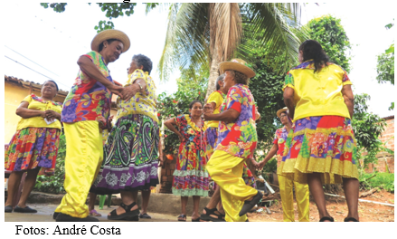

# PROVA — Camara_Barbalha_2019_Nivel_Medio

## 1. Análise geral da prova

- **Identificação:** Camara_Barbalha_2019_Nivel_Medio
- **Quantidade total de questões:** 45
- **Quantidade de textos de apoio (grupos):** 0
- **Quantidade de imagens:** 1
- **Quantidade de gráficos e tabelas:** incluídos nas imagens e no texto extraído, quando presentes no PDF original
- **Quantidade de grupos identificados:** 0
- **Quantidade de questões independentes:** 45
- **Questões que compartilham materiais:** nenhuma identificada automaticamente

### Transcrição integral da capa/instruções (conforme extraída do PDF)

> [!NOTE]
> Conteúdo integral das páginas anteriores à primeira questão, sem cortes.

> GOVERNO DO ESTADO DO CEARÁ
> SECRETARIA DE CIÊNCIAS, TECNOLOGIA E EDUCAÇÃO SUPERIOR-SECITECE
> UNIVERSIDADE REGIONAL DO CARIRI-URCA
> COMISSÃO EXECUTIVA DE VESTIBULAR-CEV
>
>
>
> NIVEL MÉDIO - PORTUGUÊS)
> TEXTO
>
>
>
> Uma rápida consulta sobre a definição de charge, encon-
> tramos o seguinte:
> Charge é uma ilustração humorística que envolve a caricatura
> de um ou mais personagens, feita com o objetivo de satirizar al-
> gum acontecimento da atualidade. [...]
> As charges são muito utilizadas para fazer críticas de natureza
> política. São normalmente publicadas em jornais ou revistas e
> conseguem atingir um vasto público. Para interpretar o signifi-
> cado de uma charge, é necessário estar a par dos acontecimentos
> políticos nacionais e internacionais. [...]
> Características de uma charge:
> Retrata acontecimentos contemporâneos;
> Retratação do exagero;
> Possui caráter cômico, satírico e irônico;
> Considerado um gênero jornalístico;
> [...]https:// www. significados. com. br / charge/

### Gabarito

| Questão | 01 | 02 | 03 | 04 | 05 |
|---|---|---|---|---|---|
| Resposta | C | A | E | B | C |

| Questão | 06 | 07 | 08 | 09 | 10 |
|---|---|---|---|---|---|
| Resposta | B | D | C | A | E |

| Questão | 11 | 12 | 13 | 14 | 15 |
|---|---|---|---|---|---|
| Resposta | D | E | E | E | B |

| Questão | 16 | 17 | 18 | 19 | 20 |
|---|---|---|---|---|---|
| Resposta | C | A | D | E | B |

| Questão | 21 | 22 | 23 | 24 | 25 |
|---|---|---|---|---|---|
| Resposta | A | C | A | D | E |

| Questão | 26 | 27 | 28 | 29 | 30 |
|---|---|---|---|---|---|
| Resposta | D | A | E | B | B |

| Questão | 31 | 32 | 33 | 34 | 35 |
|---|---|---|---|---|---|
| Resposta | D | B | D | B | E |

| Questão | 36 | 37 | 38 | 39 | 40 |
|---|---|---|---|---|---|
| Resposta | C | D | A | B | A |

| Questão | 41 | 42 | 43 | 44 | 45 |
|---|---|---|---|---|---|
| Resposta | E | D | E | B | B |

## 2. Questões agrupadas

Nenhum grupo de questões compartilhando material foi identificado automaticamente nesta prova.

## 3. Questões independentes

#### QUESTÃO 01

✅ **Gabarito: C** (gabarito oficial pareado — cargo NÍVEL MÉDIO)

**Enunciado:**

(CONCURSO
CÂMARA
BARBALHA
-
EDITAL
01/2019) Uma leitura geral da charge acima apresen-
tada permite inferir que:

**Alternativas:**

A) A realidade refletida no texto encontra-se muito diferente da
que hoje existe; a velhice hoje é reconhecida como a melhor
idade;
B) Admitir que o próprio corpo está envelhecendo, que o fres-
cor da juventude e da vida adulta está indo embora e aceitá-la
como um acontecimento natural e bonito constituem situa-
ções fáceis de serem assimiladas;
C) A velhice é de uma constatação de difícil assimilação em vir-
tude das inúmeras mudanças físicas, emocionais e intelectu-
ais que acontecem. Acresce-se a isso, o descaso e a cultura
do corpo no conjunto de incômodos que assolam o ancião.
A sátira existente no texto reside no "elogio" inusitado.
D) A velhice é reversível, uma vez que já encontraram uma so-
lução satisfatória e humana para os velhos. A sociedade lhes
confere condições admissíveis e nunca lhes cobra realiza-
ções impossíveis diante da realidade vivida pelos novos ve-
lhos;
E) As personagens reveladas no texto aceitam passivamente to-
das as mudanças ocorridas no corpo e na mente daqueles que
ficam velhos.

**Referências visuais:**

Nenhuma.

---

#### QUESTÃO 02

✅ **Gabarito: A** (gabarito oficial pareado — cargo NÍVEL MÉDIO)

**Enunciado:**

(CONCURSO
CÂMARA
BARBALHA
-
EDITAL
01/2019) Dado o fragmento, observe a palavra em des-
taque e marque a alternativa que melhor a substitui sem
alterar o sentido:
Entre os processos cruéis da natureza, é a velhice o mais
cruel. Implacável, insidiosa, ataca por todos os lados, abre
a porta a todas as moléstias mortais.

**Alternativas:**

A) Ardilosa;
B) Autêntica;
C) Verdadeira;
D) Direta;
E) Esclarecedora.

**Referências visuais:**

Nenhuma.

---

#### QUESTÃO 03

✅ **Gabarito: E** (gabarito oficial pareado — cargo NÍVEL MÉDIO)

**Enunciado:**

(CONCURSO
CÂMARA
BARBALHA
-
EDITAL
01/2019) Observe a flexão de número das palavras desta-
cadas e, em seguida, marque a opção em que não exista
a mesma metafonia:
E também esqueci os ossos, a infame osteoporose, que te
rói os ossos pelo tutano, deixando-os como frágeis cascas
de ovos.

**Alternativas:**

A) Caroço;
B) Corajoso;
C) Povo;
D) Amistoso;
E) Cachorro.

**Referências visuais:**

Nenhuma.

---

#### QUESTÃO 04

✅ **Gabarito: B** (gabarito oficial pareado — cargo NÍVEL MÉDIO)

**Enunciado:**

(CONCURSO
CÂMARA
BARBALHA
-
EDITAL
01/2019) O velho tenta se equiparar às audácias dos jo-
vens, até mesmo excedê-las. O termo destacado encontra
sua aplicação nas regras de colocação pronominal.
Das opções a seguir, marque aquela que apresente erro
dessa regra:
CONCURSO PÚBLICO PARA PROVIMENTO DE CARGOS DA CÂMARA DE BARBALHA

GOVERNO DO ESTADO DO CEARÁ
SECRETARIA DE CIÊNCIAS, TECNOLOGIA E EDUCAÇÃO SUPERIOR-SECITECE
UNIVERSIDADE REGIONAL DO CARIRI-URCA
COMISSÃO EXECUTIVA DE VESTIBULAR-CEV

**Alternativas:**

A) Tudo me era completamente novo;
B) Ninguém havia lembrado-me de fazer reservas sobre a ve-
lhice;
C) Esta cautela não deve efetuar-se;
D) A idade avançada não me deixou concluir a frase;
E) Tudo se acaba com a morte, menos a saudade.

**Referências visuais:**

Nenhuma.

---

#### QUESTÃO 05

✅ **Gabarito: C** (gabarito oficial pareado — cargo NÍVEL MÉDIO)

**Enunciado:**

(CONCURSO
CÂMARA
BARBALHA
-
EDITAL
01/2019) E, no final de tudo, vem o envelhecimento da
cabeça, da inteligência, das ideias, da alma - da chamada
psiquê.
Marque a opção em que exista similaridade de gênero
com a palavra destacada acima:

**Alternativas:**

A) Dó;
B) Saca-rolhas;
C) Alface;
D) Sósia;
E) Formicida.

**Referências visuais:**

Nenhuma.

---

#### QUESTÃO 06

✅ **Gabarito: B** (gabarito oficial pareado — cargo NÍVEL MÉDIO)

**Enunciado:**

(CONCURSO
CÂMARA
BARBALHA
-
EDITAL
01/2019) Dada a progressão geométrica
(an) = 1
2, 1
4, 1
8, 1
16, ....
Considere a sequência
(bn) = log2 1
2, log2 1
4, log2 1
8, log2 1
16, ....
Calcule a soma dos 10 primeiros termos da sequência
(bn).

**Alternativas:**

A) −50
B) −55
C) −45
D) 
E) −60

**Referências visuais:**

Nenhuma.

---

#### QUESTÃO 07

✅ **Gabarito: D** (gabarito oficial pareado — cargo NÍVEL MÉDIO)

**Enunciado:**

(CONCURSO
CÂMARA
BARBALHA
-
EDITAL
01/2019)
Considere a equação −kx2 + 2kx + 3 = 0.
Para que a equação não tenha raízes reais k deve satisfa-
zer:

**Alternativas:**

A) k > 0
B) k < −3
C) k > −3
D) k = −3
E) −3 < k < 0

**Referências visuais:**

Nenhuma.

---

#### QUESTÃO 08

✅ **Gabarito: C** (gabarito oficial pareado — cargo NÍVEL MÉDIO)

**Enunciado:**

(CONCURSO
CÂMARA
BARBALHA
-
EDITAL
01/2019) Seja E = (−2)−3 −2−3 + 3 −1
3 ÷ 4
(( 1
5)−1 + 1
2 −3
4) 1
.
Calcule o valor de E2 −121.

**Alternativas:**

A) 0
B) −30
C) −21
D) −182
E) 83

**Referências visuais:**

Nenhuma.

---

#### QUESTÃO 09

✅ **Gabarito: A** (gabarito oficial pareado — cargo NÍVEL MÉDIO)

**Enunciado:**

(CONCURSO
CÂMARA
BARBALHA
-
EDITAL
01/2019)
Um bairro possui uma caixa d’água no for-
mato de um prisma hexagonal de altura 10
√
3 m e lado
da base medindo 4m.
Calcule a capacidade, em litros, dessa caixa d’água.

**Alternativas:**

A) 720.000
B) 72.000
C) 7.200.000
D) 7.200
E) 720

**Referências visuais:**

Nenhuma.

---

#### QUESTÃO 10

✅ **Gabarito: E** (gabarito oficial pareado — cargo NÍVEL MÉDIO)

**Enunciado:**

(CONCURSO
CÂMARA
BARBALHA
-
EDITAL
01/2019)
Em uma urna há 5 bolas vermelhas, 4 bolas
azuis e 3 bolas brancas. Retira- se ao acaso três bolas,
uma a uma.
Qual a probabilidade das bolas serem todas de cores di-
ferentes?

**Alternativas:**

A) 
B) 
C) 
D) 
E) CONCURSO PÚBLICO PARA PROVIMENTO DE CARGOS DA CÂMARA DE BARBALHA
GOVERNO DO ESTADO DO CEARÁ
SECRETARIA DE CIÊNCIAS, TECNOLOGIA E EDUCAÇÃO SUPERIOR-SECITECE
UNIVERSIDADE REGIONAL DO CARIRI-URCA
COMISSÃO EXECUTIVA DE VESTIBULAR-CEV

**Referências visuais:**

Nenhuma.

---

#### QUESTÃO 11

✅ **Gabarito: D** (gabarito oficial pareado — cargo NÍVEL MÉDIO)

**Enunciado:**

(CONCURSO
CÂMARA
BARBALHA
-
EDITAL
01/2019) Marque alternativa ERRADA quando o as-
sunto é Preconceito:

**Alternativas:**

A) Preconceito com as Mulheres (Machismo, misoginia ou se-
xismo);
B) Preconceito racial está associado à etnia, raça (racismo);
C) Preconceito social está associado à classe social e definido
pelo status social de determinados indivíduos;
D) A intolerância religiosa associada à religião não é conside-
rada no Brasil um preconceito;
E) Preconceito com aparência (Gordofobia).

**Referências visuais:**

Nenhuma.

---

#### QUESTÃO 12

✅ **Gabarito: E** (gabarito oficial pareado — cargo NÍVEL MÉDIO)

**Enunciado:**

(CONCURSO
CÂMARA
BARBALHA
-
EDITAL
01/2019) No tocante ao município de Juazeiro do Norte
é CORRETO afirmar:

**Alternativas:**

A) Juazeiro do Norte está situada a 330 km de Fortaleza, no
Sul do Ceará, e recebe todos os anos em torno de dois mil
romeiros.
B) Juazeiro do Norte faz limite somente com os municípios de
Barbalha e Crato;
C) Dentre as igrejas mais visitadas do Juazeiro do Norte
destaca-se a Igreja de São Miguel;
D) A colina do Horto ganhou destaque na história de Juazeiro
do Norte no final do Sec. XIX e início do Século XX em
virtude da sua localização e beleza geográfica;
E) Pelo menos quatro vezes no ano acontecem Romarias em Ju-
azeiro do Norte: Candeias (02 de Fevereiro), Morte do Pe.
Cícero ( 20 de julho), Nossa Senhora das Dores (15 de se-
tembro) e Finados (02 de novembro). Com mais de 500 mil
pessoas peregrinando pela cidade.

**Referências visuais:**

Nenhuma.

---

#### QUESTÃO 13

✅ **Gabarito: E** (gabarito oficial pareado — cargo NÍVEL MÉDIO)

**Enunciado:**

(CONCURSO
CÂMARA
BARBALHA
-
EDITAL
01/2019)
No Período de 2014 a 2017, foram identifica-
das 13.180 notificações de violência contra a mulher no
Estado do Ceará, nesse sentido é INCORRETO afirmar:
I. De acordo com dados da DATASUS( 2019) em Fortaleza a
violência contra a mulher tem sido: Mulheres adultas jovens
(35, 1%) e adolescentes (28, 5%), Pardas (73, 1%), heteros-
sexuais (33, 5%);
II. De acordo com o Mapa da Violência Contra a Mulher 2018,
o volume de casos noticiados de violência domestica está
distribuído em todas as regiões do País, entretanto, o estado
do Ceará apresenta o menor índice de mulheres assassinadas
são os menores;
III. Quanto à caracterização da ocorrência das violências, a mai-
oria (26, 2%) foi notificada em 2017, em um único episódio
(64, 5%), no período da noite /madrugada (45, 9%), em resi-
dências (62, 5%) enquanto na rua foi de (16, 2%);
IV. O Comportamento agressivo do homem ainda é predomi-
nante em situações de violência intrafamiliar, levando em
consideração que ainda existe uma forte repercussão do pa-
pel social atribuído ao sexo masculino;
V. Segundo o Mapa da Violência contra a mulher 2018, a mai-
oria das vitimas mulheres possui a faixa etária de Idosas.

**Alternativas:**

A) As Alternativas II e III são Corretas;
B) As Alternativas I; III e IV são Corretas;
C) As Alternativas I e V são Corretas;
D) As Alternativas II e IV São Corretas;
E) As Alternativas II e V são Corretas.

**Referências visuais:**

Nenhuma.

---

#### QUESTÃO 14

✅ **Gabarito: E** (gabarito oficial pareado — cargo NÍVEL MÉDIO)

**Enunciado:**

(CONCURSO
CÂMARA
BARBALHA
-
EDITAL
01/2019) Marque a Alternativa CORRETA que se refe-
rem aos nomes dos vereadores da Câmara Municipal de
Barbalha no ano de 2020:

**Alternativas:**

A) Manoel Ramalho de Alencar, Felismino Alves Feitosa e Na-
poleão Quesado Filgueiras;
B) José Bernadino Carvalho Leite; Raymundo Ribeiro da Costa
e Salustiano de Sousa;
C) João Coelho Neto; Joaquim Duarte Grangeiro e Manoel Ra-
malho de Alencar;
D) Joaquim Duarte Grangeiro, Antonio Costa Sampaio e João
Coelho Neto;
E) Odair José de Matos, Carlos André Feitosa e Antonio Ha-
milton Ferreira.

**Referências visuais:**

Nenhuma.

---

#### QUESTÃO 15

✅ **Gabarito: B** (gabarito oficial pareado — cargo NÍVEL MÉDIO)

**Enunciado:**

(CONCURSO
CÂMARA
BARBALHA
-
EDITAL
01/2019) Marque a Alternativa Correta que se refere
ao Prefeito de Barbalha do Mandato de 2013 a 2016:

**Alternativas:**

A) Fabiano Livônio Sampaio;
B) José Leite Gonçalves Cruz;
C) Argemiro Sampaio Neto;
D) Francisco Rommel Feijó de Sá;
E) João Coelho Neto.
CONCURSO PÚBLICO PARA PROVIMENTO DE CARGOS DA CÂMARA DE BARBALHA
GOVERNO DO ESTADO DO CEARÁ
SECRETARIA DE CIÊNCIAS, TECNOLOGIA E EDUCAÇÃO SUPERIOR-SECITECE
UNIVERSIDADE REGIONAL DO CARIRI-URCA
COMISSÃO EXECUTIVA DE VESTIBULAR-CEV

**Referências visuais:**

Nenhuma.

---

#### QUESTÃO 16

✅ **Gabarito: C** (gabarito oficial pareado — cargo NÍVEL MÉDIO)

**Enunciado:**

(CONCURSO
CÂMARA
BARBALHA
-
EDITAL
01/2019) De acordo com PIANCÓ (1998) O Sonho de
Industrialização do Cariri não é de hoje, na década de
60 houve uma tentativa de implantação da industrializa-
ção na região, entretanto, até o ano de 1996 apenas 03
industrias importantes foram instaladas no município de
Barbalha,
Marque a Alternativa CORRETA:

**Alternativas:**

A) Dublagens do Nordeste LTDA - DUBLANORD, Fábrica
Brasileira de Malhas e Movimento Frutical LTDA;
B) Cerâmica Barbalhense LTDA, Indústria Química Farmacêu-
tica LTDA e Indústria de Borracha e Calçados Kaiana LTDA
- IBK;
C) Indústria Barbalhense de Cimento Portland - IBACIP, Usina
Manoel Costa e Silva - AÇUSA e Indústria Química Farma-
cêutica Cearense LTDA;
D) Usina Manoel Costa e Silva - AÇUSA, Fabrica Brasileira
de Malhas LTDA - FABRASMA e Empresa Brasileira EVA
LTDA - EVABRAS
E) Indústria Barbalhense de Cimento Portland - IBACIP, Du-
blagens do Nordeste LTDA - DUBLANORD e Movimento
Frutical LTDA.

**Referências visuais:**

Nenhuma.

---

#### QUESTÃO 17

✅ **Gabarito: A** (gabarito oficial pareado — cargo NÍVEL MÉDIO)

**Enunciado:**

(CONCURSO
CÂMARA
BARBALHA
-
EDITAL
01/2019)
No final do ano de 2019, foi descoberto um
novo vírus que causou alarmante repercussão devido à
sua rápida transmissão entre a população. Um grupo de
pesquisadores defendem que sua origem se deu entre um
grupo de pessoas relacionadas ao mercado de frutos do
mar na cidade de Wuhan - China.
Marque a Alternativa Correta que corresponde ao nome
do novo vírus:

**Alternativas:**

A) Corona Vírus-19;
B) Ebola;
C) Marburg;
D) Hantavirus
E) H5N1

**Referências visuais:**

Nenhuma.

---

#### QUESTÃO 18

✅ **Gabarito: D** (gabarito oficial pareado — cargo NÍVEL MÉDIO)

**Enunciado:**

(CONCURSO
CÂMARA
BARBALHA
-
EDITAL
01/2019)
Berço da Cultura o Cariri é uma grande vi-
trine dos Grupos de Tradições.
Marque a Alternativa CORRETA que se refere à ima-
gem:

**Alternativas:**

A) Lapinha
B) Reizado
C) Banda Cabaçal
D) Dança do Coco
E) Maneiro Pau

**Referências visuais:**

---

#### QUESTÃO 19

✅ **Gabarito: E** (gabarito oficial pareado — cargo NÍVEL MÉDIO)

**Enunciado:**

(CONCURSO
CÂMARA
BARBALHA
-
EDITAL
01/2019) O artigo 5º da Constituição Federal, um dos
princípios, destaca que "todos somos iguais perante a lei,
sem nenhuma distinção entre pessoas".
Marque a Alternativa INCORRETA

**Alternativas:**

A) Homens e mulheres são iguais em direitos e obrigações;
B) Ninguém é obrigado a fazer ou deixar de fazer algo a não ser
em virtude da lei;
C) Ninguém será submetido à tortura ou tratamento desumano;
D) O pensamento, as crenças e cultos religiosos são livres;
E) A expressão intelectual, artística, científica e de comunica-
ção deve ser submetida ao Departamento de Ordem Política
e Social (DOPS) e Serviço Nacional de Informação, ou seja,
a censura está prevista na constituição.

**Referências visuais:**

Nenhuma.

---

#### QUESTÃO 20

✅ **Gabarito: B** (gabarito oficial pareado — cargo NÍVEL MÉDIO)

**Enunciado:**

(CONCURSO
CÂMARA
BARBALHA
-
EDITAL
01/2019) De acordo com https://pt.wikipedia.org/wiki/
Regi%C3%A3o_Metropolitana_do_Cariri.
A Região
Metropolitana do Cariri (RMC), antigo CRAJUBAR,
está localizada no estado brasileiro do Ceará. A região
metropolitana surgiu a partir da Conurbação entre os
municípios de Juazeiro do Norte, Crato e Barbalha, cha-
mada triângulo CRAJUBAR. Foi criada pela Lei Com-
plementar Estadual nº 78, sancionada em 29 de junho de
2009.
Marque a alternativa CORRETA.
I. A partir de 2015, somando-se aos municípios de Juazeiro do
Norte, Crato e Barbalha, foram incluídos apenas municípios
limítrofes de Caririaçu, Farias Brito, Jardim, Missão Velha,
Nova Olinda, Santana do Cariri;
CONCURSO PÚBLICO PARA PROVIMENTO DE CARGOS DA CÂMARA DE BARBALHA

GOVERNO DO ESTADO DO CEARÁ
SECRETARIA DE CIÊNCIAS, TECNOLOGIA E EDUCAÇÃO SUPERIOR-SECITECE
UNIVERSIDADE REGIONAL DO CARIRI-URCA
COMISSÃO EXECUTIVA DE VESTIBULAR-CEV
II. Tem como área de influência a região sul do Ceará e a região
da divisa entre o Ceará e os estados de Pernambuco, Paraíba
e Piauí;
III. A Lei Complementar Estadual nº 154, de 20 de outubro de
2015, define a nova composição da região de planejamento
do Cariri, sendo a regionalização fixada em 29 municípios:
Abaiara, Altaneira, Antonina do Norte, Araripe, Assaré, Au-
rora, Barbalha, Barro, Brejo Santo, Campos Sales, Cariri-
açu, Crato, Farias Brito, Granjeiro, Jardim, Jati, Juazeiro do
Norte, Lavras da Mangabeira, Mauriti, Milagres, Missão Ve-
lha, Nova Olinda, Penaforte, Porteiras, Potengi, Salitre, San-
tana do Cariri, Tarrafas e Várzea Alegre.
IV. Dentre os principais equipamentos da Região Metropolitana
do Cariri destacam-se : Centro de Convenções do Cariri, CE-
ASA - Central de Abastecimento do Cariri, localiza-se em
Barbalha; Parque de Exposições Pedro Felício Cavalcante,
localizado na cidade do Crato, Parque Ecológico das Tim-
baúbas, localizado em Juazeiro do Norte e o Aeroporto Or-
lando Bezerra de Meneses, localizado no Município de Ju-
azeiro do Norte e Distrito Industrial do Cariri, localiza-se
próximo aos limites dos municípios de Crato, Juazeiro do
Norte e Barbalha.
V. O município do Crato é o menor em extensão territorial, com
1.176km
2.

**Alternativas:**

A) As Alternativas I e V são Corretas;
B) As Alternativas II, III e IV são Corretas;
C) As Alternativas I, II e IV São Corretas;
D) As Alternativas I, III e V são Corretas;
E) As alternativas II e V são Corretas.

**Referências visuais:**

Nenhuma.

---

#### QUESTÃO 21

✅ **Gabarito: A** (gabarito oficial pareado — cargo NÍVEL MÉDIO)

**Enunciado:**

(CONCURSO
CÂMARA
BARBALHA
-
EDITAL
01/2019)
No Brasil Atual a cidadania é prerrogativa
atribuída ao homem, detentor de direitos e obrigações
perante o Estado. Desta feita, de acordo com a Consti-
tuição Federal vigente, pode-se afirmar que:

**Alternativas:**

A) Todos são iguais perante a lei, sem distinção de qualquer na-
tureza, garantindo-se aos brasileiros e aos estrangeiros resi-
dentes no País a inviolabilidade do direito à vida, à liberdade,
à igualdade, à segurança e à propriedade.
B) Tendo acesso aos direitos civis o cidadão pode ou não, parti-
cipar no destino da sociedade, votar, ser votado, ter direitos
políticos.
C) Ser cidadão é exercer os direitos civis e políticos assegu-
rando a democracia sem a necessidade de exercer os direitos
sociais.
D) Os direitos sociais não garantem a participação do indivíduo
na riqueza coletiva: o direito à educação, ao trabalho justo,
à saúde,
E) Todo cidadão tem direito a uma velhice tranquila visto que
tal prerrogativa é dever, unicamente, da família.

**Referências visuais:**

Nenhuma.

---

#### QUESTÃO 22

✅ **Gabarito: C** (gabarito oficial pareado — cargo NÍVEL MÉDIO)

**Enunciado:**

(CONCURSO
CÂMARA
BARBALHA
-
EDITAL
01/2019)
O Ceará é um estado brasileiro localizado
na região Nordeste, possui mais de 180 municípios. A
Região Metropolitana do Cariri (RMC) faz parte da re-
gião Nordeste e é composta por 9 municípios. Nas opções
apresentadas, INDIQUE aquela em que todos os municí-
pios fazem parte da RMC.

**Alternativas:**

A) Juazeiro do Norte, Aiuaba, Caririaçu
B) Crato, Barro, Canindé
C) Missão Velha, Nova Olinda, Santana do Cariri
D) Missão Velha, Nova Olinda, Porteiras
E) Nova Russas, Russas, Barbalha

**Referências visuais:**

Nenhuma.

---

#### QUESTÃO 23

✅ **Gabarito: A** (gabarito oficial pareado — cargo NÍVEL MÉDIO)

**Enunciado:**

(CONCURSO
CÂMARA
BARBALHA
-
EDITAL
01/2019)
Qual é o principal ramo de atividade indus-
trial do estado do Ceará?

**Alternativas:**

A) Produção de calçados.
B) Polo têxtil e de confecções
C) Polo químico e siderúrgico
D) Metalomecânica.
E) Indústria de bens intermediários

**Referências visuais:**

Nenhuma.

---

#### QUESTÃO 24

✅ **Gabarito: D** (gabarito oficial pareado — cargo NÍVEL MÉDIO)

**Enunciado:**

(CONCURSO
CÂMARA
BARBALHA
-
EDITAL
01/2019)
Petra Costa é uma cineasta brasileira que foi
indicada para o Oscar 2020, com o documentário "De-
mocracia em Vertigem". O documentário descreve:

**Alternativas:**

A) A desigualdade social e a política brasileira desde a redemo-
cratização do Brasil.
B) A influência das grandes mídias brasileiras no resultado das
eleições de 2018
C) O assassinato de índios brasileiros e a demarcação de terras
indígenas.
D) O cenário político brasileiro desde a redemocratização até o
impeatchment da ex-presidente Dilma Rousseff.
E) A influência das políticas de inclusão social, implantadas no
governo do PT, no resultado das eleições de 2018.

**Referências visuais:**

Nenhuma.

---

#### QUESTÃO 25

✅ **Gabarito: E** (gabarito oficial pareado — cargo NÍVEL MÉDIO)

**Enunciado:**

(CONCURSO
CÂMARA
BARBALHA
-
EDITAL
01/2019)
No século XX, com as novas tecnologias
produziu-se meios avançadas de comunicação que pas-
saram a exercer um papel importante de elo entre as
pessoas. Pode-se dizer que os meios de comunicação de
massa são:

**Alternativas:**

A) Ferramentas que promovem o contato interpessoal.
CONCURSO PÚBLICO PARA PROVIMENTO DE CARGOS DA CÂMARA DE BARBALHA
GOVERNO DO ESTADO DO CEARÁ
SECRETARIA DE CIÊNCIAS, TECNOLOGIA E EDUCAÇÃO SUPERIOR-SECITECE
UNIVERSIDADE REGIONAL DO CARIRI-URCA
COMISSÃO EXECUTIVA DE VESTIBULAR-CEV
B) Informações que ocorrem entre uma pessoa e outra ou em
grupos restritos.
C) Cartas, telefones e internet, plataformas de mensagens ins-
tantâneas e bate-papo.
D) Comunicação entre um grande número de indivíduos: inter-
net, plataformas de mensagens instantâneas/bate-papo.
E) Comunicação entre um grande número de indivíduos rádio,
jornal e televisão.

**Referências visuais:**

Nenhuma.

---

#### QUESTÃO 26

✅ **Gabarito: D** (gabarito oficial pareado — cargo NÍVEL MÉDIO)

**Enunciado:**

(CONCURSO
CÂMARA
BARBALHA
-
EDITAL
01/2019)
De acordo com FORESTI, A. A era digital:
apropriação tecnológica e inclusão digital.
Oficina da
Net, ago. 2013. A tecnologia faz parte do ato comuni-
cativo, portanto, é uma nova maneira de comunicar, co-
nhecer e agir, desta forma, cria os alicerces para a cons-
trução de uma nova sociedade e espaço geográfico que
se consolida a partir da lógica das "Redes"assinalando o
conceito de:

**Alternativas:**

A) Espaço virtual de formação espaço temporal
B) Espaço geográfico em rede onde a sociedade se mistura com
o meio ambiente
C) Ação comunicativa em espaço digital urbano
D) Meio técnico-científico informacional
E) Territórios virtuais e focos espaciais de poder

**Referências visuais:**

Nenhuma.

---

#### QUESTÃO 27

✅ **Gabarito: A** (gabarito oficial pareado — cargo NÍVEL MÉDIO)

**Enunciado:**

(CONCURSO
CÂMARA
BARBALHA
-
EDITAL
01/2019) O Brasil está entre os países mais urbanizados
do mundo, com mais de 80% dos habitantes morando
nas cidades, formando grandes metrópoles.
Quando
uma área geográfica pode ser considerada região metro-
politana:

**Alternativas:**

A) Dependendo das características da região, mesmo com uma
população inferior a 800 mil habitantes na cidade central.
B) Quando o número de habitantes da cidade central for igual
ou superior a 1800 mil habitantes.
C) Quando há interligação entre um conjunto diferente de mu-
nicípios tão desenvolvidos quanto a megalópole.
D) Quando o fenômeno de conurbação não exerceu nenhuma
influência na formação da região.
E) Quando a urbanização mostra constante continuidade entre
as cidades e dificulta o fenômeno da metropolização.

**Referências visuais:**

Nenhuma.

---

#### QUESTÃO 28

✅ **Gabarito: E** (gabarito oficial pareado — cargo NÍVEL MÉDIO)

**Enunciado:**

(CONCURSO
CÂMARA
BARBALHA
-
EDITAL
01/2019)
A alta do dólar tem diversas motivações de
ordem nacional e internacional, como por exemplo, a
instabilidade na América latina, somada a insegurança
mundial de uma possível recessão.
Entre outras con-
sequências, temos uma depreciação de todas as moedas
emergentes frente ao dólar, que se sustenta como a moeda
mais forte. Atualmente, o governo brasileiro enfrenta di-
ficuldade em manter o real valorizado frente a outras
moedas, principalmente em relação as moedas de países
vizinhos, como é o caso do peso chileno e do peso argen-
tino, entre outras. De acordo com o enunciado, qual é a
influência do dólar na economia brasileira?

**Alternativas:**

A) O dólar em alta puxa a inflação do país para baixo, visto que
boa parte das matérias-primas brasileiras são exportadas.
B) O dólar em alta ocasiona um ponto negativo para a econo-
mia brasileira que é o aumento de transações realizadas com
o euro, visto que as negociações com a moeda se tornam
menos atrativas neste cenário.
C) A alta do dólar aumenta a inflação, porém, não interfere na
estabilização do real.
D) Há um aumento nas importações, o que auxilia no equilíbrio
da balança comercial para o País.
E) Boa parte das matérias-primas brasileiras são importadas e,
como consequência da alta do dólar, diversos itens do cotidi-
ano sofrem aumento de preço, é o caso da gasolina e do pão,
entre outros.

**Referências visuais:**

Nenhuma.

---

#### QUESTÃO 29

✅ **Gabarito: B** (gabarito oficial pareado — cargo NÍVEL MÉDIO)

**Enunciado:**

(CONCURSO
CÂMARA
BARBALHA
-
EDITAL
01/2019) No mundo moderno o velho modelo da gestão
governamental já não responde às exigências da socie-
dade. Os gestores públicos e os governantes são estimu-
lados a tomar atitudes voltadas para o cidadão concebido
como cliente, utilizando-se de critérios mais claros para
a alocação de recursos, buscando maior diálogo com a
sociedade e oferecendo transparência e controle social
(ipece.ce.gov.br).
É correto afirmar que o modelo de
Gestão Pública por Resultado adotado pelo governo cea-
rense é baseado na experiência:

**Alternativas:**

A) Finlandesa
B) Canadense
C) Alemã
D) Portuguesa
E) Estadunidense

**Referências visuais:**

Nenhuma.

---

#### QUESTÃO 30

✅ **Gabarito: B** (gabarito oficial pareado — cargo NÍVEL MÉDIO)

**Enunciado:**

(CONCURSO
CÂMARA
BARBALHA
-
EDITAL
01/2019)
Antônio Rosemberg de Moura, conhecido
como Rosemberg Cariry, nasceu em Farias Brito, na
região do Cariri cearense.
Desde sua infância as
tradições populares e religiosas locais o influencia-
ram, por meio dos relatos e testemunhos dos seus
avós.
Consciente que essa cultura popular aos pou-
cos ia desaparecendo como o contato com a moder-
nidade, decidiu dedicar numerosos estudos, pesquisas
CONCURSO PÚBLICO PARA PROVIMENTO DE CARGOS DA CÂMARA DE BARBALHA

GOVERNO DO ESTADO DO CEARÁ
SECRETARIA DE CIÊNCIAS, TECNOLOGIA E EDUCAÇÃO SUPERIOR-SECITECE
UNIVERSIDADE REGIONAL DO CARIRI-URCA
COMISSÃO EXECUTIVA DE VESTIBULAR-CEV
e publicações, às tradições nordestinas.
Atualmente
encontra-se ligado à Universidade do Porto, em Portugal
https://www.cearacultural.com.br/literatura/rosemberg-
cariry.html. Qual assertiva abaixo corresponde ao meio
artístico e cultural no qual ele se destacou?

**Alternativas:**

A) Literatura
B) Cinema
C) Teatro
D) Música
E) Escultura
REGIMENTO INTERNO / LEI ORGÂNICA)

**Referências visuais:**

Nenhuma.

---

#### QUESTÃO 31

✅ **Gabarito: D** (gabarito oficial pareado — cargo NÍVEL MÉDIO)

**Enunciado:**

(CONCURSO
CÂMARA
BARBALHA
-
EDITAL
01/2019)
Assinale a alternativa CORRETA: A auto-
nomia do Município de Barbalha é assegurada:

**Alternativas:**

A) Pela eleição do Prefeito, dos Vereadores e pela administra-
ção própria.
B) Somente pela eleição do Prefeito e pela administração pró-
pria, no que respeita seu peculiar interesse.
C) Pela eleição do Prefeito, do Vice Prefeito e pela administra-
ção própria.
D) Pela eleição do Prefeito, do Vice-Prefeito, dos Vereadores
que compõem a Câmara Municipal e pela administração pró-
pria, no que respeita seu peculiar interesse.
E) Pela eleição do Prefeito, dos Vereadores que compõem a Câ-
mara Municipal e pela administração própria, no que res-
peita seu peculiar interesse.

**Referências visuais:**

Nenhuma.

---

#### QUESTÃO 32

✅ **Gabarito: B** (gabarito oficial pareado — cargo NÍVEL MÉDIO)

**Enunciado:**

(CONCURSO
CÂMARA
BARBALHA
-
EDITAL
01/2019) Assinale a alternativa INCORRETA: Compete
privativamente ao prefeito:

**Alternativas:**

A) Dispor sobre a estruturação, atribuição e funcionamento dos
órgãos da administração municipal.
B) Contrair empréstimos sem prévia autorização da Câmara.
C) Decretar a desapropriação, por necessidade ou utilidade pú-
blica ou interesse social.
D) Propor convênios, ajustes e contratos de interesse municipal.
E) A iniciativa de leis que criem ou suprimam órgãos a ele di-
retamente subordinados.

**Referências visuais:**

Nenhuma.

---

#### QUESTÃO 33

✅ **Gabarito: D** (gabarito oficial pareado — cargo NÍVEL MÉDIO)

**Enunciado:**

(CONCURSO
CÂMARA
BARBALHA
-
EDITAL
01/2019)
Assinale a alternativa INCORRETA: É de
competência exclusiva da Câmara Municipal:

**Alternativas:**

A) Cancelar, nos termos da lei, a dívida do Município, autori-
zar a suspensão de sua cobrança e a revelação do ônus e dos
juros.
B) Emendar a Lei Orgânica ou reformá-la com aprovação de
dois terços dos seus membros.
C) Suspender a execução, no todo ou em parte, de qualquer ato,
resolução ou regulamento municipal, que haja sido pelo po-
der judiciário declarado infringente da Constituição, da Lei
Orgânica ou das leis do Estado.
D) Representar pela maioria de dois terços de seus membros,
para efeito de intervenção do município, nos termos da le-
gislação federal.
E) Autorizar o prefeito a afastar-se do Município ou do Estado
por mais de dez dias.

**Referências visuais:**

Nenhuma.

---

#### QUESTÃO 34

✅ **Gabarito: B** (gabarito oficial pareado — cargo NÍVEL MÉDIO)

**Enunciado:**

(CONCURSO
CÂMARA
BARBALHA
-
EDITAL
01/2019) Assinale a alternativa INCORRETA. Quanto a
política agrícola e fundiária a Lei Orgânica do Município
de Barbalha dispõe que:

**Alternativas:**

A) O Município assistirá aos trabalhadores rurais e suas organi-
zações legais, objetivando proporcionar a eles, entre outros
benefícios, meios de produção, saúde e bem-estar-social.
B) Que o Executivo não está compelido a ter em seus quadros
de funcionários, no mínimo, um agrônomo e um veteriná-
rio para manter a cidade arborizada, acompanhar as hortas
comunitárias e fiscalizar a saúde animal.
C) O Município fica autorizado a criar um órgão para evitar o
êxodo rural, o qual deve colaborar na criação de agrovilas,
na energização e em tudo que favoreça o desenvolvimento
das atividades agrícolas.
D) O Município deve estimular a organização em associações
dos pequenos produtores, visando a facilitar a comercializa-
ção, o estreitamento de laços entre consumidores e produto-
res, originando possíveis compras de produtos para alimen-
tação escolar do município.
E) O Executivo fica autorizado a criar um espaço para o pe-
queno produtor, nas feiras livres onde não se cobre impostos
dele.

**Referências visuais:**

Nenhuma.

---

#### QUESTÃO 35

✅ **Gabarito: E** (gabarito oficial pareado — cargo NÍVEL MÉDIO)

**Enunciado:**

(CONCURSO
CÂMARA
BARBALHA
-
EDITAL
01/2019) Assinale a alternativa CORRETA: O processo
legislativo compreende a elaboração de:

**Alternativas:**

A) Emenda a Lei Orgânica, leis complementares à Lei Orgâ-
nica, leis ordinárias e resoluções.
B) Emenda a Lei Orgânica, leis complementares à Lei Orgâ-
nica, leis ordinárias, portarias e resoluções.
C) Emenda a Lei Orgânica, leis complementares à Lei Orgâ-
nica, leis ordinárias, portarias, decretos legislativos e resolu-
ções.
CONCURSO PÚBLICO PARA PROVIMENTO DE CARGOS DA CÂMARA DE BARBALHA
GOVERNO DO ESTADO DO CEARÁ
SECRETARIA DE CIÊNCIAS, TECNOLOGIA E EDUCAÇÃO SUPERIOR-SECITECE
UNIVERSIDADE REGIONAL DO CARIRI-URCA
COMISSÃO EXECUTIVA DE VESTIBULAR-CEV
D) Emenda à Lei Orgânica, leis complementares à Lei Orgâ-
nica, leis ordinárias e decretos.
E) Emenda à Lei Orgânica, leis complementares à Lei Orgâ-
nica, leis ordinárias, decretos legislativos e resoluções.

**Referências visuais:**

Nenhuma.

---

#### QUESTÃO 36

✅ **Gabarito: C** (gabarito oficial pareado — cargo NÍVEL MÉDIO)

**Enunciado:**

(CONCURSO
CÂMARA
BARBALHA
-
EDITAL
01/2019)
Assinale a alternativa CORRETA. A Lei Or-
gânica por ser emendada, com observância do requisito
previsto no artigo 38 da citada Lei Orgânica, mediante
proposta:

**Alternativas:**

A) dos vereadores e do prefeito.
B) por iniciativa popular e dos vereadores.
C) dos vereadores, no mínimo 1/3, ou do prefeito e/ou por ini-
ciativa popular.
D) dos vereadores, no mínimo 2/3, ou do prefeito e/ou por ini-
ciativa popular.
E) somente pelo prefeito e ou dos vereadores, no mínimo 1/3.

**Referências visuais:**

Nenhuma.

---

#### QUESTÃO 37

✅ **Gabarito: D** (gabarito oficial pareado — cargo NÍVEL MÉDIO)

**Enunciado:**

(CONCURSO
CÂMARA
BARBALHA
-
EDITAL
01/2019)
Assinale a alternativa CORRETA: A inicia-
tiva de projetos de leis por parte de cidadãos precisa da
subscrição:

**Alternativas:**

A) quatro por cento (4%) do eleitorado municipal.
B) cinco por cento (5%) da população do município
C) seis por cento (6%) do eleitorado municipal.
D) cinco por cento (5%) do eleitorado municipal.
E) quatro por cento (4%) da população do município

**Referências visuais:**

Nenhuma.

---

#### QUESTÃO 38

✅ **Gabarito: A** (gabarito oficial pareado — cargo NÍVEL MÉDIO)

**Enunciado:**

(CONCURSO
CÂMARA
BARBALHA
-
EDITAL
01/2019)
Assinale a alternativa INCORRETA. O ple-
nário da Câmara Municipal de Barbalha tem como atri-
buições, autorizar, sob a forma de lei, observadas as
restrições da Constituição e da Legislação incidente, os
seguintes atos e negócios administrativos:

**Alternativas:**

A) abertura de créditos adicionais, vedado para atender subven-
ções e auxílios financeiros.
B) operações de créditos.
C) alienação real de bens imóveis municipais.
D) concessão e permissão de serviço público.
E) concessão de direito real de uso de bens municipais.

**Referências visuais:**

Nenhuma.

---

#### QUESTÃO 39

✅ **Gabarito: B** (gabarito oficial pareado — cargo NÍVEL MÉDIO)

**Enunciado:**

(CONCURSO
CÂMARA
BARBALHA
-
EDITAL
01/2019)
Assinale a alternativa CORRETA. As comis-
sões temporárias da Câmara Municipal de Barbalha são:

**Alternativas:**

A) especiais, de inquérito, externas e de justiça.
B) especiais, de inquérito e externas.
C) de justiça, orçamento e fiscalização e de inquérito
D) especiais, de inquérito, externas e de orçamento.
E) de educação, justiça, especiais, de inquérito e externas.

**Referências visuais:**

Nenhuma.

---

#### QUESTÃO 40

✅ **Gabarito: A** (gabarito oficial pareado — cargo NÍVEL MÉDIO)

**Enunciado:**

(CONCURSO
CÂMARA
BARBALHA
-
EDITAL
01/2019) Assinale a alternativa INCORRETA. São mo-
dalidades de preposição sujeitas a deliberações do plená-
rio da Câmara Municipal de Barbalha:

**Alternativas:**

A) projetos de leis, medidas provisórias, projetos de decretos
legislativos, projetos de resolução, projetos de substitutivos,
emendas e subemendas, pareceres de comissões permanen-
tes, relatório das comissões especiais de qualquer natureza,
requerimentos, recursos e representações.
B) projetos de leis, medidas provisórias, projetos de decretos
legislativos, projetos de resolução, projetos de substitutivos,
emendas e subemendas, pareceres de comissões permanen-
tes, relatório das comissões especiais de qualquer natureza,
requerimentos e representações.
C) projetos de leis, medidas provisórias, projetos de decretos
legislativos, projetos de resolução, emendas e subemendas,
pareceres de comissões permanentes, relatório das comis-
sões especiais de qualquer natureza, requerimentos, recursos
e representações.
D) projetos de leis, medidas provisórias, projetos de decretos
legislativos, projetos de resolução, projetos de substitutivos,
emendas e subemendas, pareceres de comissões permanen-
tes, relatório das comissões especiais de qualquer natureza e
representações.
E) projetos de leis, medidas provisórias, projetos de decretos
legislativos, projetos de resolução, projetos de substitutivos,
emendas, pareceres de comissões permanentes, relatório das
comissões especiais de qualquer natureza, requerimentos,
recursos e representações.

**Referências visuais:**

Nenhuma.

---

#### QUESTÃO 41

✅ **Gabarito: E** (gabarito oficial pareado — cargo NÍVEL MÉDIO)

**Enunciado:**

(CONCURSO
CÂMARA
BARBALHA
-
EDITAL
01/2019)
Assinale a alternativa INCORRETA. Con-
forme o Regimento Interno da Câmara Municipal de
Barbalha emenda é a proposição apresentada como aces-
sório de outra e podem ser:

**Alternativas:**

A) supressivas que manda erradicar qualquer parte e outra.
B) substitutiva apresentada como sucedânea à outra.
C) aditiva que deve ser acrescentada a outra.
D) modificativa que visa alterar a redação de outra.
E) alternativa que altera dispositivo de outra.
CONCURSO PÚBLICO PARA PROVIMENTO DE CARGOS DA CÂMARA DE BARBALHA
GOVERNO DO ESTADO DO CEARÁ
SECRETARIA DE CIÊNCIAS, TECNOLOGIA E EDUCAÇÃO SUPERIOR-SECITECE
UNIVERSIDADE REGIONAL DO CARIRI-URCA
COMISSÃO EXECUTIVA DE VESTIBULAR-CEV

**Referências visuais:**

Nenhuma.

---

#### QUESTÃO 42

✅ **Gabarito: D** (gabarito oficial pareado — cargo NÍVEL MÉDIO)

**Enunciado:**

(CONCURSO
CÂMARA
BARBALHA
-
EDITAL
01/2019)
Assinale a alternativa INCORRETA. Con-
forme o Regimento Interno da Câmara Municipal de
Barbalha quanto a tramitação das proposições podemos
afirmar:

**Alternativas:**

A) No caso de projeto substitutivo oferecido por determinada
comissão, ficará prejudica a remessa do mesmo à sua pró-
pria autora.
B) Os projetos originários elaborados pela Mesa ou por Comis-
são Permanente ou Especial em assuntos de sua competên-
cia, dispensarão pareceres para sua apreciação pelo Plenário,
sempre que o requerer o seu próprio autor e a audiência não
for obrigatória, na forma deste regimento.
C) Os projetos de leis originários do Executivo Municipal que
disponham sobre autorização para doação de imóvel de pro-
priedade do Município, mesmo tendo recebido os pareceres
das Comissões competentes, só poderão entrar na ordem do
dia, após a convocação dos beneficiários e de um represen-
tante do Executivo para prestarem esclarecimentos aos Vere-
adores em Plenário.
D) Os projetos de leis originários do Executivo Municipal que
disponham sobre autorização para doação de imóvel de pro-
priedade do Município, mesmo tendo recebido os pareceres
das Comissões competentes, prescinde de convocação dos
beneficiários e de um representante do Executivo para pres-
tarem esclarecimentos aos Vereadores em Plenário.
E) Recebida qualquer preposição escrita, será encaminhada ao
presidente da Câmara, que determinará a sua tramitação no
prazo máximo de três (03) dias, observado o disposto no re-
gimento.

**Referências visuais:**

Nenhuma.

---

#### QUESTÃO 43

✅ **Gabarito: E** (gabarito oficial pareado — cargo NÍVEL MÉDIO)

**Enunciado:**

(CONCURSO
CÂMARA
BARBALHA
-
EDITAL
01/2019)
Assinale a alternativa INCORRETA. Con-
forme o Regimento Interno da Câmara Municipal de
Barbalha, serão incluídos no regime de urgência sim-
ples, independentemente de manifestação do Plenário, as
seguintes matérias.

**Alternativas:**

A) a proposta orçamentária, diretrizes orçamentárias, plano plu-
rianual, a partir do escoamento de metade do prazo de que
dispunha o legislativo para apreciá-la.
B) o veto, quando escoadas duas terças (2/3) partes do prazo
para sua apreciação.
C) os projetos de lei do Executivo sujeitos a apreciação em
prazo certo, a partir das três (03) últimas sessões que se rea-
lizem no intercurso daquele.
D) a medida provisória, quando escoadas duas terças (2/3) par-
tes do prazo para sua apreciação.D) a medida provisória,
quando escoadas duas terças (2/3) partes do prazo para sua
apreciação.
E) os projetos de resolução sujeitos a apreciação em prazo
certo, a partir das três (03) últimas sessões que se realizem
no intercurso daquele.

**Referências visuais:**

Nenhuma.

---

#### QUESTÃO 44

✅ **Gabarito: B** (gabarito oficial pareado — cargo NÍVEL MÉDIO)

**Enunciado:**

(CONCURSO
CÂMARA
BARBALHA
-
EDITAL
01/2019)
Assinale a alternativa CORRETA Conforme
o Regimento Interno da Câmara Municipal de Barba-
lha, quanto às deliberações do Plenário podemos afirmar
que:

**Alternativas:**

A) as deliberações do Plenário serão tomadas por maioria ab-
soluta e de dois terços , conforme determinações legais ou
regimentais.
B) as deliberações do Plenário serão tomadas por maioria sim-
ples, sempre que não se exija a maioria absoluta ou a maioria
de dois terços, conforme determinações constitucionais, le-
gais ou regimentais aplicáveis em cada caso.
C) o processo nominal consiste na simples contagem dos votos
a favor ou contra a proposição, mediante convite do presi-
dente aos Vereadores, para que permaneçam sentados ou se
levantem, respectivamente.
D) uma vez iniciada a votação, somente se interromperá se for
verificada a falta de número legal, caso em que os votos já
colhidos serão considerados válidos.
E) do resultado da votação simbólica qualquer vereador poderá
requerer verificação mediante votação nominal, podendo o
Presidente indeferi-la.

**Referências visuais:**

Nenhuma.

---

#### QUESTÃO 45

✅ **Gabarito: B** (gabarito oficial pareado — cargo NÍVEL MÉDIO)

**Enunciado:**

(CONCURSO
CÂMARA
BARBALHA
-
EDITAL
01/2019)
Assinale a alternativa INCORRETA. Con-
forme o Regimento Interno da Câmara Municipal de
Barbalha quanto as sessões ordinárias podemos afirmar:

**Alternativas:**

A) à hora do início dos trabalhos, será verificada a presença dos
Vereadores e havendo número legal o Presidente declarará
aberta a sessão.
B) não havendo número legal, o Presidente efetivo ou eventual
aguardará durante quarenta (40) minutos que aquele se com-
plete e, caso assim não ocorra, fará lavrar ata sintética.
C) havendo número legal, a sessão se iniciará com expediente, o
qual terá duração máxima de trinta (30) minutos, destinando-
se à discussão da ata da sessão anterior e a leitura dos docu-
mentos de quaisquer origens.
D) qualquer Vereador poderá requerer a leitura da ata no todo ou
em parte, mediante aprovação do requerimento pela maioria
dos Vereadores presentes, para efeito de mera retificação.
E) após a aprovação da ata, o presidente determinará ao Secre-
tário a leitura da matéria do expediente.
CONCURSO PÚBLICO PARA PROVIMENTO DE CARGOS DA CÂMARA DE BARBALHA

**Referências visuais:**

Nenhuma.

---

## 4. Observações e limitações da extração

- Extração automática (texto selecionável do PDF via PyMuPDF), sem OCR: PDFs escaneados podem perder texto.
- Imagens repetidas (logos/marcas d'água) foram descartadas; as imagens de conteúdo foram salvas em `imagens/` com nomenclatura `imagem_00N`.
- A detecção de grupos usa os avisos padrão das bancas ("o texto seguinte servirá de base..."). Bancas sem esse aviso podem ter grupos não identificados — o conteúdo, porém, permanece integral.
- Se houver divergência entre esta versão e o PDF original, vale o PDF original; corrija manualmente o Markdown.
