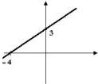
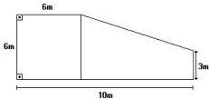

# PROVA — Camara_Barra_Bonita_2012_Agente_Administrativo

## 1. Análise geral da prova

- **Identificação:** Camara_Barra_Bonita_2012_Agente_Administrativo
- **Quantidade total de questões:** 40
- **Quantidade de textos de apoio (grupos):** 0
- **Quantidade de imagens:** 2
- **Quantidade de gráficos e tabelas:** incluídos nas imagens e no texto extraído, quando presentes no PDF original
- **Quantidade de grupos identificados:** 0
- **Quantidade de questões independentes:** 40
- **Questões que compartilham materiais:** nenhuma identificada automaticamente

### Transcrição integral da capa/instruções (conforme extraída do PDF)

> [!NOTE]
> Conteúdo integral das páginas anteriores à primeira questão, sem cortes.

> AGENTE ADMINISTRATIVO
> CÂMARA MUNICIPAL DA ESTÂNCIA TURÍSTICA DE BARRA BONITA
> Câmara Municipal da Estância Turística de Barra Bonita
> CONCURSO PÚBLICO – EDITAL Nº. 01/2012
> AGENTE ADMINISTRATIVO
> Nome do Candidato: _________________________
> INSTRUÇÕES:
> MUITA ATENÇÃO!
> 1. Você está recebendo uma Folha Definitiva de Respostas e este Caderno contendo 40 questões.
> 2. Somente as respostas transcritas na Folha Definitiva de Respostas terão valor para a nota da prova do concurso.
> 3. Você dispõe três horas, tempo suficiente para fazer a prova. Faça-a com tranquilidade, mas controle este seu tempo.
> 4. Somente após 30 minutos de prova, poderá ser entregue a Folha Definitiva de Respostas e o Caderno de Questões.
> 5. Ao terminar a prova, você entregará ao fiscal a Folha Definitiva de Respostas e este Caderno de Questões.
> 6. Questões em branco, com duas alternativas assinaladas ou com rasuras serão consideradas erradas.
> 7. Não haverá substituição de Folha de Respostas.
> 8. Os últimos 3(três) candidatos da sala deverão permanecer até o final, para acompanharem o fechamento do envelope, apondo suas assinaturas nestes, juntamente com os fiscais.
> 9. Você pode levar para casa esta capa do caderno de questões para posterior conferência do gabarito; para isto escreva seu nome na folha seguinte deste caderno de questões.
> 10. Os gabaritos serão divulgados nesta segunda-feira, pelos sites da ASTEC – www.astecinfo.com.br e da Câmara, assim como afixado em local de costume.
> 11. O Caderno de Questões poderá ser SOLICITADO no site da ASTEC, a partir de amanhã, segunda-feira.
> 12. IMPORTANTE: Confira seu Nome, RG e Data de Nascimento que constam da FOLHA DE RESPOSTAS. Caso tenha divergências, anote no verso da mesma.
> Leia atentamente e assinale uma única opção para cada questão que considere correta na Folha Definitiva de Respostas.
> Use caneta esferográfica preta ou azul.
> Aguarde ordem para abrir este caderno de questões.
> RESPOSTAS:
> | 1 | 2 | 3 | 4 | 5 | 6 | 7 | 8 | 9 | 10 |
> |---|---|---|---|---|---|---|---|---|---|
> | 11 | 12 | 13 | 14 | 15 | 16 | 17 | 18 | 19 | 20 |
> | 21 | 22 | 23 | 24 | 25 | 26 | 27 | 28 | 29 | 30 |
> | 31 | 32 | 33 | 34 | 35 | 36 | 37 | 38 | 39 | 40 |
> Barra Bonita, 14 de Outubro de 2012.

### Gabarito

| Questão | 01 | 02 | 03 | 04 | 05 |
|---|---|---|---|---|---|
| Resposta | C | D | B | A | C |

| Questão | 06 | 07 | 08 | 09 | 10 |
|---|---|---|---|---|---|
| Resposta | A | B | C | D | B |

| Questão | 11 | 12 | 13 | 14 | 15 |
|---|---|---|---|---|---|
| Resposta | B | B | C | D | B |

| Questão | 16 | 17 | 18 | 19 | 20 |
|---|---|---|---|---|---|
| Resposta | A | D | B | D | B |

| Questão | 21 | 22 | 23 | 24 | 25 |
|---|---|---|---|---|---|
| Resposta | B | C | B | C | D |

| Questão | 26 | 27 | 28 | 29 | 30 |
|---|---|---|---|---|---|
| Resposta | D | C | B | C | D |

| Questão | 31 | 32 | 33 | 34 | 35 |
|---|---|---|---|---|---|
| Resposta | D | B | C | B | B |

| Questão | 36 | 37 | 38 | 39 | 40 |
|---|---|---|---|---|---|
| Resposta | A | C | A | B | D |

## 2. Questões agrupadas

Nenhum grupo de questões compartilhando material foi identificado automaticamente nesta prova.

## 3. Questões independentes

#### QUESTÃO 01

✅ **Gabarito: C** (gabarito oficial — bloco Agente Administrativo do cartão de respostas)

**Enunciado:**

Texto:

A comunicação é uma questão essencialmente social, desenvolvida pelo homem em diferentes sistemas. Pode-se dizer que ela faz parte da interação humana e, nas organizações, grande parte do êxito dela depende da habilidade dos colaboradores em se comunicar com os outros.

Assim, é considerada como um processo social básico, primário, porque é ela que torna possível a própria vida em sociedade com troca, intercâmbio entre os seres humanos. Já, nas empresas, a comunicação e a informação determinarão o fracasso ou o sucesso delas nas próximas décadas, mudarão a estrutura dos mercados, o comportamento dos clientes internos e externos, e, consequentemente, as relações de trabalho.

Hoje, as empresas sabem que comunicar não é apenas um dever, mas um fator estratégico para alcançar o sucesso de seus negócios e a conquista da opinião pública. Nelas, uma comunicação eficaz e eficiente pode levar uma organização a obter conhecimentos e informações e, com isto, atingir uma vantagem competitiva, sobressaindo-se em relação a suas concorrentes.

Os objetivos gerais da comunicação em empresas levam os colaboradores a modificar e a adaptar o comportamento das pessoas às normas traçadas, a influenciar atitudes e preferências, a colocar em prática todos os atos com vistas à execução das metas programadas. Comunicando-se adequadamente, pode-se ter mais prazer, motivação e satisfação no trabalho e nas relações de cada um com seus companheiros, com maior participação e mais informação acerca do ambiente de trabalho.

Assinale a alternativa que corresponde ao conteúdo apresentado no texto dado:

**Alternativas:**

A) Nas empresas, a comunicação é um ato social e se restringe a um dever de seus colaboradores, essencial para seu crescimento pessoal.
B) É de relativa importância o papel da comunicação nas organizações, não influenciando diretamente na vantagem competitiva e no sucesso das pessoas.
C) Comunicação nas empresas é um fator estratégico importante no sucesso dos negócios, assim como tem papel relevante nas mudanças das condutas dos seus colaboradores.
D) A competição com concorrentes leva as empresas a buscar melhoria em sua comunicação interna para melhorar a satisfação dos colaboradores.

**Referências visuais:**

Nenhuma.

---

#### QUESTÃO 02

✅ **Gabarito: D** (gabarito oficial — bloco Agente Administrativo do cartão de respostas)

**Enunciado:**

Nas orações seguintes:

Não me interessa o _______ de sua ausência.

Carlos, venha _______ preciso de você.

Ademar não veio. _______ ?

Esta foi a razão _______ pediu demissão.

A alternativa que apresenta formas adequadas para preencher respectivamente as lacunas é:

**Alternativas:**

A) por quê; por que; porquê; porque
B) por que; porque; por quê; porquê
C) por que; por que; porquê; porque
D) porquê; porque; por quê; por que

**Referências visuais:**

Nenhuma.

---

#### QUESTÃO 03

✅ **Gabarito: B** (gabarito oficial — bloco Agente Administrativo do cartão de respostas)

**Enunciado:**

A passiva correta da frase “A menina já tinha lido este livro” está na alternativa:

**Alternativas:**

A) O livro foi lido por uma menina.
B) Este livro já tinha sido lido pela menina.
C) Este livro já fora lido pela menina.
D) Este livro a menina já tinha lido.

**Referências visuais:**

Nenhuma.

---

#### QUESTÃO 04

✅ **Gabarito: A** (gabarito oficial — bloco Agente Administrativo do cartão de respostas)

**Enunciado:**

A colocação de pronomes pessoais está indevidamente empregada na alternativa:

**Alternativas:**

A) Em tratando-se de cinema, prefiro o suspense.
B) Revelando-se um funcionário eficiente, logo foi promovido.
C) Os amigos lembrar-se-ão com saudades desta festa.
D) Ela sempre se dedicou aos estudos.

**Referências visuais:**

Nenhuma.

---

#### QUESTÃO 05

✅ **Gabarito: C** (gabarito oficial — bloco Agente Administrativo do cartão de respostas)

**Enunciado:**

Há emprego correto de concordância na alternativa:

**Alternativas:**

A) É necessária liberdade de expressão para artistas.
B) Estou meia indecisa quanto à escolha de minha futura profissão, disse Joana
C) É proibido entrada neste local.
D) Encontrei os quartos e a sala vazias.

**Referências visuais:**

Nenhuma.

---

#### QUESTÃO 06

✅ **Gabarito: A** (gabarito oficial — bloco Agente Administrativo do cartão de respostas)

**Enunciado:**

A regência verbal não está adequadamente usada na frase da alternativa:

**Alternativas:**

A) O jovem retirou-se apressado após assistir algumas aulas.
B) Entre os filmes a que assistimos, preferi o de aventura.
C) O médico assistiu o paciente com presteza.
D) Estes são os bens que lhe assistem.

**Referências visuais:**

Nenhuma.

---

#### QUESTÃO 07

✅ **Gabarito: B** (gabarito oficial — bloco Agente Administrativo do cartão de respostas)

**Enunciado:**

Quanto ao uso de crase, a alternativa incorreta é

**Alternativas:**

A) A reunião será às três horas.
B) A loja fica daqui à três quarteirões.
C) Hoje fui à farmácia após o trabalho.
D) Ele foi à Itália durante as férias.

**Referências visuais:**

Nenhuma.

---

#### QUESTÃO 08

✅ **Gabarito: C** (gabarito oficial — bloco Agente Administrativo do cartão de respostas)

**Enunciado:**

Há derivação por prefixação nas palavras da alternativa:

**Alternativas:**

A) inerte, prestar, discar
B) inferno, prego, disfarce
C) infeliz, pré-história, dispor
D) inverno, prêmio, discreto

**Referências visuais:**

Nenhuma.

---

#### QUESTÃO 09

✅ **Gabarito: D** (gabarito oficial — bloco Agente Administrativo do cartão de respostas)

**Enunciado:**

Há uso de metáfora na alternativa:

**Alternativas:**

A) Tomou o cálice da morte.
B) Fez-se noite escura no dia claro.
C) A visão era suave como uma ave delicada.
D) Seus passos eram cisnes no caminho da felicidade.

**Referências visuais:**

Nenhuma.

---

#### QUESTÃO 10

✅ **Gabarito: B** (gabarito oficial — bloco Agente Administrativo do cartão de respostas)

**Enunciado:**

Há erro de nexo sintático na frase da alternativa:

**Alternativas:**

A) Se fizer a lição, poderá ir brincar na praça.
B) Foi em uma época de conflitos onde pessoas se alternavam no poder.
C) Embora o trabalho pareça fácil, ele exige dedicação e paciência.
D) Se fizesse o relatório, teria sido dispensado.
# MATEMÁTICA

**Referências visuais:**

Nenhuma.

---

#### QUESTÃO 11

✅ **Gabarito: B** (gabarito oficial — bloco Agente Administrativo do cartão de respostas)

**Enunciado:**

A equação da reta mostrada na figura a seguir é:

**Alternativas:**

A) 3x + 4y - 12 = 0
B) 3x - 4y + 12 = 0
C) 4x + 3y + 12 = 0
D) 4x - 3y - 12 = 0

**Referências visuais:**

---

#### QUESTÃO 12

✅ **Gabarito: B** (gabarito oficial — bloco Agente Administrativo do cartão de respostas)

**Enunciado:**

Para pintar a parede indicada, com certa tinta, gasta-se uma lata pequena de tinta para cada 3,6 m². Para pintar a parede inteira o número de latas necessário é:

**Alternativas:**

A) 12
B) 15
C) 11
D) 1,5

**Referências visuais:**

---

#### QUESTÃO 13

✅ **Gabarito: C** (gabarito oficial — bloco Agente Administrativo do cartão de respostas)

**Enunciado:**

Um campeonato de futebol será disputado por 28 equipes em sistema de turno e returno, ou seja, cada equipe joga exatamente duas vezes com cada uma das demais. Esse campeonato terá então a seguinte quantidade de jogos:

**Alternativas:**

A) 751
B) 676
C) 756
D) 1.512

**Referências visuais:**

Nenhuma.

---

#### QUESTÃO 14

✅ **Gabarito: D** (gabarito oficial — bloco Agente Administrativo do cartão de respostas)

**Enunciado:**

Numa Câmara Municipal, 60% dos funcionários são do sexo feminino. Dos funcionários homens, 44% são solteiros. Já dentre as mulheres, a porcentagem de solteiras é de 52%. Nessa Casa de Leis, a porcentagem geral de solteiros é igual a:

**Alternativas:**

A) 46,2%
B) 47,6%
C) 48,0%
D) 48,8%

**Referências visuais:**

Nenhuma.

---

#### QUESTÃO 15

✅ **Gabarito: B** (gabarito oficial — bloco Agente Administrativo do cartão de respostas)

**Enunciado:**

Temos três números inteiros e consecutivos. Sabemos que o triplo do maior excede em 20 unidades um terço do triplo da soma dos dois menores. Quais são esses números?

**Alternativas:**

A) 16, 17, 18
B) 15, 16, 17
C) 17, 18, 19
D) 14, 15, 16

**Referências visuais:**

Nenhuma.

---

#### QUESTÃO 16

✅ **Gabarito: A** (gabarito oficial — bloco Agente Administrativo do cartão de respostas)

**Enunciado:**

Ricardo pegou um empréstimo de R$ 8.250,00 em uma agência de empréstimos e segundo o contrato, deveria quitá-lo após 4 meses com uma taxa de juros compostos de 2% ao mês. Ricardo deverá pagar:

**Alternativas:**

A) Um pouco mais do que R$ 8.930,00.
B) Exatamente R$ 8.830,06.
C) Menos de R$ 8.910,00.
D) Exatamente R$ 8.910,00.

**Referências visuais:**

Nenhuma.

---

#### QUESTÃO 17

✅ **Gabarito: D** (gabarito oficial — bloco Agente Administrativo do cartão de respostas)

**Enunciado:**

No final de 2009, Toninho tinha a metade da idade de seu pai. A soma dos anos de nascimento dos dois é 3940. Quantos anos Toninho terá no final de 2014?

**Alternativas:**

A) 28
B) 29
C) 30
D) 31

**Referências visuais:**

Nenhuma.

---

#### QUESTÃO 18

✅ **Gabarito: B** (gabarito oficial — bloco Agente Administrativo do cartão de respostas)

**Enunciado:**

Nas últimas eleições municipais de uma determinada cidade, em que 9% dos eleitores votaram em branco e 11% anularam o voto, o vencedor obteve 51% dos votos válidos. Não são considerados válidos os votos brancos e nulos. Pode-se afirmar que o vencedor, de fato, obteve de todos os eleitores um percentual de votos da ordem de:

**Alternativas:**

A) 38,8%
B) 40,8%
C) 44,5%
D) 47,1%

**Referências visuais:**

Nenhuma.

---

#### QUESTÃO 19

✅ **Gabarito: D** (gabarito oficial — bloco Agente Administrativo do cartão de respostas)

**Enunciado:**

Se o par ordenado (x, y) é a solução do sistema:

6x + y = 1
11x + 2y = 3

então o valor de 7x + y é:

**Alternativas:**

A) 15.
B) - 6.
C) 48.
D) 0.

**Referências visuais:**

Nenhuma.

---

#### QUESTÃO 20

✅ **Gabarito: B** (gabarito oficial — bloco Agente Administrativo do cartão de respostas)

**Enunciado:**

Josefina comprou, no primeiro domingo de setembro, cinco quilos de carne e dois pacotes de carvão, pagando R$ 34,60. No domingo seguinte, ela retornou ao açougue e comprou apenas 3,5 quilos de carne e um pacote de carvão, pagando R$ 23,10. Se os preços não sofreram alterações no período em que Josefina fez as compras, o preço do quilo da carne que ela comprou foi de:

**Alternativas:**

A) R$ 5,40.
B) R$ 5,80.
C) R$ 6,00.
D) R$ 6,10.
# CONHECIMENTOS GERAIS E ESPECÍFICOS

**Referências visuais:**

Nenhuma.

---

#### QUESTÃO 21

✅ **Gabarito: B** (gabarito oficial — bloco Agente Administrativo do cartão de respostas)

**Enunciado:**

Socialista moderado que parecia encarnar a banalidade desponta como a maior mudança da Europa dos últimos anos. No discurso de comemoração da vitória, se apresentou como portador de uma mensagem para toda a Europa. Disse que sua missão é “dar à construção europeia uma dimensão de crescimento, emprego e prosperidade”. Tem uma relação estável amorosa com Valérie Trierweiler, que o trata como “companheiro sentimental”.

O político descrito acima, motivo de notícias em maio de 2012, trata-se do:

**Alternativas:**

A) Presidente da França, Nicolas Sarcozy.
B) Presidente eleito da França, François Hollande.
C) Primeiro Ministro italiano, Silvio Berlusconi.
D) Jean-Marc Ayrault, Primeiro-ministro francês.

**Referências visuais:**

Nenhuma.

---

#### QUESTÃO 22

✅ **Gabarito: C** (gabarito oficial — bloco Agente Administrativo do cartão de respostas)

**Enunciado:**

O julgamento começou no dia 2 de agosto de 2012, com a análise de uma questão de ordem trazida por três advogados sobre o fato de todos os réus estarem sendo julgados pelo STF quando apenas três deles possuem foro privilegiado. No dia seguinte, o procurador geral da República, Roberto Gurgel, pediu a condenação de 36 dos 38 réus do “mensalão”. O ministro-revisor do “mensalão” condenou seis dos dez réus denunciados no quarto capítulo da denúncia do chamado “mensalão”, que trata de crimes de lavagem de dinheiro. O ministro-revisor do “mensalão” é:

**Alternativas:**

A) Dias Toffoli
B) Joaquim Barbosa
C) Ricardo Lewandowski
D) Cezar Peluzo

**Referências visuais:**

Nenhuma.

---

#### QUESTÃO 23

✅ **Gabarito: B** (gabarito oficial — bloco Agente Administrativo do cartão de respostas)

**Enunciado:**

Nas olimpíadas de Londres nesse ano de 2012, a quantidade de medalhas de ouro que o Brasil obteve foi de:

**Alternativas:**

A) Apenas 1
B) 3 medalhas
C) 5 medalhas
D) 6 medalhas

**Referências visuais:**

Nenhuma.

---

#### QUESTÃO 24

✅ **Gabarito: C** (gabarito oficial — bloco Agente Administrativo do cartão de respostas)

**Enunciado:**

Ao produzir uma planilha no Microsoft Excel 2007, Silvia copiou o conteúdo da célula A10 e colou na célula C14. Sabendo que o conteúdo da célula A10 era a fórmula =($C4*F$2)+1, qual será a fórmula contida na célula C14 ?

**Alternativas:**

A) =($E4*H$4)+1
B) =($E4*K$2)+2
C) =($C8*H$2)+1
D) =($C8*K$4)+ 3

**Referências visuais:**

Nenhuma.

---

#### QUESTÃO 25

✅ **Gabarito: D** (gabarito oficial — bloco Agente Administrativo do cartão de respostas)

**Enunciado:**

O Microsoft Word 2007, idioma português brasileiro, possui um recurso extremamente útil que é o verificador de ortografia e gramática. Tal recurso permite agilizar o processo de correção do texto digitado. A verificação de ortografia e gramática pode ser iniciada através do uso da tecla:

**Alternativas:**

A) F2
B) F5
C) F6
D) F7

**Referências visuais:**

Nenhuma.

---

#### QUESTÃO 26

✅ **Gabarito: D** (gabarito oficial — bloco Agente Administrativo do cartão de respostas)

**Enunciado:**

No que se refere à manipulação de arquivos no Windows 7, assinale a alternativa incorreta:

**Alternativas:**

A) Uma forma de renomear um arquivo ou pasta é selecioná-lo e pressionar a tecla F2, digitar o novo nome e pressionar ENTER.
B) Podemos selecionar todos os arquivos de uma pasta utilizando a combinação de teclas CTRL+A.
C) Ao renomearmos vários arquivos de uma vez, o nome atribuído será seguido por um número sequencial. Por exemplo: Foto (1), Foto(2), Foto(3), e assim sucessivamente.
D) Por medida de segurança, ao deletar mais de um arquivo de uma vez, será exibida uma caixa de diálogo correspondente a cada um, perguntando se o usuário deseja realmente excluí-lo.

**Referências visuais:**

Nenhuma.

---

#### QUESTÃO 27

✅ **Gabarito: C** (gabarito oficial — bloco Agente Administrativo do cartão de respostas)

**Enunciado:**

Uma redação oficial deve caracterizar-se entre outras coisas pela concisão.

Assim podemos afirmar que:

**Alternativas:**

A) A clareza de digitação, o uso de papéis uniformes e a correta diagramação do texto são indispensáveis à concisão.
B) A concisão é uma qualidade do texto, principalmente o do oficial. Conciso é o texto que consegue transmitir um máximo de informações com um mínimo de palavras. A concisão é, basicamente, economia linguística. Isso quer dizer economia de pensamento, ou seja, se necessário deve-se eliminar passagens substanciais do texto, pois a concisão nada mais é do que um resumo do assunto tratado no texto.
C) A concisão é uma qualidade do texto, principalmente o do oficial. Conciso é o texto que consegue transmitir um máximo de informações com um mínimo de palavras. A concisão é, basicamente, economia linguística. Isso não quer dizer economia de pensamento, isto é, não se devem eliminar passagens substanciais do texto no afã de reduzi-lo em tamanho. Trata-se exclusivamente de cortar palavras inúteis, redundâncias, passagens que nada acrescentem ao que já foi dito.
D) As comunicações oficiais devem ser concisas. Não só ao correto emprego deste ou daquele pronome de tratamento, mais do que isso, a concisão diz respeito à polidez e à civilidade.

**Referências visuais:**

Nenhuma.

---

#### QUESTÃO 28

✅ **Gabarito: B** (gabarito oficial — bloco Agente Administrativo do cartão de respostas)

**Enunciado:**

Os pronomes de tratamento apresentam certas peculiaridades. Embora se refiram à segunda pessoa gramatical, levam a concordância para a terceira pessoa. É que o verbo concorda com o substantivo que integra a locução e não com o pronome. O emprego dos pronomes de tratamento obedece à secular tradição.

São de uso consagrado: Vossa Excelência, para as seguintes autoridades:

**Alternativas:**

A) Do poder Executivo somente.
B) Do poder Executivo, do poder Legislativo, do poder Judiciário.
C) Do poder Legislativo, do poder Judiciário e em comunicações aos Cardeais.
D) Do poder Executivo, e empregada por força da tradição, em comunicações dirigidas a reitores de universidade.

**Referências visuais:**

Nenhuma.

---

#### QUESTÃO 29

✅ **Gabarito: C** (gabarito oficial — bloco Agente Administrativo do cartão de respostas)

**Enunciado:**

Em relação a definição e finalidade do Memorando, é incorreto afirmar que:

**Alternativas:**

A) É a modalidade de comunicação entre unidades administrativas de um mesmo órgão, que podem estar hierarquicamente em mesmo nível ou em níveis diferentes.
B) Trata-se de uma forma de comunicação eminentemente interna.
C) É a comunicação que é expedida exclusivamente para tratar assuntos oficiais entre órgãos da Administração Pública ou a particulares.
D) Sua característica principal é a agilidade. A tramitação do memorando em qualquer órgão deve pautar-se pela rapidez e pela simplicidade de procedimentos burocráticos.

**Referências visuais:**

Nenhuma.

---

#### QUESTÃO 30

✅ **Gabarito: D** (gabarito oficial — bloco Agente Administrativo do cartão de respostas)

**Enunciado:**

Baseados nas primeiras definições podemos dizer que existem vários tipos de Arquivos, tudo depende dos objetivos e competências das entidades que os produzem.
Segundo as Entidades criadoras/mantenedoras os Arquivos podem ser classificados em:

**Alternativas:**

A) Públicos, Pessoais, Acadêmicos, Especializados.
B) Arquivos compostos, Institucionais, Arquivos Simples.
C) Institucionais, Comerciais, Acadêmicos, Arquivos Gerais.
D) Públicos, Institucionais, Comerciais, Pessoais.

**Referências visuais:**

Nenhuma.

---

#### QUESTÃO 31

✅ **Gabarito: D** (gabarito oficial — bloco Agente Administrativo do cartão de respostas)

**Enunciado:**

É a unidade constituída pela informação (elemento referencial ou dado) e seu suporte (material, base), produzida em decorrência do cumprimento de uma atividade. Portanto, são variados os tipos de documentos produzidos e acumulados. Assinale a alternativa que define e fornece exemplos de um documento de acordo com sua espécie.

**Alternativas:**

A) Espécie: configuração que assume um documento de acordo com o sistema de signos utilizado na comunicação de seu conteúdo. Exemplos: audiovisual (filmes); fonográfico (discos, fitas); iconográfico (obras de arte, fotografias, negativos, slides, microformas; textual).
B) Espécie: é a configuração física de um suporte de acordo com a sua natureza e o modo como foi confeccionado: Exemplos: formulários, ficha, livro, caderno, planta, folha, cartaz.
C) Espécie: configuração que assume um documento de acordo com o sistema de signos utilizado na comunicação de seu conteúdo. Exemplos: ata, relatório, carta, ofício, proposta, diploma, atestado, requerimento, organograma.
D) Espécie: é a configuração que assume um documento de acordo com a disposição e a natureza das informações nesse contidas. Exemplos: ata, relatório, carta, ofício, proposta, diploma, atestado, requerimento, organograma.

**Referências visuais:**

Nenhuma.

---

#### QUESTÃO 32

✅ **Gabarito: B** (gabarito oficial — bloco Agente Administrativo do cartão de respostas)

**Enunciado:**

Os documentos podem ser arquivados de forma horizontal ou vertical. Normalmente são arquivados horizontalmente os mapas, plantas e cartazes. Os arquivos verticais são mais utilizados para documentos textuais (geralmente arquivo em aço com gavetas, deslizantes, estantes etc.). Sobre os arquivos horizontais, ainda podemos citar como exemplo:

**Alternativas:**

A) Arquivos Sargento: são aqueles em forma de escaninho. Encontrados ainda hoje em portarias de hotéis, de prédios, restaurantes etc.
B) Arquivos Pombais: sua forma que pode ser considerada de transposição do tipo horizontal. Os documentos são guardados em uma espécie de pasta com subdivisões horizontais, depois carregados verticalmente.
C) Arquivos Sargento: são tubos metálicos utilizados pelo exército em campanha, estudantes de desenho, engenharia, arquitetura etc.
D) Arquivos Pombais: são aqueles em que os documentos são guardados rapidamente, sem a necessidade de remover outros papéis.

**Referências visuais:**

Nenhuma.

---

#### QUESTÃO 33

✅ **Gabarito: C** (gabarito oficial — bloco Agente Administrativo do cartão de respostas)

**Enunciado:**

As funções básicas de um sistema de gestão de estoques, interligadas pelo Planejamento e Controle da produção são:

**Alternativas:**

A) Administração de recursos, Produção, Armazenamento, Distribuição.
B) Sistema de controle, Armazenamento, Estocagem, Sistema de informação.
C) Programação, Aquisição, Estocagem, Distribuição.
D) Aquisição, Planejamento, Estocagem, Sistema de informação.

**Referências visuais:**

Nenhuma.

---

#### QUESTÃO 34

✅ **Gabarito: B** (gabarito oficial — bloco Agente Administrativo do cartão de respostas)

**Enunciado:**

Assinale a alternativa que corresponde as características de Centralização e Descentralização de Materiais:

**Alternativas:**

A) Centralização: Estocagem junto aos pontos de utilização, a entrega e o inventário são mais rápidos, o trabalho com fichário e documentação é menor. Descentralização: Estocagem em um único local facilita o planejamento da produção, o inventário e o controle.
B) Centralização: Estocagem em um único local facilita o planejamento da produção, o inventário e o controle. Descentralização: Estocagem junto aos pontos de utilização, a entrega e o inventário são mais rápidos, o trabalho com fichário e documentação é menor.
C) Centralização: Estocagem pode ser feita em vários locais, e ocorre verificação da existência dos materiais da empresa, através de um levantamento físico de contagem, para confrontação com os estoques registrados nas fichas, efetuado periodicamente. Descentralização: Estocagem em pontos descentralizados: Devem ser agrupados os itens iguais, identificados com os cartões e isolados os que não serão inventariados.
D) Centralização: Estocagem em um único local facilita a apuração e a conciliação. Descentralização: Estocagem em pontos descentralizados facilita o planejamento da produção, o inventário e o controle.

**Referências visuais:**

Nenhuma.

---

#### QUESTÃO 35

✅ **Gabarito: B** (gabarito oficial — bloco Agente Administrativo do cartão de respostas)

**Enunciado:**

A licitação destina-se a garantir a observância do princípio constitucional da isonomia e a selecionar proposta mais vantajosa para a Administração e será processada e julgada em estrita conformidade com os princípios básicos da legalidade, da impessoalidade, da moralidade, da igualdade, da publicidade, da probidade administrativa, da vinculação ao instrumento convocatório, do julgamento objetivo e dos que lhes são correlatos.É vedado aos agentes públicos (conforme Lei Federal 8.666/93, Art. 3º):

**Alternativas:**

A) Levar-se em conta condições equivalentes de prazo de entrega, suporte de serviços, qualidade, padronização, compatibilidade e especificação de desempenho e preço.
B) Admitir, prever, incluir ou tolerar, nos atos de convocação, cláusulas ou condições que comprometam, restrinjam ou frustrem o seu caráter competitivo e estabeleçam preferências ou distinções em razão da naturalidade, da sede ou domicílio dos licitantes ou de qualquer outra circunstância impertinente ou irrelevante para o específico objeto do contrato.
C) As obras, serviços, inclusive de publicidade, compras, alienações, concessões, permissões e locações da Administração Pública, quando contratadas com terceiros, serão necessariamente precedidas de licitação.
D) Não incluir no objeto da licitação a obtenção de recursos financeiros para sua execução, qualquer que seja a sua origem, exceto nos casos de empreendimentos executados e explorados sob o regime de concessão, nos termos da legislação específica.

**Referências visuais:**

Nenhuma.

---

#### QUESTÃO 36

✅ **Gabarito: A** (gabarito oficial — bloco Agente Administrativo do cartão de respostas)

**Enunciado:**

Segundo a Lei Federal 8.883/94 (Art. 21, parágrafo I): Os avisos contendo os resumos dos editais das concorrências, das tomadas de preços, dos concursos e dos leilões, embora realizados no local da repartição interessada, deverão ser publicados com antecedência, no mínimo, por uma vez:

**Alternativas:**

A) No Diário Oficial da União, quando se tratar de licitação feita por órgão ou entidade da Administração Pública Federal, e ainda, quando se tratar de obras financiadas parcial ou totalmente com recursos federais ou garantidas por instituições federais.
B) Em jornal diário de grande circulação no Estado e também, onde será realizado o leilão ou obra, prestado o serviço, fornecido, alienado ou alugado o bem, podendo ainda a Administração, conforme o vulto da licitação, utilizar-se de outros meios de divulgação para ampliar a área de competição.
C) No Diário Oficial do Estado para concessão de direito real de uso, locação ou permissão de uso de bens imóveis construídos e destinados ou efetivamente utilizados no âmbito de programas habitacionais de interesse social, por órgãos ou entidades da Administração Pública, especificamente criados para esse fim.
D) Em jornal diário e no Diário oficial do país, para informar locação, permissão de uso de bens imóveis construídos, conforme o vulto da licitação.

**Referências visuais:**

Nenhuma.

---

#### QUESTÃO 37

✅ **Gabarito: C** (gabarito oficial — bloco Agente Administrativo do cartão de respostas)

**Enunciado:**

Os estoques podem ser classificados em ativos e inativos, e sub classificados em outras especificações conforme apresentado abaixo. Este tipo de classificação facilita a montagem de um sistema de controle de estoques e sua gestão. Assim, podemos definir Estoque Ativo como:

**Alternativas:**

A) Estoque inutilizado, decorrente de alterações de programas, mudanças nas políticas de estoques ou eventuais falhas de planejamento, que engloba as seguintes categorias: Produção, Produtos em processo, Manutenção, Reparo, Operação, Produtos acabados, Materiais administrativos.
B) Todo estoque constituído pelos materiais sem perspectiva de utilização, sem destinação definida, total ou parcialmente, e é dividido nas seguintes categorias: Estoque Alienável, Produção, Materiais administrativos e Estoque disponível.
C) Todo estoque resultante de um planejamento prévio e destinado a uma utilização em: Produção, Produtos em processo, Manutenção, Reparo, Operação, Produtos acabados, Materiais administrativos.
D) Todo estoque resultante de um planejamento prévio e destinado a uma utilização em: Estoque alienável, materiais administrativos, Produção, Estoque disponível.

**Referências visuais:**

Nenhuma.

---

#### QUESTÃO 38

✅ **Gabarito: A** (gabarito oficial — bloco Agente Administrativo do cartão de respostas)

**Enunciado:**

Os sistemas de armazenagem de materiais podem ser classificados quanto a movimentação interna da carga como:

**Alternativas:**

A) Estático e dinâmico.
B) Armazenagem leve e Armazenagem pesada.
C) Armazenagem de organização, Armazenagem de controle.
D) Estático e Armazenagem de controle.

**Referências visuais:**

Nenhuma.

---

#### QUESTÃO 39

✅ **Gabarito: B** (gabarito oficial — bloco Agente Administrativo do cartão de respostas)

**Enunciado:**

Em relação a Administração de cargos e salários, benefícios sociais são aquelas facilidades, conveniências, vantagens e serviços que as empresas oferecem aos seus empregados como remuneração indireta, no sentido de poupar-lhes esforços e preocupação. Entre os diversos tipos, existe o benefício classificado de acordo com a natureza, que pode ser definido como:

**Alternativas:**

A) Legais e Espontâneos.
B) Monetários e não monetários.
C) Assistenciais e Supletivos.
D) Supletivos e Monetários.

**Referências visuais:**

Nenhuma.

---

#### QUESTÃO 40

✅ **Gabarito: D** (gabarito oficial — bloco Agente Administrativo do cartão de respostas)

**Enunciado:**

A remuneração (direta ou indireta) dos participantes de uma organização é um dos custos de maior relevância. Os benefícios concedidos além das exigências legais constituem uma substancial parcela no orçamento de despesas, variando de acordo com:

**Alternativas:**

A) Custos excessivamente altos, Perda de vitalidade, ao tornar-se hábito, Manter os trabalhadores menos produtivos (acomodados), Negligência quanto a outras funções de pessoal (controle de frequência, penalidades)
B) Eliminação das causas das doenças profissionais, Redução dos efeitos prejudiciais do trabalho, Negligência quanto a outras funções de pessoal (controle de frequência, penalidades), Condições de infraestrutura da comunidade.
C) Prevenção do agravamento de doenças, Manutenção da saúde dos trabalhadores e aumento da produtividade, através do controle do ambiente, Custos excessivamente altos, Perda de vitalidade, ao tornar-se hábito, Condições de infraestrutura da comunidade.
D) Número de empregados, Nível socioeconômico do pessoal, Política salarial da empresa Distribuição etária do pessoal, Proporção entre maiores e menores, homens e mulheres, solteiros e casados, Localização da empresa, Condições de infraestrutura da comunidade.

**Referências visuais:**

Nenhuma.

---

## 4. Observações e limitações da extração

- Conteúdo extraído via OCR de PDF escaneado (imagem), transcrito integralmente e conferido contra o original.
- Imagens repetidas (logos/marcas d'água) foram descartadas; as imagens de conteúdo foram salvas em `imagens/` com nomenclatura `imagem_00N`.
- A detecção de grupos usa os avisos padrão das bancas ("o texto seguinte servirá de base..."). Bancas sem esse aviso podem ter grupos não identificados — o conteúdo, porém, permanece integral.
- Se houver divergência entre esta versão e o PDF original, vale o PDF original; corrija manualmente o Markdown.
- A prova é um PDF escaneado; o conteúdo foi transcrito integralmente via OCR e conferido contra o original.
- Marcações de resposta acrescentadas pelo site de origem (asteriscos ao final de alternativas) foram removidas; o gabarito informado é o do cartão oficial de respostas (bloco Agente Administrativo), transcrito na íntegra.
- Na questão 19, o sistema de equações foi transcrito em texto simples: {6x + y = 1; 11x + 2y = 3}.
- O brasão da capa e as marcas d'água do site foram descartados; as figuras das questões 11 e 12 foram preservadas em `imagens/`.
