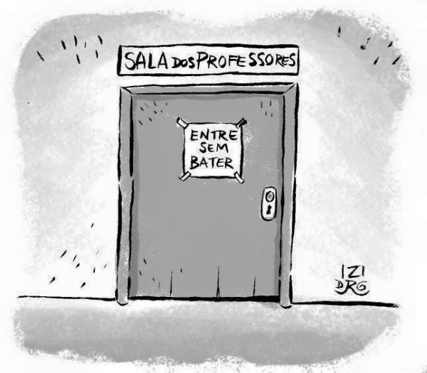

# PROVA — Camara_Belem_do_Sao_Francisco_2016_Agente_Administrativo

## 1. Análise geral da prova

- **Identificação:** Camara_Belem_do_Sao_Francisco_2016_Agente_Administrativo
- **Quantidade total de questões:** 40
- **Quantidade de textos de apoio (grupos):** 0
- **Quantidade de imagens:** 2
- **Quantidade de gráficos e tabelas:** incluídos nas imagens e no texto extraído, quando presentes no PDF original
- **Quantidade de grupos identificados:** 0
- **Quantidade de questões independentes:** 40
- **Questões que compartilham materiais:** nenhuma identificada automaticamente

### Transcrição integral da capa/instruções (conforme extraída do PDF)

> [!NOTE]
> Conteúdo integral das páginas anteriores à primeira questão, sem cortes.

> PREFEITURA MUNICIPAL DE ESPERANTINA-PI
> Cargo: Auxiliar de Serviços Gerais (AOSD)
> INSTITUTO MACHADO DE ASSIS – IMA CONCURSO PÚBLICO CÂMARA MUNICIPAL DE BELÉM DO SÃO FRANCISCO
> .
>
>
>
>
>
>
> TURNO: MANHÃ
> MAIS INFORMAÇÕES:
> Internet:
> www.institutomachadodeassis.com.br
> Telefone: (86) 3303-3146
> E-mail:
> ima.belemdosaofrancisco2016@outlook.com
> Leia atentamente as instruções abaixo.
>
> 01- Você recebeu do fiscal o seguinte material:
> a) Este Caderno, com 40 (quarenta) questões da Prova Objetiva, sem repetição ou falha,
> conforme distribuição abaixo. Examine se a prova está completa, se há falhas ou imperfeições
> gráficas que causem dúvidas.
> Língua Portuguesa
> Atualidades
> Informática
> Básica
> Conhecimentos
> Específicos
>
> 02- A prova terá duração de 3 (três horas).
> 03- No Cartão de Respostas, a marcação da alternativa correta deve ser feita cobrindo a letra e
> preenchendo todo o espaço interno do quadrado, com caneta esferográfica de tinta na cor azul ou
> preta, de forma contínua e densa.
> Exemplo:
>
> 05- Para cada uma das questões objetivas, são apresentadas 4 (quatro) alternativas
> classificadas com as letras (A, B, C, D), mas só uma responde adequadamente à questão
> proposta. Você só deve assinalar uma alternativa. A marcação em mais de uma alternativa anula
> a questão, mesmo que uma das respostas esteja correta.
>
> 06- Será eliminado do Concurso Público o candidato que:
> a) Utilizar ou consultar cadernos, livros, notas de estudo, calculadoras, telefones celulares, pagers,
> walkmans, réguas, esquadros, transferidores, compassos, MP3, Ipod, Ipad e quaisquer outros
> recursos analógicos.
> b) Ausentar-se da sala, a qualquer tempo, portando o Cartão de Respostas.
> Observações: Por motivo de segurança, o candidato só poderá retirar-se da sala após 1
> (uma) hora a partir do início da prova.
> 5.11.1. O candidato somente poderá levar o Caderno de Questões caso saía da sala de aplicação
> de sua prova nos últimos 30 (trinta) minutos.
>
> NOME DO (A) CANDIDATO (A):_________________________________________________
> CADERNO DE PROVA OBJETIVA
> AGENTE
> ADMINISTRATIVO
> CARGO
> ESTADO DO PERNAMBUCO
> CÂMARA MUNICIPAL DE BELÉM DO SÃO FRANCISCO
> CONCURSO PÚBLICO PARA PROVIMENTOS DE CARGOS
> A
> B
>
> D
> FOLHA DE ANOTAÇÃO DO GABARITO - ATENÇÃO: Esta parte somente deverá ser destacada pelo fiscal da sala, após o término da prova
>
>
>
>
>
>
>
>
>
> Instituto Machado de Assis
>
>
>
> Cargo: AGENTE ADMINISTRATIVO
> CÂMARA MUNICIPAL DE BELÉM DO SÃO FRANCISCO
>
>
>
>
>
>
> Instituto Machado de Assis
> Cargo: AGENTE ADMINISTRATIVO
> CÂMARA MUNICIPAL DE BELÉM DO SÃO FRANCISCO
> LÍNGUA PORTUGUESA QUESTÕES DE 1 A 10
> INSTRUÇÃO:
> Para responder a essas questões, assinale APENAS UMA ÚNICA alternativa correta e marque o número
> correspondente na Folha de Respostas.

### Gabarito

| Questão | 01 | 02 | 03 | 04 | 05 |
|---|---|---|---|---|---|
| Resposta | B | D | D | A | C |

| Questão | 06 | 07 | 08 | 09 | 10 |
|---|---|---|---|---|---|
| Resposta | C | D | B | C | B |

| Questão | 11 | 12 | 13 | 14 | 15 |
|---|---|---|---|---|---|
| Resposta | C | B | A | D | C |

| Questão | 16 | 17 | 18 | 19 | 20 |
|---|---|---|---|---|---|
| Resposta | C | A | C | A | D |

| Questão | 21 | 22 | 23 | 24 | 25 |
|---|---|---|---|---|---|
| Resposta | D | D | B | A | C |

| Questão | 26 | 27 | 28 | 29 | 30 |
|---|---|---|---|---|---|
| Resposta | D | A | A | D | C |

| Questão | 31 | 32 | 33 | 34 | 35 |
|---|---|---|---|---|---|
| Resposta | C | B | A | D | A |

| Questão | 36 | 37 | 38 | 39 | 40 |
|---|---|---|---|---|---|
| Resposta | B | B | B | C | D |

## 2. Questões agrupadas

Nenhum grupo de questões compartilhando material foi identificado automaticamente nesta prova.

## 3. Questões independentes

#### QUESTÃO 01

✅ **Gabarito: B** (gabarito oficial pareado — cargo AGENTE ADMINISTRATIVO)

**Enunciado:**

Assinale a alternativa em que há erro de
ortografia:

**Alternativas:**

A) A televisão ainda está dentro da caixa.
B) Estes pneus são claramente recauxutados.
C) O tapete ficou encharcado depois da chuva.
D) Mamãe cortou uma mecha do meu cabelo.

**Referências visuais:**

Nenhuma.

---

#### QUESTÃO 02

✅ **Gabarito: D** (gabarito oficial pareado — cargo AGENTE ADMINISTRATIVO)

**Enunciado:**

Todas as alternativas estão corretas quanto à
ortografia, exceto:

**Alternativas:**

A) Estamos preocupados com o sumisso da nossa
cachorrinha.
B) A paciente está com náuzea.
C) A jiboia não é uma cobra pessonhenta.
D) Catalisador é uma substância química que não
participa da reação química.

**Referências visuais:**

Nenhuma.

---

#### QUESTÃO 03

✅ **Gabarito: D** (gabarito oficial pareado — cargo AGENTE ADMINISTRATIVO)

**Enunciado:**

Analise os itens a seguir:
I. Hiato é a sequência de vogal com vogal em
sílabas separadas. Ex.: po-e-ta.
II. Ditongo é a sequência de vogal com semivogal
(decrescente)
ou
semivogal
com
vogal
(crescente) na mesma sílaba. Ex.: vai-da-de, tê-
nue.
III. Tritongo é a sequência de semivogal com vogal e
outra semivogal na mesma sílaba. Ex.: i-guais.

Quantos itens estão corretos?

**Alternativas:**

A) zero
B) um
C) dois
D) três

**Referências visuais:**

Nenhuma.

---

#### QUESTÃO 04

✅ **Gabarito: A** (gabarito oficial pareado — cargo AGENTE ADMINISTRATIVO)

**Enunciado:**

Todas as palavras a seguir são PAROXÍTONAS,
exceto:

**Alternativas:**

A) álibi
B) empório
C) ímã
D) tórax

**Referências visuais:**

Nenhuma.

---

#### QUESTÃO 05

✅ **Gabarito: C** (gabarito oficial pareado — cargo AGENTE ADMINISTRATIVO)

**Enunciado:**

Assinale a alternativa em que há erro de
pontuação:

**Alternativas:**

A) Sairá amanhã, aliás, depois de amanhã.
B) Teresina, 14 de maio de 1984.
C) As ruas, da cidade amanheceram alagadas.
D) E essa força, que é tudo, vem de um nada.

**Referências visuais:**

Nenhuma.

---

#### QUESTÃO 06

✅ **Gabarito: C** (gabarito oficial pareado — cargo AGENTE ADMINISTRATIVO)

**Enunciado:**

“Mesmo que chova, iremos à praia amanhã.”
A oração em destaque deve ser classificada
como:

**Alternativas:**

A) oração adverbial causal
B) oração adverbial comparativa
C) oração adverbial concessiva
D) oração adverbial condicional

**Referências visuais:**

Nenhuma.

---

#### QUESTÃO 07

✅ **Gabarito: D** (gabarito oficial pareado — cargo AGENTE ADMINISTRATIVO)

**Enunciado:**

Assinale a alternativa em que o verbo VISAR
não é transitivo direto:

**Alternativas:**

A) A menina visava as nuvens.
B) Dezenas de armas visavam o seu peito.
C) O gerente já visou o meu cheque.
D) O ensino visa ao progresso social.

**Referências visuais:**

Nenhuma.

---

#### QUESTÃO 08

✅ **Gabarito: B** (gabarito oficial pareado — cargo AGENTE ADMINISTRATIVO)

**Enunciado:**

Analise a charge e a reportagem a seguir:

CÂMARA MUNICIPAL DE BELÉM DO SÃO FRANCISCO
Instituto Machado de Assis
Cargo: AGENTE ADMINISTRATIVO
Quando a tarefa de ensinar vira caso de polícia
O que era para ser uma simples reprimenda pela
bagunça no corredor da escola, tornou-se caso de
polícia após uma aluna partir para a agressão física
contra a professora. Glaucia Teresinha da Silva bateu
com a cabeça no chão, teve traumatismo craniano,
ficou 15 dias no hospital e seis meses em casa até se
recuperar. Isso aconteceu em 2009, numa escola
pública de Porto Alegre.
Glaucia deu a volta por cima, enfrentou o medo da
sala de aula, e hoje desenvolve um projeto de
alfabetização que é exemplo no Rio Grande do Sul.
Mas passados quatro anos do caso que ganhou
repercussão nacional, a violência contra professores
nas escolas se multiplicou.
Segundo pesquisa divulgada pelo Sindicato dos
Professores do Ensino Oficial de São Paulo (Apeoesp)
em maio deste ano, 44% dos professores da rede
estadual já sofreram algum tipo de violência na
escola. A agressão verbal é a forma mais comum de
ataque, tendo atingido 39% dos docentes, seguida de
assédio moral (10%), bullying (6%) e agressão física
(5%). O estudo mostra ainda que quem mais sofre
violência
escolar
são
os
professores
do
sexo
masculino que lecionam no ensino médio: 65% deles
foram agredidos de alguma forma.
Professores sem autoridade e desmotivados com o
quadro de abandono da carreira, pais que repassam
para a escola a tarefa de educar, alunos inquietos
uma sala de aula que parece ter parado no tempo e
governos
omissos
formam
a
bomba-relógio
da
violência.
Para contar o drama de quem precisa conviver com a
violência física e psicológica, o Terra ouviu relatos de
educadores de todo o Brasil. Eles já levaram tapas,
socos, chutes, foram ofendidos por alunos e pais.
Alguns superaram o trauma, outros não conseguem
voltar para a escola. Eles não querem assumir o papel
de vítimas, e reconhecem que a escola precisa mudar.
Mas pedem respeito, e principalmente, querem ser
valorizados como professores. (Angela Chagas, para
especial Terra)

Com base na leitura analise as afirmativas:
I. A charge demonstra, tão somente, a falta de
educação
dos
alunos
que
não
costumam
respeitar o espaço do professor, invadindo sua
privacidade sem ao menos bater na porta ao
entrar.
II. Após a leitura do segundo texto, a interpretação
da charge é remetida para a ideia de que o cartaz
não se refere a questões de educação e etiqueta,
mas sim de violência contra os professores.
III. segundo os dados trazidos no texto 2, os homens
são os que mais se queixam de violência escolar
contra os docentes do ensino médio.

**Alternativas:**

A) Apenas um item está correto.
B) Apenas dois itens estão corretos.
C) Todos os itens estão corretos.
D) Todos os itens estão errados.

**Referências visuais:**

---

#### QUESTÃO 09

✅ **Gabarito: C** (gabarito oficial pareado — cargo AGENTE ADMINISTRATIVO)

**Enunciado:**

Ainda sobre o texto 2, assinale a opção
incorreta:

**Alternativas:**

A) podemos dizer que dentre os professores que
afirmam ter sofrido algum tipo de violência, a
maioria relata casos de agressões verbais.
B) no quarto parágrafo, a autora revela algumas
outras dificuldades que envolvem a docência.
C) entre todos os professores do ensino médio de
São Paulo, mais da metade afirma já ter
sofrido algum tipo de violência.
D) o texto, ao revelar que o bullyng também
pode ser sofrido pelos professores, deixa claro
que não é caso isolado na relação aluno-
aluno.

**Referências visuais:**

Nenhuma.

---

#### QUESTÃO 10

✅ **Gabarito: B** (gabarito oficial pareado — cargo AGENTE ADMINISTRATIVO)

**Enunciado:**

“Professores sem autoridade e desmotivados
com o quadro de abandono da carreira, pais
que repassam para a escola a tarefa de
educar, alunos inquietos uma sala de aula que
parece ter parado no tempo e governos
omissos
formam
a
bomba-relógio
da
violência.”

No trecho sublinhado, podemos dizer que se trata
de qual figura de linguagem?

**Alternativas:**

A) Comparação.
B) Metáfora.
C) Aleiteração.
D) Paranomásia.

**Referências visuais:**

Nenhuma.

---

#### QUESTÃO 11

✅ **Gabarito: C** (gabarito oficial pareado — cargo AGENTE ADMINISTRATIVO)

**Enunciado:**

Considerando
os
componentes
do
desenvolvimento
sustentável,
assinale
a
alternativa incorreta:

**Alternativas:**

A) A sustentabilidade
ambiental consiste
na
manutenção das funções e componentes
dos ecossistemas
para
assegurar
que
continuem
viáveis
–
capazes
de
se
autorreproduzir e se adaptar a alterações,
para manter a sua variedade biológica. É
também a capacidade que o ambiente natural
tem de manter as condições de vida para as
pessoas e para os outros seres vivos, tendo
em conta a habitabilidade, a beleza do
ambiente e a sua função como fonte de
energias renováveis.
CÂMARA MUNICIPAL DE BELÉM DO SÃO FRANCISCO
Instituto Machado de Assis
Cargo: AGENTE ADMINISTRATIVO
B) A sustentabilidade econômica é um conjunto de
medidas e políticas que visam à incorporação de
preocupações e conceitos ambientais e sociais. O
lucro passa a ser também medido através da
perspectiva social e ambiental, o que leva à
otimização do uso de recursos limitados e à
gestão de tecnologias de poupança de materiais
e energia. A exploração sustentável dos recursos
evita o seu esgotamento.
C) A sustentabilidade sociopolítica é orientada para
o desenvolvimento animal, a estabilidade das
instituições ambientais, bem como a redução de
conflitos naturais. É um veículo de valorização da
ecologia,
e,
ao
mesmo
tempo,
pretende
desenvolver
o
tecido
biológico
nos
seus
componentes originários e naturais.
D) A sustentabilidade cultural leva em consideração
como os povos encaram os seus recursos
naturais, e, sobretudo, como são construídas e
tratadas as relações com outros povos a curto e
longo prazo, com vista à criação de um mundo
mais sustentável a todos os níveis sociais. A
integração
das
especificidades
culturais
na
concepção,
medição
e
prática
do
desenvolvimento sustentável é fundamental, uma
vez que assegura a participação da população
local nos esforços de desenvolvimento.

**Referências visuais:**

Nenhuma.

---

#### QUESTÃO 12

✅ **Gabarito: B** (gabarito oficial pareado — cargo AGENTE ADMINISTRATIVO)

**Enunciado:**

“____________ é o processo instaurado com
base em denúncia de crime de responsabilidade
contra alta autoridade do poder executivo (p.ex.,
presidente da República, governadores, prefeitos)
ou do poder judiciário (p.ex., ministros do STF),
cuja sentença é da alçada do poder legislativo.”
Marque a alternativa que preencha corretamente
o espaço em branco.

**Alternativas:**

A) Cassação
B) Impeachment
C) Tergiversação
D) Demissão por justa causa

**Referências visuais:**

Nenhuma.

---

#### QUESTÃO 13

✅ **Gabarito: A** (gabarito oficial pareado — cargo AGENTE ADMINISTRATIVO)

**Enunciado:**

“Sistema operacional baseado em Linux que
opera
em
celulares (smartphones),
netbooks e tablets. É desenvolvido pela Open
Handset Alliance, uma aliança entre várias
empresas, dentre elas a Google.” O enunciado
está se referindo a qual sistema operacional?

**Alternativas:**

A) Android
B) iOS
C) Windows
D) Ubuntu

**Referências visuais:**

Nenhuma.

---

#### QUESTÃO 14

✅ **Gabarito: D** (gabarito oficial pareado — cargo AGENTE ADMINISTRATIVO)

**Enunciado:**

Qual o nome do(a) atual presidente da
Rússia?

**Alternativas:**

A) Angela Merkel
B) Mikhail Baryshnikov
C) Garry Kasparov
D) Vladimir Putin

**Referências visuais:**

Nenhuma.

---

#### QUESTÃO 15

✅ **Gabarito: C** (gabarito oficial pareado — cargo AGENTE ADMINISTRATIVO)

**Enunciado:**

Vinícius de Moraes é ícone de que movimento
musical brasileiro?

**Alternativas:**

A) Brega
B) Forró
C) Bossa Nova
D) Tropicália

**Referências visuais:**

Nenhuma.

---

#### QUESTÃO 16

✅ **Gabarito: C** (gabarito oficial pareado — cargo AGENTE ADMINISTRATIVO)

**Enunciado:**

Analise os itens com relação às categorias de
softwares:
I. Os programas de edição de gráficos e
planilhas de cálculos são considerados
Softwares aplicativos.
II. Os sistemas operacionais são considerados
Softwares de entrada e saída.
III. O Software aplicativo específico é uma
categoria de software.

**Alternativas:**

A) Apenas o item I é falso.
B) Apenas os itens I e II estão corretos.
C) Apenas os itens I e III estão corretos.
D) Todas as afirmativas são falsas.

**Referências visuais:**

Nenhuma.

---

#### QUESTÃO 17

✅ **Gabarito: A** (gabarito oficial pareado — cargo AGENTE ADMINISTRATIVO)

**Enunciado:**

Com relação aos tipos de periféricos analise os
itens abaixo:
I. O Light Pen (Caneta Óptica) é um periférico
de entrada de dados apenas.
II. Os Monitores de Vídeo Sensíveis ao Toque são
considerados periféricos de entrada e saída.
III. As impressoras 3D são considerados
periféricos apenas de saída.

**Alternativas:**

A) Todos os itens estão corretos.
B) Todos os itens são falsos.
C) Apenas o item I é falso.
D) Apenas o item II é falso.
CÂMARA MUNICIPAL DE BELÉM DO SÃO FRANCISCO
Instituto Machado de Assis
Cargo: AGENTE ADMINISTRATIVO

**Referências visuais:**

Nenhuma.

---

#### QUESTÃO 18

✅ **Gabarito: C** (gabarito oficial pareado — cargo AGENTE ADMINISTRATIVO)

**Enunciado:**

Julgue as afirmativas abaixo com relação à
unidade de memória e os tipos de memórias
RAM:
I. A memória RAM é montada sobre módulos.
II. A memória RAM (secundária) permite o acesso
mais veloz aos dados que precisam ser
frequentemente acessados e são mais caras e
complexas.

**Alternativas:**

A) Apenas o item I é verdadeiro.
B) Apenas o item II é verdadeiro.
C) Os itens I e II são verdadeiros.
D) Os itens I e II são falsos.

**Referências visuais:**

Nenhuma.

---

#### QUESTÃO 19

✅ **Gabarito: A** (gabarito oficial pareado — cargo AGENTE ADMINISTRATIVO)

**Enunciado:**

No Microsoft Word 2010 o comando SHIFT + F8
irá:

**Alternativas:**

A) Reduzir o tamanho de uma seleção.
B) Abrir a caixa de edição Parágrafo.
C) Abrir a caixa de opções de Formatação.
D) Fechar o documento ativo.

**Referências visuais:**

Nenhuma.

---

#### QUESTÃO 20

✅ **Gabarito: D** (gabarito oficial pareado — cargo AGENTE ADMINISTRATIVO)

**Enunciado:**

No Microsoft Access 2010 a função Filtrar está
localizado na guia:

**Alternativas:**

A) Ferramentas de Banco de Dados.
B) Dados Externos.
C) Criar
D) Página Inicial.

**Referências visuais:**

Nenhuma.

---

#### QUESTÃO 21

✅ **Gabarito: D** (gabarito oficial pareado — cargo AGENTE ADMINISTRATIVO)

**Enunciado:**

Analise os conceitos abaixo de administração
pública:

I.
Administração Pública é todo o aparelhamento
do Estado, preordenado à realização de seus
serviços,
visando
à
satisfação
das
necessidades coletivas.
II.
Administração Pública, portanto, é a gestão de
bens e interesses qualificados da comunidade
no âmbito dos três níveis de governo (federal,
estadual ou municipal), segundo preceitos de
Direito e da Moral, visando o bem comum.
III. Administração pública: “Em sentido formal, é
o conjunto de órgãos instituídos para a
consecução dos objetivos do Governo; em
sentido material é o conjunto das funções
necessárias aos serviços públicos em geral
(...).”.
IV. “a Administração Pública é a atividade do
Estado
exercida
pelos
seus
órgãos
encarregados do desempenho das funções
públicas, dentro de uma relação jurídica que
se estrutura ao influxo de uma finalidade”.
Após análise dos conceitos acima, podemos
concluir que:

**Alternativas:**

A) Apenas I, II e III estão corretos
B) Apenas I, III e IV estão corretos
C) Apenas II, III e IV estão corretos
D) I, II, III e IV estão corretos.

**Referências visuais:**

Nenhuma.

---

#### QUESTÃO 22

✅ **Gabarito: D** (gabarito oficial pareado — cargo AGENTE ADMINISTRATIVO)

**Enunciado:**

Os princípios são necessários para nortear o
direito,
embasando
como
deve
ser.
Na
Administração Pública não é diferente, temos
os princípios expressos na constituição que
são
responsáveis
por
organizar
toda
a
estrutura e, além disso, mostrar requisitos
básicos para uma “boa administração”, não
apenas
isso,
mas
também
gerar
uma
segurança jurídica aos cidadãos. Todas as
afirmações abaixo sobre esses princípios estão
corretos, EXCETO.

**Alternativas:**

A) Princípios da Administração Pública exige que
a atividade administrativa seja exercida com
presteza, perfeição e rendimento funcional e o
da eficiência.
B) Josenildon é um agente público, em sua
conduta ele se vale da publicidade oficial para
realizar promoção pessoal assim ele atenta
contra os princípios da impessoalidade e
moralidade.
CÂMARA MUNICIPAL DE BELÉM DO SÃO FRANCISCO
Instituto Machado de Assis
Cargo: AGENTE ADMINISTRATIVO
C) Contraria o princípio da moralidade o servidor
público que nomeie o seu sobrinho para um
cargo em comissão subordinado.
D) O princípio da eficiência não está expresso no
texto constitucional, mas é aplicável a toda
atividade da administração pública.

**Referências visuais:**

Nenhuma.

---

#### QUESTÃO 23

✅ **Gabarito: B** (gabarito oficial pareado — cargo AGENTE ADMINISTRATIVO)

**Enunciado:**

Os princípios podem ser expressos ou implícitos,
nos referimos aqui aos expressos, que são os
consagrados no art. 37 da Constituição da
República
Federativa
do
Brasil.
Todas
as
afirmações
relacionadas
aos
princípios
constitucionais estão corretas, EXCETO.

**Alternativas:**

A) O concurso público para ingresso em cargo ou
emprego público é um exemplo de aplicação do
princípio da impessoalidade.
B) A atuação administrativa não pode contrariar,
além da lei, a moral, os bons costumes, a
honestidade, os deveres de boa administração,
sob pena de ofensa ao princípio da publicidade.
C) Se o ato administrativo estiver viciado pelo
desvio de poder, por falta do elemento relativo à
finalidade
de
interesse
público,
atingirá
o
princípio da legalidade.
D) A ideia de que a Administração tem que tratar a
todos os administrados sem discriminações,
benéficas ou detrimentosas, é referente ao
princípio da impessoalidade.

**Referências visuais:**

Nenhuma.

---

#### QUESTÃO 24

✅ **Gabarito: A** (gabarito oficial pareado — cargo AGENTE ADMINISTRATIVO)

**Enunciado:**

Na Administração Pública só é permitido fazer o
que a lei autoriza, regra esta que compõe o
princípio básico da:

**Alternativas:**

A) Legalidade
B) Moralidade
C) Finalidade
D) Impessoalidade

**Referências visuais:**

Nenhuma.

---

#### QUESTÃO 25

✅ **Gabarito: C** (gabarito oficial pareado — cargo AGENTE ADMINISTRATIVO)

**Enunciado:**

Os Resultados práticos de produtividade e
redução de desperdícios na Administração Pública
são medidas obtidas por observância ao principio
da:

**Alternativas:**

A) Moralidade
B) Finalidade
C) Eficiência
D) Publicidade

**Referências visuais:**

Nenhuma.

---

#### QUESTÃO 26

✅ **Gabarito: D** (gabarito oficial pareado — cargo AGENTE ADMINISTRATIVO)

**Enunciado:**

Todas as afirmações relacionadas à conceituação
de
administração
pública
estão
corretas,
EXCETO.

**Alternativas:**

A) A Administração não pratica atos de governo;
pratica tão somente atos de execução, com maior
ou menor autonomia funcional, segundo a
competência dos órgãos e de seus agentes.
B) Administração Pública abrange as atividades
exercidas pelas entidades, órgãos e agentes
incumbidos de atender concretamente às
necessidades coletivas.
C) Os poderes da Administração Pública são
eminentemente instrumentais, ou seja, são
instrumentos conferidos à Administração e
utilizados exclusivamente com a finalidade de
satisfazer o interesse público.
D) À
Administração
Pública
faculta-se
agir
somente de acordo com a Lei ou maneira a
não afrontá-la, isto é, pode fazer tudo aquilo
que a Lei não proíbe.

**Referências visuais:**

Nenhuma.

---

#### QUESTÃO 27

✅ **Gabarito: A** (gabarito oficial pareado — cargo AGENTE ADMINISTRATIVO)

**Enunciado:**

A licitação destina-se a garantir a observância
do princípio constitucional da:

**Alternativas:**

A) Isonomia
B) Publicidade
C) Autotutela
D) Razoabilidade

**Referências visuais:**

Nenhuma.

---

#### QUESTÃO 28

✅ **Gabarito: A** (gabarito oficial pareado — cargo AGENTE ADMINISTRATIVO)

**Enunciado:**

De acordo com a Lei 6.888/93, a seleção da
proposta mais vantajosa para a administração
e a promoção do desenvolvimento nacional
sustentável será processada e julgada em
estrita conformidade com os princípios básicos
da:
I.
Legalidade, impessoalidade, da moralidade;
II.
Igualdade, da publicidade e da probidade
administrativa;
III. Da vinculação ao instrumento convocatório;
IV. Do julgamento objetivo e dos que lhes são
correlatos.
Após análise das afirmações acima podemos
concluir que:

**Alternativas:**

A) I, II, III e IV estão corretas.
B) Apenas I, II e III estão corretas
C) Apenas I, III e IV estão corretas
D) Apenas II, III e IV estão corretas

**Referências visuais:**

Nenhuma.

---

#### QUESTÃO 29

✅ **Gabarito: D** (gabarito oficial pareado — cargo AGENTE ADMINISTRATIVO)

**Enunciado:**

As obras e os serviços somente poderão ser
licitados quando: EXCETO

**Alternativas:**

A) Houver
projeto
básico
aprovado
pela
autoridade competente e disponível para
exame dos interessados em participar do
processo licitatório;
B) Existir orçamento detalhado em planilhas que
expressem a composição de todos os seus
custos unitários;
C) Houver previsão de recursos orçamentários
que assegurem o pagamento das obrigações
decorrentes de obras ou serviços a serem
executadas no exercício financeiro em curso,
de acordo com o respectivo cronograma;
D) O produto dela esperado estiver contemplado
nas metas estabelecidas na Lei de Diretrizes
orçamentária de que trata o art. 165 da
Constituição Federal, quando for o caso.
CÂMARA MUNICIPAL DE BELÉM DO SÃO FRANCISCO
Instituto Machado de Assis
Cargo: AGENTE ADMINISTRATIVO

**Referências visuais:**

Nenhuma.

---

#### QUESTÃO 30

✅ **Gabarito: C** (gabarito oficial pareado — cargo AGENTE ADMINISTRATIVO)

**Enunciado:**

Os avisos contendo os resumos dos editais das
concorrências, das tomadas de preços, dos
concursos e dos leilões, embora realizados no
local da repartição interessada, deverão ser
publicados com antecedência, no mínimo, por
uma vez: O aviso publicado conterá a indicação
do local em que os interessados poderão ler e
obter o texto integral do edital e todas as
informações sobre a licitação. O prazo mínimo
até o recebimento das propostas ou da realização
do evento será quarenta e cinco dias para:

**Alternativas:**

A) Tomada de preços, quando a licitação for do tipo
melhor técnica ou técnica e preço.
B) Leilão;
C) Concorrência, quando o contrato a ser celebrado
contemplar o regime de empreitada integral ou
quando a licitação for do tipo melhor técnica ou
técnica e preço.
D) Convite.

**Referências visuais:**

Nenhuma.

---

#### QUESTÃO 31

✅ **Gabarito: C** (gabarito oficial pareado — cargo AGENTE ADMINISTRATIVO)

**Enunciado:**

Todas abaixo são modalidades de licitação,
EXCETO.

**Alternativas:**

A) Concorrência e tomada de preços;
B) Convite e concurso;
C) Edital
D) Leilão.

**Referências visuais:**

Nenhuma.

---

#### QUESTÃO 32

✅ **Gabarito: B** (gabarito oficial pareado — cargo AGENTE ADMINISTRATIVO)

**Enunciado:**

O regime jurídico dos contratos administrativos
instituído
pela
Lei
6.888/93
confere
à
Administração, em relação a eles dentre outras, a
prerrogativa de: EXCETO.

**Alternativas:**

A) Modificá-los,
unilateralmente,
para
melhor
adequação às finalidades de interesse público,
respeitados os direitos do contratado;
B) Aumentar-lhes a execução;
C) Aplicar sanções motivadas pela inexecução total
ou parcial do ajuste;
D) Nos
casos
de
serviços
essenciais,
ocupar
provisoriamente bens móveis, imóveis, pessoal e
serviços vinculados ao objeto do contrato, na
hipótese da necessidade de acautelar apuração
administrativa
de
faltas
contratuais
pelo
contratado, bem como na hipótese de rescisão do
contrato administrativo.

**Referências visuais:**

Nenhuma.

---

#### QUESTÃO 33

✅ **Gabarito: A** (gabarito oficial pareado — cargo AGENTE ADMINISTRATIVO)

**Enunciado:**

Os contratos regidos pela Lei 6.888/93 poderão
ser alterados, com as devidas justificativas, no
caso de unilateralmente pela Administração
quando:

**Alternativas:**

A) Houver
modificação
do
projeto
ou
das
especificações, para melhor adequação técnica
aos seus objetivos.
B) Conveniente à substituição da garantia de
execução
C) Necessária à modificação do regime de
execução da obra ou serviço, bem como do
modo de fornecimento, em face de verificação
técnica
da
inaplicabilidade
dos
termos
contratuais originários;
D) Necessária
à
modificação
da
forma
de
pagamento, por imposição de circunstâncias
supervenientes,
mantido
o
valor
inicial
atualizado,
vedada
a
antecipação
do
pagamento,
com
relação
ao
cronograma
financeiro
fixado,
sem
a
correspondente
contraprestação de fornecimento de bens ou
execução de obra ou serviço.

**Referências visuais:**

Nenhuma.

---

#### QUESTÃO 34

✅ **Gabarito: D** (gabarito oficial pareado — cargo AGENTE ADMINISTRATIVO)

**Enunciado:**

O projeto de lei orçamentária anual, elaborado
de forma compatível com o plano plurianual,
com a lei de diretrizes orçamentárias e com as
normas da Lei Complementar nº 101/2000.
De acordo com essa lei todas as afirmações
abaixo estão corretas, EXCETO.

**Alternativas:**

A) Todas as despesas relativas à dívida pública,
mobiliária ou contratual, e as receitas que as
atenderão, constarão da lei orçamentária
anual.
B) O refinanciamento da dívida pública constará
separadamente na lei orçamentária e nas de
crédito adicional.
C) A atualização monetária do principal da dívida
mobiliária refinanciada não poderá superar a
variação do índice de preços previsto na lei de
diretrizes orçamentárias, ou em legislação
específica.
D) É permitido consignar na lei orçamentária
crédito com finalidade imprecisa ou com
dotação ilimitada.

**Referências visuais:**

Nenhuma.

---

#### QUESTÃO 35

✅ **Gabarito: A** (gabarito oficial pareado — cargo AGENTE ADMINISTRATIVO)

**Enunciado:**

De acordo com a Lei de Responsabilidade
fiscal em seu Art. 37.
Equiparam-se a
operações de crédito e estão vedados:

I.
Captação de recursos a título de antecipação
de receita de tributo ou contribuição cujo fato
gerador
ainda
não
tenha
ocorrido
sem
prejuízo do disposto no § 7º do art. 150 da
Constituição Federal;
II.
Recebimento
antecipado
de
valores
de
empresa em que o Poder Público detenha,
direta ou indiretamente, a maioria do capital
social com direito a voto, salvo lucros e
dividendos, na forma da legislação;
III. Assunção direta de compromisso, confissão de
dívida
ou
operação
assemelhada,
com
fornecedor de bens, mercadorias ou serviços,
mediante emissão, aceite ou aval de título de
crédito, não se aplicando esta vedação a
empresas estatais dependentes;

CÂMARA MUNICIPAL DE BELÉM DO SÃO FRANCISCO
Instituto Machado de Assis
Cargo: AGENTE ADMINISTRATIVO
IV. Assunção
de
obrigação,
sem
autorização
orçamentária, com fornecedores para pagamento
a posteriori de bens e serviços.

Após análise das afirmações acima podemos concluir
que:

**Alternativas:**

A) I, II, III e IV estão corretas.
B) Apenas I, II e III estão corretas
C) Apenas I, III e IV estão corretas
D) Apenas II, III e IV estão corretas

**Referências visuais:**

Nenhuma.

---

#### QUESTÃO 36

✅ **Gabarito: B** (gabarito oficial pareado — cargo AGENTE ADMINISTRATIVO)

**Enunciado:**

De acordo com a Lei de Responsabilidade Fiscal a
operação de crédito por antecipação de receita
destina-se a atender insuficiência de caixa
durante o exercício financeiro e cumprirá as
exigências mencionadas no art. 32 dessa mesma
lei e mais as seguintes: EXCETO.

**Alternativas:**

A) Realizar-se-á somente a partir do décimo dia do
início do exercício;
B) Deverá ser liquidada, sem juros e outros
encargos incidentes, até o dia dez de novembro
de cada ano;
C) Não será autorizada se forem cobrados outros
encargos que não a taxa de juros da operação,
obrigatoriamente prefixada ou indexada à taxa
básica financeira, ou à que vier a esta substituir;
D) Estará
proibida
enquanto
existir
operação
anterior da mesma natureza não integralmente
resgatada e no último ano de mandato do
Presidente, Governador ou Prefeito Municipal.

**Referências visuais:**

Nenhuma.

---

#### QUESTÃO 37

✅ **Gabarito: B** (gabarito oficial pareado — cargo AGENTE ADMINISTRATIVO)

**Enunciado:**

A escolha de um ou mais elementos determinará
a estrutura de organização de um arquivo,
respeitando-se
o
grau
de
importância
e
frequência com que são solicitados. No trabalho
secretarial, os métodos de uso mais comum são
dentre outros todos abaixo, EXCETO.

**Alternativas:**

A) Alfabético e Geográfico;
B) Tabulário
C) Numérico (simples, cronológico, decimal... ).
D) Por assuntos.

**Referências visuais:**

Nenhuma.

---

#### QUESTÃO 38

✅ **Gabarito: B** (gabarito oficial pareado — cargo AGENTE ADMINISTRATIVO)

**Enunciado:**

Ato
administrativo
expedido
por
autoridade
pública por meio do qual instruções são dadas
para a execução de um serviço, uma lei,
regulamento, nomeação, demissão ou medida
disciplinar é:

**Alternativas:**

A) Decreto
B) Portaria
C) Oficio
D) Memorando

**Referências visuais:**

Nenhuma.

---

#### QUESTÃO 39

✅ **Gabarito: C** (gabarito oficial pareado — cargo AGENTE ADMINISTRATIVO)

**Enunciado:**

Assinale a alternativa INCORRETA quanto à
associação a tecla e seu uso:

**Alternativas:**

A) 
B) 
C) 
D) 

**Referências visuais:**

Nenhuma.

---

#### QUESTÃO 40

✅ **Gabarito: D** (gabarito oficial pareado — cargo AGENTE ADMINISTRATIVO)

**Enunciado:**

Somos conscientes que a maior queixa dos
usuários, em relação à prestação dos serviços
públicos é o atendimento. Esse atendimento
envolve
um
leque
de
atitudes
comportamentais, das quais a falta de atenção
é uma das principais de conflitos entre
servidores e usuários. Todo ser humano,
independente
de
classe
social,
atividade
profissional, sexo ou idade gosta de ser
abordado pelas pessoas com atenção, isto
significa, manter um contato amigável, direto,
único e singular. Uma pessoa atenciosa
demonstra
consideração
e
personaliza
o
atendimento
observando
os
seguintes
aspectos:
É usada para abandonar um
programa, ou cancelar um
comando. É a primeira tecla
do lado esquerdo do teclado
Esta tecla funciona como
uma
segunda
tecla
de
controle
do
microcomputador.
A
referida
tecla
também
possui a função de gerar
caracteres com significados
especiais
em
certos
programas
Quando
esta
tecla
estiver
acionada,
qualquer
letra
digitada no microcomputador
será
interpretada
como
maiúscula. Quando pressionar
a tecla novamente o comando
será desativado
Tecla que confirma a entrada
de dados no microcomputador

CÂMARA MUNICIPAL DE BELÉM DO SÃO FRANCISCO
Instituto Machado de Assis
Cargo: AGENTE ADMINISTRATIVO
I.
Busque compreender o que a pessoa está
procurando ou desejando resolver.
II.
Questione o usuário demonstrando interesse, se
não compreender o que ele deseja.
III. Investigue, através da própria abordagem ao
usuário, se você está agindo conforme as
expectativas dele.
IV. Olhe sempre nos olhos da pessoa que está sendo
atendida. Jamais lhe preste um atendimento
fazendo outras tarefas, principalmente as alheias
ao serviço.
V.
Cuidado com o uso de aparelhos telefônicos ou
celulares,
principalmente
se
for
assuntos
pessoais. Dê exclusividade ao seu cliente.

Após análise das afirmações acima podemos concluir
que:

**Alternativas:**

A) Apenas I, II e III estão corretas
B) Apenas II, III, IV e V estão corretas.
C) Apenas I, III, IV e V estão corretas.
D) I, II, III, IV e V estão corretas.

**Referências visuais:**

Nenhuma.

---

## 4. Observações e limitações da extração

- Extração automática (texto selecionável do PDF via PyMuPDF), sem OCR: PDFs escaneados podem perder texto.
- Imagens repetidas (logos/marcas d'água) foram descartadas; as imagens de conteúdo foram salvas em `imagens/` com nomenclatura `imagem_00N`.
- A detecção de grupos usa os avisos padrão das bancas ("o texto seguinte servirá de base..."). Bancas sem esse aviso podem ter grupos não identificados — o conteúdo, porém, permanece integral.
- Se houver divergência entre esta versão e o PDF original, vale o PDF original; corrija manualmente o Markdown.
- Cabeçalhos de seção do caderno ("QUESTÕES 11 A 15", "QUESTÕES 16 A 20", "QUESTÕES 21 A 40") foram removidos do corpo das questões por serem divisores estruturais; a numeração e o conteúdo das questões foram preservados.
