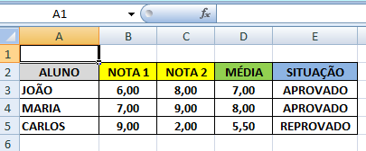
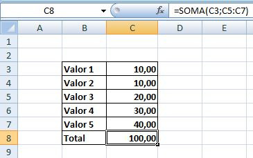

# PROVA — Camara_Belo_Jardim_2015_Agente_Administrativo

## 1. Análise geral da prova

- **Identificação:** Camara_Belo_Jardim_2015_Agente_Administrativo
- **Quantidade total de questões:** 40
- **Quantidade de textos de apoio (grupos):** 0
- **Quantidade de imagens:** 3
- **Quantidade de gráficos e tabelas:** incluídos nas imagens e no texto extraído, quando presentes no PDF original
- **Quantidade de grupos identificados:** 0
- **Quantidade de questões independentes:** 40
- **Questões que compartilham materiais:** nenhuma identificada automaticamente

### Transcrição integral da capa/instruções (conforme extraída do PDF)

> [!NOTE]
> Conteúdo integral das páginas anteriores à primeira questão, sem cortes.

> CONCURSO PÚBLICO 2015
> CÂMARA MUNICIPAL DE BELO JARDIM - PE
> Prova: Agente Administrativo
> CADERNO DE PROVA
> NÍVEL MÉDIO
> Dia: 17 de janeiro de 2016
> NOME:
> INSCRIÇÃO:
> IDENTIDADE:
> ORGÃO/UF:
> SALA:
> Leia com atenção:
> SUA PROVA
> Além deste caderno de prova, contendo quarenta questões objetivas, você receberá do fiscal de sala:
> ·
> Uma folha destinada às respostas das questões objetivas.
>
> TEMPO
> ·
> 3h é o tempo disponível para realização da prova, já incluído o tempo para a marcação da Folha de
> Respostas da prova objetiva;
> ·
> 1 hora após o início da prova é possível retirar-se da sala, sem levar o caderno de prova;
> ·
> 30 minutos antes do término do período de prova é possível retirar-se da sala levando o caderno de prova.
>
> NÃO SERÁ PERMITIDO
> ·
> Qualquer tipo de comunicação entre os candidatos durante a aplicação da prova;
> ·
> Levantar da cadeira sem autorização do fiscal de sala;
> ·
> Após o término da prova o candidato não poderá fazer uso dos sanitários.
> INFORMAÇÕES GERAIS
> ·
> A prova contém 40 questões objetivas de múltipla escolha;
> ·
> Verifique se seu caderno está completo, sem repetição de questões ou falhas. Caso contrário, notifique
> imediatamente o fiscal de sala, para que sejam tomadas as providências;
> ·
> Confira seus dados pessoais, especialmente nome, número de inscrição, documento de identidade e data de
> nascimento; leia atentamente as instruções para preencher a Folha de Resposta;
> ·
> Use somente caneta esferográfica, em material transparente, com tinta preta ou azul;
> ·
> Assine seu nome apenas nos espaços reservados;
> ·
> O preenchimento das respostas da prova objetiva é de sua responsabilidade e não será permitida a troca da
> Folha de Respostas em caso de erro;
> ·
> Reserve tempo suficiente para o preenchimento de suas respostas. Para fins de avaliação, serão levadas em
> consideração apenas as marcações realizadas na Folha de Resposta da prova objetiva, não sendo permitido
> anotar informações relativas às respostas em qualquer outro meio que não seja o caderno de prova;
> ·
> Os candidatos serão submetidos ao sistema de detecção de metais quando do ingresso e da saída de
> sanitários durante a realização da prova;
> ·
> Ao terminar a prova, o candidato entregará ao fiscal de sala, obrigatoriamente, sua folha de respostas;
> ·
> Os três últimos candidatos ao terminarem as provas deverão permanecer juntos no recinto, sendo liberados
> somente após os três terem devolvido o material utilizado e terem seus nomes registrados na Ata, além de
> coletadas suas respectivas assinaturas.
>
>
>
>
>
>
> CÂMARA MUNICIPAL DE BELO JARDIM - 2015
> CONCURSO PÚBLICO
> Nível Médio
> Cargo: Agente Administrativo
> PROVA: Língua Portuguesa
> Texto 1
> Atualmente o analfabetismo funcional alcança um
> número considerável de brasileiros, cerca de 13
> milhões. Refletir sobre esse preocupante índice é uma
> forma de estabelecer uma engrenagem para erradicar
> com o analfabetismo e todos os aspectos que o
> sustentam: discriminação, exclusão e dificuldade em
> comunicação.
> Fala-se em educação, hoje, evidenciando um caráter
> amplo, democrático, plural e irrestrito. A escola
> brasileira garantiu (e ainda garante) o ingresso do
> aluno à educação de base, cumprindo um dos pilares
> da sociedade moderna. Mas, a permanência de
> crianças e jovens no espaço educacional, é um
> desafio
> gigantesco,
> demonstrando
> uma
> triste
> realidade. O plano da valorização da educação e,
> consequentemente do aluno, permeia problemas que
> envolvem uma ampla cadeia reflexiva, instaurando
> desdobramentos complexos, contraditórios e em
> alguns casos assustadores. A educação não depende
> só de novos incentivos, edifícios e materiais coloridos
> e atraentes, mas, também, de um olhar clínico para
> diversos envolvimentos, desenvolvimentos, rupturas e
> análises com resultados satisfatórios, como, por
> exemplo, o número considerável de analfabetos
> funcionais no Brasil, uma realidade preocupante.
> O analfabetismo divide-se em duas vertentes: o
> analfabetismo absoluto e o analfabetismo funcional.
> No primeiro caso, a pessoa não teve nenhum ou
> pouco acesso à educação. No segundo caso, a
> pessoa é capaz de identificar letras e números, mas
> não consegue interpretar textos e realizar operações
> matemáticas mais complexas. As duas formas de
> analfabetismo
> comprometem
> o
> desenvolvimento
> pessoal e social do indivíduo.
> De acordo com o diretor de relações com o mercado
> do Instituto Monitor Eduardo Alves, mais do que limitar
> a
> inclusão
> da
> pessoa
> enquanto
> cidadão,
> o
> analfabetismo
> restringe
> o
> desenvolvimento
> profissional. “Isso reflete no país como um todo.
> Vivemos em um momento de ‘apagão de talentos’, de
> falta de mão de obra especializada, e está tudo
> relacionado com a base da educação brasileira, que
> ainda deixa a desejar”, explica Alves.
> Segundo a Pesquisa Nacional por Amostra de
> Domicílio (Pnad), publicada em 2014 pelo IBGE,
> Instituto Brasileiro de Geografia e Estatística, o
> analfabetismo tem caído no país, mas ainda alcança
> 13 milhões de brasileiros acima de 15 anos, o que
> corresponde a 8,3% da população. “O ponto mais
> preocupante
> revelado
> pelo
> estudo
> é
> que
> o
> analfabetismo atinge todas as regiões do país. Isso
> mostra que é urgente o foco em políticas públicas
> para erradicá-lo, como já foi feito em outros países.
> Nesse sentido, a educação a distância colabora nesse
> processo, pois alcança lugares remotos do país e
> oferece um ensino mais personalizado, de acordo com
> as necessidades e habilidades do aluno”, defende
> Alves.
> A condição de analfabeto funcional é caracterizada
> pela incapacidade de exercitar certas habilidades de
> leitura,
> escrita
> e
> cálculo
> necessários
> para
> a
> participação ativa da vida social em diversas
> dimensões. A permanência de dados preocupantes
> com relação ao analfabetismo funcional pode ser
> diagnosticado de uma (das muitas) maneiras: o
> acesso
> universal
> à
> educação,
> propiciou
> uma
> contingência incalculável nas instituições escolares,
> mas, por outro lado, o processo de escolarização
> fracassou em alguns pontos, tendo assim, a
> frequência dos alunos, porém, nula ─ sem
> conhecimento, sem ensino, sem acompanhamento,
> sem solucionar as dúvidas que eclodiam na rotina
> escolar.
> www.direcionalescolas.com.br acesso em 27/11/2015

### Gabarito

| Questão | 01 | 02 | 03 | 04 | 05 |
|---|---|---|---|---|---|
| Resposta | A | E | B | A | B |

| Questão | 06 | 07 | 08 | 09 | 10 |
|---|---|---|---|---|---|
| Resposta | A | C | B | E | V |

| Questão | 11 | 12 | 13 | 14 | 15 |
|---|---|---|---|---|---|
| Resposta | C | E | A | C | C |

| Questão | 16 | 17 | 18 | 19 | 20 |
|---|---|---|---|---|---|
| Resposta | D | E | A | B | D |

| Questão | 21 | 22 | 23 | 24 | 25 |
|---|---|---|---|---|---|
| Resposta | E | E | B | A | B |

| Questão | 26 | 27 | 28 | 29 | 30 |
|---|---|---|---|---|---|
| Resposta | E | D | B | E | A |

| Questão | 31 | 32 | 33 | 34 | 35 |
|---|---|---|---|---|---|
| Resposta | B | B | C | D | D |

| Questão | 36 | 37 | 38 | 39 | 40 |
|---|---|---|---|---|---|
| Resposta | B | D | B | A | A |

## 2. Questões agrupadas

Nenhum grupo de questões compartilhando material foi identificado automaticamente nesta prova.

## 3. Questões independentes

#### QUESTÃO 01

✅ **Gabarito: A** (gabarito oficial pareado — cargo AGENTE ADMINISTRATIVO)

**Enunciado:**

A construção do texto e as respectivas informações
indicam que:
1. Por tratar-se de uma defesa de um ponto de
vista, ser um ensaio, é um gênero textual não
literário.
2. A ideia central é o analfabetismo em geral,
apresentando argumentos contundentes.
3. Existe predominância de objetividade, por ser
um texto de tipo informativo.
4. Há, no analfabetismo funcional, uma quase
total ausência de condições de resolução de
problemas e de interpretação.
5. Dirimir o analfabetismo, em seus aspectos
gerais, no Brasil, encontra-se perto de ser
conseguido.

Estão corretas apenas as alternativas:

**Alternativas:**

A) 1, 2,3 e 4.
B) 1, 3, 4 e 5.
C) 1, 2, 4 e 5.
D) 1, 2 e 4.
E) 1, 3 e 4.

**Referências visuais:**

Nenhuma.

---

#### QUESTÃO 02

✅ **Gabarito: E** (gabarito oficial pareado — cargo AGENTE ADMINISTRATIVO)

**Enunciado:**

Atualmente o analfabetismo funcional alcança um
número considerável de brasileiros, cerca de 13
milhões. Refletir sobre esse preocupante índice é uma
forma de estabelecer uma engrenagem para erradicar
com o analfabetismo e todos os aspectos que o
sustentam: discriminação, exclusão e dificuldade em
comunicação.

Os elementos destacados se encontram de acordo
com a variedade formal. A palavra “todos” está
corretamente empregada na alternativa:

CÂMARA MUNICIPAL DE BELO JARDIM - 2015
CONCURSO PÚBLICO
Nível Médio
Cargo: Agente Administrativo

**Alternativas:**

A) Todos
os
dois
estavam
sendo
bem
negligentes no condizente à educação dos
filhos.
B) Todos homens deveriam estar boquiabertos
diante do quadro, presenciado, de falta de
ética naquela assembleia.
C) Todo Brasil grita por justiça frente aos casos
escabrosos de corrupção existente no hoje.
D) Contamos todas vezes que as crianças se
encontravam felizes na sessão de ludoterapia.
E) Pode contar com o grupo, pois todos os
quatro vogais possuem conduta ilibada e não
irão ludibriar a justiça.

**Referências visuais:**

Nenhuma.

---

#### QUESTÃO 03

✅ **Gabarito: B** (gabarito oficial pareado — cargo AGENTE ADMINISTRATIVO)

**Enunciado:**

Quanto aos aspectos gerais do texto pode-se afirmar
que:
1. A função de linguagem predominante é a
denotativa, uma vez que a metalinguagem é
uma constante em todo o texto.
2. A variedade linguística é a diastrática por
haver a percepção de que ela é formal,
utilizada por determinado grupo social e não
conter deslizes.

Está correta a alternativa:

**Alternativas:**

A) Ambos os itens se encontram sem falhas.
B) Na alternativa 1, a afirmação é correta, porém
a explicação é errada.
C) Na alternativa 2, apenas a causa explicativa
se encontra sem erro.
D) Ambos os itens se encontram corretos.
E) A afirmação do item 2 se encontra errada,
mas a explicação correta.

**Referências visuais:**

Nenhuma.

---

#### QUESTÃO 04

✅ **Gabarito: A** (gabarito oficial pareado — cargo AGENTE ADMINISTRATIVO)

**Enunciado:**

Ainda em relação ao texto em epígrafe. O autor se
refere à situação do nosso país em relação ao
analfabetismo e afirma que é necessário utilizar meios
a fim de poder extirpar tal condição vigente,
abordando todos os motivos de tal estado sob todos
os aspectos.

O trecho acima é um exemplo de

**Alternativas:**

A) Paráfrase.
B) Crônica.
C) Sátira.
D) Paródia.
E) Anacoluto.

**Referências visuais:**

Nenhuma.

---

#### QUESTÃO 05

✅ **Gabarito: B** (gabarito oficial pareado — cargo AGENTE ADMINISTRATIVO)

**Enunciado:**

“Fala-se em educação, hoje, evidenciando um caráter
amplo, democrático, plural e irrestrito. A escola
brasileira garantiu (e ainda garante) o ingresso do
aluno à educação de base, cumprindo um dos pilares
da sociedade moderna. Mas, a permanência de
crianças e jovens no espaço educacional, é um
desafio
gigantesco,
demonstrando
uma
triste
realidade. O plano da valorização da educação e,
consequentemente do aluno, permeia problemas que
envolvem uma ampla cadeia reflexiva, instaurando
desdobramentos complexos, contraditórios e em
alguns casos assustadores. A educação não depende
só de novos incentivos, edifícios e materiais coloridos
e atraentes, mas, também, de um olhar clínico para
diversos envolvimentos, desenvolvimentos, rupturas e
análises com resultados satisfatórios, como, por
exemplo, o número considerável de analfabetos
funcionais no Brasil, uma realidade preocupante.”

Considere o parágrafo no condizente aos aspectos
gerais de sua constituição, desde qualidades de estilo,
morfologia, sintaxe até semântica.
1. O vocábulo em destaque é formador de voz
passiva e indica que o sujeito é paciente.
2. Um sentido de melhorar a educação mediante
a eliminação de certos paradigmas se
encontra claro.
3. Sinal de pontuação, dando indício enfático se
encontra claro no excerto.
4. Na oração “... que envolvem...” o termo em
destaque é pronome relativo, é uma retomada
e exerce função de sujeito.
5. Os
sinais
de
pontuação
estão
todos
empregados adequadamente.

As alternativas corretas são apenas:

**Alternativas:**

A) 1, 2, 4, 5.
B) 2, 3, 4, 5.
C) 1, 4, 5.
D) 1, 2, 3, 4.
E) 1, 2, 3.

**Referências visuais:**

Nenhuma.

---

#### QUESTÃO 06

✅ **Gabarito: A** (gabarito oficial pareado — cargo AGENTE ADMINISTRATIVO)

**Enunciado:**

O
excerto
que
começa
com
“Fala-se”...
até
“realidade.”,
pertinente
ao
1º
parágrafo,
está
respeitando os aspectos gerais da gramática quanto à
fonética, morfossintaxe e semântica. Quanto a tais
aspectos, marque a única alternativa cujo período
esteja correto.

**Alternativas:**

A) Naquela ocasião, havia bastantes pessoas
que elogiaram a atuação do magistrado por
sua imparcial decisão diante do processo em
análise.
B) Íamos a uma reunião, no entanto por
chagarmos atrazados, deparamo-nos com um
aviso: “Terminou o prazo, proibida a entrada.”
C) Admiramos muito aquele escritor por que sua
filosofia da vida íntegra vai de encontro à
nossa em todas suas alusões.
CÂMARA MUNICIPAL DE BELO JARDIM - 2015
CONCURSO PÚBLICO
Nível Médio
Cargo: Agente Administrativo
D) Qual de nós temos a certeza de um amanhã
alvissareiro? Então, pautemo-nos, em tudo,
por viver o presente com dignidade.
E) Informaram-lhe, ontem, de que a proposta
sugerida por você foi aceita, por que não se
dirige logo à mesa da presidência?

**Referências visuais:**

Nenhuma.

---

#### QUESTÃO 07

✅ **Gabarito: C** (gabarito oficial pareado — cargo AGENTE ADMINISTRATIVO)

**Enunciado:**

O terceiro e o quarto parágrafos são iniciados por
elementos coesivos possuidores de idêntico valor
semântico. Analise as alternativas abaixo, quanto a tal
aspecto, e identifique a única alternativa com igual
valor:

**Alternativas:**

A) Como todos possuem raciocínio avançado,
certamente não estão inclusos dentre os
analfabetos funcionais.
B) Salvo os que possuem deficiência visual
grave, todos estão em condições de discernir
o que se encontra escrito naquele anúncio.
C) Todos
os
testes
foram
elaborados
cuidadosamente,
como
o
conteúdo
programático exposto no Edital exigia.
D) Perguntaram-me como consigo realizar tantas
atividades e respondi: “Entrego-me sempre às
forças divinas”.
E) Fale sempre a verdade, caso não vá atingir os
princípios de outrem, pois a mentira denigre o
caráter do ser humano.
Texto 2
Se se pudesse a crise financeira
Ler “através da máscara da face”,
Quanta gente, talvez, que da primeira
Fila, então, para a última passasse...
Bastos Tigre
Texto 3
Se se pudesse, o espírito que chora,
Ver através da máscara da face,
Quanta gente, talvez, que inveja agora
Nos causa, então piedade nos causasse!
Raimundo Correia

**Referências visuais:**

Nenhuma.

---

#### QUESTÃO 08

✅ **Gabarito: B** (gabarito oficial pareado — cargo AGENTE ADMINISTRATIVO)

**Enunciado:**

Em relação aos vários aspectos textuais pertinentes
aos textos 2 e 3, analise as assertivas abaixo:
1. Ambos os quartetos possuem como uma das
características
ter
como
predomínio
a
conotação.
2. O texto 3 é uma paráfrase do texto 2 por
adotar uma mesma estrutura formal.
3. O texto 2 é uma paródia do texto 3, uma vez
que o poeta embora empregue uma mesma
estrutura, impõe um tom de ironia.
4. Os dois textos, escritos em verso, possuem
características de narração.
Encontram-se corretas apenas as alternativas:

**Alternativas:**

A) 1, 2 e 3.
B) 1 e 3.
C) 2, 3 e 4.
D) 1 e 2.
E) 3 e 4

**Referências visuais:**

Nenhuma.

---

#### QUESTÃO 09

✅ **Gabarito: E** (gabarito oficial pareado — cargo AGENTE ADMINISTRATIVO)

**Enunciado:**

Quanto aos aspectos sintáticos, morfológicos e
semânticos dos textos, qual é a única alternativa
correta?

**Alternativas:**

A) As formas verbais existentes estão em tempos
pertencentes a um mesmo modo.
B) As duas ocorrências de “se” evidenciam que
são vocábulos possuidores de uma mesma
identidade morfológica.
C) Os vocábulos estão empregados apenas na
ordem direta.
D) Uma
figura
chamada
onomatopeia
está
presente no texto 2.
E) Uma forma pronominal oblíqua em posição
proclítica, não sendo iniciadora de oração.
Texto 4

**Referências visuais:**

Nenhuma.

---

#### QUESTÃO 10

✅ **Gabarito: V** (gabarito oficial pareado — cargo AGENTE ADMINISTRATIVO)

**Enunciado:**

Em relação ao texto acima, responda VERDADEIRO
ou FALSO:
Verifica-se que pertence a um gênero textual
específico, não pertinente à classificação literária.

( )Verdadeiro
( ) Falso

CÂMARA MUNICIPAL DE BELO JARDIM - 2015
CONCURSO PÚBLICO
Nível Médio
Cargo: Agente Administrativo
PROVA: Informática

**Referências visuais:**

Nenhuma.

---

#### QUESTÃO 11

✅ **Gabarito: C** (gabarito oficial pareado — cargo AGENTE ADMINISTRATIVO)

**Enunciado:**

Na digitação de um texto de três páginas, no Microsoft
Office Word, um digitador deseja que apenas a
segunda página do documento esteja em orientação
tipo paisagem, e que o texto na terceira página seja
igual ao texto da primeira página, porém em negrito.
Quais dos comandos abaixo ele deverá usar?

**Alternativas:**

A) Inserir quebra de seção, <CTRL> + X,
<CTRL> + V, <CTRL> + N.
B) Inserir quebra de coluna, <CTRL> + C,
<CTRL> + V, <CTRL> + P.
C) Inserir quebra de seção, <CTRL> + C,
<CTRL> + V, <CTRL> + N.
D) <CTRL> + Enter, <CTRL> + C, <CTRL> + V,
<CTRL> + N.
E) Inserir quebra de seção, <CTRL> + C,
<CTRL> + V, <CTRL> + P.

**Referências visuais:**

Nenhuma.

---

#### QUESTÃO 12

✅ **Gabarito: E** (gabarito oficial pareado — cargo AGENTE ADMINISTRATIVO)

**Enunciado:**

Na empresa Albuquerque Ltda, localizada na cidade
de Fortaleza – CE trabalha a secretária Sra. Ana
Paula. Assinale a alternativa abaixo, na qual NÃO
poderia ser o e-mail profissional da Sra. Ana Paula.

**Alternativas:**

A) anapaula@albuquerque.com
B) ana_paula@albuquerque.com.br
C) ana_paula_secr@albuquerque.com
D) ana.paula@albuquerque.com.br
E) ana_paula@albuquerque.gov.br

**Referências visuais:**

Nenhuma.

---

#### QUESTÃO 13

✅ **Gabarito: A** (gabarito oficial pareado — cargo AGENTE ADMINISTRATIVO)

**Enunciado:**

Após ter digitado um texto em um documento no
Microsoft Word, quais teclas devem ser utilizadas para
que todo o texto fique com letras maiúsculas, negrito e
itálico, respectivamente?

**Alternativas:**

A) <SHIFT> + F3, <CTRL> + N, <CTRL> + I
B) <CTRL> + N, <CTRL> + I, <CTRL> + Z
C) <CTRL> + M, <CTRL> + N, <CTRL> + O
D) <SHIFT> + F3, <CTRL> + N, <CTRL> + Z
E) <CTRL> + P, <CTRL> + I, <CTRL> + Z

**Referências visuais:**

Nenhuma.

---

#### QUESTÃO 14

✅ **Gabarito: C** (gabarito oficial pareado — cargo AGENTE ADMINISTRATIVO)

**Enunciado:**

Para desinstalar um software no Windows qual dos
recursos abaixo deverá ser executado:

**Alternativas:**

A) Painel de Controle > Sistema e Segurança
B) Gerenciador de Tarefas > Processos
C) Painel de Controle > Programa
D) Meu Computador > Rede
E) Dispositivos e Impressoras

**Referências visuais:**

Nenhuma.

---

#### QUESTÃO 15

✅ **Gabarito: C** (gabarito oficial pareado — cargo AGENTE ADMINISTRATIVO)

**Enunciado:**

Protocolo utilizado na Web para transferência de
hipertexto e para comunicação entre computadores.

**Alternativas:**

A) WWW
B) SMTP
C) HTTP
D) DNS
E) PHP

**Referências visuais:**

Nenhuma.

---

#### QUESTÃO 16

✅ **Gabarito: D** (gabarito oficial pareado — cargo AGENTE ADMINISTRATIVO)

**Enunciado:**

No Microsoft Office Excel, foi digitada a seguinte
planilha de valores:

Conforme figura acima podemos afirmar que:

**Alternativas:**

A) As células C3, C4, C5, C6 e C7 serão
somadas.
B) Apenas as células C3, C5 e C7 serão
somadas.
C) O valor na célula C8 será 110,00.
D) A célula C4 não será somada.
E) O Microsoft Excel não executará a soma.

**Referências visuais:**

Nenhuma.

---

#### QUESTÃO 17

✅ **Gabarito: E** (gabarito oficial pareado — cargo AGENTE ADMINISTRATIVO)

**Enunciado:**

Para responder às questões 17 e 18 observe a
planilha abaixo, construída no Microsoft Excel:

Para calcular a média aritmética das notas de Carlos,
assinale a alternativa que corresponde à fórmula
utilizada:

**Alternativas:**

A) = MÉDIA(B4;C4)
B) = SOMA(B5*C5)
C) = SOMA(B5;C5)
D) = MÉDIA(B5;C5)/2
E) = SOMA(B5;C5)/2

CÂMARA MUNICIPAL DE BELO JARDIM - 2015
CONCURSO PÚBLICO
Nível Médio
Cargo: Agente Administrativo

**Referências visuais:**

---

#### QUESTÃO 18

✅ **Gabarito: A** (gabarito oficial pareado — cargo AGENTE ADMINISTRATIVO)

**Enunciado:**

Assinale a alternativa que corresponde à fórmula
aplicada para calcular a situação do aluno João, isto
é, se foi “aprovado” ou “reprovado” após a digitação
das notas.

**Alternativas:**

A) =SE(D3>=7;"APROVADO";"REPROVADO")
B) =SE(NOTA1+NOTA2)/2 > 7; "APROVADO")
C) =MÉDIA(B3;C3)>7;"APROVADO";"REPROVADO"
D) =MÉDIA(JOAO);APROVADO;REPROVADO
E) =SE(D3>=8;"APROVADO";"REPROVADO")

**Referências visuais:**

Nenhuma.

---

#### QUESTÃO 19

✅ **Gabarito: B** (gabarito oficial pareado — cargo AGENTE ADMINISTRATIVO)

**Enunciado:**

Em uma pasta foram salvos os seguintes arquivos:
relatório.odt, clientes.pdf e imagens.ppt . Assinale a
alternativa que apresenta os softwares que podem ser
utilizados para abrirem os respectivos arquivos.

**Alternativas:**

A) Adobe Reader, Access e Word
B) OpenOffice, Adobe Reader e Power Point
C) Word, Adobe Reader e Excel
D) Word, Adober Reader e Access
E) Adobe Reader, Adobe Reader e Power Point

**Referências visuais:**

Nenhuma.

---

#### QUESTÃO 20

✅ **Gabarito: D** (gabarito oficial pareado — cargo AGENTE ADMINISTRATIVO)

**Enunciado:**

Serviço de armazenamento e partilha de arquivos que
podem ser acessados pela internet:

**Alternativas:**

A) WhatsApp
B) MSN
C) Outlook
D) Dropbox
E) Google Adword
PROVA: Conhecimentos Específicos

**Referências visuais:**

Nenhuma.

---

#### QUESTÃO 21

✅ **Gabarito: E** (gabarito oficial pareado — cargo AGENTE ADMINISTRATIVO)

**Enunciado:**

Administrar é ação. Administrar é obter resultados a
partir de recursos. Administrar é, também, o ato de
tomar decisões e realizar ações que compreendem
quatro
funções
gerenciais:
planejar,
organizar,
executar e controlar. A função que está relacionada à
necessidade de estabelecer indicadores e avaliar
desempenho é:

**Alternativas:**

A) Planejamento.
B) Organização.
C) Execução.
D) Direção.
E) Controle.

**Referências visuais:**

Nenhuma.

---

#### QUESTÃO 22

✅ **Gabarito: E** (gabarito oficial pareado — cargo AGENTE ADMINISTRATIVO)

**Enunciado:**

Nos ambientes externos dinâmicos o ritmo de
transformação é acelerado. No setor de aplicativos
para smartphones, por exemplo, a inovação é
permanente já que a tecnologia muda com rapidez.
Além disso, os consumidores esperam sempre ser
surpreendidos
com
novas
funcionalidades
dos
aplicativos que possam ser utilitárias no seu dia a dia.
Em relação ao ambiente externo, é incorreto afirmar
que:

**Alternativas:**

A) O ambiente externo pode ser dividido em duas
categorias: o ambiente geral e o ambiente
específico.
B) Os concorrentes diretos são aqueles que
possuem produtos ou serviços iguais ou
bastante similares aos da empresa.
C) Concorrente indireto é aquele que não vende
a mesma linha de produtos, mas que atinge
seu público alvo com uma estratégia clara de
substituição de produto.
D) Os
fornecedores
são
estratégicos
para
qualquer
organização.
O
desempenho
organizacional frente aos clientes depende da
performance do fornecedor.
E) A macroeconomia, que faz parte do ambiente
específico ou ambiente de mercado, influencia
significativamente na liquidez dos negócios.

**Referências visuais:**

Nenhuma.

---

#### QUESTÃO 23

✅ **Gabarito: B** (gabarito oficial pareado — cargo AGENTE ADMINISTRATIVO)

**Enunciado:**

A cultura organizacional, ao mesmo tempo que
influencia o comportamento do funcionário, também,
pode ser alterada por ele. Neste sentido, ela não é
algo acabado e estará sempre em construção. Uma
empresa que deseja constriur uma cultura participativa
necessita de estruturas organizacionais:

**Alternativas:**

A) Verticais e flexíveis.
B) Horizontais e flexíveis.
C) Descentralizadas e padronizadas.
D) Centralizadas e padronizadas.
E) Verticais e engessadas.

**Referências visuais:**

Nenhuma.

---

#### QUESTÃO 24

✅ **Gabarito: A** (gabarito oficial pareado — cargo AGENTE ADMINISTRATIVO)

**Enunciado:**

O processo decisório faz parte do cotidiano dos
administradores. O sucesso oriundo de uma decisão
acertada depende de vários fatores, entre eles, as
importantes habilidades que os gestores devem
desenvolver e aperfeiçoar durante suas trajetórias. A
respeito disto, pode-se afirmar que:

**Alternativas:**

A) O papel de alocar recursos é inerente ao
processo
decisório.
A
programação
de
atividades em uma linha de produção é um
exemplo deste papel.
B) O gestor necessita ser um mediador de
conflitos e deve evitá-lo já que ele, por si só, é
pouco produtivo para uma equipe de trabalho.
C) O gestor para realizar decisões adequadas
necessita ser um negociador. A negociação
com fornecedores e clientes, por exemplo, é,
cada vez mais, orientada pelas diretrizes das
relações tipo ganha-ganha.
CÂMARA MUNICIPAL DE BELO JARDIM - 2015
CONCURSO PÚBLICO
Nível Médio
Cargo: Agente Administrativo
D) O gestor necessita gastar muito do seu tempo
com
networking
e
comunicação,
mas,
infelizmente, isto não agrega muito valor ao
processo decisório.
E) As
mudanças
não
controladas
são
as
esperadas pelos gestores no âmbito do
processo decisório.

**Referências visuais:**

Nenhuma.

---

#### QUESTÃO 25

✅ **Gabarito: B** (gabarito oficial pareado — cargo AGENTE ADMINISTRATIVO)

**Enunciado:**

A competição acirrada dos negócios exige alto nível
de motivação das pessoas. Neste sentido, as
empresas buscam meios e ferramentas para estimular
a motivação dos funcionários, entretanto, as empresas
esbarram nas seguintes dificuldades, que são:

**Alternativas:**

A) A motivação tem origem em uma necessidade
que está relacionada aos fatores externos.
B) A motivação tem origem em uma necessidade
que está relacionada aos fatores intrínsecos.
C) As
empresas
podem
criar
condições
favoráveis de trabalho para incentivar os
funcionários e isto faz parte dos fatores
intrínsecos da motivação.
D) A valorização salarial tende a ser a principal
ferramenta de motivação para a Geração Y,
por exemplo.
E) A motivação depende, principalmente, de
fatores ambientais.

**Referências visuais:**

Nenhuma.

---

#### QUESTÃO 26

✅ **Gabarito: E** (gabarito oficial pareado — cargo AGENTE ADMINISTRATIVO)

**Enunciado:**

Nas empresas, os canais de comunicação formais são
cada vez mais os eletrônicos, tais como: e-mail,
Skype, fóruns virtuais de discussão e, mais recente, o
Whatsapp. Sobre estes canais é válido afirmar,
exceto:

**Alternativas:**

A) São meios mais econômicos de comunicação.
B) A agilidade na apuração da informação é uma
vantagem.
C) Podem,
também,
ser
usados
para
comunicação
informal
entre
os
atores
organizacionais.
D) A mensagem é difundida com uma amplitude
bem maior.
E) Esses canais fazem com que a comunicação
face a face para assuntos importantes perca a
relevância para a empresa.

**Referências visuais:**

Nenhuma.

---

#### QUESTÃO 27

✅ **Gabarito: D** (gabarito oficial pareado — cargo AGENTE ADMINISTRATIVO)

**Enunciado:**

A administração pública é exercida em cada um dos
três níveis, ou seja, a administração pública pode ser
Federal, Estadual ou Municipal. Para cada um dos
níveis de administração, há atribuições gerais e
específicas. Compete aos Municípios, exceto:

**Alternativas:**

A) Legislar sobre assuntos de interesse local.
B) Criar, organizar e suprimir distritos.
C) Promover a proteção do patrimônio histórico-
cultural local, observada a legislação e a ação
fiscalizadora federal e estadual.
D) Instituir impostos sobre produtos exportados.
E) Promover,
no
que
couber,
adequado
ordenamento
territorial,
mediante
planejamento
e
controle
do
uso,
do
parcelamento e da ocupação do solo urbano.

**Referências visuais:**

Nenhuma.

---

#### QUESTÃO 28

✅ **Gabarito: B** (gabarito oficial pareado — cargo AGENTE ADMINISTRATIVO)

**Enunciado:**

Essa abordagem busca identificar o peso de cada um
dos fatores em razão da conjuntura e estabelece um
modelo de liderança mais adequado. Esta abordagem
é:

**Alternativas:**

A) Comportamental.
B) Situacional.
C) Traços.
D) Participativa.
E) Cooperativa.

**Referências visuais:**

Nenhuma.

---

#### QUESTÃO 29

✅ **Gabarito: E** (gabarito oficial pareado — cargo AGENTE ADMINISTRATIVO)

**Enunciado:**

Lei 8.666 estabelece normas gerais sobre licitações e
contratos
administrativos
pertinentes
a
obras,
serviços,
inclusive
de
publicidade,
compras,
alienações e locações no âmbito dos Poderes da
União, dos Estados, do Distrito Federal e dos
Municípios. Está no âmbito da lei, exceto:

**Alternativas:**

A) As obras, serviços, inclusive de publicidade,
compras, alienações, concessões, permissões
e locações da Administração Pública, quando
contratadas
com
terceiros,
serão
necessariamente precedidas de licitação,
ressalvadas as hipóteses previstas nesta Lei.
B) A licitação não será sigilosa, sendo públicos e
acessíveis, ao público, os atos de seu
procedimento, salvo quanto ao conteúdo das
propostas, até a respectiva abertura.
C) Será divulgada na internet, a cada exercício
financeiro,
a
relação
de
empresas
favorecidas.
D) Todos
quantos
participem
de
licitação
promovida pelos órgãos ou entidades a que
se refere o art. 1º têm direito público subjetivo
à fiel observância do pertinente procedimento
estabelecido nesta lei, podendo qualquer
cidadão acompanhar o seu desenvolvimento,
desde que não interfira de modo a perturbar
ou impedir a realização dos trabalhos.
E) O procedimento licitatório previsto, nesta lei,
caracteriza ato administrativo formal, no que
tange, exclusivamente, à esfera federal.

**Referências visuais:**

Nenhuma.

---

#### QUESTÃO 30

✅ **Gabarito: A** (gabarito oficial pareado — cargo AGENTE ADMINISTRATIVO)

**Enunciado:**

É consenso que o planejamento é uma função
primordial para a gestão. Entender o problema, gerar

CÂMARA MUNICIPAL DE BELO JARDIM - 2015
CONCURSO PÚBLICO
Nível Médio
Cargo: Agente Administrativo
soluções e planos potenciais e escolher o melhor,
tudo isto faz parte do processo de planejamento e é
fundamental para qualquer negócio. Sobre este
processo é válido afirmar que:

**Alternativas:**

A) O planejamento não fornece 100 % de
exatidão sobre os cenários projetados.
B) O planejamento garante o sucesso de
qualquer negócio.
C) O planejamento, quando muito engessado,
pode apresentar armadilhas, tal como maior
flexibilidade de lidar com mudanças.
D) Quanto maior o horizonte de tempo envolvido,
mais fácil fica o planejamento.
E) Quanto
menor
o
horizonte
de
tempo
envolvido, mais complexo fica o planejamento.

**Referências visuais:**

Nenhuma.

---

#### QUESTÃO 31

✅ **Gabarito: B** (gabarito oficial pareado — cargo AGENTE ADMINISTRATIVO)

**Enunciado:**

Um supervisor de produção, depois de receber as
informações do planejamento de vendas anual da
empresa, começa a programar taxas de produção dos
produtos, nos respectivos meses e semanas. Este
líder de produção está realizando que tipo de
planejamento?

**Alternativas:**

A) Planejamento estratégico.
B) Planejamento tático.
C) Planejamento comercial.
D) Planejamento de longo prazo.
E) Planejamento de capacidade de produção.

**Referências visuais:**

Nenhuma.

---

#### QUESTÃO 32

✅ **Gabarito: B** (gabarito oficial pareado — cargo AGENTE ADMINISTRATIVO)

**Enunciado:**

Uma clínica possui 4 funcionários e atende 80
pacientes por semana. Cada funcionário trabalha 20
horas por semana. Qual a produtividade de cada
funcionário?

**Alternativas:**

A) 2 pacientes/hora.
B) 1 paciente/hora.
C) 3 pacientes/hora.
D) 4 pacientes/hora.
E) 8 pacientes/hora.

**Referências visuais:**

Nenhuma.

---

#### QUESTÃO 33

✅ **Gabarito: C** (gabarito oficial pareado — cargo AGENTE ADMINISTRATIVO)

**Enunciado:**

Produtividade é a razão entre o que é produzido por
uma operação e o que é necessário para essa
produção.
São
exemplos
de
indicadores
de
produtividade total, exceto:

**Alternativas:**

A) PIB.
B) Volume de Produção/Conjunto Global de
Insumos.
C) Quantidade de clientes atendidos/Funcionário.
D) Volume total de materiais recebidos.
E) Volume total expedido.

**Referências visuais:**

Nenhuma.

---

#### QUESTÃO 34

✅ **Gabarito: D** (gabarito oficial pareado — cargo AGENTE ADMINISTRATIVO)

**Enunciado:**

A qualidade na
operação está relacionada
à
conformidade dos produtos a partir das expectativas
dos clientes. Sobre qualidade pode-se afirmar que:

**Alternativas:**

A) Os custos de reparo, por exemplo, em uma
fábrica, tendem a ser mais baixos do que os
de prevenção.
B) A
maioria
das
empresas
não
utiliza
amostragem para checar qualidade e sim
realizam checagem, a partir de gráficos de
controle de grupos de produtos específicos.
C) O controle estatístico do processo é usado, de
forma pontual pelas empresas e é atribuído
para a checagem de uma amostra de
produtos ou serviço.
D) Um funcionário desmotivado pode ser uma
causa assinalável de desvio de qualidade.
E) Nos gráficos de controle não tem como
observar a extensão de possíveis variações.

**Referências visuais:**

Nenhuma.

---

#### QUESTÃO 35

✅ **Gabarito: D** (gabarito oficial pareado — cargo AGENTE ADMINISTRATIVO)

**Enunciado:**

Executivos de alto escalão são aqueles que têm uma
grande importância estratégica para a empresa.
Geralmente, o alto escalão abrange as posições de
diretor, CEO, diretor de operações, diretor financeiro,
diretor de marketing, diretor de finanças, etc. Sobre
estes executivos é incorreto afirmar que:

**Alternativas:**

A) Eles têm maior responsabilidade sobre os
negócios.
B) Precisam construir uma cultura organizacional
positiva
a
fim
de
alinhar
interesses
competitivos
com
os
interesses
dos
colaboradores e de outros grupos afetados
pela operação da empresa.
C) Estão
constantemente
monitorando
os
ambientes interno e externo.
D) Precisam fixar objeivos de médio prazo
coerentes com os objetivos de longo prazo.
E) Estabelecem a visão da empresa.

**Referências visuais:**

Nenhuma.

---

#### QUESTÃO 36

✅ **Gabarito: B** (gabarito oficial pareado — cargo AGENTE ADMINISTRATIVO)

**Enunciado:**

Teoria Clássica, no contexto, foi a Revolução
Francesa em 1789, uma revolução burguesa e a
Revolução Industrial no final do século XVIII, a Teoria
Humanística surgiu na década de 1930 nos Estados
Unidos, quando o país atravessava uma enorme
recessão com a depressão econômica da época, que
forçou as empresas a redefinirem seus conceitos de
produtividade. Nestes termos, a teoria das relações
humanas foi revolucionária já que:

CÂMARA MUNICIPAL DE BELO JARDIM - 2015
CONCURSO PÚBLICO
Nível Médio
Cargo: Agente Administrativo

**Alternativas:**

A) Mostrou que a produtividade dos funcionários
era oriunda de aspectos controláveis pelos
gestores.
B) Mostrou que o nível de produção é resultante
da integração social e não da capacidade
física ou fisiológica do empregado.
C) Afirmou que a empresa é, na verdade, uma
organização social composta de diversos
grupos sociais formais.
D) O “conteúdo do cargo”, a especialização é a
melhor forma de organização do trabalho.
E) A organização desintegra grupos primários
(família) e não forma uma outra unidade
social.

**Referências visuais:**

Nenhuma.

---

#### QUESTÃO 37

✅ **Gabarito: D** (gabarito oficial pareado — cargo AGENTE ADMINISTRATIVO)

**Enunciado:**

São contribuições da Teoria da Burocracia, exceto:

**Alternativas:**

A) Racionalidade nas decisões.
B) Profissionalização.
C) Caráter formal da comunicação.
D) Caráter informal da organização.
E) Publicidade das informações.

**Referências visuais:**

Nenhuma.

---

#### QUESTÃO 38

✅ **Gabarito: B** (gabarito oficial pareado — cargo AGENTE ADMINISTRATIVO)

**Enunciado:**

Os
princípios
de
direito
administrativo
são
mandamentos gerais que se aplicam a toda e
qualquer situação, em maior ou menor medida. Sobre
os princípios da administração pública, é válido
afirmar que:

**Alternativas:**

A) O princípio da legalidade afirma que o Estado
é resultado da vontade da coletividade. Por
isso, o ato do administrador deve levar
sempre em consideração os interesses de
grupos específicos privados.
B) O princípio da moralidade vincula-se com o
princípio da razoabilidade, pelo qual os atos
do
administrador
público
devem
ser
adequados para se atingir a finalidade pública.
C) O princípio da legalidade está relacionado à
vontade individual do administrador.
D) O princípio da publicidade está relacionado à
disseminação das informações, somente,
entre agentes públicos.
E) O princípio da impessoalidade defende que o
administrador está proibido de atuar em
processos
que
envolvem
interesses
de
parentes até o segundo grau.

**Referências visuais:**

Nenhuma.

---

#### QUESTÃO 39

✅ **Gabarito: A** (gabarito oficial pareado — cargo AGENTE ADMINISTRATIVO)

**Enunciado:**

Fazem parte dos deveres do administrador público:

**Alternativas:**

A) Dever de agir e dever da eficiência.
B) Dever de vendas e dever da eficiência.
C) Dever de prestar contas e dever da promoção
do seu trabalho.
D) Dever de agir e dever de legislar.
E) Dever de legislar e de promover.

**Referências visuais:**

Nenhuma.

---

#### QUESTÃO 40

✅ **Gabarito: A** (gabarito oficial pareado — cargo AGENTE ADMINISTRATIVO)

**Enunciado:**

A administração científica contribui para a eficiência
operacional das empresas. Entre estas contribuições,
destaca(m)-se:

**Alternativas:**

A) A divisão do trabalho e padronização.
B) A
identificação
de
fatores
intrínsecos
importantes
para
a
produtividade
do
funcionário.
C) A relevância do ambiente externo para as
diretrizes organizacionais.
D) A estrutura funcional.
E) As principais funções gerenciais.

**Referências visuais:**

Nenhuma.

---

## 4. Observações e limitações da extração

- Extração automática (texto selecionável do PDF via PyMuPDF), sem OCR: PDFs escaneados podem perder texto.
- Imagens repetidas (logos/marcas d'água) foram descartadas; as imagens de conteúdo foram salvas em `imagens/` com nomenclatura `imagem_00N`.
- A detecção de grupos usa os avisos padrão das bancas ("o texto seguinte servirá de base..."). Bancas sem esse aviso podem ter grupos não identificados — o conteúdo, porém, permanece integral.
- Se houver divergência entre esta versão e o PDF original, vale o PDF original; corrija manualmente o Markdown.
- **Figura da questão 16 indisponível:** o enunciado cita "planilha de valores... conforme figura acima", mas a imagem da planilha não foi extraída da prova original e o PDF original não está mais disponível no sandbox para reextração; os valores citados nas alternativas (células C3–C8, total 110,00) permanecem como referência do conteúdo. Registrado como limitação (status CONCLUÍDA COM RESSALVAS no relatório).
