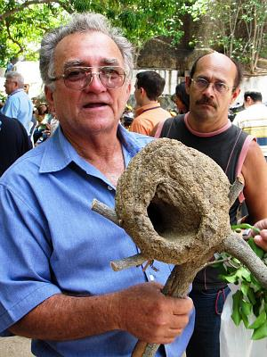
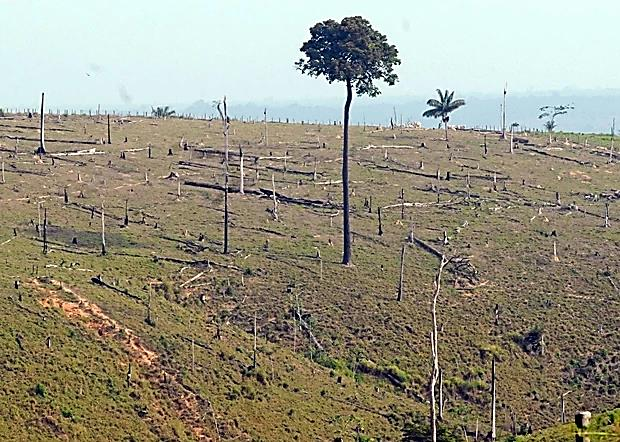

# PROVA — Camara_Boa_Viagem_2016_Agente_Administrativo

## 1. Análise geral da prova

- **Identificação:** Camara_Boa_Viagem_2016_Agente_Administrativo
- **Quantidade total de questões:** 60
- **Quantidade de textos de apoio (grupos):** 1
- **Quantidade de imagens:** 3
- **Quantidade de gráficos e tabelas:** incluídos nas imagens e no texto extraído, quando presentes no PDF original
- **Quantidade de grupos identificados:** 1
- **Quantidade de questões independentes:** 55
- **Questões que compartilham materiais:** texto-base das questões 01 a 05 → questões 01, 02, 03, 04, 05

### Transcrição integral da capa/instruções (conforme extraída do PDF)

> [!NOTE]
> Conteúdo integral das páginas anteriores à primeira questão, sem cortes.

> CÂMARA MUNICIPAL DE BOA VIAGEM – CE – AGENTE ADMINISTRATIVO – 31/01/2016
> CÂMARA MUNICIPAL DE BOA VIAGEM – CE
> CONCURSO PÚBLICO – EDITAL 001/2015
> AGENTE ADMINISTRATIVO
> NOME DO CANDIDATO: ____________________________________________________________________________________
> RG:_______________________________ ÓRGÃO EXPEDIDOR:_________________________________________
> Nº DE INSCRIÇÃO
> ASSINATURA:______________________________________________________
> LEIA COM ATENÇÃO E SIGA RIGOROSAMENTE ESTAS INSTRUÇÕES:
> 1. Este caderno contém 60 (sessenta) questões de
> múltipla escolha, numeradas de 01 a 60.
> 2. Cada uma das questões apresenta um enunciado
> seguido de 5 (cinco) alternativas, das quais somente
> uma deve ser assinalada.
> 3. Examine se a prova está completa, com a sequência
> numérica
> das
> questões,
> se
> há
> falhas
> ou
> imperfeições
> gráficas
> que
> causem
> dúvidas.
> Qualquer reclamação deverá ser feita durante os 20
> minutos iniciais. Após esse tempo, qualquer
> reclamação será desconsiderada.
> 4. Depois de decorridas 2 (duas) horas do início da
> prova, será distribuído o cartão-resposta, o qual será
> o único documento válido para a correção da prova.
> Ao recebê-lo, verifique se seu nome e seu número
> de inscrição estão corretos. Reclame imediatamente
> se houver discrepância.
> 5. O
> cartão-resposta
> não
> pode
> ser
> dobrado,
> amassado, rasurado ou manchado. Exceto sua
> assinatura e inscrição, nada deve ser escrito ou
> registrado fora dos locais destinados às respostas.
> Tenha muita atenção ao marcar seu cartão-
> resposta, pois não haverá substituição por erro do
> candidato.
> Marque
> sua
> resposta
> pintando
> completamente
> o
> espaço
> correspondente
> à
> alternativa de sua opção.
> Ex.: A
>
> B
>
> C
>
> D
>
> E
> 6. A leitora de marcas não registrará as respostas em
> que houver falta de nitidez, uso de corretivo,
> marcação a lápis ou marcação de mais de uma letra.
> Não serão computadas questões não assinaladas.
> 7. Durante a prova, é proibido o intercâmbio e o
> empréstimo de material de qualquer natureza entre
> os candidatos. A tentativa de fraude, a indisciplina e
> o desrespeito às autoridades encarregadas dos
> trabalhos
> são
> faltas
> que
> implicarão
> a
> desclassificação do(a) candidato(a).
> 8. Qualquer forma de comunicação entre candidatos
> implicará a eliminação de ambos do certame.
> 9. Não será permitido ao candidato, durante a
> realização das provas, portar armas, aparelhos
> eletrônicos de qualquer natureza, relógios, bolsas,
> livros, jornais e impressos em geral; bonés,
> chapéus, lenço de cabelo, bandanas etc.
> 10. É vedado o uso de telefone celular ou de qualquer
> outro meio de comunicação. O candidato que for
> flagrado portando aparelho celular, durante o
> período de realização da prova, ou, ainda, aquele
> cujo aparelho celular tocar, será sumariamente
> eliminado do certame.
> 11. Em caso de dúvida, durante a prova, levante o braço
> para solicitar atendimento da fiscalização. Jamais
> pergunte em voz alta.
> 12. O candidato que permanecer na sala de provas, por
> mais de 3h45min, poderá levar consigo a cópia do
> gabarito, em formulário específico, fornecido pela
> ORGANIZADORA.
> 13. Ao terminar a resolução da prova, entregue-a ao
> fiscal de sala juntamente com o cartão-resposta
> (devidamente assinado). Não se esqueça, também,
> de assinar a folha de frequência.
> 14. As provas terão duração de 4 (quatro) horas. Turno
> da Manhã com início às 08h00min e término às
> 12h00min. Turno da Tarde com início às 14h00min
> e término às 18h00min. O candidato só poderá
> ausentar-se da sala depois de decorridas duas
> horas do início das provas.
> 15. Os Gabaritos Preliminares das Provas Objetivas
> serão divulgados 72 (setenta e duas) horas após a
> realização das mesmas.
>
>
>
> CÂMARA MUNICIPAL DE BOA VIAGEM – CE – AGENTE ADMINISTRATIVO – 31/01/2016
>
>
>
>
>
>
> CÂMARA MUNICIPAL DE BOA VIAGEM – CE – AGENTE ADMINISTRATIVO – 31/01/2016
> CONHECIMENTOS GERAIS
> Leia o Texto para responder às questões 1 a 5.
> Tragédia em Mariana: "É a maior catástrofe ambiental do
> Brasil", diz ministra
> A ministra do Meio Ambiente, Izabella Teixeira, disse nesta
> quinta-feira (19) que o rompimento da barragem de rejeitos de
> mineração da Samarco, em Mariana (MG), há duas semanas, é
> a maior tragédia ambiental da história do Brasil.
>
> “É a maior catástrofe ambiental do país, isso é inegável. Eu
> vi o acidente. É impressionante o impacto na flora e nas
> atividades econômicas”, disse a ministra. "No trecho do Rio Doce
> em Minas, a ictiofauna [espécies de peixe em uma região] na
> calha do rio principal acabou".
>
> Segundo Izabella, o governo está trabalhando para reduzir
> os impactos no Rio Doce e no oceano. “Nós estamos desde
> sábado trabalhando em parceria com o Espírito Santo e com a
> prefeitura de Linhares. Abrimos um canal na foz do rio, que está
> assoreado, para facilitar a dispersão da lama”, informou. "Os
> peixes de superfície conseguiram migrar para alguns rios
> tributários, mas estão morrendo, e a fauna ribeirinha também foi
> impactada".
>
> A ministra informou que a onda de lama deve se espalhar
> por uma extensão de 9 quilômetros (km) quando chegar ao mar,
> após desaguar na costa do Espírito Santo, na cidade de Linhares.
> “Os dados de dispersão disponíveis indicam que a dispersão
> máxima para o sul é 6 km e a dispersão máxima para o norte é 3
> km, porque as correntes marinhas ali seguem para o sul”, afirmou.
>
> O rompimento da barragem de Fundão destruiu o distrito de
> Bento Rodrigues e deixou mais de 900 pessoas desabrigadas. A
> onda de lama que se formou chegou ao Rio Doce, provocando a
> mortandade de peixes e impedindo o abastecimento de água em
> cidades de Minas Gerais e do Espírito Santo. Sete mortos durante
> a tragédia foram identificados, cinco corpos aguardam
> identificação e 11 pessoas permanecem desaparecidas.
> (Disponível em Últimosegundo.ig.com.br)

## 2. Questões agrupadas

### GRUPO 01 — Texto-base compartilhado pelas questões 01 a 05

**Questões relacionadas:** 01, 02, 03, 04, 05.

#### QUESTÃO 01

**Material de apoio:**

Tragédia em Mariana: "É a maior catástrofe ambiental do
Brasil", diz ministra
A ministra do Meio Ambiente, Izabella Teixeira, disse nesta
quinta-feira (19) que o rompimento da barragem de rejeitos de
mineração da Samarco, em Mariana (MG), há duas semanas, é
a maior tragédia ambiental da história do Brasil.

“É a maior catástrofe ambiental do país, isso é inegável. Eu
vi o acidente. É impressionante o impacto na flora e nas
atividades econômicas”, disse a ministra. "No trecho do Rio Doce
em Minas, a ictiofauna [espécies de peixe em uma região] na
calha do rio principal acabou".

Segundo Izabella, o governo está trabalhando para reduzir
os impactos no Rio Doce e no oceano. “Nós estamos desde
sábado trabalhando em parceria com o Espírito Santo e com a
prefeitura de Linhares. Abrimos um canal na foz do rio, que está
assoreado, para facilitar a dispersão da lama”, informou. "Os
peixes de superfície conseguiram migrar para alguns rios
tributários, mas estão morrendo, e a fauna ribeirinha também foi
impactada".

A ministra informou que a onda de lama deve se espalhar
por uma extensão de 9 quilômetros (km) quando chegar ao mar,
após desaguar na costa do Espírito Santo, na cidade de Linhares.
“Os dados de dispersão disponíveis indicam que a dispersão
máxima para o sul é 6 km e a dispersão máxima para o norte é 3
km, porque as correntes marinhas ali seguem para o sul”, afirmou.

O rompimento da barragem de Fundão destruiu o distrito de
Bento Rodrigues e deixou mais de 900 pessoas desabrigadas. A
onda de lama que se formou chegou ao Rio Doce, provocando a
mortandade de peixes e impedindo o abastecimento de água em
cidades de Minas Gerais e do Espírito Santo. Sete mortos durante
a tragédia foram identificados, cinco corpos aguardam
identificação e 11 pessoas permanecem desaparecidas.
(Disponível em Últimosegundo.ig.com.br)

**Enunciado:**

Segundo o texto, é correto afirmar.

**Alternativas:**

A) Para a flora, o impacto do acidente foi positivo.
B) Os peixes não sofreram nenhuma consequência.
C) O acidente deixou muitas pessoas desabrigadas.
D) Todos os corpos/pessoas foram encontrados.
E) O governo não tomou nenhuma atitude para ajudar as
vítimas do acidente.

**Referências visuais:**

Nenhuma.

---

#### QUESTÃO 02

**Material de apoio:**

Tragédia em Mariana: "É a maior catástrofe ambiental do
Brasil", diz ministra
A ministra do Meio Ambiente, Izabella Teixeira, disse nesta
quinta-feira (19) que o rompimento da barragem de rejeitos de
mineração da Samarco, em Mariana (MG), há duas semanas, é
a maior tragédia ambiental da história do Brasil.

“É a maior catástrofe ambiental do país, isso é inegável. Eu
vi o acidente. É impressionante o impacto na flora e nas
atividades econômicas”, disse a ministra. "No trecho do Rio Doce
em Minas, a ictiofauna [espécies de peixe em uma região] na
calha do rio principal acabou".

Segundo Izabella, o governo está trabalhando para reduzir
os impactos no Rio Doce e no oceano. “Nós estamos desde
sábado trabalhando em parceria com o Espírito Santo e com a
prefeitura de Linhares. Abrimos um canal na foz do rio, que está
assoreado, para facilitar a dispersão da lama”, informou. "Os
peixes de superfície conseguiram migrar para alguns rios
tributários, mas estão morrendo, e a fauna ribeirinha também foi
impactada".

A ministra informou que a onda de lama deve se espalhar
por uma extensão de 9 quilômetros (km) quando chegar ao mar,
após desaguar na costa do Espírito Santo, na cidade de Linhares.
“Os dados de dispersão disponíveis indicam que a dispersão
máxima para o sul é 6 km e a dispersão máxima para o norte é 3
km, porque as correntes marinhas ali seguem para o sul”, afirmou.

O rompimento da barragem de Fundão destruiu o distrito de
Bento Rodrigues e deixou mais de 900 pessoas desabrigadas. A
onda de lama que se formou chegou ao Rio Doce, provocando a
mortandade de peixes e impedindo o abastecimento de água em
cidades de Minas Gerais e do Espírito Santo. Sete mortos durante
a tragédia foram identificados, cinco corpos aguardam
identificação e 11 pessoas permanecem desaparecidas.
(Disponível em Últimosegundo.ig.com.br)

**Enunciado:**

De modo geral, essa catástrofe atingiu

**Alternativas:**

A) os peixes.
B) o meio ambiente.
C) a flora.
D) o oceano.
E) o Rio Doce.

**Referências visuais:**

Nenhuma.

---

#### QUESTÃO 03

**Material de apoio:**

Tragédia em Mariana: "É a maior catástrofe ambiental do
Brasil", diz ministra
A ministra do Meio Ambiente, Izabella Teixeira, disse nesta
quinta-feira (19) que o rompimento da barragem de rejeitos de
mineração da Samarco, em Mariana (MG), há duas semanas, é
a maior tragédia ambiental da história do Brasil.

“É a maior catástrofe ambiental do país, isso é inegável. Eu
vi o acidente. É impressionante o impacto na flora e nas
atividades econômicas”, disse a ministra. "No trecho do Rio Doce
em Minas, a ictiofauna [espécies de peixe em uma região] na
calha do rio principal acabou".

Segundo Izabella, o governo está trabalhando para reduzir
os impactos no Rio Doce e no oceano. “Nós estamos desde
sábado trabalhando em parceria com o Espírito Santo e com a
prefeitura de Linhares. Abrimos um canal na foz do rio, que está
assoreado, para facilitar a dispersão da lama”, informou. "Os
peixes de superfície conseguiram migrar para alguns rios
tributários, mas estão morrendo, e a fauna ribeirinha também foi
impactada".

A ministra informou que a onda de lama deve se espalhar
por uma extensão de 9 quilômetros (km) quando chegar ao mar,
após desaguar na costa do Espírito Santo, na cidade de Linhares.
“Os dados de dispersão disponíveis indicam que a dispersão
máxima para o sul é 6 km e a dispersão máxima para o norte é 3
km, porque as correntes marinhas ali seguem para o sul”, afirmou.

O rompimento da barragem de Fundão destruiu o distrito de
Bento Rodrigues e deixou mais de 900 pessoas desabrigadas. A
onda de lama que se formou chegou ao Rio Doce, provocando a
mortandade de peixes e impedindo o abastecimento de água em
cidades de Minas Gerais e do Espírito Santo. Sete mortos durante
a tragédia foram identificados, cinco corpos aguardam
identificação e 11 pessoas permanecem desaparecidas.
(Disponível em Últimosegundo.ig.com.br)

**Enunciado:**

De acordo com o texto, pode-se apontar como
consequências dessa catástrofe, exceto o(a)

**Alternativas:**

A) impacto econômico.
B) extinção da ictiofauna.
C) não abastecimento de água nas regiões afetadas.
D) destruição do distrito de Bento Rodrigues.
E) permanência de peixes na calha do rio principal.

**Referências visuais:**

Nenhuma.

---

#### QUESTÃO 04

**Material de apoio:**

Tragédia em Mariana: "É a maior catástrofe ambiental do
Brasil", diz ministra
A ministra do Meio Ambiente, Izabella Teixeira, disse nesta
quinta-feira (19) que o rompimento da barragem de rejeitos de
mineração da Samarco, em Mariana (MG), há duas semanas, é
a maior tragédia ambiental da história do Brasil.

“É a maior catástrofe ambiental do país, isso é inegável. Eu
vi o acidente. É impressionante o impacto na flora e nas
atividades econômicas”, disse a ministra. "No trecho do Rio Doce
em Minas, a ictiofauna [espécies de peixe em uma região] na
calha do rio principal acabou".

Segundo Izabella, o governo está trabalhando para reduzir
os impactos no Rio Doce e no oceano. “Nós estamos desde
sábado trabalhando em parceria com o Espírito Santo e com a
prefeitura de Linhares. Abrimos um canal na foz do rio, que está
assoreado, para facilitar a dispersão da lama”, informou. "Os
peixes de superfície conseguiram migrar para alguns rios
tributários, mas estão morrendo, e a fauna ribeirinha também foi
impactada".

A ministra informou que a onda de lama deve se espalhar
por uma extensão de 9 quilômetros (km) quando chegar ao mar,
após desaguar na costa do Espírito Santo, na cidade de Linhares.
“Os dados de dispersão disponíveis indicam que a dispersão
máxima para o sul é 6 km e a dispersão máxima para o norte é 3
km, porque as correntes marinhas ali seguem para o sul”, afirmou.

O rompimento da barragem de Fundão destruiu o distrito de
Bento Rodrigues e deixou mais de 900 pessoas desabrigadas. A
onda de lama que se formou chegou ao Rio Doce, provocando a
mortandade de peixes e impedindo o abastecimento de água em
cidades de Minas Gerais e do Espírito Santo. Sete mortos durante
a tragédia foram identificados, cinco corpos aguardam
identificação e 11 pessoas permanecem desaparecidas.
(Disponível em Últimosegundo.ig.com.br)

**Enunciado:**

“A onda de lama que se formou chegou ao Rio Doce,...”
Os termos grifados constituem uma oração

**Alternativas:**

A) subordinada adjetiva restritiva.
B) subordinada substantiva objetiva direta.
C) subordinada adjetiva explicativa.
D) subordinada adverbial causal.
E) coordenada sindética explicativa.

**Referências visuais:**

Nenhuma.

---

#### QUESTÃO 05

**Material de apoio:**

Tragédia em Mariana: "É a maior catástrofe ambiental do
Brasil", diz ministra
A ministra do Meio Ambiente, Izabella Teixeira, disse nesta
quinta-feira (19) que o rompimento da barragem de rejeitos de
mineração da Samarco, em Mariana (MG), há duas semanas, é
a maior tragédia ambiental da história do Brasil.

“É a maior catástrofe ambiental do país, isso é inegável. Eu
vi o acidente. É impressionante o impacto na flora e nas
atividades econômicas”, disse a ministra. "No trecho do Rio Doce
em Minas, a ictiofauna [espécies de peixe em uma região] na
calha do rio principal acabou".

Segundo Izabella, o governo está trabalhando para reduzir
os impactos no Rio Doce e no oceano. “Nós estamos desde
sábado trabalhando em parceria com o Espírito Santo e com a
prefeitura de Linhares. Abrimos um canal na foz do rio, que está
assoreado, para facilitar a dispersão da lama”, informou. "Os
peixes de superfície conseguiram migrar para alguns rios
tributários, mas estão morrendo, e a fauna ribeirinha também foi
impactada".

A ministra informou que a onda de lama deve se espalhar
por uma extensão de 9 quilômetros (km) quando chegar ao mar,
após desaguar na costa do Espírito Santo, na cidade de Linhares.
“Os dados de dispersão disponíveis indicam que a dispersão
máxima para o sul é 6 km e a dispersão máxima para o norte é 3
km, porque as correntes marinhas ali seguem para o sul”, afirmou.

O rompimento da barragem de Fundão destruiu o distrito de
Bento Rodrigues e deixou mais de 900 pessoas desabrigadas. A
onda de lama que se formou chegou ao Rio Doce, provocando a
mortandade de peixes e impedindo o abastecimento de água em
cidades de Minas Gerais e do Espírito Santo. Sete mortos durante
a tragédia foram identificados, cinco corpos aguardam
identificação e 11 pessoas permanecem desaparecidas.
(Disponível em Últimosegundo.ig.com.br)

**Enunciado:**

“Abrimos um canal na foz do rio, que está assoreado,
para facilitar a dispersão da lama.” Não é sinônimo de
assorear.

**Alternativas:**

A) Entulhar
B) Sedimentar
C) Cobrir
D) Obstruir
E) Abrir

**Referências visuais:**

Nenhuma.

---

## 3. Questões independentes

#### QUESTÃO 06

**Enunciado:**

A palavra “academia” ´é coletivo de

**Alternativas:**

A) pessoas convocadas para julgar.
B) textos seletos.
C) músicos.
D) eleitores e membros de uma corporação.
E) artistas, literatos e sábios.

**Referências visuais:**

Nenhuma.

---

#### QUESTÃO 07

**Enunciado:**

Marque a opção correta quanto à classificação dos
verbos.

**Alternativas:**

A) Abundante é o verbo que apresenta irregularidade em sua
conjugação.
B) Defectivo é o verbo que não se conjuga em todos os tempos,
modos ou pessoas.
C) Impessoal é o verbo que se conjuga apenas na segunda
pessoa do singular.
D) Auxiliar é o verbo que, junto a outro, exerce sentido próprio.
E) Anômalo é o verbo que possui mais de uma forma para o
particípio.

**Referências visuais:**

Nenhuma.

---

#### QUESTÃO 08

**Enunciado:**

Nas opções a seguir, há apenas um substantivo feminino.
Identifique-o.

**Alternativas:**

A) Comichão
B) Champanha
C) Ágape
D) Estratagema
E) Alvará

**Referências visuais:**

Nenhuma.

---

#### QUESTÃO 09

**Enunciado:**

As palavras a seguir são acentuadas pela mesma regra,
exceto

**Alternativas:**

A) atribuído.
B) baú.
C) uísque.
D) astúcia.
E) miúdo.

**Referências visuais:**

Nenhuma.

---

#### QUESTÃO 10

**Enunciado:**

Indique a alternativa em que o sinal indicativo de crase
é facultativo.

**Alternativas:**

A) Voltamos à casa do juiz.
B) Voltou às pressas.
C) Devolvemos o dinheiro àquela mulher.
D) Voltamos à minha casa.
E) Chegamos às cinco horas.

**Referências visuais:**

Nenhuma.

---

#### QUESTÃO 11

**Enunciado:**

“A briga entre as duas facções recrudesceu nestes
últimos dois dias.” Qual o significado da palavra sublinhada
no período?

**Alternativas:**

A) Agravar-se
B) Diminuir
C) Recuar
D) Cessar
E) Aprimorar

**Referências visuais:**

Nenhuma.

---

#### QUESTÃO 12

**Enunciado:**

Transpondo para a voz ativa a frase “As frutas estavam
sendo guardadas em caixotes”, obtém-se a forma verbal

**Alternativas:**

A) houveram sido guardadas.
B) haviam sido guardadas.
C) estavam guardando.
D) guardar-se-iam.
E) seriam guardadas.

**Referências visuais:**

Nenhuma.

---

#### QUESTÃO 13

**Enunciado:**

Assinale a alternativa CORRETA quanto à concordância
verbal.

**Alternativas:**

A) Fazem anos que não vou a minha terra natal.
B) Luís ou Roberto será escolhido para o cargo.
C) Aspiramos um aumento salarial em breve.
D) Há muito, Paulo namora com Cristina.
E) Devem haver pessoas honestas nesse lugar.
CÂMARA MUNICIPAL DE BOA VIAGEM – CE – AGENTE ADMINISTRATIVO – 31/01/2016

**Referências visuais:**

Nenhuma.

---

#### QUESTÃO 14

**Enunciado:**

No período “Deixei-os sair, mas procurei orientá-los
bem”, os termos destacados são, respectivamente?

**Alternativas:**

A) Artigo, conjunção, pronome
B) Pronome, preposição, pronome
C) Pronome, conjunção, pronome
D) Artigo, conjunção, artigo
E) Artigo, preposição, artigo

**Referências visuais:**

Nenhuma.

---

#### QUESTÃO 15

**Enunciado:**

A palavra DEBATE é formada por derivação

**Alternativas:**

A) regressiva.
B) imprópria.
C) parassintética.
D) prefixal.
E) sufixal.

**Referências visuais:**

Nenhuma.

---

#### QUESTÃO 16

**Enunciado:**

Marque a alternativa em que a palavra apresenta hiato.

**Alternativas:**

A) Uruguai
B) Guerra
C) Moratória
D) Secretaria
E) Pai

**Referências visuais:**

Nenhuma.

---

#### QUESTÃO 17

**Enunciado:**

Um grupo de 10 operários pode fazer uma casa em 96
dias, trabalhando 6 horas por dia. Se o mesmo grupo
trabalhar 8 horas por dia, a estrada será concluída em

**Alternativas:**

A) 72 dias.
B) 90 dias.
C) 84 dias.
D) 128 dias.
E) 60 dias.

**Referências visuais:**

Nenhuma.

---

#### QUESTÃO 18

**Enunciado:**

Uma mesa cujo preço era R$ 220,00 teve dois aumentos
sucessivos de 15% e 20% respectivamente. Em seguida, o
valor resultante teve um desconto percentual igual a 10%,
resultando num preço final de

**Alternativas:**

A) 273,24.
B) 148,15.
C) 512,44.
D) 244,00.
E) 289,20.

**Referências visuais:**

Nenhuma.

---

#### QUESTÃO 19

**Enunciado:**

A soma de dois números é 3.333, a quinta parte de um
deles é 77. Qual o valor do maior deles?

**Alternativas:**

A) 1.785.
B) 1.885.
C) 2.948.
D) 2.085.
E) 2.185.

**Referências visuais:**

Nenhuma.

---

#### QUESTÃO 20

**Enunciado:**

Qual o valor de x na proporção
𝐗
𝟏𝟎=
𝟏𝟒,𝟒

**Alternativas:**

A) 3.
B) 6.
C) 9.
D) 12.
E) 15.

**Referências visuais:**

Nenhuma.

---

#### QUESTÃO 21

**Enunciado:**

Em uma Felisópolis existem duas empresas de ônibus,
X e Y. Exatamente 70% dos estudantes dessa cidade utilizam
a Empresa X e 50% a Empresa Y. Sabendo que todo
estudante da cidade é usuário de, pelo menos, uma das
empresas, qual o percentual deles que utilizam as duas
empresas?

**Alternativas:**

A) 15%.
B) 20%.
C) 27%.
D) 33%.
E) 35%.

**Referências visuais:**

Nenhuma.

---

#### QUESTÃO 22

**Enunciado:**

Dividindo o número 360 em duas partes inversamente
proporcionais a 3 e 5, o resultado é

**Alternativas:**

A) 205 – 155.
B) 215 – 145.
C) 225 – 135.
D) 220 – 140.
E) 210 – 150.

**Referências visuais:**

Nenhuma.

---

#### QUESTÃO 23

**Enunciado:**

Uma geladeira é vendida à vista por R$ 2.000,00 ou em
duas parcelas, sendo a primeira como uma entrada de
R$ 400,00 e a segunda, dois meses após, no valor de
R$ 1.760,00. Qual a taxa mensal de juros simples utilizada?

**Alternativas:**

A) 2%.
B) 4%.
C) 5%.
D) 10%.
E) 15%.

**Referências visuais:**

Nenhuma.

---

#### QUESTÃO 24

**Enunciado:**

Aplicando todo meu dinheiro com uma taxa de juros
simples de 4% ao mês, terei o dobro do valor em

**Alternativas:**

A) 2 anos e 1 mês.
B) 1 ano e 5 meses.
C) 2 anos.
D) 2 anos e 5 meses.
E) 1 ano.

**Referências visuais:**

Nenhuma.

---

#### QUESTÃO 25

**Enunciado:**

As raízes que satisfazem a equação 2x² + 3x - 2 = 0 são

**Alternativas:**

A) - 1/2; 2
B) 1/2; 2
C) 1; -2
D) - 1/2; -2
E) 1/2; -2

**Referências visuais:**

Nenhuma.

---

#### QUESTÃO 26

**Enunciado:**

Uma prova do concurso realizada num domingo terá seu
resultado publicado em 44 dias. Os resultados serão
publicados, portanto, em uma

**Alternativas:**

A) segunda-feira.
B) terça-feira
C) quarta-feira.
D) quinta-feira
E) sexta-feira

**Referências visuais:**

Nenhuma.

---

#### QUESTÃO 27

**Enunciado:**

Vendi um carro por R$ 18.900,00, com prejuízo de 10%
sobre o custo. Para obter um lucro de 25% sobre o custo,
deveria vender o mesmo carro por

**Alternativas:**

A) R$ 19.900,00.
B) R$ 26.250,00.
C) R$ 20.850,00.
D) R$ 25.750,00.
E) R$ 21.360,00.

**Referências visuais:**

Nenhuma.

---

#### QUESTÃO 28

**Enunciado:**

Uma prefeitura deve distribuir a verba de R$ 15.750,00,
para pequenas reformas de pintura, entre 3 escolas
municipais com 10, 12 e 13 salas de aula. Se a divisão for
proporcional ao número de salas de aula de cada escola,
então a de maior número de salas receberá

**Alternativas:**

A) R$ 3.432,00.
B) R$ 5.840,00.
C) R$ 6.468,00.
D) R$ 7.475,00.
E) R$ 5.488,00.

**Referências visuais:**

Nenhuma.

---

#### QUESTÃO 29

**Enunciado:**

Complete, com as afirmativas a seguir a seguinte frase:
O cidadão sustentável deve
I.
compreender que todas as nossas ações repercutem e
interferem na qualidade de vida das outras pessoas e do
meio ambiente.
II.
ser consciente de que, através da condição de consumidor,
somos capazes de alterar positivamente os rumos da
sociedade.
III. aproveitar todas as promoções de consumo, antes que sejam
comprometidas pela escassez de recursos.

CÂMARA MUNICIPAL DE BOA VIAGEM – CE – AGENTE ADMINISTRATIVO – 31/01/2016
IV. acreditar que as mudanças só acontecem na coletividade, o
esforço individual não promove resultado.
V. conhecer nossos direitos e deveres, ter iniciativa e
compreender que as verdadeiras mudanças começam em
nós mesmos.
Marque a opção que apresenta as afirmativas que a completa
corretamente.

**Alternativas:**

A) I – II – III
B) I – III – V
C) II – III – IV
D) I – II – V
E) II – IV – V.

**Referências visuais:**

Nenhuma.

---

#### QUESTÃO 30

**Enunciado:**

A captação de água da chuva è

**Alternativas:**

A) uma solução prática e confiável para o abastecimento de
água potável, quando realizada de forma correta.
B) pouco recomendável porque geralmente precipita trazendo
toda a poluição do ar.
C) de difícil armazenamento, pois as técnicas para tal requerem
procedimentos de conhecimento técnico.
D) desaconselhável nas áreas de irrigação, pois favorece a
proliferação de mosquitos.
E) um processo complexo que necessita de especialistas para
planejar e executar a obra.

**Referências visuais:**

Nenhuma.

---

#### QUESTÃO 31

**Enunciado:**

Leia a seguinte notícia:
Publicado em Quinta, 14 janeiro 2016, 21:55
Meteorologistas Meiry Sakamoto e Raul Fritz, da FUNCEME, são
membros do Conselho
A posse dos 17 membros do Conselho Municipal de Proteção e
Defesa Civil e a primeira reunião do Comitê de Ações para a
Quadra Chuvosa ocorreu nesta quinta-feira (14/01), no auditório
do Paço Municipal da Prefeitura de Fortaleza, representando as
ações fundamentais que a administração municipal desenvolve
para a prevenção para a quadra chuvosa deste ano.
A FUNCEME é o(a)

**Alternativas:**

A) Secretaria Estadual que controla os recursos hídricos do
Ceará.
B) Fundação Cearense de Meteorologia e Recursos Hídricos.
C) Comissão protetora das águas do Ceará.
D) órgão que fiscaliza as águas marítimas do litoral cearense.
E) órgão municipal que é vinculado à CAGECE.

**Referências visuais:**

Nenhuma.

---

#### QUESTÃO 32

**Enunciado:**

O que é o meteorologista?

**Alternativas:**

A) O funcionário que opera com o anemômetro, instrumento
utilizado para medir a velocidade do vento.
B) O profissional que trabalha com o barômetro, instrumento
utilizado para medir a pressão atmosférica.
C) O profissional que estuda a atmosfera e os fenômenos
atmosféricos.
D) O estudioso do movimento da superfície da água, quando
não há vento ou ondulação.
E) O estudioso que observa o estado do céu, quando nenhuma
nuvem ou obscurecimento são observados.

**Referências visuais:**

Nenhuma.

---

#### QUESTÃO 33

**Enunciado:**

Analise as afirmativas a seguir sobre a camada de
ozônio e assinale (V) para as verdadeiras e (F) para as
FALSAS.
(
) Contém uma elevada proporção de oxigênio sob a forma
de ozônio.
(
) Área alongada de baixa pressão atmosférica que é
associada a uma área de circulação ciclônica mínima.
(
) Também conhecida como área de baixa pressão; é o
oposto de uma área de alta pressão.
(
) Esta camada age como um filtro, protegendo o Planeta da
radiação ultravioleta.
(
)
Situa-se
entre
a
troposfera
e
a
estratosfera,
aproximadamente entre 15 a 20 quilômetros (9,5 e 12,5 milhas)
acima da superfície da Terra.
Marque a opção que apresenta a sequência CORRETA.

**Alternativas:**

A) V – V – F – F – F
B) V – F – V – F – V
C) F – F – V – V – V
D) F – V – V – V – F
E) V – F – F – V – V.

**Referências visuais:**

Nenhuma.

---

#### QUESTÃO 34

**Enunciado:**

Os
impactos
ambientais
são
ocasionados
por
confrontos diretos ou indiretos entre o homem e a natureza.
Exemplos bem conhecidos de impacto ambiental são o(a)(s)

**Alternativas:**

A) desmatamentos, as queimadas, a poluição das águas, o
buraco na camada de ozônio.
B) continuadas
melhorias
nos
meios
de
transporte
e
comunicação.
C) melhorias nos processos de produção em grandes
quantidades e com melhor qualidade.
D) desenvolvimento das embalagens determinou a evolução da
prática habitual do embalamento.
E) crescente industrialização e novos hábitos urbanos ajudaram
a criar um novo tipo de consumidor.

**Referências visuais:**

Nenhuma.

---

#### QUESTÃO 35

**Enunciado:**

Leia a seguinte reportagem:
14/01/2012 07h00 - Atualizado em 14/01/2012 07h00
'Profetas da chuva' do CE preveem bom ano para agricultura no
Nordeste
Quixadá sedia anualmente o encontro dos chamados profetas da
chuva.
Os chamados “profetas da chuva” se reuniram neste sábado (14)
em Quixadá, sertão central do Ceará, para divulgar previsões
para o período chuvoso. Três deles antecipam as previsões e
dizem que a estação chuvosa será boa para os agricultores do
Ceará e do Nordeste.
João-de-barro construiu a casa voltada para o poente, sinal de
muita chuva, diz profeta.
(Foto: Alex Pimentel/Agência Diário)
Quem são os profetas da chuva?

**Alternativas:**

A) São pessoas de formação técnica na área de educação
ambiental.
B) São idosos (acima de 60 anos) que pela experiência de vida,
conhecem o tempo.
C) Agricultores treinados pelos meteorologistas para fazerem
previsão do tempo.
D) Moradores do interior do Ceará que se dedicam ao estudo
dos recursos hídricos.
E) São pessoas que fazem leitura em plantas, insetos, ventos e
nuvens para arriscarem palpites.

CÂMARA MUNICIPAL DE BOA VIAGEM – CE – AGENTE ADMINISTRATIVO – 31/01/2016

**Referências visuais:**

Nenhuma.

---

#### QUESTÃO 36

**Enunciado:**

A
paisagem
a
seguir denota
os
impactos
do
desmatamento na região amazônica.
Sobre essa ação, estão corretas as seguintes afirmações:
I.
Impacto ambiental é um desequilíbrio provocado pela ação
dos seres humanos sobre o meio ambiente.
II.
Resultou de acidentes naturais: a explosão de um vulcão.
III. Aconteceu um grande incêndio na floresta devido ao choque
de um meteoro.
IV. Quando os ecossistemas sofrem impactos ambientais,
geralmente a vegetação é o primeiro elemento da natureza a
ser atingido.
V. Atualmente todas as formações vegetais, em maior ou menor
grau, encontram-se modificadas pela ação humana.
VI. Ocorre
principalmente
por
causa
das
atividades
agropecuárias.
Marque a opção que apresenta as afirmativas CORRETAS.

**Alternativas:**

A) I – II – III
B) I – III – V
C) IV – V – VI
D) II – IV – VI
E) III – IV – V.

**Referências visuais:**

Nenhuma.

---

#### QUESTÃO 37

**Enunciado:**

Quais são os principais fatores componentes da ética
profissional?

**Alternativas:**

A) Habilidade,
competência,
respeito,
pontualidade,
assiduidade e lealdade.
B) Honestidade, sigilo, competência, prudência, humildade e
imparcialidade.
C) Assiduidade, pontualidade, sigilo, competência, prudência e
humildade.
D) Honestidade, habilidade, competência, prudência, humildade
e imparcialidade.
E) Respeito, pontualidade, assiduidade, lealdade, fidelidade e
humildade.

**Referências visuais:**

Nenhuma.

---

#### QUESTÃO 38

**Enunciado:**

João Paulo é funcionário de uma empresa de grande
porte. Ocupa o cargo de gerente. Precisou chamar atenção
de uma funcionária e surpreendeu-se com a atitude dela
porque ela foi ríspida e exaltada.
Faltou a funcionária atitude de

**Alternativas:**

A) honestidade.
B) prudência.
C) competência.
D) lealdade.
E) fidelidade.

**Referências visuais:**

Nenhuma.

---

#### QUESTÃO 39

**Enunciado:**

Ao chegar a casa, João Paulo contou à esposa o que
aconteceu e esta ficou indignada porque conhecia a
funcionária de ambientes sociais. A atitude de João Paulo
fere ao compromisso ético de

**Alternativas:**

A) sigilo.
B) lealdade.
C) prudência.
D) honestidade.
E) humildade.

**Referências visuais:**

Nenhuma.

---

#### QUESTÃO 40

**Enunciado:**

Primeira grande epidemia de Zika no mundo acontece
no Brasil, diz infectologista
Mosquito do Aedes aegypti, transmissor do Zika vírus (Foto:
Thinkstock)
Um dos mais respeitados infectologistas do país, o professor e
ex-diretor da Faculdade de Medicina da Universidade de São
Paulo e coordenador de Controle de Doenças da Secretaria da
Saúde de São Paulo, Marcos Boulos, acredita que o país vive
atualmente a maior epidemia já registrada no mundo por vírus
Zika.
“Houve poucas epidemias no mundo. A primeira grande epidemia
de Zika está acontecendo agora no Brasil”, disse. O especialista
defendeu o combate sistemático ao mosquito Aedes aegypti.
(http://www.bing.com/news/search?q=PROUNE&first=11&FORM=PENR)
O que mais assusta a população sobre a doença é o número
de casos de

**Alternativas:**

A) Febre Amarela.
B) Dengue Hemorrágica.
C) Febre Chikungunya.
D) Microcefalia.
E) Malária.
CONHECIMENTOS ESPECÍFICOS

**Referências visuais:**

Nenhuma.

---

#### QUESTÃO 41

**Enunciado:**

É necessário que o serviço público estabeleça
procedimentos administrativos que devem ser cumpridos
por todos. No fornecimento das compras pelas empresas
privadas, mesmo após o cumprimento de todo procedimento
licitatório por parte do órgão público referente à aquisição, o
fornecedor ganhador do certame somente poderá entregar o
produto licitado perante a emissão de que documento?

**Alternativas:**

A) Nota de empenho.
B) Contrato.
C) Ordem de pagamento.
D) Proposta de fornecimento.
E) Termo de referência.

**Referências visuais:**

Nenhuma.

---

#### QUESTÃO 42

**Enunciado:**

Com o propósito de facilitar e formalizar o fluxo das
comunicações nas organizações, são adotados como
procedimentos
administrativos
diversos
tipos
de
formulários. Assinale a alternativa que apresenta um dos
objetivos relacionados a essa ferramenta.

**Alternativas:**

A) Identificar duplicidade de atividades e tarefas em cada área.
B) Divulgar as atividades ao pessoal envolvido com o processo.
C) Documentar e centralizar as informações que tramitam em
um processo.
D) Permitir a coordenação efetiva de todas as atividades do
processo.
E) Delimitar as áreas de competências dos órgãos envolvidos
com o processo.

**Referências visuais:**

Nenhuma.

---

#### QUESTÃO 43

**Enunciado:**

Analise as afirmativas a seguir sobre os princípios
norteadores do serviço público.
I.
O governo age com impessoalidade quando trata todos os
cidadãos de maneira igual, não havendo favorecimento ou
promoção devido a atividades ou funções desempenhadas.
II.
A eficiência é o mais recente dos princípios constitucionais,
tendo como um dos objetivos melhorar a prestação do
serviço público oferecido ao cidadão.
III. De acordo com o Princípio da Moralidade, todos os atos do
governo deverão ser tornados públicos e cabe ao cidadão
solicitar tais informações.

CÂMARA MUNICIPAL DE BOA VIAGEM – CE – AGENTE ADMINISTRATIVO – 31/01/2016
Marque a opção que indica a(s) afirmativa(s) corretas(s).

**Alternativas:**

A) I
B) III
C) I – II
D) II – III
E) I – II – III.

**Referências visuais:**

---

#### QUESTÃO 44

**Enunciado:**

O agente administrativo pode contribuir de forma
significativa para a boa imagem da instituição e para que o
público tenha uma boa impressão de seu atendimento. Para
tanto deve adotar as seguintes posturas, EXCETO.

**Alternativas:**

A) Procurar conhecer o perfil do público a ser atendido.
B) Obedecer rigorosamente às regras da instituição, sendo
inflexível em qualquer ocasião, demonstrando seriedade no
trabalho.
C) Ter forte conexão com o público-alvo da instituição.
D) Procurar atender com solicitude e atenção às demandas
apresentadas pelo público.
E) Conscientizar-se do papel que exerce e contribuir para o
alcance dos objetivos do órgão.

**Referências visuais:**

Nenhuma.

---

#### QUESTÃO 45

**Enunciado:**

Sobre
a
definição:
“Ordenação
dos
conjuntos
documentais remanescentes das eliminações (na fase
corrente e na intermediária, em obediência à Tabela de
Temporalidade), obedecendo a critérios que respeitem o
caráter orgânico dos conjuntos, interna e externamente”.
(LIBERALLI, 2004). Estamos falando do:

**Alternativas:**

A) Arquivo Morto
B) Controle Interno
C) Arquivo Corrente
D) Protocolo
E) Arquivo Permanente

**Referências visuais:**

Nenhuma.

---

#### QUESTÃO 46

**Enunciado:**

Antônio atua no setor de protocolo de uma instituição
pública municipal. Ao ingressar no referido setor, foi
orientado sobre como proceder para que os documentos que
por ali passam, cumpram a função devida. Aprendeu que no
protocolo são desenvolvidas as seguintes ações:

**Alternativas:**

A) prestação de serviços de microfilmagem e digitalização de
documentos.
B) guarda de documentação relativa a recursos materiais e
humanos.
C) empréstimo e consulta de documentos.
D) recebimento, registro, distribuição e movimentação dos
documentos em curso.
E) decisão sobre o andamento de processos consulta e
destinação de documentos.

**Referências visuais:**

Nenhuma.

---

#### QUESTÃO 47

**Enunciado:**

O Setor de Protocolo Geral da Câmara de Vereadores de
Boa Viagem recebeu uma carta registrada emitida pela
Polícia Rodoviária Federal, informando que se tratava de
assunto referente a um automóvel oficial pertencente à
Câmara. Tendo em vista essa situação, como deve ser
classificado documento?

**Alternativas:**

A) Oficial e ostensivo.
B) Oficial e sigiloso.
C) Oficial e particular.
D) Particular e ostensivo.
E) Particular e sigiloso.

**Referências visuais:**

Nenhuma.

---

#### QUESTÃO 48

**Enunciado:**

Considere as afirmativas a seguir em relação ao
almoxarifado.
I.
Almoxarifado é o local destinado à guarda e conservação de
materiais, em recinto coberto ou não, adequado à sua
natureza, tendo a função de destinar espaços onde
permanecerá cada item aguardando a necessidade do seu
uso.
II.
O documento a ser utilizado para a retirada de materiais do
almoxarifado é a requisição de material.
III. No almoxarifado, o recebimento é a atividade intermediária
entre as tarefas de compra e pagamento ao fornecedor,
sendo de sua responsabilidade a conferência dos materiais
destinados à instituição.
IV. Codificar um material significa agrupá-lo segundo sua forma,
dimensão, peso, tipo e uso para poder classificá-lo.
Marque a opção que apresenta as afirmativas CORRETAS.

**Alternativas:**

A) I – III – IV
B) IV – II
C) I – II – III
D) III – IV
E) I – II

**Referências visuais:**

Nenhuma.

---

#### QUESTÃO 49

**Enunciado:**

Jorge Henrique recebeu do Setor de Protocolo uma
carta registrada enviada pela Secretaria Metropolitana de
Transporte e Trânsito de uma Prefeitura Municipal. Ao abrir,
constatou que se tratava de uma notificação de infração de
trânsito cometida por condutor de um dos veículos
pertencentes ao órgão público em que ele trabalha. Com
base na situação, como deve proceder Jorge Henrique de
acordo com a redação de correspondências oficiais?

**Alternativas:**

A) Fazer um ofício ao remetente da carta e registrar no setor de
protocolo do órgão público emitente da infração de trânsito,
solicitando uma exposição de motivos que justifique a
aplicação de multa a um veículo oficial quando a serviço de
interesse público em outro Município.
B) Redigir um aviso à Procuradoria Jurídica do órgão,
solicitando um parecer quanto à legalidade da notificação de
infração de trânsito emitida contra um veículo oficial
pertencente a diferente jurisdição.
C) Remeter um edital ao órgão emitente da infração de trânsito,
informando que o valor correspondente à multa será pago via
convênio a ser assinado entre os órgãos públicos das
diferentes esferas municipais.
D) Convocar via ofício uma reunião com todos os motoristas do
órgão, informando a autuação de um dos veículos e registrar
em ata. Em seguida, enviar uma cópia da ata ao órgão
emissor da infração de trânsito.
E) Fazer um memorando endereçado ao responsável pelo
veículo, que deverá ser peça inicial de processo
administrativo aberto no setor de protocolo do órgão, o qual
deve ser instruído por despachos com fins de identificar as
causas e o responsável pela infração de trânsito.

**Referências visuais:**

Nenhuma.

---

#### QUESTÃO 50

**Enunciado:**

Nas redações oficiais, quanto à forma de diagramação,
os documentos que seguem o padrão Ofício devem obedecer
que tipo de forma de apresentação?

**Alternativas:**

A) Fonte (letra) do tipo Times New Roman de corpo (tamanho)
14 no texto em geral, 11 nas citações e 10 nas notas de
rodapé.
B) Fonte (letra) do tipo Times New Roman de corpo (tamanho)
12 no texto em geral, 11 nas citações e 10 nas notas de
rodapé.
C) Fonte (letra) do tipo Times New Roman de corpo (tamanho)
14 no texto em geral, 12 nas citações e 11 nas notas de
rodapé.
D) Fonte (letra) do tipo Times New Roman de corpo (tamanho)
10 no texto em geral, 10 nas citações e 10 nas notas de
rodapé.
E) Fonte (letra) do tipo Times New Roman de corpo (tamanho)
12 no texto em geral, 12 nas citações e 10 nas notas de
rodapé.

**Referências visuais:**

Nenhuma.

---

#### QUESTÃO 51

**Enunciado:**

Sabemos que a correspondência oficial possui regras
específicas que orientam sua elaboração. Posto isso marque
a opção INCORRETA.

**Alternativas:**

A) A formalidade é necessária e diz respeito à polidez, à
civilidade no próprio enfoque dado ao assunto do qual cuida
a comunicação oficial.
B) A redação oficial é caracterizada pela impessoalidade, uso
do padrão culto de linguagem, clareza, concisão, formalidade
e uniformidade.
C) Vossa Excelência é um pronome de tratamento usado para
autoridades como: governadores de estado, juízes e reitores
de universidades.
CÂMARA MUNICIPAL DE BOA VIAGEM – CE – AGENTE ADMINISTRATIVO – 31/01/2016
D) Quando um documento estiver respondendo à solicitação de
um outro documento, deve-se fazer referência à espécie, ao
número e à data ao qual este se refere.
E) Ofícios e memorandos devem conter, dentre outras coisas,
tipo e número do expediente, seguido da sigla do órgão que
o expede.

**Referências visuais:**

Nenhuma.

---

#### QUESTÃO 52

**Enunciado:**

A elaboração correta de uma ata, exige a observação de
alguns aspectos técnicos. A seguir analise alguns desses
aspectos e marque a alternativa INCORRETA em relação a
ata.

**Alternativas:**

A) Na ata não se admitem rasuras.
B) Deve ser lavrada de tal maneira que se lhe não possam
introduzir modificações posteriores.
C) É um documento sem valor jurídico.
D) Na ata não se fazem parágrafos ou alíneas.
E) Quando se constata erro ou omissão após a redação, usa-se
a expressão “em tempo”, que é colocada após o escrito,
seguindo-se a emenda ou acréscimo.

**Referências visuais:**

Nenhuma.

---

#### QUESTÃO 53

**Enunciado:**

Uma escola do Município, ao examinar os documentos
contidos em seu arquivo intermediário, com prazo total de
guarda vencido, encontrou a pasta de uma aluna que ficou
mundialmente famosa por suas contribuições que levaram
ao desenvolvimento de uma vacina para combater uma certa
doença contagiosa. Quanto ao valor dos documentos
encontrados na pasta da aluna, eles devem ser classificados
como

**Alternativas:**

A) primários históricos probatórios.
B) primários históricos informativos.
C) primários probatórios informativos.
D) secundários históricos probatórios.
E) secundários históricos informativos.

**Referências visuais:**

Nenhuma.

---

#### QUESTÃO 54

**Enunciado:**

Analise as afirmativas a seguir e assinale (V) para as
VERDADEIRAS e (F) para as FALSAS.
(
) Recebimento é a atividade intermediária entre as tarefas
de compra e pagamento ao fornecedor, sendo responsabilidade
daquele que o efetiva a conferência dos materiais destinados à
instituição.
(
) O fluxo documental diz respeito ao(s) “local (is)” por onde
passa(m) o(s) documento(s), enquanto que o trâmite está
diretamente associado ao cumprimento da sua finalidade.
(
) O agente administrativo, quando atender ao público deve
ser direto, objetivo e claro em suas respostas, atendo-se ao foco
do que está sendo perguntado. Deve oferecer informações
precisas e sucintas com atenção e gentileza.
(
) A comunicação entre as pessoas de uma instituição pode
ser dividida em formais, informais e pessoais.
Marque a opção que apresenta a sequência CORRETA.

**Alternativas:**

A) V – V – V – F
B) F – V – F – V
C) V – V – V – V
D) F – F – V – V
E) V – V – F – V.

**Referências visuais:**

Nenhuma.

---

#### QUESTÃO 55

**Enunciado:**

Analise com atenção e relaciona a coluna B com a
coluna A.
COLUNA A
I.
Formação de um processo.
II.
União de um processo a outro ou de um documento a um
processo
III. Decisão proferida sobre ofício, memorando, parecer ou
demais documentos submetidos pelas partes a seu
conhecimento e solução.
IV. Retirada de peças de um processo, quando houver interesse
da Administração ou a pedido do interessado.
COLUNA B
(
) Desentranhamento de peças
(
) Juntada
(
) Autuação
(
) Despacho
Marque a opção que apresenta a sequência CORRETA.

**Alternativas:**

A) I – IV – III – II
B) IV – III – II – I
C) II – III – I – IV
D) IV – II – I – III
E) IV – III – I – II.

**Referências visuais:**

Nenhuma.

---

#### QUESTÃO 56

**Enunciado:**

A Câmara de vereadores de Boa Viagem adquiriu 200
grampeadores para papéis, cada um ao custo de R$ 10,00
(dez reais). No entanto, no momento do recebimento, estava
escrito na embalagem que eles têm prazo de validade
indeterminada, gerando, com isso, uma dúvida: se os itens
deveriam ser considerados como materiais permanentes e as
unidades enviadas ao setor de patrimônio para registro e
tombamento com posterior distribuição ou se os itens seriam
considerados como materiais de consumo e as unidades
dariam entrada no almoxarifado e distribuídas através de
requisição. De acordo com as características do produto,
eles devem ser classificados como

**Alternativas:**

A) material de consumo, cadastrado no grupo de materiais
permanentes.
B) material permanente, cadastrado no grupo de materiais de
escritório.
C) material permanente, cadastrado no grupo de materiais de
expediente.
D) material de consumo, cadastrado no grupo de ferramentas
de escritório.
E) material de consumo, cadastrado no grupo de materiais de
expediente.

**Referências visuais:**

Nenhuma.

---

#### QUESTÃO 57

**Enunciado:**

Zilu foi aprovada em um concurso público. A mesma
está angustiada quanto à maneira como deverá proceder em
sua atuação profissional, tendo em vista sua timidez e sua
dificuldade em expressar suas ideias. Sobre isso marque a
opção correta:

**Alternativas:**

A) É importante, uma vez que a espécie de relação ou contato
que estabelecemos com as pessoas é determinante para os
resultados que esperamos obter de nossas atividades
diárias.
B) É relevante, pois a relação interpessoal é imprescindível,
uma vez que todo trabalho é feito em equipe, direta ou
indiretamente, um depende do trabalho do outro, é uma
cadeia de relações e, se não há um relacionamento bom
entre as pessoas, o resultado pode não ser bom.
C) É procedente e ela está em sérias dificuldades, considerando
que o serviço público envolve relações não apenas com os
demais servidores, mas também com a sociedade em geral
e a mesma não parece ter as características básicas para a
função que dentre outras atitudes requer desinibição e
capacidade de comunicação.
D) Não tem razão de ser, uma vez que o serviço público é
marcado pela impessoalidade nas relações interpessoais e
independe das características individuais dos servidores.
E) Embora seja significativa, valoriza demais a questão
individual e desconsidera que a perspectiva fundamental de
um trabalho institucional é a equipe e não o indivíduo.

**Referências visuais:**

Nenhuma.

---

#### QUESTÃO 58

**Enunciado:**

Antônio
Pedro
necessita
classificar
os
bens
pertencentes ao patrimônio público de um município, mas
está com dúvida de como seria a classificação do prédio
onde funciona a sede de sua secretaria. Considerando a
situação hipotética, segundo o critério jurídico, o prédio
onde funciona a secretaria seria classificado como bem
imóvel de uso

**Alternativas:**

A) público.
B) comum.
C) privativo.
D) dominial.
E) especial.
CÂMARA MUNICIPAL DE BOA VIAGEM – CE – AGENTE ADMINISTRATIVO – 31/01/2016

**Referências visuais:**

Nenhuma.

---

#### QUESTÃO 59

**Enunciado:**

Os dispositivos periféricos de um computador podem
ser
classificados
em
duas
grandes
categorias:
os
dispositivos de entrada e os de saída. Com base neste
conceito, assinale a alternativa que listam dispositivos que
se adéquam ao conceito.

**Alternativas:**

A) Scanner, teclado, mouse e impressora.
B) Roteador, mouse, teclado e windows.
C) Fonte de alimentação, teclado, conector bluetooth e placa de
rede.
D) HD, CD-ROM, DVD-ROM e disquete.
E) Memória RAM, HD, teclado e mouse.

**Referências visuais:**

Nenhuma.

---

#### QUESTÃO 60

**Enunciado:**

O sistema operacional Windows é dotado de diversas
teclas de atalho que visam aumentar o desempenho do
usuário em certas funções durante a operação do sistema.
Indique a opção que realiza a função de abrir o aplicativo
Windows Explorer.

**Alternativas:**

A) alt+t.
B) F2.
C) F5.
D) ctrl+a.
E) Bandeira do Windows+e.

**Referências visuais:**

Nenhuma.

---

## 4. Observações e limitações da extração

- Extração automática (texto selecionável do PDF via PyMuPDF), sem OCR: PDFs escaneados podem perder texto.
- Imagens repetidas (logos/marcas d'água) foram descartadas; as imagens de conteúdo foram salvas em `imagens/` com nomenclatura `imagem_00N`.
- A detecção de grupos usa os avisos padrão das bancas ("o texto seguinte servirá de base..."). Bancas sem esse aviso podem ter grupos não identificados — o conteúdo, porém, permanece integral.
- Se houver divergência entre esta versão e o PDF original, vale o PDF original; corrija manualmente o Markdown.
- Gabarito oficial não disponível/pareado — nenhuma resposta foi preenchida.
