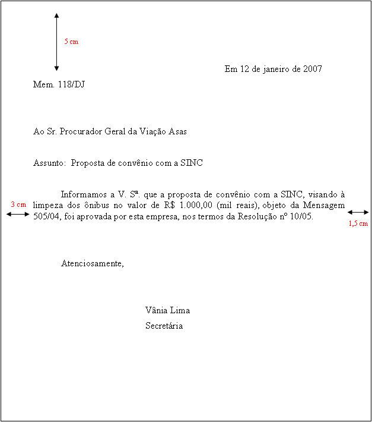

# PROVA — Camara_Bom_Jesus_do_Itabapoana_2010_Agente_Legislativo

## 1. Análise geral da prova

- **Identificação:** Camara_Bom_Jesus_do_Itabapoana_2010_Agente_Legislativo
- **Quantidade total de questões:** 30
- **Quantidade de textos de apoio (grupos):** 0
- **Quantidade de imagens:** 1
- **Quantidade de gráficos e tabelas:** incluídos nas imagens e no texto extraído, quando presentes no PDF original
- **Quantidade de grupos identificados:** 0
- **Quantidade de questões independentes:** 30
- **Questões que compartilham materiais:** nenhuma identificada automaticamente

### Transcrição integral da capa/instruções (conforme extraída do PDF)

> [!NOTE]
> Conteúdo integral das páginas anteriores à primeira questão, sem cortes.

> CONCURSO CÂMARA MUNICIPAL DE BOM JESUS DO ITABAPOANA ­ RJ
> CONCURSO PÚBLICO
> PROVAS OBJETIVAS – AGENTE LEGISLATIVO/TÉCNICO LEGISLATIVO
> Leia atentamente as INSTRUÇÕES:
> 1. Confira seus dados no cartão­resposta: nome, número de inscrição, cargo para o qual se
> inscreveu.
> 2. Confira se a prova que recebeu é para o cargo ao qual se inscreveu.
> 3. Assine seu cartão­resposta.
> 4. Aguarde a autorização do Fiscal para abrir o caderno de provas. Ao receber a ordem do
> fiscal, confira o caderno de provas com muita atenção. Nenhuma reclamação sobre o total de
> questões ou falha de impressão será aceita depois de iniciada a prova.
> 5. Sua prova tem 30 questões, com 4 alternativas.
> 6. Preencha toda a área do cartão­resposta correspondente à alternativa de sua escolha, com
> caneta esferográfica (tinta azul ou preta), sem ultrapassar as bordas. As marcações duplas ou
> rasuradas ou marcadas diferente do modelo estabelecido no cartão­resposta poderão ser
> anuladas.
> 7. O cartão­resposta não será substituído, salvo se contiver erro de impressão.
> 8. Cabe apenas ao candidato a interpretação das questões, o fiscal não poderá fazer nenhuma
> interferência.
> 9. A prova será realizada com duração máxima de 3h, incluído o tempo para a realização da
> prova objetiva e o preenchimento do cartão­resposta.
> 10. O candidato somente poderá se retirar do local de realização das provas depois de
> decorrida 1h do início das mesmas. Contudo, não poderá levar consigo o caderno de provas
> enquanto não obtiver autorização expressa para tanto, sob pena de ser excluído do concurso.
> 11. O candidato somente poderá se retirar da sala de provas levando o caderno de provas
> depois 1h30min do início das mesmas.
> 12. Ao terminar a prova, o candidato deverá entregar o cartão­resposta preenchido e assinado,
> ao fiscal de sala.
> 13. Os 3 (três) últimos candidatos que realizarem a prova devem permanecer na sala para
> acompanhar o fechamento do envelope contendo os cartões­resposta dos candidatos
> presentes e ausentes e assinar a ata de sala atestando que o envelope foi devidamente
> lacrado.
> BOA PROVA!
>
>
>
> PROVAS OBJETIVAS – AGENTE LEGISLATIVO/TÉCNICO LEGISLATIVO
> LÍNGUA PORTUGUESA
> Leia o texto abaixo para responder às questões seguintes:
> Crescem os sinais de desespero entre os americanos
>
>
>
> Miss EUA é acusada de ter vínculos com fundamentalistas islâmicos (Foto: Reuters)
> Ao enfrentar questionamentos quanto à eficiência da inteligência americana e a insurgência de novos
> atentados terroristas, os Estados Unidos se veem cercados pelo terror. O medo acaba levando a suspeitas
> exageradas, ou no mínimo inusitadas, por parte dos cidadãos americanos e das autoridades do país.
> A recém­eleita Miss EUA é um dos alvos de desconfiança. De origem libanesa, Rima Fakih, de 24 anos,
> foi acusada em sites conservadores americanos de ter vínculos com fundamentalistas islâmicos. Alguns
> asseguram que o grupo islâmico Hezbollah apoiou financeiramente a campanha da candidata. Outros dizem que
> a própria Rima seria uma defensora das atividades dos militantes.
> Já a embaixada americana no Paquistão recebeu um alerta nesta sexta­feira sobre o perigo de uma
> empresa de alimentos, Hanif Rajput Catering Service, que teria ligação com grupos terroristas. A loja atende a
> clientes importantes na capital do país, inclusive recepções de embaixadas. Há representantes do governo
> americano que acreditam que um dos suspeitos de ter atuado no atentado frustrado na Times Square, em maio,
> seria um dos sócios da companhia.
> Publicação em 21.05.2010. Acesso em 23.05.2010. http://veja.abril.com.br/noticia/internacional/crescem­sinais­desespero­
> americanos­562234.shtml

### Gabarito

| Questão | 01 | 02 | 03 | 04 | 05 |
|---|---|---|---|---|---|
| Resposta | B | D | A | D | C |

| Questão | 06 | 07 | 08 | 09 | 10 |
|---|---|---|---|---|---|
| Resposta | ANULADA | A | C | B | D |

| Questão | 11 | 12 | 13 | 14 | 15 |
|---|---|---|---|---|---|
| Resposta | A | C | D | C | B |

| Questão | 16 | 17 | 18 | 19 | 20 |
|---|---|---|---|---|---|
| Resposta | B | D | B | A | C |

| Questão | 21 | 22 | 23 | 24 | 25 |
|---|---|---|---|---|---|
| Resposta | A | A | A | D | D |

| Questão | 26 | 27 | 28 | 29 | 30 |
|---|---|---|---|---|---|
| Resposta | D | B | B | B | C |

## 2. Questões agrupadas

Nenhum grupo de questões compartilhando material foi identificado automaticamente nesta prova.

## 3. Questões independentes

#### QUESTÃO 01

✅ **Gabarito: B** (gabarito oficial pareado — cargo TÉCNICO LEGISLATIVO/AGENTE LEGISLATIVO (Edital nº 001/2010))

**Enunciado:**

Segundo o texto, é CORRETO inferir:
I – A eficiência da inteligência norte­americana está sendo questionada devido à insurgência de novos
atentados terroristas, e por isso os Estados Unidos se veem cercados pelo terror.
II – Uma parcela dos cidadãos americanos e das autoridades do país levanta suspeitas excessivas e/ou
extraordinárias contra algumas pessoas, causadas pelo medo dos movimentos terroristas.
III – A insurgência de novos ataques terroristas se deve ao medo excessivo dos americanos.

**Alternativas:**

A) Apenas o item I é coerente com as informações do texto.
B) Apenas os itens I e II são coerentes com as informações do texto.
C) Apenas os itens II e III são coerentes com as informações do texto.
D) Apenas os itens I, II e III são coerentes com as informações do texto.

**Referências visuais:**

Nenhuma.

---

#### QUESTÃO 02

✅ **Gabarito: D** (gabarito oficial pareado — cargo TÉCNICO LEGISLATIVO/AGENTE LEGISLATIVO (Edital nº 001/2010))

**Enunciado:**

Ainda de acordo com o que se pode inferir do texto, analise os itens abaixo.
I – A recém­eleita Miss Estados Unidos é defensora das atividades dos militantes do grupo islâmico
Hezbollah.
II – Rima Fakih foi patrocinada em sua campanha no concurso de beleza Miss Estados Unidos pelo grupo
islâmico Hezbollah.
III – Rima Fakih e Hanif Rajput são sócios de empresa de alimentos que abastece a embaixada americana
no Paquistão.
Está (ão) em CONTRADIÇÃO com o texto o(s) item(s):

**Alternativas:**

A) Apenas I.
B) Apenas I e II.
C) Apenas II e III.
D) Apenas I, II e III.

**Referências visuais:**

Nenhuma.

---

#### QUESTÃO 03

✅ **Gabarito: A** (gabarito oficial pareado — cargo TÉCNICO LEGISLATIVO/AGENTE LEGISLATIVO (Edital nº 001/2010))

**Enunciado:**

Quanto à fotografia que aparece no início da reportagem, é INCORRETO inferir:

**Alternativas:**

A) Mostra uma moça de origem libanesa que ganhou um concurso de “pole dance” nos Estados Unidos.
B) Mostra uma moça de origem libanesa que ganhou um concurso de beleza nos Estados Unidos e foi coroada
com o título de Miss Estados Unidos.
C) Mostra uma moça de origem libanesa emocionada com o resultado do concurso em que participava na
ocasião em que foi fotografada.
D) Mostra uma moça de 24 anos chamada Rima Fakih.

**Referências visuais:**

Nenhuma.

---

#### QUESTÃO 04

✅ **Gabarito: D** (gabarito oficial pareado — cargo TÉCNICO LEGISLATIVO/AGENTE LEGISLATIVO (Edital nº 001/2010))

**Enunciado:**

Leia com atenção o excerto a seguir:
“ Há representantes do governo americano que acreditam que um dos suspeitos de ter atuado no
atentado frustrado na Times Square, em maio, seria um dos sócios da companhia.”
A palavra “ companhia” faz referência de significado a que outro termo do texto abordado?

**Alternativas:**

A) Governo dos Estados Unidos.
B) Rima Fakih.
C) Hezbollah.
D) Hanif Rajput Catering Service.

**Referências visuais:**

Nenhuma.

---

#### QUESTÃO 05

✅ **Gabarito: C** (gabarito oficial pareado — cargo TÉCNICO LEGISLATIVO/AGENTE LEGISLATIVO (Edital nº 001/2010))

**Enunciado:**

A concordância verbal na oração “ Crescem os sinais de desespero entre os americanos” está:

**Alternativas:**

A) Correta, pois o verbo “crescem” está de acordo com sujeito posposto “os americanos”.
B) Incorreta, pois o verbo “crescem” está em desacordo com sujeito posposto “os americanos”.
C) Correta, pois o verbo “crescem” está de acordo com sujeito posposto “os sinais de desespero”.
D) Incorreta, pois o verbo “crescem” está em desacordo com sujeito anteposto “os sinais de desespero”.

**Referências visuais:**

Nenhuma.

---

#### QUESTÃO 06

⚠️ **Gabarito: ANULADA**

**Enunciado:**

Esse método é útil se você quiser postergar a revisão do documento até concluir sua edição. É
possível verificar possíveis erros de ortografia e, em seguida, confirmar cada correção. A verificação
gramatical está disponível em quais aplicativos do Microsoft Office?

**Alternativas:**

A) Outlook e Word.
B) Excel e Word.
C) Power Point e Word.
D) Outlook e Excel.

**Referências visuais:**

Nenhuma.

---

#### QUESTÃO 07

✅ **Gabarito: A** (gabarito oficial pareado — cargo TÉCNICO LEGISLATIVO/AGENTE LEGISLATIVO (Edital nº 001/2010))

**Enunciado:**

O Word 2007 pode criar automaticamente listas numeradas e com marcadores à medida que você
digita. O que deve ser digitado para iniciar uma lista com marcadores simbólicos?

**Alternativas:**

A) Asterisco (*)
B) Exclamação (!)
C) Percentual (%)
D) Arroba (@)

**Referências visuais:**

Nenhuma.

---

#### QUESTÃO 08

✅ **Gabarito: C** (gabarito oficial pareado — cargo TÉCNICO LEGISLATIVO/AGENTE LEGISLATIVO (Edital nº 001/2010))

**Enunciado:**

Utilizando o Microsoft Outlook 2007 Um item movido para uma pasta que não seja de correio poderá
não funcionar da forma esperada depois de movido. Se uma mensagem, por exemplo, for movida para a
pasta Calendário, o que será criado?

**Alternativas:**

A) Um novo anexo.
B) Um novo email.
C) Um novo compromisso.
D) Uma nova pasta.

**Referências visuais:**

Nenhuma.

---

#### QUESTÃO 09

✅ **Gabarito: B** (gabarito oficial pareado — cargo TÉCNICO LEGISLATIVO/AGENTE LEGISLATIVO (Edital nº 001/2010))

**Enunciado:**

Para imprimir o número exato de páginas desejadas no Excel 2007, usa­se a opção visualizar quebra
de página. Essa opção realiza que tipo de ajuste?

**Alternativas:**

A) Quebra de seção.
B) Quebra de página.
C) Quebra de parágrafo.
D) Quebra de planilha.

**Referências visuais:**

Nenhuma.

---

#### QUESTÃO 10

✅ **Gabarito: D** (gabarito oficial pareado — cargo TÉCNICO LEGISLATIVO/AGENTE LEGISLATIVO (Edital nº 001/2010))

**Enunciado:**

No Microsoft Office Excel 2007, é muito fácil criar gráficos com aparência profissional. Necessitando
apenas escolher três opções, são elas?

**Alternativas:**

A) Estilo de gráfico, Opções e Tipo.
B) Layout, Inserção e Tipo.
C) Tipo, Inserção e Estilo de gráfico.
D) Tipo, Layout e Estilo de gráfico.

**Referências visuais:**

Nenhuma.

---

#### QUESTÃO 11

✅ **Gabarito: A** (gabarito oficial pareado — cargo TÉCNICO LEGISLATIVO/AGENTE LEGISLATIVO (Edital nº 001/2010))

**Enunciado:**

Com base no disposto na Lei Orgânica Municipal, analise os itens I a III abaixo e assinale a alternativa
que preencha corretamente a sequência das lacunas dos textos.
I ­ Comprovada a impossibilidade de acesso ou outra causa que impeça a utilização do recinto destinado
ao funcionamento das sessões legislativas, estas poderão ser realizadas em outro local, por decisão
__________1______________.
II – As sessões da Câmara serão públicas, salvo deliberação em contrário, tomada ________2________,
quando ocorrer motivo relevante de preservação do decoro parlamentar.
III ­ As sessões somente poderão ser abertas ____________3_____________ com a presença mínima de
um terço de seus membros.

**Alternativas:**

A) 1 ­ Do Presidente da Câmara; 2 – pela maioria absoluta de seus membros; 3 – pelo Presidente da Câmara ou
por membro da Mesa.
B) 1 ­ Da maioria absoluta dos membros; 2­ pela maioria de dois terços de seus membros; 3 – pelo Presidente da
Câmara.
C) 1 ­ Da maioria de dois terços de seus membros; 2 – pela maioria de dois terços dos membros; 3 – por membro
da Mesa.
D) 1 ­ Do Presidente da Câmara; 2 – pela maioria absoluta de seus membros; 3 – pelo Presidente da Câmara.

**Referências visuais:**

Nenhuma.

---

#### QUESTÃO 12

✅ **Gabarito: C** (gabarito oficial pareado — cargo TÉCNICO LEGISLATIVO/AGENTE LEGISLATIVO (Edital nº 001/2010))

**Enunciado:**

Quanto ao processo legislativo estabelecido na Lei Orgânica Municipal podemos afirmar:

**Alternativas:**

A) O processo legislativo municipal compreende a elaboração de emendas à Lei Orgânica Municipal, leis
complementares, leis ordinárias, leis delegadas, decretos­lei e resoluções.
B) As matérias que independem de sanção ou veto pelo Prefeito Municipal são restritas às resoluções do
legislativo municipal.
C) A Lei Orgânica Municipal poderá ser emendada mediante proposta de iniciativa popular.
D) Na proposição legislativa, o vício de iniciativa restringe­se aos casos de invasão na esfera de competência
legislativa exclusiva do Prefeito Municipal.

**Referências visuais:**

Nenhuma.

---

#### QUESTÃO 13

✅ **Gabarito: D** (gabarito oficial pareado — cargo TÉCNICO LEGISLATIVO/AGENTE LEGISLATIVO (Edital nº 001/2010))

**Enunciado:**

A investidura em cargo ou emprego público depende de aprovação prévia em concurso público de
provas ou de provas e títulos, de acordo com a natureza e a complexidade do cargo ou emprego, na
forma prevista em lei, ressalvadas as nomeações para cargo em comissão declarado em lei de livre
nomeação e exoneração (art. 37, inciso II, CF). A Constituição Federal determina que a não observância a
esta determinação implicará:

**Alternativas:**

A) Apenas a nulidade do ato.
B) Apenas a revogação do ato.
C) Apenas a punição da autoridade responsável.
D) Apenas a nulidade do ato e a punição da autoridade responsável.

**Referências visuais:**

Nenhuma.

---

#### QUESTÃO 14

✅ **Gabarito: C** (gabarito oficial pareado — cargo TÉCNICO LEGISLATIVO/AGENTE LEGISLATIVO (Edital nº 001/2010))

**Enunciado:**

As pessoas jurídicas de direito público e as de direito privado prestadoras de serviços públicos
responderão pelos danos que seus agentes, nessa qualidade, causarem a terceiros, assegurado o direito
de regresso contra o responsável nos casos de dolo ou culpa (art. 37, §6º, CF). Acerca deste dispositivo
consitucional podemos afirmar:

**Alternativas:**

A) A Constituição Federal estabelece a responsabilidade civil subjetiva da Administração.
B) A Constituição Federal estabelece a responsabilidade civil objetiva da Administração e de seus agentes.
C) A Constituição Federal estabelece a responsabilidade civil objetiva da Administração e a subjetiva para os
agentes públicos.
D) A Constituição Federal estabelece a responsabilidade civil subjetiva da Administração e de seus agentes.

**Referências visuais:**

Nenhuma.

---

#### QUESTÃO 15

✅ **Gabarito: B** (gabarito oficial pareado — cargo TÉCNICO LEGISLATIVO/AGENTE LEGISLATIVO (Edital nº 001/2010))

**Enunciado:**

Ao disciplinar acerca das finanças públicas, a Constituição Federal vem a estabelecer inúmeras
diretrizes acerca do orçamento público. Com base nas imposições constitucionais, analise as
alternativas abaixo e assinale a INCORRETA:

**Alternativas:**

A) A lei orçamentária anual não conterá dispositivo estranho à previsão da receita e à fixação da despesa, não se
incluindo na proibição a autorização para abertura de créditos suplementares e contratação de operações de
crédito, ainda que por antecipação de receita, nos termos da lei.
B) O Poder Executivo publicará, até trinta dias após o encerramento de cada semestre, relatório resumido da
execução orçamentária.
C) O projeto de lei orçamentária será acompanhado de demonstrativo regionalizado do efeito, sobre as receitas e
despesas, decorrente de isenções, anistias, remissões, subsídios e benefícios de natureza financeira, tributária e
creditícia.
D) O plano plurianual, as diretrizes orçamentárias e o orçamento anual serão estabelecidos mediante leis de
iniciativa do Poder Executivo.

**Referências visuais:**

Nenhuma.

---

#### QUESTÃO 16

✅ **Gabarito: B** (gabarito oficial pareado — cargo TÉCNICO LEGISLATIVO/AGENTE LEGISLATIVO (Edital nº 001/2010))

**Enunciado:**

Qual das alternativas abaixo melhor caracteriza o conceito da expressão “ redação técnica” ?

**Alternativas:**

A) A redação técnica se caracteriza como tipo de linguagem oral regida por princípios de objetividade e
obediência às normas gramaticais de um idioma. O campo de utilização dessa modalidade de linguagem
abrange artigos jornalísticos e teses científicas, além da redação poética.
B) A redação técnica se caracteriza como tipo de linguagem escrita regida por princípios como objetividade e
obediência às normas gramaticais de um idioma. O campo de utilização dessa modalidade de linguagem
abrange artigos e teses científicas, além da redação comercial ou administrativa.
C) A redação técnica se caracteriza como tipo de linguagem escrita regida por princípios de subjetividade e
desobediência às normas gramaticais de um idioma. O campo de utilização dessa modalidade de linguagem
abrange romances e periódicos, além da redação comercial ou administrativa.
D) A redação técnica se caracteriza como tipo de linguagem gestual regida por princípios de objetividade e
obediência às normas gramaticais de um idioma. O campo de utilização dessa modalidade de linguagem
abrange mímica, artigos e teses científicas, além da redação comercial ou administrativa.

**Referências visuais:**

Nenhuma.

---

#### QUESTÃO 17

✅ **Gabarito: D** (gabarito oficial pareado — cargo TÉCNICO LEGISLATIVO/AGENTE LEGISLATIVO (Edital nº 001/2010))

**Enunciado:**

Sobre os princípios utilizados na linguagem da redação técnica, julgue os itens a seguir:
I – Os princípios da clareza, precisão e concisão devem estar presentes na linguagem da redação
técnica.
II – As frases na linguagem da redação técnica devem ser despojadas de adjetivação e advérbios e
devem cuidar do tratamento formal através da utilização correta de pronomes de tratamentos adequados
ao contexto.
III – Formalmente, a redação técnica ainda se preocupa com a estética, incorporando, entre outros,
elementos como margens, parágrafos e espaço entre linhas.
Está CORRETO o que se afirma:

**Alternativas:**

A) Apenas em I.
B) Apenas em I e II.
C) Apenas em II e III.
D) Apenas em I, II e III.

**Referências visuais:**

Nenhuma.

---

#### QUESTÃO 18

✅ **Gabarito: B** (gabarito oficial pareado — cargo TÉCNICO LEGISLATIVO/AGENTE LEGISLATIVO (Edital nº 001/2010))

**Enunciado:**

Sobre os fechos utilizados em comunicações oficiais, assinale a única alternativa INCORRETA.

**Alternativas:**

A) O fecho das comunicações oficiais possui, além da finalidade óbvia de arrematar o texto, a de saudar o
destinatário.
B) O fecho para autoridades superiores hierarquicamente deve ser “respeitosamente”, exceto para o Presidente
da República, e para autoridades do mesmo nível hierárquico deve ser “Atenciosamente”. Não deve ser utilizado
fecho nas comunicações oficiais dirigidas a pessoas portadoras de cargos inferiores hierarquicamente.
C) Com o fito de simplificá­los e uniformizá­los, o Manual de Redação da Presidência da República estabelece o
emprego de somente dois fechos diferentes para todas as modalidades de comunicação oficial.
D) Os modelos para fecho que vinham sendo utilizados foram regulados pela Portaria nº 1 do Ministério da
Justiça, de 1937, que estabelecia quinze padrões diferentes.

**Referências visuais:**

Nenhuma.

---

#### QUESTÃO 19

✅ **Gabarito: A** (gabarito oficial pareado — cargo TÉCNICO LEGISLATIVO/AGENTE LEGISLATIVO (Edital nº 001/2010))

**Enunciado:**

Sobre o Padrão Ofício, julgue os itens a seguir:
I – Há três tipos de expedientes (documentos oficiais) que se diferenciam antes pela finalidade do que
pela forma. Eles são: aviso, ofício e requerimento.
II – São permitidas apenas duas formas de fecho: “ Respeitosamente” e “ Atenciosamente”.
III – Com o fito de uniformizar os expedientes (documentos oficiais), foi adotada uma diagramação única
para os três tipos inclusos no Padrão Ofício.
Está INCORRETO o que se afirma:

**Alternativas:**

A) Apenas em I.
B) Apenas em I e II.
C) Apenas em II e III.
D) Apenas em I, II e III.

**Referências visuais:**

Nenhuma.

---

#### QUESTÃO 20

✅ **Gabarito: C** (gabarito oficial pareado — cargo TÉCNICO LEGISLATIVO/AGENTE LEGISLATIVO (Edital nº 001/2010))

**Enunciado:**

A figura a seguir representa que tipo de comunicação oficial?

**Alternativas:**

A) Aviso.
B) Ofício.
C) Memorando.
D) Memorial.

**Referências visuais:**

---

#### QUESTÃO 21

✅ **Gabarito: A** (gabarito oficial pareado — cargo TÉCNICO LEGISLATIVO/AGENTE LEGISLATIVO (Edital nº 001/2010))

**Enunciado:**

Existem diversos sistemas modernos, um deles é o sistema numérico que é conhecido como:

**Alternativas:**

A) Arquivos de correspondência – arquivos de casos – arquivos de assuntos.
B) Arquivos de assuntos – CDD – arquivos de fichas de índice de registro.
C) CDD – arquivos de casos – arquivos alfanuméricos.
D) CDD – arquivos de correspondência – CDU.

**Referências visuais:**

Nenhuma.

---

#### QUESTÃO 22

✅ **Gabarito: A** (gabarito oficial pareado — cargo TÉCNICO LEGISLATIVO/AGENTE LEGISLATIVO (Edital nº 001/2010))

**Enunciado:**

Arquivo de correspondência faz parte de qual sistema moderno?

**Alternativas:**

A) Sistemas numéricos.
B) Sistemas alfanuméricos.
C) Sistema numérico­dupléx.
D) Sistemas alfabéticos.

**Referências visuais:**

Nenhuma.

---

#### QUESTÃO 23

✅ **Gabarito: A** (gabarito oficial pareado — cargo TÉCNICO LEGISLATIVO/AGENTE LEGISLATIVO (Edital nº 001/2010))

**Enunciado:**

Existem dois tipos de arquivo, o horizontal e o vertical, qual é o conceito correto de arquivo
horizontal?

**Alternativas:**

A) Os documentos ou fichas são arquivados uns sobre os outros, bem como em caixas, estantes ou
escaninhos.
B) Os documentos ou fichas são arquivados lado a lado, bem como em pastas suspensas ou fichários.
C) Os documentos ou fichas devem estar dispostos uns atrás dos outros, permitindo sua rápida consulta, sem
a necessidade de remover outros documentos para ter acesso a um determinado documento ou ficha.
D) Os documentos ou fichas são arquivados em sequência, bem como em caixas, pastas suspensas ou
fichários.

**Referências visuais:**

Nenhuma.

---

#### QUESTÃO 24

✅ **Gabarito: D** (gabarito oficial pareado — cargo TÉCNICO LEGISLATIVO/AGENTE LEGISLATIVO (Edital nº 001/2010))

**Enunciado:**

Das citações abaixo qual é a citação INCORRETA:

**Alternativas:**

A) Os arquivos são órgãos receptores, enquanto as bibliotecas são colecionadores.
B) A biblioteconomia trata de documentos individuais e a arquivística, de conjuntos de documentos.
C) Os arquivos são administrados por arquivista e a biblioteca por bibliotecários.
D) Os arquivos são públicos e as bibliotecas pertencem aos órgãos governamentais.

**Referências visuais:**

Nenhuma.

---

#### QUESTÃO 25

✅ **Gabarito: D** (gabarito oficial pareado — cargo TÉCNICO LEGISLATIVO/AGENTE LEGISLATIVO (Edital nº 001/2010))

**Enunciado:**

A organização de arquivos pode ser desenvolvida em várias etapas ou fases. Qual é a organização
abaixo que se aplica corretamente a essas etapas ou fases?

**Alternativas:**

A) Busca de dados – catalogação – planejamento – análise dos objetos.
B) Levantamento de dados – planejamento – acompanhamento ­ informações inventariadas.
C) Catalogação – classificação – inventário – planejamento.
D) Levantamento de dados ­ análise dos dados coletados – planejamento ­ implantação e acompanhamento.

**Referências visuais:**

Nenhuma.

---

#### QUESTÃO 26

✅ **Gabarito: D** (gabarito oficial pareado — cargo TÉCNICO LEGISLATIVO/AGENTE LEGISLATIVO (Edital nº 001/2010))

**Enunciado:**

Leia os conceitos abaixo e assinale a alternativa CORRETA:
I ­ Guia­fora é a que tem como notação a palavra Fora e indica a ausência de uma pasta do arquivo.
II ­ Tira de inserção é uma tira de papel gomado ou de cartolina, picotada, onde se escrevem as notações.
Tais tiras são inseridas nas projeções das pastas ou guias.
III ­ Pasta miscelânea é aquela onde se guardam documentos referentes a diversos assuntos ou diversas
pessoas em ordem alfabética e dentro de cada grupo, pela ordenação cronológica.
IV ­ Material permanente é aquele que tem grande duração e pode ser utilizado várias vezes para o
mesmo fim.

**Alternativas:**

A) Apenas I e II estão corretas.
B) Apenas I – II e III estão corretas.
C) Apenas I – III e IV estão corretas.
D) Todas estão corretas.

**Referências visuais:**

Nenhuma.

---

#### QUESTÃO 27

✅ **Gabarito: B** (gabarito oficial pareado — cargo TÉCNICO LEGISLATIVO/AGENTE LEGISLATIVO (Edital nº 001/2010))

**Enunciado:**

Qual setor funciona como um centro de distribuição e redistribuição de documentos.

**Alternativas:**

A) Expedição.
B) Registro e movimentação.
C) Organização.
D) Protocolo.

**Referências visuais:**

Nenhuma.

---

#### QUESTÃO 28

✅ **Gabarito: B** (gabarito oficial pareado — cargo TÉCNICO LEGISLATIVO/AGENTE LEGISLATIVO (Edital nº 001/2010))

**Enunciado:**

São as fases de arquivamento: inspeção, estudo, classificação, codificação, ordenação e guarda dos
documentos. Qual é o conceito CORRETO de inspeção?

**Alternativas:**

A) É o arquivamento propriamente dito.
B) Consiste no exame, por intermédio da leitura do documento, para verificar se o mesmo se destina ao
arquivamento.
C) Consiste na determinação da entrada e das referências cruzadas que lhe serão atribuídas através de um
processo interpretativo.
D) Consiste na posição dos símbolos correspondentes ao método de arquivamento adotado.

**Referências visuais:**

Nenhuma.

---

#### QUESTÃO 29

✅ **Gabarito: B** (gabarito oficial pareado — cargo TÉCNICO LEGISLATIVO/AGENTE LEGISLATIVO (Edital nº 001/2010))

**Enunciado:**

Em relação ao seu valor, os documentos podem ser permanentes vitais, permanentes e temporários.
Qual o conceito CORRETO de documentos permanentes?

**Alternativas:**

A) Quando se pode determinar um prazo ou determinada data em que cessa o valor do documento.
B) São os que, pela informação que contêm devem ser conservados indefinidamente.
C) Aqueles que devem ser conservados indefinidamente por serem de importância vital para a organização.
D) Todas as alternativas acima estão corretas.

**Referências visuais:**

Nenhuma.

---

#### QUESTÃO 30

✅ **Gabarito: C** (gabarito oficial pareado — cargo TÉCNICO LEGISLATIVO/AGENTE LEGISLATIVO (Edital nº 001/2010))

**Enunciado:**

Em 1973, a AAB – Associação dos Arquivistas do Brasil, formou um grupo de trabalho, sob a direção
de seu presidente, com a finalidade de definir os instrumentos de pesquisa básicos. Considerando que a
maioria dos arquivos brasileiros não dispõem de instrumentos de pesquisa e nem mesmo de um mínimo
de orientação, o grupo selecionou e definiu os quatro seguintes tipos: guia, inventário, catálogo e
repertório. Neste sentido assinale abaixo o conceito CORRETO de catálogo selecionado por este grupo:

**Alternativas:**

A) Obra destinada à orientação dos usuários no conhecimento e na utilização dos fundos que integram o acervo
de um arquivo permanente.
B) Instrumento no qual as unidades de arquivamento de um fundo ou de uma de suas divisões são identificadas
e descritas sucintamente.
C) Instrumento de pesquisa elaborado segundo um critério temático, cronológico, onomástico ou geográfico,
incluindo todos os documentos pertencentes a um ou mais fundos, descritos de forma sumária ou
pormenorizada.
D) É o instrumento de pesquisa que descreve pormenorizadamente documentos previamente selecionados,
pertencentes a um ou mais fundos, segundo um critério temático, cronológico, onomástico ou geográfico.
RASCUNHO:

**Referências visuais:**

Nenhuma.

---

## 4. Observações e limitações da extração

- Extração automática (texto selecionável do PDF via PyMuPDF), sem OCR: PDFs escaneados podem perder texto.
- Imagens repetidas (logos/marcas d'água) foram descartadas; as imagens de conteúdo foram salvas em `imagens/` com nomenclatura `imagem_00N`.
- A detecção de grupos usa os avisos padrão das bancas ("o texto seguinte servirá de base..."). Bancas sem esse aviso podem ter grupos não identificados — o conteúdo, porém, permanece integral.
- Se houver divergência entre esta versão e o PDF original, vale o PDF original; corrija manualmente o Markdown.
- A prova atende simultaneamente aos cargos de AGENTE LEGISLATIVO e TÉCNICO LEGISLATIVO (caderno único do Edital nº 001/2010).
- O arquivo original da prova estava datado como "2007", mas o concurso é o do Edital nº 001/2010 (gabarito oficial do mesmo certame).
- A questão 6 consta como ANULADA no gabarito oficial ("em decorrência de recurso").
- O PDF do gabarito contém um banner de outro concurso ("PREFEITURA MUNICIPAL DE ESPERANTINA-PI"), que é erro de template do site de origem e não faz parte da prova.
