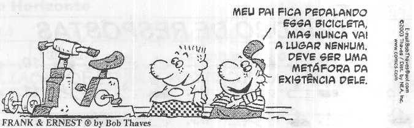

# PROVA — Camara_Bonito_de_Minas_2009

## 1. Análise geral da prova

- **Identificação:** Camara_Bonito_de_Minas_2009
- **Quantidade total de questões:** 40
- **Quantidade de textos de apoio (grupos):** 0
- **Quantidade de imagens:** 1
- **Quantidade de gráficos e tabelas:** incluídos nas imagens e no texto extraído, quando presentes no PDF original
- **Quantidade de grupos identificados:** 0
- **Quantidade de questões independentes:** 40
- **Questões que compartilham materiais:** nenhuma identificada automaticamente

### Transcrição integral da capa/instruções (conforme extraída do PDF)

> [!NOTE]
> Conteúdo integral das páginas anteriores à primeira questão, sem cortes.

> CÂMARA MUNICIPAL DE BONITO DE MINAS /MG
> 2009 - 2012
> CONCURSO PÙBLICO 01/12
>
>
> Nome: ___________________________________________________________
>
> Inscrição nº: _________ Cargo: _____________________________________
> LEIA ATENTAMENTE AS SEGUINTES INSTRUÇÕES
>
>
> 01- Preencha corretamente os dados pedidos no Caderno de Questões e no Cartão de
> Respostas.
> Verifique se este material está em ordem.
> Use caneta esferográfica de tinta azul ou preta.
> Qualquer tipo de reclamação ou questionamento deverá ser feito dentro da sala e registrado
> na Folha de Ocorrências.
>
> 02- A duração da prova será de três horas incluindo o preenchimento do Cartão de Respostas .
> Tenha muito cuidado com o Cartão de Respostas porque ele não será substituído.
> O Cartão de Respostas não deve ser dobrado, amassado ou rasurado. Cuide bem dele. Ele é
> a sua PROVA.
>
> 03-Cada questão será seguida das opções: a, b, c, d.
> Assinale apenas uma opção e transfira-a para o Cartão de Respostas preenchendo toda a
> bolinha a tinta.
> Você deve assinalar apenas uma alternativa. A marcação em mais de uma alternativa anula a
> questão, mesmo que uma das respostas esteja correta.
> Não deixe nenhuma questão sem resposta.
>
> 04- Será eliminado o Candidato que:
> -
> se utilizar durante a prova, de máquinas e/ou relógios de calcular, bem como gravadores,
> headphones, telefones celulares ou fontes de consulta de qualquer espécie;
> -
> se retirar da sala levando o Caderno de Questões e/ou o Cartão de Respostas
> personalizado, porque os mesmos deverão ser entregues quando de sua saída.
>
> 05- Os rascunhos e as marcações assinalados no Caderno de Questões não serão levados em
> conta.
>
> 06- Recursos – Edital – item 6 – dos Recursos ; informações detalhadas.
>
>
>
>
>
>
> PORTUGUÊS
>
>
>
>
> Leia a tirinha

## 2. Questões agrupadas

Nenhum grupo de questões compartilhando material foi identificado automaticamente nesta prova.

## 3. Questões independentes

#### QUESTÃO 01

⚠️ **Gabarito: oficial não disponível** (sem gabarito no acervo (o PDF 'Gabarito', ID 072, contém a prova; quadro de respostas não localizado))

**Enunciado:**

01- Nesta tirinha, a personagem faz referência a uma das mais conhecidas figuras de linguagem para:

**Alternativas:**

A) condenar o uso das bicicletas.
B) criticar a falta de perspectiva do pai.
C) valorizar aspectos da vida moderna.
D) problematizar a questão do diálogo entre gerações.

**Referências visuais:**

---

#### QUESTÃO 02

⚠️ **Gabarito: oficial não disponível** (sem gabarito no acervo (o PDF 'Gabarito', ID 072, contém a prova; quadro de respostas não localizado))

**Material de apoio:**

• Leia o trecho
"Ora, ela, que até os quinze anos era inocente como a
flor, e por isso alegre e foigazona como uma cabritinha nova,
começou a fazer-se tímida e depois triste, como o gemido da rola;
a causa disto estava no agradável parecer de um mancebo da sua
tribo, que diariamente vinha caçar ou pescar à ilha, e vinte vezes já
o havia feito sem que de uma só desse fé dos olhares ardentes que
lhe dardejava a moça.
MACEDO, Joaquim Manuel de. A Moreninha. São Paulo:
Atica, 1997, p. 62-63.

**Enunciado:**

O verbo "dardejava", no texto, significa

**Alternativas:**

A) arremessar
B) dirigir
C) resplandecer
D) cintilar

**Referências visuais:**

Nenhuma.

---

#### QUESTÃO 03

⚠️ **Gabarito: oficial não disponível** (sem gabarito no acervo (o PDF 'Gabarito', ID 072, contém a prova; quadro de respostas não localizado))

**Enunciado:**

03- Assinale a alternativa em que ocorre o maior número de pronomes:

**Alternativas:**

A) Confundi-o com aquele garoto de que lhe falei antes.
B) Ele fez todo o exercício, sem o qual não seria aceito em sala.
C) Quis vê-lo; pareceu-me muito diferente do garoto gorducho e tímido que
Ângela conhecera no colégio.
D) Ele continua o mesmo. Moço e simpático, quis abraçá-lo e dizer tudo o que
guardei no fundo do meu coração.

**Referências visuais:**

Nenhuma.

---

#### QUESTÃO 04

⚠️ **Gabarito: oficial não disponível** (sem gabarito no acervo (o PDF 'Gabarito', ID 072, contém a prova; quadro de respostas não localizado))

**Enunciado:**

04- Indique a alternativa em que não ocorre concordância segundo a norma culta
da língua:

**Alternativas:**

A) Não só o governo, mas também o povo precisam salvar a economia nacional.
B) O partido do governo ou a oposição deverá receber a verba para a proteção do
menor.
C) Quais de vós teriam a coragem de perguntar a razão de sua ausência?
D) Amar e sofrer são próprios do espírito humano.

**Referências visuais:**

Nenhuma.

---

#### QUESTÃO 05

⚠️ **Gabarito: oficial não disponível** (sem gabarito no acervo (o PDF 'Gabarito', ID 072, contém a prova; quadro de respostas não localizado))

**Enunciado:**

05- “As vantagens e os privilégios ilegítimos estão (...) arraigados.”

Das seguintes alterações da frase, aquela em que a concordância nominal está
em desacordo com a norma culta é:

**Alternativas:**

A) Estão arraigadas as vantagens e os privilégios ilegítimos.
B) Os privilégios e as vantagens ilegítimas estão arraigados.
C) Estão arraigadas a vantagem e o privilégio ilegítimos.
D) A vantagem e o privilégio ilegítimo estão arraigados.

**Referências visuais:**

Nenhuma.

---

#### QUESTÃO 06

⚠️ **Gabarito: oficial não disponível** (sem gabarito no acervo (o PDF 'Gabarito', ID 072, contém a prova; quadro de respostas não localizado))

**Enunciado:**

06- Em que alternativa todas as palavras são escritas com j ?

**Alternativas:**

A) ma__estade - __iló - __esto
B) pro__eto - __erar - tra__eto
C) __enipapo - re__eitar - a__ir
D) __ibóia - berin__ela - pa__é

**Referências visuais:**

Nenhuma.

---

#### QUESTÃO 07

⚠️ **Gabarito: oficial não disponível** (sem gabarito no acervo (o PDF 'Gabarito', ID 072, contém a prova; quadro de respostas não localizado))

**Enunciado:**

07- Complete os espaços com uma das opções abaixo:

“Se você preferir ler ____________ sair, não deixe de folhear os livros
__________
conteúdo o professor fez referência.

**Alternativas:**

A) a - a cujo
B) do que - cujo o
C) do que - cujo
D) a – cujo

**Referências visuais:**

Nenhuma.

---

#### QUESTÃO 08

⚠️ **Gabarito: oficial não disponível** (sem gabarito no acervo (o PDF 'Gabarito', ID 072, contém a prova; quadro de respostas não localizado))

**Enunciado:**

08- Observe a ocorrência da palavra “só” nas frases abaixo:
I
- Só, eu não conseguiria fazer a mulher andar.
II
- Eu não conseguiria fazer a mulher andar só.
III - Eu não conseguiria fazer a mulher só andar.
IV - Eu, só, não conseguiria fazer a mulher andar.

A análise das frases permite afirmar:

**Alternativas:**

A) Em II e III, só refere-se apenas ao substantivo “mulher”.
B) Em III e IV, só refere-se apenas ao verbo “andar”.
C) Em I e IV, só refere-se apenas ao pronome “eu”.
D) Em I e II, só refere-se à frase inteira.

**Referências visuais:**

Nenhuma.

---

#### QUESTÃO 09

⚠️ **Gabarito: oficial não disponível** (sem gabarito no acervo (o PDF 'Gabarito', ID 072, contém a prova; quadro de respostas não localizado))

**Enunciado:**

09- Assinale a alternativa em que há incorreção quanto ao emprego da forma
verbal:

**Alternativas:**

A) Hão de querer que eu seja presidente de novo, ainda há muito o que eu possa
fazer por meu país.
B) Faz uns três anos que não vejo ninguém da sua família.
C) Passaram-se meses e nenhuma notícia do seu cunhado.
D) Choveram aplausos para a rainha do baile.

**Referências visuais:**

Nenhuma.

---

#### QUESTÃO 10

⚠️ **Gabarito: oficial não disponível** (sem gabarito no acervo (o PDF 'Gabarito', ID 072, contém a prova; quadro de respostas não localizado))

**Enunciado:**

10- “Os suicidas se realizam porque, na hora do desespero, falta o vizinho que lhe deseje
sinceramente uma boa noite”.
O advérbio em negrito traduz a idéia de:

**Alternativas:**

A) modo
B) desejo
C) afirmação
D) dúvida

**Referências visuais:**

Nenhuma.

---

#### QUESTÃO 11

⚠️ **Gabarito: oficial não disponível** (sem gabarito no acervo (o PDF 'Gabarito', ID 072, contém a prova; quadro de respostas não localizado))

**Enunciado:**

11- Certa faculdade, 6000 alunos inscreveram-se para cursar as disciplinas A e B.
Desses alunos, 3228 matricularam-se na disciplina A e 1247 matricularam-se na
disciplina B. Por falta de condições acadêmicas, 1624 alunos não puderam
matricular-se em nenhuma das disciplinas. O número de alunos matriculados,
simultaneamente, nas duas disciplinas é:

**Alternativas:**

A) 99
B) 148
C) 377
D) 126

**Referências visuais:**

Nenhuma.

---

#### QUESTÃO 12

⚠️ **Gabarito: oficial não disponível** (sem gabarito no acervo (o PDF 'Gabarito', ID 072, contém a prova; quadro de respostas não localizado))

**Enunciado:**

12- Um fusca com a velocidade média de 50km/h, rodando 12 horas por dia, leva 14
dias para fazer determinado percurso. Quantos dias levaria o mesmo fusca para
fazer aquele percurso, se viajasse 8 horas por dia, com a velocidade média de
70km/hora?

**Alternativas:**

A) 12 dias
B) 15 dias
C) 14 dias
D) 20 dias

**Referências visuais:**

Nenhuma.

---

#### QUESTÃO 13

⚠️ **Gabarito: oficial não disponível** (sem gabarito no acervo (o PDF 'Gabarito', ID 072, contém a prova; quadro de respostas não localizado))

**Enunciado:**

13- No ano de 1935, no dia do aniversário de suas duas filhas gêmeas, Nini fez
uma descoberta interessante que multiplicando entre si as idades dela e de suas
três filhas, o produto obtido era exatamente o número do ano em curso.
Quando nasceram as gêmeas, certamente a idade de Nini era

**Alternativas:**

A) 43 anos
B) 37 anos
C) 40 anos
D) 34 anos

**Referências visuais:**

Nenhuma.

---

#### QUESTÃO 14

⚠️ **Gabarito: oficial não disponível** (sem gabarito no acervo (o PDF 'Gabarito', ID 072, contém a prova; quadro de respostas não localizado))

**Enunciado:**

14- Levantando o quadro de pessoal da Prefeitura de Lilópolis, foram registrados os
seguintes dados:
35% eram mulheres
1/5 dos homens eram carecas
Qual é a porcentagem dos homens carecas?

**Alternativas:**

A) 20%
B) 18%
C) 26%
D) 13%

**Referências visuais:**

Nenhuma.

---

#### QUESTÃO 15

⚠️ **Gabarito: oficial não disponível** (sem gabarito no acervo (o PDF 'Gabarito', ID 072, contém a prova; quadro de respostas não localizado))

**Enunciado:**

15- Maria Cecília gasta 4 minutos para digitar um terço de página de um texto de
certo livro, enquanto Lucas gasta 12 minutos para digitar metade dessa mesma
página. Iniciando o trabalho no mesmo instante, o mínimo de tempo que eles
gastarão juntos para digitarem 60 páginas é?

**Alternativas:**

A) 8h e 41 min
B) 8h e 0 min
C) 6h e 24 min
D) 6h e 55 min

**Referências visuais:**

Nenhuma.

---

#### QUESTÃO 16

⚠️ **Gabarito: oficial não disponível** (sem gabarito no acervo (o PDF 'Gabarito', ID 072, contém a prova; quadro de respostas não localizado))

**Enunciado:**

16- Juquinha passou todos os dias de suas férias em Salvador. Quando ia à praia
pela manhã, não ia à tarde. Juquinha foi à praia 9 dias, tendo perdido 5 manhãs
e 8 tardes de praia. Quantos dias duraram as férias de Juquinha?

**Alternativas:**

A) 11
B) 12
C) 13
D) 14

**Referências visuais:**

Nenhuma.

---

#### QUESTÃO 17

⚠️ **Gabarito: oficial não disponível** (sem gabarito no acervo (o PDF 'Gabarito', ID 072, contém a prova; quadro de respostas não localizado))

**Enunciado:**

17- As lojas Dias vendem 8 metros de um certo plástico por R$ 276,00 e as lojas
Paps vendem 5 metros do mesmo plástico por R$ 145,00. Os preços do metro
do plástico nas lojas Dias e nas lojas Paps são, respectivamente

**Alternativas:**

A) R$ 27,60 e R$ 14,50
B) R$ 36,00 e R$ 23,00
C) R$ 34,50 e R$ 29,00
D) R$ 18,25 e R$ 55,50

**Referências visuais:**

Nenhuma.

---

#### QUESTÃO 18

⚠️ **Gabarito: oficial não disponível** (sem gabarito no acervo (o PDF 'Gabarito', ID 072, contém a prova; quadro de respostas não localizado))

**Enunciado:**

18- Mateus aplicou a quantia de R$ 250.000,00 à taxa de juro composto de 6% ao
ano. Que montante este capital irá gerar após seis anos?

**Alternativas:**

A) R$ 351.766,52
B) R$ 351.677,43
C) R$ 340,000,00
D) R$ 354.649,50

**Referências visuais:**

Nenhuma.

---

#### QUESTÃO 19

⚠️ **Gabarito: oficial não disponível** (sem gabarito no acervo (o PDF 'Gabarito', ID 072, contém a prova; quadro de respostas não localizado))

**Enunciado:**

19- Um dos ângulos da base de um triângulo isósceles mede 400. Calcular o ângulo
do vértice.

**Alternativas:**

A) 1100
B) 1000
C) 900
D) 800

**Referências visuais:**

Nenhuma.

---

#### QUESTÃO 20

⚠️ **Gabarito: oficial não disponível** (sem gabarito no acervo (o PDF 'Gabarito', ID 072, contém a prova; quadro de respostas não localizado))

**Enunciado:**

20- Calcular 6% de R$ 15.500,00 e marcar a alternativa correta:

**Alternativas:**

A) R$ 900,00
B) R$ 930,00
C) R$ 1040,00
D) R$ 1950,00
AGENTE LEGISLATIVO

**Referências visuais:**

Nenhuma.

---

#### QUESTÃO 21

⚠️ **Gabarito: oficial não disponível** (sem gabarito no acervo (o PDF 'Gabarito', ID 072, contém a prova; quadro de respostas não localizado))

**Enunciado:**

21- As afirmativas abaixo dizem respeito ao Orçamento Público.
Todas estão corretas, EXCETO:

**Alternativas:**

A) Orçamento Público é um instrumento de planejamento e execução das Finanças
Públicas;
B) O conceito de Orçamento Público está ligado à previsão das Receitas e fixação das
Despesas Públicas;
C) O Orçamento Público é um instrumento que faz indicações de possibilidades de
arrecadação estabelecendo os seus limites arrecadatórios, deixando aberta a
possibilidade de efetivar gastos com investimentos e custeios;
D) O Orçamento Público contem estimativa das receitas e autorização para a
realização de despesas da administração pública direta e indireta.

**Referências visuais:**

Nenhuma.

---

#### QUESTÃO 22

⚠️ **Gabarito: oficial não disponível** (sem gabarito no acervo (o PDF 'Gabarito', ID 072, contém a prova; quadro de respostas não localizado))

**Enunciado:**

22-Existem vários tipos de correspondências. Assinale a alternativa abaixo que descreve
corretamente como as correspondências do tipo “oficial” são feitas:

**Alternativas:**

A) Entre órgãos do serviço público, civil ou militar;
B) Entre empresas privadas e pessoas físicas;
C) Por meio de correio eletrônico;
D) Entre empresas privadas.

**Referências visuais:**

Nenhuma.

---

#### QUESTÃO 23

⚠️ **Gabarito: oficial não disponível** (sem gabarito no acervo (o PDF 'Gabarito', ID 072, contém a prova; quadro de respostas não localizado))

**Enunciado:**

23-Analise as afirmativas abaixo identificando as Verdadeiras (V) e as Falsas (F):

____ O Sistema de Planejamento Integrado, conhecido como Processo de
Planejamento-Orçamento baseia-se no Plano Plurianual (PPA), na Lei das Diretrizes
Orçamentárias (LDO) e na Lei de Orçamentos Anuais (LOA);
____ O Sistema de Planejamento Integrado é definido anualmente pelos Governos
Estaduais que repassam aos Municípios os recursos arrecadados na proporção do
número de habitantes;
____ O Plano Plurianual é um plano de médio prazo, através do qual se procura ordenar
as ações do governo que levem a atingir as metas e objetivos fixados para o período
de quatro anos, tanto no governo federal como nos governos estaduais e
municipais.
____ a Lei de Diretrizes Orçamentárias norteia a elaboração do orçamento de forma a
adequar às diretrizes e objetivos estabelecidos no plano plurianual, restrito ao ano a
que se refere, além disso,define as metas em termos de programas.

Assinale de acordo com a ordem encontrada, de cima para baixo:

**Alternativas:**

A) V, F, F, V;
B) V, F, V, V;
C) F, V, F, F;
D) F, V, V, F.

**Referências visuais:**

Nenhuma.

---

#### QUESTÃO 24

⚠️ **Gabarito: oficial não disponível** (sem gabarito no acervo (o PDF 'Gabarito', ID 072, contém a prova; quadro de respostas não localizado))

**Enunciado:**

24- Dentre outras formas, os cargos públicos são providos por:

**Alternativas:**

A) Nomeação, Promoção, Readaptação;
B) Transferência, Revisão,Cumulação;
C) Readmissão,Reversão,Aproveitamento;
D) Promoção, Cumulação, Reintegração.

**Referências visuais:**

Nenhuma.

---

#### QUESTÃO 25

⚠️ **Gabarito: oficial não disponível** (sem gabarito no acervo (o PDF 'Gabarito', ID 072, contém a prova; quadro de respostas não localizado))

**Enunciado:**

25-De todas as reuniões são lavradas atas. As atas se destinam a:

**Alternativas:**

A) Estimular a convivência democrática;
B) Registrar anseios e dúvidas da população, em geral;
C) Construir a memória do Legislativo Municipal;
D) Avaliar o transcorrer da reunião.

**Referências visuais:**

Nenhuma.

---

#### QUESTÃO 26

⚠️ **Gabarito: oficial não disponível** (sem gabarito no acervo (o PDF 'Gabarito', ID 072, contém a prova; quadro de respostas não localizado))

**Enunciado:**

26-Identifique, dentre as afirmativas abaixo, as Verdadeiras (V) e as Falsas (F):
____Denomina-se Receita Pública o conjunto de recursos financeiros que entram para
os cofres estatais, provindo de quaisquer fontes, a fim de ocorrer às despesas
orçamentárias e adicionais do orçamento;
____ Na Receita Municipal incluem-se recursos financeiros oriundos dos tributos
municipais e preços pela utilização de bens ou serviços, excluindo os ingressos que
o município recebe em caráter permanente, como a sua participação nas
transferências constitucionais estaduais e federais (ICMS, FPM), bem como os
eventuais, como os advindos de financiamentos, empréstimos, subvenções, auxílios
e doações de outras entidades ou pessoas físicas;
____ Os tributos são contribuições legais e não compulsórias da Administração sobre os
administrados para auferir recursos financeiros;
____ Impostos, nos termos do art. 145, I, da Constituição Federal, são tributos cobrados
em função de determinados fatos econômicos da vida como, por exemplo, a
circulação e o consumo de bens como o Imposto sobre Circulação de Mercadorias e
Serviços e o Imposto Sobre Serviços de Qualquer Natureza.
Assinale de acordo com a ordem encontrada, de cima para baixo:

**Alternativas:**

A) V, V, F, V;
B) V, F, F, V;
C) F, F, V, F;
D) F, V, V, F.

**Referências visuais:**

Nenhuma.

---

#### QUESTÃO 27

⚠️ **Gabarito: oficial não disponível** (sem gabarito no acervo (o PDF 'Gabarito', ID 072, contém a prova; quadro de respostas não localizado))

**Enunciado:**

27- As afirmativas abaixo dizem respeito ao sistema arrecadatório do Município. Todas
as alternativas estão corretas, EXCETO:

**Alternativas:**

A) O Imposto Predial e Territorial Urbano (IPTU) é de competência municipal (CF, art.
156, I) que possui como fato gerador a propriedade predial e territorial urbana, bem
como o seu domínio útil e a posse,
B) O Imposto sobre Serviços (ISS) não é de competência municipal (CF, art. 156, IV)
que, apesar disso incide sobre a prestação de serviços por empresas ou
profissionais autônomos;
C) O Imposto sobre a Transmissão de Bens Imóveis (ITBI) é de competência municipal
(CF, art. 156, II) que possui como fato gerador a transferência, “inter vivos”, da
propriedade imóvel;
D) As taxas não estão discriminadas constitucionalmente, podendo, assim, o município
criar as que forem necessárias ao policiamento administrativo originário de sua
competência ou à manutenção dos serviços específicos e divisíveis prestados aos
munícipes ou postos à sua disposição (CF, art. 145, II).

**Referências visuais:**

Nenhuma.

---

#### QUESTÃO 28

⚠️ **Gabarito: oficial não disponível** (sem gabarito no acervo (o PDF 'Gabarito', ID 072, contém a prova; quadro de respostas não localizado))

**Enunciado:**

28-Tendo sido extinto o cargo no qual estava lotado o servidor público ele será colocado
na situação de:

**Alternativas:**

A) Férias;
B) Disponibilidade;
C) Licença;
D) Aposentadoria.

**Referências visuais:**

Nenhuma.

---

#### QUESTÃO 29

⚠️ **Gabarito: oficial não disponível** (sem gabarito no acervo (o PDF 'Gabarito', ID 072, contém a prova; quadro de respostas não localizado))

**Enunciado:**

29-A Constituição da República Federativa do Brasil determina, a propósito da
contagem de tempo de contribuição ficto, o seguinte critério para efeito de
aposentadoria:

**Alternativas:**

A) A Constituição veda sem excessões;
B) Permite desde que a Lei Orgânica do Município regule o tema;
C) A Constituição veda admitindo excessões;
D) Permite dentro do que preceitua o orçamento do Município.

**Referências visuais:**

Nenhuma.

---

#### QUESTÃO 30

⚠️ **Gabarito: oficial não disponível** (sem gabarito no acervo (o PDF 'Gabarito', ID 072, contém a prova; quadro de respostas não localizado))

**Enunciado:**

30- De acordo com a legislação vigente, é vedado o recebimento de proventos de
aposentadoria e vencimentos, salvo em se tratando de cargo de:

**Alternativas:**

A) Provimento efetivo;
B) Assessoramento superior;
C) Em comissão;
D) Gestão.

**Referências visuais:**

Nenhuma.

---

#### QUESTÃO 31

⚠️ **Gabarito: oficial não disponível** (sem gabarito no acervo (o PDF 'Gabarito', ID 072, contém a prova; quadro de respostas não localizado))

**Enunciado:**

31-Nos termos da Constituição Federal a administração pública federal, estadual ou
municipal tem que se pautar dentro dos princípios de: (Todas as alternativas estão
corretas, EXCETO)

**Alternativas:**

A) Arbitrariedade;
B) Impessoalidade;
C) Legalidade;
D) Publicidade.

**Referências visuais:**

Nenhuma.

---

#### QUESTÃO 32

⚠️ **Gabarito: oficial não disponível** (sem gabarito no acervo (o PDF 'Gabarito', ID 072, contém a prova; quadro de respostas não localizado))

**Enunciado:**

32-Analise as afirmativas abaixo e assinale no gabarito a que está correta:

**Alternativas:**

A) Permite-se ao servidor público mudar de cargo sem novo concurso;
B) É permitido ao servidor público filiar-se a sindicatos;
C) Não é permitido ao servidor público filiar-se a sindicatos;
D) Nos termos da lei, os concursos públicos só valem por um ano.

**Referências visuais:**

Nenhuma.

---

#### QUESTÃO 33

⚠️ **Gabarito: oficial não disponível** (sem gabarito no acervo (o PDF 'Gabarito', ID 072, contém a prova; quadro de respostas não localizado))

**Enunciado:**

33-A Constituição de 1988 determina que o ensino deve ser ministrado com base em
princípios. Todas as alternativas abaixo estão corretas, EXCETO:

**Alternativas:**

A) Valorização dos profissionais do ensino, garantido, na forma da lei, plano de carreira
para o magistério público, com piso salarial profissional e ingresso, exclusivamente
por concurso público de provas e títulos, assegurado regime jurídico único para
todas as instituições mantidas pela União;
B) Igualdade de condições para o acesso e permanência na escola;
C) Liberdade de aprender, ensinar, pesquisar e divulgar o pensamento, a arte e o
saber, desde que respeitados os princípios da moral vigente na sociedade;
D) Pluralismo de idéias e de concepções pedagógicas, e coexistência de instituições
públicas e privadas de ensino.

**Referências visuais:**

Nenhuma.

---

#### QUESTÃO 34

⚠️ **Gabarito: oficial não disponível** (sem gabarito no acervo (o PDF 'Gabarito', ID 072, contém a prova; quadro de respostas não localizado))

**Enunciado:**

34-Com referência à elaboração de correspondências e atos oficiais estão corretas
todas as afirmativas abaixo, EXCETO:

**Alternativas:**

A) Caracteriza-se pela impessoalidade e pelo uso do padrão culto da linguagem;
B) Quem se comunica é sempre a Administração Pública;
C) O que se comunica é sempre algum assunto relativo às atribuições do órgão ou
entidade que se comunica;
D) Deve ter clareza, concisão e informalidade.

**Referências visuais:**

Nenhuma.

---

#### QUESTÃO 35

⚠️ **Gabarito: oficial não disponível** (sem gabarito no acervo (o PDF 'Gabarito', ID 072, contém a prova; quadro de respostas não localizado))

**Enunciado:**

35-Analise as afirmativas abaixo identificando as Verdadeiras (V) e as Falsas (F):

____ Além de setor de protocolo, todos os demais setores de um órgão público têm
responsabilidade de expedir seus documentos;
____O memorando é uma correspondência interna de órgãos públicos;
____ No arquivamento alfabético, os sobrenomes compostos não devem ser separados,
de acordo com as regras de alfabetação;
____ Apenas a espécie de documento determina o método pelo qual deve ser
arquivado.

Assinale a resposta certa considerando a ordem encontrada de cima para baixo:

**Alternativas:**

A) V, V, F, F;
B) F, F, V, V;
C) F, V, F, F;
D) V, F, V, V.

**Referências visuais:**

Nenhuma.

---

#### QUESTÃO 36

⚠️ **Gabarito: oficial não disponível** (sem gabarito no acervo (o PDF 'Gabarito', ID 072, contém a prova; quadro de respostas não localizado))

**Enunciado:**

36-Considerando que o usuário do Internet Explorer pressiona simultaneamente as
teclas Ctrl + P o resultado é que uma caixa de diálogo se abre para:

**Alternativas:**

A) Alternar entre o Word e o site atualmente em uso;
B) Atualizar o conteúdo da tela;
C) Adicionar o site aberto a favoritos;
D) Imprimir a página atualmente aberta.

**Referências visuais:**

Nenhuma.

---

#### QUESTÃO 37

⚠️ **Gabarito: oficial não disponível** (sem gabarito no acervo (o PDF 'Gabarito', ID 072, contém a prova; quadro de respostas não localizado))

**Enunciado:**

37-A expressão baixar um arquivo da Internet significa:

**Alternativas:**

A) Fazer um download de um arquivo;
B) Copiar um arquivo no disquete;
C) Diminuir a resolução do vídeo;
D) Fazer um up grade no hadware.

**Referências visuais:**

Nenhuma.

---

#### QUESTÃO 38

⚠️ **Gabarito: oficial não disponível** (sem gabarito no acervo (o PDF 'Gabarito', ID 072, contém a prova; quadro de respostas não localizado))

**Enunciado:**

38-Considerando os recursos do Windows 95, assinale a alternativa incorreta:

**Alternativas:**

A) A janela “Perfis do Usuário” permite indicar ao Windows que diferentes usuários
podem personalizar suas configurações na área de trabalho;
B) O Windows 95 permite copiar e colar textos a partir de janelas MS-DOS;
C) Pode-se colocar um atalho para qualquer programa, documento ou impressora em
sua área de trabalho ou em qualquer pasta;
D) O ScanDisk pode ser utilizado para procurar arquivos com vírus e reparar as áreas
danificadas.

**Referências visuais:**

Nenhuma.

---

#### QUESTÃO 39

⚠️ **Gabarito: oficial não disponível** (sem gabarito no acervo (o PDF 'Gabarito', ID 072, contém a prova; quadro de respostas não localizado))

**Enunciado:**

39-Para abrir o menu INICIAR no Windows, utilizando o teclado, pressiona a seguinte
combinação de teclas:

**Alternativas:**

A) Ctrl + F2;
B) Alt + Alt;
C) Ctrl + Esc;
D) Alt + Shift.

**Referências visuais:**

Nenhuma.

---

#### QUESTÃO 40

⚠️ **Gabarito: oficial não disponível** (sem gabarito no acervo (o PDF 'Gabarito', ID 072, contém a prova; quadro de respostas não localizado))

**Enunciado:**

40-Segundo o conceito da Free Software Foundationsoftware livre é qualquer programa
de computador que pode ser usado, estudado e copiado sem restrições. O Linux é
um software livre muito conhecido. Ele é um programa de que tipo?

**Alternativas:**

A) Planilha eletrônica;
B) Sistema operacional;
C) Editor de textos;
D) Banco de dados.

**Referências visuais:**

Nenhuma.

---

## 4. Observações e limitações da extração

- Extração automática (texto selecionável do PDF via PyMuPDF), sem OCR: PDFs escaneados podem perder texto.
- Imagens repetidas (logos/marcas d'água) foram descartadas; as imagens de conteúdo foram salvas em `imagens/` com nomenclatura `imagem_00N`.
- A detecção de grupos usa os avisos padrão das bancas ("o texto seguinte servirá de base..."). Bancas sem esse aviso podem ter grupos não identificados — o conteúdo, porém, permanece integral.
- Se houver divergência entre esta versão e o PDF original, vale o PDF original; corrija manualmente o Markdown.
- Gabarito oficial não disponível/pareado — nenhuma resposta foi preenchida.
