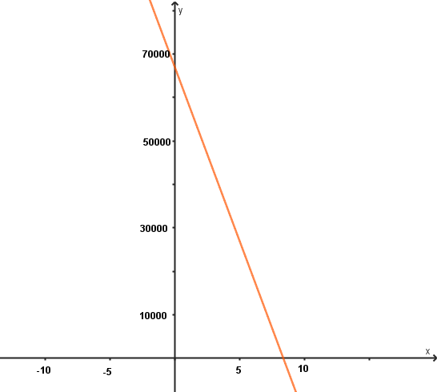
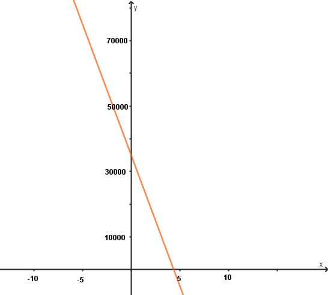
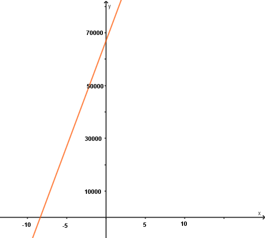
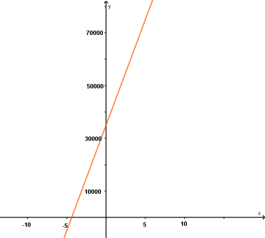
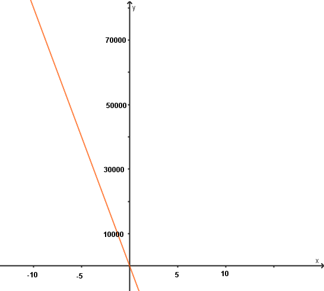
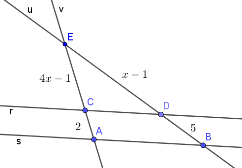
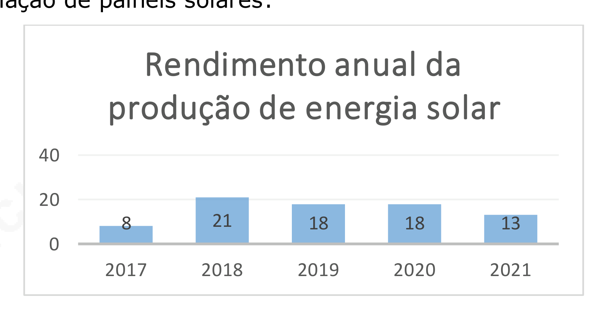

# PROVA — CÂMARA MUNICIPAL DE BRAGA – RS (E PREFEITURA MUNICIPAL DE BRAGA – RS) — CONCURSO PÚBLICO Nº 01/2023 — ASSESSOR ADMINISTRATIVO E TESOUREIRO (NÍVEL MÉDIO)

## 1. Análise geral da prova

**Identificação da prova:**

- **Concurso:** Concurso Público Nº 01/2023 — Prefeitura Municipal de Braga/RS e Câmara Municipal de Braga/RS
- **Cargo (deste caderno):** Assessor Administrativo e Tesoureiro — Câmara Municipal (prova única de Nível Médio compartilhada pelos cargos Agente Administrativo, Agente Comunitário de Saúde, Fiscal Tributário, Monitor de Educação Infantil, Assessor Administrativo e Tesoureiro)
- **Banca:** Fundatec
- **Estrutura:** 40 questões objetivas (A–E): Língua Portuguesa (01–15), Legislação (16–25), Conhecimentos Gerais (26–30), Matemática/Raciocínio Lógico (31–40)

**Composição quantitativa:**

| Item | Quantidade |
|---|---|
| Total de questões | 40 |
| Textos de apoio compartilhados (grupos) | 1 (texto de Língua Portuguesa, Q01–Q15) |
| Imagens de conteúdo | 7 (5 gráficos-alternativa da Q34, 1 figura da Q35, 1 gráfico da Q40) |
| Gráficos e tabelas | 6 gráficos (5 alternativas da Q34 + gráfico da Q40); 1 figura geométrica (Q35) |
| Grupos identificados | 1 |
| Questões independentes | 25 (Q16–Q40) |

**Composição por bloco:**

| Bloco | Questões | Quantidade |
|---|---|---|
| Língua Portuguesa | 01–15 | 15 |
| Legislação | 16–25 | 10 |
| Conhecimentos Gerais | 26–30 | 5 |
| Matemática/Raciocínio Lógico | 31–40 | 10 |

**Observações sobre a estrutura original:**

- A capa do caderno lista 6 cargos de Nível Médio que utilizam esta prova; o gabarito aplicado é o do cargo 31 — Assessor Administrativo (idêntico aos blocos dos cargos 21 — Agente Administrativo, 22 — Agente Comunitário de Saúde e 23 — Fiscal Tributário).
- O texto de Língua Portuguesa possui numeração própria de linhas (01–32), reproduzida integralmente, pois as questões citam linhas específicas.
- O texto original contém lacunas tracejadas ('.....'), lacunas com sublinhado ('____________') e três símbolos circulares (●) impressos em azul, todos reproduzidos; os caracteres destacados em cinza no original não são reproduzíveis em Markdown e estão registrados no relatório.

> **Transcrição integral da capa, das instruções e da folha de anotações (conforme extraída do PDF):**
> 
> > PREFEITURA MUNICIPAL DE BRAGA/RS E
> > CÂMARA MUNICIPAL DE BRAGA/RS
> > CONCURSO PÚBLICO Nº 01/2023
> > 
> > AGENTE ADMINISTRATIVO, AGENTE COMUNITÁRIO DE SAÚDE,
> > FISCAL TRIBUTÁRIO, MONITOR DE EDUCAÇÃO INFANTIL,
> > ASSESSOR ADMINISTRATIVO E TESOUREIRO
> > 
> > Leia atentamente e cumpra rigorosamente as instruções que seguem, pois elas são parte integrante
> > das provas e das normas que regem esse certame.
> > 1. Atente-se aos avisos contidos no quadro da sala.
> > 2. Seus pertences deverão estar armazenados dentro de embalagem específica fornecida pelo fiscal,
> > 
> > permanecendo em  sua  posse  somente  caneta  esferográfica  de  ponta  grossa,  de  material
> > transparente, com tinta azul ou preta, lanche e água, se houver. A utilização de qualquer material
> > não permitido em edital é expressamente proibida, acarretando a sua imediata eliminação do
> > certame.
> > 3. Certifique-se de que este caderno:
> > - contém 40 (quarenta) questões;
> > - refere-se ao cargo/emprego para o qual realizou a inscrição.
> > 
> > 4. Cada questão oferece 5 (cinco) alternativas de respostas, representadas pelas letras A, B, C, D e
> > E, sendo apenas 1 (uma) a resposta correta.
> > 5. Será respeitado o tempo para realização da prova conforme previsto em edital, incluindo o
> > preenchimento da grade de respostas.
> > 6. Os três últimos candidatos deverão retirar-se da sala de prova ao mesmo tempo, devendo assinar
> > a Ata de Prova.
> > 
> > 7. A responsabilidade referente à interpretação dos conteúdos das questões é exclusiva do candidato.
> > 8. No caderno de prova, você poderá rabiscar, riscar e calcular.
> > 9. Os gabaritos preliminares da prova objetiva serão divulgados na data descrita no Cronograma de
> > Execução desse certame.
> > 
> > Espaço para anotação dos gabaritos
> > 
> > 01      02      03      04      05      06      07      08      09      10
> > 
> > 11      12      13      14      15      16      17      18      19      20
> > 
> > 21      22      23      24      25      26      27      28      29      30
> > 
> > 31      32      33      34      35      36      37      38      39      40

**Gabarito oficial — tabela "Gabarito preliminar — Fundatec (Cargo 31 — Assessor Administrativo)":**

| Questão | Resposta | Questão | Resposta | Questão | Resposta | Questão | Resposta | Questão | Resposta |
|---|---|---|---|---|---|---|---|---|---|
| 01 | **B** | 02 | **D** | 03 | **E** | 04 | **B** | 05 | **A** |
| 06 | **E** | 07 | **B** | 08 | **E** | 09 | **C** | 10 | **D** |
| 11 | **A** | 12 | **C** | 13 | **D** | 14 | **A** | 15 | **D** |
| 16 | **C** | 17 | **B** | 18 | **A** | 19 | **D** | 20 | **E** |
| 21 | **E** | 22 | **C** | 23 | **A** | 24 | **B** | 25 | **D** |
| 26 | **B** | 27 | **D** | 28 | **D** | 29 | **C** | 30 | **E** |
| 31 | **E** | 32 | **B** | 33 | **D** | 34 | **A** | 35 | **C** |
| 36 | **D** | 37 | **C** | 38 | **D** | 39 | **C** | 40 | **B** |

> 📌 Fonte: Gabarito preliminar — Fundatec (Cargo 31 — Assessor Administrativo)

---

## 2. Questões agrupadas

### GRUPO 01 — Texto de Língua Portuguesa — "Meus pais não enxergam" (José Manuel Diogo) compartilhado pelas questões 01 a 15

**Questões relacionadas:** 01, 02, 03, 04, 05, 06, 07, 08, 09, 10, 11, 12, 13, 14, 15.

**Material de apoio compartilhado:**

> LÍNGUA PORTUGUESA
> 
> Instrução: As questões de números 01 a 15 referem-se ao texto abaixo. Os destaques ao
> longo do texto estão citados nas questões.
> 
> **Meus pais não enxergam** — Por José Manuel Diogo
> 
> 01 Um dos maiores desafios para os pais é conhecer e compreender a forma como seus filhos
> 02 atingem e geram o conhecimento. Hoje, no centro desse desafio estão as mídias sociais. No
> 03 século 20 parece que foi já em outra vida, os instrumentos de comunicação eram lineares e de
> 04 fácil ___________, mas hoje tudo é diferente. Antes uma coisa era sempre __________ de
> 05 outra; e essa coisa estava quase sempre perto e era conhecida por todos. Não havia surpresa
> 06 nas novidades.
> 07 Antigamente, os filhos aprendiam dos pais porque tinham menor acesso ● informação.
> 08 Hoje não é assim. Os filhos, porque são mais jovens, menos ocupados e mais digitais, ..... acesso
> 09 a mais e melhor informação que seus __________. O desafio dos mais velhos é hoje muito
> 10 maior. Se antes o problema era saber que informação se devia proibir, agora é preciso saber
> 11 que mundo devemos conhecer. Neste jogo os guris levam grande vantagem. As redes sociais
> 12 são o território onde esta batalha se trava. Porque são mais imediatas, rápidas e ......... os nossos
> 13 filhos ● um mundo que nos é desconhecido; mas também porque, paradoxalmente, são o local
> 14 onde nos encontramos com eles na internet. Por exemplo, o Google é muito mais perigoso do
> 15 que o Facebook, mas os adultos se preocupam menos com o F azul que com o G multicolor.
> 16 Talvez porque as hipóteses de encontrar um filho ou uma filha num motor de busca sejam quase
> 17 nulas, mas nas redes sociais já não é tanto assim.
> 18 Quem tem filhos adolescentes se preocupa. Nos perguntamos se eles conseguem ter uma
> 19 vida normal passando tanto tempo ligados remotamente aos amigos. Mas será que são eles que
> 20 estão viciados na rede, ou seremos nós mais viciados do que eles? Os mais novos sabem
> 21 ___________ para que serve cada uma das redes sociais, como se  .......... vivas, e qual a
> 22 recompensa que existe em cada uma. A Carol quando tinha 14 anos, sabia que o que ..........
> 23 vivo o Snapchat é a regularidade com que contacta cada pessoa – ● é a rede da Amizade. Sabe
> 24 que no Instagram o objetivo são os gostos em cada fotografia – é a rede da Vaidade. Já
> 25 o Twitter é tudo diferente, ele serve para encontrar coisas interessantes – é a rede da
> 26 Informação. Os adolescentes estão a abandonar o Facebook. Se transferiram para o Snapchat e
> 27 para o Instagram, deixando a meta rede de Zuckerberg para mais tradicional forma de
> 28 comunicação: as mensagens de texto.
> 29 Como educadores, um dos nossos maiores receios é que nossos filhos possam estar a
> 30 falar com alguém que seja uma ameaça para eles. Mas isso rapidamente vai perdendo sentido.
> 31 Eles sabem mais sobre o assunto do que nós, e o funcionamento das redes sociais — onde eles
> 32 verdadeiramente vivem — são elas próprias a segurança necessária para todos eles.
> 
> (Disponível em https://istoe.com.br/meus-pais-nao-enxergam/ – texto adaptado especialmente para esta
> prova).

---

#### QUESTÃO 01

✅ **Gabarito: B** (Gabarito preliminar — Fundatec (Cargo 31 — Assessor Administrativo))

**Material de apoio:**

> LÍNGUA PORTUGUESA
> 
> Instrução: As questões de números 01 a 15 referem-se ao texto abaixo. Os destaques ao
> longo do texto estão citados nas questões.
> 
> **Meus pais não enxergam** — Por José Manuel Diogo
> 
> 01 Um dos maiores desafios para os pais é conhecer e compreender a forma como seus filhos
> 02 atingem e geram o conhecimento. Hoje, no centro desse desafio estão as mídias sociais. No
> 03 século 20 parece que foi já em outra vida, os instrumentos de comunicação eram lineares e de
> 04 fácil ___________, mas hoje tudo é diferente. Antes uma coisa era sempre __________ de
> 05 outra; e essa coisa estava quase sempre perto e era conhecida por todos. Não havia surpresa
> 06 nas novidades.
> 07 Antigamente, os filhos aprendiam dos pais porque tinham menor acesso ● informação.
> 08 Hoje não é assim. Os filhos, porque são mais jovens, menos ocupados e mais digitais, ..... acesso
> 09 a mais e melhor informação que seus __________. O desafio dos mais velhos é hoje muito
> 10 maior. Se antes o problema era saber que informação se devia proibir, agora é preciso saber
> 11 que mundo devemos conhecer. Neste jogo os guris levam grande vantagem. As redes sociais
> 12 são o território onde esta batalha se trava. Porque são mais imediatas, rápidas e ......... os nossos
> 13 filhos ● um mundo que nos é desconhecido; mas também porque, paradoxalmente, são o local
> 14 onde nos encontramos com eles na internet. Por exemplo, o Google é muito mais perigoso do
> 15 que o Facebook, mas os adultos se preocupam menos com o F azul que com o G multicolor.
> 16 Talvez porque as hipóteses de encontrar um filho ou uma filha num motor de busca sejam quase
> 17 nulas, mas nas redes sociais já não é tanto assim.
> 18 Quem tem filhos adolescentes se preocupa. Nos perguntamos se eles conseguem ter uma
> 19 vida normal passando tanto tempo ligados remotamente aos amigos. Mas será que são eles que
> 20 estão viciados na rede, ou seremos nós mais viciados do que eles? Os mais novos sabem
> 21 ___________ para que serve cada uma das redes sociais, como se  .......... vivas, e qual a
> 22 recompensa que existe em cada uma. A Carol quando tinha 14 anos, sabia que o que ..........
> 23 vivo o Snapchat é a regularidade com que contacta cada pessoa – ● é a rede da Amizade. Sabe
> 24 que no Instagram o objetivo são os gostos em cada fotografia – é a rede da Vaidade. Já
> 25 o Twitter é tudo diferente, ele serve para encontrar coisas interessantes – é a rede da
> 26 Informação. Os adolescentes estão a abandonar o Facebook. Se transferiram para o Snapchat e
> 27 para o Instagram, deixando a meta rede de Zuckerberg para mais tradicional forma de
> 28 comunicação: as mensagens de texto.
> 29 Como educadores, um dos nossos maiores receios é que nossos filhos possam estar a
> 30 falar com alguém que seja uma ameaça para eles. Mas isso rapidamente vai perdendo sentido.
> 31 Eles sabem mais sobre o assunto do que nós, e o funcionamento das redes sociais — onde eles
> 32 verdadeiramente vivem — são elas próprias a segurança necessária para todos eles.
> 
> (Disponível em https://istoe.com.br/meus-pais-nao-enxergam/ – texto adaptado especialmente para esta
> prova).

**Enunciado:**

QUESTÃO 01 – Considerando a grafia das palavras, assinale a alternativa que preenche, correta e
respectivamente, as lacunas tracejadas das linhas 04 (duas ocorrências), 09 e 21.

**Alternativas:**

A) compreenção – conseqüência – progenitores – ezatamente

B) compreensão – consequência – progenitores – exatamente

C) compreensão – consequência – projenitores – exatamente

D) compreenção – conseqüência – projenitores – exatamente

E) compreenção – consequência – projenitores – ezatamente

**Referências visuais:**

Nenhuma.

---

#### QUESTÃO 02

✅ **Gabarito: D** (Gabarito preliminar — Fundatec (Cargo 31 — Assessor Administrativo))

**Material de apoio:**

> LÍNGUA PORTUGUESA
> 
> Instrução: As questões de números 01 a 15 referem-se ao texto abaixo. Os destaques ao
> longo do texto estão citados nas questões.
> 
> **Meus pais não enxergam** — Por José Manuel Diogo
> 
> 01 Um dos maiores desafios para os pais é conhecer e compreender a forma como seus filhos
> 02 atingem e geram o conhecimento. Hoje, no centro desse desafio estão as mídias sociais. No
> 03 século 20 parece que foi já em outra vida, os instrumentos de comunicação eram lineares e de
> 04 fácil ___________, mas hoje tudo é diferente. Antes uma coisa era sempre __________ de
> 05 outra; e essa coisa estava quase sempre perto e era conhecida por todos. Não havia surpresa
> 06 nas novidades.
> 07 Antigamente, os filhos aprendiam dos pais porque tinham menor acesso ● informação.
> 08 Hoje não é assim. Os filhos, porque são mais jovens, menos ocupados e mais digitais, ..... acesso
> 09 a mais e melhor informação que seus __________. O desafio dos mais velhos é hoje muito
> 10 maior. Se antes o problema era saber que informação se devia proibir, agora é preciso saber
> 11 que mundo devemos conhecer. Neste jogo os guris levam grande vantagem. As redes sociais
> 12 são o território onde esta batalha se trava. Porque são mais imediatas, rápidas e ......... os nossos
> 13 filhos ● um mundo que nos é desconhecido; mas também porque, paradoxalmente, são o local
> 14 onde nos encontramos com eles na internet. Por exemplo, o Google é muito mais perigoso do
> 15 que o Facebook, mas os adultos se preocupam menos com o F azul que com o G multicolor.
> 16 Talvez porque as hipóteses de encontrar um filho ou uma filha num motor de busca sejam quase
> 17 nulas, mas nas redes sociais já não é tanto assim.
> 18 Quem tem filhos adolescentes se preocupa. Nos perguntamos se eles conseguem ter uma
> 19 vida normal passando tanto tempo ligados remotamente aos amigos. Mas será que são eles que
> 20 estão viciados na rede, ou seremos nós mais viciados do que eles? Os mais novos sabem
> 21 ___________ para que serve cada uma das redes sociais, como se  .......... vivas, e qual a
> 22 recompensa que existe em cada uma. A Carol quando tinha 14 anos, sabia que o que ..........
> 23 vivo o Snapchat é a regularidade com que contacta cada pessoa – ● é a rede da Amizade. Sabe
> 24 que no Instagram o objetivo são os gostos em cada fotografia – é a rede da Vaidade. Já
> 25 o Twitter é tudo diferente, ele serve para encontrar coisas interessantes – é a rede da
> 26 Informação. Os adolescentes estão a abandonar o Facebook. Se transferiram para o Snapchat e
> 27 para o Instagram, deixando a meta rede de Zuckerberg para mais tradicional forma de
> 28 comunicação: as mensagens de texto.
> 29 Como educadores, um dos nossos maiores receios é que nossos filhos possam estar a
> 30 falar com alguém que seja uma ameaça para eles. Mas isso rapidamente vai perdendo sentido.
> 31 Eles sabem mais sobre o assunto do que nós, e o funcionamento das redes sociais — onde eles
> 32 verdadeiramente vivem — são elas próprias a segurança necessária para todos eles.
> 
> (Disponível em https://istoe.com.br/meus-pais-nao-enxergam/ – texto adaptado especialmente para esta
> prova).

**Enunciado:**

QUESTÃO 02 – No vocábulo ‘hipóteses’ (l. 16) há:

**Alternativas:**

A) 8 letras e 4 fonemas.

B) 8 letras e 9 fonemas.

C) 9 letras e 4 fonemas.

D) 9 letras e 8 fonemas.

E) 9 letras e 9 fonemas. Execução: Fundatec NÍVEL MÉDIO www.pciconcursos.com.br

**Referências visuais:**

Nenhuma.

---

#### QUESTÃO 03

✅ **Gabarito: E** (Gabarito preliminar — Fundatec (Cargo 31 — Assessor Administrativo))

**Material de apoio:**

> LÍNGUA PORTUGUESA
> 
> Instrução: As questões de números 01 a 15 referem-se ao texto abaixo. Os destaques ao
> longo do texto estão citados nas questões.
> 
> **Meus pais não enxergam** — Por José Manuel Diogo
> 
> 01 Um dos maiores desafios para os pais é conhecer e compreender a forma como seus filhos
> 02 atingem e geram o conhecimento. Hoje, no centro desse desafio estão as mídias sociais. No
> 03 século 20 parece que foi já em outra vida, os instrumentos de comunicação eram lineares e de
> 04 fácil ___________, mas hoje tudo é diferente. Antes uma coisa era sempre __________ de
> 05 outra; e essa coisa estava quase sempre perto e era conhecida por todos. Não havia surpresa
> 06 nas novidades.
> 07 Antigamente, os filhos aprendiam dos pais porque tinham menor acesso ● informação.
> 08 Hoje não é assim. Os filhos, porque são mais jovens, menos ocupados e mais digitais, ..... acesso
> 09 a mais e melhor informação que seus __________. O desafio dos mais velhos é hoje muito
> 10 maior. Se antes o problema era saber que informação se devia proibir, agora é preciso saber
> 11 que mundo devemos conhecer. Neste jogo os guris levam grande vantagem. As redes sociais
> 12 são o território onde esta batalha se trava. Porque são mais imediatas, rápidas e ......... os nossos
> 13 filhos ● um mundo que nos é desconhecido; mas também porque, paradoxalmente, são o local
> 14 onde nos encontramos com eles na internet. Por exemplo, o Google é muito mais perigoso do
> 15 que o Facebook, mas os adultos se preocupam menos com o F azul que com o G multicolor.
> 16 Talvez porque as hipóteses de encontrar um filho ou uma filha num motor de busca sejam quase
> 17 nulas, mas nas redes sociais já não é tanto assim.
> 18 Quem tem filhos adolescentes se preocupa. Nos perguntamos se eles conseguem ter uma
> 19 vida normal passando tanto tempo ligados remotamente aos amigos. Mas será que são eles que
> 20 estão viciados na rede, ou seremos nós mais viciados do que eles? Os mais novos sabem
> 21 ___________ para que serve cada uma das redes sociais, como se  .......... vivas, e qual a
> 22 recompensa que existe em cada uma. A Carol quando tinha 14 anos, sabia que o que ..........
> 23 vivo o Snapchat é a regularidade com que contacta cada pessoa – ● é a rede da Amizade. Sabe
> 24 que no Instagram o objetivo são os gostos em cada fotografia – é a rede da Vaidade. Já
> 25 o Twitter é tudo diferente, ele serve para encontrar coisas interessantes – é a rede da
> 26 Informação. Os adolescentes estão a abandonar o Facebook. Se transferiram para o Snapchat e
> 27 para o Instagram, deixando a meta rede de Zuckerberg para mais tradicional forma de
> 28 comunicação: as mensagens de texto.
> 29 Como educadores, um dos nossos maiores receios é que nossos filhos possam estar a
> 30 falar com alguém que seja uma ameaça para eles. Mas isso rapidamente vai perdendo sentido.
> 31 Eles sabem mais sobre o assunto do que nós, e o funcionamento das redes sociais — onde eles
> 32 verdadeiramente vivem — são elas próprias a segurança necessária para todos eles.
> 
> (Disponível em https://istoe.com.br/meus-pais-nao-enxergam/ – texto adaptado especialmente para esta
> prova).

**Enunciado:**

QUESTÃO 03 – Sobre o uso da crase, avalie as assertivas que seguem, assinalando V, se verdadeiras,
ou F, se falsas.

(  ) Na linha 07, o símbolo ● tornaria a frase correta se fosse substituído por à.
(  ) O uso do artigo definido feminino em lugar do símbolo ● utilizado na linha 13 manteria a correção
do período.
(  ) Na linha 23, a troca do símbolo ● pela preposição ‘a’ manteria a correção do fragmento.

A ordem correta de preenchimento de parênteses, de cima para baixo, é:

**Alternativas:**

A) F – V – V.

B) F – F – V.

C) V – V – V.

D) V – F – V.

E) V – F – F.

**Referências visuais:**

Nenhuma.

---

#### QUESTÃO 04

✅ **Gabarito: B** (Gabarito preliminar — Fundatec (Cargo 31 — Assessor Administrativo))

**Material de apoio:**

> LÍNGUA PORTUGUESA
> 
> Instrução: As questões de números 01 a 15 referem-se ao texto abaixo. Os destaques ao
> longo do texto estão citados nas questões.
> 
> **Meus pais não enxergam** — Por José Manuel Diogo
> 
> 01 Um dos maiores desafios para os pais é conhecer e compreender a forma como seus filhos
> 02 atingem e geram o conhecimento. Hoje, no centro desse desafio estão as mídias sociais. No
> 03 século 20 parece que foi já em outra vida, os instrumentos de comunicação eram lineares e de
> 04 fácil ___________, mas hoje tudo é diferente. Antes uma coisa era sempre __________ de
> 05 outra; e essa coisa estava quase sempre perto e era conhecida por todos. Não havia surpresa
> 06 nas novidades.
> 07 Antigamente, os filhos aprendiam dos pais porque tinham menor acesso ● informação.
> 08 Hoje não é assim. Os filhos, porque são mais jovens, menos ocupados e mais digitais, ..... acesso
> 09 a mais e melhor informação que seus __________. O desafio dos mais velhos é hoje muito
> 10 maior. Se antes o problema era saber que informação se devia proibir, agora é preciso saber
> 11 que mundo devemos conhecer. Neste jogo os guris levam grande vantagem. As redes sociais
> 12 são o território onde esta batalha se trava. Porque são mais imediatas, rápidas e ......... os nossos
> 13 filhos ● um mundo que nos é desconhecido; mas também porque, paradoxalmente, são o local
> 14 onde nos encontramos com eles na internet. Por exemplo, o Google é muito mais perigoso do
> 15 que o Facebook, mas os adultos se preocupam menos com o F azul que com o G multicolor.
> 16 Talvez porque as hipóteses de encontrar um filho ou uma filha num motor de busca sejam quase
> 17 nulas, mas nas redes sociais já não é tanto assim.
> 18 Quem tem filhos adolescentes se preocupa. Nos perguntamos se eles conseguem ter uma
> 19 vida normal passando tanto tempo ligados remotamente aos amigos. Mas será que são eles que
> 20 estão viciados na rede, ou seremos nós mais viciados do que eles? Os mais novos sabem
> 21 ___________ para que serve cada uma das redes sociais, como se  .......... vivas, e qual a
> 22 recompensa que existe em cada uma. A Carol quando tinha 14 anos, sabia que o que ..........
> 23 vivo o Snapchat é a regularidade com que contacta cada pessoa – ● é a rede da Amizade. Sabe
> 24 que no Instagram o objetivo são os gostos em cada fotografia – é a rede da Vaidade. Já
> 25 o Twitter é tudo diferente, ele serve para encontrar coisas interessantes – é a rede da
> 26 Informação. Os adolescentes estão a abandonar o Facebook. Se transferiram para o Snapchat e
> 27 para o Instagram, deixando a meta rede de Zuckerberg para mais tradicional forma de
> 28 comunicação: as mensagens de texto.
> 29 Como educadores, um dos nossos maiores receios é que nossos filhos possam estar a
> 30 falar com alguém que seja uma ameaça para eles. Mas isso rapidamente vai perdendo sentido.
> 31 Eles sabem mais sobre o assunto do que nós, e o funcionamento das redes sociais — onde eles
> 32 verdadeiramente vivem — são elas próprias a segurança necessária para todos eles.
> 
> (Disponível em https://istoe.com.br/meus-pais-nao-enxergam/ – texto adaptado especialmente para esta
> prova).

**Enunciado:**

QUESTÃO 04 – No que se refere à flexão de pessoa e de número dos verbos ‘ter’ (l.08), ‘expor’
(l. 12) e ‘manter’ (l. 21 e 22), assinale a alternativa que preenche, correta e respectivamente, as
lacunas pontilhadas, considerando que, no texto, foram empregados no presente do indicativo.

**Alternativas:**

A) tem – expõe – mantem – mantem

B) têm – expõem – mantêm – mantém

C) tem – expõe – mantém – mantêm

D) têm – expoe – mantem – mantêm

E) tem – expõem – mantém – mantém

**Referências visuais:**

Nenhuma.

---

#### QUESTÃO 05

✅ **Gabarito: A** (Gabarito preliminar — Fundatec (Cargo 31 — Assessor Administrativo))

**Material de apoio:**

> LÍNGUA PORTUGUESA
> 
> Instrução: As questões de números 01 a 15 referem-se ao texto abaixo. Os destaques ao
> longo do texto estão citados nas questões.
> 
> **Meus pais não enxergam** — Por José Manuel Diogo
> 
> 01 Um dos maiores desafios para os pais é conhecer e compreender a forma como seus filhos
> 02 atingem e geram o conhecimento. Hoje, no centro desse desafio estão as mídias sociais. No
> 03 século 20 parece que foi já em outra vida, os instrumentos de comunicação eram lineares e de
> 04 fácil ___________, mas hoje tudo é diferente. Antes uma coisa era sempre __________ de
> 05 outra; e essa coisa estava quase sempre perto e era conhecida por todos. Não havia surpresa
> 06 nas novidades.
> 07 Antigamente, os filhos aprendiam dos pais porque tinham menor acesso ● informação.
> 08 Hoje não é assim. Os filhos, porque são mais jovens, menos ocupados e mais digitais, ..... acesso
> 09 a mais e melhor informação que seus __________. O desafio dos mais velhos é hoje muito
> 10 maior. Se antes o problema era saber que informação se devia proibir, agora é preciso saber
> 11 que mundo devemos conhecer. Neste jogo os guris levam grande vantagem. As redes sociais
> 12 são o território onde esta batalha se trava. Porque são mais imediatas, rápidas e ......... os nossos
> 13 filhos ● um mundo que nos é desconhecido; mas também porque, paradoxalmente, são o local
> 14 onde nos encontramos com eles na internet. Por exemplo, o Google é muito mais perigoso do
> 15 que o Facebook, mas os adultos se preocupam menos com o F azul que com o G multicolor.
> 16 Talvez porque as hipóteses de encontrar um filho ou uma filha num motor de busca sejam quase
> 17 nulas, mas nas redes sociais já não é tanto assim.
> 18 Quem tem filhos adolescentes se preocupa. Nos perguntamos se eles conseguem ter uma
> 19 vida normal passando tanto tempo ligados remotamente aos amigos. Mas será que são eles que
> 20 estão viciados na rede, ou seremos nós mais viciados do que eles? Os mais novos sabem
> 21 ___________ para que serve cada uma das redes sociais, como se  .......... vivas, e qual a
> 22 recompensa que existe em cada uma. A Carol quando tinha 14 anos, sabia que o que ..........
> 23 vivo o Snapchat é a regularidade com que contacta cada pessoa – ● é a rede da Amizade. Sabe
> 24 que no Instagram o objetivo são os gostos em cada fotografia – é a rede da Vaidade. Já
> 25 o Twitter é tudo diferente, ele serve para encontrar coisas interessantes – é a rede da
> 26 Informação. Os adolescentes estão a abandonar o Facebook. Se transferiram para o Snapchat e
> 27 para o Instagram, deixando a meta rede de Zuckerberg para mais tradicional forma de
> 28 comunicação: as mensagens de texto.
> 29 Como educadores, um dos nossos maiores receios é que nossos filhos possam estar a
> 30 falar com alguém que seja uma ameaça para eles. Mas isso rapidamente vai perdendo sentido.
> 31 Eles sabem mais sobre o assunto do que nós, e o funcionamento das redes sociais — onde eles
> 32 verdadeiramente vivem — são elas próprias a segurança necessária para todos eles.
> 
> (Disponível em https://istoe.com.br/meus-pais-nao-enxergam/ – texto adaptado especialmente para esta
> prova).

**Enunciado:**

QUESTÃO 05 – Na linha 13, o elemento coesivo ‘mas também’ expressa ideia de:

**Alternativas:**

A) Adição.

B) Conclusão.

C) Conformidade.

D) Explicação.

E) Oposição.

**Referências visuais:**

Nenhuma.

---

#### QUESTÃO 06

✅ **Gabarito: E** (Gabarito preliminar — Fundatec (Cargo 31 — Assessor Administrativo))

**Material de apoio:**

> LÍNGUA PORTUGUESA
> 
> Instrução: As questões de números 01 a 15 referem-se ao texto abaixo. Os destaques ao
> longo do texto estão citados nas questões.
> 
> **Meus pais não enxergam** — Por José Manuel Diogo
> 
> 01 Um dos maiores desafios para os pais é conhecer e compreender a forma como seus filhos
> 02 atingem e geram o conhecimento. Hoje, no centro desse desafio estão as mídias sociais. No
> 03 século 20 parece que foi já em outra vida, os instrumentos de comunicação eram lineares e de
> 04 fácil ___________, mas hoje tudo é diferente. Antes uma coisa era sempre __________ de
> 05 outra; e essa coisa estava quase sempre perto e era conhecida por todos. Não havia surpresa
> 06 nas novidades.
> 07 Antigamente, os filhos aprendiam dos pais porque tinham menor acesso ● informação.
> 08 Hoje não é assim. Os filhos, porque são mais jovens, menos ocupados e mais digitais, ..... acesso
> 09 a mais e melhor informação que seus __________. O desafio dos mais velhos é hoje muito
> 10 maior. Se antes o problema era saber que informação se devia proibir, agora é preciso saber
> 11 que mundo devemos conhecer. Neste jogo os guris levam grande vantagem. As redes sociais
> 12 são o território onde esta batalha se trava. Porque são mais imediatas, rápidas e ......... os nossos
> 13 filhos ● um mundo que nos é desconhecido; mas também porque, paradoxalmente, são o local
> 14 onde nos encontramos com eles na internet. Por exemplo, o Google é muito mais perigoso do
> 15 que o Facebook, mas os adultos se preocupam menos com o F azul que com o G multicolor.
> 16 Talvez porque as hipóteses de encontrar um filho ou uma filha num motor de busca sejam quase
> 17 nulas, mas nas redes sociais já não é tanto assim.
> 18 Quem tem filhos adolescentes se preocupa. Nos perguntamos se eles conseguem ter uma
> 19 vida normal passando tanto tempo ligados remotamente aos amigos. Mas será que são eles que
> 20 estão viciados na rede, ou seremos nós mais viciados do que eles? Os mais novos sabem
> 21 ___________ para que serve cada uma das redes sociais, como se  .......... vivas, e qual a
> 22 recompensa que existe em cada uma. A Carol quando tinha 14 anos, sabia que o que ..........
> 23 vivo o Snapchat é a regularidade com que contacta cada pessoa – ● é a rede da Amizade. Sabe
> 24 que no Instagram o objetivo são os gostos em cada fotografia – é a rede da Vaidade. Já
> 25 o Twitter é tudo diferente, ele serve para encontrar coisas interessantes – é a rede da
> 26 Informação. Os adolescentes estão a abandonar o Facebook. Se transferiram para o Snapchat e
> 27 para o Instagram, deixando a meta rede de Zuckerberg para mais tradicional forma de
> 28 comunicação: as mensagens de texto.
> 29 Como educadores, um dos nossos maiores receios é que nossos filhos possam estar a
> 30 falar com alguém que seja uma ameaça para eles. Mas isso rapidamente vai perdendo sentido.
> 31 Eles sabem mais sobre o assunto do que nós, e o funcionamento das redes sociais — onde eles
> 32 verdadeiramente vivem — são elas próprias a segurança necessária para todos eles.
> 
> (Disponível em https://istoe.com.br/meus-pais-nao-enxergam/ – texto adaptado especialmente para esta
> prova).

**Enunciado:**

QUESTÃO 06 – Avalie as seguintes ocorrências da palavra ‘que’, devidamente hachuradas no texto:

I. que (l. 10).
II. que (l. 11).
III. que (l. 22).

Quais são pronomes?

**Alternativas:**

A) Apenas I.

B) Apenas II.

C) Apenas III.

D) Apenas I e II.

E) Apenas II e III.

**Referências visuais:**

Nenhuma.

---

#### QUESTÃO 07

✅ **Gabarito: B** (Gabarito preliminar — Fundatec (Cargo 31 — Assessor Administrativo))

**Material de apoio:**

> LÍNGUA PORTUGUESA
> 
> Instrução: As questões de números 01 a 15 referem-se ao texto abaixo. Os destaques ao
> longo do texto estão citados nas questões.
> 
> **Meus pais não enxergam** — Por José Manuel Diogo
> 
> 01 Um dos maiores desafios para os pais é conhecer e compreender a forma como seus filhos
> 02 atingem e geram o conhecimento. Hoje, no centro desse desafio estão as mídias sociais. No
> 03 século 20 parece que foi já em outra vida, os instrumentos de comunicação eram lineares e de
> 04 fácil ___________, mas hoje tudo é diferente. Antes uma coisa era sempre __________ de
> 05 outra; e essa coisa estava quase sempre perto e era conhecida por todos. Não havia surpresa
> 06 nas novidades.
> 07 Antigamente, os filhos aprendiam dos pais porque tinham menor acesso ● informação.
> 08 Hoje não é assim. Os filhos, porque são mais jovens, menos ocupados e mais digitais, ..... acesso
> 09 a mais e melhor informação que seus __________. O desafio dos mais velhos é hoje muito
> 10 maior. Se antes o problema era saber que informação se devia proibir, agora é preciso saber
> 11 que mundo devemos conhecer. Neste jogo os guris levam grande vantagem. As redes sociais
> 12 são o território onde esta batalha se trava. Porque são mais imediatas, rápidas e ......... os nossos
> 13 filhos ● um mundo que nos é desconhecido; mas também porque, paradoxalmente, são o local
> 14 onde nos encontramos com eles na internet. Por exemplo, o Google é muito mais perigoso do
> 15 que o Facebook, mas os adultos se preocupam menos com o F azul que com o G multicolor.
> 16 Talvez porque as hipóteses de encontrar um filho ou uma filha num motor de busca sejam quase
> 17 nulas, mas nas redes sociais já não é tanto assim.
> 18 Quem tem filhos adolescentes se preocupa. Nos perguntamos se eles conseguem ter uma
> 19 vida normal passando tanto tempo ligados remotamente aos amigos. Mas será que são eles que
> 20 estão viciados na rede, ou seremos nós mais viciados do que eles? Os mais novos sabem
> 21 ___________ para que serve cada uma das redes sociais, como se  .......... vivas, e qual a
> 22 recompensa que existe em cada uma. A Carol quando tinha 14 anos, sabia que o que ..........
> 23 vivo o Snapchat é a regularidade com que contacta cada pessoa – ● é a rede da Amizade. Sabe
> 24 que no Instagram o objetivo são os gostos em cada fotografia – é a rede da Vaidade. Já
> 25 o Twitter é tudo diferente, ele serve para encontrar coisas interessantes – é a rede da
> 26 Informação. Os adolescentes estão a abandonar o Facebook. Se transferiram para o Snapchat e
> 27 para o Instagram, deixando a meta rede de Zuckerberg para mais tradicional forma de
> 28 comunicação: as mensagens de texto.
> 29 Como educadores, um dos nossos maiores receios é que nossos filhos possam estar a
> 30 falar com alguém que seja uma ameaça para eles. Mas isso rapidamente vai perdendo sentido.
> 31 Eles sabem mais sobre o assunto do que nós, e o funcionamento das redes sociais — onde eles
> 32 verdadeiramente vivem — são elas próprias a segurança necessária para todos eles.
> 
> (Disponível em https://istoe.com.br/meus-pais-nao-enxergam/ – texto adaptado especialmente para esta
> prova).

**Enunciado:**

QUESTÃO 07 – Assinale a alternativa cuja conversão da voz ativa para a passiva da frase ‘Neste jogo
os guris levam grande vantagem’ (l. 11) está correta.

**Alternativas:**

A) Neste jogo a grande vantagem os guris levam.

B) Grande vantagem é levada pelos guris neste jogo.

C) A grande vantagem do jogo é aquela que os guris levam.

D) Grande vantagem seria levada neste jogo pelos guris.

E) Os guris, neste jogo, podem levar grande vantagem. Execução: Fundatec NÍVEL MÉDIO www.pciconcursos.com.br

**Referências visuais:**

Nenhuma.

---

#### QUESTÃO 08

✅ **Gabarito: E** (Gabarito preliminar — Fundatec (Cargo 31 — Assessor Administrativo))

**Material de apoio:**

> LÍNGUA PORTUGUESA
> 
> Instrução: As questões de números 01 a 15 referem-se ao texto abaixo. Os destaques ao
> longo do texto estão citados nas questões.
> 
> **Meus pais não enxergam** — Por José Manuel Diogo
> 
> 01 Um dos maiores desafios para os pais é conhecer e compreender a forma como seus filhos
> 02 atingem e geram o conhecimento. Hoje, no centro desse desafio estão as mídias sociais. No
> 03 século 20 parece que foi já em outra vida, os instrumentos de comunicação eram lineares e de
> 04 fácil ___________, mas hoje tudo é diferente. Antes uma coisa era sempre __________ de
> 05 outra; e essa coisa estava quase sempre perto e era conhecida por todos. Não havia surpresa
> 06 nas novidades.
> 07 Antigamente, os filhos aprendiam dos pais porque tinham menor acesso ● informação.
> 08 Hoje não é assim. Os filhos, porque são mais jovens, menos ocupados e mais digitais, ..... acesso
> 09 a mais e melhor informação que seus __________. O desafio dos mais velhos é hoje muito
> 10 maior. Se antes o problema era saber que informação se devia proibir, agora é preciso saber
> 11 que mundo devemos conhecer. Neste jogo os guris levam grande vantagem. As redes sociais
> 12 são o território onde esta batalha se trava. Porque são mais imediatas, rápidas e ......... os nossos
> 13 filhos ● um mundo que nos é desconhecido; mas também porque, paradoxalmente, são o local
> 14 onde nos encontramos com eles na internet. Por exemplo, o Google é muito mais perigoso do
> 15 que o Facebook, mas os adultos se preocupam menos com o F azul que com o G multicolor.
> 16 Talvez porque as hipóteses de encontrar um filho ou uma filha num motor de busca sejam quase
> 17 nulas, mas nas redes sociais já não é tanto assim.
> 18 Quem tem filhos adolescentes se preocupa. Nos perguntamos se eles conseguem ter uma
> 19 vida normal passando tanto tempo ligados remotamente aos amigos. Mas será que são eles que
> 20 estão viciados na rede, ou seremos nós mais viciados do que eles? Os mais novos sabem
> 21 ___________ para que serve cada uma das redes sociais, como se  .......... vivas, e qual a
> 22 recompensa que existe em cada uma. A Carol quando tinha 14 anos, sabia que o que ..........
> 23 vivo o Snapchat é a regularidade com que contacta cada pessoa – ● é a rede da Amizade. Sabe
> 24 que no Instagram o objetivo são os gostos em cada fotografia – é a rede da Vaidade. Já
> 25 o Twitter é tudo diferente, ele serve para encontrar coisas interessantes – é a rede da
> 26 Informação. Os adolescentes estão a abandonar o Facebook. Se transferiram para o Snapchat e
> 27 para o Instagram, deixando a meta rede de Zuckerberg para mais tradicional forma de
> 28 comunicação: as mensagens de texto.
> 29 Como educadores, um dos nossos maiores receios é que nossos filhos possam estar a
> 30 falar com alguém que seja uma ameaça para eles. Mas isso rapidamente vai perdendo sentido.
> 31 Eles sabem mais sobre o assunto do que nós, e o funcionamento das redes sociais — onde eles
> 32 verdadeiramente vivem — são elas próprias a segurança necessária para todos eles.
> 
> (Disponível em https://istoe.com.br/meus-pais-nao-enxergam/ – texto adaptado especialmente para esta
> prova).

**Enunciado:**

QUESTÃO 08 – Sobre as palavras ‘paradoxalmente’ (l. 13) e ‘remotamente’ (l. 19), são feitas as
seguintes assertivas:

(  ) Ambas são advérbios.
(  ) A supressão desses vocábulos do texto não implicaria alteração de sentido, visto que são termos
acessórios das orações em que ocorrem.
(  ) Sem alterar o sentido dos períodos, poderíamos substituir, respectivamente, por ‘por consenso’
e por ‘por controle remoto’.

A ordem correta de preenchimento de parênteses, de cima para baixo, é:

**Alternativas:**

A) F – V – F.

B) F – F – V.

C) V – V – V.

D) V – F – V.

E) V – F – F.

**Referências visuais:**

Nenhuma.

---

#### QUESTÃO 09

✅ **Gabarito: C** (Gabarito preliminar — Fundatec (Cargo 31 — Assessor Administrativo))

**Material de apoio:**

> LÍNGUA PORTUGUESA
> 
> Instrução: As questões de números 01 a 15 referem-se ao texto abaixo. Os destaques ao
> longo do texto estão citados nas questões.
> 
> **Meus pais não enxergam** — Por José Manuel Diogo
> 
> 01 Um dos maiores desafios para os pais é conhecer e compreender a forma como seus filhos
> 02 atingem e geram o conhecimento. Hoje, no centro desse desafio estão as mídias sociais. No
> 03 século 20 parece que foi já em outra vida, os instrumentos de comunicação eram lineares e de
> 04 fácil ___________, mas hoje tudo é diferente. Antes uma coisa era sempre __________ de
> 05 outra; e essa coisa estava quase sempre perto e era conhecida por todos. Não havia surpresa
> 06 nas novidades.
> 07 Antigamente, os filhos aprendiam dos pais porque tinham menor acesso ● informação.
> 08 Hoje não é assim. Os filhos, porque são mais jovens, menos ocupados e mais digitais, ..... acesso
> 09 a mais e melhor informação que seus __________. O desafio dos mais velhos é hoje muito
> 10 maior. Se antes o problema era saber que informação se devia proibir, agora é preciso saber
> 11 que mundo devemos conhecer. Neste jogo os guris levam grande vantagem. As redes sociais
> 12 são o território onde esta batalha se trava. Porque são mais imediatas, rápidas e ......... os nossos
> 13 filhos ● um mundo que nos é desconhecido; mas também porque, paradoxalmente, são o local
> 14 onde nos encontramos com eles na internet. Por exemplo, o Google é muito mais perigoso do
> 15 que o Facebook, mas os adultos se preocupam menos com o F azul que com o G multicolor.
> 16 Talvez porque as hipóteses de encontrar um filho ou uma filha num motor de busca sejam quase
> 17 nulas, mas nas redes sociais já não é tanto assim.
> 18 Quem tem filhos adolescentes se preocupa. Nos perguntamos se eles conseguem ter uma
> 19 vida normal passando tanto tempo ligados remotamente aos amigos. Mas será que são eles que
> 20 estão viciados na rede, ou seremos nós mais viciados do que eles? Os mais novos sabem
> 21 ___________ para que serve cada uma das redes sociais, como se  .......... vivas, e qual a
> 22 recompensa que existe em cada uma. A Carol quando tinha 14 anos, sabia que o que ..........
> 23 vivo o Snapchat é a regularidade com que contacta cada pessoa – ● é a rede da Amizade. Sabe
> 24 que no Instagram o objetivo são os gostos em cada fotografia – é a rede da Vaidade. Já
> 25 o Twitter é tudo diferente, ele serve para encontrar coisas interessantes – é a rede da
> 26 Informação. Os adolescentes estão a abandonar o Facebook. Se transferiram para o Snapchat e
> 27 para o Instagram, deixando a meta rede de Zuckerberg para mais tradicional forma de
> 28 comunicação: as mensagens de texto.
> 29 Como educadores, um dos nossos maiores receios é que nossos filhos possam estar a
> 30 falar com alguém que seja uma ameaça para eles. Mas isso rapidamente vai perdendo sentido.
> 31 Eles sabem mais sobre o assunto do que nós, e o funcionamento das redes sociais — onde eles
> 32 verdadeiramente vivem — são elas próprias a segurança necessária para todos eles.
> 
> (Disponível em https://istoe.com.br/meus-pais-nao-enxergam/ – texto adaptado especialmente para esta
> prova).

**Enunciado:**

QUESTÃO 09 – Em relação à frase: ‘Não havia surpresa nas novidades.’, avalie as assertivas que
seguem:

I. O substantivo ‘surpresa’ funciona como sujeito da frase.
II. A substituição do verbo ‘haver’ pelo verbo ‘existir’ não provoca nenhuma alteração na estrutura
da frase.
III. Na frase observa-se a ocorrência de um advérbio e de uma locução adverbial.

Quais estão corretas?

**Alternativas:**

A) Apenas I.

B) Apenas II.

C) Apenas III.

D) Apenas I e II.

E) Apenas II e III.

**Referências visuais:**

Nenhuma.

---

#### QUESTÃO 10

✅ **Gabarito: D** (Gabarito preliminar — Fundatec (Cargo 31 — Assessor Administrativo))

**Material de apoio:**

> LÍNGUA PORTUGUESA
> 
> Instrução: As questões de números 01 a 15 referem-se ao texto abaixo. Os destaques ao
> longo do texto estão citados nas questões.
> 
> **Meus pais não enxergam** — Por José Manuel Diogo
> 
> 01 Um dos maiores desafios para os pais é conhecer e compreender a forma como seus filhos
> 02 atingem e geram o conhecimento. Hoje, no centro desse desafio estão as mídias sociais. No
> 03 século 20 parece que foi já em outra vida, os instrumentos de comunicação eram lineares e de
> 04 fácil ___________, mas hoje tudo é diferente. Antes uma coisa era sempre __________ de
> 05 outra; e essa coisa estava quase sempre perto e era conhecida por todos. Não havia surpresa
> 06 nas novidades.
> 07 Antigamente, os filhos aprendiam dos pais porque tinham menor acesso ● informação.
> 08 Hoje não é assim. Os filhos, porque são mais jovens, menos ocupados e mais digitais, ..... acesso
> 09 a mais e melhor informação que seus __________. O desafio dos mais velhos é hoje muito
> 10 maior. Se antes o problema era saber que informação se devia proibir, agora é preciso saber
> 11 que mundo devemos conhecer. Neste jogo os guris levam grande vantagem. As redes sociais
> 12 são o território onde esta batalha se trava. Porque são mais imediatas, rápidas e ......... os nossos
> 13 filhos ● um mundo que nos é desconhecido; mas também porque, paradoxalmente, são o local
> 14 onde nos encontramos com eles na internet. Por exemplo, o Google é muito mais perigoso do
> 15 que o Facebook, mas os adultos se preocupam menos com o F azul que com o G multicolor.
> 16 Talvez porque as hipóteses de encontrar um filho ou uma filha num motor de busca sejam quase
> 17 nulas, mas nas redes sociais já não é tanto assim.
> 18 Quem tem filhos adolescentes se preocupa. Nos perguntamos se eles conseguem ter uma
> 19 vida normal passando tanto tempo ligados remotamente aos amigos. Mas será que são eles que
> 20 estão viciados na rede, ou seremos nós mais viciados do que eles? Os mais novos sabem
> 21 ___________ para que serve cada uma das redes sociais, como se  .......... vivas, e qual a
> 22 recompensa que existe em cada uma. A Carol quando tinha 14 anos, sabia que o que ..........
> 23 vivo o Snapchat é a regularidade com que contacta cada pessoa – ● é a rede da Amizade. Sabe
> 24 que no Instagram o objetivo são os gostos em cada fotografia – é a rede da Vaidade. Já
> 25 o Twitter é tudo diferente, ele serve para encontrar coisas interessantes – é a rede da
> 26 Informação. Os adolescentes estão a abandonar o Facebook. Se transferiram para o Snapchat e
> 27 para o Instagram, deixando a meta rede de Zuckerberg para mais tradicional forma de
> 28 comunicação: as mensagens de texto.
> 29 Como educadores, um dos nossos maiores receios é que nossos filhos possam estar a
> 30 falar com alguém que seja uma ameaça para eles. Mas isso rapidamente vai perdendo sentido.
> 31 Eles sabem mais sobre o assunto do que nós, e o funcionamento das redes sociais — onde eles
> 32 verdadeiramente vivem — são elas próprias a segurança necessária para todos eles.
> 
> (Disponível em https://istoe.com.br/meus-pais-nao-enxergam/ – texto adaptado especialmente para esta
> prova).

**Enunciado:**

QUESTÃO 10 – Sobre a palavra ‘mas’ (l. 15), é correto afirmar que:

I. Trata-se de uma conjunção coordenativa adversativa.
II. Relaciona orações subordinadas, isto é, que dependem sintaticamente uma da outra.
III. Mantendo-se a mesma relação de sentido que estabelece no contexto, poderia ser correta e
adequadamente substituída por ‘porém’.

Quais estão corretas?

**Alternativas:**

A) Apenas I.

B) Apenas II.

C) Apenas I e II.

D) Apenas I e III.

E) Apenas II e III. Execução: Fundatec NÍVEL MÉDIO www.pciconcursos.com.br

**Referências visuais:**

Nenhuma.

---

#### QUESTÃO 11

✅ **Gabarito: A** (Gabarito preliminar — Fundatec (Cargo 31 — Assessor Administrativo))

**Material de apoio:**

> LÍNGUA PORTUGUESA
> 
> Instrução: As questões de números 01 a 15 referem-se ao texto abaixo. Os destaques ao
> longo do texto estão citados nas questões.
> 
> **Meus pais não enxergam** — Por José Manuel Diogo
> 
> 01 Um dos maiores desafios para os pais é conhecer e compreender a forma como seus filhos
> 02 atingem e geram o conhecimento. Hoje, no centro desse desafio estão as mídias sociais. No
> 03 século 20 parece que foi já em outra vida, os instrumentos de comunicação eram lineares e de
> 04 fácil ___________, mas hoje tudo é diferente. Antes uma coisa era sempre __________ de
> 05 outra; e essa coisa estava quase sempre perto e era conhecida por todos. Não havia surpresa
> 06 nas novidades.
> 07 Antigamente, os filhos aprendiam dos pais porque tinham menor acesso ● informação.
> 08 Hoje não é assim. Os filhos, porque são mais jovens, menos ocupados e mais digitais, ..... acesso
> 09 a mais e melhor informação que seus __________. O desafio dos mais velhos é hoje muito
> 10 maior. Se antes o problema era saber que informação se devia proibir, agora é preciso saber
> 11 que mundo devemos conhecer. Neste jogo os guris levam grande vantagem. As redes sociais
> 12 são o território onde esta batalha se trava. Porque são mais imediatas, rápidas e ......... os nossos
> 13 filhos ● um mundo que nos é desconhecido; mas também porque, paradoxalmente, são o local
> 14 onde nos encontramos com eles na internet. Por exemplo, o Google é muito mais perigoso do
> 15 que o Facebook, mas os adultos se preocupam menos com o F azul que com o G multicolor.
> 16 Talvez porque as hipóteses de encontrar um filho ou uma filha num motor de busca sejam quase
> 17 nulas, mas nas redes sociais já não é tanto assim.
> 18 Quem tem filhos adolescentes se preocupa. Nos perguntamos se eles conseguem ter uma
> 19 vida normal passando tanto tempo ligados remotamente aos amigos. Mas será que são eles que
> 20 estão viciados na rede, ou seremos nós mais viciados do que eles? Os mais novos sabem
> 21 ___________ para que serve cada uma das redes sociais, como se  .......... vivas, e qual a
> 22 recompensa que existe em cada uma. A Carol quando tinha 14 anos, sabia que o que ..........
> 23 vivo o Snapchat é a regularidade com que contacta cada pessoa – ● é a rede da Amizade. Sabe
> 24 que no Instagram o objetivo são os gostos em cada fotografia – é a rede da Vaidade. Já
> 25 o Twitter é tudo diferente, ele serve para encontrar coisas interessantes – é a rede da
> 26 Informação. Os adolescentes estão a abandonar o Facebook. Se transferiram para o Snapchat e
> 27 para o Instagram, deixando a meta rede de Zuckerberg para mais tradicional forma de
> 28 comunicação: as mensagens de texto.
> 29 Como educadores, um dos nossos maiores receios é que nossos filhos possam estar a
> 30 falar com alguém que seja uma ameaça para eles. Mas isso rapidamente vai perdendo sentido.
> 31 Eles sabem mais sobre o assunto do que nós, e o funcionamento das redes sociais — onde eles
> 32 verdadeiramente vivem — são elas próprias a segurança necessária para todos eles.
> 
> (Disponível em https://istoe.com.br/meus-pais-nao-enxergam/ – texto adaptado especialmente para esta
> prova).

**Enunciado:**

QUESTÃO 11 – Se em ‘Nos perguntamos se eles conseguem ter uma vida normal passando tanto
tempo ligados remotamente aos amigos.’ flexionássemos a forma verbal ‘perguntamos’ na primeira
pessoal do singular, quantas outras alterações deveríamos fazer para manter a correção gramatical
do período?

**Alternativas:**

A) Uma.

B) Duas.

C) Três.

D) Quatro.

E) Cinco.

**Referências visuais:**

Nenhuma.

---

#### QUESTÃO 12

✅ **Gabarito: C** (Gabarito preliminar — Fundatec (Cargo 31 — Assessor Administrativo))

**Material de apoio:**

> LÍNGUA PORTUGUESA
> 
> Instrução: As questões de números 01 a 15 referem-se ao texto abaixo. Os destaques ao
> longo do texto estão citados nas questões.
> 
> **Meus pais não enxergam** — Por José Manuel Diogo
> 
> 01 Um dos maiores desafios para os pais é conhecer e compreender a forma como seus filhos
> 02 atingem e geram o conhecimento. Hoje, no centro desse desafio estão as mídias sociais. No
> 03 século 20 parece que foi já em outra vida, os instrumentos de comunicação eram lineares e de
> 04 fácil ___________, mas hoje tudo é diferente. Antes uma coisa era sempre __________ de
> 05 outra; e essa coisa estava quase sempre perto e era conhecida por todos. Não havia surpresa
> 06 nas novidades.
> 07 Antigamente, os filhos aprendiam dos pais porque tinham menor acesso ● informação.
> 08 Hoje não é assim. Os filhos, porque são mais jovens, menos ocupados e mais digitais, ..... acesso
> 09 a mais e melhor informação que seus __________. O desafio dos mais velhos é hoje muito
> 10 maior. Se antes o problema era saber que informação se devia proibir, agora é preciso saber
> 11 que mundo devemos conhecer. Neste jogo os guris levam grande vantagem. As redes sociais
> 12 são o território onde esta batalha se trava. Porque são mais imediatas, rápidas e ......... os nossos
> 13 filhos ● um mundo que nos é desconhecido; mas também porque, paradoxalmente, são o local
> 14 onde nos encontramos com eles na internet. Por exemplo, o Google é muito mais perigoso do
> 15 que o Facebook, mas os adultos se preocupam menos com o F azul que com o G multicolor.
> 16 Talvez porque as hipóteses de encontrar um filho ou uma filha num motor de busca sejam quase
> 17 nulas, mas nas redes sociais já não é tanto assim.
> 18 Quem tem filhos adolescentes se preocupa. Nos perguntamos se eles conseguem ter uma
> 19 vida normal passando tanto tempo ligados remotamente aos amigos. Mas será que são eles que
> 20 estão viciados na rede, ou seremos nós mais viciados do que eles? Os mais novos sabem
> 21 ___________ para que serve cada uma das redes sociais, como se  .......... vivas, e qual a
> 22 recompensa que existe em cada uma. A Carol quando tinha 14 anos, sabia que o que ..........
> 23 vivo o Snapchat é a regularidade com que contacta cada pessoa – ● é a rede da Amizade. Sabe
> 24 que no Instagram o objetivo são os gostos em cada fotografia – é a rede da Vaidade. Já
> 25 o Twitter é tudo diferente, ele serve para encontrar coisas interessantes – é a rede da
> 26 Informação. Os adolescentes estão a abandonar o Facebook. Se transferiram para o Snapchat e
> 27 para o Instagram, deixando a meta rede de Zuckerberg para mais tradicional forma de
> 28 comunicação: as mensagens de texto.
> 29 Como educadores, um dos nossos maiores receios é que nossos filhos possam estar a
> 30 falar com alguém que seja uma ameaça para eles. Mas isso rapidamente vai perdendo sentido.
> 31 Eles sabem mais sobre o assunto do que nós, e o funcionamento das redes sociais — onde eles
> 32 verdadeiramente vivem — são elas próprias a segurança necessária para todos eles.
> 
> (Disponível em https://istoe.com.br/meus-pais-nao-enxergam/ – texto adaptado especialmente para esta
> prova).

**Enunciado:**

QUESTÃO 12 – Sobre os sinais de pontuação utilizados no texto, avalie as seguintes assertivas,
assinalando V, se verdadeiras, ou F, se falsas.

(  ) As vírgulas das linhas 02 e 07 foram usadas para separar adjuntos adverbiais deslocados.
(  ) As três vírgulas da linha 08 foram empregadas para separar termos de mesma função.
(  ) A vírgula da linha 15 poderia ser suprimida sem que isso causasse incorreção ao período.

A ordem correta de preenchimento dos parênteses, de cima para baixo, é:

**Alternativas:**

A) F – F – V.

B) F – V – F.

C) V – F – F.

D) V – F – V.

E) V – V – V.

**Referências visuais:**

Nenhuma.

---

#### QUESTÃO 13

✅ **Gabarito: D** (Gabarito preliminar — Fundatec (Cargo 31 — Assessor Administrativo))

**Material de apoio:**

> LÍNGUA PORTUGUESA
> 
> Instrução: As questões de números 01 a 15 referem-se ao texto abaixo. Os destaques ao
> longo do texto estão citados nas questões.
> 
> **Meus pais não enxergam** — Por José Manuel Diogo
> 
> 01 Um dos maiores desafios para os pais é conhecer e compreender a forma como seus filhos
> 02 atingem e geram o conhecimento. Hoje, no centro desse desafio estão as mídias sociais. No
> 03 século 20 parece que foi já em outra vida, os instrumentos de comunicação eram lineares e de
> 04 fácil ___________, mas hoje tudo é diferente. Antes uma coisa era sempre __________ de
> 05 outra; e essa coisa estava quase sempre perto e era conhecida por todos. Não havia surpresa
> 06 nas novidades.
> 07 Antigamente, os filhos aprendiam dos pais porque tinham menor acesso ● informação.
> 08 Hoje não é assim. Os filhos, porque são mais jovens, menos ocupados e mais digitais, ..... acesso
> 09 a mais e melhor informação que seus __________. O desafio dos mais velhos é hoje muito
> 10 maior. Se antes o problema era saber que informação se devia proibir, agora é preciso saber
> 11 que mundo devemos conhecer. Neste jogo os guris levam grande vantagem. As redes sociais
> 12 são o território onde esta batalha se trava. Porque são mais imediatas, rápidas e ......... os nossos
> 13 filhos ● um mundo que nos é desconhecido; mas também porque, paradoxalmente, são o local
> 14 onde nos encontramos com eles na internet. Por exemplo, o Google é muito mais perigoso do
> 15 que o Facebook, mas os adultos se preocupam menos com o F azul que com o G multicolor.
> 16 Talvez porque as hipóteses de encontrar um filho ou uma filha num motor de busca sejam quase
> 17 nulas, mas nas redes sociais já não é tanto assim.
> 18 Quem tem filhos adolescentes se preocupa. Nos perguntamos se eles conseguem ter uma
> 19 vida normal passando tanto tempo ligados remotamente aos amigos. Mas será que são eles que
> 20 estão viciados na rede, ou seremos nós mais viciados do que eles? Os mais novos sabem
> 21 ___________ para que serve cada uma das redes sociais, como se  .......... vivas, e qual a
> 22 recompensa que existe em cada uma. A Carol quando tinha 14 anos, sabia que o que ..........
> 23 vivo o Snapchat é a regularidade com que contacta cada pessoa – ● é a rede da Amizade. Sabe
> 24 que no Instagram o objetivo são os gostos em cada fotografia – é a rede da Vaidade. Já
> 25 o Twitter é tudo diferente, ele serve para encontrar coisas interessantes – é a rede da
> 26 Informação. Os adolescentes estão a abandonar o Facebook. Se transferiram para o Snapchat e
> 27 para o Instagram, deixando a meta rede de Zuckerberg para mais tradicional forma de
> 28 comunicação: as mensagens de texto.
> 29 Como educadores, um dos nossos maiores receios é que nossos filhos possam estar a
> 30 falar com alguém que seja uma ameaça para eles. Mas isso rapidamente vai perdendo sentido.
> 31 Eles sabem mais sobre o assunto do que nós, e o funcionamento das redes sociais — onde eles
> 32 verdadeiramente vivem — são elas próprias a segurança necessária para todos eles.
> 
> (Disponível em https://istoe.com.br/meus-pais-nao-enxergam/ – texto adaptado especialmente para esta
> prova).

**Enunciado:**

QUESTÃO 13 – No último parágrafo do texto, entre as linhas 29 a 32, a expressão ‘nossos filhos’ é
retomada por todas as palavras listadas a seguir, EXCETO por:

**Alternativas:**

A) eles (l. 30).

B) Eles (l. 31, 1ª ocorrência).

C) eles (l. 31, 2ª ocorrência).

D) Elas (l. 32).

E) todos eles (l. 32).

**Referências visuais:**

Nenhuma.

---

#### QUESTÃO 14

✅ **Gabarito: A** (Gabarito preliminar — Fundatec (Cargo 31 — Assessor Administrativo))

**Material de apoio:**

> LÍNGUA PORTUGUESA
> 
> Instrução: As questões de números 01 a 15 referem-se ao texto abaixo. Os destaques ao
> longo do texto estão citados nas questões.
> 
> **Meus pais não enxergam** — Por José Manuel Diogo
> 
> 01 Um dos maiores desafios para os pais é conhecer e compreender a forma como seus filhos
> 02 atingem e geram o conhecimento. Hoje, no centro desse desafio estão as mídias sociais. No
> 03 século 20 parece que foi já em outra vida, os instrumentos de comunicação eram lineares e de
> 04 fácil ___________, mas hoje tudo é diferente. Antes uma coisa era sempre __________ de
> 05 outra; e essa coisa estava quase sempre perto e era conhecida por todos. Não havia surpresa
> 06 nas novidades.
> 07 Antigamente, os filhos aprendiam dos pais porque tinham menor acesso ● informação.
> 08 Hoje não é assim. Os filhos, porque são mais jovens, menos ocupados e mais digitais, ..... acesso
> 09 a mais e melhor informação que seus __________. O desafio dos mais velhos é hoje muito
> 10 maior. Se antes o problema era saber que informação se devia proibir, agora é preciso saber
> 11 que mundo devemos conhecer. Neste jogo os guris levam grande vantagem. As redes sociais
> 12 são o território onde esta batalha se trava. Porque são mais imediatas, rápidas e ......... os nossos
> 13 filhos ● um mundo que nos é desconhecido; mas também porque, paradoxalmente, são o local
> 14 onde nos encontramos com eles na internet. Por exemplo, o Google é muito mais perigoso do
> 15 que o Facebook, mas os adultos se preocupam menos com o F azul que com o G multicolor.
> 16 Talvez porque as hipóteses de encontrar um filho ou uma filha num motor de busca sejam quase
> 17 nulas, mas nas redes sociais já não é tanto assim.
> 18 Quem tem filhos adolescentes se preocupa. Nos perguntamos se eles conseguem ter uma
> 19 vida normal passando tanto tempo ligados remotamente aos amigos. Mas será que são eles que
> 20 estão viciados na rede, ou seremos nós mais viciados do que eles? Os mais novos sabem
> 21 ___________ para que serve cada uma das redes sociais, como se  .......... vivas, e qual a
> 22 recompensa que existe em cada uma. A Carol quando tinha 14 anos, sabia que o que ..........
> 23 vivo o Snapchat é a regularidade com que contacta cada pessoa – ● é a rede da Amizade. Sabe
> 24 que no Instagram o objetivo são os gostos em cada fotografia – é a rede da Vaidade. Já
> 25 o Twitter é tudo diferente, ele serve para encontrar coisas interessantes – é a rede da
> 26 Informação. Os adolescentes estão a abandonar o Facebook. Se transferiram para o Snapchat e
> 27 para o Instagram, deixando a meta rede de Zuckerberg para mais tradicional forma de
> 28 comunicação: as mensagens de texto.
> 29 Como educadores, um dos nossos maiores receios é que nossos filhos possam estar a
> 30 falar com alguém que seja uma ameaça para eles. Mas isso rapidamente vai perdendo sentido.
> 31 Eles sabem mais sobre o assunto do que nós, e o funcionamento das redes sociais — onde eles
> 32 verdadeiramente vivem — são elas próprias a segurança necessária para todos eles.
> 
> (Disponível em https://istoe.com.br/meus-pais-nao-enxergam/ – texto adaptado especialmente para esta
> prova).

**Enunciado:**

QUESTÃO 14 – Em relação à palavra ‘filhos’ (l. 07), afirma-se que:

I. Possui desinência de gênero.
II. Em sua estrutura, há desinência de número.
III. O radical é representado por ‘filho’.
IV. Possui sufixo.

Quais estão corretas?

**Alternativas:**

A) Apenas I e II.

B) Apenas II e III.

C) Apenas III e IV.

D) Apenas I, II e III.

E) Apenas II, III e IV.

**Referências visuais:**

Nenhuma.

---

#### QUESTÃO 15

✅ **Gabarito: D** (Gabarito preliminar — Fundatec (Cargo 31 — Assessor Administrativo))

**Material de apoio:**

> LÍNGUA PORTUGUESA
> 
> Instrução: As questões de números 01 a 15 referem-se ao texto abaixo. Os destaques ao
> longo do texto estão citados nas questões.
> 
> **Meus pais não enxergam** — Por José Manuel Diogo
> 
> 01 Um dos maiores desafios para os pais é conhecer e compreender a forma como seus filhos
> 02 atingem e geram o conhecimento. Hoje, no centro desse desafio estão as mídias sociais. No
> 03 século 20 parece que foi já em outra vida, os instrumentos de comunicação eram lineares e de
> 04 fácil ___________, mas hoje tudo é diferente. Antes uma coisa era sempre __________ de
> 05 outra; e essa coisa estava quase sempre perto e era conhecida por todos. Não havia surpresa
> 06 nas novidades.
> 07 Antigamente, os filhos aprendiam dos pais porque tinham menor acesso ● informação.
> 08 Hoje não é assim. Os filhos, porque são mais jovens, menos ocupados e mais digitais, ..... acesso
> 09 a mais e melhor informação que seus __________. O desafio dos mais velhos é hoje muito
> 10 maior. Se antes o problema era saber que informação se devia proibir, agora é preciso saber
> 11 que mundo devemos conhecer. Neste jogo os guris levam grande vantagem. As redes sociais
> 12 são o território onde esta batalha se trava. Porque são mais imediatas, rápidas e ......... os nossos
> 13 filhos ● um mundo que nos é desconhecido; mas também porque, paradoxalmente, são o local
> 14 onde nos encontramos com eles na internet. Por exemplo, o Google é muito mais perigoso do
> 15 que o Facebook, mas os adultos se preocupam menos com o F azul que com o G multicolor.
> 16 Talvez porque as hipóteses de encontrar um filho ou uma filha num motor de busca sejam quase
> 17 nulas, mas nas redes sociais já não é tanto assim.
> 18 Quem tem filhos adolescentes se preocupa. Nos perguntamos se eles conseguem ter uma
> 19 vida normal passando tanto tempo ligados remotamente aos amigos. Mas será que são eles que
> 20 estão viciados na rede, ou seremos nós mais viciados do que eles? Os mais novos sabem
> 21 ___________ para que serve cada uma das redes sociais, como se  .......... vivas, e qual a
> 22 recompensa que existe em cada uma. A Carol quando tinha 14 anos, sabia que o que ..........
> 23 vivo o Snapchat é a regularidade com que contacta cada pessoa – ● é a rede da Amizade. Sabe
> 24 que no Instagram o objetivo são os gostos em cada fotografia – é a rede da Vaidade. Já
> 25 o Twitter é tudo diferente, ele serve para encontrar coisas interessantes – é a rede da
> 26 Informação. Os adolescentes estão a abandonar o Facebook. Se transferiram para o Snapchat e
> 27 para o Instagram, deixando a meta rede de Zuckerberg para mais tradicional forma de
> 28 comunicação: as mensagens de texto.
> 29 Como educadores, um dos nossos maiores receios é que nossos filhos possam estar a
> 30 falar com alguém que seja uma ameaça para eles. Mas isso rapidamente vai perdendo sentido.
> 31 Eles sabem mais sobre o assunto do que nós, e o funcionamento das redes sociais — onde eles
> 32 verdadeiramente vivem — são elas próprias a segurança necessária para todos eles.
> 
> (Disponível em https://istoe.com.br/meus-pais-nao-enxergam/ – texto adaptado especialmente para esta
> prova).

**Enunciado:**

QUESTÃO 15 – Em relação à frase: ‘Se antes o problema era saber que informação se devia proibir,
agora é preciso descobrir que mundo devemos conhecer.’ (l. 10-11), é correto afirmar que:

I. Nesta frase, a voz do produtor do texto é percebida pelo uso do verbo ‘devemos’.
II. O uso do verbo ‘dever’ atribui à frase a ideia de possibilidade.
III. O articular ‘Se’ atribui à frase a ideia de condição.

Quais estão corretas?

**Alternativas:**

A) Apenas I.

B) Apenas II.

C) Apenas I e II.

D) Apenas I e III.

E) Apenas II e III. Execução: Fundatec NÍVEL MÉDIO www.pciconcursos.com.br LEGISLAÇÃO

**Referências visuais:**

Nenhuma.

---

## 3. Questões independentes

#### QUESTÃO 16

✅ **Gabarito: C** (Gabarito preliminar — Fundatec (Cargo 31 — Assessor Administrativo))

**Enunciado:**

QUESTÃO 16 – Sobre os símbolos do Município, de acordo com a Lei Orgânica de Braga, assinale V,
se verdadeiro, ou F, se falso.

(  ) O escudo.
(  ) A bandeira.
(  ) A igreja.

A ordem correta de preenchimento dos parênteses, de cima para baixo, é:

**Alternativas:**

A) V – F – F.

B) V – F – V.

C) V – V – F.

D) F – V – V.

E) F – F – F.

**Referências visuais:**

Nenhuma.

---

#### QUESTÃO 17

✅ **Gabarito: B** (Gabarito preliminar — Fundatec (Cargo 31 — Assessor Administrativo))

**Enunciado:**

QUESTÃO 17 – Segundo o Plano de Carreira de Braga, as licenças para tratamento de saúde em
pessoa da família __________ a contagem do tempo para fins de promoção.

Assinale a alternativa que preenche corretamente a lacuna do trecho acima.

**Alternativas:**

A) diminuem

B) suspendem

C) aumentam

D) triplicam

E) dobram

**Referências visuais:**

Nenhuma.

---

#### QUESTÃO 18

✅ **Gabarito: A** (Gabarito preliminar — Fundatec (Cargo 31 — Assessor Administrativo))

**Enunciado:**

QUESTÃO 18 – De acordo com o Regime Jurídico de Braga, quando não estabelecido em lei ou
regulamento, quem determinará o horário de expediente das repartições?

**Alternativas:**

A) O prefeito.

B) O secretário de segurança.

C) Os recursos humanos.

D) A encarregada de diligências.

E) O defensor público.

**Referências visuais:**

Nenhuma.

---

#### QUESTÃO 19

✅ **Gabarito: D** (Gabarito preliminar — Fundatec (Cargo 31 — Assessor Administrativo))

**Enunciado:**

QUESTÃO 19 – Analise as assertivas abaixo de acordo com o Código de Posturas de Braga:

I. É permitido ao proprietário manter sem cerca o terreno urbano não edificado.
II. É vedado varrer resíduos do interior de residências para a via pública.
III. O responsável pelo terreno deve evitar a formação de viveiros de insetos nocivos.

Quais estão corretas?

**Alternativas:**

A) Apenas I.

B) Apenas I e II.

C) Apenas I e III.

D) Apenas II e III.

E) I, II e III. Execução: Fundatec NÍVEL MÉDIO www.pciconcursos.com.br

**Referências visuais:**

Nenhuma.

---

#### QUESTÃO 20

✅ **Gabarito: E** (Gabarito preliminar — Fundatec (Cargo 31 — Assessor Administrativo))

**Enunciado:**

QUESTÃO 20 – Analise as assertivas abaixo, assinalando V, se verdadeiras, ou F, se falsas, com base
no Estatuto da Igualdade Racial do Rio Grande do Sul.

(  ) A promoção de seminários para divulgar os temas da saúde da população negra nos serviços de
saúde encontra previsão no estatuto.
(  ) A ênfase em doenças geneticamente determinadas da população negra é prevista no estatuto.
(  ) O estatuto prevê a divulgação da literatura produzida pelos negros.

A ordem correta de preenchimento dos parênteses, de cima para baixo, é:

**Alternativas:**

A) F – V – V.

B) F – F – F.

C) V – F – F.

D) V – F – V.

E) V – V – V.

**Referências visuais:**

Nenhuma.

---

#### QUESTÃO 21

✅ **Gabarito: E** (Gabarito preliminar — Fundatec (Cargo 31 — Assessor Administrativo))

**Enunciado:**

QUESTÃO 21 – De acordo com o Código de Posturas de Braga, todas as exumações dependem de:

**Alternativas:**

A) Autorização do governador.

B) Assinatura do prefeito.

C) Licitação pública.

D) Termo de responsabilidade do familiar.

E) Licença do município.

**Referências visuais:**

Nenhuma.

---

#### QUESTÃO 22

✅ **Gabarito: C** (Gabarito preliminar — Fundatec (Cargo 31 — Assessor Administrativo))

**Enunciado:**

QUESTÃO 22 – De acordo com a Constituição do Rio Grande do Sul, o Estado e os Municípios
estabelecerão programas destinados a facilitar o acesso da população à habitação como condição
essencial:

I. Ao desenvolvimento.
II. À de marginalização.
III. À qualidade de vida.

Quais estão corretas?

**Alternativas:**

A) Apenas II.

B) Apenas I e II.

C) Apenas I e III.

D) Apenas II e III.

E) I, II e III.

**Referências visuais:**

Nenhuma.

---

#### QUESTÃO 23

✅ **Gabarito: A** (Gabarito preliminar — Fundatec (Cargo 31 — Assessor Administrativo))

**Enunciado:**

QUESTÃO 23 – De acordo com os termos do Estatuto Nacional da Igualdade Racial, nos meios rural
e urbano, o acesso ao crédito para a pequena produção será assegurado com ações afirmativas para:

**Alternativas:**

A) Mulheres negras.

B) Asiáticos.

C) Portugueses.

D) Estrangeiros.

E) Militares.

**Referências visuais:**

Nenhuma.

---

#### QUESTÃO 24

✅ **Gabarito: B** (Gabarito preliminar — Fundatec (Cargo 31 — Assessor Administrativo))

**Enunciado:**

QUESTÃO 24 – Conforme a Constituição Federal, é garantido o direito de:

**Alternativas:**

A) Tortura.

B) Herança.

C) Desigualdade.

D) Prisão perpétua.

E) Tratamento desumano. Execução: Fundatec NÍVEL MÉDIO www.pciconcursos.com.br

**Referências visuais:**

Nenhuma.

---

#### QUESTÃO 25

✅ **Gabarito: D** (Gabarito preliminar — Fundatec (Cargo 31 — Assessor Administrativo))

**Enunciado:**

QUESTÃO 25 – De acordo com a Lei Maria da Penha, a mulher que tem sua saúde corporal ofendida
no âmbito doméstico:

**Alternativas:**

A) Não é vítima de violência.

B) Sofre fato não criminoso.

C) É autora do crime.

D) É vítima de violência física.

E) Deve ser presa. CONHECIMENTOS GERAIS

**Referências visuais:**

Nenhuma.

---

#### QUESTÃO 26

✅ **Gabarito: B** (Gabarito preliminar — Fundatec (Cargo 31 — Assessor Administrativo))

**Enunciado:**

QUESTÃO 26 – Braga é um município brasileiro do estado do Rio Grande do Sul localizado no norte
do estado. No que se refere à história e geografia do Município e da região que o cerca, é INCORRETO
afirmar que:

**Alternativas:**

A) A colonização da área onde hoje se encontra Braga teve início no século XIX, mais precisamente entre os anos de 1904 e 1905, com a chegada das primeiras famílias de origem luso-brasileira.

B) O território de Braga era abundante em matas no início da colonização, mas a exploração de ma- deira e seu envio a outras regiões através do Rio Jacuí foi fator decisivo para o desenvolvimento local, contribuindo, por outro lado, para o desaparecimento das florestas.

C) O município de Braga foi criado pela Lei nº 5.154/1965 e a sua instalação oficial se deu em 08 de maio de 1966.

D) Por volta do ano de 1916, residiu, numa estalagem à margem direita do Lajeado da Cachoeira, o comerciante de origem portuguesa chamado Manoel Braga. Desta época em diante, o Lajeado passou a chamar-se Lajeado Braga e daí surgiu o nome da Vila que se formou ao redor.

E) De acordo com o IBGE, o território de Braga é classificado pelo bioma Mata Atlântica.

**Referências visuais:**

Nenhuma.

---

#### QUESTÃO 27

✅ **Gabarito: D** (Gabarito preliminar — Fundatec (Cargo 31 — Assessor Administrativo))

**Enunciado:**

QUESTÃO 27 – São chamadas de Modais as diferentes  classificações para a locomoção de
mercadorias ao redor do mundo. No contexto da Matriz de Transportes, relacione a Coluna 1 à
Coluna 2, associando o modal à respectiva descrição.

Coluna 1
1. Rodoviário.
2. Ferroviário.
3. Aéreo.
4. Dutoviário.

Coluna 2
(  ) É bastante utilizado para mercadorias frágeis ou com prazo de validade curto, graças à agilidade
oferecida, que garante menor tempo de entrega. As desvantagens estão nos altos custos opera-
cionais, limitações de tamanho, volume e peso da carga e pode depender de outros tipos de
transporte para chegar ao destinatário.
(  ) É usado para cargas perigosas, como petróleo e gás natural. Oferece uma capacidade de carga
alta com baixo custo operacional, embora o custo inicial seja alto. Dentre as desvantagens, estão
o trajeto fixo e o risco de acidentes ambientais.
(  ) É geralmente utilizado para commodities. Suas vantagens são o baixo custo e a capacidade de
transportar grandes quantidades de cargas. Por outro lado, pode depender de outros modais para
chegar ao destino final.
(  ) Tem como vantagens a acessibilidade e flexibilidade, ótimo para carregar mercadorias de maneira
rápida e sem precisar de outro tipo de transporte. Dentre as desvantagens, tem-se o alto custo
do frete, o tempo mais demorado e o risco de extravio por acidentes ou roubos.

A ordem correta de preenchimento dos parênteses, de cima para baixo, é:

**Alternativas:**

A) 1 – 2 – 4 – 3.

B) 2 – 3 – 4 – 1.

C) 3 – 4 – 1 – 2.

D) 3 – 4 – 2 – 1.

E) 4 – 2 – 1 – 3. Execução: Fundatec NÍVEL MÉDIO www.pciconcursos.com.br

**Referências visuais:**

Nenhuma.

---

#### QUESTÃO 28

✅ **Gabarito: D** (Gabarito preliminar — Fundatec (Cargo 31 — Assessor Administrativo))

**Enunciado:**

QUESTÃO 28 – Ana tem sentido cada vez mais calor quando sai de casa no verão. Ao assistir um
documentário sobre Aquecimento Global e se impressionar com os dados atuais de que os últimos
seis anos foram os mais quentes já registrados desde 1880, conforme a Organização Meteorológica
Mundial (OMM), Ana decidiu mudar alguns hábitos diários para ajudar a combater as mudanças
climáticas, a exemplo da separação do lixo. Ela separou os dejetos orgânicos, papel, metal, plástico e
vidro. Levou os lixos para descarte e se deparou com lixeiras de diferentes cores. Conforme o Conselho
Nacional do Meio Ambiente, qual o descarte correto do lixo de Ana, respectivamente?

**Alternativas:**

A) Cinza, verde, laranja, azul e vermelho.

B) Preto, amarelo, roxo, branco e azul.

C) Branco, cinza, azul, laranja e preto.

D) Marrom, azul, amarelo, vermelho e verde.

E) Laranja, branco, marrom, verde e amarelo.

**Referências visuais:**

Nenhuma.

---

#### QUESTÃO 29

✅ **Gabarito: C** (Gabarito preliminar — Fundatec (Cargo 31 — Assessor Administrativo))

**Enunciado:**

QUESTÃO 29 – Conforme a Empresa de Pesquisa Energética (EPE), algumas fontes não renováveis
de energia são responsáveis por grande parte da emissão de gases de efeito estufa na atmosfera,
pois liberam gases poluentes. Porém, algumas fontes de energia renováveis são alternativas
ecológicas e sustentáveis, como, por exemplo:

**Alternativas:**

A) Petróleo.

B) Gás natural.

C) Eólica.

D) Carvão mineral.

E) Nuclear.

**Referências visuais:**

Nenhuma.

---

#### QUESTÃO 30

✅ **Gabarito: E** (Gabarito preliminar — Fundatec (Cargo 31 — Assessor Administrativo))

**Enunciado:**

QUESTÃO 30 – Em 2023, celebra-se a memória de uma pintora e desenhista brasileira considerada
uma das principais artistas modernistas latino-americanas pelos 50 anos de seu falecimento. A artista
deixou um grande legado no âmbito das artes no Brasil, como a pintura “Operários”, de 1933, e um
dos quadros mais valiosos do país, Abaporu, de 1928. Qual o nome da pintora?

**Alternativas:**

A) Anita Malfatti.

B) Abigail de Andrade.

C) Rosina Becker do Valle.

D) Di Cavalcanti.

E) Tarsila do Amaral. MATEMÁTICA/RACIOCÍNIO LÓGICO

**Referências visuais:**

Nenhuma.

---

#### QUESTÃO 31

✅ **Gabarito: E** (Gabarito preliminar — Fundatec (Cargo 31 — Assessor Administrativo))

**Enunciado:**

QUESTÃO 31 – Três canais de televisão a cabo repetem a propaganda de um sabão em pó em
intervalos de tempo constante. O canal ‘A’ exibe a propaganda a cada 42 minutos, o canal ‘B’ a cada
72 minutos e o canal ‘C’ a cada 126 minutos. Em dado momento, os três canais exibem a mesma
propaganda simultaneamente. Quanto tempo irá demorar para que a propaganda seja exibida de
forma simultânea nos três canais?

**Alternativas:**

A) 4 horas.

B) 4 horas e 30 minutos.

C) 6 horas.

D) 8 horas e 24 minutos.

E) 8 horas e 40 minutos.

**Referências visuais:**

Nenhuma.

---

#### QUESTÃO 32

✅ **Gabarito: B** (Gabarito preliminar — Fundatec (Cargo 31 — Assessor Administrativo))

**Enunciado:**

QUESTÃO 32 – Sabendo que 𝑥 e 𝑦 são números primos entre si e que 𝑥/𝑦 = 3,012121…, qual é o valor da diferença 𝑥−𝑦 ?

**Alternativas:**

A) 301.

B) 332.

C) 996.

D) 1992.

E) 2012. Execução: Fundatec NÍVEL MÉDIO www.pciconcursos.com.br

**Referências visuais:**

Nenhuma.

---

#### QUESTÃO 33

✅ **Gabarito: D** (Gabarito preliminar — Fundatec (Cargo 31 — Assessor Administrativo))

**Enunciado:**

QUESTÃO 33 – Quando Matheus, o filho de Ana, nasceu, ela tinha 26 anos. Daqui 7 anos, Ana terá
o triplo da idade do seu filho. Qual é, atualmente, a idade de Ana (em anos)?

**Alternativas:**

A) 26.

B) 28.

C) 30.

D) 32.

E) 34.

**Referências visuais:**

Nenhuma.

---

#### QUESTÃO 34

✅ **Gabarito: A** (Gabarito preliminar — Fundatec (Cargo 31 — Assessor Administrativo))

**Enunciado:**

QUESTÃO 34 – O valor de um carro popular é R$ 67.000,00. Daqui 4 anos seu valor baixará para
R$ 35.000,00. Supondo que o comportamento dos valores dos preços desse carro seja dado por uma
função linear, qual é o gráfico que melhor representa esse comportamento?

Execução: Fundatec
NÍVEL MÉDIO                   www.pciconcursos.com.br

**Alternativas (gráficos):**

A)

B)

C)

D)

E)

**Referências visuais:**

As cinco alternativas desta questão são gráficos, reproduzidos acima (imagens/imagem_004.png a imagem_008.png).

---

#### QUESTÃO 35

✅ **Gabarito: C** (Gabarito preliminar — Fundatec (Cargo 31 — Assessor Administrativo))

**Enunciado:**

QUESTÃO 35 – Na figura abaixo, as retas r e s são paralelas cortadas pelas retas transversais u e v:

Considerando que os segmentos 𝐸𝐶, 𝐶𝐴, 𝐸𝐷 e 𝐷𝐵 medem respectivamente 4𝑥−1, 2, 𝑥−1 e 5, o valor de
𝑥 é um número:

**Alternativas:**

A) Inteiro e menor do que três.

B) Irracional e menor do que dois.

C) Racional e menor do que dois.

D) Inteiro e maior do que dois.

E) Racional e maior do que três. Execução: Fundatec NÍVEL MÉDIO www.pciconcursos.com.br

**Referências visuais:**

---

#### QUESTÃO 36

✅ **Gabarito: D** (Gabarito preliminar — Fundatec (Cargo 31 — Assessor Administrativo))

**Enunciado:**

QUESTÃO 36 – Uma ciclista andando a 30 km/h gasta o total de cinco horas para ir de uma cidade
a outra. Considerando que ela quer reduzir o tempo gasto para 2/3 do total de horas, qual deverá ser,
em km/h, a sua velocidade?

**Alternativas:**

A) 15.

B) 25.

C) 40.

D) 45.

E) 50.

**Referências visuais:**

Nenhuma.

---

#### QUESTÃO 37

✅ **Gabarito: C** (Gabarito preliminar — Fundatec (Cargo 31 — Assessor Administrativo))

**Enunciado:**

QUESTÃO 37 – Alice comprou um vestido com 40% de desconto por R$ 296,40. Qual era o preço do
vestido, em R$, antes do desconto?

**Alternativas:**

A) 450,00.

B) 482,00.

C) 494,00.

D) 728,00.

E) 741,00.

**Referências visuais:**

Nenhuma.

---

#### QUESTÃO 38

✅ **Gabarito: D** (Gabarito preliminar — Fundatec (Cargo 31 — Assessor Administrativo))

**Enunciado:**

QUESTÃO 38 – Analise as assertivas abaixo e assinale V, para as verdadeiras, ou F, para as falsas.
(  ) A negação da proposição “Nenhuma criança tem brinquedo” é “alguma criança tem brinquedo”.
(  ) A sentença “Qual a sua idade?” é uma proposição interrogativa.
(  ) Uma proposição composta formada é uma Tautologia se ela for sempre falsa, independentemente
dos valores lógicos das proposições que a compõem.
A ordem correta de preenchimento dos parênteses, de cima para baixo, é:

**Alternativas:**

A) F – F – V.

B) F – V – V.

C) V – V – V.

D) V – F – F.

E) V – V – F.

**Referências visuais:**

Nenhuma.

---

#### QUESTÃO 39

✅ **Gabarito: C** (Gabarito preliminar — Fundatec (Cargo 31 — Assessor Administrativo))

**Enunciado:**

QUESTÃO 39 – Um sabonete líquido é vendido em recipientes que têm a forma de um paralelepípedo
retângulo, cujas dimensões são 7 cm, 3 cm e 9 cm. Qual a capacidade, em mililitros, do referido
recipiente?

**Alternativas:**

A) 63.

B) 111.

C) 189.

D) 222.

E) 251.

**Referências visuais:**

Nenhuma.

---

#### QUESTÃO 40

✅ **Gabarito: B** (Gabarito preliminar — Fundatec (Cargo 31 — Assessor Administrativo))

**Enunciado:**

QUESTÃO 40 – O gráfico abaixo ilustra as variações (em Megawatt-hora - MWh) do rendimento de
uma determinada instalação de painéis solares:

Rendimento anual da
produção de energia solar

40

20
8        21       18       18       13
2017     2018     2019     2020     2021

Qual a média aritmética das variações do rendimento nesse período?

**Alternativas:**

A) 12,1.

B) 15,6.

C) 18.

D) 18,5.

E) 20,4. Execução: Fundatec NÍVEL MÉDIO www.pciconcursos.com.br

**Referências visuais:**

---

## 4. Observações e limitações da extração

