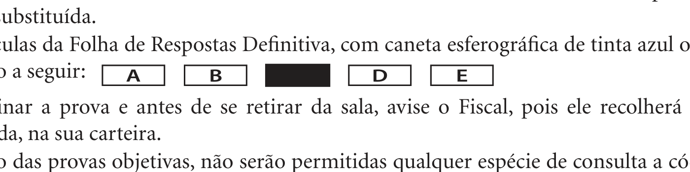
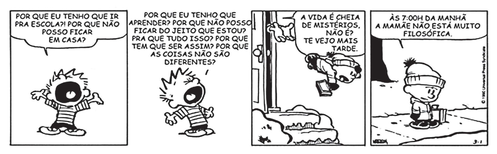
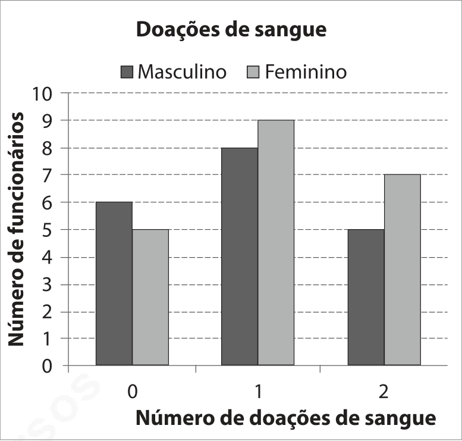
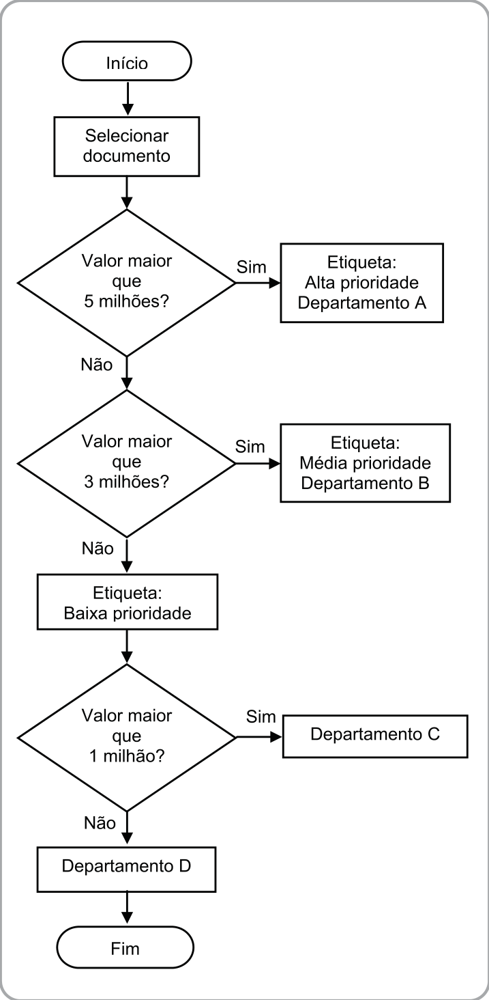
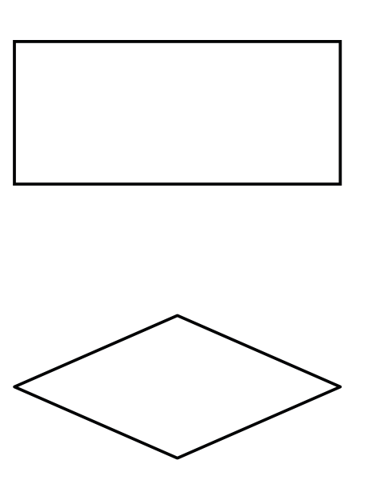
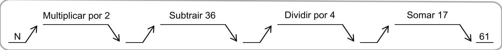

# PROVA — Camara_Cacapava_2015_Agente_Administrativo

## 1. Análise geral da prova

- **Identificação:** Câmara Municipal de Caçapava - SP - 2015 - Agente Administrativo (Concurso Público; prova aplicada em 08/02/2015; banca: Fundação FAT)
- **Quantidade total de questões:** 50
- **Divisão original do caderno:** Língua Portuguesa (questões 01 a 20), Matemática (21 a 35), Noções de Informática (36 a 50). A capa pode conter valores como “1 013” e “13o” exibidos exatamente como no original (espaçamento/ordinais preservados).
- **Quantidade de textos de apoio (grupos):** 4 (crônica “Filho pai”; carta de Machado de Assis; tirinha de Calvin; texto e gráfico das doações de sangue)
- **Materiais compartilhados:** 4 grupos; materiais individuais (música na questão 13; poema na questão 20; fluxograma na questão 21; tabela na questão 27; esquema na questão 30; sequência de figuras na questão 32; ícone de botão na questão 42)
- **Quantidade de imagens:** 13 (1 exemplo de preenchimento da capa; 1 tirinha; 1 fluxograma; 1 legenda de símbolos; 1 gráfico; 1 esquema; 1 sequência de figuras; 5 alternativas em figura da questão 32; 1 ícone de botão da questão 42)
- **Quantidade de gráficos e tabelas:** 1 gráfico (questões 23 a 26) e 1 tabela (questão 27); demais elementos visuais listados acima
- **Quantidade de grupos identificados:** 4
- **Quantidade de questões independentes:** 35
- **Questões que compartilham materiais:** crônica (01–04) → 01, 02, 03, 04; carta (10–12) → 10, 11, 12; tirinha (14–17) → 14, 15, 16, 17; gráfico (23–26) → 23, 24, 25, 26

**Gabarito oficial — Agente Administrativo (Edital de divulgação, aplicações de 08/02/2015):**

| Questão | Resposta | Questão | Resposta | Questão | Resposta | Questão | Resposta | Questão | Resposta |
|---|---|---|---|---|---|---|---|---|---|
| 01 | **A** | 02 | **C** | 03 | **E** | 04 | **D** | 05 | **B** |
| 06 | **D** | 07 | **E** | 08 | **C** | 09 | **E** | 10 | **A** |
| 11 | **B** | 12 | **D** | 13 | **B** | 14 | **D** | 15 | **D** |
| 16 | **C** | 17 | **E** | 18 | **B** | 19 | **E** | 20 | **C** |
| 21 | **D** | 22 | **A** | 23 | **D** | 24 | **B** | 25 | **D** |
| 26 | **E** | 27 | **C** | 28 | **B** | 29 | **C** | 30 | **E** |
| 31 | **B** | 32 | **A** | 33 | **D** | 34 | **C** | 35 | **E** |
| 36 | **D** | 37 | **B** | 38 | **C** | 39 | **D** | 40 | **E** |
| 41 | **E** | 42 | **C** | 43 | **A** | 44 | **B** | 45 | **E** |
| 46 | **D** | 47 | **A** | 48 | **E** | 49 | **A** | 50 | **C** |

### Transcrição integral da capa/instruções (conforme extraída do PDF)

> [!NOTE]
> Conteúdo integral das páginas anteriores à primeira questão, sem cortes.

> CONCURSO PÚBLICO
> CÂMARA MUNICIPAL DE CAÇAPAVA
> (AGENTE ADMINISTRATIVO)
> Exame – Prova Objetiva: 08/02/2015 (domingo), às 13 h
> Caro(a) candidato(a):
> Antes de iniciar a prova, leia atentamente as instruções a seguir e aguarde a ordem do Fiscal para iniciar o Exame.
> 1. Este caderno contém 50 (cinquenta) questões em forma de teste.
> 2. A prova terá duração de 4 (quatro) horas.
> 3. Após o início do Exame, você somente poderá retirar-se da sala de aplicação da prova, depois de transcorrido o tempo de 50% (cinquenta por cento) da duração da prova, levando consigo o Caderno de Questões.
> 4. Você receberá do Fiscal a Folha de Respostas Definitiva e o Caderno de Questões. Confira se na Folha de Respostas Definitiva consta o seu nome completo. Caso contrário, notifique o Fiscal, imediatamente.
> 5. Após certificar-se de que a Folha de Respostas Definitiva é sua, assine-a com caneta esferográfica de tinta azul ou preta, no local em que há a indicação: “ASSINATURA DO(A) CANDIDATO(A)”.
> 6. Após o recebimento da Folha de Respostas Definitiva, não a dobre e nem a amasse, manipulando-a o mínimo possível.
> 7. Os espaços em branco contidos neste Caderno de Questões poderão ser utilizados para rascunho.
> 8. Transcreva todas as alternativas assinaladas para a Folha de Respostas Definitiva, utilizando caneta esferográfica de tinta azul ou preta.
> 9. Questões com mais de uma alternativa assinalada, rasurada ou em branco serão anuladas, portanto evite erros, pois a Folha de Respostas não será substituída.
> 10. Preencha as quadrículas da Folha de Respostas Definitiva, com caneta esferográfica de tinta azul ou preta e com traço forte e cheio, conforme o exemplo a seguir:
>
> 
>
> 11. Quando você terminar a prova e antes de se retirar da sala, avise o Fiscal, pois ele recolherá a Folha de Respostas Definitiva, devidamente assinada, na sua carteira.
> 12. Durante a realização das provas objetivas, não serão permitidas qualquer espécie de consulta a códigos, livros, manuais, impressos, anotações e/ou outro tipo de pesquisa, utilização de outro material não fornecido pela Fundação FAT, de relógio, telefone celular ou qualquer equipamento eletrônico, protetor auricular, boné, gorro, chapéu e óculos de sol.
> 13. O Candidato deverá manter o celular totalmente desligado durante todo o período em que estiver no prédio em que realizar a prova, inclusive sem a possibilidade de emissão de alarme sonoro, devendo permanecer desligado até a saída do prédio.
> 14. O desrespeito às normas que regem o presente Concurso Público bem como a desobediência às exigências registradas no respectivo Edital, além de sanções legais cabíveis, implicam a desclassificação do candidato.
> 15. Será excluído do Concurso Público o candidato que:
> • não comparecer às provas objetiva e ou prática, conforme convocação oficial, publicada na Imprensa Oficial do Município, seja qual for o motivo alegado;
> • apresentar-se fora de local, sala, turma, data e/ou do horário estabelecidos no Edital de Convocação;
> • não apresentar o documento de identificação conforme o previsto na alínea “b” do item 5 do Capítulo V do Edital de Abertura;
> • ausentar-se, durante o processo, da sala ou do local de prova(s) sem o acompanhamento de um fiscal;
> • estiver, durante a aplicação da(s) prova(s), fazendo uso de calculadora, relógio com calculadora e/ou agenda eletrônica ou similar;
> • estiver, no local de prova(s), portanto qualquer equipamento eletrônico e/ou sonoro e/ou de comunicação ligados;
> • for surpreendido em comunicação com outro candidato ou terceiros, verbalmente ou por escrito, bem como fazendo uso de material não permitido para a realização das provas;
> • lançar meios ilícitos para a realização das provas;
> • não devolver ao fiscal qualquer material de aplicação das provas, fornecido pela Fundação FAT;
> • estiver portando arma, ainda que possua o respectivo porte;
> • durante o processo, não atender a quaisquer das disposições estabelecidas no Edital de Abertura;
> • perturbar, de qualquer modo, a ordem dos trabalhos;
> • agir com incorreção ou descortesia para com qualquer membro da equipe encarregada da aplicação das provas;
> • retirar-se do local de prova(s) antes de decorrido o tempo mínimo de permanência.
> 16. Aguardem a ordem do fiscal para iniciar o Exame.
> BOA PROVA!
>
> CADERNO DE QUESTÕES
> Nome do(a) candidato(a): ________________________________________________________ Nº de inscrição: _______________________
>
> Gabarito oficial
> O gabarito oficial da prova será divulgado a partir do dia 10/02/2015, no site www.fundacaofat.org.br
> Divulgação do resultado da Prova Objetiva
> O resultado da Prova Objetiva será divulgado, oportunamente no site www.fundacaofat.org.br

## 2. Questões agrupadas

### GRUPO 01 — Crônica “Filho pai” (Walcyr Carrasco), compartilhada pelas questões 01 a 04

**Questões relacionadas:** 01, 02, 03 e 04.

#### QUESTÃO 01

✅ **Gabarito: A** (gabarito oficial pareado — cargo AGENTE ADMINISTRATIVO)

**Material de apoio:**

Leia a crônica a seguir para responder às questões de números 01 a 04.

Filho pai

(Walcyr Carrasco)

Quando eu tinha pouco mais de 20 anos, morava com minha família em um pequeno sobrado de vila. Meu pai era ferroviário. Minha mãe se dedicava a bicos, como vender roupas feitas ou blusas de lã que ela mesma tricotava. Eu estudava e contribuía para parte das despesas trabalhando aqui e ali. Não havia luxos, mas o dia-a-dia era relativamente confortável. Na época eu não seria capaz de avaliar a contribuição que meu pai dera à minha vida. Minha carreira de jornalista e escritor ainda engatinhava. O estímulo para que eu estudasse, os livros que ganhara ao longo dos anos, o curso de inglês, a máquina de escrever, tudo isso me parecia obrigação. Pelo contrário. Eu me ressentia dos modos autoritários de papai. De sua braveza. E também de suas parcas condições financeiras. Observava meus amigos bem de vida, alguns ricos. Achava que ele, pai, poderia ter ganho mais dinheiro. Eu também sentia dificuldade em conversar abertamente. Havia uma espécie de muro entre nós dois.

Sua mãe, minha avó, vendeu a casinha no interior. O dinheiro acabou rapidamente. Ela veio morar conosco. Logo teve um pequeno derrame. Fosse por isso ou por alguma outra doença, perdeu o juízo. De repente, a vovó que adorava fazer doces tornou-se uma pessoa furiosa. Dizia coisas horrendas. Pior. Parecia ter desenvolvido uma sensibilidade especial para atingir o ponto fraco de cada um. Um psicanalista teria feito uma tese com suas frases, tal a súbita argúcia para alardear velhos ressentimentos, mágoas escondidas, tensões ocultas. Não me poupou: acusava-me de não me dar bem com meu pai. Eu me sentia culpado ao ouvi-la, pois acreditava que ele me devia mais carinho, mais cuidados, mais confortos.

Pior era com mamãe. Nunca se deram bem. Fora uma torturada relação entre nora e sogra. Agora vovó levava minha mãe às lagrimas algumas vezes por dia. A situação era ruim. Tornou-se insustentável quando ela passou a ameaçar mamãe fisicamente. Descobrimos uma espécie de estilete escondido entre seus objetos pessoais.

Hoje teria sido possível a contratação de uma enfermeira. Na época, nem podíamos oferecer-lhe um quarto. Eu dormia na sala. Ela dividia um aposento com meu irmão menor. Só havia uma solução. Interná-la em uma casa de saúde.

Meu irmão mais velho, já casado, escolheu uma que parecia adequada, embora modesta. (Ao longo dos anos seguintes, trocamos de lugar várias vezes, quando constatávamos deficiências.) Todos os netos se cotizaram para pagar a mensalidade. Em um sábado, meu irmão veio com o carro. Vovó pareceu ter percebido alguma coisa, apesar de nada ter sido explicado. Gritou:

— Não quero ir!

Foi preciso alguma firmeza para convencê-la a entrar no automóvel. Meu pai assistiu a toda a cena da sala. Fiquei com ele, enquanto levavam vovó. Fechei a porta. Ouvimos o motor, a partida. Houve um silêncio.

Papai subiu as escadas lentamente. Senti um nó na garganta. Fui atrás. Ele atirou-se na cama de casal. Chorou. Pela primeira vez em toda a minha vida, eu via meu pai chorar. Um choro convulsivo, com soluços, o peito estremecendo. Debrucei-me sobre ele. Abracei-o.

— Não chora, pai. Não chora!

Permaneci com meu pai nos braços. O muro serompeu. Percebi que há um momento na vida em que o pai se torna filho e o filho, pai. Agora era minha vez de cuidar dele. Abracei-o mais fortemente, oferecendo reservas de sentimento guardadas. Descobri, então, como era profundo meu amor por papai, e como eu estava disposto a fazer o impossível para que ele não sofresse tanto.

(http://vejasp.abril.com.br/materia/filho-pai. Acesso em 08.12.14)

**Enunciado:**

Considerando as informações presentes nessa crônica, é correto afirmar que o narrador ressentia-se de

**Alternativas:**

A) o pai ser autoritário e bravo com ele.
B) a mãe ser autoritária e injusta com a avó.
C) o pai sempre tratar os irmãos mais velhos melhor.
D) não ter estudado numa universidade importante.
E) o pai não ter lhe dado todas as condições de estudar.

#### QUESTÃO 02

✅ **Gabarito: C** (gabarito oficial pareado — cargo AGENTE ADMINISTRATIVO)

**Material de apoio:**

Leia a crônica a seguir para responder às questões de números 01 a 04.

Filho pai

(Walcyr Carrasco)

Quando eu tinha pouco mais de 20 anos, morava com minha família em um pequeno sobrado de vila. Meu pai era ferroviário. Minha mãe se dedicava a bicos, como vender roupas feitas ou blusas de lã que ela mesma tricotava. Eu estudava e contribuía para parte das despesas trabalhando aqui e ali. Não havia luxos, mas o dia-a-dia era relativamente confortável. Na época eu não seria capaz de avaliar a contribuição que meu pai dera à minha vida. Minha carreira de jornalista e escritor ainda engatinhava. O estímulo para que eu estudasse, os livros que ganhara ao longo dos anos, o curso de inglês, a máquina de escrever, tudo isso me parecia obrigação. Pelo contrário. Eu me ressentia dos modos autoritários de papai. De sua braveza. E também de suas parcas condições financeiras. Observava meus amigos bem de vida, alguns ricos. Achava que ele, pai, poderia ter ganho mais dinheiro. Eu também sentia dificuldade em conversar abertamente. Havia uma espécie de muro entre nós dois.

Sua mãe, minha avó, vendeu a casinha no interior. O dinheiro acabou rapidamente. Ela veio morar conosco. Logo teve um pequeno derrame. Fosse por isso ou por alguma outra doença, perdeu o juízo. De repente, a vovó que adorava fazer doces tornou-se uma pessoa furiosa. Dizia coisas horrendas. Pior. Parecia ter desenvolvido uma sensibilidade especial para atingir o ponto fraco de cada um. Um psicanalista teria feito uma tese com suas frases, tal a súbita argúcia para alardear velhos ressentimentos, mágoas escondidas, tensões ocultas. Não me poupou: acusava-me de não me dar bem com meu pai. Eu me sentia culpado ao ouvi-la, pois acreditava que ele me devia mais carinho, mais cuidados, mais confortos.

Pior era com mamãe. Nunca se deram bem. Fora uma torturada relação entre nora e sogra. Agora vovó levava minha mãe às lagrimas algumas vezes por dia. A situação era ruim. Tornou-se insustentável quando ela passou a ameaçar mamãe fisicamente. Descobrimos uma espécie de estilete escondido entre seus objetos pessoais.

Hoje teria sido possível a contratação de uma enfermeira. Na época, nem podíamos oferecer-lhe um quarto. Eu dormia na sala. Ela dividia um aposento com meu irmão menor. Só havia uma solução. Interná-la em uma casa de saúde.

Meu irmão mais velho, já casado, escolheu uma que parecia adequada, embora modesta. (Ao longo dos anos seguintes, trocamos de lugar várias vezes, quando constatávamos deficiências.) Todos os netos se cotizaram para pagar a mensalidade. Em um sábado, meu irmão veio com o carro. Vovó pareceu ter percebido alguma coisa, apesar de nada ter sido explicado. Gritou:

— Não quero ir!

Foi preciso alguma firmeza para convencê-la a entrar no automóvel. Meu pai assistiu a toda a cena da sala. Fiquei com ele, enquanto levavam vovó. Fechei a porta. Ouvimos o motor, a partida. Houve um silêncio.

Papai subiu as escadas lentamente. Senti um nó na garganta. Fui atrás. Ele atirou-se na cama de casal. Chorou. Pela primeira vez em toda a minha vida, eu via meu pai chorar. Um choro convulsivo, com soluços, o peito estremecendo. Debrucei-me sobre ele. Abracei-o.

— Não chora, pai. Não chora!

Permaneci com meu pai nos braços. O muro serompeu. Percebi que há um momento na vida em que o pai se torna filho e o filho, pai. Agora era minha vez de cuidar dele. Abracei-o mais fortemente, oferecendo reservas de sentimento guardadas. Descobri, então, como era profundo meu amor por papai, e como eu estava disposto a fazer o impossível para que ele não sofresse tanto.

(http://vejasp.abril.com.br/materia/filho-pai. Acesso em 08.12.14)

**Enunciado:**

O narrador, nessa crônica, afirma que o relacionamento entre a avó e a mãe

**Alternativas:**

A) sempre foi saudável, cheio de amor, de afeto e de compreensão.
B) passou a ser desagradável, depois da doença da mãe dele.
C) sempre foi complicado, torturador, sofrido e desagradável.
D) sempre foi cheio de felicidade, de comunhão e de fraternidade.
E) passou a ser harmonioso, depois da enfermidade da avó.

#### QUESTÃO 03

✅ **Gabarito: E** (gabarito oficial pareado — cargo AGENTE ADMINISTRATIVO)

**Material de apoio:**

Leia a crônica a seguir para responder às questões de números 01 a 04.

Filho pai

(Walcyr Carrasco)

Quando eu tinha pouco mais de 20 anos, morava com minha família em um pequeno sobrado de vila. Meu pai era ferroviário. Minha mãe se dedicava a bicos, como vender roupas feitas ou blusas de lã que ela mesma tricotava. Eu estudava e contribuía para parte das despesas trabalhando aqui e ali. Não havia luxos, mas o dia-a-dia era relativamente confortável. Na época eu não seria capaz de avaliar a contribuição que meu pai dera à minha vida. Minha carreira de jornalista e escritor ainda engatinhava. O estímulo para que eu estudasse, os livros que ganhara ao longo dos anos, o curso de inglês, a máquina de escrever, tudo isso me parecia obrigação. Pelo contrário. Eu me ressentia dos modos autoritários de papai. De sua braveza. E também de suas parcas condições financeiras. Observava meus amigos bem de vida, alguns ricos. Achava que ele, pai, poderia ter ganho mais dinheiro. Eu também sentia dificuldade em conversar abertamente. Havia uma espécie de muro entre nós dois.

Sua mãe, minha avó, vendeu a casinha no interior. O dinheiro acabou rapidamente. Ela veio morar conosco. Logo teve um pequeno derrame. Fosse por isso ou por alguma outra doença, perdeu o juízo. De repente, a vovó que adorava fazer doces tornou-se uma pessoa furiosa. Dizia coisas horrendas. Pior. Parecia ter desenvolvido uma sensibilidade especial para atingir o ponto fraco de cada um. Um psicanalista teria feito uma tese com suas frases, tal a súbita argúcia para alardear velhos ressentimentos, mágoas escondidas, tensões ocultas. Não me poupou: acusava-me de não me dar bem com meu pai. Eu me sentia culpado ao ouvi-la, pois acreditava que ele me devia mais carinho, mais cuidados, mais confortos.

Pior era com mamãe. Nunca se deram bem. Fora uma torturada relação entre nora e sogra. Agora vovó levava minha mãe às lagrimas algumas vezes por dia. A situação era ruim. Tornou-se insustentável quando ela passou a ameaçar mamãe fisicamente. Descobrimos uma espécie de estilete escondido entre seus objetos pessoais.

Hoje teria sido possível a contratação de uma enfermeira. Na época, nem podíamos oferecer-lhe um quarto. Eu dormia na sala. Ela dividia um aposento com meu irmão menor. Só havia uma solução. Interná-la em uma casa de saúde.

Meu irmão mais velho, já casado, escolheu uma que parecia adequada, embora modesta. (Ao longo dos anos seguintes, trocamos de lugar várias vezes, quando constatávamos deficiências.) Todos os netos se cotizaram para pagar a mensalidade. Em um sábado, meu irmão veio com o carro. Vovó pareceu ter percebido alguma coisa, apesar de nada ter sido explicado. Gritou:

— Não quero ir!

Foi preciso alguma firmeza para convencê-la a entrar no automóvel. Meu pai assistiu a toda a cena da sala. Fiquei com ele, enquanto levavam vovó. Fechei a porta. Ouvimos o motor, a partida. Houve um silêncio.

Papai subiu as escadas lentamente. Senti um nó na garganta. Fui atrás. Ele atirou-se na cama de casal. Chorou. Pela primeira vez em toda a minha vida, eu via meu pai chorar. Um choro convulsivo, com soluços, o peito estremecendo. Debrucei-me sobre ele. Abracei-o.

— Não chora, pai. Não chora!

Permaneci com meu pai nos braços. O muro serompeu. Percebi que há um momento na vida em que o pai se torna filho e o filho, pai. Agora era minha vez de cuidar dele. Abracei-o mais fortemente, oferecendo reservas de sentimento guardadas. Descobri, então, como era profundo meu amor por papai, e como eu estava disposto a fazer o impossível para que ele não sofresse tanto.

(http://vejasp.abril.com.br/materia/filho-pai. Acesso em 08.12.14)

**Enunciado:**

O título dessa crônica estabelece uma relação com o texto, no momento em que o narrador consola

**Alternativas:**

A) o pai dele que sofria ao ver a esposa sendo levada para uma casa de saúde.
B) a mãe dele que sofria ao ver a avó sendo levada para uma casa de saúde.
C) o pai dele que sofria e não aceitava ser internado em uma casa de saúde.
D) a avó dele que sofria e chorava, ao ver o filho ser levado para uma casa de saúde.
E) o pai dele que sofria, ao ver a mãe sendo levada para uma casa de saúde.

#### QUESTÃO 04

✅ **Gabarito: D** (gabarito oficial pareado — cargo AGENTE ADMINISTRATIVO)

**Material de apoio:**

Leia a crônica a seguir para responder às questões de números 01 a 04.

Filho pai

(Walcyr Carrasco)

Quando eu tinha pouco mais de 20 anos, morava com minha família em um pequeno sobrado de vila. Meu pai era ferroviário. Minha mãe se dedicava a bicos, como vender roupas feitas ou blusas de lã que ela mesma tricotava. Eu estudava e contribuía para parte das despesas trabalhando aqui e ali. Não havia luxos, mas o dia-a-dia era relativamente confortável. Na época eu não seria capaz de avaliar a contribuição que meu pai dera à minha vida. Minha carreira de jornalista e escritor ainda engatinhava. O estímulo para que eu estudasse, os livros que ganhara ao longo dos anos, o curso de inglês, a máquina de escrever, tudo isso me parecia obrigação. Pelo contrário. Eu me ressentia dos modos autoritários de papai. De sua braveza. E também de suas parcas condições financeiras. Observava meus amigos bem de vida, alguns ricos. Achava que ele, pai, poderia ter ganho mais dinheiro. Eu também sentia dificuldade em conversar abertamente. Havia uma espécie de muro entre nós dois.

Sua mãe, minha avó, vendeu a casinha no interior. O dinheiro acabou rapidamente. Ela veio morar conosco. Logo teve um pequeno derrame. Fosse por isso ou por alguma outra doença, perdeu o juízo. De repente, a vovó que adorava fazer doces tornou-se uma pessoa furiosa. Dizia coisas horrendas. Pior. Parecia ter desenvolvido uma sensibilidade especial para atingir o ponto fraco de cada um. Um psicanalista teria feito uma tese com suas frases, tal a súbita argúcia para alardear velhos ressentimentos, mágoas escondidas, tensões ocultas. Não me poupou: acusava-me de não me dar bem com meu pai. Eu me sentia culpado ao ouvi-la, pois acreditava que ele me devia mais carinho, mais cuidados, mais confortos.

Pior era com mamãe. Nunca se deram bem. Fora uma torturada relação entre nora e sogra. Agora vovó levava minha mãe às lagrimas algumas vezes por dia. A situação era ruim. Tornou-se insustentável quando ela passou a ameaçar mamãe fisicamente. Descobrimos uma espécie de estilete escondido entre seus objetos pessoais.

Hoje teria sido possível a contratação de uma enfermeira. Na época, nem podíamos oferecer-lhe um quarto. Eu dormia na sala. Ela dividia um aposento com meu irmão menor. Só havia uma solução. Interná-la em uma casa de saúde.

Meu irmão mais velho, já casado, escolheu uma que parecia adequada, embora modesta. (Ao longo dos anos seguintes, trocamos de lugar várias vezes, quando constatávamos deficiências.) Todos os netos se cotizaram para pagar a mensalidade. Em um sábado, meu irmão veio com o carro. Vovó pareceu ter percebido alguma coisa, apesar de nada ter sido explicado. Gritou:

— Não quero ir!

Foi preciso alguma firmeza para convencê-la a entrar no automóvel. Meu pai assistiu a toda a cena da sala. Fiquei com ele, enquanto levavam vovó. Fechei a porta. Ouvimos o motor, a partida. Houve um silêncio.

Papai subiu as escadas lentamente. Senti um nó na garganta. Fui atrás. Ele atirou-se na cama de casal. Chorou. Pela primeira vez em toda a minha vida, eu via meu pai chorar. Um choro convulsivo, com soluços, o peito estremecendo. Debrucei-me sobre ele. Abracei-o.

— Não chora, pai. Não chora!

Permaneci com meu pai nos braços. O muro serompeu. Percebi que há um momento na vida em que o pai se torna filho e o filho, pai. Agora era minha vez de cuidar dele. Abracei-o mais fortemente, oferecendo reservas de sentimento guardadas. Descobri, então, como era profundo meu amor por papai, e como eu estava disposto a fazer o impossível para que ele não sofresse tanto.

(http://vejasp.abril.com.br/materia/filho-pai. Acesso em 08.12.14)

**Enunciado:**

“Havia uma espécie de muro entre nós dois.”

Com essa declaração, o narrador enfatiza

**Alternativas:**

A) a dificuldade de relacionamento que havia entre a avó e o resto da família.
B) a dificuldade de relacionamento que havia entre ele e a avó.
C) a dificuldade de relacionamento que havia entre ele e a mãe.
D) a dificuldade de relacionamento que havia entre ele e o pai.
E) a dificuldade de relacionamento que havia entre ele e os irmãos.

### GRUPO 02 — Carta de Machado de Assis, compartilhada pelas questões 10 a 12

**Questões relacionadas:** 10, 11 e 12.

#### QUESTÃO 10

✅ **Gabarito: A** (gabarito oficial pareado — cargo AGENTE ADMINISTRATIVO)

**Material de apoio:**

Para responder às questões de números 10 a 12, leia um trecho de uma das cartas que Machado de Assis enviou à esposa dele.

Minha querida C.

Recebi **ontem** duas cartas tuas, **depois de dois dias de espera**. Calcula o prazer que tive, como as li, reli e beijei! A minha tristeza converteu-se em súbita alegria. Eu estava tão aflito por ter notícias tuas que saí **do Diário à uma hora** para ir à **casa** e com efeito encontrei as duas cartas, uma das quais devera ter vindo antes, mas que, sem dúvida, por causa do correio foi demorada. (...)

(http://conversandocommachado.blogspot.com.br/2008/01/minha-querida-carolina.html. acesso em 13.12.2014. Adaptado)

**Enunciado:**

O verbo *calcular*, nesse trecho, foi empregado no modo

**Alternativas:**

A) imperativo afirmativo, segunda pessoa do singular.
B) imperativo afirmativo, terceira pessoa do singular.
C) imperativo afirmativo, segunda pessoa do plural.
D) subjuntivo afirmativo, segunda pessoa do singular.
E) subjuntivo afirmativo, segunda pessoa do plural.

#### QUESTÃO 11

✅ **Gabarito: B** (gabarito oficial pareado — cargo AGENTE ADMINISTRATIVO)

**Material de apoio:**

Para responder às questões de números 10 a 12, leia um trecho de uma das cartas que Machado de Assis enviou à esposa dele.

Minha querida C.

Recebi **ontem** duas cartas tuas, **depois de dois dias de espera**. Calcula o prazer que tive, como as li, reli e beijei! A minha tristeza converteu-se em súbita alegria. Eu estava tão aflito por ter notícias tuas que saí **do Diário à uma hora** para ir à **casa** e com efeito encontrei as duas cartas, uma das quais devera ter vindo antes, mas que, sem dúvida, por causa do correio foi demorada. (...)

(http://conversandocommachado.blogspot.com.br/2008/01/minha-querida-carolina.html. acesso em 13.12.2014. Adaptado)

**Enunciado:**

Nesse fragmento da carta, a expressão “Minha querida C.” exerce a função de

**Alternativas:**

A) predicado.
B) vocativo.
C) advérbio.
D) sujeito.
E) aposto.

#### QUESTÃO 12

✅ **Gabarito: D** (gabarito oficial pareado — cargo AGENTE ADMINISTRATIVO)

**Material de apoio:**

Para responder às questões de números 10 a 12, leia um trecho de uma das cartas que Machado de Assis enviou à esposa dele.

Minha querida C.

Recebi **ontem** duas cartas tuas, **depois de dois dias de espera**. Calcula o prazer que tive, como as li, reli e beijei! A minha tristeza converteu-se em súbita alegria. Eu estava tão aflito por ter notícias tuas que saí **do Diário à uma hora** para ir à **casa** e com efeito encontrei as duas cartas, uma das quais devera ter vindo antes, mas que, sem dúvida, por causa do correio foi demorada. (...)

(http://conversandocommachado.blogspot.com.br/2008/01/minha-querida-carolina.html. acesso em 13.12.2014. Adaptado)

**Enunciado:**

Os termos destacados nesse trecho da carta são classificados sintaticamente como

**Alternativas:**

A) adjuntos adverbiais de lugar e modo.
B) adjuntos adverbiais de modo e causa.
C) adjuntos adverbiais de tempo e modo.
D) adjuntos adverbiais de tempo e lugar.
E) adjuntos adverbiais de tempo e causa.

### GRUPO 03 — Tirinha de Calvin, compartilhada pelas questões 14 a 17

**Questões relacionadas:** 14, 15, 16 e 17.

#### QUESTÃO 14

✅ **Gabarito: D** (gabarito oficial pareado — cargo AGENTE ADMINISTRATIVO)

**Material de apoio:**

Leia a tirinha a seguir para responder às questões de números 14 a 17.

(http://revistaescola.abril.com.br/lingua-portuguesa/coletaneas/calvin-seus-amigos-428892.shtml. Acesso em 13.12.2014)

**Enunciado:**

As preposições *pra* (para), *em*, e *da* apresentadas nos quadrinhos acima, exercem os respectivos valores semânticos:

**Alternativas:**

A) finalidade, tempo e tempo.
B) finalidade, lugar e tempo.
C) lugar, tempo e tempo.
D) lugar, lugar e tempo.
E) lugar, tempo e lugar.

**Referências visuais:**

#### QUESTÃO 15

✅ **Gabarito: D** (gabarito oficial pareado — cargo AGENTE ADMINISTRATIVO)

**Material de apoio:**

Leia a tirinha a seguir para responder às questões de números 14 a 17.

(http://revistaescola.abril.com.br/lingua-portuguesa/coletaneas/calvin-seus-amigos-428892.shtml. Acesso em 13.12.2014)

**Enunciado:**

Na expressão exposta no terceiro quadrinho “*Te* vejo mais tarde.”, o pronome destacado exerce a função sintática de

**Alternativas:**

A) aposto.
B) vocativo.
C) predicativo.
D) objeto direto.
E) objeto indireto.

**Referências visuais:**

#### QUESTÃO 16

✅ **Gabarito: C** (gabarito oficial pareado — cargo AGENTE ADMINISTRATIVO)

**Material de apoio:**

Leia a tirinha a seguir para responder às questões de números 14 a 17.

(http://revistaescola.abril.com.br/lingua-portuguesa/coletaneas/calvin-seus-amigos-428892.shtml. Acesso em 13.12.2014)

**Enunciado:**

A oração “Te vejo mais tarde.” foi empregada na forma coloquial. Ao considerarmos a norma-padrão, podemos afirmar que

**Alternativas:**

A) a colocação pronominal está correta, pois a regra prática impede que se iniciem orações com pronomes oblíquos átonos.
B) a colocação pronominal está correta, pois a regra prática impede que se iniciem orações com pronomes pessoais do caso reto.
C) a colocação pronominal está incorreta, pois a regra prática impede que se iniciem orações com pronomes oblíquos átonos.
D) a colocação pronominal está incorreta, pois a regra prática impede que se iniciem orações com pronomes pessoais do caso reto.
E) a colocação pronominal está correta, pois a regra prática impede que se iniciem orações com pronomes de tratamento.

**Referências visuais:**

#### QUESTÃO 17

✅ **Gabarito: E** (gabarito oficial pareado — cargo AGENTE ADMINISTRATIVO)

**Material de apoio:**

Leia a tirinha a seguir para responder às questões de números 14 a 17.

(http://revistaescola.abril.com.br/lingua-portuguesa/coletaneas/calvin-seus-amigos-428892.shtml. Acesso em 13.12.2014)

**Enunciado:**

No terceiro quadrinho, há a expressão “A vida é cheia de *mistérios*”. O termo *mistérios* nessa frase, deve ser classificado sintaticamente como:

**Alternativas:**

A) predicativo do sujeito.
B) predicativo do objeto.
C) predicado nominal.
D) complemento verbal.
E) complemento nominal.

**Referências visuais:**

### GRUPO 04 — Texto e gráfico “Doações de sangue” (número de doações de sangue, por sexo), compartilhados pelas questões 23 a 26

**Questões relacionadas:** 23, 24, 25 e 26.

#### QUESTÃO 23

✅ **Gabarito: D** (gabarito oficial pareado — cargo AGENTE ADMINISTRATIVO)

**Material de apoio:**

Leia o texto e considere o gráfico para responder às questões de números 23 a 26.

Numa empresa, realizou-se uma pesquisa sobre o número de funcionários que já doaram sangue. O gráfico apresenta o número de doações de sangue, por sexo.

**Enunciado:**

De acordo com os dados, o número de funcionários que responderam à pesquisa foi

**Alternativas:**

A) 22.
B) 30.
C) 34.
D) 40.
E) 46.

**Referências visuais:**

#### QUESTÃO 24

✅ **Gabarito: B** (gabarito oficial pareado — cargo AGENTE ADMINISTRATIVO)

**Material de apoio:**

Leia o texto e considere o gráfico para responder às questões de números 23 a 26.

Numa empresa, realizou-se uma pesquisa sobre o número de funcionários que já doaram sangue. O gráfico apresenta o número de doações de sangue, por sexo.

**Enunciado:**

Em relação aos funcionários dessa empresa, é correto afirmar que

**Alternativas:**

A) exatamente 5 do sexo feminino doaram sangue 2 vezes.
B) os do sexo feminino são os que mais doam sangue.
C) exatamente 16 doaram sangue uma única vez.
D) exatamente 12 nunca doaram sangue.
E) os do sexo masculino são maioria.

**Referências visuais:**

#### QUESTÃO 25

✅ **Gabarito: D** (gabarito oficial pareado — cargo AGENTE ADMINISTRATIVO)

**Material de apoio:**

Leia o texto e considere o gráfico para responder às questões de números 23 a 26.

Numa empresa, realizou-se uma pesquisa sobre o número de funcionários que já doaram sangue. O gráfico apresenta o número de doações de sangue, por sexo.

**Enunciado:**

Dos funcionários pesquisados dessa empresa, o percentual que corresponde ao sexo feminino é de

**Alternativas:**

A) 45,0%.
B) 47,5%.
C) 50,0%.
D) 52,5%.
E) 55,0%.

**Referências visuais:**

#### QUESTÃO 26

✅ **Gabarito: E** (gabarito oficial pareado — cargo AGENTE ADMINISTRATIVO)

**Material de apoio:**

Leia o texto e considere o gráfico para responder às questões de números 23 a 26.

Numa empresa, realizou-se uma pesquisa sobre o número de funcionários que já doaram sangue. O gráfico apresenta o número de doações de sangue, por sexo.

**Enunciado:**

Escolhendo um funcionário dessa empresa, ao acaso, a probabilidade de ele ter doado sangue pelo menos uma vez é

**Alternativas:**

A) A) 12/40.
B) B) 17/40.
C) C) 19/40.
D) D) 21/40.
E) E) 29/40.

**Referências visuais:**

## 3. Questões independentes

#### QUESTÃO 05

✅ **Gabarito: B** (gabarito oficial pareado — cargo AGENTE ADMINISTRATIVO)

**Enunciado:**

“... minha avó vendeu a casinha no interior.”

Ao passar essa oração para a voz passiva analítica teremos

**Alternativas:**

A) a casinha no interior era vendida pela minha avó.
B) a casinha no interior foi vendida pela minha avó.
C) a casinha no interior será vendida pela minha avó.
D) venderam-se a casinha no interior.
E) vendeu-se a casinha no interior.

#### QUESTÃO 06

✅ **Gabarito: D** (gabarito oficial pareado — cargo AGENTE ADMINISTRATIVO)

**Enunciado:**

Na oração “Meu pai era **ferroviário**.”, o termo destacado exerce a função sintática de

**Alternativas:**

A) objeto indireto, pois completa um verbo transitivo indireto.
B) objeto direto, pois completa um verbo transitivo direto.
C) complemento nominal, pois qualifica o substantivo pai.
D) predicativo do sujeito, pois especifica o sujeito.
E) sujeito, pois acompanha um verbo de ligação.

#### QUESTÃO 07

✅ **Gabarito: E** (gabarito oficial pareado — cargo AGENTE ADMINISTRATIVO)

**Enunciado:**

Assinale a alternativa que está acentuada corretamente.

**Alternativas:**

A) A cliente não concordou em colocar a rúbrica dela no contrato.
B) O substantivo é a palavra que da nome aos seres em geral.
C) Naquela partida não adiantava reclamar com o juíz.
D) Todas as especies de pássaros daquela região são protegidas.
E) Há uma linha muito tênue entre a razão e loucura.

#### QUESTÃO 08

✅ **Gabarito: C** (gabarito oficial pareado — cargo AGENTE ADMINISTRATIVO)

**Enunciado:**

Indique a expressão na qual a crase foi empregada corretamente.

**Alternativas:**

A) Na sexta-feira passada, tudo naquela loja estava à partir de dez reais.
B) Depois que implantaram as ciclovias, muita gente deixou de andar à pé.
C) Às vezes, no final da tarde, as saudades invadem o meu pobre coração.
D) Não sabemos quando nosso vice - presidente vai à Curitiba novamente.
E) Aprendemos ontem que andar à cavalo exige equilíbrio, domínio e força.

#### QUESTÃO 09

✅ **Gabarito: E** (gabarito oficial pareado — cargo AGENTE ADMINISTRATIVO)

**Enunciado:**

Entre os itens que seguem, marque aquele que corresponde ao correto emprego da grafia.

**Alternativas:**

A) O novo gerente não exitou em contratar um novo assistente de produção.
B) Nossa missão é formar cidadãos éticos e compromissados com a comunidade.
C) A diretoria informou-nos que todas as férias estão canceladas, sem excessões.
D) Todas as nossas viajens para o Nordeste foram embaladas por ritimos regionais.
E) Não está sendo fácil para o governo conscientizar a população sobre a escassez da água.

#### QUESTÃO 13

✅ **Gabarito: B** (gabarito oficial pareado — cargo AGENTE ADMINISTRATIVO)

**Material de apoio:**

“Procurei

Em todas as mulheres

A felicidade

Mas eu não encontrei

E fiquei na saudade

Foi começando bem

Mas tudo teve um fim (...)

(http://www.radio.uol.com.br/#/letras-e-musicas/martinho-da-vila/mulheres/2492446. Acesso em 08.12.14 - Adaptado)

**Enunciado:**

Leia o fragmento da música de Martinho da Vila e assinale a alternativa correta.

Nesse trecho da música, há a presença das seguintes conjunções

**Alternativas:**

A) coordenativa adversativa e coordenativa conclusiva.
B) coordenativa adversativa e coordenativa aditiva.
C) coordenativa adversativa e coordenativa explicativa.
D) coordenativa alternativa e coordenativa aditiva.
E) coordenativa alternativa e coordenativa adversativa.

#### QUESTÃO 18

✅ **Gabarito: B** (gabarito oficial pareado — cargo AGENTE ADMINISTRATIVO)

**Enunciado:**

A regência verbal foi corretamente empregada na alternativa

**Alternativas:**

A) A vizinha sempre namorou com aquele talentoso jogador.
B) Prefiro comer feijoada a um hambúrguer na lanchonete.
C) Assistimos, ontem, no shopping, o filme Jogos Vorazes.
D) Alguns motoristas não obedeceram as leis de trânsito.
E) Ele sempre se esquece as chaves do carro alegórico.

#### QUESTÃO 19

✅ **Gabarito: E** (gabarito oficial pareado — cargo AGENTE ADMINISTRATIVO)

**Enunciado:**

Indique a oração que apresenta a correta concordância nominal.

**Alternativas:**

A) É proibido a entrada de pessoas estranhas.
B) A miss agradeceu emocionada: - Muito obrigado.
C) Gastaremos menas água com essas providências.
D) O embarque de toda a diretoria será meio-dia e meio.
E) A moda neste verão é tênis, bermuda e camiseta brancos.

#### QUESTÃO 20

✅ **Gabarito: C** (gabarito oficial pareado — cargo AGENTE ADMINISTRATIVO)

**Material de apoio:**

Leia este fragmento do poema da escritora portuguesa Florbela Espanca, Fanatismo.

“Minh' alma, de sonhar-te, anda perdida

Meus olhos andam cegos de te ver

Não és sequer a razão do meu viver

pois que tu és já toda minha vida (...)”

(http://pensador.uol.com.br/poemas_de_amor_de_florbela_espanca/. Acesso em: 13.12.2014)

**Enunciado:**

Os dois últimos versos, nessa estrofe, apresentam como figura de linguagem

**Alternativas:**

A) eufemismo.
B) catacrese.
C) hipérbole.
D) sinestesia.
E) comparação.

#### QUESTÃO 21

✅ **Gabarito: D** (gabarito oficial pareado — cargo AGENTE ADMINISTRATIVO)

**Material de apoio:**

Em um escritório, um funcionário está encarregado de separar e classificar documentos, com valores expressos em reais, de acordo com um fluxograma que descreve, passo a passo, os procedimentos a serem executados, conforme figura.

Os símbolos usados no fluxograma têm os seguintes significados:

**Operação**

**Decisão** (testa uma condição, executando operações, caso essa condição seja verdadeira ou falsa)

**Enunciado:**

Segundo esse fluxograma, se o valor do documento é de 2,4 milhões de reais, então, ele recebe a etiqueta

**Alternativas:**

A) alta prioridade e será encaminhado para o departamento A.
B) média prioridade e será encaminhado para o departamento B.
C) média prioridade e será encaminhado para o departamento C.
D) baixa prioridade e será encaminhado para o departamento C.
E) baixa prioridade e será encaminhado para o departamento D.

**Referências visuais:**

#### QUESTÃO 22

✅ **Gabarito: A** (gabarito oficial pareado — cargo AGENTE ADMINISTRATIVO)

**Enunciado:**

Em uma pesquisa realizada com 1 013 trabalhadores, constatou-se que 68% deles pretendem gastar o 13o salário com dívidas já contraídas. Desses, 81% vão pagar os débitos contraídos com o cartão de crédito e com o cheque especial.

Nessas condições, o número desses trabalhadores que vai pagar a dívida contraída com o cartão de crédito e com o cheque especial é, aproximadamente,

**Alternativas:**

A) 558.
B) 600.
C) 756.
D) 840.
E) 928.

#### QUESTÃO 27

✅ **Gabarito: C** (gabarito oficial pareado — cargo AGENTE ADMINISTRATIVO)

**Enunciado:**

Pedro é revendedor de suco e, para organizar o seu negócio, preparou a tabela a seguir.

| Embalagem | Preço de compra/unidade | Preço de venda/unidade |
|---|---|---|
| 200 mL | R$ 0,90 | R$ 1,70 |
| 1 L | R$ 5,00 | R$ 7,40 |

Considere que, em uma determinada semana, Pedro vendeu, ao todo, 500 unidades dos dois tipos de embalagem e obteve um lucro de R$ 640,00.

Assim sendo, Pedro vendeu, exatamente,

**Alternativas:**

A) 250 unidades do suco de 200 mL.
B) 300 unidades do suco de 200 mL.
C) 350 unidades do suco de 200 mL.
D) 200 unidades do suco de 1 L.
E) 230 unidades do suco de 1 L.

#### QUESTÃO 28

✅ **Gabarito: B** (gabarito oficial pareado — cargo AGENTE ADMINISTRATIVO)

**Enunciado:**

No estoque de um escritório, o número de lapiseiras está para o número de canetas na razão de 1 para 3. Sabendo que o número de canetas supera o número de lapiseiras em 20 unidades, a quantidade de lapiseiras é

**Alternativas:**

A) 5.
B) 10.
C) 15.
D) 20.
E) 25.

#### QUESTÃO 29

✅ **Gabarito: C** (gabarito oficial pareado — cargo AGENTE ADMINISTRATIVO)

**Enunciado:**

Marcelo é prestador de serviço autônomo e recebeu R$ 4.500,00, trabalhando 8 horas por dia, durante 25 dias. Se Marcelo trabalhasse 10 horas por dia, durante N dias, ele receberia o mesmo valor.

Nessas condições, N é igual a

**Alternativas:**

A) 18.
B) 19.
C) 20.
D) 21.
E) 22.

#### QUESTÃO 30

✅ **Gabarito: E** (gabarito oficial pareado — cargo AGENTE ADMINISTRATIVO)

**Enunciado:**

No esquema a seguir, têm-se indicadas as operações sucessivas que devem ser efetuadas, a partir do número N, de modo que obtém-se como resultado final o número 61.

Logo, a soma dos algarismos de N é

**Alternativas:**

A) 11.
B) 10.
C) 9.
D) 8.
E) 7.

**Referências visuais:**

#### QUESTÃO 31

✅ **Gabarito: B** (gabarito oficial pareado — cargo AGENTE ADMINISTRATIVO)

**Enunciado:**

Os vestidos de Ana, Beth e Cátia são, não necessariamente nessa ordem, azul, roxo e amarelo. Um dos vestidos é curto; um tem comprimento médio e o outro é longo. O vestido de Ana é azul; o vestido de Beth é curto; o vestido de Cátia não é amarelo e não é longo.

Portanto, as cores dos vestidos curto, médio e longo são, respectivamente,

**Alternativas:**

A) amarelo, azul e roxo.
B) amarelo, roxo e azul.
C) azul, amarelo e roxo.
D) azul, roxo e amarelo.
E) roxo, azul e amarelo.

#### QUESTÃO 32

✅ **Gabarito: A** (gabarito oficial pareado — cargo AGENTE ADMINISTRATIVO)

**Material de apoio:**

Considere a sequência de figuras.

**Enunciado:**

A figura que substitui corretamente a interrogação é (alternativas apresentadas em figuras, conforme no original):

**Alternativas:**

A) 
B) 
C) 
D) 
E) 

**Referências visuais:**

#### QUESTÃO 33

✅ **Gabarito: D** (gabarito oficial pareado — cargo AGENTE ADMINISTRATIVO)

**Enunciado:**

Um capital de R$ 500,00 foi aplicado a juros simples à taxa mensal de 0,9%. Sabendo que o rendimento dessa aplicação foi de R$ 720,00, então, esse capital ficou aplicado por

**Alternativas:**

A) 100 meses.
B) 120 meses.
C) 140 meses.
D) 160 meses.
E) 180 meses.

#### QUESTÃO 34

✅ **Gabarito: C** (gabarito oficial pareado — cargo AGENTE ADMINISTRATIVO)

**Enunciado:**

O montante produzido por um capital de R$ 10.000,00, aplicado a juros compostos de taxa anual de 10%, durante três anos, é

**Alternativas:**

A) R$ 13.000,00.
B) R$ 13.200,00.
C) R$ 13.310,00.
D) R$ 13.450,00.
E) R$ 13.740,00.

#### QUESTÃO 35

✅ **Gabarito: E** (gabarito oficial pareado — cargo AGENTE ADMINISTRATIVO)

**Enunciado:**

Em uma empresa com 80 funcionários, sabe-se que: 15 praticam corrida em sua hora de folga, 55 são homens ou praticam corrida e 7 são mulheres que praticam corrida em sua hora de folga.

Nessas condições, sobre os funcionários dessa empresa, conclui-se que

**Alternativas:**

A) 40 são homens.
B) 30 são mulheres.
C) 10 são homens que praticam corrida.
D) 32 são homens que não praticam corrida.
E) 25 são mulheres que não praticam corrida.

#### QUESTÃO 36

✅ **Gabarito: D** (gabarito oficial pareado — cargo AGENTE ADMINISTRATIVO)

**Enunciado:**

Utilizando a configuração padrão do MS-Windows 7, qual das opções a seguir é a correta para gerenciar arquivos e pastas em um computador?

**Alternativas:**

A) MS-Word
B) MS-Excel
C) Bloco de Notas
D) Windows Explorer
E) Internet Explorer

#### QUESTÃO 37

✅ **Gabarito: B** (gabarito oficial pareado — cargo AGENTE ADMINISTRATIVO)

**Enunciado:**

Utilizando o MS-Windows 7, quando um arquivo é simplesmente excluído do disco rígido, o mesmo é movido para um local do computador. Qual o nome correto desse local?

**Alternativas:**

A) Desktop
B) Lixeira
C) Meu computador
D) Meus Documentos
E) Painel de Controle

#### QUESTÃO 38

✅ **Gabarito: C** (gabarito oficial pareado — cargo AGENTE ADMINISTRATIVO)

**Enunciado:**

Utilizando o MS-Windows 7, podemos renomear arquivos e/ou pastas. Das teclas mencionadas a seguir, qual permite a alteração do nome do arquivo e/ou pasta?

**Alternativas:**

A) F1
B) F3
C) F2
D) ALT+TAB
E) CTRL+Z

#### QUESTÃO 39

✅ **Gabarito: D** (gabarito oficial pareado — cargo AGENTE ADMINISTRATIVO)

**Enunciado:**

Utilizando o MS-WORD 2010, um usuário digitou 5 páginas de texto e resolveu imprimir apenas as páginas 1, 4 e 5. Ao acionar a opção de impressão, qual a simbologia correta para que somente as páginas citadas sejam impressas?

**Alternativas:**

A) 1-4
B) 1-4-5
C) 1:5
D) 1;4;5
E) 1 e 4 e 5

#### QUESTÃO 40

✅ **Gabarito: E** (gabarito oficial pareado — cargo AGENTE ADMINISTRATIVO)

**Enunciado:**

Utilizando o MS-WORD 2010, qual a função do botão Formatar Pincel?

**Alternativas:**

A) Recortar o texto selecionado.
B) Copiar o texto selecionado.
C) Abrir um novo documento.
D) Colar o texto selecionado.
E) Copiar a formatação de um texto e aplicar em outro.

#### QUESTÃO 41

✅ **Gabarito: E** (gabarito oficial pareado — cargo AGENTE ADMINISTRATIVO)

**Enunciado:**

Utilizando o MS-WORD 2010, existe uma combinação de teclas que posiciona o cursor no final do documento que está sendo utilizado. Qual é essa combinação?

**Alternativas:**

A) CTRL + X
B) CTRL + Home
C) ALT + T
D) CTRL + Num Lock
E) CTRL + End

#### QUESTÃO 42

✅ **Gabarito: C** (gabarito oficial pareado — cargo AGENTE ADMINISTRATIVO)

**Enunciado:**

Utilizando o MS-EXCEL 2010, na sua configuração padrão, qual é a função desse botão  ?

**Alternativas:**

A) Aumentar Casas Decimais
B) Estilo Porcentagem
C) Separador de Milhares
D) Formato Contábil
E) Mesclar números

**Referências visuais:**

#### QUESTÃO 43

✅ **Gabarito: A** (gabarito oficial pareado — cargo AGENTE ADMINISTRATIVO)

**Enunciado:**

Ao formatar numericamente uma célula no MS-EXCEL 2010, em sua configuração padrão, se aparecer “######” na referida célula, significa que

**Alternativas:**

A) Os números não cabem na célula e é necessário aumentar a largura da coluna.
B) O resultado do cálculo não está correto, e precisa ser corrigido.
C) A função escolhida não está sendo aplicada corretamente.
D) A célula não pode ser utilizada.
E) A planilha só pode ser alterada por meio da digitação de uma senha de acesso.

#### QUESTÃO 44

✅ **Gabarito: B** (gabarito oficial pareado — cargo AGENTE ADMINISTRATIVO)

**Enunciado:**

Utilizando o MS-EXCEL 2010, na sua configuração padrão, o que aparece na célula, se digitarmos a função =Agora()

**Alternativas:**

A) Aparece a data de hoje
B) Aparece o dia e a hora atual
C) Aparece o horário atual
D) Aparece a data de criação do arquivo
E) Aparece a soma dos números das células anteriores

#### QUESTÃO 45

✅ **Gabarito: E** (gabarito oficial pareado — cargo AGENTE ADMINISTRATIVO)

**Enunciado:**

Utilizando o MS-PowerPoint 2010, ao salvarmos o arquivo, a extensão padrão é

**Alternativas:**

A) .pdf
B) .docx
C) .html
D) .jpg
E) .pptx

#### QUESTÃO 46

✅ **Gabarito: D** (gabarito oficial pareado — cargo AGENTE ADMINISTRATIVO)

**Enunciado:**

Utilizando o MS-PowerPoint 2010, podemos criar botões de ação. Assim, quando clicarmos no botão ele, poderá executar algumas tarefas ou ações. Das alternativas a seguir, qual não pode ser aplicada a um botão de ação?

**Alternativas:**

A) Executar um programa.
B) Executar uma macro.
C) Tocar uma música.
D) Desligar o computador.
E) Acessar o Slide anterior.

#### QUESTÃO 47

✅ **Gabarito: A** (gabarito oficial pareado — cargo AGENTE ADMINISTRATIVO)

**Enunciado:**

Utilizando o MS-PowerPoint 2010, podemos animar texto, imagens e outros objetos da apresentação. Em qual guia podemos encontrar essas opções?

**Alternativas:**

A) Animações
B) Inserir
C) Design
D) Revisão
E) Exibição

#### QUESTÃO 48

✅ **Gabarito: E** (gabarito oficial pareado — cargo AGENTE ADMINISTRATIVO)

**Enunciado:**

É comum nos dias de hoje o envio de e-mail para amigos e pessoas em geral. Existe um símbolo obrigatório em todo endereço e-mail. Qual é ele?

**Alternativas:**

A) $
B) #
C) &
D) %
E) @

#### QUESTÃO 49

✅ **Gabarito: A** (gabarito oficial pareado — cargo AGENTE ADMINISTRATIVO)

**Enunciado:**

Para navegarmos pelas páginas da Internet, necessitamos de um programa navegador. Assinale a alternativa que apresenta um programa que não é um navegador.

**Alternativas:**

A) MS-ACCESS
B) Mozzilla Firefox
C) Internet Explorer
D) Google Chrome
E) Opera

#### QUESTÃO 50

✅ **Gabarito: C** (gabarito oficial pareado — cargo AGENTE ADMINISTRATIVO)

**Enunciado:**

O Google é uma poderosa ferramenta de busca que, além de nos auxiliar nas pesquisas, também é capaz de executar algumas funções. Dos itens a seguir qual o Google não é capaz de executar?

**Alternativas:**

A) Funcionar como uma calculadora.
B) Funcionar como um tradutor.
C) Funcionar como o sistema operacional do seu computador.
D) Localizar ruas e traçar rotas.
E) Buscar imagens.

## 4. Observações e limitações da extração

- Extração por texto selecionável do PDF (2 colunas, PyMuPDF) — a prova NÃO é escaneada, texto nativo íntegro.
- **Layout original:** prova em 2 colunas; o número de cada questão aparece em uma caixa na margem esquerda da coluna (não há a palavra “QUESTÃO”); na extração em coluna única esses números migraram de coluna (ex.: o “04” aparece junto ao enunciado da questão 01) — a numeração original 01–50 foi reconstruída e está preservada.
- **Numeros “fantasma” da fonte:** fragmentos “04”, “49” e “50” que vazaram entre colunas na extração foram descartados (são numerações de questões vizinhas, não conteúdo); o texto de cada questão foi cotejado com o PDF.
- Frações das alternativas da questão 26 foram apresentadas no original em formato empilhado; aqui estão em notação linear (ex.: 12/40).
- Destaques tipográficos (negrito/itálico) preservados: “ferroviário” (questão 06); termos da carta em negrito (questões 10–12); termos em itálico das questões 13–17.
- A prova original contém erros/norma de grafia próprios e foram mantidos integralmente, sem correção (ex.: “lagrimas” na crônica; “Mozzilla Firefox”, “juíz”, “excessões”, “viajens”, “ritimos”, “exitou”, “menas água”, “à pé”, “à partir”, “vice - presidente”, “no botão ele, poderá” e demais grafias das alternativas 07–09/18–19/46–49).
- Na questão 42, o ícone do botão do MS-Excel aparece inline no enunciado (imagem_012) e repetido em Referências visuais. Na questão 32, as alternativas A–E são figuras (imagem_007 a imagem_011), inseridas inline em cada alternativa e repetidas em Referências visuais.
- As quadrículas do exemplo de preenchimento da capa (item 10 das instruções) foram extraídas como imagem (imagem_013.png) e referenciadas na transcrição da capa; logos/marca-d’água da banca descartados conforme padrão do projeto.
- O documento contém ainda a FOLHA DE RESPOSTAS INTERMEDIÁRIAS (página 15 — modelo/instruções, não é questão) e uma página de contracapa (página 16) — conteúdo preservado na transcrição da capa.
- **Duplicidade de prova (banco):** verificado — não há registro prévio desta prova (Caçapava 2015) em `Provas MD/`; a Caçapava 2025 (também Funda??o FAT) é concurso distinto e foi publicada separadamente.
- **Duplicidade interna de questões:** conferida — não foram identificadas questões repetidas (mesmo enunciado) dentro da prova; textos citados repetidos (ex.: “Te vejo mais tarde.”) são materiais compartilhados das questões 14–17, não duplicidades.
- **Recorrência entre concursos:** não foram identificadas questões recorrentes com as demais provas do banco atual.
- O PDF contém ainda a FOLHA DE RESPOSTAS INTERMEDIÁRIAS (página 15) e a contracapa (página 16), replicadas na transcrição da capa e sem questões.
- Se houver divergência entre esta versão e o PDF original, vale o PDF original; corrija manualmente o Markdown.
