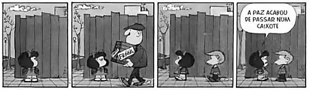
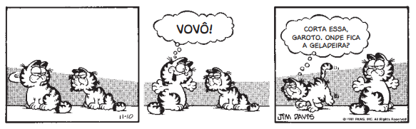
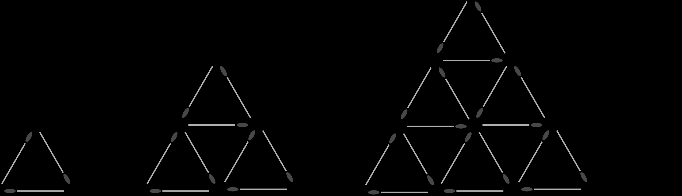

# PROVA — Camara_Cacapava_2025_Agente_Administrativo

## 1. Análise geral da prova

- **Identificação:** Camara_Cacapava_2025_Agente_Administrativo
- **Quantidade total de questões:** 40
- **Quantidade de textos de apoio (grupos):** 1
- **Quantidade de imagens:** 3
- **Quantidade de gráficos e tabelas:** incluídos nas imagens e no texto extraído, quando presentes no PDF original
- **Quantidade de grupos identificados:** 1
- **Quantidade de questões independentes:** 38
- **Questões que compartilham materiais:** texto-base das questões 01 a 02 → questões 01, 02

### Transcrição integral da capa/instruções (conforme extraída do PDF)

> [!NOTE]
> Conteúdo integral das páginas anteriores à primeira questão, sem cortes.

> AGENTE ADMINISTRATIVO
> Leia atentamente as instruções abaixo
>
>
>
> CADERNO DE QUESTÕES
> 1. PROVA E FOLHA DE RESPOSTAS
>
>  Além deste Caderno de Prova, contendo 40 (quarenta)
> questões objetivas, você receberá do Fiscal de Sala:
>
>  01 (uma) Folha de Respostas destinada às respostas das
> questões objetivas. Confira se seus dados estão corretos.
>
> 2. TEMPO
>
>  03 (três) horas é o tempo disponível para realização da
> prova, já incluído o tempo para marcação da Folha de
> Respostas da prova objetiva;
>
>  01 (uma) hora após o início da prova é possível, retirar-
> se da sala levando o caderno de prova;
>
> 3. INFORMAÇÕES GERAIS
>
>  As questões objetivas têm 05 (cinco) alternativas de
> resposta (A, B, C, D, E) e somente uma delas está correta;
>
>  Verifique se seu caderno está completo, sem repetição
> de questões ou falhas. Caso contrário, informe
> imediatamente o Fiscal da Sala, para que sejam tomadas
> as devidas providências;
>
>  Confira seus dados pessoais na Folha de Respostas,
> especialmente nome, número de inscrição e documento
> de identidade e leia atentamente as instruções para
> preenchimento;
>
>  O preenchimento das respostas da prova objetiva é de
> sua responsabilidade e não será permitida a troca de
> Folha de Respostas em caso de erro de marcação pelo
> candidato;
>  Marque, na folha de respostas, com caneta de tinta azul
> ou preta, a letra correspondente à alternativa que você
> escolheu.
>
>  Reserve tempo suficiente para o preenchimento de suas
> respostas. Para fins de avaliação, serão levadas em
> consideração apenas as marcações realizadas na Folha de
> Respostas da prova objetiva, não sendo permitido anotar
> informações relativas às respostas em qualquer outro
> meio que não seja o caderno de prova;
>
>  Ao se retirar, entregue a Folha de Respostas preenchida
> e assinada ao Fiscal de Sala.
>
> SERÁ ELIMINADO do presente certame o candidato que:
>
> a) for surpreendido, durante as provas, em qualquer tipo
> de comunicação com outro candidato;
>
> b) portar ou usar, qualquer tipo de aparelho eletrônico
> (calculadoras,
> bips/pagers,
> câmeras
> fotográficas,
> filmadoras, telefones celulares, smartphones, tablets,
> relógios, walkmans, MP3 players, fones de ouvido,
> agendas eletrônicas, notebooks, palmtops ou qualquer
> outro tipo de computador portátil, receptores ou
> gravadores) seja na sala de prova, sanitários, pátios ou
> qualquer outra dependência do local de prova;
>
> c) se ausentar da sala em que se realizam as provas
> levando consigo o Caderno de Questões e/ou a Folha de
> Respostas;
>
> d) se recusar a entregar a Folha de Respostas, quando
> terminar o tempo estabelecido;
>
> e) não assinar a Lista de Presença e/ou a Folha de
> Respostas.
> PROVA OBJETIVA
> CÂMARA MUNICIPAL DE CAÇAPAVA/SP
> CONCURSO PÚBLICO
> 01/2025
>
>
>
>
>
>
> Câmara Municipal de Caçapava – Concurso Público - 01/2025 INSTITUTO AVANÇA SÃO PAULO
> AGENTE ADMINISTRATIVO Página 2 de 13
> LÍNGUA PORTUGUESA
> TEXTO
> Leia a tirinha a seguir para responder às questões 1 e 2.
> Fonte: https://catracalivre.com.br/entretenimento/10-tirinhas-da-mafalda-que-se-levadas-a-serio-mudariam-o-mundo/

### Gabarito

| Questão | 01 | 02 | 03 | 04 | 05 |
|---|---|---|---|---|---|
| Resposta | D | A | D | C | B |

| Questão | 06 | 07 | 08 | 09 | 10 |
|---|---|---|---|---|---|
| Resposta | E | C | A | E | B |

| Questão | 11 | 12 | 13 | 14 | 15 |
|---|---|---|---|---|---|
| Resposta | E | E | C | A | C |

| Questão | 16 | 17 | 18 | 19 | 20 |
|---|---|---|---|---|---|
| Resposta | C | C | A | D | B |

| Questão | 21 | 22 | 23 | 24 | 25 |
|---|---|---|---|---|---|
| Resposta | D | C | D | C | A |

| Questão | 26 | 27 | 28 | 29 | 30 |
|---|---|---|---|---|---|
| Resposta | D | A | B | C | A |

| Questão | 31 | 32 | 33 | 34 | 35 |
|---|---|---|---|---|---|
| Resposta | B | A | E | D | D |

| Questão | 36 | 37 | 38 | 39 | 40 |
|---|---|---|---|---|---|
| Resposta | C | E | D | A | D |

## 2. Questões agrupadas

### GRUPO 01 — Texto-base compartilhado pelas questões 01 a 02

**Questões relacionadas:** 01, 02.

#### QUESTÃO 01

✅ **Gabarito: D** (gabarito oficial pareado — cargo AGENTE ADMINISTRATIVO)

**Material de apoio:**

Fonte: https://catracalivre.com.br/entretenimento/10-tirinhas-da-mafalda-que-se-levadas-a-serio-mudariam-o-mundo/

**Enunciado:**

Assinale a alternativa correta a respeito da tirinha de Mafalda:

**Alternativas:**

A) Mafalda acha que a paz deve ser evitada e, por isso, precisa ser escondida em uma caixa.
B) A paz é tão importante para Mafalda que ela mandou fechá-la numa caixa e colocar um aviso de
frágil, para nunca ser usada.
C) Apenas para fazer uma brincadeira com seu colega, Mafalda o faz acreditar que a paz é algo que
possa ser aprisionado num caixote.
D) Podemos entender, a partir da leitura, que Mafalda considera a paz como algo frágil, porque ela
diz que a paz passou num caixote e nesse caixote havia o aviso “FRÁGIL”.
E) Para Mafalda, a paz nunca pode ser acessada e é algo impossível de se obter, pois ela diz que a paz
está trancada em um caixote.

**Referências visuais:**

---

#### QUESTÃO 02

✅ **Gabarito: A** (gabarito oficial pareado — cargo AGENTE ADMINISTRATIVO)

**Material de apoio:**

Fonte: https://catracalivre.com.br/entretenimento/10-tirinhas-da-mafalda-que-se-levadas-a-serio-mudariam-o-mundo/

**Enunciado:**

Por que a frase “A paz acabou de passar num caixote” tem sentido figurado?

**Alternativas:**

A) A paz é algo abstrato e, como tal, não pode ser colocada dentro de um caixote.
B) Paz faz oposição ao termo “guerra”, que é um substantivo concreto e poderia estar numa caixa.
C) A palavra “paz” está sendo usada como figura de linguagem, pois na frase há comparação.
D) Caixote é uma hipérbole que remete à guerra.
E) Ao utilizar “acabou de passar”, a frase suscita a ideia de que a paz é algo atual.

**Referências visuais:**

---

## 3. Questões independentes

#### QUESTÃO 03

✅ **Gabarito: D** (gabarito oficial pareado — cargo AGENTE ADMINISTRATIVO)

**Enunciado:**

Marque a alternativa que preenche as lacunas a seguir conforme a correta regência verbal da língua
portuguesa:
“Ele deixou a janela aberta e foi __________ a rua sem melancolia, sem ódio, leve e satisfeito,
pensando __________ ir ao cinema ou fazer qualquer outra coisa que todo mundo faz, devolvido
__________ cotidiano – com as mãos nos bolsos e assoviando à maneira dos rapazes em toda parte.”.
(OLIVEIRA, José Carlos. A Árvore de Ouro. In: Os Olhos Dourados do Ódio, José Álvaro Editor, 1960. pp. 51-53.
Disponível em: https://cronicabrasileira.org.br/cronicas/14662/a-arvore-de-ouro)

**Alternativas:**

A) até – de – para
B) até – sobre – de
C) para – de – com
D) para – em – ao
E) a – em – no

**Referências visuais:**

Nenhuma.

---

#### QUESTÃO 04

✅ **Gabarito: C** (gabarito oficial pareado — cargo AGENTE ADMINISTRATIVO)

**Enunciado:**

Na tirinha de Garfield abaixo, quatro sinais de pontuação diferentes são utilizados. Assinale a
alternativa que explica correta e respectivamente cada um desses sinais:
Fonte:
https://www.lpm.com.br/site/default.asp?Template=../livros/layout_produto.asp&CategoriaID=645528&ID=927193

**Alternativas:**

A) Exclamação: aparece no fim de uma pergunta intercalada; vírgula: precede um resumo; ponto-
final: demonstra elipse de um termo; interrogação: indica mudança de interlocutor nos diálogos.
B) Exclamação: serve para sugerir a continuação de um fato; vírgula: indica chamamento; ponto-
final: usado na abreviatura; interrogação: isola frases intercaladas.
C) Exclamação: usada depois de frase exclamativa; vírgula: separa o vocativo; ponto-final: serve
para encerrar o período; interrogação: põe-se no fim da oração para indicar pergunta direta.
D) Exclamação: remete a uma explicação no rodapé da página; vírgula: separa adjuntos adverbiais;
ponto-final: sugere movimento; interrogação: substitui a vírgula depois de um vocativo enfático.
E) Exclamação: serve para grifar palavras estrangeiras; vírgula: separa orações coordenadas longas;
ponto-final: separa apostos; interrogação: aparece para indicar suspensão do pensamento.

**Referências visuais:**

---

#### QUESTÃO 05

✅ **Gabarito: B** (gabarito oficial pareado — cargo AGENTE ADMINISTRATIVO)

**Enunciado:**

Assinale a alternativa que apresenta concordância INCORRETA.

**Alternativas:**

A) As crianças dançaram juntas na apresentação
da escola.
B) Ganhou o torneio Sérgio, Paulo e Kléber.
C) Eles se arrependeram amargamente da
decisão que tomaram.
D) Silvana e Marlene apareceram de vestidos
azuis idênticos na festa.
E) Cobraram valores exorbitantes no hotel onde
ficamos.

**Referências visuais:**

Nenhuma.

---

#### QUESTÃO 06

✅ **Gabarito: E** (gabarito oficial pareado — cargo AGENTE ADMINISTRATIVO)

**Enunciado:**

O uso de crase na frase “Eles vão ao cinema
sempre, mas ao teatro, só às vezes.” está correto
porque ocorre crase diante de:

**Alternativas:**

A) palavra de sentido indefinido.
B) pronomes relativos.
C) verbo no infinitivo.
D) pronome pessoal e expressões de tratamento.
E) locuções
adverbiais
constituídas
de
substantivo feminino plural.

**Referências visuais:**

Nenhuma.

---

#### QUESTÃO 07

✅ **Gabarito: C** (gabarito oficial pareado — cargo AGENTE ADMINISTRATIVO)

**Enunciado:**

Leia as palavras a seguir e analise se estão
ortograficamente corretas.
I. Ferrujem
II. Anoitecer
III. Trouxe
Assinale a alternativa correta:

**Alternativas:**

A) I, II e III estão corretas.
B) Apenas I e II estão corretas.
C) Apenas II e III estão corretas.
D) Apenas I e III estão corretas.
E) Apenas III está correta.

**Referências visuais:**

Nenhuma.

---

#### QUESTÃO 08

✅ **Gabarito: A** (gabarito oficial pareado — cargo AGENTE ADMINISTRATIVO)

**Enunciado:**

Analise as frases abaixo a respeito das classes de
palavras e classifique-as em verdadeiro (V) ou
falso (F). Em seguida, marque a alternativa
correta.
( ) Eles se conhecem desde a época da escola –
a palavra em destaque classifica-se como
preposição.
( ) Elas estudam todas as tardes – a palavra
“estudam” é um verbo conjugado na terceira
pessoa do singular.
( ) A caneta falhou bem na hora da prova – o
termo destacado na frase é um substantivo
abstrato.
( ) Aquele é o senhor cuja esposa vende bolos
– a palavra destacada é um pronome relativo.

**Alternativas:**

A) V – F – F – V
B) V – V – F – F
C) V – V – V – V
D) F – V – F – F
E) F – F – V – V

**Referências visuais:**

Nenhuma.

---

#### QUESTÃO 09
✅ **Gabarito: E** (gabarito oficial pareado — cargo AGENTE ADMINISTRATIVO)

**Enunciado:**

Analise as palavras destacadas nas frases e
relacione-as aos seus sinônimos:
I. Depois daquela atitude, ele se tornou meu
adversário.
II. Meu filho teve um excelente preceptor no ano
passado.
III. Hélio nunca foi muito sensato.
a) professor
b) rival
c) ponderado
Indique a alternativa que estabelece as relações
corretamente.

**Alternativas:**

A) I – b; II – c; III – a.
B) I – a; II – c; III – b.
C) I – c; II – a; III – b.
D) I – a; II – b; III – c.
E) I – b; II – a; III – c.

**Referências visuais:**

Nenhuma.

---

#### QUESTÃO 10

✅ **Gabarito: B** (gabarito oficial pareado — cargo AGENTE ADMINISTRATIVO)

**Enunciado:**

Observe a colocação do pronome na frase: “Por
que nos calamos durante a discussão?”.
Assinale a alternativa em que ocorre o mesmo
tipo de colocação pronominal:

**Alternativas:**

A) Era um ótimo orientador, instruiu-me muito
bem ao longo de toda a pesquisa.
B) Como se lembrou de tantos detalhes na
prova?
C) Envolveu-se demais na briga dos irmãos, por
isso acabaram cortando relações.
D) Enviou-nos uma mensagem muito mal-
educada como resposta à nossa solicitação.
E) Ela saiu usando o relógio, perdeu-o na rua e
depois pensou que havia esquecido em casa.
MATEMÁTICA E RACIOCÍNIO LÓGICO

**Referências visuais:**

Nenhuma.

---

#### QUESTÃO 11

✅ **Gabarito: E** (gabarito oficial pareado — cargo AGENTE ADMINISTRATIVO)

**Enunciado:**

Uma determinada marca de sabão líquido custa
R$ 20,00 por 500 ml e informa que a cada 150 ml
consegue lavar 12 kg de roupa. Com isso, quanto
de sabão (em reais) é gasto para lavar 30 kg de
roupa?

**Alternativas:**

A) R$ 16,00.
B) R$ 12,00.
C) R$ 18,00.
D) R$ 17,50.
E) R$ 15,00.

**Referências visuais:**

Nenhuma.

---

#### QUESTÃO 12

✅ **Gabarito: E** (gabarito oficial pareado — cargo AGENTE ADMINISTRATIVO)

**Enunciado:**

A densidade de um material é definida pela razão
entre sua massa e seu volume. Um cientista
confeccionou dois blocos, um de vidro e o outro
de chumbo. Ele mede que o volume do bloco de
chumbo tem metade do volume do bloco de vidro
e que o bloco de vidro tem metade da massa do
bloco de chumbo. Nessas condições, pode-se
dizer que a razão entre a densidade do bloco de
vidro e do bloco de chumbo é:

**Alternativas:**

A) 4.
B) 2.
C) 1.
D) 1/2.
E) 1/4.

**Referências visuais:**

Nenhuma.

---

#### QUESTÃO 13

✅ **Gabarito: C** (gabarito oficial pareado — cargo AGENTE ADMINISTRATIVO)

**Enunciado:**

Observe as seguintes afirmativas sobre polígonos
convexos:
I – Paralelogramo, trapézio e losango são todos
classificados como quadriláteros;
II – Um trapézio deve ter necessariamente um par
de lados paralelos;
III – Um losango deve ter necessariamente pelo
menos um par de lados paralelos;
Estão corretas:

**Alternativas:**

A) Somente I.
B) Somente II.
C) I e II.
D) I e III.
E) I, II e III.

**Referências visuais:**

Nenhuma.

---

#### QUESTÃO 14

✅ **Gabarito: A** (gabarito oficial pareado — cargo AGENTE ADMINISTRATIVO)

**Enunciado:**

A figura abaixo mostra uma sequência feita com
palitos de fósforo:
Observe que o primeiro elemento da sequência
foi feito com 3 palitos. Com quantos palitos será
feito o 9° elemento da sequência?

**Alternativas:**

A) 135.
B) 196.
C) 123.
D) 108.
E) 114.

**Referências visuais:**

---

#### QUESTÃO 15

✅ **Gabarito: C** (gabarito oficial pareado — cargo AGENTE ADMINISTRATIVO)

**Enunciado:**

João e Carla dividirão uma herança na proporção
de 5 para 3, respectivamente. Se o valor total da
herança é de R$ 48.000,00, quanto João receberá
a mais que Carla?

**Alternativas:**

A) R$ 30.000,00.
B) R$ 18.000,00.
C) R$ 12.000,00.
D) R$ 15.000,00.
E) R$ 16.000,00.

**Referências visuais:**

Nenhuma.

---

#### QUESTÃO 16

✅ **Gabarito: C** (gabarito oficial pareado — cargo AGENTE ADMINISTRATIVO)

**Enunciado:**

Samanta acabou de adquirir um computador e
deseja utilizar o recurso de histórico da Área de
Transferência do sistema Windows. Para isso,
será necessário ativar essa funcionalidade pela
primeira vez. Considerando as configurações
padrão do sistema, escolha a alternativa que ativa
o histórico da Área de Transferência:

**Alternativas:**

A) Utilize o atalho Ctrl + C para copiar e Ctrl +
V para colar.
B) Clique em Iniciar, acesse Configurações >
Privacidade > Histórico de atividades e clique em
“Ativar”.
C) Clique em Iniciar, acesse Configurações >
Sistema > Área de Transferência e ative a opção
“Histórico da Área de Transferência”.
D) Clique em Iniciar, vá em Configurações >
Acessibilidade e ative a opção “Histórico da Área
de Transferência”.
E) Clique em Iniciar, acesse Configurações >
Personalização > Área de Transferência e ative a
opção “Histórico da Área de Transferência”.

**Referências visuais:**

Nenhuma.

---

#### QUESTÃO 17

✅ **Gabarito: C** (gabarito oficial pareado — cargo AGENTE ADMINISTRATIVO)

**Enunciado:**

Considerando as funcionalidades oferecidas pelo
Microsoft PowerPoint, qual é a principal
vantagem de utilizar o recurso Slide Mestre em
uma apresentação?

**Alternativas:**

A) Permite adicionar vídeos e músicas
automaticamente em todos os slides.
B) Serve apenas para criar o primeiro slide da
apresentação com o título.
C) Garante que todas as alterações feitas em
fonte, cores e imagens
sejam aplicadas
uniformemente a todos os slides baseados
naquele mestre.
D) Substitui a necessidade de aplicar animações
e transições entre slides.
E) É um modo de exibição que mostra todos os
slides em miniatura, facilitando a organização.

**Referências visuais:**

Nenhuma.

---

#### QUESTÃO 18

✅ **Gabarito: A** (gabarito oficial pareado — cargo AGENTE ADMINISTRATIVO)

**Enunciado:**

Em uma planilha do Excel, qual é a função da
referência absoluta em uma fórmula e como ela é
representada?

**Alternativas:**

A) Mantém fixa a referência a uma célula
específica ao copiar a fórmula para outras
células; é representada pelo símbolo "$" antes da
letra da coluna e do número da linha.
B) Permite
que
a
fórmula
se
ajuste
automaticamente ao ser copiada para outras
células; é representada por letras e números sem
símbolos.
C) Indica que a fórmula deve ser aplicada
somente à célula atual; é representada pelo
símbolo "#".
D) Serve para criar uma fórmula que soma todas
as células de uma coluna; é representada pela
palavra "SOMA".
E) Refere-se a células em outra pasta de
trabalho; é representada pelo nome do arquivo
entre colchetes.

**Referências visuais:**

Nenhuma.

---

#### QUESTÃO 19

✅ **Gabarito: D** (gabarito oficial pareado — cargo AGENTE ADMINISTRATIVO)

**Enunciado:**

No Excel, qual é o procedimento mais adequado
para
inserir
um
gráfico
que
represente
corretamente os dados selecionados?

**Alternativas:**

A) Inserir uma imagem externa do gráfico e
posicioná-la sobre a planilha.
B) Utilizar a função SOMA para calcular os
dados antes de criar o gráfico.
C) Selecionar os dados, clicar na guia Dados,
escolher
“Gráficos
Recomendados”
ou
selecionar o tipo de gráfico desejado.
D) Selecionar os dados, clicar na guia Inserir,
selecionar o tipo de gráfico desejado ou escolher
“Gráficos Recomendados” para utilizar a
sugestão do Excel.
E) Digitar manualmente os valores do gráfico
em uma nova planilha e formatar os eixos.
**Referências visuais:**

Nenhuma.

---

#### QUESTÃO 20

✅ **Gabarito: B** (gabarito oficial pareado — cargo AGENTE ADMINISTRATIVO)

**Enunciado:**

A respeito da formatação de textos e da
organização do documento no Microsoft Word,
assinale a alternativa que descreve corretamente
o procedimento para criar e personalizar uma
lista com marcadores simbólicos diferentes dos
padrões, incluindo a alteração da fonte do
marcador.

**Alternativas:**

A) Na guia Inserir, clique em Marcadores,
escolha o símbolo desejado e aplique-o
diretamente à lista.
B) Na guia Página Inicial, no grupo Parágrafo,
clique na seta ao lado do botão Marcadores,
selecione "Definir Novo Marcador", escolha o
símbolo desejado e, para alterar a fonte do
marcador, clique em "Fonte" para ajustar o estilo,
o tamanho e a cor.
C) Selecione o texto da lista, vá até a guia
Design, clique em Marcadores e escolha o
símbolo desejado, sem possibilidade de alterar a
fonte.
D) Clique com o botão direito do mouse sobre a
lista, selecione "Formatar Marcadores", escolha
o símbolo e a fonte desejada e clique em OK.
E) Na guia Layout, selecione Marcadores,
escolha o símbolo e defina a fonte diretamente na
caixa de diálogo.
CONHECIMENTOS ESPECÍFICOS

**Referências visuais:**

Nenhuma.

---

#### QUESTÃO 21

✅ **Gabarito: D** (gabarito oficial pareado — cargo AGENTE ADMINISTRATIVO)

**Enunciado:**

Durante uma capacitação sobre o processo
legislativo no âmbito municipal, o servidor
Carlos foi questionado sobre os instrumentos
pelos quais a Câmara Municipal de Caçapava
exerce sua função legislativa. Considerando o
disposto no Art. 138 do Regimento Interno da
Câmara,
qual
das
alternativas
apresenta
corretamente um desses instrumentos?

**Alternativas:**

A) Decreto Executivo.
B) Portaria Interna.
C) Instrução Normativa.
D) Decreto Legislativo.
E) Recomendação Legislativa.

**Referências visuais:**

Nenhuma.

---

#### QUESTÃO 22

✅ **Gabarito: C** (gabarito oficial pareado — cargo AGENTE ADMINISTRATIVO)

**Enunciado:**

A Prefeitura de Caçapava, buscando melhorar o
fluxo urbano, decidiu implantar nova sinalização
viária e alterar o sentido de algumas ruas do
centro comercial. Parte da população questionou
essas ações, alegando que tais decisões seriam de
competência do Governo do Estado.
Considerando a Lei Orgânica do Município de
Caçapava, é correto afirmar que tais medidas
adotadas pela Prefeitura:

**Alternativas:**

A) São ilegais, pois o controle do tráfego urbano
é de competência exclusiva do Departamento
Estadual de Trânsito (Detran).
B) São inconstitucionais, pois o planejamento
urbano deve ser executado por consórcios
intermunicipais.
C) São legítimas, pois o Município tem
competência
privativa
para
disciplinar a
utilização
dos
logradouros
públicos,
especialmente com referência ao trânsito e
tráfego.
D) Exigem aprovação prévia da Assembleia
Legislativa do Estado de São Paulo.
E) São permitidas apenas mediante convênio
com o Departamento Nacional de Infraestrutura
de Transportes (DNIT).

**Referências visuais:**

Nenhuma.

---

#### QUESTÃO 23

✅ **Gabarito: D** (gabarito oficial pareado — cargo AGENTE ADMINISTRATIVO)

**Enunciado:**

Na cerimônia de posse dos novos vereadores da
Câmara Municipal de Caçapava, imediatamente
após serem empossados, uma sessão especial foi
convocada para eleição da nova Mesa Diretora.
Segundo o Regimento Interno da Câmara, quem
deverá presidir essa sessão inicial?

**Alternativas:**

A) O vereador mais experiente entre os
presentes.
B) O vereador mais idoso presente.
C) O atual presidente da Câmara.
D) O vereador mais votado entre os presentes.
E) O secretário da legislatura anterior.
**Referências visuais:**

Nenhuma.

---

#### QUESTÃO 24

✅ **Gabarito: C** (gabarito oficial pareado — cargo AGENTE ADMINISTRATIVO)

**Enunciado:**

Durante uma sessão de formação para novos
servidores da Câmara Municipal de Caçapava,
surgiu um debate sobre as competências do
Presidente da Câmara.
Considerando a Lei Orgânica do Município de
Caçapava, leia as afirmações a seguir e assinale
a alternativa correta:
I. O Presidente da Câmara Municipal de
Caçapava dentre outras atribuições, compete,
promulgar as
Resoluções
e
os
Decretos
Legislativos, bem como as Leis com sanção
tácita ou cujo veto tenha sido rejeitado pelo
Plenário.
PORQUE
II. A sanção de leis municipais é competência do
Presidente da Câmara, como autoridade máxima
do Poder Legislativo.

**Alternativas:**

A) As duas asserções são verdadeiras, e a
segunda justifica a primeira.
B) As duas asserções são verdadeiras, mas a
segunda não justifica a primeira.
C) A primeira asserção é verdadeira, e a segunda
é falsa.
D) A primeira asserção é falsa, e a segunda é
verdadeira.
E) As duas asserções são falsas.

**Referências visuais:**

Nenhuma.

---

#### QUESTÃO 25

✅ **Gabarito: A** (gabarito oficial pareado — cargo AGENTE ADMINISTRATIVO)

**Enunciado:**

Como é denominado o serviço encarregado do
recebimento, registro, classificação, distribuição,
controle
da
tramitação
e
expedição
de
documentos. É também a área responsável pelo
recebimento e distribuição de correspondências,
documentos e processos e pelo controle do seu
fluxo na instituição.

**Alternativas:**

A) Protocolo.
B) Tesouraria.
C) Recursos Humanos.
D) Almoxarifado.
E) Controle Interno.

**Referências visuais:**

Nenhuma.

---

#### QUESTÃO 26

✅ **Gabarito: D** (gabarito oficial pareado — cargo AGENTE ADMINISTRATIVO)

**Enunciado:**

Durante uma auditoria no setor de documentação
da Prefeitura de Caçapava, identificou-se que
diversos arquivos estavam acumulados sem
critérios
claros
de
avaliação,
contendo
documentos antigos, pouco utilizados, e outros
com informações históricas relevantes. O chefe
do setor, ao revisar a legislação aplicável,
orientou a equipe a organizar os documentos
conforme
sua
classificação
arquivística,
definindo critérios para eventual descarte
autorizado.
Com base em diretrizes nacionais de gestão
documental e considerando a situação hipotética
apresentada, assinale a alternativa correta:

**Alternativas:**

A) Os documentos intermediários devem ser
eliminados automaticamente após cinco anos,
sem necessidade de autorização.
B) A cessação das atividades de uma instituição
pública implica a inutilização automática de seus
arquivos.
C) Documentos de valor permanente podem ser
alienados
se
não
forem
mais
úteis
à
administração pública.
D) A eliminação de documentos públicos deve
ser autorizada por instituição arquivística
competente.
E) A classificação documental se aplica
exclusivamente a arquivos da administração
federal.

**Referências visuais:**

Nenhuma.

---

#### QUESTÃO 27

✅ **Gabarito: A** (gabarito oficial pareado — cargo AGENTE ADMINISTRATIVO)

**Enunciado:**

Durante uma capacitação interna, os servidores
da Prefeitura de Caçapava foram orientados
sobre a forma adequada de estruturar e
padronizar documentos oficiais na administração
pública. Nesse contexto, foi explicado que os
antigos modelos de aviso, memorando e ofício
foram reunificados em um modelo único.
Assinale a alternativa que preenche corretamente
a lacuna abaixo:
A
padronização
dos
modelos
de
aviso,
memorando e ofício em um único formato é
denominada padrão ___________.

**Alternativas:**

A) ofício
B) unificado
C) simplificado
D) institucional
E) funcional
**Referências visuais:**

Nenhuma.

---

#### QUESTÃO 28

✅ **Gabarito: B** (gabarito oficial pareado — cargo AGENTE ADMINISTRATIVO)

**Enunciado:**

Na organização dos arquivos físicos da Câmara
Municipal de Caçapava, a servidora responsável
separou os documentos conforme sua frequência
de uso. Os mais recentes e frequentemente
acessados foram mantidos próximos ao setor,
enquanto outros, menos utilizados, foram
encaminhados para armazenamento temporário.
Já os documentos históricos foram destinados à
preservação permanente.
Essa classificação documental corresponde,
respectivamente, às seguintes categorias:

**Alternativas:**

A) Temporários, residuais e históricos.
B) Correntes, intermediários e permanentes.
C) Informais, provisórios e definitivos.
D) Operacionais, setoriais e institucionais.
E) Simples, compostos e arquivados.

**Referências visuais:**

Nenhuma.

---

#### QUESTÃO 29

✅ **Gabarito: C** (gabarito oficial pareado — cargo AGENTE ADMINISTRATIVO)

**Enunciado:**

Durante um projeto de digitalização histórica, a
Prefeitura de Caçapava recebeu o acervo
documental de uma tradicional instituição
privada, que registrava fatos relevantes da
história local desde o início do século XX. Os
documentos foram identificados como de
interesse público e social, e o município iniciou
tratativas para sua preservação oficial.
Considerando a situação hipotética apresentada,
é correto afirmar que:

**Alternativas:**

A) O Poder Público pode livremente acessar e
divulgar os documentos, independentemente da
vontade do proprietário.
B) O acervo pode ser transferido ao exterior com
a anuência de qualquer órgão de controle
arquivístico.
C) O Poder Público tem preferência na aquisição
do acervo, se este for alienado.
D) O sigilo e o acesso aos documentos são
regulados exclusivamente pelo Código Civil.
E) O Poder Público pode impor a doação
compulsória
do
acervo
a
instituições
arquivísticas federais.

**Referências visuais:**

Nenhuma.

---

#### QUESTÃO 30

✅ **Gabarito: A** (gabarito oficial pareado — cargo AGENTE ADMINISTRATIVO)

**Enunciado:**

Na elaboração de relatórios e outros documentos
administrativos, a redação oficial deve apresentar
determinados atributos essenciais. Assinale a
alternativa que indica corretamente esses
atributos:

**Alternativas:**

A) Clareza e precisão; objetividade; concisão;
coesão e coerência; impessoalidade; formalidade
e padronização; uso da norma padrão da língua
portuguesa.
B) Criatividade; subjetividade; informalidade;
uso de regionalismos; clareza e precisão; coesão
e coerência.
C) Concisão;
subjetividade;
flexibilidade
gramatical;
uso
da
linguagem
coloquial;
formalidade.
D) Clareza
e
precisão;
informalidade;
impessoalidade; ausência de padronização; uso
da norma culta e popular.
E) Objetividade; uso da linguagem figurada;
criatividade; ausência de padronização; clareza.

**Referências visuais:**

Nenhuma.

---

#### QUESTÃO 31

✅ **Gabarito: B** (gabarito oficial pareado — cargo AGENTE ADMINISTRATIVO)

**Enunciado:**

Sobre os procedimentos de organização e
arquivamento
de
documentos
e
correspondências, assinale a alternativa correta:

**Alternativas:**

A) A triagem dos documentos é dispensável,
bastando
arquivar
todos
os
recebidos
independentemente de sua natureza, destinatário
ou grau de sigilo.
B) O recebimento de documentos arquivísticos
deve envolver a verificação do destinatário, a
integridade do invólucro, a separação entre
documentos
oficiais
e
particulares,
a
classificação dos oficiais em ostensivos ou
sigilosos (com tratamento legal adequado), e a
priorização dos documentos urgentes.
C) Documentos de caráter particular devem ser
arquivados
junto
com
os
oficiais,
sem
necessidade de procedimentos diferenciados.
D) A prioridade de arquivamento deve ser dada
apenas aos documentos de caráter sigiloso,
independentemente de urgência.
E) Não é necessário verificar a integridade do
invólucro dos documentos encaminhados por
correio ou malote, pois isso não interfere no
processo de arquivamento.
**Referências visuais:**

Nenhuma.

---

#### QUESTÃO 32

✅ **Gabarito: A** (gabarito oficial pareado — cargo AGENTE ADMINISTRATIVO)

**Enunciado:**

Durante capacitação na Prefeitura de Caçapava,
servidores
foram
orientados
sobre
os
procedimentos de tramitação de documentos
sigilosos.
I. O documento sigiloso deve ser encaminhado
em envelope interno lacrado, com indicação do
grau de sigilo e identificação do servidor
autorizado a recebê-lo, sem qualquer menção ao
assunto ou teor.
PORQUE
II. A adoção de envelope duplo e a restrição de
acesso ao servidor autorizado garantem a
segurança da informação durante o trâmite do
documento.
A respeito dessas asserções, assinale a opção
correta:

**Alternativas:**

A) As asserções I e II são proposições
verdadeiras, e a II é uma justificativa correta da
I.
B) As asserções I e II são proposições
verdadeiras, mas a II não é uma justificativa
correta da I.
C) A asserção I é uma proposição verdadeira, e
a II é uma proposição falsa.
D) A asserção I é uma proposição falsa, e a II é
uma proposição verdadeira.
E) As asserções I e II são proposições falsas.

**Referências visuais:**

Nenhuma.

---

#### QUESTÃO 33

✅ **Gabarito: E** (gabarito oficial pareado — cargo AGENTE ADMINISTRATIVO)

**Enunciado:**

No âmbito da Administração Pública, a gestão
documental
e
a
proteção
especial
aos
documentos de arquivo são deveres essenciais
para garantir a eficiência administrativa, a
preservação da cultura, o desenvolvimento
científico e a segurança jurídica. Considerando
as normas e políticas vigentes, a quem compete o
dever de realizar a gestão documental e
assegurar proteção especial aos documentos de
arquivo?

**Alternativas:**

A) Aos órgãos de controle interno.
B) Analista Administrativo.
C) Profissionais de tecnologia da informação.
D) Departamento Jurídico.
E) Poder Público.

**Referências visuais:**

Nenhuma.

---

#### QUESTÃO 34

✅ **Gabarito: D** (gabarito oficial pareado — cargo AGENTE ADMINISTRATIVO)

**Enunciado:**

Com o avanço das tecnologias da informação,
documentos
arquivísticos
passaram a ser
produzidos exclusivamente em formato digital,
trazendo
vantagens
como
aumento
da
produtividade e facilidade de acesso. Nesse
contexto, considera-se documento digital:

**Alternativas:**

A) Documento físico convertido em imagem
para fins de descarte imediato do original.
B) Arquivo eletrônico sigiloso criado apenas por
órgãos públicos e destinado à preservação
permanente.
C) Conjunto de registros digitalizados, sem
necessidade de interpretação ou recuperação por
sistemas.
D) Documento codificado em dígitos binários,
acessível e interpretável por meio de recursos
computacionais, como textos, imagens, vídeos,
áudios
e
páginas
da
internet.
E) Informação
inserida
em
papel,
posteriormente digitalizada, e desprovida de
valor arquivístico.

**Referências visuais:**

Nenhuma.

---

#### QUESTÃO 35

✅ **Gabarito: D** (gabarito oficial pareado — cargo AGENTE ADMINISTRATIVO)

**Enunciado:**

Sobre os procedimentos para manutenção de
arquivos digitais, assinale a alternativa correta:

**Alternativas:**

A) É suficiente armazenar os documentos
digitais em uma única unidade física, desde que
o acesso seja restrito.
B) A realização de backups é dispensável se os
documentos estiverem armazenados em um
único servidor confiável, sendo suficiente a
autenticação manual dos arquivos.
C) Marcas d’água digitais devem ser evitadas,
pois comprometem a legibilidade dos arquivos.
D) A política de segurança deve prever cópias
de segurança, trilhas de auditoria e autenticação
por assinatura digital.
E) A autenticação de documentos digitais pode
ser substituída pelo simples envio por e-mail,
sem necessidade de assinatura digital ou outro
método seguro.
**Referências visuais:**

Nenhuma.

---

#### QUESTÃO 36

✅ **Gabarito: C** (gabarito oficial pareado — cargo AGENTE ADMINISTRATIVO)

**Enunciado:**

A confidencialidade está diretamente relacionada
ao sigilo dos dados. O princípio básico é que as
informações serão “tratadas” apenas pelas
pessoas para as quais o acesso foi fornecido.
Sobre as normas de segurança e o princípio da
confidencialidade
no
gerenciamento
de
informações, a confidencialidade pode ser
comprometida quando:

**Alternativas:**

A) O acesso às informações é restrito apenas aos
colaboradores autorizados.
B) O ambiente virtual utiliza autenticação
multifator e criptografia de dados.
C) Se fornece, intencionalmente ou não,
informações a quem não tem autorização, ou
quando a informação é roubada em um ataque.
D) O sistema realiza auditoria periódica das
atividades dos usuários com base em registro de
logs.
E) As senhas de acesso são renovadas
periodicamente por medida preventiva.

**Referências visuais:**

Nenhuma.

---

#### QUESTÃO 37

✅ **Gabarito: E** (gabarito oficial pareado — cargo AGENTE ADMINISTRATIVO)

**Enunciado:**

Sobre a estrutura e a formatação de documentos
administrativos, assinale a alternativa correta:

**Alternativas:**

A) A diagramação do texto pode variar
livremente conforme o estilo do redator, desde
que o conteúdo esteja correto.
B) A informalidade é recomendada para
agilizar
a
comunicação
administrativa,
permitindo
variações
na
apresentação,
diagramação e uso de linguagem coloquial,
principalmente em documentos eletrônicos.
C) A
padronização
de
documentos
administrativos é dispensável quando se utiliza
papel timbrado, sendo suficiente apenas a
identificação do órgão emissor.
D) A
uniformidade
de
tratamento
e
apresentação só é exigida para documentos
impressos, não se aplicando a comunicações em
meio eletrônico.
E) As comunicações administrativas devem ser
sempre formais, obedecendo a regras de forma e
padronização, tanto em meio eletrônico quanto
impresso, incluindo digitação sem erros, uso de
papéis
uniformes,
correta
diagramação
e
uniformidade no tratamento e na apresentação do
texto.

**Referências visuais:**

Nenhuma.

---

#### QUESTÃO 38

✅ **Gabarito: D** (gabarito oficial pareado — cargo AGENTE ADMINISTRATIVO)

**Enunciado:**

O despacho é uma manifestação administrativa
fundamental para a tramitação de processos e
documentos no setor público. Considerando as
características, finalidades e formas do despacho,
analise as alternativas abaixo e assinale a opção
correta:

**Alternativas:**

A) O despacho é um ato administrativo de
encaminhamento de uma exposição de motivos,
parecer, informação, requerimento ou demais
documentos submetidos pelas partes a seu
conhecimento e solução, utilizado apenas dentro
de um mesmo órgão. Os despachos devem conter
apenas uma palavra (Autorizo, Aprovo ou
Indefiro).
B) O despacho é um documento administrativo
restrito à comunicação interna, devendo ser
sempre fundamentado em texto longo e
detalhado, e não admite manifestações sucintas,
sendo vedada a utilização de expressões curtas ou
palavras isoladas para registrar decisões.
C) O despacho é um instrumento de registro
administrativo que pode ser destinado ao
servidor da instituição, mediante a prestação de
serviço relevante, que pode partir do gestor ou de
solicitação do público externo.
D) O despacho é um ato administrativo de
encaminhamento de uma exposição de motivos,
parecer, informação, requerimento ou demais
documentos submetidos pelas partes a seu
conhecimento e solução, dentro de um mesmo
órgão ou entre setores do mesmo órgão, e entre
órgãos diferentes. Pode proferir uma decisão e
constituir-se de uma palavra (Aprovo, Autorizo,
Indefiro etc.), de duas palavras (De acordo etc.)
ou de muitas palavras.
E) O despacho é um instrumento administrativo
oficial, externo ou interno, usado pelas
autoridades públicas para tratar de assuntos de
serviço ou de interesse da Administração Pública
entre si e, também, com particulares. Deverá ser
utilizado quando a informação for dirigida,
simultaneamente, a diversos destinatários.
**Referências visuais:**

Nenhuma.

---

#### QUESTÃO 39

✅ **Gabarito: A** (gabarito oficial pareado — cargo AGENTE ADMINISTRATIVO)

**Enunciado:**

Na elaboração, revisão e transcrição de relatórios
e outros textos oficiais, a clareza é considerada a
qualidade básica do texto. Assinale a alternativa
que
apresenta
corretamente
práticas
recomendadas para garantir a clareza em
documentos oficiais:

**Alternativas:**

A) Utilizar palavras e expressões simples, em
seu sentido comum, salvo quando o texto tratar
de assunto técnico, usar frases curtas e bem
estruturadas, preferir a ordem direta das orações,
buscar uniformidade do tempo verbal e evitar
regionalismos e neologismos.
B) Utilizar frases longas e complexas, adotar
regionalismos para aproximar o texto do leitor,
variar o tempo verbal para dar dinamismo e
utilizar
expressões
técnicas
em
qualquer
contexto.
C) Priorizar a ordem inversa das orações em
todo o texto, empregar neologismos para
enriquecer o vocabulário e utilizar palavras
pouco conhecidas para demonstrar erudição.
D) Usar frases curtas apenas em textos
informais,
adotar
regionalismos
para
personalizar o relatório e variar o tempo verbal
conforme o gosto do redator.
E) Utilizar expressões ambíguas para permitir
múltiplas
interpretações,
empregar
regionalismos e evitar a padronização da
linguagem.

**Referências visuais:**

Nenhuma.

---

#### QUESTÃO 40

✅ **Gabarito: D** (gabarito oficial pareado — cargo AGENTE ADMINISTRATIVO)

**Enunciado:**

Na elaboração de documentos oficiais, a correta
identificação do destinatário é fundamental para
garantir a formalidade e a padronização da
comunicação administrativa. No documento do
tipo ofício, sobre o campo “Destinatário” em
expedientes oficiais, assinale a alternativa
correta:

**Alternativas:**

A) O nome civil do destinatário deve ser omitido
quando se tratar de autoridade superior, bastando
o cargo e a instituição.
B) O campo “Destinatário” deve conter
exclusivamente
o
nome
da
instituição,
dispensando a menção ao nome do servidor ou
autoridade.
C) A identificação do destinatário deve incluir
obrigatoriamente o nome civil com abreviações
informais, cargo ocupado e o nome da
instituição, respeitando ordem inversa.
D) O campo “Destinatário” deve conter o
tratamento adequado, seguido do nome civil, do
cargo ou função ocupados e, por fim, a
Instituição/endereço postal.
E) O campo “Destinatário” admite linguagem
coloquial e o uso de apelidos institucionais,
desde que reconhecidos informalmente pelo
remetente.
**Referências visuais:**

Nenhuma.

---

## 4. Observações e limitações da extração

- Extração automática (texto selecionável do PDF via PyMuPDF), sem OCR: PDFs escaneados podem perder texto.
- Imagens repetidas (logos/marcas d'água) foram descartadas; as imagens de conteúdo foram salvas em `imagens/` com nomenclatura `imagem_00N`.
- A detecção de grupos usa os avisos padrão das bancas ("o texto seguinte servirá de base..."). Bancas sem esse aviso podem ter grupos não identificados — o conteúdo, porém, permanece integral.
- Se houver divergência entre esta versão e o PDF original, vale o PDF original; corrija manualmente o Markdown.
