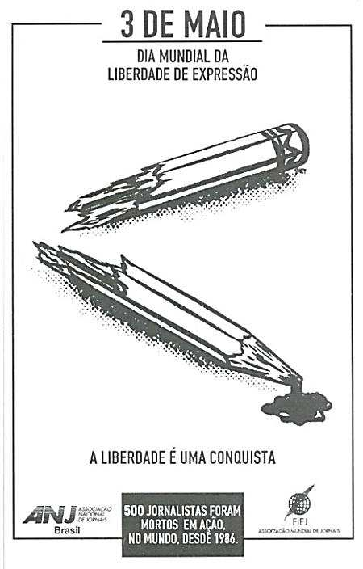
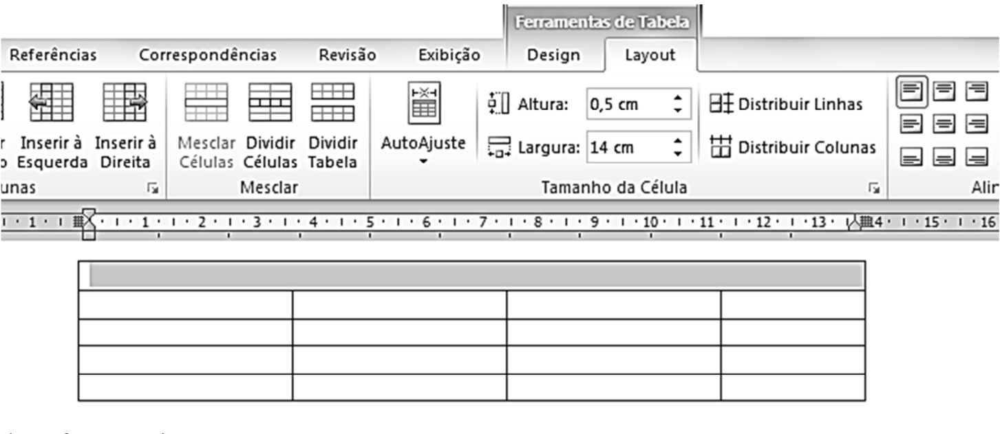
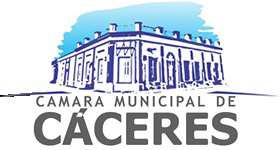

# PROVA — Camara_Caceres_2018_Analista_em_Comunicacao_Social_Jornalismo

## 1. Análise geral da prova

- **Identificação:** Camara_Caceres_2018_Analista_em_Comunicacao_Social_Jornalismo
- **Quantidade total de questões:** 40
- **Quantidade de textos de apoio (grupos):** 4
- **Quantidade de imagens:** 2
- **Quantidade de gráficos e tabelas:** incluídos nas imagens e no texto extraído, quando presentes no PDF original
- **Quantidade de grupos identificados:** 4
- **Quantidade de questões independentes:** 29
- **Questões que compartilham materiais:** texto-base das questões 01 a 03 → questões 01, 02, 03; texto-base das questões 05 a 06 → questões 05, 06; texto-base das questões 07 a 10 → questões 07, 08, 09, 10; texto-base das questões 34 a 35 → questões 34, 35

### Transcrição integral da capa/instruções (conforme extraída do PDF)

> [!NOTE]
> Conteúdo integral das páginas anteriores à primeira questão, sem cortes.

> Cargo:
> Analista em
> Comunicação Social
> − Jornalismo −
> Caderno de Provas
> Nome do Candidato
> Número de Inscrição
> -
> Superior
> UNIVERSIDADE FEDERAL DE MATO GROSSO
> Gerência de Exames e Concursos
>
>
>
> I N S T R U Ç Õ E S
> LEIA COM ATENÇÃO
>
> 1.
> Este Caderno de Provas, com páginas numeradas de 1 a 21, é constituído de
>  uma Prova Objetiva com 40 (quarenta) questões objetivas, cada uma com 4 (quatro) alternativas, assim distribuídas:
> 01 a 10 – Língua Portuguesa
>
> 11 a 15 – Informática
>
> 16 a 20 – Legislação Básica
>
> 21 a 40 – Conhecimentos Específicos
>
>  uma Prova Discursiva.
>
> 2. Caso o Caderno de Provas esteja incompleto ou tenha qualquer defeito de impressão, solicite ao fiscal que o substitua.
>
> 3. Sobre a Marcação do Cartão de Respostas da Prova Objetiva
> As respostas das questões objetivas deverão ser transcritas com caneta esferográfica de tinta azul ou preta não
> porosa, fabricada em material transparente, para o Cartão de Respostas, que será o único documento válido para
> correção.
> 3.1. Para cada questão existe apenas uma alternativa que a responde acertadamente. Para a marcação da alternativa escolhida
> no CARTÃO DE RESPOSTAS, pinte completamente o círculo correspondente.
> Exemplo: Suponha que para determinada questão a alternativa C seja a escolhida.
> N.º da
> Questão
> A
> B
> C
> D
> 3.2. Marque apenas uma alternativa para cada questão.
> 3.3. Será invalidada a questão em que houver mais de uma marcação, marcação rasurada ou emendada, ou não houver
> marcação.
> 3.4. Não rasure nem amasse o CARTÃO DE RESPOSTAS.
>
> 4.
> Para responder à Prova Discursiva, poderão ser usadas para rascunho as páginas de 16 a 20 deste Caderno de Provas, mas o
> texto definitivo deverá ser transcrito na Folha de Resposta, que será o único documento válido para a correção. Use caneta
> esferográfica de tinta azul ou preta não porosa fabricada em material transparente.
>
> 5.
> Todos os espaços em branco, neste caderno, podem ser utilizados para rascunho.
>
> 6.
> A duração das provas é 5 (cinco) horas, já incluído o tempo destinado ao preenchimento do CARTÃO DE RESPOSTAS da
> Prova Objetiva e da FOLHA DE RESPOSTA da Prova Discursiva.
>
> 7.
> Somente após decorridas 2 horas e 30 minutos do início das provas, o candidato, depois de entregar seu Caderno de Provas,
> seu Cartão de Respostas e sua Folha de Resposta, poderá retirar-se da sala de prova. O candidato que insistir em sair da sala
> de prova antes desse tempo deverá assinar Termo de Ocorrência declarando sua desistência do concurso.
>
> 8.
> Será permitida a saída de candidatos levando o Caderno de Provas somente na última meia hora de prova.
> 9.
> Na página 21 deste Caderno de Provas, encontra-se a Folha de Anotação do Candidato, a qual poderá ser utilizada para a
> transcrição das respostas das questões objetivas. Essa folha poderá ser levada pelo candidato para posterior conferência com o
> gabarito somente após decorridas 2 horas e 30 minutos do início da prova.
> 10. Após o término das provas, o candidato deverá, obrigatoriamente, entregar ao fiscal o CARTÃO DE RESPOSTAS e a FOLHA
> DE RESPOSTA devidamente assinados e preenchidos.
>
>
>
> 1/21 – Concurso Público da Câmara Municipal de Cáceres – NÍVEL SUPERIOR
> PROVA OBJETIVA
> Língua Portuguesa
> INSTRUÇÃO: Leia o texto abaixo (adaptado), parte da reportagem de capa da revista Isto É, nº 2531, e responda
> às questões de 01 a 03.
> Pra frente, Brasil
> Se estamos em crise, tire o “s” da palavra. Crie. Essas frases podem ser a chave para tirar os brasileiros do atual
> estado de desalento que tem feito ruir as expectativas de um futuro melhor. A julgar pelas pesquisas de opinião,
> tudo vai mal. A insatisfação com o governo é recorde, a economia piorou segundo 72% da população, e o desejo
> de abandonar o País é assumido por dois em cada três jovens com idade entre 16 e 24 anos. O quadro de
> desânimo, porém, é o lado mais danoso da ciclotimia que caracteriza os altos e baixos do humor nacional. Assim
> como somos tomados de um pessimismo atávico que drena energias e bloqueia a prosperidade, podemos ser
> instantaneamente tomados pela euforia que nos coloca entre os mais confiantes cidadãos do mundo. O que nos
> falta, como diria o técnico Tite em sua pregação junto ao elenco que disputa o mundial da Rússia, é equilíbrio. [...]
> Reagir ao clima de derrota, em todos os campos, e não apenas no futebol, é o que o País precisa para sair
> fortalecido de uma conjuntura tão adversa quanto nefasta.
> Hora de acreditar
> Talento não nos falta. Nem iniciativas exemplares, que se espalham pelas mais diversas áreas: da gestão pública
> comprometida com a eficiência e a economia (sim, parece difícil de acreditar, mas temos políticos honestos e
> capazes) ao desenvolvimento de tecnologias de ponta no setor aeroespacial; das inovações em saúde que
> permitem debelar em tempo recorde uma epidemia como a zika à criação de aplicativos voltados para reduzir as
> alarmantes taxas de feminicídio. Há um Brasil que cria, que busca soluções merecedoras de admiração e
> reconhecimento internacional. E há um Brasil que permanece inerte, esperando que as coisas melhorem sem que
> seja necessário grande (ou nenhum) esforço. Fazer parte do primeiro é acreditar no País. É reagir. Resignar-se ao
> segundo é como entrar no jogo preferindo perder. [...]

### Gabarito

| Questão | 01 | 02 | 03 | 04 | 05 |
|---|---|---|---|---|---|
| Resposta | C | B | C | A | D |

| Questão | 06 | 07 | 08 | 09 | 10 |
|---|---|---|---|---|---|
| Resposta | D | A | B | A | C |

| Questão | 11 | 12 | 13 | 14 | 15 |
|---|---|---|---|---|---|
| Resposta | B | D | A | C | A |

| Questão | 16 | 17 | 18 | 19 | 20 |
|---|---|---|---|---|---|
| Resposta | B | B | D | D | C |

| Questão | 21 | 22 | 23 | 24 | 25 |
|---|---|---|---|---|---|
| Resposta | C | B | D | A | D |

| Questão | 26 | 27 | 28 | 29 | 30 |
|---|---|---|---|---|---|
| Resposta | A | B | C | D | A |

| Questão | 31 | 32 | 33 | 34 | 35 |
|---|---|---|---|---|---|
| Resposta | B | D | B | C | A |

| Questão | 36 | 37 | 38 | 39 | 40 |
|---|---|---|---|---|---|
| Resposta | B | D | A | C | C |

## 2. Questões agrupadas

### GRUPO 01 — Texto-base compartilhado pelas questões 01 a 03

**Questões relacionadas:** 01, 02, 03.

#### QUESTÃO 01

✅ **Gabarito: C** (gabarito oficial pareado — cargo ANALISTA DE COMUNICAÇÃO SOCIAL/JORNALISMO)

**Material de apoio:**

Pra frente, Brasil
Se estamos em crise, tire o “s” da palavra. Crie. Essas frases podem ser a chave para tirar os brasileiros do atual
estado de desalento que tem feito ruir as expectativas de um futuro melhor. A julgar pelas pesquisas de opinião,
tudo vai mal. A insatisfação com o governo é recorde, a economia piorou segundo 72% da população, e o desejo
de abandonar o País é assumido por dois em cada três jovens com idade entre 16 e 24 anos. O quadro de
desânimo, porém, é o lado mais danoso da ciclotimia que caracteriza os altos e baixos do humor nacional. Assim
como somos tomados de um pessimismo atávico que drena energias e bloqueia a prosperidade, podemos ser
instantaneamente tomados pela euforia que nos coloca entre os mais confiantes cidadãos do mundo. O que nos
falta, como diria o técnico Tite em sua pregação junto ao elenco que disputa o mundial da Rússia, é equilíbrio. [...]
Reagir ao clima de derrota, em todos os campos, e não apenas no futebol, é o que o País precisa para sair
fortalecido de uma conjuntura tão adversa quanto nefasta.
Hora de acreditar
Talento não nos falta. Nem iniciativas exemplares, que se espalham pelas mais diversas áreas: da gestão pública
comprometida com a eficiência e a economia (sim, parece difícil de acreditar, mas temos políticos honestos e
capazes) ao desenvolvimento de tecnologias de ponta no setor aeroespacial; das inovações em saúde que
permitem debelar em tempo recorde uma epidemia como a zika à criação de aplicativos voltados para reduzir as
alarmantes taxas de feminicídio. Há um Brasil que cria, que busca soluções merecedoras de admiração e
reconhecimento internacional. E há um Brasil que permanece inerte, esperando que as coisas melhorem sem que
seja necessário grande (ou nenhum) esforço. Fazer parte do primeiro é acreditar no País. É reagir. Resignar-se ao
segundo é como entrar no jogo preferindo perder. [...]

**Enunciado:**

A respeito do texto, analise as afirmativas.
I - Segundo pesquisas, dos jovens brasileiros de 16 a 24 anos, um terço deseja viver fora do País.
II - O Brasil está caracterizado como dois: um hereditariamente pessimista e inerte e outro eufórico, ativo e
confiante.
III - As referências comparativas ao futebol, inclusive com pretensa fala do técnico da seleção brasileira, se
iniciam com o título do texto Pra frente, Brasil.
IV - Os redatores da reportagem não deixam clara qualquer possibilidade de o cidadão brasileiro atingir o
equilíbrio entre euforia e desalento.
V - As últimas frases do texto apresentam-se curtas, o que lhes proporciona maior ênfase semântica.
Estão corretas as afirmativas

**Alternativas:**

A) I, III, IV e V, apenas.
B) II, IV e V, apenas.
C) II, III e V, apenas.
D) I, II, III e IV, apenas.

**Referências visuais:**

Nenhuma.

---

#### QUESTÃO 02

✅ **Gabarito: B** (gabarito oficial pareado — cargo ANALISTA DE COMUNICAÇÃO SOCIAL/JORNALISMO)

**Material de apoio:**

Pra frente, Brasil
Se estamos em crise, tire o “s” da palavra. Crie. Essas frases podem ser a chave para tirar os brasileiros do atual
estado de desalento que tem feito ruir as expectativas de um futuro melhor. A julgar pelas pesquisas de opinião,
tudo vai mal. A insatisfação com o governo é recorde, a economia piorou segundo 72% da população, e o desejo
de abandonar o País é assumido por dois em cada três jovens com idade entre 16 e 24 anos. O quadro de
desânimo, porém, é o lado mais danoso da ciclotimia que caracteriza os altos e baixos do humor nacional. Assim
como somos tomados de um pessimismo atávico que drena energias e bloqueia a prosperidade, podemos ser
instantaneamente tomados pela euforia que nos coloca entre os mais confiantes cidadãos do mundo. O que nos
falta, como diria o técnico Tite em sua pregação junto ao elenco que disputa o mundial da Rússia, é equilíbrio. [...]
Reagir ao clima de derrota, em todos os campos, e não apenas no futebol, é o que o País precisa para sair
fortalecido de uma conjuntura tão adversa quanto nefasta.
Hora de acreditar
Talento não nos falta. Nem iniciativas exemplares, que se espalham pelas mais diversas áreas: da gestão pública
comprometida com a eficiência e a economia (sim, parece difícil de acreditar, mas temos políticos honestos e
capazes) ao desenvolvimento de tecnologias de ponta no setor aeroespacial; das inovações em saúde que
permitem debelar em tempo recorde uma epidemia como a zika à criação de aplicativos voltados para reduzir as
alarmantes taxas de feminicídio. Há um Brasil que cria, que busca soluções merecedoras de admiração e
reconhecimento internacional. E há um Brasil que permanece inerte, esperando que as coisas melhorem sem que
seja necessário grande (ou nenhum) esforço. Fazer parte do primeiro é acreditar no País. É reagir. Resignar-se ao
segundo é como entrar no jogo preferindo perder. [...]

**Enunciado:**

A frase A julgar pelas pesquisas de opinião, tudo vai mal. pode ser reescrita de diversas maneiras, conservando-se
o sentido. Assinale a alternativa que NÃO apresenta reescrita com o mesmo sentido da original.

**Alternativas:**

A) De acordo com as pesquisas de opinião, tudo vai mal.
B) Apesar das pesquisas de opinião, tudo vai mal.
C) Considerando as pesquisas de opinião, tudo vai mal.
D) Haja vista as pesquisas de opinião, tudo vai mal.

**Referências visuais:**

Nenhuma.

---

#### QUESTÃO 03

✅ **Gabarito: C** (gabarito oficial pareado — cargo ANALISTA DE COMUNICAÇÃO SOCIAL/JORNALISMO)

**Material de apoio:**

Pra frente, Brasil
Se estamos em crise, tire o “s” da palavra. Crie. Essas frases podem ser a chave para tirar os brasileiros do atual
estado de desalento que tem feito ruir as expectativas de um futuro melhor. A julgar pelas pesquisas de opinião,
tudo vai mal. A insatisfação com o governo é recorde, a economia piorou segundo 72% da população, e o desejo
de abandonar o País é assumido por dois em cada três jovens com idade entre 16 e 24 anos. O quadro de
desânimo, porém, é o lado mais danoso da ciclotimia que caracteriza os altos e baixos do humor nacional. Assim
como somos tomados de um pessimismo atávico que drena energias e bloqueia a prosperidade, podemos ser
instantaneamente tomados pela euforia que nos coloca entre os mais confiantes cidadãos do mundo. O que nos
falta, como diria o técnico Tite em sua pregação junto ao elenco que disputa o mundial da Rússia, é equilíbrio. [...]
Reagir ao clima de derrota, em todos os campos, e não apenas no futebol, é o que o País precisa para sair
fortalecido de uma conjuntura tão adversa quanto nefasta.
Hora de acreditar
Talento não nos falta. Nem iniciativas exemplares, que se espalham pelas mais diversas áreas: da gestão pública
comprometida com a eficiência e a economia (sim, parece difícil de acreditar, mas temos políticos honestos e
capazes) ao desenvolvimento de tecnologias de ponta no setor aeroespacial; das inovações em saúde que
permitem debelar em tempo recorde uma epidemia como a zika à criação de aplicativos voltados para reduzir as
alarmantes taxas de feminicídio. Há um Brasil que cria, que busca soluções merecedoras de admiração e
reconhecimento internacional. E há um Brasil que permanece inerte, esperando que as coisas melhorem sem que
seja necessário grande (ou nenhum) esforço. Fazer parte do primeiro é acreditar no País. É reagir. Resignar-se ao
segundo é como entrar no jogo preferindo perder. [...]

**Enunciado:**

Na frase Resignar-se ao segundo é como entrar no jogo preferindo perder., o verbo resignar exige, em termos
da língua culta escrita, complementação de sentido com uso de preposição. Em qual afirmativa há verbo com
a mesma exigência?

**Alternativas:**

A) É possível observar vários exemplos de superação no atletismo, na corrida de rua, entre outras
modalidades.
B) É visível o desencanto dos brasileiros no alto índice de cidadãos que não vão votar neste ano, segundo
pesquisas.
C) É fato que todos os candidatos devem obedecer às regras do concurso que prestam.
D) É verdade que a doação de medula óssea pode salvar vidas de pessoas com doenças de sangue, entre as
quais linfomas e leucemia.

**Referências visuais:**

Nenhuma.

---

### GRUPO 02 — Texto-base compartilhado pelas questões 05 a 06

**Questões relacionadas:** 05, 06.

#### QUESTÃO 05

✅ **Gabarito: D** (gabarito oficial pareado — cargo ANALISTA DE COMUNICAÇÃO SOCIAL/JORNALISMO)

**Material de apoio:**

INSTRUÇÃO: Leia atentamente a propaganda abaixo e responda às questões 05 e 06.

**Enunciado:**

Na propaganda, estabelece-se uma relação entre o lápis e a comemoração ao dia mundial da liberdade de
expressão. O lápis, instrumento de trabalho, foi tomado como o próprio trabalho do jornalista, o escrever. O
lápis quebrado e sangrando pode significar sofrimento e perda de liberdade dos jornalistas. Esses
entendimentos constituem, respectivamente, as figuras de linguagem denominadas

**Alternativas:**

A) hipérbole e anáfora.
B) antítese e metonímia.
C) anacoluto e pleonasmo.
D) metonímia e metáfora.

**Referências visuais:**

---

#### QUESTÃO 06

✅ **Gabarito: D** (gabarito oficial pareado — cargo ANALISTA DE COMUNICAÇÃO SOCIAL/JORNALISMO)

**Material de apoio:**

INSTRUÇÃO: Leia atentamente a propaganda abaixo e responda às questões 05 e 06.

**Enunciado:**

A que pode ser atribuído o sangue a sair do lápis em se tratando de um texto a comemorar a liberdade de
expressão?

**Alternativas:**

A) Ao sofrimento dos jornalistas quando trabalham em zona de guerra.
B) Ao fato de países em conflito submeterem jornalistas estrangeiros à tortura.
C) Ao grande número de jornalistas que presenciam conflitos que geram violência e morte.
D) Ao grande número de jornalistas mortos no trabalho.
Por que elegemos idiotas?
Neurociência e psicologia tentam desvendar nossas escolhas nas urnas
A habilidade de estabelecer um vínculo com eleitores arredios à política, focados no curto prazo e
ignorantes sobre a natureza dos desafios existentes é um dos principais atributos dos candidatos vitoriosos. A
experiência sugere que honestidade e razoabilidade parecem afugentar os eleitores. Como explicar essa
preferência por gente claramente incapaz?
Uma hipótese aventada pela literatura é a de que somos irracionais. Preferimos políticas “erradas” e
votamos em candidatos que as oferecem. Outra avenida é presumir que o eleitor não escolhe programas de
governo, mas usa o voto para mostrar “atitude”. Essas teses ajudam a resolver o quebra-cabeça, mas fica uma
dúvida: por que os candidatos mais competentes não copiam o discurso que cola e projetam uma imagem
que agrada o eleitorado apenas para serem eleitos?
O neurocientista britânico Dean Burnett, autor do livro “The Idiot Brain”, usa a psicologia para
desvendar o mistério. As evidências mostram que as pessoas que se comunicam com segurança inspiram
confiança nos outros e, portanto, têm mais chance de serem bem-sucedidas na política. O problema é que
confiança é também um traço das pessoas menos inteligentes, pois falta a elas a habilidade de reconhecer as
próprias limitações.
Outro aspecto perverso é que os indivíduos mais inteligentes acreditam que tarefas que a eles
parecem simples também são fáceis aos demais. Ou seja, a fatia esclarecida da população tende a
menosprezar o potencial destrutivo dos idiotas.
Quando se soma a incapacidade metacognitiva dos políticos mais confiantes, mas intelectualmente
limitados, com a indiferença das camadas sensatas, torna-se mais fácil entender porque indivíduos
desqualificados galgam altos postos, corroendo a democracia no mundo e, pelo andar da carruagem, no
Brasil. Os candidatos mais capazes, cedo ou tarde, titubeiam em um jogo que premia a estupidez.
Daí a dificuldade de produzir um candidato sólido, apto a ser também um bom presidente. Para ganhar
uma eleição, é preciso convencer o eleitor da falácia de que é possível corrigir o rumo rapidamente. Ninguém
melhor do que sujeitos inescrupulosos, que propagam acreditar na existência das soluções fáceis.
(TOLEDO, Celso. Revista Exame, 2018.)

**Referências visuais:**

---

### GRUPO 03 — Texto-base compartilhado pelas questões 07 a 10

**Questões relacionadas:** 07, 08, 09, 10.

#### QUESTÃO 07

✅ **Gabarito: A** (gabarito oficial pareado — cargo ANALISTA DE COMUNICAÇÃO SOCIAL/JORNALISMO)

**Material de apoio:**

QUESTÃO 06
A que pode ser atribuído o sangue a sair do lápis em se tratando de um texto a comemorar a liberdade de
expressão?
(A) Ao sofrimento dos jornalistas quando trabalham em zona de guerra.
(B) Ao fato de países em conflito submeterem jornalistas estrangeiros à tortura.
(C) Ao grande número de jornalistas que presenciam conflitos que geram violência e morte.
INSTRUÇÃO: Leia o texto abaixo e responda às questões de 07 a 10.
Por que elegemos idiotas?
Neurociência e psicologia tentam desvendar nossas escolhas nas urnas
A habilidade de estabelecer um vínculo com eleitores arredios à política, focados no curto prazo e
ignorantes sobre a natureza dos desafios existentes é um dos principais atributos dos candidatos vitoriosos. A
experiência sugere que honestidade e razoabilidade parecem afugentar os eleitores. Como explicar essa
preferência por gente claramente incapaz?
Uma hipótese aventada pela literatura é a de que somos irracionais. Preferimos políticas “erradas” e
votamos em candidatos que as oferecem. Outra avenida é presumir que o eleitor não escolhe programas de
governo, mas usa o voto para mostrar “atitude”. Essas teses ajudam a resolver o quebra-cabeça, mas fica uma
dúvida: por que os candidatos mais competentes não copiam o discurso que cola e projetam uma imagem
que agrada o eleitorado apenas para serem eleitos?
O neurocientista britânico Dean Burnett, autor do livro “The Idiot Brain”, usa a psicologia para
desvendar o mistério. As evidências mostram que as pessoas que se comunicam com segurança inspiram
confiança nos outros e, portanto, têm mais chance de serem bem-sucedidas na política. O problema é que
confiança é também um traço das pessoas menos inteligentes, pois falta a elas a habilidade de reconhecer as
próprias limitações.
Outro aspecto perverso é que os indivíduos mais inteligentes acreditam que tarefas que a eles
parecem simples também são fáceis aos demais. Ou seja, a fatia esclarecida da população tende a
menosprezar o potencial destrutivo dos idiotas.
Quando se soma a incapacidade metacognitiva dos políticos mais confiantes, mas intelectualmente
limitados, com a indiferença das camadas sensatas, torna-se mais fácil entender porque indivíduos
desqualificados galgam altos postos, corroendo a democracia no mundo e, pelo andar da carruagem, no
Brasil. Os candidatos mais capazes, cedo ou tarde, titubeiam em um jogo que premia a estupidez.
Daí a dificuldade de produzir um candidato sólido, apto a ser também um bom presidente. Para ganhar
uma eleição, é preciso convencer o eleitor da falácia de que é possível corrigir o rumo rapidamente. Ninguém
melhor do que sujeitos inescrupulosos, que propagam acreditar na existência das soluções fáceis.
(TOLEDO, Celso. Revista Exame, 2018.)

**Enunciado:**

A respeito das ideias apresentadas no texto, assinale a afirmativa correta.

**Alternativas:**

A) Uma das ideias falsas que candidatos usam para ganhar uma eleição é a de que os problemas do país
podem ser resolvidos em curto prazo.
B) Candidato que conquista eleitores despolitizados, que pensam basicamente no amanhã e desconhecem a
natureza dos desafios a serem enfrentados, não sai vitorioso das urnas.
C) A segurança em seus discursos mostra que o candidato é pessoa menos inteligente e com limitações
cognitivas.
D) O trecho a fatia esclarecida da população tende a menosprezar o potencial destrutivo dos idiotas
esclarece o fato de eleitores inteligentes votarem em políticos idiotas.

**Referências visuais:**

Nenhuma.

---

#### QUESTÃO 08

✅ **Gabarito: B** (gabarito oficial pareado — cargo ANALISTA DE COMUNICAÇÃO SOCIAL/JORNALISMO)

**Material de apoio:**

QUESTÃO 06
A que pode ser atribuído o sangue a sair do lápis em se tratando de um texto a comemorar a liberdade de
expressão?
(A) Ao sofrimento dos jornalistas quando trabalham em zona de guerra.
(B) Ao fato de países em conflito submeterem jornalistas estrangeiros à tortura.
(C) Ao grande número de jornalistas que presenciam conflitos que geram violência e morte.
INSTRUÇÃO: Leia o texto abaixo e responda às questões de 07 a 10.
Por que elegemos idiotas?
Neurociência e psicologia tentam desvendar nossas escolhas nas urnas
A habilidade de estabelecer um vínculo com eleitores arredios à política, focados no curto prazo e
ignorantes sobre a natureza dos desafios existentes é um dos principais atributos dos candidatos vitoriosos. A
experiência sugere que honestidade e razoabilidade parecem afugentar os eleitores. Como explicar essa
preferência por gente claramente incapaz?
Uma hipótese aventada pela literatura é a de que somos irracionais. Preferimos políticas “erradas” e
votamos em candidatos que as oferecem. Outra avenida é presumir que o eleitor não escolhe programas de
governo, mas usa o voto para mostrar “atitude”. Essas teses ajudam a resolver o quebra-cabeça, mas fica uma
dúvida: por que os candidatos mais competentes não copiam o discurso que cola e projetam uma imagem
que agrada o eleitorado apenas para serem eleitos?
O neurocientista britânico Dean Burnett, autor do livro “The Idiot Brain”, usa a psicologia para
desvendar o mistério. As evidências mostram que as pessoas que se comunicam com segurança inspiram
confiança nos outros e, portanto, têm mais chance de serem bem-sucedidas na política. O problema é que
confiança é também um traço das pessoas menos inteligentes, pois falta a elas a habilidade de reconhecer as
próprias limitações.
Outro aspecto perverso é que os indivíduos mais inteligentes acreditam que tarefas que a eles
parecem simples também são fáceis aos demais. Ou seja, a fatia esclarecida da população tende a
menosprezar o potencial destrutivo dos idiotas.
Quando se soma a incapacidade metacognitiva dos políticos mais confiantes, mas intelectualmente
limitados, com a indiferença das camadas sensatas, torna-se mais fácil entender porque indivíduos
desqualificados galgam altos postos, corroendo a democracia no mundo e, pelo andar da carruagem, no
Brasil. Os candidatos mais capazes, cedo ou tarde, titubeiam em um jogo que premia a estupidez.
Daí a dificuldade de produzir um candidato sólido, apto a ser também um bom presidente. Para ganhar
uma eleição, é preciso convencer o eleitor da falácia de que é possível corrigir o rumo rapidamente. Ninguém
melhor do que sujeitos inescrupulosos, que propagam acreditar na existência das soluções fáceis.
(TOLEDO, Celso. Revista Exame, 2018.)

**Enunciado:**

A tese do articulista, posta já no primeiro parágrafo, é defendida no decorrer do texto. Assinale o trecho que
NÃO faz parte da construção argumentativa do texto.

**Alternativas:**

A) Uma hipótese aventada pela literatura é a de que somos irracionais. Preferimos políticas “erradas” e
votamos em candidatos que as oferecem. Outra avenida é presumir que o eleitor não escolhe programas
de governo, mas usa o voto para mostrar “atitude”.
B) Para ganhar uma eleição, é preciso convencer o eleitor da falácia de que é possível corrigir o rumo
rapidamente. Ninguém melhor do que sujeitos inescrupulosos, que propagam acreditar na existência das
soluções fáceis.
C) As evidências mostram que as pessoas que se comunicam com segurança inspiram confiança nos outros e,
portanto, têm mais chance de serem bem-sucedidas na política.
D) Outro aspecto perverso é que os indivíduos mais inteligentes acreditam que tarefas que a eles parecem
simples também são fáceis aos demais.

**Referências visuais:**

Nenhuma.

---

#### QUESTÃO 09

✅ **Gabarito: A** (gabarito oficial pareado — cargo ANALISTA DE COMUNICAÇÃO SOCIAL/JORNALISMO)

**Material de apoio:**

QUESTÃO 06
A que pode ser atribuído o sangue a sair do lápis em se tratando de um texto a comemorar a liberdade de
expressão?
(A) Ao sofrimento dos jornalistas quando trabalham em zona de guerra.
(B) Ao fato de países em conflito submeterem jornalistas estrangeiros à tortura.
(C) Ao grande número de jornalistas que presenciam conflitos que geram violência e morte.
INSTRUÇÃO: Leia o texto abaixo e responda às questões de 07 a 10.
Por que elegemos idiotas?
Neurociência e psicologia tentam desvendar nossas escolhas nas urnas
A habilidade de estabelecer um vínculo com eleitores arredios à política, focados no curto prazo e
ignorantes sobre a natureza dos desafios existentes é um dos principais atributos dos candidatos vitoriosos. A
experiência sugere que honestidade e razoabilidade parecem afugentar os eleitores. Como explicar essa
preferência por gente claramente incapaz?
Uma hipótese aventada pela literatura é a de que somos irracionais. Preferimos políticas “erradas” e
votamos em candidatos que as oferecem. Outra avenida é presumir que o eleitor não escolhe programas de
governo, mas usa o voto para mostrar “atitude”. Essas teses ajudam a resolver o quebra-cabeça, mas fica uma
dúvida: por que os candidatos mais competentes não copiam o discurso que cola e projetam uma imagem
que agrada o eleitorado apenas para serem eleitos?
O neurocientista britânico Dean Burnett, autor do livro “The Idiot Brain”, usa a psicologia para
desvendar o mistério. As evidências mostram que as pessoas que se comunicam com segurança inspiram
confiança nos outros e, portanto, têm mais chance de serem bem-sucedidas na política. O problema é que
confiança é também um traço das pessoas menos inteligentes, pois falta a elas a habilidade de reconhecer as
próprias limitações.
Outro aspecto perverso é que os indivíduos mais inteligentes acreditam que tarefas que a eles
parecem simples também são fáceis aos demais. Ou seja, a fatia esclarecida da população tende a
menosprezar o potencial destrutivo dos idiotas.
Quando se soma a incapacidade metacognitiva dos políticos mais confiantes, mas intelectualmente
limitados, com a indiferença das camadas sensatas, torna-se mais fácil entender porque indivíduos
desqualificados galgam altos postos, corroendo a democracia no mundo e, pelo andar da carruagem, no
Brasil. Os candidatos mais capazes, cedo ou tarde, titubeiam em um jogo que premia a estupidez.
Daí a dificuldade de produzir um candidato sólido, apto a ser também um bom presidente. Para ganhar
uma eleição, é preciso convencer o eleitor da falácia de que é possível corrigir o rumo rapidamente. Ninguém
melhor do que sujeitos inescrupulosos, que propagam acreditar na existência das soluções fáceis.
(TOLEDO, Celso. Revista Exame, 2018.)

**Enunciado:**

Tome o trecho: Essas teses ajudam a resolver o quebra-cabeça, mas fica uma dúvida: por que os candidatos
mais competentes não copiam o discurso que cola e projetam uma imagem que agrada o eleitorado apenas
para serem eleitos? Em termos de elementos coesivos empregados nesse trecho, marque V para as
afirmativas verdadeiras e F para as falsas.
( ) O conector mas marca que está sendo feita uma oposição à ideia da resolução do quebra-cabeça,
configurando-se como elemento coesivo sequencial.
( ) O pronome Essas funciona como elemento coesivo referencial, pois retoma as teses enunciadas
anteriormente: os eleitores são arredios à política e votam para mostrar atitude.
( ) O pronome que, nas duas ocorrências, substitui uma palavra antecedente: discurso e imagem,
respectivamente, funcionado como mecanismo referencial.
( ) O termo quebra-cabeça volta-se para o título do texto Por que elegemos idiotas?, em função coesiva
substitutiva.
Assinale a sequência correta.

**Alternativas:**

A) V, F, V, V
B) V, V, F, F
C) F, F, V, V
D) F, V, F, F

**Referências visuais:**

Nenhuma.

---

#### QUESTÃO 10

✅ **Gabarito: C** (gabarito oficial pareado — cargo ANALISTA DE COMUNICAÇÃO SOCIAL/JORNALISMO)

**Material de apoio:**

QUESTÃO 06
A que pode ser atribuído o sangue a sair do lápis em se tratando de um texto a comemorar a liberdade de
expressão?
(A) Ao sofrimento dos jornalistas quando trabalham em zona de guerra.
(B) Ao fato de países em conflito submeterem jornalistas estrangeiros à tortura.
(C) Ao grande número de jornalistas que presenciam conflitos que geram violência e morte.
INSTRUÇÃO: Leia o texto abaixo e responda às questões de 07 a 10.
Por que elegemos idiotas?
Neurociência e psicologia tentam desvendar nossas escolhas nas urnas
A habilidade de estabelecer um vínculo com eleitores arredios à política, focados no curto prazo e
ignorantes sobre a natureza dos desafios existentes é um dos principais atributos dos candidatos vitoriosos. A
experiência sugere que honestidade e razoabilidade parecem afugentar os eleitores. Como explicar essa
preferência por gente claramente incapaz?
Uma hipótese aventada pela literatura é a de que somos irracionais. Preferimos políticas “erradas” e
votamos em candidatos que as oferecem. Outra avenida é presumir que o eleitor não escolhe programas de
governo, mas usa o voto para mostrar “atitude”. Essas teses ajudam a resolver o quebra-cabeça, mas fica uma
dúvida: por que os candidatos mais competentes não copiam o discurso que cola e projetam uma imagem
que agrada o eleitorado apenas para serem eleitos?
O neurocientista britânico Dean Burnett, autor do livro “The Idiot Brain”, usa a psicologia para
desvendar o mistério. As evidências mostram que as pessoas que se comunicam com segurança inspiram
confiança nos outros e, portanto, têm mais chance de serem bem-sucedidas na política. O problema é que
confiança é também um traço das pessoas menos inteligentes, pois falta a elas a habilidade de reconhecer as
próprias limitações.
Outro aspecto perverso é que os indivíduos mais inteligentes acreditam que tarefas que a eles
parecem simples também são fáceis aos demais. Ou seja, a fatia esclarecida da população tende a
menosprezar o potencial destrutivo dos idiotas.
Quando se soma a incapacidade metacognitiva dos políticos mais confiantes, mas intelectualmente
limitados, com a indiferença das camadas sensatas, torna-se mais fácil entender porque indivíduos
desqualificados galgam altos postos, corroendo a democracia no mundo e, pelo andar da carruagem, no
Brasil. Os candidatos mais capazes, cedo ou tarde, titubeiam em um jogo que premia a estupidez.
Daí a dificuldade de produzir um candidato sólido, apto a ser também um bom presidente. Para ganhar
uma eleição, é preciso convencer o eleitor da falácia de que é possível corrigir o rumo rapidamente. Ninguém
melhor do que sujeitos inescrupulosos, que propagam acreditar na existência das soluções fáceis.
(TOLEDO, Celso. Revista Exame, 2018.)

**Enunciado:**

O texto em análise é um artigo de opinião. Assinale a alternativa que NÃO apresenta característica desse
gênero discursivo.

**Alternativas:**

A) A circulação ocorre em diferentes lugares sociais, como jornal, revista, periódico, televisão,
webjornalismo.
B) Traz a interpretação do articulista sobre um fato ou tema, geralmente atual de ordem social, econômica,
política ou cultural, relevante para os leitores.
C) A apresentação do problema ou acontecimentos no texto interessa muito mais ao leitor que a construção
de um ponto de vista.
D) Muitas vezes o articulista busca outras vozes para a construção de seu ponto de vista e da argumentação.

**Referências visuais:**

Nenhuma.

---

### GRUPO 04 — Texto-base compartilhado pelas questões 34 a 35

**Questões relacionadas:** 34, 35.

#### QUESTÃO 34

✅ **Gabarito: C** (gabarito oficial pareado — cargo ANALISTA DE COMUNICAÇÃO SOCIAL/JORNALISMO)

**Material de apoio:**

QUESTÃO 33
Sobre fotojornalismo, marque V para as afirmativas verdadeiras e F para as falsas.
( ) A diagramação de uma página de jornal impresso considera a fotografia como elemento do processo
de construção do projeto gráfico.
( ) A legenda tem como função principal modificar o que se vê na imagem, oferecendo ao leitor sempre
uma interpretação do fato.
( ) A fotografia de imprensa aumenta o realismo do relato jornalístico pelo seu caráter de presença no
acontecimento.
( ) A legenda não é considerada parte da fotografia de imprensa, tendo seu uso facultativo para passar a
informação.
( ) A legenda circunscreve o significado da imagem, reduzindo as possibilidades de interpretação.
Assinale a sequência correta.
(A) F, V, V, F, V
(B) V, F, V, F, F
(C) F, F, F, V, V
(D) V, V, F, V, F
INSTRUÇÃO: Leia o texto a seguir para responder às .

Um século após o advento da contratação de Ivy Lee como responsável pela comunicação de Rockfeller nos
Estados Unidos, o Brasil é a grande referência como centro produtor do pensamento e das técnicas
empregadas pelo jornalista no exercício da assessoria.
É difícil imaginar os veículos de comunicação sem o apoio das assessorias na oferta de informação qualificada
e essa situação estratégica ao mesmo tempo em que propicia respeito e boas perspectivas emite um alerta.
Há que se incorporar aos produtos e serviços das assessorias a geração de conteúdo dentro dos parâmetros
jornalísticos para alimentar, inclusive, novas mídias como a Internet. Esse é apenas um item entre as
possibilidades de produtos e serviços.
Por conta do enorme potencial do segmento é que os olhos do mundo estão voltados para o mercado
brasileiro. Não é por outra razão que empresas multinacionais têm efetivado parceria com agências de
comunicação brasileiras e o resultado indica um futuro promissor.
Cabe ao jornalista assessor apurar os sentidos para estar sempre adaptado a uma conjuntura que se modifica
na velocidade com que circula a informação neste momento de incessantes inovações tecnológicas.
(Manual de Assessoria de Comunicação – Imprensa 2007. Brasília: FEnaj, 4ª edição.)

**Enunciado:**

O texto acima demonstra o papel estratégico da assessoria de imprensa no mundo contemporâneo. Em
relação a funções de uma assessoria de imprensa de uma organização pública ou privada nesse novo contexto
social de atuação do profissional de assessoria, assinale a afirmativa INCORRETA.

**Alternativas:**

A) Desenvolver relação de confiança com veículos de comunicação.
B) Criar mecanismos de aferição de resultados das ações propostas aos diferentes públicos envolvidos com a
organização.
C) Elaborar um plano de comunicação centrado, exclusivamente, na eficiência do contato com a imprensa.
D) Preparar as fontes de informação da organização para o atendimento ágil e eficiente das demandas da
equipe de comunicação.

**Referências visuais:**

Nenhuma.

---

#### QUESTÃO 35

✅ **Gabarito: A** (gabarito oficial pareado — cargo ANALISTA DE COMUNICAÇÃO SOCIAL/JORNALISMO)

**Material de apoio:**

QUESTÃO 33
Sobre fotojornalismo, marque V para as afirmativas verdadeiras e F para as falsas.
( ) A diagramação de uma página de jornal impresso considera a fotografia como elemento do processo
de construção do projeto gráfico.
( ) A legenda tem como função principal modificar o que se vê na imagem, oferecendo ao leitor sempre
uma interpretação do fato.
( ) A fotografia de imprensa aumenta o realismo do relato jornalístico pelo seu caráter de presença no
acontecimento.
( ) A legenda não é considerada parte da fotografia de imprensa, tendo seu uso facultativo para passar a
informação.
( ) A legenda circunscreve o significado da imagem, reduzindo as possibilidades de interpretação.
Assinale a sequência correta.
(A) F, V, V, F, V
(B) V, F, V, F, F
(C) F, F, F, V, V
(D) V, V, F, V, F
INSTRUÇÃO: Leia o texto a seguir para responder às .

Um século após o advento da contratação de Ivy Lee como responsável pela comunicação de Rockfeller nos
Estados Unidos, o Brasil é a grande referência como centro produtor do pensamento e das técnicas
empregadas pelo jornalista no exercício da assessoria.
É difícil imaginar os veículos de comunicação sem o apoio das assessorias na oferta de informação qualificada
e essa situação estratégica ao mesmo tempo em que propicia respeito e boas perspectivas emite um alerta.
Há que se incorporar aos produtos e serviços das assessorias a geração de conteúdo dentro dos parâmetros
jornalísticos para alimentar, inclusive, novas mídias como a Internet. Esse é apenas um item entre as
possibilidades de produtos e serviços.
Por conta do enorme potencial do segmento é que os olhos do mundo estão voltados para o mercado
brasileiro. Não é por outra razão que empresas multinacionais têm efetivado parceria com agências de
comunicação brasileiras e o resultado indica um futuro promissor.
Cabe ao jornalista assessor apurar os sentidos para estar sempre adaptado a uma conjuntura que se modifica
na velocidade com que circula a informação neste momento de incessantes inovações tecnológicas.
(Manual de Assessoria de Comunicação – Imprensa 2007. Brasília: FEnaj, 4ª edição.)

**Enunciado:**

Num Departamento de Comunicação de uma organização empresarial com divisões que abarquem também
outros profissionais deste setor, como publicitários e relações públicas, qual função NÃO deve ser exercida
por jornalista?

**Alternativas:**

A) Gerência de integração entre a organização e seus públicos.
B) Elaboração de press-releases.
C) Participação na definição de estratégias de comunicação.
D) Acompanhamento dos serviços de diagramação de impressos.

**Referências visuais:**

Nenhuma.

---

## 3. Questões independentes

#### QUESTÃO 04

✅ **Gabarito: A** (gabarito oficial pareado — cargo ANALISTA DE COMUNICAÇÃO SOCIAL/JORNALISMO)

**Enunciado:**

Na construção de um texto, a ambiguidade pode causar falha no entendimento do leitor, a menos que seja
empregada intencionalmente como recurso de expressão. Assinale a afirmativa que se apresenta coerente,
sem qualquer ambiguidade.

**Alternativas:**

A) Durante o jogo, Felipe deu várias caneladas em Romero; depois entrou no jogo Pedrinho que também
sofreu empurrões do primeiro.
B) A filha dileta trouxe o remédio para seu pai que está doente no pequeno frasco.
C) O herdeiro gastou os milhões da família com o ramo de construção de estradas de ferro em festas e
viagens.
D) Durante o longo namoro, o rapaz pediu à garota que se casasse com ele muitas vezes.

**Referências visuais:**

Nenhuma.

---

#### QUESTÃO 11

✅ **Gabarito: B** (gabarito oficial pareado — cargo ANALISTA DE COMUNICAÇÃO SOCIAL/JORNALISMO)

**Enunciado:**

A figura abaixo apresenta uma tabela inserida em um documento do Microsoft Word 2010 com a primeira
linha selecionada.
Sobre a figura, analise as assertivas.
I - A barra de Ferramentas de Tabela chamada Layout, exibida na figura, só pode ser visualizada quando a
tabela (ou parte dela) está selecionada ou se pelo menos alguma célula da tabela estiver ativada.
II - A primeira linha da tabela, que está selecionada, foi transformada em uma única célula. Tal efeito pode
ser aplicado com a utilização do comando chamado Dividir Células.
III - Ao se clicar no comando Dividir Tabela, com a terceira linha da tabela selecionada, a tabela será dividida
em duas e a linha selecionada será a primeira linha da nova tabela.
IV - Todas as células da tabela apresentam altura de 0,5 cm e largura de 14 cm.
Estão corretas as assertivas

**Alternativas:**

A) II e III, apenas.
B) I e III, apenas.
C) I, II e IV, apenas.
D) I, II, III e IV.

**Referências visuais:**

---

#### QUESTÃO 12

✅ **Gabarito: D** (gabarito oficial pareado — cargo ANALISTA DE COMUNICAÇÃO SOCIAL/JORNALISMO)

**Enunciado:**

A figura abaixo apresenta uma planilha do Microsoft Excel 2010, idioma português.
De acordo com a planilha, quais valores seriam produzidos pelas fórmulas =SE(B1-A2>=A1;B2;A1) e
=MÉDIA(A2;B1)/2 , respectivamente?

**Alternativas:**

A) 14 e 9.
B) 13 e 18.
C) 14 e 18.
D) 13 e 9.

**Referências visuais:**

---

#### QUESTÃO 13

✅ **Gabarito: A** (gabarito oficial pareado — cargo ANALISTA DE COMUNICAÇÃO SOCIAL/JORNALISMO)

**Enunciado:**

No site de busca Google, caso se queira encontrar na Web sites similares, ou seja, outros sites que atuem no
mesmo ramo que o site www.trivago.com.br, qual termo de busca mais apropriado deve ser digitado na caixa
de pesquisa?

**Alternativas:**

A) related:www.trivago.com.br
B) info:www.trivago.com.br
C) cache:www.trivago.com.br
D) site:www.trivago.com.br

**Referências visuais:**

Nenhuma.

---

#### QUESTÃO 14

✅ **Gabarito: C** (gabarito oficial pareado — cargo ANALISTA DE COMUNICAÇÃO SOCIAL/JORNALISMO)

**Enunciado:**

Assinale a alternativa que apresenta o recurso do Mozilla Firefox 61.0.2 que permite aos usuários
sincronizarem, através de determinada conta, os seus históricos de navegação, seus favoritos e suas senhas e,
desse modo, deixá-los acessíveis em outras máquinas.

**Alternativas:**

A) Firefox Update
B) Firefox ShareData
C) Firefox Sync
D) Firefox Storage Inspector

**Referências visuais:**

Nenhuma.

---

#### QUESTÃO 15

✅ **Gabarito: A** (gabarito oficial pareado — cargo ANALISTA DE COMUNICAÇÃO SOCIAL/JORNALISMO)

**Enunciado:**

A respeito da memória cache que fica localizada na CPU, é correto afirmar:

**Alternativas:**

A) É uma memória que opera com velocidade de acesso superior à velocidade de acesso à memória principal
(RAM).
B) É o nível de memória mais lento na hierarquia de memória dos computadores.
C) É um tipo de memória não volátil, o que aumenta a velocidade de acesso aos dados.
D) É o principal nível de memória do computador, pois é utilizada para armazenar todos os dados do sistema
operacional.
Legislação Básica

**Referências visuais:**

Nenhuma.

---

#### QUESTÃO 16

✅ **Gabarito: B** (gabarito oficial pareado — cargo ANALISTA DE COMUNICAÇÃO SOCIAL/JORNALISMO)

**Enunciado:**

Nos termos da Lei Orgânica Municipal de Cáceres/MT, compete privativamente ao Município:

**Alternativas:**

A) Manter programas de educação no ensino médio.
B) Promover o serviço de iluminação pública.
C) Licenciar os direitos de pesquisa, exploração de recursos hídricos e minerais em seu território.
D) Administrar os portos fluviais.

**Referências visuais:**

Nenhuma.

---

#### QUESTÃO 17

✅ **Gabarito: B** (gabarito oficial pareado — cargo ANALISTA DE COMUNICAÇÃO SOCIAL/JORNALISMO)

**Enunciado:**

Consoante as normas do Regimento Interno da Câmara Municipal de Cáceres/MT (Resolução nº 10, de
20/12/2004 atualizada até a Resolução nº 01, de 26/03/2018) acerca de Administração Interna, assinale a
assertiva INCORRETA.

**Alternativas:**

A) Os princípios gerais para livre nomeação e exoneração de pessoal em cargos comissionados serão
previstos no Plano de Cargos, Carreira e Salários dos Servidores Públicos da Câmara Municipal.
B) Os assessores ocupantes de cargos de livre nomeação e exoneração prestarão serviços exclusivamente à
Mesa Diretora da Câmara Municipal.
C) São considerados de livre nomeação e exoneração certos cargos de serviços técnicos especializados em
determinadas assessorias.
D) Os cargos de provimento em comissão são de livre nomeação e exoneração pelo Presidente da Câmara
Municipal.

**Referências visuais:**

Nenhuma.

---

#### QUESTÃO 18

✅ **Gabarito: D** (gabarito oficial pareado — cargo ANALISTA DE COMUNICAÇÃO SOCIAL/JORNALISMO)

**Enunciado:**

De acordo com as disposições preliminares do Regimento Interno da Câmara Municipal de Cáceres/MT
(Resolução nº 10, de 20/12/2004 atualizada até a Resolução nº 01, de 26/03/2018), complete as assertivas
relacionadas com funções exercidas pelo Poder Legislativo Municipal.
I- A função ______________________ é exercida pelos atos de posse dos vereadores, do prefeito e do vice-
prefeito, pela extinção de seus mandatos, pela convocação de suplentes e pela comunicação à Justiça
Eleitoral das vagas a serem preenchidas.
II- A função ______________________é exercida pela apreciação do parecer prévio emitido pelo Tribunal
de Contas do Estado sobre as contas que o prefeito municipal deve prestar anualmente.
III- A função _______________________ é restrita à sua organização interna, aos seus recursos humanos e
materiais e aos seus serviços auxiliares.
IV- A função ______________________ é exercida pela cooperação das associações e entidades
representativas na elaboração das leis municipais.
Assinale a alternativa que completa correta e respectivamente as lacunas.

**Alternativas:**

A) administrativa; fiscalizadora; institucional; de assessoramento
B) legislativa; administrativa; integrativa; institucional
C) julgadora; legislativa; de assessoramento; administrativa
D) institucional; julgadora; administrativa; integrativa

**Referências visuais:**

Nenhuma.

---

#### QUESTÃO 19

✅ **Gabarito: D** (gabarito oficial pareado — cargo ANALISTA DE COMUNICAÇÃO SOCIAL/JORNALISMO)

**Enunciado:**

Em conformidade com a Lei Complementar nº 120/2017, que dispõe sobre a instituição do Plano de Cargos,
Carreira e Vencimento dos Servidores Públicos da Câmara Municipal de Cáceres/MT, analise as assertivas.
I- As funções gratificadas serão concedidas pelo Presidente da Câmara Municipal exclusivamente aos
ocupantes de cargos efetivos que exercerem a chefia de serviços da Casa.
II- Quando o servidor efetivo for designado para ocupar cargo exclusivamente em comissão, perceberá o
vencimento do seu cargo efetivo acrescido de um terço.
III- Todo servidor efetivo que vier a ocupar cargo em comissão terá resguardado o seu direito de retornar ao
seu cargo e vencimento de origem quando for exonerado do cargo comissionado.
IV- Os acréscimos pecuniários percebidos pelo servidor público serão computados e acumulados para fins de
concessão de acréscimos ulteriores sob o mesmo título ou idêntico fundamento.
Estão corretas as assertivas

**Alternativas:**

A) II, III e IV, apenas.
B) I e IV, apenas.
C) I, II, III e IV.
D) I e III, apenas.

**Referências visuais:**

Nenhuma.

---

#### QUESTÃO 20

✅ **Gabarito: C** (gabarito oficial pareado — cargo ANALISTA DE COMUNICAÇÃO SOCIAL/JORNALISMO)

**Enunciado:**

A Lei Complementar nº 120/2017, que dispõe sobre a instituição do Plano de Cargos, Carreira e Vencimento
dos Servidores Públicos da Câmara Municipal de Cáceres/MT, prescreve que a progressão vertical
corresponde à evolução na carreira do servidor avaliado como apto ao serviço público e em condições de
progressão, e está condicionada à

**Alternativas:**

A) nomeação para ocupar cargo em comissão no serviço público municipal.
B) apresentação de títulos, certificados ou diplomas de cursos de capacitação de interesse para a
Administração Pública.
C) apuração do efetivo exercício no cargo a cada interstício de vinte e quatro meses.
D) concessão de função gratificada para exercer a chefia de serviços da Casa.

**Referências visuais:**

Nenhuma.

---

#### QUESTÃO 21

✅ **Gabarito: C** (gabarito oficial pareado — cargo ANALISTA DE COMUNICAÇÃO SOCIAL/JORNALISMO)

**Enunciado:**

Em radiojornalismo, a DEIXA marcada no script corresponde

**Alternativas:**

A) à identificação de uma matéria no roteiro de um programa jornalístico por meio de uma retranca.
B) à inserção de um trecho de gravação no início ou meio de uma reportagem radiofônica.
C) às palavras finais da matéria que indicam ao operador de som e ao locutor o momento em que deve
prosseguir com outra informação.
D) à indicação do final do programa radiofônico e passagem para comercial.

**Referências visuais:**

Nenhuma.

---

#### QUESTÃO 22

✅ **Gabarito: B** (gabarito oficial pareado — cargo ANALISTA DE COMUNICAÇÃO SOCIAL/JORNALISMO)

**Enunciado:**

Em 1941, um programa jornalístico marcou a vida dos ouvintes e revolucionou o radiojornalismo brasileiro.
Usando como lema a expressão “testemunha ocular da história”, ficou no ar por quase 30 anos e teve
também uma versão televisiva na extinta TV Tupi. Trata-se do programa

**Alternativas:**

A) Roquete Pinto.
B) Repórter Esso.
C) A voz do Brasil.
D) Radiobrás.

**Referências visuais:**

Nenhuma.

---

#### QUESTÃO 23

✅ **Gabarito: D** (gabarito oficial pareado — cargo ANALISTA DE COMUNICAÇÃO SOCIAL/JORNALISMO)

**Enunciado:**

Em uma produção sonora radiojornalística, o background ou BG pode indicar

**Alternativas:**

A) uma mistura de sons para indicar mudança de ambiente.
B) transmissão musical que foi sucesso no passado.
C) breve trecho musical que separa duas notícias.
D) um fundo musical que acompanha uma locução.

**Referências visuais:**

Nenhuma.

---

#### QUESTÃO 24

✅ **Gabarito: A** (gabarito oficial pareado — cargo ANALISTA DE COMUNICAÇÃO SOCIAL/JORNALISMO)

**Enunciado:**

Sobre o texto jornalístico, marque V para as afirmativas verdadeiras e F para as falsas.
( ) O texto jornalístico pode ser considerado uma modalidade do texto publicitário, porque tem como
objetivo vender uma notícia.
( ) Na televisão, o texto informativo deve ser claro e objetivo, dando suporte à imagem, utilizando-se de
palavras de fácil compreensão.
( ) No webjornalismo, valoriza-se mais a densidade dos conteúdos escritos do que as possibilidades
interativas.
( ) O bom texto radiojornalístico considera o tradicional lead como a principal forma de construção da
notícia, uma vez que a torna atraente para o ouvinte.
Assinale a sequência correta.

**Alternativas:**

A) F, V, F, V
B) F, F, V, F
C) V, F, F, V
D) V, V, V, F

**Referências visuais:**

Nenhuma.

---

#### QUESTÃO 25

✅ **Gabarito: D** (gabarito oficial pareado — cargo ANALISTA DE COMUNICAÇÃO SOCIAL/JORNALISMO)

**Enunciado:**

Em telejornalismo, um recurso usado na edição de entrevistas apresenta o repórter olhando para o
entrevistado, enquanto este responde ao questionamento ou ainda pode-se apresentar o repórter fazendo a
pergunta com o posterior corte para a resposta do entrevistado. Como é denominado esse recurso de edição?

**Alternativas:**

A) Continuidade
B) Close
C) Plano de corte
D) Contraplano

**Referências visuais:**

Nenhuma.

---

#### QUESTÃO 26

✅ **Gabarito: A** (gabarito oficial pareado — cargo ANALISTA DE COMUNICAÇÃO SOCIAL/JORNALISMO)

**Enunciado:**

Em relação ao significado de jargões empregados em telejornalismo, numere a coluna da direita de acordo
com a da esquerda.
1 - Espelho
( ) Ligação entre equipe externa e emissora para transmissão
de sinal televisivo que possibilita entradas Ao Vivo.
2 - Off
( ) Estabelece a ordem de entrada das matérias no telejornal,
divisão em blocos e comerciais.
3 - Sonora
( ) Breve chamada da reportagem gravada pelo repórter para
a escalada do telejornal.
4 - Teaser
( ) Texto de uma reportagem lido e gravado pelo repórter
para a edição da matéria.
5 - Link
( ) Fala do entrevistado.
Assinale a sequência correta.

**Alternativas:**

A) 5, 1, 4, 2, 3
B) 2, 4, 3, 1, 5
C) 3, 5, 2, 4, 1
D) 5, 1, 3, 4, 2

**Referências visuais:**

Nenhuma.

---

#### QUESTÃO 27

✅ **Gabarito: B** (gabarito oficial pareado — cargo ANALISTA DE COMUNICAÇÃO SOCIAL/JORNALISMO)

**Enunciado:**

Sobre o material telejornalístico, marque V para as afirmativas verdadeiras e F para as falsas.
( ) Na edição da reportagem para o telejornal diário, os editores podem derrubar a passagem do repórter
ou transformá-la em off se considerarem pertinente a sua cobertura com imagens que darão mais
força para a informação.
( ) A retranca designa o texto final das matérias que vão ao ar com informações de áudio e vídeo e
marcações que subsidiam o trabalho do diretor de imagem, sonoplasta e apresentadores do
noticiário.
( ) O telejornalismo praticado na TV brasileira vem cada vez mais se valendo das possiblidades da
integração multimídia para manter a audiência.
( ) Para que o texto jornalístico na TV possa ser facilmente entendido pelos telespectadores, recomenda-
se que a edição valorize o rebuscamento de linguagem, a construção das frases em ordem indireta e o
ritmo lento dos cortes de imagem e som.
Assinale a sequência correta.

**Alternativas:**

A) V, V, F, V
B) V, F, V, F
C) F, V, F, V
D) F, F, V, F

**Referências visuais:**

Nenhuma.

---

#### QUESTÃO 28

✅ **Gabarito: C** (gabarito oficial pareado — cargo ANALISTA DE COMUNICAÇÃO SOCIAL/JORNALISMO)

**Enunciado:**

No webjornalismo, o título de uma notícia diferencia-se do jornalismo tradicional pela possibilidade de

**Alternativas:**

A) revelar a síntese da notícia em poucas palavras.
B) ser elemento determinante do layout da página.
C) apresentar links e sistemas de busca.
D) apoiar-se pela primeira vez no trabalho do design gráfico.

**Referências visuais:**

Nenhuma.

---

#### QUESTÃO 29

✅ **Gabarito: D** (gabarito oficial pareado — cargo ANALISTA DE COMUNICAÇÃO SOCIAL/JORNALISMO)

**Enunciado:**

A qual veículo de comunicação NÃO se aplica a capacidade de transmissão de notícias em tempo real?

**Alternativas:**

A) Rádio
B) Televisão
C) Internet
D) Jornal impresso

**Referências visuais:**

Nenhuma.

---

#### QUESTÃO 30

✅ **Gabarito: A** (gabarito oficial pareado — cargo ANALISTA DE COMUNICAÇÃO SOCIAL/JORNALISMO)

**Enunciado:**

NÃO é característica do radiojornalismo na internet:

**Alternativas:**

A) Transmissão da notícia, em via única, do emissor para o receptor.
B) Uso de sons, textos e imagens para noticiar.
C) Interatividade com ouvintes.
D) Capacidade de armazenar programas para pesquisas.

**Referências visuais:**

Nenhuma.

---

#### QUESTÃO 31

✅ **Gabarito: B** (gabarito oficial pareado — cargo ANALISTA DE COMUNICAÇÃO SOCIAL/JORNALISMO)

**Enunciado:**

No estudo do fluxo da informação no mundo contemporâneo, o conceito de mediamorfose, segundo Roger
Fidler, refere-se

**Alternativas:**

A) ao fim das mídias tradicionais.
B) a novas mídias que surgem da transformação das mídias tradicionais.
C) à democratização dos meios de comunicação na internet.
D) a possibilidades de atualização de conteúdos na webesfera em tempo real.

**Referências visuais:**

Nenhuma.

---

#### QUESTÃO 32

✅ **Gabarito: D** (gabarito oficial pareado — cargo ANALISTA DE COMUNICAÇÃO SOCIAL/JORNALISMO)

**Enunciado:**

As mídias livres se propõem a fazer um jornalismo ativista, que mesmo à margem do mainstream, busca ter
poder de decisão e exercer voz ativa no debate público a respeito dos temas controlados pela macromídia.
Logo, os movimentos sociais estão sendo reinventados a partir dos novos modelos de comunicação
autônoma, como destaca Castells (2013), e além de utilizarem as tecnologias digitais e a internet para
informarem sobre suas ações, reformulam suas estratégias e agenciamentos. Por seu turno, o midialivrismo –
ou ativismo midiático – é potencializado com as tecnologias e incrementa sua busca pela expansão da
liberdade de expressão e a efetiva democratização informacional, que tende a enfrentar as oligarquias
midiáticas (RAMONET, 2012) e o cenário de concentração no qual a macromídia se faz hegemônica.
(ALMEIDA, T. D. R. In: Midiativismo e Coberturas Jornalísticas: mídias livres, movimentos
em rede e estratégias de contrapoder. UFPB: Dissertação de mestrado, 2015.)

NÃO são exemplos de comunicação que podem desenvolver ações de midiativismo:

**Alternativas:**

A) Coletivos.
B) Mídias comunitárias.
C) Fanzines.
D) Empresas Jornalísticas.

**Referências visuais:**

Nenhuma.

---

#### QUESTÃO 33

✅ **Gabarito: B** (gabarito oficial pareado — cargo ANALISTA DE COMUNICAÇÃO SOCIAL/JORNALISMO)

**Enunciado:**

Sobre fotojornalismo, marque V para as afirmativas verdadeiras e F para as falsas.
( ) A diagramação de uma página de jornal impresso considera a fotografia como elemento do processo
de construção do projeto gráfico.
( ) A legenda tem como função principal modificar o que se vê na imagem, oferecendo ao leitor sempre
uma interpretação do fato.
( ) A fotografia de imprensa aumenta o realismo do relato jornalístico pelo seu caráter de presença no
acontecimento.
( ) A legenda não é considerada parte da fotografia de imprensa, tendo seu uso facultativo para passar a
informação.
( ) A legenda circunscreve o significado da imagem, reduzindo as possibilidades de interpretação.
Assinale a sequência correta.

**Alternativas:**

A) F, V, V, F, V
B) V, F, V, F, F
C) F, F, F, V, V
D) V, V, F, V, F
Um século após o advento da contratação de Ivy Lee como responsável pela comunicação de Rockfeller nos
Estados Unidos, o Brasil é a grande referência como centro produtor do pensamento e das técnicas
empregadas pelo jornalista no exercício da assessoria.
É difícil imaginar os veículos de comunicação sem o apoio das assessorias na oferta de informação qualificada
e essa situação estratégica ao mesmo tempo em que propicia respeito e boas perspectivas emite um alerta.
Há que se incorporar aos produtos e serviços das assessorias a geração de conteúdo dentro dos parâmetros
jornalísticos para alimentar, inclusive, novas mídias como a Internet. Esse é apenas um item entre as
possibilidades de produtos e serviços.
Por conta do enorme potencial do segmento é que os olhos do mundo estão voltados para o mercado
brasileiro. Não é por outra razão que empresas multinacionais têm efetivado parceria com agências de
comunicação brasileiras e o resultado indica um futuro promissor.
Cabe ao jornalista assessor apurar os sentidos para estar sempre adaptado a uma conjuntura que se modifica
na velocidade com que circula a informação neste momento de incessantes inovações tecnológicas.
(Manual de Assessoria de Comunicação – Imprensa 2007. Brasília: FEnaj, 4ª edição.)

**Referências visuais:**

Nenhuma.

---

#### QUESTÃO 36

✅ **Gabarito: B** (gabarito oficial pareado — cargo ANALISTA DE COMUNICAÇÃO SOCIAL/JORNALISMO)

**Enunciado:**

Dentre as atividades desempenhadas por assessor de imprensa está a de confeccionar Sinopses. Tal produto
pode ser definido como:

**Alternativas:**

A) Texto de caráter informativo para divulgação à imprensa.
B) Resumo de notícias veiculadas em jornais, revistas e, às vezes, publicações específicas de interesse do
assessorado.
C) Relação de assuntos divulgados indexada por veículo, título da matéria e página (quando impresso),
programa e horário (TV ou rádio), endereço eletrônico (Internet).
D) Textos e fotos distribuídos a jornalistas para apoiar a divulgação das informações repassadas à imprensa
normalmente em entrevistas coletivas ou eventos.

**Referências visuais:**

Nenhuma.

---

#### QUESTÃO 37

✅ **Gabarito: D** (gabarito oficial pareado — cargo ANALISTA DE COMUNICAÇÃO SOCIAL/JORNALISMO)

**Enunciado:**

NÃO é característica encontrada no texto da notícia:

**Alternativas:**

A) Objetividade.
B) Lead.
C) Precisão.
D) Opinião.

**Referências visuais:**

Nenhuma.

---

#### QUESTÃO 38

✅ **Gabarito: A** (gabarito oficial pareado — cargo ANALISTA DE COMUNICAÇÃO SOCIAL/JORNALISMO)

**Enunciado:**

Assinale a alternativa que apresenta uma característica do gênero jornalístico editorial.

**Alternativas:**

A) Persuasão
B) Isenção
C) Factualidade
D) Atemporalidade

**Referências visuais:**

Nenhuma.

---

#### QUESTÃO 39

✅ **Gabarito: C** (gabarito oficial pareado — cargo ANALISTA DE COMUNICAÇÃO SOCIAL/JORNALISMO)

**Enunciado:**

Considerando as características da reportagem, assinale a afirmativa INCORRETA.

**Alternativas:**

A) Há um predomínio da forma narrativa no relato jornalístico.
B) A reportagem deve valorizar a objetividade dos fatos.
C) O repórter deve ser um observador distanciado dos fatos para manter a imparcialidade sobre o relato
jornalístico.
D) O texto de reportagem atenta-se à emotividade e à presença do repórter no acontecimento.

**Referências visuais:**

Nenhuma.

---

#### QUESTÃO 40

✅ **Gabarito: C** (gabarito oficial pareado — cargo ANALISTA DE COMUNICAÇÃO SOCIAL/JORNALISMO)

**Enunciado:**

Em relação ao direito à informação previsto no código de ética dos jornalistas brasileiros, assinale a afirmativa
INCORRETA.

**Alternativas:**

A) Todo cidadão brasileiro tem resguardado pelo código de ética dos jornalistas o direito fundamental à
informação, que envolve seu direito de informar, de ser informado e de ter acesso à informação.
B) A informação deve sempre se pautar pela veracidade, precisão e exatidão para que o interesse público
esteja acima das possíveis vantagens que uma empresa de comunicação – pública, estatal ou privada –
possa obter com a divulgação da informação.
C) A liberdade de imprensa é limitada e passível de censura quando a divulgação da informação fere os
interesses do denunciado.
D) O código de ética dos jornalistas brasileiros considera a prestação da informação uma obrigação social,
não importando se sua divulgação é originária de organização pública, privada ou de uma organização
não governamental.
A respeito da temática Violência Urbana, leia os textos de apoio.
A violência urbana, que nos faz vítimas todos os dias, consistente em assaltos, agressões físicas, estupros,
sequestros, homicídios e tantos outros delitos, não é nova, existindo desde épocas remotas. Atualmente, sua
natureza e formas de manifestação expressam-se conforme as condições das cidades, consideradas estas as
regiões urbanas que possuem mais de 25 mil habitantes, dependendo das condições sociais e econômicas das
comunidades. Assim, nos aglomerados desenvolvidos são cometidos mais crimes contra a propriedade; nos em
desenvolvimento, delitos contra a pessoa, como lesões corporais e homicídios.
No plano constitucional brasileiro, compete ao Estado, e não ao Município ou à União, a repressão à atividade
criminosa. Em face do aumento da população, os Estados, diante da pequenez da quantia por eles recebida dos
valores dos tributos arrecadados pela União, não têm condições de proteger os cidadãos nas suas comunidades.
Os Municípios, por razões legais e financeiras, são quase inertes em termos de segurança pública. E as
comunidades, pelas mesmas razões, mostram-se prostradas diante dos furtos, roubos, sequestros e tantos outros
crimes. O resultado é desastroso, transformando-nos em vítimas pacatas e sem esperança.
(Disponível em: http://www.cartaforense.com.br/. Acesso em: 17/09/2018.)
No passado, era possível afirmar com certeza que a violência estava associada, quase que exclusivamente, ao
mundo da pobreza. Se você habitasse o espaço social da violência, teria que conviver com ela ou com seus efeitos.
Eram os reflexos da vida marcada pela miséria e pela exclusão que impulsionavam o comportamento violento. A
violência ocorria nas famílias socialmente desestruturadas e localizava-se nas áreas urbanas que espelhavam a
pobreza: as periferias e as favelas.
Atualmente vem ocorrendo significativas mudanças no perfil social da violência. Pessoas, sobretudo jovens, que
não fazem parte do mundo da pobreza e da discriminação racial, têm tido participação constante nas ações de
violência. No Brasil, são cada vez mais frequentes as informações que nos chegam sobre atos de violência
envolvendo jovens da alta classe média que agridem, por diversão ou intolerância, homossexuais, profissionais do
sexo, negros, nordestinos e indígenas, entre outros seguimentos que integram um extenso leque de minorias
sociais.
(Disponível em: http://ambito-juridico.com.br/site/. Acesso em: 17/09/2018.)
Atlas da Violência 2017 mapeia os homicídios no Brasil
Estudo realizado pelo Ipea e pelo Fórum Brasileiro de Segurança Pública mostra que jovens e negros são as
principais vítimas de violência no país
O Brasil registrou, em 2015, 59.080 homicídios. Isso significa 28,9 mortes a cada 100 mil habitantes. Os números
representam uma mudança de patamar nesse indicador em relação a 2005, quando ocorreram 48.136 homicídios.
As informações estão no Atlas da Violência 2017, produzido pelo Instituto de Pesquisa Econômica Aplicada (Ipea)
em parceria com o Fórum Brasileiro de Segurança Pública (FBSP). O estudo analisa os números e as taxas de
homicídio no país entre 2005 e 2015 e detalha os dados por regiões, Unidades da Federação e municípios com
mais de 100 mil habitantes. Apenas 2% dos municípios brasileiros (111) respondiam, em 2015, por metade dos
casos de homicídio no país, e 10% dos municípios (557) concentraram 76,5% do total de mortes.
(Disponível em: http://www.ipea.gov.br/portal/ Acesso em: 21/09/2018.)
Entre 2011 e 2015, a violência no Brasil matou mais pessoas que a Guerra da Síria, segundo dados do Fórum
Brasileiro de Segurança Pública (FBSP) divulgados nesta sexta-feira (28/10/2016).
Entre janeiro de 2011 e dezembro de 2015, o Brasil teve um total de 278.839 assassinatos, o que, de grosso modo,
leva a uma média mensal de 4.647,3 vítimas. Os dados incluem as ocorrências de homicídio doloso, latrocínio
(roubo seguido de morte), lesão corporal seguida de morte e morte decorrente de ações policiais.
Já na Síria, entre março de 2011 e novembro de 2015, a guerra causou 256.124 mortes, segundo estimativa da
Agência da Organização das Nações Unidas para os Refugiados. A média para esse período é de 4.493,4 mortes por
mês.
(Disponível em: https://exame.abril.com.br/brasil/violencia-brasil-mata-mais-guerra-
siria Acesso em: 21/09/2018)
PROPOSTA DE PRODUÇÃO DE UM ARTIGO DE OPINIÃO
A prevenção à criminalidade urbana, inclusive a violenta, só pode ter sucesso por
intermédio de uma inclusão humana, social, econômica e política. Não se reduz a
criminalidade a níveis razoáveis unicamente por meio de lei, definindo novos fatos
típicos, agravando a resposta penal e excluindo benefícios dos autores de
infrações penais graves. É uma verdade secular, já vivida pelo nosso País há longos
anos com enorme prejuízo à segurança pública. Discuta, em seu artigo, se/como o
município pode contribuir para diminuir a violência urbana.
Atenção: Não assine seu texto.
PÁGINA DE RASCUNHO
PÁGINA DE RASCUNHO - Continuação
PÁGINA DE RASCUNHO - Continuação
PÁGINA DE RASCUNHO - Continuação
PÁGINA DE RASCUNHO - Continuação
Cargo de Nível Superior: Analista de Comunicação Social – Jornalismo
FOLHA DE ANOTAÇÃO DO CANDIDATO

Concurso Público

**Referências visuais:**

Nenhuma.

---

## 4. Observações e limitações da extração

- Extração automática (texto selecionável do PDF via PyMuPDF), sem OCR: PDFs escaneados podem perder texto.
- Imagens repetidas (logos/marcas d'água) foram descartadas; as imagens de conteúdo foram salvas em `imagens/` com nomenclatura `imagem_00N`.
- A detecção de grupos usa os avisos padrão das bancas ("o texto seguinte servirá de base..."). Bancas sem esse aviso podem ter grupos não identificados — o conteúdo, porém, permanece integral.
- Se houver divergência entre esta versão e o PDF original, vale o PDF original; corrija manualmente o Markdown.
- As figuras das questões 11 e 12 (Word/Excel) e a propaganda das questões 05 e 06 foram extraídas do PDF original na validação final.
- No PDF original, a figura do Word 2010 (questão 11) está fragmentada em faixas pela digitalização; foi reconstruída por recorte de página.
- Cabeçalhos de página/disciplinas impressos no meio das questões (rodapés "N/21 – Concurso Público...") foram removidos dos blocos de alternativas.
