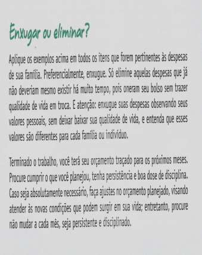
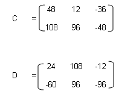
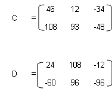
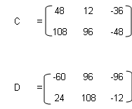
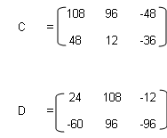
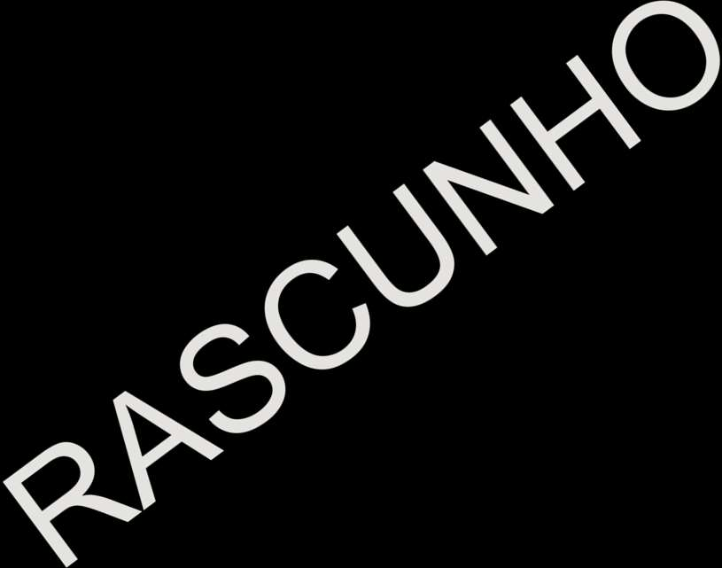

# PROVA — Camara_Caete_2015_Agente_Administrativo

## 1. Análise geral da prova

- **Identificação:** Camara_Caete_2015_Agente_Administrativo
- **Quantidade total de questões:** 40
- **Quantidade de textos de apoio (grupos):** 0
- **Quantidade de imagens:** 9
- **Quantidade de gráficos e tabelas:** incluídos nas imagens e no texto extraído, quando presentes no PDF original
- **Quantidade de grupos identificados:** 0
- **Quantidade de questões independentes:** 40
- **Questões que compartilham materiais:** nenhuma identificada automaticamente

### Transcrição integral da capa/instruções (conforme extraída do PDF)

> [!NOTE]
> Conteúdo integral das páginas anteriores à primeira questão, sem cortes.

> 
>
> CONCURSO PÚBLICO DE PROVAS PARA PROVIMENTO DE EMPREGOS PÚBLICOS
> DO QUADRO PERMANENTE DE PESSOAL DA CÂMARA MUNICIPAL DE CAETÉ, MINAS GERAIS
> EDITAL Nº 01/2015
> CÓDIGO
> EMPREGO PÚBLICO
> AGENTE ADMINISTRATIVO
> ORGANIZAÇÃO: FUNDAÇÃO DE ENSINO DE CONTAGEM
> LEIA ATENTAMENTE AS INSTRUÇÕES ABAIXO
>
> Ao receber a ordem do Fiscal da sala, confira este CADERNO com muita atenção, pois nenhuma reclamação
> sobre o total de questões e/ou falhas na impressão será aceita depois de iniciada a prova. Caso haja algum
> problema, solicite a substituição deste caderno.
>
> Confira se sua prova corresponde ao cargo pelo qual você optou quando realizou a inscrição.
>
> As instruções constantes neste Caderno de Questões da Prova Objetiva e da Prova de Redação complementam
> o Edital e deverão ser rigorosamente observadas e seguidas pelo candidato.
> Este caderno contém a Prova Objetiva e a Prova de Redação. São 40 (QUARENTA) questões de prova objetiva,
> sendo 10 (DEZ) de Língua Portuguesa, 10 (DEZ) de Matemática, 10 (DEZ) de Conhecimentos em Informática
> e 10 (DEZ) de Conhecimentos Específicos, incluindo noções de Redação Oficial, cada uma constituída de 4
> (QUATRO) alternativas de respostas para cada questão, sendo apenas uma alternativa correta. A Prova de
> Redação compõe-se de uma proposta de REDAÇÃO relativa ao cargo de Ensino Médio completo, conforme item
> 6.2.1, QUADRO VI do Edital.
>
> Faça nas páginas apropriadas, deste caderno, os rascunhos do gabarito e da redação. Os rascunhos não serão
> considerados na correção.
>
> Não serão distribuídas folhas suplementares para os rascunhos.
>
> Ao finalizar a Prova Objetiva, transfira as respostas para a Folha de Respostas, observando o seguinte exemplo:
> Questão 01 – letra C
> 01)
> A)
> B)
> C)
> D)
> Questão 02 – letra B
> 02)
> A)
> B)
> C)
> D)
> Use apenas caneta (tinta preta ou azul) para preencher o gabarito da Folha de Respostas. Não utilize corretivo.
> NÃO SERÃO ACEITAS RASURAS.
>
> Sua resposta não será computada se houver marcação de duas ou mais alternativas, MESMO QUE UMA DELAS
> ESTEJA CORRETA.
>
> Não deixe nenhuma questão sem resposta.
>
> Transcreva, a caneta (tinta preta ou azul), a redação para a Folha de Resposta da Prova de Redação.
>
> Não dobre, amasse ou rasure as Folhas de Respostas. ELAS SÃO A SUA PROVA.
>
> O candidato deverá entregar somente a FOLHA DE RESPOSTAS DO GABARITO e a FOLHA DE
> TRANSCRIÇÃO DA REDAÇÃO, devidamente preenchidas e assinadas.
>
> O tempo de duração da Prova Objetiva e da Prova de Redação é de 4 h (QUATRO HORAS), já incluído o tempo
> destinado à transcrição das respostas de Questões da Prova Objetiva e da Prova de Redação para as Folhas de
> Respostas e à assinatura das mesmas.
>
> Durante a prova, não será admitida qualquer espécie de consulta ou comunicação entre candidatos, tampouco será
> permitido o uso de qualquer tipo de equipamento eletrônico (calculadora, telefone celular, beep, pagers, entre
> outros).
> ABRA ESTE CADERNO SOMENTE QUANDO AUTORIZADO
>
>
>
> CONCURSO PÚBLICO DE PROVAS PARA PROVIMENTO DE EMPREGOS PÚBLICOS
> DO QUADRO PERMANENTE DE PESSOAL DA CÂMARA MUNICIPAL DE CAETÉ, MINAS GERAIS
> EDITAL Nº 01/2015
> CÓDIGO
> Emprego Público
> AGENTE ADMINISTRATIVO
> ORGANIZAÇÃO: FUNDAÇÃO DE ENSINO DE CONTAGEM – FUNEC 2
> LÍNGUA PORTUGUESA
> TEXTO I
> (...)
> (SICOOB Cofal. Cartilha de planejamento do orçamento doméstico.)

### Gabarito

| Questão | 01 | 02 | 03 | 04 | 05 |
|---|---|---|---|---|---|
| Resposta | B | C | B | B | C |

| Questão | 06 | 07 | 08 | 09 | 10 |
|---|---|---|---|---|---|
| Resposta | C | B | A | B | A |

| Questão | 11 | 12 | 13 | 14 | 15 |
|---|---|---|---|---|---|
| Resposta | D | D | A | C | A |

| Questão | 16 | 17 | 18 | 19 | 20 |
|---|---|---|---|---|---|
| Resposta | A | D | B | B | A |

| Questão | 21 | 22 | 23 | 24 | 25 |
|---|---|---|---|---|---|
| Resposta | A | C | A | B | D |

| Questão | 26 | 27 | 28 | 29 | 30 |
|---|---|---|---|---|---|
| Resposta | B | A | C | C | D |

| Questão | 31 | 32 | 33 | 34 | 35 |
|---|---|---|---|---|---|
| Resposta | B | B | A | C | B |

| Questão | 36 | 37 | 38 | 39 | 40 |
|---|---|---|---|---|---|
| Resposta | B | D | B | B | B |

## 2. Questões agrupadas

Nenhum grupo de questões compartilhando material foi identificado automaticamente nesta prova.

## 3. Questões independentes

#### QUESTÃO 01

✅ **Gabarito: B** (gabarito.pdf (bloco AGENTE ADMINISTRATIVO, Edital 01/2015, FUNEC))

**Enunciado:**

Esse texto corresponde a fragmento de uma
publicação cujo objetivo é:

**Alternativas:**

A) Convencer as pessoas a poupar ou fazer
investimentos bancários.
B) Propor
uma
forma
de
organização
do
orçamento doméstico.
C) Ensinar a fazer uma planilha de orçamento
doméstico.
D) Orientar as pessoas sobre como deve ser feito
um planejamento doméstico.

**Referências visuais:**

Nenhuma.

---

#### QUESTÃO 02

✅ **Gabarito: C** (gabarito.pdf (bloco AGENTE ADMINISTRATIVO, Edital 01/2015, FUNEC))

**Enunciado:**

É
CORRETO
afirmar
que
esse
texto
é
predominantemente:

**Alternativas:**

A) Injuntivo.
B) Dissertativo.
C) Argumentativo.
D) Descritivo.

**Referências visuais:**

Nenhuma.

---

#### QUESTÃO 03

✅ **Gabarito: B** (gabarito.pdf (bloco AGENTE ADMINISTRATIVO, Edital 01/2015, FUNEC))

**Enunciado:**

Analise as proposições a seguir sobre o texto.

I-
Há um predomínio de períodos curtos, com
vistas a facilitar a leitura.
II-
Os verbos foram empregados sempre no
modo imperativo.
III- As ações foram apresentadas de modo
sequencial.

Está(ão) CORRETA(S):

**Alternativas:**

A) I.
B) I e II.
C) II e III.
D) I e III.

**Referências visuais:**

Nenhuma.

---

#### QUESTÃO 04

✅ **Gabarito: B** (gabarito.pdf (bloco AGENTE ADMINISTRATIVO, Edital 01/2015, FUNEC))

**Enunciado:**

Segundo
os
autores,
planejar
o
orçamento
doméstico é importante porque:

**Alternativas:**

A) Torna possível manter uma boa qualidade de
vida, alcançar determinados objetivos e ter um
futuro seguro financeiramente.
B) Ajuda as pessoas a se organizarem, sabendo
quanto e com o que podem gastar.
C) É uma tarefa que possibilita às pessoas
pouparem recursos.
D) A queda do índice de pessoas endividadas é
importante
para
a
saúde
financeira
dos
estabelecimentos.

**Referências visuais:**

Nenhuma.

---

#### QUESTÃO 05

✅ **Gabarito: C** (gabarito.pdf (bloco AGENTE ADMINISTRATIVO, Edital 01/2015, FUNEC))

**Enunciado:**

Em “Muitos brasileiros têm um hábito pouco
saudável: primeiro gastar, para depois ver como
pagar” está implícito que:

**Alternativas:**

A) Pessoas de outras nacionalidades agem de
forma diferente do brasileiro em relação às
finanças.
B) O brasileiro é mais endividado que pessoas
dos demais países.
C) O brasileiro compra tudo o que vê.
D) Nos demais países, as pessoas não se
endividam tanto quanto os brasileiros.

CONCURSO PÚBLICO DE PROVAS PARA PROVIMENTO DE EMPREGOS PÚBLICOS
DO QUADRO PERMANENTE DE PESSOAL DA CÂMARA MUNICIPAL DE CAETÉ, MINAS GERAIS
EDITAL Nº 01/2015
CÓDIGO
Emprego Público
AGENTE ADMINISTRATIVO
ORGANIZAÇÃO: FUNDAÇÃO DE ENSINO DE CONTAGEM – FUNEC 3

**Referências visuais:**

Nenhuma.

---

#### QUESTÃO 06

✅ **Gabarito: C** (gabarito.pdf (bloco AGENTE ADMINISTRATIVO, Edital 01/2015, FUNEC))

**Enunciado:**

A alternativa em que as relações estabelecidas
entre as orações não foram corretamente indicadas é:

**Alternativas:**

A) Terminado
o
trabalho,
você
terá
seu
orçamento traçado para os próximos meses.
(subordinação)
B) Procure cumprir o que você planejou, tenha
persistência
e
boa
dose
de
disciplina.
(coordenação)
C) Caso seja absolutamente necessário, faça
ajustes
no
orçamento
planejado
(...)
(subordinação)
D) Aplique os exemplos acima em todos os itens
que forem pertinentes às despesas de sua família.
(coordenação)

**Referências visuais:**

Nenhuma.

---

#### QUESTÃO 07

✅ **Gabarito: B** (gabarito.pdf (bloco AGENTE ADMINISTRATIVO, Edital 01/2015, FUNEC))

**Enunciado:**

Foi utilizada linguagem figurada em:

**Alternativas:**

A) “(...) primeiro gastar, para depois ver como
pagar.”
B) “Enxugar ou eliminar?”
C) “(...) você terá o seu orçamento traçado para
os próximos meses.”
D) “Tendo listado suas receitas e definido o valor
de sua reserva mensal (...)

**Referências visuais:**

Nenhuma.

---

#### QUESTÃO 08

✅ **Gabarito: A** (gabarito.pdf (bloco AGENTE ADMINISTRATIVO, Edital 01/2015, FUNEC))

**Enunciado:**

Em “enxugue suas despesas observando seus
valores pessoais, sem deixar baixar sua qualidade de
vida, e entenda que esses valores são diferentes para
cada família ou indivíduo” ocorre ambiguidade porque:
I- Não se pode afirmar qual o sentido da palavra
“valores”: se é preço de um produto ou princípio
ético.
II- O pronome possessivo “seus” pode referir-se
aos valores das despesas a serem enxugadas ou
aos valores do receptor do texto, no caso o leitor.

Marque a opção CORRETA.

**Alternativas:**

A) As duas afirmações são verdadeiras e I é
decorrente de II.
B) As duas afirmações são verdadeiras, mas não
há relação entre elas.
C) I é verdadeira e II é falsa.
D) I é falsa e II é verdadeira.

**Referências visuais:**

Nenhuma.

---

#### QUESTÃO 09

✅ **Gabarito: B** (gabarito.pdf (bloco AGENTE ADMINISTRATIVO, Edital 01/2015, FUNEC))

**Enunciado:**

A alternativa cuja reescrita implica alteração de
sentido ou inadequação às regras da língua escrita
padrão é:

**Alternativas:**

A) Caso seja absolutamente necessário, faça
ajustes no orçamento planejado, visando atender
às novas condições que podem surgir em sua vida.
Entretanto, procure não mudar a cada mês. Seja
persistente e disciplinado.
B) Aplique os exemplos acima em todos os itens,
que forem pertinentes às despesas de sua família.
C) Assim, antes de o mês começar, tenha em
suas anotações o orçamento previsto como meta
que você vai trabalhar para atingir.
D) Muitos brasileiros têm um hábito pouco
saudável: primeiro gastar para, depois, ver como
pagar.

**Referências visuais:**

Nenhuma.

---

#### QUESTÃO 10

✅ **Gabarito: A** (gabarito.pdf (bloco AGENTE ADMINISTRATIVO, Edital 01/2015, FUNEC))

**Enunciado:**

A alternativa cujo termo sublinhado exerce função
sintática diferente dos destacados nas demais é:

**Alternativas:**

A) O planejamento permite conhecer o seu limite
para cada tipo de consumo.
B) Só elimine aquelas despesas que já não
deveriam mesmo existir há muito tempo.
C) Entretanto, procure não mudar a cada mês.
D) Aplique os exemplos acima em todos os itens
que forem pertinentes às despesas de sua família.
MATEMÁTICA

**Referências visuais:**

Nenhuma.

---

#### QUESTÃO 11

✅ **Gabarito: D** (gabarito.pdf (bloco AGENTE ADMINISTRATIVO, Edital 01/2015, FUNEC))

**Enunciado:**

O sólido geométrico apresentado a seguir tem:

**Alternativas:**

A) 9 vértices, 6 arestas e 6 faces.
B) 5 vértices, 9 arestas e 5 faces.
C) 6 vértices, 6 arestas e 6 faces.
D) 6 vértices, 9 arestas e 5 faces.

**Referências visuais:**

Nenhuma.

---

#### QUESTÃO 12

✅ **Gabarito: D** (gabarito.pdf (bloco AGENTE ADMINISTRATIVO, Edital 01/2015, FUNEC))

**Enunciado:**

De acordo com os conceitos relacionados aos
sólidos geométricos, todas as alternativas abaixo
estão corretas, EXCETO:

**Alternativas:**

A) Prisma é um poliedro que tem duas bases
iguais e paralelas. As demais faces são regulares,
sendo que cada prisma recebe o nome de acordo
com a forma de suas bases.
B) Pirâmide é um poliedro que tem uma única
base
que
pode
ser
triangular,
quadrada,
pentagonal, hexagonal, etc. Todas as outras faces
são triangulares e convergem para um mesmo
vértice.
C) São chamados poliedros, todos os sólidos
geométricos que têm pelo menos uma face plana e
uma face circular.
D) Todos os poliedros possuem faces, arestas e
vértices.
CONCURSO PÚBLICO DE PROVAS PARA PROVIMENTO DE EMPREGOS PÚBLICOS
DO QUADRO PERMANENTE DE PESSOAL DA CÂMARA MUNICIPAL DE CAETÉ, MINAS GERAIS
EDITAL Nº 01/2015
CÓDIGO
Emprego Público
AGENTE ADMINISTRATIVO
ORGANIZAÇÃO: FUNDAÇÃO DE ENSINO DE CONTAGEM – FUNEC 4

**Referências visuais:**

Nenhuma.

---

#### QUESTÃO 13

✅ **Gabarito: A** (gabarito.pdf (bloco AGENTE ADMINISTRATIVO, Edital 01/2015, FUNEC))

**Enunciado:**

As figuras classificadas como poliedros são:

**Alternativas:**

A) 1, 2, 3.
B) 2, 4.
C) 2, 3, 4.
D) 1, 3.

**Referências visuais:**

Nenhuma.

---

#### QUESTÃO 14

✅ **Gabarito: C** (gabarito.pdf (bloco AGENTE ADMINISTRATIVO, Edital 01/2015, FUNEC))

**Enunciado:**

Paulo e Bernardo são corredores da mesma
equipe
e
participam
de
uma
competição.
Considerando que eles largaram juntos, todas as
afirmativas abaixo estão corretas, EXCETO:

**Alternativas:**

A) Se Paulo percorreu 7/10 (sete décimos) da
prova, e Bernardo percorreu 6/8 (seis oitavos) da
prova, Paulo está na frente de Bernardo.
B) Se Bernardo percorreu 3/5 (três quintos) da
prova, e Paulo percorreu 2/3 (dois terços) da prova,
Paulo está na frente de Bernardo.
C) Se Bernardo percorreu 7/8 (sete oitavos) da
prova, e Paulo percorreu 9/10 (nove décimos) da
prova, Paulo está na frente de Bernardo.
D) Se Paulo percorreu 4/7 (quatro sétimos) da
prova, e Bernardo percorreu 5/9 (cinco nonos) da
prova, Paulo está na frente de Bernardo.

**Referências visuais:**

Nenhuma.

---

#### QUESTÃO 15

✅ **Gabarito: A** (gabarito.pdf (bloco AGENTE ADMINISTRATIVO, Edital 01/2015, FUNEC))

**Enunciado:**

De acordo com os conceitos relacionados à
trigonometria e considerando os ângulos projetados
durante a subida de uma determinada rua íngreme,
todas as alternativas abaixo estão corretas, EXCETO:

**Alternativas:**

A) Quanto maior o ângulo de subida, mais
íngreme é a subida.
B) Quanto menor o índice de subida, mais
íngreme é a subida.
C) Em qualquer subida, Cosseno é a razão entre
o afastamento e o percurso.
D) Em qualquer subida, Seno é a razão entre a
altura e o percurso.

**Referências visuais:**

Nenhuma.

---

#### QUESTÃO 16

✅ **Gabarito: A** (gabarito.pdf (bloco AGENTE ADMINISTRATIVO, Edital 01/2015, FUNEC))

**Enunciado:**

De acordo com os conceitos relacionados à
trigonometria, todas as alternativas abaixo estão
corretas, EXCETO:

**Alternativas:**

A) Um arco de um radiano (1 rad) é um arco cujo
comprimento
retificado
é
igual
ao
raio
da
circunferência.
B) Se temos 1 ângulo central de medida 1
radiano, ele subentende um arco de medida 1
radiano e comprimento de um raio.
C) Se temos um ângulo central de medida 2
radianos, ele subentende dois arcos de medida 2
radianos e comprimento de 2 raios.
D) Todo arco de circunferência tem um ângulo
central que o subentende.

**Referências visuais:**

Nenhuma.

---

#### QUESTÃO 17

✅ **Gabarito: D** (gabarito.pdf (bloco AGENTE ADMINISTRATIVO, Edital 01/2015, FUNEC))

**Enunciado:**

De acordo com os conceitos relacionados ao
Binômio de Newton, todas as alternativas abaixo estão
corretas, EXCETO:

**Alternativas:**

A) (12x + 36)0 = 1
B) (x + y)2 = x2 + 2xy + y2
C) (x + y)3 = x3 + 3xy + y3
D) (x + y)1 = x + y

**Referências visuais:**

Nenhuma.

---

#### QUESTÃO 18

✅ **Gabarito: B** (gabarito.pdf (bloco AGENTE ADMINISTRATIVO, Edital 01/2015, FUNEC))

**Enunciado:**

De acordo com os conceitos relacionados aos
Sistemas Lineares, analise as afirmativas abaixo.

A alternativa CORRETA é:

**Alternativas:**

A) 
B) 
C) 
D) CONCURSO PÚBLICO DE PROVAS PARA PROVIMENTO DE EMPREGOS PÚBLICOS
DO QUADRO PERMANENTE DE PESSOAL DA CÂMARA MUNICIPAL DE CAETÉ, MINAS GERAIS
EDITAL Nº 01/2015
CÓDIGO
Emprego Público
AGENTE ADMINISTRATIVO
ORGANIZAÇÃO: FUNDAÇÃO DE ENSINO DE CONTAGEM – FUNEC 5

**Referências visuais:**

Nenhuma.

---

#### QUESTÃO 19

✅ **Gabarito: B** (gabarito.pdf (bloco AGENTE ADMINISTRATIVO, Edital 01/2015, FUNEC))

**Enunciado:**

Considerando as duas matrizes A e B do tipo 2 x
3 apresentadas abaixo, determine o valor de C tal que
cij = aij + bij e o valor de D tal que dij = aij – bij.
A alternativa CORRETA é:

**Alternativas:**

A) 
B) 
C) 
D) 

**Referências visuais:**

Nenhuma.

---

#### QUESTÃO 20

✅ **Gabarito: A** (gabarito.pdf (bloco AGENTE ADMINISTRATIVO, Edital 01/2015, FUNEC))

**Enunciado:**

Considere uma progressão geométrica de 5
termos, sendo que o primeiro termo é 6. É CORRETO
afirmar que:

**Alternativas:**

A) Se a razão é q = 3, o terceiro termo é 162.
B) Se a razão é q = 4, o terceiro termo é 384.
C) Se a razão é q = 5, o quinto termo é 750.
D) Se a razão é q = 3, o quinto termo é 486.
CONHECIMENTOS EM INFORMÁTICA

**Referências visuais:**

Nenhuma.

---

#### QUESTÃO 21

✅ **Gabarito: A** (gabarito.pdf (bloco AGENTE ADMINISTRATIVO, Edital 01/2015, FUNEC))

**Enunciado:**

Para reduzir a possibilidade de roubo de dados
de um computador, é uma boa prática instalar e
configurar um software:

**Alternativas:**

A) Malware.
B) Firewall.
C) Spyware.
D) Trojan.

**Referências visuais:**

Nenhuma.

---

#### QUESTÃO 22

✅ **Gabarito: C** (gabarito.pdf (bloco AGENTE ADMINISTRATIVO, Edital 01/2015, FUNEC))

**Enunciado:**

Avalie as proposições sobre o software Microsoft
Word 2013.
I-
O pincel de formatação pode ser usado para
aplicar a aparência de um parágrafo do texto em
outro parágrafo de outro texto.
II-
O zoom pode ser usado para reduzir o
tamanho do texto na tela do computador.
III- A orientação da página de um texto pode ser
configurada para o modo paisagem ou modo A4.
Estão CORRETAS:

**Alternativas:**

A) Somente as afirmativas I e II.
B) Somente as afirmativas II e III.
C) Somente as afirmativas I e III.
D) Todas as afirmativas.

**Referências visuais:**

Nenhuma.

---

#### QUESTÃO 23

✅ **Gabarito: A** (gabarito.pdf (bloco AGENTE ADMINISTRATIVO, Edital 01/2015, FUNEC))

**Enunciado:**

Marque a ação que pode ser realizada no
software Power Point 2013.

**Alternativas:**

A) Criar um slide contendo um título e um
manuscrito.
B) Salvar uma apresentação em formato tcpip.
C) Inserir um gráfico de colunas em um slide.
D) Alterar o modo de apresentação para slide de
apoio.

CONCURSO PÚBLICO DE PROVAS PARA PROVIMENTO DE EMPREGOS PÚBLICOS
DO QUADRO PERMANENTE DE PESSOAL DA CÂMARA MUNICIPAL DE CAETÉ, MINAS GERAIS
EDITAL Nº 01/2015
CÓDIGO
Emprego Público
AGENTE ADMINISTRATIVO
ORGANIZAÇÃO: FUNDAÇÃO DE ENSINO DE CONTAGEM – FUNEC 6

**Referências visuais:**

Nenhuma.

---

#### QUESTÃO 24

✅ **Gabarito: B** (gabarito.pdf (bloco AGENTE ADMINISTRATIVO, Edital 01/2015, FUNEC))

**Enunciado:**

Uma função do Excel 2013 que calcula o desvio
padrão de um conjunto de células contendo valores
numéricos é:

**Alternativas:**

A) DESVQ
B) DESVPAD.A
C) DESV.MÉDIO
D) DESVNUM

**Referências visuais:**

Nenhuma.

---

#### QUESTÃO 25

✅ **Gabarito: D** (gabarito.pdf (bloco AGENTE ADMINISTRATIVO, Edital 01/2015, FUNEC))

**Enunciado:**

Para finalizar uma tarefa do sistema operacional
Windows 8, que está consumindo recursos excessivos
de processador do computador, pode-se usar o
aplicativo:

**Alternativas:**

A) Monitor de Tarefas.
B) Monitor de Recursos.
C) Windows Explorer.
D) Gerenciador de Tarefas.

**Referências visuais:**

Nenhuma.

---

#### QUESTÃO 26

✅ **Gabarito: B** (gabarito.pdf (bloco AGENTE ADMINISTRATIVO, Edital 01/2015, FUNEC))

**Enunciado:**

O Linux é um sistema operacional freeware com
a seguinte característica:

**Alternativas:**

A) Proprietário.
B) Periférico.
C) Multitarefa.
D) Formatável.

**Referências visuais:**

Nenhuma.

---

#### QUESTÃO 27

✅ **Gabarito: A** (gabarito.pdf (bloco AGENTE ADMINISTRATIVO, Edital 01/2015, FUNEC))

**Enunciado:**

Analise
as
proposições
sobre
redes
de
computadores.
I-
Redes de computadores permitem que dois ou
mais computadores enviem ou recebam dados e
compartilhem
os
recursos
de
hardware
ou
software.
II-
Rede ponto a ponto é um tipo de torrent
utilizado para compartilhar a internet entre dois ou
mais computadores.
III- Repetidor, Hub e Modem são dispositivos que
podem ser usados para a montagem de redes de
computadores.
Estão CORRETAS.

**Alternativas:**

A) Somente as afirmativas I e II.
B) Somente as afirmativas II e III.
C) Somente as afirmativas I e III.
D) Todas as afirmativas.

**Referências visuais:**

Nenhuma.

---

#### QUESTÃO 28

✅ **Gabarito: C** (gabarito.pdf (bloco AGENTE ADMINISTRATIVO, Edital 01/2015, FUNEC))

**Enunciado:**

A rede social mais utilizada no Brasil, em que o
usuário pode divulgar seu currículo e todo seu portfólio
de trabalho, é:

**Alternativas:**

A) Facebook.
B) Twitter.
C) LinkedIn.
D) Instagram.

**Referências visuais:**

Nenhuma.

---

#### QUESTÃO 29

✅ **Gabarito: C** (gabarito.pdf (bloco AGENTE ADMINISTRATIVO, Edital 01/2015, FUNEC))

**Enunciado:**

A suíte de software LibreOffice é uma alternativa
para:

**Alternativas:**

A) Microsoft Windows.
B) Intranet.
C) Google Docs.
D) Microsoft Word.

**Referências visuais:**

Nenhuma.

---

#### QUESTÃO 30

✅ **Gabarito: D** (gabarito.pdf (bloco AGENTE ADMINISTRATIVO, Edital 01/2015, FUNEC))

**Enunciado:**

A respeito dos navegadores web, é possível
afirmar que:

**Alternativas:**

A) O Google Chrome destaca-se pela rapidez e
facilidade de utilização.
B) O Mozilla Firefox destaca-se pela habilidade
de transferência de dados distribuídos.
C) O Internet Explorer destaca-se pela habilidade
de integração com o sistema operacional Linux.
D) Nenhum dos navegadores web permite a
navegação em modo privado.
CONHECIMENTOS ESPECÍFICOS

**Referências visuais:**

Nenhuma.

---

#### QUESTÃO 31

✅ **Gabarito: B** (gabarito.pdf (bloco AGENTE ADMINISTRATIVO, Edital 01/2015, FUNEC))

**Enunciado:**

Em documentos oficiais destinados aos prefeitos
municipais ou governadores, deve-se utilizar:

**Alternativas:**

A) Vossa Senhoria.
B) Vossa Magnificência.
C) Vossa Excelência.
D) Vossa Eminência.

**Referências visuais:**

Nenhuma.

---

#### QUESTÃO 32

✅ **Gabarito: B** (gabarito.pdf (bloco AGENTE ADMINISTRATIVO, Edital 01/2015, FUNEC))

**Enunciado:**

A característica da redação oficial que se refere à
ligação entre os elementos de um texto, que ocorre no
interior das frases, entre as próprias frases e entre os
vários parágrafos, é a:

**Alternativas:**

A) Uniformidade.
B) Formalidade.
C) Coesão.
D) Concisão.

**Referências visuais:**

Nenhuma.

---

#### QUESTÃO 33

✅ **Gabarito: A** (gabarito.pdf (bloco AGENTE ADMINISTRATIVO, Edital 01/2015, FUNEC))

**Enunciado:**

Analise a definição a seguir relacionada aos atos
administrativos e de comunicação.

“Decisão proferida sobre ofício, memorando, parecer,
informação, requerimento ou demais documentos
submetidos pelas partes a seu conhecimento e
solução”.
(Disponível em
<http://www.icmbio.gov.br/portal/images/stories/comunicacao/manua
ldegestaodocumental.pdf>.Acesso em 11 jan.2016)

Ela é a(o):

**Alternativas:**

A) Ofício.
B) Circular.
C) Despacho.
D) Ordem de serviço.
CONCURSO PÚBLICO DE PROVAS PARA PROVIMENTO DE EMPREGOS PÚBLICOS
DO QUADRO PERMANENTE DE PESSOAL DA CÂMARA MUNICIPAL DE CAETÉ, MINAS GERAIS
EDITAL Nº 01/2015
CÓDIGO
Emprego Público
AGENTE ADMINISTRATIVO
ORGANIZAÇÃO: FUNDAÇÃO DE ENSINO DE CONTAGEM – FUNEC 7

**Referências visuais:**

Nenhuma.

---

#### QUESTÃO 34

✅ **Gabarito: C** (gabarito.pdf (bloco AGENTE ADMINISTRATIVO, Edital 01/2015, FUNEC))

**Enunciado:**

Com relação à correspondência, todas as
alternativas estão corretas, EXCETO:

**Alternativas:**

A) A
classificação
e
a
caracterização
da
correspondência
são
dois
fatores
da
maior
importância no desenvolvimento das tarefas de
registro e protocolo.
B) Correspondência é toda e qualquer forma de
comunicação escrita, produzida e destinada a
pessoas jurídicas ou físicas, e vice-versa.
C) A correspondência oficial é aquela que trata
de assunto de serviço ou de interesse específico
das atividades de uma instituição.
D) Quanto ao destino e procedência, pode-se
classificar
a
correspondência
somente
como
interna.

**Referências visuais:**

Nenhuma.

---

#### QUESTÃO 35

✅ **Gabarito: B** (gabarito.pdf (bloco AGENTE ADMINISTRATIVO, Edital 01/2015, FUNEC))

**Enunciado:**

Sobre a gestão de materiais, pode-se afirmar que
todas as alternativas estão corretas, EXCETO:

**Alternativas:**

A) Just in time é um tipo de sistema utilizado pela
administração
de
materiais
para
garantir
a
quantidade certa, na hora certa, de modo que
atenda as necessidades de demanda com estoque
mínimo.
B) Entende-se que a gestão de materiais possui
atualmente uma visão muito mais estratégica do
que operacional.
C) Alguns princípios da gestão dos recursos
materiais são: qualidade do material, quantidade
necessária, prazo de entrega, preço e condições
de pagamento.
D) A administração da gestão de materiais deve
realizar, ao final de cada ano, o inventário e enviá-
lo para a contabilidade.

**Referências visuais:**

Nenhuma.

---

#### QUESTÃO 36

✅ **Gabarito: B** (gabarito.pdf (bloco AGENTE ADMINISTRATIVO, Edital 01/2015, FUNEC))

**Enunciado:**

Com relação à administração de patrimônio,
marque a alternativa CORRETA:

**Alternativas:**

A) Os bens patrimoniais são os bens móveis e
imóveis classificados como material permanente e
de propriedade de uma empresa.
B) As plaquetas destinadas aos bens móveis
devem
ser
trocadas
mensalmente
e
são
meramente ilustrativas.
C) A cada final de semestre, os bens patrimoniais
deverão ser compatibilizados com os registros
contábeis, atribuindo-se valores a cada um.
D) A relação completa desses bens constitui-se
no histórico dos bens patrimoniais.

**Referências visuais:**

Nenhuma.

---

#### QUESTÃO 37

✅ **Gabarito: D** (gabarito.pdf (bloco AGENTE ADMINISTRATIVO, Edital 01/2015, FUNEC))

**Enunciado:**

Sobre a expedição, uma das rotinas inerentes
aos processos de protocolo, é CORRETO afirmar:

**Alternativas:**

A) Consiste em separar os documentos e
proceder a separação dos mesmos.
B) Consiste no envio dos originais (com anexos,
se for o caso) aos destinatários, via Correios
(ECT), malotes ou em mãos, e, ainda, o envio das
cópias,
devidamente
classificadas
e
acompanhadas dos documentos que lhes deram
origem.
C) É a reprodução dos dados do documento, feita
em sistema terceirizado, destinado a controlar a
movimentação das correspondências.
D) É a entrega dos documentos aos destinatários
e o controle da movimentação dos documentos.

**Referências visuais:**

Nenhuma.

---

#### QUESTÃO 38

✅ **Gabarito: B** (gabarito.pdf (bloco AGENTE ADMINISTRATIVO, Edital 01/2015, FUNEC))

**Enunciado:**

Todas as alternativas, sobre protocolo, estão
corretas, EXCETO:

**Alternativas:**

A) A principal função é autenticar a entrega de
um documento ou evidenciar a decisão ou fato que
deve ser registrado.
B) Entende-se que é um livro no qual pode-se
registrar as deliberações ou atas de um congresso.
C) É um livro obrigatório em que os cartórios de
registro anotam todas as operações de que tenham
participado.
D) Livro no qual se registram, independente da
ordem, os documentos apresentados em uma
repartição.

**Referências visuais:**

Nenhuma.

---

#### QUESTÃO 39

✅ **Gabarito: B** (gabarito.pdf (bloco AGENTE ADMINISTRATIVO, Edital 01/2015, FUNEC))

**Enunciado:**

Em processos administrativos, pode-se dizer que
a autuação e/ou formação de processo é:

**Alternativas:**

A) A reprodução dos dados do documento, que
pode ser feita em sistema próprio, com o objetivo
de controlar a movimentação da correspondência e
de processo, além de fornecer dados de suas
características fundamentais, aos interessados.
B) O andamento do processo e/ou documento de
uma unidade à outra, interna ou externa, através
do sistema próprio.
C) O termo que caracteriza a abertura de um
processo.
D) Toda espécie de comunicação escrita, que
tramita nos órgãos ou entidades.
CONCURSO PÚBLICO DE PROVAS PARA PROVIMENTO DE EMPREGOS PÚBLICOS
DO QUADRO PERMANENTE DE PESSOAL DA CÂMARA MUNICIPAL DE CAETÉ, MINAS GERAIS
EDITAL Nº 01/2015
CÓDIGO
Emprego Público
AGENTE ADMINISTRATIVO
ORGANIZAÇÃO: FUNDAÇÃO DE ENSINO DE CONTAGEM – FUNEC 8

**Referências visuais:**

Nenhuma.

---

#### QUESTÃO 40

✅ **Gabarito: B** (gabarito.pdf (bloco AGENTE ADMINISTRATIVO, Edital 01/2015, FUNEC))

**Enunciado:**

Analise a definição a seguir.

“ É a transmissão de informações com o mínimo de
palavras . É a precisão na escolha das palavras , a
objetividade para tratar do assunto, com foco na
intenção do texto, evitando-se informações supérfluas,
que dispersam o leitor e dificultam a inteligibilidade.”
(Manual de Redação Oficial do Governo do Estado de Minas
Gerais. 2012. Disponível em : <
http://www.google.com.br/#q=manual+de+reda%C3%A7%C3%A3o
+oficial+do+governo+de+minas+gerais>. Acesso em: 15 dez. 2015)
Tendo em vista as características da redação oficial, é
CORRETO afirmar que a definição acima refere-se à:

**Alternativas:**

A) Precisão.
B) Objetividade.
C) Concisão.
D) Assertividade.
FOLHA DE RASCUNHO DE GABARITO
CAETÉ, 31 DE JANEIRO DE 2016
CONCURSO PÚBLICO DE PROVAS PARA PROVIMENTO DE EMPREGOS PÚBLICOS
DO QUADRO PERMANENTE DE PESSOAL DA CÂMARA MUNICIPAL DE CAETÉ, MINAS GERAIS
EDITAL Nº 01/2015
CÓDIGO
Emprego Público
AGENTE ADMINISTRATIVO
ORGANIZAÇÃO: FUNDAÇÃO DE ENSINO DE CONTAGEM – FUNEC 9
INSTRUÇÕES ESPECÍFICAS
Preencha com cuidado, utilizando caneta de tinta preta ou azul, a identificação que se encontra na parte superior
da Folha de Resposta.
A versão definitiva da resposta deverá ser registrada no espaço próprio da Folha de Resposta.
NÃO SE IDENTIFIQUE NO ESPAÇO DE TRANSCRIÇÃO DA FOLHA DE RESPOSTA DA PROVA DE REDAÇÃO.
A prova que apresentar, no espaço específico para transcrição da redação, qualquer sinal ou que contiver
expressão que possibilite a identificação do candidato será anulada e a ela será atribuída a nota 0 (zero).
O texto da redação a ser redigida deve conter, no mínimo, 18 (dezoito) e, no máximo, 20 (vinte) linhas.
Haverá um desconto de pontos para as seguintes situações:

desconto de 0,5 (meio) ponto por linha aquém do mínimo estipulado.

desconto de 0,5 (meio) ponto por linha além do máximo estipulado.
Este critério se aplica ainda ao texto escrito com letra grande demais ou com espaçamento exagerado entre os
vocábulos.
A variante linguística a ser utilizada na elaboração do texto é o padrão culto formal.
A Prova de Redação consistirá na elaboração de uma redação, no valor de 30 (trinta) pontos, sendo atribuída nota
zero, de acordo com o critério de avaliação do Anexo VII ou que não obedecer às orientações apresentadas neste
caderno de prova.
Somente serão corrigidas as redações escritas com caneta esferográfica de tinta preta ou azul. Não será permitido
o uso de lápis borracha ou corretivo de texto.
Nos termos do Anexo VII do Edital, os critérios de correção da Prova de Redação serão os estabelecidos no item
A, QUADRO III em que são apresentados os quesitos a serem considerados na avaliação.
QUADRO III CRITÉRIOS DE AVALIAÇÃO DA PROVA DE REDAÇÃO
- TEXTO DISSERTATIVO-
ARGUMENTATIVO – ENSINO MÉDIO.
ASPECTOS AVALIADOS
Total de Pontos
Não pertinência ao tema /proposta
Zerada
CL – Correção Linguística (Pontuação, ortografia, acentuação
gráfica e morfossintaxe)
Até 4,0 pontos (0,5 ponto por erro)
PV - Propriedade Vocabular
Até 2,0 pontos (0,5 ponto por erro)
AA - Adequação no uso dos articuladores
Até 2,0 pontos (0,5 ponto por erro)
PG - Pertinência ao tipo textual (estrutura do texto dissertativo)
Até 2,0 pontos
OP - Organização adequada de parágrafos
Até 2,0 pontos
ACI - Argumentação coerente das ideias pertinentes à proposta
(pertinência, relevância e suficiência argumentativa).
Até 6,0 pontos
CC – Coesão e Coerência
Até 3,0 pontos
PI – Progressão e continuidade de idéias (manutenção temática)
Até 5,0 pontos
Proposta de Intervenção
Até 4,0 pontos
CONCURSO PÚBLICO DE PROVAS PARA PROVIMENTO DE EMPREGOS PÚBLICOS
DO QUADRO PERMANENTE DE PESSOAL DA CÂMARA MUNICIPAL DE CAETÉ, MINAS GERAIS
EDITAL Nº 01/2015
CÓDIGO
Emprego Público
AGENTE ADMINISTRATIVO
ORGANIZAÇÃO: FUNDAÇÃO DE ENSINO DE CONTAGEM – FUNEC 10
PROPOSTA DE REDAÇÃO
Leia os textos abaixo.
Texto I
(Disponível em:<http://revistadireito.com/a-empresa-sob-o-ponto-de-vista-do-direito-do-trabalho/>.Acesso em: 12 nov. 2015)
Texto II
Servidor Público - Ofício do "bem servir"
Um município, estado ou nação tem em suas bases o esforço, dedicação e trabalho de milhares de servidores
públicos. Estes cidadãos carregam consigo a responsabilidade de estabelecer um elo entre o Poder Público e a
sociedade, prestando serviços essenciais à população. [...] Sua missão é a de servir ao interesse coletivo [...] e seu
papel, embora subordinado ao poder político dos detentores de mandato popular, está longe de ser passivo. Pelo
contrário, é e tem que ser ativo: diagnosticando problemas, levantando alternativas, propondo soluções. [...] Não há
dúvida que os servidores públicos de carreira constituem o ativo mais rico, mais estratégico, pois é o único fator que
não se substitui com facilidade. Quando estes cidadãos que escolheram o ofício do "bem servir" são deixados de
lado, [...] quem perde é a instituição, é o povo, pois, sem corpo funcional bem selecionado, bem treinado, bem
remunerado e constantemente estimulado, não poderemos crescer de forma permanente e equilibrada.
(Disponível em:<http://www.administradores.com.br/artigos/carreira/servidor-publico-oficio-do-bem-servir/57804/>.Acesso em: 11 nov. 2015
Adaptado)
Analise os textos acima, e, a partir deles, produza um texto dissertativo-argumentativo, discutindo a seguinte questão:
O PRINCÍPIO DO BEM SERVIR COMO BASE PARA O TRABALHO DO SERVIDOR PÚBLICO. Apresente uma
proposta de intervenção, que esteja articulada às discussões feitas por você no texto, e que vise aprimorar o
atendimento ao público.

CONCURSO PÚBLICO DE PROVAS PARA PROVIMENTO DE EMPREGOS PÚBLICOS
DO QUADRO PERMANENTE DE PESSOAL DA CÂMARA MUNICIPAL DE CAETÉ, MINAS GERAIS
EDITAL Nº 01/2015
CÓDIGO
Emprego Público
AGENTE ADMINISTRATIVO
ORGANIZAÇÃO: FUNDAÇÃO DE ENSINO DE CONTAGEM – FUNEC 11

Será atribuída a nota 0 (zero) à Prova de Redação:
 Cujo conteúdo versar sobre tema diverso do estabelecido;
 Que não esteja de acordo com a tipologia e proposta solicitadas;
 Considerada ilegível ou desenvolvida em forma de desenhos, versos, bem como em códigos alheios à língua
portuguesa escrita ou em idioma diverso do português;
 Que estiver em branco, que for redigida a lápis, que apresentar qualquer tipo de identificação em local indevido.

**Referências visuais:**

Nenhuma.

---

## 4. Observações e limitações da extração

- Extração automática (texto selecionável do PDF via PyMuPDF), sem OCR: PDFs escaneados podem perder texto.
- Imagens repetidas (logos/marcas d'água) foram descartadas; as imagens de conteúdo foram salvas em `imagens/` com nomenclatura `imagem_00N`.
- A detecção de grupos usa os avisos padrão das bancas ("o texto seguinte servirá de base..."). Bancas sem esse aviso podem ter grupos não identificados — o conteúdo, porém, permanece integral.
- Se houver divergência entre esta versão e o PDF original, vale o PDF original; corrija manualmente o Markdown.
