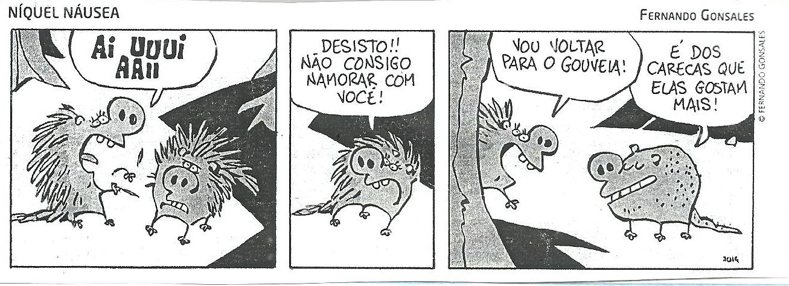

# PROVA — Camara_Camaragibe_2016_Agente_Administrativo

## 1. Análise geral da prova

- **Identificação:** Camara_Camaragibe_2016_Agente_Administrativo
- **Quantidade total de questões:** 40
- **Quantidade de textos de apoio (grupos):** 0
- **Quantidade de imagens:** 2
- **Quantidade de gráficos e tabelas:** incluídos nas imagens e no texto extraído, quando presentes no PDF original
- **Quantidade de grupos identificados:** 0
- **Quantidade de questões independentes:** 40
- **Questões que compartilham materiais:** nenhuma identificada automaticamente

### Transcrição integral da capa/instruções (conforme extraída do PDF)

> [!NOTE]
> Conteúdo integral das páginas anteriores à primeira questão, sem cortes.

> ESTADO DE PERNAMBUCO
> CÂMARA MUNICIPAL DE CAMARAGIBE
> * ATENÇÃO - CONFIRA SE ESTA PROVA CORRESPONDE AO CARGO QUE VOCÊ CONCORRE
> * Neste Caderno de Questões, você encontra:
> - 20 questões ESPECÍFICAS
> - 10 questões de Português
> - 05 questões de Matemática
> - 05 questões da Legislação Municipal
> * Só inicie a prova após a autorização do Fiscal de Sala.
> * Duração da prova: 3 horas. O Candidato só poderá retirar-se do recinto das provas após 01 hora, contada a partir do seu efetivo início.
> * O candidato só terá o direito de levar o caderno de prova após 02:00 horas do início dos trabalhos, e deixará apenas o Cartão de Respostas.
> * Caso o candidato opte em sair antes de 02:00 horas do início dos trabalhos; NÃO será permitido a anotação do gabarito seja qual for a
> forma.
> * Os Fiscais de Sala não estão autorizados a prestar quaisquer esclarecimentos sobre a resolução das questões; esta tarefa é obrigação do
> candidato.
> * Não é permitido que os candidatos se comuniquem entre si. É proibida também a utilização de quaisquer equipamentos eletrônicos.
> * O candidato receberá do Fiscal de Sala, 01 (hum) Cartão de Respostas correspondente às questões objetivas.
> * Assinale apenas uma opção em cada questão. Não deixe questão em branco, nem assinale mais de uma opção, para seu Cartão não ter
> questões anuladas.
> * O seu Cartão de Respostas é pessoal e insubstituível. Portanto, CUIDADO, não rasure, dobre ou amasse seu Cartão de Respostas pois
> em hipótese alguma ele será substituído, salvo por erro do fiscal ou por falha de impressão. Confira seus dados, leia as instruções para
> seu preenchimento e assinale no local indicado.
> * A assinatura no Cartão de Respostas é obrigatória. Assine o seu Cartão de Respostas (Gabarito). Cartão de Respostas
> sem assinatura acarretará na desclassificação do candidato.
> * O Gabarito desta prova estará disponível no dia 21/03/2016, no site www.conpass.com.br.
> * Para exercer o direito de recorrer contra qualquer questão, o candidato deve seguir as orientações constantes da Cláusula X do Edital do
> Concurso Público nº 001/2016 da CÂMARA MUNICIPAL DE CAMARAGIBE, de 14/01/2016.
> * Após o término da prova, o candidato deverá deixar a sala e em hipótese alguma poderá permanecer no estabelecimento onde realizou
> a mesma.
>
> BOA PROVA!!
> DATA: 20 DE MARÇO DE 2016
> CONCURSO PÚBLICO
> PROVA PARA CARGO DE:
> AGENTE ADMINISTRATIVO
>
>
>
> PARTE I – CONHECIMENTOS ESPECÍFICOS
>
> Responda as questões de 01 a 12 informando que atalhos de
> teclado do Windows 7 ou do Microsoft Office 2010
> permitem:

### Gabarito

| Questão | 01 | 02 | 03 | 04 | 05 |
|---|---|---|---|---|---|
| Resposta | E | C | B | A | D |

| Questão | 06 | 07 | 08 | 09 | 10 |
|---|---|---|---|---|---|
| Resposta | E | A | D | C | B |

| Questão | 11 | 12 | 13 | 14 | 15 |
|---|---|---|---|---|---|
| Resposta | D | C | D | C | E |

| Questão | 16 | 17 | 18 | 19 | 20 |
|---|---|---|---|---|---|
| Resposta | D | B | C | A | E |

| Questão | 21 | 22 | 23 | 24 | 25 |
|---|---|---|---|---|---|
| Resposta | A | D | C | E | D |

| Questão | 26 | 27 | 28 | 29 | 30 |
|---|---|---|---|---|---|
| Resposta | B | E | A | C | B |

| Questão | 31 | 32 | 33 | 34 | 35 |
|---|---|---|---|---|---|
| Resposta | E | D | A | A | C |

| Questão | 36 | 37 | 38 | 39 | 40 |
|---|---|---|---|---|---|
| Resposta | B | D | B | E | A |

## 2. Questões agrupadas

Nenhum grupo de questões compartilhando material foi identificado automaticamente nesta prova.

## 3. Questões independentes

#### QUESTÃO 01

✅ **Gabarito: E** (gabarito.pdf (bloco AGENTE ADMINISTRATIVO, prova aplicada em 20/03/2016))

**Enunciado:**

01 - No Office, fechar uma janela ativa:

**Alternativas:**

A) CTRL + O e CTRL + F4
B) ALT + F4 ou CTRL + F
C) ALT + W ou CTRL + F6
D) CTRL + W e CTRL + F3
E) CTRL + W ou CTRL + F4

**Referências visuais:**

Nenhuma.

---

#### QUESTÃO 02

✅ **Gabarito: C** (gabarito.pdf (bloco AGENTE ADMINISTRATIVO, prova aplicada em 20/03/2016))

**Enunciado:**

02 - No Word, criar um espaço não separável:

**Alternativas:**

A) CTRL + ALT + BARRA DE ESPAÇOS
B) SHIFT + ALT + TAB
C) CTRL + SHIFT + BARRA DE ESPAÇOS
D) SHIFT + ALT + S
E) CTRL + SHIFT + S

**Referências visuais:**

Nenhuma.

---

#### QUESTÃO 03

✅ **Gabarito: B** (gabarito.pdf (bloco AGENTE ADMINISTRATIVO, prova aplicada em 20/03/2016))

**Enunciado:**

03 - No Word, colar especial:

**Alternativas:**

A) CTRL + V
B) CTRL + ALT + V
C) ALT + U
D) CTRL + C
E) ALT + CTRL + C

**Referências visuais:**

Nenhuma.

---

#### QUESTÃO 04

✅ **Gabarito: A** (gabarito.pdf (bloco AGENTE ADMINISTRATIVO, prova aplicada em 20/03/2016))

**Enunciado:**

04 - No Word abrir a caixa de diálogo Contar Palavras:

**Alternativas:**

A) CTRL + SHIFT + G
B) CTRL + SHIFT + C
C) CTRL + G
D) ALT + C
E) ALT + TAB + V

**Referências visuais:**

Nenhuma.

---

#### QUESTÃO 05

✅ **Gabarito: D** (gabarito.pdf (bloco AGENTE ADMINISTRATIVO, prova aplicada em 20/03/2016))

**Enunciado:**

05 - No Excel, aplicar ou remover formatação em itálico:

**Alternativas:**

A) CTRL + S
B) ALT + 2
C) ALT + U
D) CTRL + 3
E) CTRL + 2

**Referências visuais:**

Nenhuma.

---

#### QUESTÃO 06

✅ **Gabarito: E** (gabarito.pdf (bloco AGENTE ADMINISTRATIVO, prova aplicada em 20/03/2016))

**Enunciado:**

06 - No Excel, ocultar as linhas selecionadas:

**Alternativas:**

A) CTRL + 3
B) SHIFT + O
C) SHIFT + 9
D) TAB + 3
E) CTRL + 9

**Referências visuais:**

Nenhuma.

---

#### QUESTÃO 07

✅ **Gabarito: A** (gabarito.pdf (bloco AGENTE ADMINISTRATIVO, prova aplicada em 20/03/2016))

**Enunciado:**

07 - Durante uma apresentação no PowerPoint, alterar o
ponteiro para uma caneta:

**Alternativas:**

A) CRTL + P
B) CRTL + C
C) ALT + C
D) SHIFT + C
E) SHIFT + P

**Referências visuais:**

Nenhuma.

---

#### QUESTÃO 08

✅ **Gabarito: D** (gabarito.pdf (bloco AGENTE ADMINISTRATIVO, prova aplicada em 20/03/2016))

**Enunciado:**

08 - Finalizar uma apresentação no PowerPoint:

**Alternativas:**

A) F ou CTRL F
B) TAB ou SHIFT
C) ESC + HIFEN
D) ESC ou HIFEN
E) TAB + F

**Referências visuais:**

Nenhuma.

---

#### QUESTÃO 09

✅ **Gabarito: C** (gabarito.pdf (bloco AGENTE ADMINISTRATIVO, prova aplicada em 20/03/2016))

**Enunciado:**

09 - No Access, abrir a caixa de diálogo Salvar Como:

**Alternativas:**

A) CTRL + F2
B) ALT + F10
C) F12
D) F2
E) F9

**Referências visuais:**

Nenhuma.

---

#### QUESTÃO 10

✅ **Gabarito: B** (gabarito.pdf (bloco AGENTE ADMINISTRATIVO, prova aplicada em 20/03/2016))

**Enunciado:**

10 - No Access, alternar do modo Design do formulário para
o modo Formulário:

**Alternativas:**

A) F6
B) F5
C) F9
D) F12
E) F7

**Referências visuais:**

Nenhuma.

---

#### QUESTÃO 11

✅ **Gabarito: D** (gabarito.pdf (bloco AGENTE ADMINISTRATIVO, prova aplicada em 20/03/2016))

**Enunciado:**

11 - No Windows, abrir a caixa Executar:

**Alternativas:**

A) WIN + E
B) CTRL + R
C) CTRL + E
D) WIN + R
E) ALT + E

**Referências visuais:**

Nenhuma.

---

#### QUESTÃO 12

✅ **Gabarito: C** (gabarito.pdf (bloco AGENTE ADMINISTRATIVO, prova aplicada em 20/03/2016))

**Enunciado:**

12 - No Windows, abrir a janela de Ajuda e Suporte do
Windows:

**Alternativas:**

A) WIN + F3
B) CTRL + S
C) WIN + F1
D) CTRL + H
E) WIN + H

**Referências visuais:**

Nenhuma.

---

#### QUESTÃO 13

✅ **Gabarito: D** (gabarito.pdf (bloco AGENTE ADMINISTRATIVO, prova aplicada em 20/03/2016))

**Enunciado:**

13 - Comando do Linux que permite testar a conectividade
entre equipamentos:

**Alternativas:**

A) root
B) conect
C) config
D) ping
E) chown

**Referências visuais:**

Nenhuma.

---

#### QUESTÃO 14

✅ **Gabarito: C** (gabarito.pdf (bloco AGENTE ADMINISTRATIVO, prova aplicada em 20/03/2016))

**Enunciado:**

14 - Comando do Linux que permite enviar uma mensagem
a todos os usuários logados no sistema:

**Alternativas:**

A) ping
B) chown
C) wall
D) talk
E) write

**Referências visuais:**

Nenhuma.

---

#### QUESTÃO 15

✅ **Gabarito: E** (gabarito.pdf (bloco AGENTE ADMINISTRATIVO, prova aplicada em 20/03/2016))

**Enunciado:**

15 - Recurso do Calc do LibreOffice, menu Dados, que
permite limitar os valores que podem ser usados em
determinada célula:

**Alternativas:**

A) Classificar
B) AutoFiltro
C) Definição
D) Proteger
E) Validação

**Referências visuais:**

Nenhuma.

---

#### QUESTÃO 16

✅ **Gabarito: D** (gabarito.pdf (bloco AGENTE ADMINISTRATIVO, prova aplicada em 20/03/2016))

**Enunciado:**

16 - Item de menu de acesso no Calc do LibreOffice para
criar uma tabela dinâmica:

**Alternativas:**

A) Inserir
B) Formatar
C) Janela
D) Dados
E) Editar

**Referências visuais:**

Nenhuma.

---

#### QUESTÃO 17

✅ **Gabarito: B** (gabarito.pdf (bloco AGENTE ADMINISTRATIVO, prova aplicada em 20/03/2016))

**Enunciado:**

17 - União das várias redes do mundo, interligadas através
do protocolo TCP/IP:

**Alternativas:**

A) Ethernet
B) Internet
C) Google
D) Wi-Fi
E) Telnet

**Referências visuais:**

Nenhuma.

---

#### QUESTÃO 18

✅ **Gabarito: C** (gabarito.pdf (bloco AGENTE ADMINISTRATIVO, prova aplicada em 20/03/2016))

**Enunciado:**

18 - Protocolo de transferência de hipertexto e que permite
a navegação na WEB.

**Alternativas:**

A) FTP
B) Telnet
C) HTTP
D) Archie
E) Netfind

**Referências visuais:**

Nenhuma.

---

#### QUESTÃO 19

✅ **Gabarito: A** (gabarito.pdf (bloco AGENTE ADMINISTRATIVO, prova aplicada em 20/03/2016))

**Enunciado:**

19 - Rede social online criada para compartilhamento de
foto e vídeo:

**Alternativas:**

A) Instagram
B) Badoo
C) Google+
D) Linkedin
E) Twitter

**Referências visuais:**

Nenhuma.

---

#### QUESTÃO 20

✅ **Gabarito: E** (gabarito.pdf (bloco AGENTE ADMINISTRATIVO, prova aplicada em 20/03/2016))

**Enunciado:**

20 - No Writer do LibreOffice, na janela Inserir quebra têm-
se como opções:

**Alternativas:**

A) Apenas quebra de linha e de página.
B) Apenas quebra de página e de linha.
C) Apenas quebra de página e de coluna.
D) Quebras de página, linha e coluna.
E) Apenas quebra de página.
As questões de 21 a 23 referem-se ao texto seguinte:
O que é cultura?
Estamos entrando no mundo da cultura indígena. Mas o
que é cultura? É tudo aquilo que determina a identidade de
um povo. Cada povo está localizado em um espaço e, nesse
espaço, tem que inventar uma forma toda própria de morar,
comer, comunicar, rezar, dançar, acreditar... viver.
As pessoas que formam um povo têm que criar
instrumentos para conseguir alimento, água e matéria-prima
para construir abrigos, produzir instrumentos musicais e
utensílios domésticos que facilitem sua vida e lhe tragam
sobrevivência. Além disso, precisam organizar uma
sociedade onde todos possam trabalhar para seu sustento.
Percebem, então, que é preciso dividir as funções, realizar
reuniões, eleger pessoas para liderar o grupo, criando uma
organização política, econômica, social, artística e religiosa.
A cultura é uma construção coletiva e compartilhada.
Dessa forma, cada povo vai ordenando seu modo de estar,
ver e explicar o mundo.
Cada pessoa pertence a uma determinada cultura, e isso
lhe dá identidade. O orgulho desse “pertencimento” é o que
faz com que cada um defenda sua própria cultura e queira
que ela sobreviva.
Se prestarmos atenção, notaremos que há muitas
culturas presentes no Brasil: as culturas dos povos europeus,
dos povos latino-americanos, dos povos africanos, dos
povos indígenas... entre outras...Todas essas culturas foram
formadoras daquilo que hoje chamamos Brasil. Elas
contribuíram e ainda contribuem para a formação de uma
identidade brasileira sem deixar de existir enquanto culturas
diferenciadas. A cultura está sempre em movimento, é
construída e reconstruída a todo momento. Nosso país se
forma e está se formando da junção de modos diferentes de
ver o mundo, tem um estilo todo próprio, uma cultura
própria... a cultura brasileira.
Todos os povos têm uma cultura, mas nenhuma é melhor
ou pior que a outra. Sua composição depende de muitos
elementos que devem ser levados em consideração na hora
de “olharmos” para ela.
A partir de agora iremos conhecer um pouco das muitas
culturas dos povos indígenas.
MUNDURUKU, Daniel. Coisas de índio. São Paulo:
Callis, 2006, p. 32-33.

**Referências visuais:**

Nenhuma.

---

#### QUESTÃO 21

✅ **Gabarito: A** (gabarito.pdf (bloco AGENTE ADMINISTRATIVO, prova aplicada em 20/03/2016))

**Enunciado:**

21 - Entre os significados abaixo, qual o que está de acordo
com o conceito de “cultura” apresentado no texto?

**Alternativas:**

A) Tudo o que o homem produz ou transforma para
garantir sua existência e suas relações com os outros
homens.
B) Conhecimentos adquiridos ao longo da formação
escolar.
C) Manifestações artísticas tais como teatro, pintura,
escultura e música.
D) Lendas, crenças, culinária, enfim, a todas as
manifestações populares.
E) Cultivo da terra ou seu produto.

**Referências visuais:**

Nenhuma.

---

#### QUESTÃO 22

✅ **Gabarito: D** (gabarito.pdf (bloco AGENTE ADMINISTRATIVO, prova aplicada em 20/03/2016))

**Enunciado:**

22 - Identifique a alternativa que apresenta manifestação
cultural capaz de exemplificar a necessidade de organização
social:

**Alternativas:**

A) Formas próprias de morar e de comer.
B) Formas de comunicar, rezar, dançar.
C) Instrumentos para conseguir alimento, água e
matéria-prima para construir abrigos.
D) Dividir funções, realizar reuniões, eleger pessoas
para liderar o grupo.
E) Instrumentos musicais.

**Referências visuais:**

Nenhuma.

---

#### QUESTÃO 23

✅ **Gabarito: C** (gabarito.pdf (bloco AGENTE ADMINISTRATIVO, prova aplicada em 20/03/2016))

**Enunciado:**

23 - Das afirmações seguintes:
I. Considerando o conceito de cultura apresentado no texto
é inadequado dizer que uma pessoa não tem cultura.
II. De acordo com o texto é possível afirmar que há povos
sem cultura.
III. “A cultura é uma construção coletiva e compartilhada”
significa dizer que esta não é construída isoladamente, não
é individual.

**Alternativas:**

A) Estão corretas apenas os itens I e II.
B) Estão corretas apenas os itens II e III.
C) Estão corretas apenas os itens I e III.
D) Todas estão corretas.
E) Apenas o item I está correto.

**Referências visuais:**

Nenhuma.

---

#### QUESTÃO 24

✅ **Gabarito: E** (gabarito.pdf (bloco AGENTE ADMINISTRATIVO, prova aplicada em 20/03/2016))

**Enunciado:**

24 - Assinale a alternativa onde não há correspondência
entre a palavra e seu processo de formação:

**Alternativas:**

A) Ventania – derivação sufixal.
B) Burocracia – hibridismo.
C) Boquiaberto – composição por aglutinação.
D) Compra – derivação regressiva.
E) Enlouquecer - derivação prefixal e sufixal.

**Referências visuais:**

Nenhuma.

---

#### QUESTÃO 25

✅ **Gabarito: D** (gabarito.pdf (bloco AGENTE ADMINISTRATIVO, prova aplicada em 20/03/2016))

**Enunciado:**

25 - Assinale a alternativa cujo acento indicativo de crase
foi usado erroneamente:

**Alternativas:**

A) Tomar vitamina C é essencial à nossa saúde.
B) Rimos à beça ontem à noite na festa.
C) Ele saiu à meia-noite.
D) Viajamos à Campinas neste final de semana.
E) Entrei em casa às gargalhadas

**Referências visuais:**

Nenhuma.

---

#### QUESTÃO 26

✅ **Gabarito: B** (gabarito.pdf (bloco AGENTE ADMINISTRATIVO, prova aplicada em 20/03/2016))

**Enunciado:**

26 - A vírgula foi empregada de forma incorreta em:

**Alternativas:**

A) Niccolo nem mesmo procurava compreender
quando Paul falava sobre o assunto, parecendo
borbulhar.
B) Tenho isso guardado no porão, desde que você
mudou para cá.
C) Quando Paulo entrou, o Bardo estava dizendo:
[...]”.
D) “Muitas vezes, enquanto as meninas esperavam que
o pai voltasse para casa, após trabalhar no mato, a
filha mais velha sentava-se e cantava.”
E) “Era mais magro do que Niccolo e não tão alto,
mesmo sendo seis meses mais velho.”

**Referências visuais:**

Nenhuma.

---

#### QUESTÃO 27

✅ **Gabarito: E** (gabarito.pdf (bloco AGENTE ADMINISTRATIVO, prova aplicada em 20/03/2016))

**Enunciado:**

27 - Escolha a alternativa que completa adequadamente a
notícia a seguir:
Filho de mamute congelado é fêmea

O filhote de mamute encontrado intacto em maio
na Sibéria é fêmea, revelaram ontem especialistas.
_________ mamute, que recebeu o nome de Liuba, morreu
_________ mais de 10 mil anos quando tinha apenas 12
meses de idade, media 130 centímetros de altura e pesava
50 quilos. Até os olhos e _______ trompa do animal foram
conservados no gelo.

**Alternativas:**

A) há - há – a
B) há – a – a
C) há – a – há
D) a – a – há
E) a – há – a

**Referências visuais:**

Nenhuma.

---

#### QUESTÃO 28

✅ **Gabarito: A** (gabarito.pdf (bloco AGENTE ADMINISTRATIVO, prova aplicada em 20/03/2016))

**Enunciado:**

28 - Assinale a alternativa incorreta quanto ao elemento
analisado.

**Alternativas:**

A) desencanto: -O vogal temática
B) responsável: -VEL sufixo
C) menina: -A desinência de gênero
D) discutíveis: -EIS desinência de pessoa verbal
E) conversam: -CONVERS radical

**Referências visuais:**

Nenhuma.

---

#### QUESTÃO 29

✅ **Gabarito: C** (gabarito.pdf (bloco AGENTE ADMINISTRATIVO, prova aplicada em 20/03/2016))

**Enunciado:**

29 - Identifique a alternativa cuja colocação pronominal está
incorreta:

**Alternativas:**

A) Isso nos incomodou muito.
B) Meninos e meninas, aprontem-se rapidamente.
C) Ontem encontrei-o na casa de amigos.
D) Dir-te-ia, se o soubesse.
E) Saiu, esquecendo-se da mochila.
A questão 30 refere-se as tiras abaixo:

**Referências visuais:**

Nenhuma.

---

#### QUESTÃO 30

✅ **Gabarito: B** (gabarito.pdf (bloco AGENTE ADMINISTRATIVO, prova aplicada em 20/03/2016))

**Enunciado:**

30 - Das afirmações seguintes:
I. Por meio do humor, a tira 1 de Garfield faz uma crítica à
televisão, pois a “fala” do gato no último balão dá a entender
que é incompatível assistir à TV e pensar.
II. A tira 2 de Níquel Náusea mantém um diálogo
(intertextualidade) com o dito popular “É dos carecas que
elas gostam mais”.
III. A regência do verbo “NAMORAR” na segunda tira, está
de acordo com as normas urbanas de prestígio.

**Alternativas:**

A) Estão corretas apenas os itens I e III.
B) Estão corretas apenas os itens I e II.
C) Estão corretas apenas os itens II e III.
D) Todas estão corretas.
E) Apenas o item II está correto.
Tira 1:

Tira 2:

**Referências visuais:**

---

#### QUESTÃO 31

✅ **Gabarito: E** (gabarito.pdf (bloco AGENTE ADMINISTRATIVO, prova aplicada em 20/03/2016))

**Enunciado:**

-
Qual
o
valor
de
x
na
equação





...
x
x
x







, sabendo que as
parcelas do primeiro membro formam uma progressão
aritmética?

**Alternativas:**

A) 6
B) 2
C) 7
D) 5
E) 4

**Referências visuais:**

Nenhuma.

---

#### QUESTÃO 32

✅ **Gabarito: D** (gabarito.pdf (bloco AGENTE ADMINISTRATIVO, prova aplicada em 20/03/2016))

**Enunciado:**

32 - Carlos fez um empréstimo de R$ 2500,00 a uma taxa
de juros simples de 30% ao ano. Em quanto tempo os juros
da dívida de Carlos serão iguais ao triplo do valor do
empréstimo?

**Alternativas:**

A) 5 anos
B) 15 anos
C) 12 anos
D) 10 anos
E) 9 anos

**Referências visuais:**

Nenhuma.

---

#### QUESTÃO 33

✅ **Gabarito: A** (gabarito.pdf (bloco AGENTE ADMINISTRATIVO, prova aplicada em 20/03/2016))

**Enunciado:**

33 - Com a palavra PRISMA é possível formar quantos
anagramas que começam e terminam com vogal?

**Alternativas:**

A) 48
B) 72
C) 420
D) 24
E) 240

**Referências visuais:**

Nenhuma.

---

#### QUESTÃO 34

✅ **Gabarito: A** (gabarito.pdf (bloco AGENTE ADMINISTRATIVO, prova aplicada em 20/03/2016))

**Enunciado:**

34 - No primeiro mês de lançamento de um smartphone, as
vendas em uma rede de lojas foram de 5000 unidades; a
partir do segundo mês, essas vendas sofreram mensalmente
quedas de 15% até o smartphone sair de linha um ano depois
do início das vendas. Quantos desses aparelhos foram
comercializados nessa rede de lojas no último mês de
vendas?

**Alternativas:**

A) 836
B) 914
C) 785
D) 614
E) 856

**Referências visuais:**

Nenhuma.

---

#### QUESTÃO 35

✅ **Gabarito: C** (gabarito.pdf (bloco AGENTE ADMINISTRATIVO, prova aplicada em 20/03/2016))

**Enunciado:**

35 - Ao lançar quatro vezes uma mesma moeda, qual a
probabilidade de ser obter coroa em todos os lançamentos?

**Alternativas:**

A) 1 8
B) 1 32
C) 1 16
D) 1 64
E) 1 32

**Referências visuais:**

Nenhuma.

---

#### QUESTÃO 36

✅ **Gabarito: B** (gabarito.pdf (bloco AGENTE ADMINISTRATIVO, prova aplicada em 20/03/2016))

**Enunciado:**

36 - De acordo com o Regimento Interno da Câmara Municipal,
marque a alternativa errada:

**Alternativas:**

A) A sessão solene de 1º de Janeiro do primeiro ano da
legislatura será presidida pelo Vereador mais votado
entre os presentes na sessão.
B) A Câmara Municipal de Camaragibe reunir-se-á, em
sessão solene, no dia 1º de Janeiro do primeiro ano da
legislatura para dar posse ao Prefeito, Vice-Prefeito e
Secretários Municipais.
C) No ato da posse, o Vereador fará declaração de bens,
que deverá ser renovada anualmente, inclusive com
autorização de quebra de sigilo bancário.
D) A declaração de bens e a autorização de quebra de sigilo
bancário de todos os vereadores serão entregues em
envelope lacrado e enviado ao TCE-PE.
E) Nenhuma das respostas anteriores.

**Referências visuais:**

Nenhuma.

---

#### QUESTÃO 37

✅ **Gabarito: D** (gabarito.pdf (bloco AGENTE ADMINISTRATIVO, prova aplicada em 20/03/2016))

**Enunciado:**

37 – A Câmara Municipal de Camaragibe poderá ser convocada
extraordinariamente para tratar de matéria urgente ou de
interesse público relevante, EXCETO:

**Alternativas:**

A) Pelo Presidente da Câmara Municipal de Camaragibe.
B) Pelo requerimento de 2/3 dos membros da Câmara
Municipal.
C) Por iniciativa popular de 5% (cinco por cento) dos
eleitores alistados no Município, obedecido ao disposto
na Lei Orgânica do Município.
D) Por qualquer vereador em exercício que tenha interesse
na matéria.
E) Pelo Prefeito Municipal.

**Referências visuais:**

Nenhuma.

---

#### QUESTÃO 38

✅ **Gabarito: B** (gabarito.pdf (bloco AGENTE ADMINISTRATIVO, prova aplicada em 20/03/2016))

**Enunciado:**

38 – De acordo com a Lei Orgânica do Município de
Camaragibe, compete à Câmara Municipal:

**Alternativas:**

A) Representar o Município em juízo e fora dele.
B) Fixar a remuneração do Vereador, do Prefeito, do Vice-
Prefeito e Secretários Municipais.
C) Iniciar o processo legislativo, nos termos do Art. 27 da
Lei Orgânica.
D) Enviar ao TCE, dentro de 60 dias após a abertura da
sessão legislativa, as contas e o balanço geral referentes
ao exercício anterior do legislativo e do executivo.
E) Celebrar convênios, ajustes e contratos do interesse do
poder executivo municipal.

**Referências visuais:**

Nenhuma.

---

#### QUESTÃO 39

✅ **Gabarito: E** (gabarito.pdf (bloco AGENTE ADMINISTRATIVO, prova aplicada em 20/03/2016))

**Enunciado:**

39 – Constituem deveres do Vereador, EXCETO:

**Alternativas:**

A) Comparecer às reuniões, na hora regimental, e nelas
permanecer até o seu término.
B) Participar dos trabalhos das Comissões Permanentes ou
Especiais, de que seja integrante, comparecendo às suas
reuniões nos dias e horas designados para sua
realização.
C) Comunicar sua falta ou ausência, por si próprio ou
através do respectivo líder, quando tiver motivo justo
para deixar de comparecer às reuniões plenárias ou às
da Comissão que integre.
D) Manter conduta pública compatível com a dignidade do
Poder Legislativo e de guardar fidelidade aos princípios
éticos de urbanidade, probidade e lealdade, dispensados
aos demais membros da Câmara, respeito e tratamento
de “excelência”.
E) Comparecer a, no máximo, 60% das reuniões plenárias
anuais.

**Referências visuais:**

Nenhuma.

---

#### QUESTÃO 40

✅ **Gabarito: A** (gabarito.pdf (bloco AGENTE ADMINISTRATIVO, prova aplicada em 20/03/2016))

**Enunciado:**

40 – Em relação a pedidos de licença pelos Vereadores, é correto
afirmar que o Vereador poderá licenciar-se:

**Alternativas:**

A) Por doença, devidamente comprovada ou gravidez,
pelo prazo previsto por licença-gestante.
B) Para desempenhar missões de caráter cultural ou de
interesse do município, por tempo indeterminado.
C) Para tratar de interesses particulares, por prazo
determinado de, no máximo, 120 dias.
D) Em qualquer hipótese, independente de autorização da
Câmara Municipal.
E) Todas as alternativas.

**Referências visuais:**

Nenhuma.

---

## 4. Observações e limitações da extração

- Extração automática (texto selecionável do PDF via PyMuPDF), sem OCR: PDFs escaneados podem perder texto.
- Imagens repetidas (logos/marcas d'água) foram descartadas; as imagens de conteúdo foram salvas em `imagens/` com nomenclatura `imagem_00N`.
- A detecção de grupos usa os avisos padrão das bancas ("o texto seguinte servirá de base..."). Bancas sem esse aviso podem ter grupos não identificados — o conteúdo, porém, permanece integral.
- Se houver divergência entre esta versão e o PDF original, vale o PDF original; corrija manualmente o Markdown.
- A questão 31 (equação com progressão aritmética) possui fórmula em fonte simbólica cuja camada de texto do PDF veio corrompida (caracteres ilegíveis); o enunciado em texto foi preservado integralmente, mas a expressão matemática exata não pôde ser transcrita com fidelidade a partir do arquivo enviado.
- As tiras das questões 30 (Garfield e Níquel Náusea) aparecem na prova original após as alternativas da questão 30; aqui foram referenciadas dentro da própria questão.
