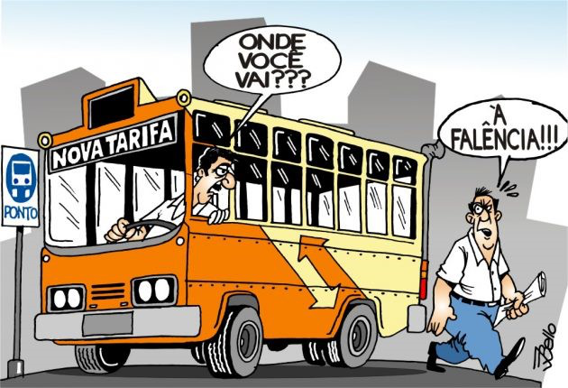
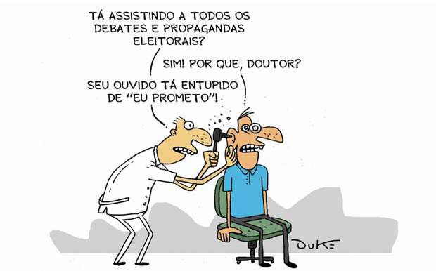
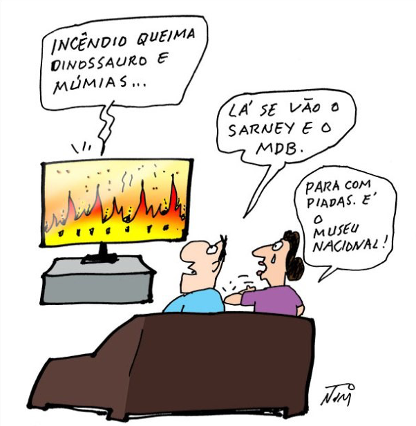
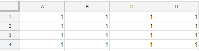

# PROVA — Camara_Campina_Grande_2018_Assessor_Tecnico_Legislativo_I

## 1. Análise geral da prova

- **Identificação:** Camara_Campina_Grande_2018_Assessor_Tecnico_Legislativo_I
- **Quantidade total de questões:** 40
- **Quantidade de textos de apoio (grupos):** 0
- **Quantidade de imagens:** 9
- **Quantidade de gráficos e tabelas:** incluídos nas imagens e no texto extraído, quando presentes no PDF original
- **Quantidade de grupos identificados:** 0
- **Quantidade de questões independentes:** 40
- **Questões que compartilham materiais:** nenhuma identificada automaticamente

### Transcrição integral da capa/instruções (conforme extraída do PDF)

> [!NOTE]
> Conteúdo integral das páginas anteriores à primeira questão, sem cortes.

> 
>
> CMCG2 0 1 8 - ASS. T EC. L EGI SL AT I VO I
> CÂMARA MUNICIPAL DE CAMPINA GRANDE - PB
> CARGO:
> NÍVEL MÉDIO
> Assessor Técnico Legislativo I
>
>
> 
>
> EXAME GRAFOTÉCNICO:
> (Transcreva a frase abaixo no local indicado na sua Folha de Respostas)
> “Campina, as tuas ruas são os meus caminhos!
> Por onde quer que eu ande, eles me conduzirão a ti”.
> Verifique se este caderno de provas contém 40 (quarenta) questões de múltipla escolha, sendo Português de 01 a 15,
> Informática de 16 a 25 e Conhecimentos Específicos de 26 a 40.
> Observe se há falhas ou imperfeições gráficas que causem dúvidas. Caso existam, comunique imediatamente ao Fiscal de
> Sala.
> Verifique se os dados existentes na Folha de Respostas conferem com os dados do Cartão de Inscrição.
> Esta Prova tem duração de 4 (quatro) horas. Não é permitida a saída do candidato antes de esgotado o tempo mínimo de 2
> (duas) horas.
> É vetado, durante a prova, o intercâmbio ou empréstimo de material de qualquer natureza entre os candidatos, bem como o
> uso de celulares, calculadoras e/ou qualquer outro tipo de equipamento eletrônico. A fraude, ou tentativa, a indisciplina e o
> desrespeito às autoridades encarregadas dos trabalhos são faltas que eliminam o candidato.
> Assine, ao sair da sala, a Lista de Presença e entregue o seu Caderno de Prova e a Folha de Respostas, devidamente
> assinados, ao Fiscal de Sala. O Candidato poderá destacar o gabarito rascunho da última folha da prova, e levá-lo para sua
> conferência.
> INSTRUÇÕES:
>
>
>
>
>
>
> PORTUGUÊS

### Gabarito

| Questão | 01 | 02 | 03 | 04 | 05 |
|---|---|---|---|---|---|
| Resposta | C | D | C | ANULADA | A |

| Questão | 06 | 07 | 08 | 09 | 10 |
|---|---|---|---|---|---|
| Resposta | D | A | B | D | E |

| Questão | 11 | 12 | 13 | 14 | 15 |
|---|---|---|---|---|---|
| Resposta | A | B | E | E | A |

| Questão | 16 | 17 | 18 | 19 | 20 |
|---|---|---|---|---|---|
| Resposta | B | A | E | E | B |

| Questão | 21 | 22 | 23 | 24 | 25 |
|---|---|---|---|---|---|
| Resposta | D | E | B | ANULADA | D |

| Questão | 26 | 27 | 28 | 29 | 30 |
|---|---|---|---|---|---|
| Resposta | A | C | B | C | E |

| Questão | 31 | 32 | 33 | 34 | 35 |
|---|---|---|---|---|---|
| Resposta | A | A | C | D | C |

| Questão | 36 | 37 | 38 | 39 | 40 |
|---|---|---|---|---|---|
| Resposta | B | A | D | B | E |

## 2. Questões agrupadas

Nenhum grupo de questões compartilhando material foi identificado automaticamente nesta prova.

## 3. Questões independentes

#### QUESTÃO 01

✅ **Gabarito: C** (gabarito.pdf (GABARITO DEFINITIVO UEPB/CPCON de 13/02/2019, bloco Assessor Técnico Legislativo I; concurso CMCG 2018))

**Enunciado:**

01ª QUESTÃO
Leia a charge abaixo com atenção para os elementos visuais e linguísticos que lhe conferem sentido.
Disponível em: https://encryptedtbn0.gstatic.com/images?q=tbn:ANd9GcQ8C4EeeaM3KS6HMIju9aLvLxUlv555CzSaC2H_Qk_pyv37D0i2qA.
Pode-se afirmar que o tom crítico e humorístico do texto resulta da

**Alternativas:**

A) ausência de passageiros no ponto de ônibus, como protesto às condições precárias do transporte público.
B) exposição de um ônibus vazio, em virtude de os passageiros deliberadamente se recusarem a pagar a nova tarifa.
C) revolta do transeunte face ao aumento da tarifa de ônibus, refletida no modo como responde ao motorista, mudando o foco da
pergunta - da direção espacial para um estado ou condição.
D) expressão de surpresa do motorista em relação à indelicadeza do transeunte, que demonstra não entender a pergunta.
E) recusa do transeunte ao “convite” para entrar no ônibus, devido aos assaltos praticados constantemente, portanto, à falta de
segurança.
Após a leitura do trecho da matéria jornalística abaixo, responda às questões de 2 a 4:
A AMEAÇA CRESCENTE DA OBESIDADE NO PAÍS
O número de pessoas acima do peso no Brasil saltou de 24% da população nos anos 1970 para mais da metade
dos brasileiros hoje em dia.
Os dados são precisos, recentes e, sobretudo, alarmantes. De acordo com o Ministério da Saúde, dos 207,6
milhões de brasileiros, 53,8% estão acima do peso. Na década de 70, o índice no país era bem menor: 24%. A marca
ultrapassou 50% da população em 2016 – o que equivale a dizer que o salto não ocorreu de uma hora para outra; desenhou-
se aos poucos, é verdade, mas não sem deixar pistas. A crônica da obesidade no Brasil foi, sim, anunciada.
Para além dos fatores genéticos, as causas do sobrepeso se multiplicam – e as mudanças nos hábitos alimentares
verificadas mundo afora nas últimas décadas têm enorme responsabilidade no avanço da obesidade. Houve, por exemplo,
um aumento significativo no consumo de alimentos semiprontos e congelados. A popularização dos micro-ondas e dos
freezers contribuiu bastante para isso. Embora prático, esse cardápio é quase sempre pouco saudável, como a maioria das
atrações das redes de fast-food. E o pior: muitas vezes, engorda.
Não bastasse o alastramento do sobrepeso entre os adultos – que no Brasil atinge 57,7% dos homens e 50,5% das
mulheres –, a obesidade se espalha de forma avassaladora na população infantil. No país, 12,7% dos meninos e 9,4% das
meninas estão obesos. O índice nos Estados Unidos, para ficar em um exemplo, é maior; no entanto, observando-se a curva
dos últimos vinte anos, nota-se que o crescimento de casos de crianças acima do peso na população americana foi de 66%,
enquanto no Brasil esse índice subiu para 239%. A Organização Mundial de Saúde projeta que até 2022 o número de
crianças obesas no planeta deva ultrapassar o das que se situarem abaixo do peso. Para tentar ao menos abrandar essa
perspectiva, a entidade defende a elevação de impostos sobre produtos açucarados e a restrição a alimentos industrializados
nas escolas. A propósito, os especialistas chamam a atenção para o fato de que frequentemente em supermercados os
alimentos naturais ocupam menos espaço, e como menor destaque que os produtos industrializados.Outra medida seria
uma estudada regulação da publicidade destinada ao público infantil. [...] (Veja, 25/07/2018)

PÁGINA 03
CMCG2 0 1 8 - AS S . T E C. L E GI S L AT I V O I

**Referências visuais:**

Nenhuma.

---

#### QUESTÃO 02

✅ **Gabarito: D** (gabarito.pdf (GABARITO DEFINITIVO UEPB/CPCON de 13/02/2019, bloco Assessor Técnico Legislativo I; concurso CMCG 2018))

**Enunciado:**

02ª QUESTÃO
Analise a adequação das proposições abaixo enquanto paráfrases resumitivas dos tópicos temáticos desenvolvidos no texto base.
I-
A oferta de alimentos semiprontos e congelados, aliada à facilidade para a aquisição de micro-ondas e freezers, concorre para o
aumento da obesidade, embora não sejam os únicos responsáveis pelo quadro.
II- Em comparação aos Estados Unidos, a obesidade infantil no Brasil preocupa mais, devido ao acelerado crescimento no número
de crianças atingidas pela doença, como demonstram os registros levantados no decorrer de 20 anos: crescimento de 239% no
Brasil e 66% nos Estados Unidos.
III- O aumento de impostos sobre produtos açucarados e a proibição de produtos industrializados nas escolas são os únicos meios de
frear os casos de obesidade infantil, de acordo com a Organização Mundial de Saúde.
Pode-se afirmar que NÃO corresponde totalmente com o conteúdo do texto o que se declara em:
a) I.
d) III.
b) I e II.
e) II e III.
c) II.

**Referências visuais:**

Nenhuma.

---

#### QUESTÃO 03

✅ **Gabarito: C** (gabarito.pdf (GABARITO DEFINITIVO UEPB/CPCON de 13/02/2019, bloco Assessor Técnico Legislativo I; concurso CMCG 2018))

**Enunciado:**

03ª QUESTÃO
Sob o aspecto da organização do texto, algumas palavras ou expressões retomam informações ou apontam para outras presentes no
texto. Assim, sob o aspecto da coesão referencial, é FALSO o que se afirma em:

**Alternativas:**

A) Os constituintes “o índice” e “a marca”, no primeiro parágrafo, recuperam a informação precedente relativa ao número de
brasileiros acima do peso.
B) A expressão “esse cardápio” está elíptica (oculta) na frase “E o pior: muitas vezes, engorda”. (LINHA 12)
C) A expressão “esse cardápio” na frase “esse cardápio é quase sempre pouco saudável” (LINHA 11) faz remissão à informação
subsequente “atrações das redes fast-food” (LINHA 12).
D) “isso”, no segundo parágrafo (LINHA 11), é um pronome que retoma não um termo, mas o conteúdo do contexto precedente
relativo aos fatores que concorrem para o aumento da obesidade.
E) A expressão “essa perspectiva”, no terceiro parágrafo (LINHAS 18 e 19), refere-se à informação anterior concernente à projeção do
aumento do número de crianças obesas até 2022.

**Referências visuais:**

Nenhuma.

---

#### QUESTÃO 04

⚠️ **Gabarito: ANULADA**

**Enunciado:**

04ª QUESTÃO
Advérbio é uma palavra ou expressão modificadora – relativamente a outro termo, ou mesmo uma oração – que acrescenta
informações circunstancias de tempo, lugar, modo, intensidade, causa, condição, etc.
Assim, considerando o contexto de ocorrência dos advérbios em destaque nos fragmentos textuais abaixo listados, relacione os
sentidos expressos na coluna à esquerda com os advérbios correspondentes na coluna à direita.
I-
De acordo com o Ministério da Saúde, dos 207,6 milhões de brasileiros, 53,8% estão acima do peso. Na década de 70, o índice no
país era bem menor: 24%.
II- A popularização dos micro-ondas e dos freezers contribuiu bastante para isso.
III- Embora prático, esse cardápio é quase sempre pouco saudável, como a maioria das atrações das redes de fast-food. E o pior:
muitas vezes, engorda.
IV- Os especialistas chamam a atenção para o fato de que frequentemente em supermercados os alimentos naturais ocupam menos
espaço, e como menor destaque que os produtos industrializados.
1. Tempo
( ) Bem
2. Lugar
( ) Bastante
3. Modo
( ) Quase
4. Dúvida
( ) Sempre
5. Intensidade
( ) Frequentemente

( ) Menos
A sequência numérica CORRETA é:
a) 5 – 3 – 3 – 4 – 3 – 3 – 5.
d) 3 – 5 – 3 – 5 – 3 – 1 – 2.
b) 3 – 5 – 5 – 1 – 5 – 3 – 3.
e) 5 – 5 – 5 – 1 – 3 – 1 – 5.
c) 5 – 3 – 5 – 5 – 3 – 3 – 2.
PÁGINA 04
CMCG2 0 1 8 - AS S . T E C. L E GI S L AT I V O I

**Referências visuais:**

Nenhuma.

---

#### QUESTÃO 05

✅ **Gabarito: A** (gabarito.pdf (GABARITO DEFINITIVO UEPB/CPCON de 13/02/2019, bloco Assessor Técnico Legislativo I; concurso CMCG 2018))

**Enunciado:**

05ª QUESTÃO
“Eleições” é o tema da charge a seguir, que destaca não só a postura de políticos, de fazer promessas durante as campanhas eleitorais,
mas também a postura crítica de muitos eleitores, atentos a essa realidade. Avalie as proposições de I a III, que dizem respeito aos
recursos linguísticos presentes no diálogo entre os personagens, e responda ao que se pede.
Disponível em: https://www.otempo.com.br/charges/charge-o-tempo-13-09-2018-1.2030423.
I-
O uso da forma verbal abreviada “tá”, em vez de “está” não constitui um erro, apesar de ser proferido por um médico, pois reflete o
envolvimento dos personagens no processo interacional; além disso, justifica-se em razão do propósito comunicativo do gênero
textual – a charge.
II- Em “assistindo a todos os programas”, a relação de regência revela o uso da linguagem exigido pela gramática normativa, de
modo que, na frase como um todo, verifica-se uma incompatibilidade entre este uso e o emprego da forma verbal auxiliar.
III- Considerando que a frase “eu prometo” é proferida pelos vários candidatos que se apresentam nos debates e programas eleitorais,
a estrutura “nós prometemos” é que seria adequada.
É CORRETO o que se afirma apenas em:
a) I e II.
d) I.
b) II.
e) III.
c) II e III.

**Referências visuais:**

Nenhuma.

---

#### QUESTÃO 06

✅ **Gabarito: D** (gabarito.pdf (GABARITO DEFINITIVO UEPB/CPCON de 13/02/2019, bloco Assessor Técnico Legislativo I; concurso CMCG 2018))

**Enunciado:**

06ª QUESTÃO
No texto abaixo, as orações se ligam umas às outros por meio dos processos de subordinação e também de coordenação. Feita a leitura
do texto, relacione as colunas, estabelecendo a correspondência entre a oração e a sua classificação.
Suas Excelências
Quando se discutem os “riscos da judicialização da política”, muitos brasileiros, com razão, suspeitam estar ouvindo grego. Mas se
souberem que o Supremo Tribunal Federal decidiu contratar 56 motoristas executivos, ao custo de R$ 5 milhões, entenderão a língua.
Ela é falada por todo o Estado brasileiro, viciado em sangrar majestosamente o bolso do contribuinte. Os choferes, aliás, terão que usar
paletós com “três botões e seis bolsos”, como exige o edital. Ah, sim, suas calças “não poderão ter pregas”.
(Isto É, 27/09/2017)
1 - “Quando se discutem os “riscos da judicialização da política, .... ”.
2 - “ .... Mas entenderão a língua”.
3 - “ ... se souberem que o Supremo Tribunal Federal decidiu contratar 56 motoristas executivos, ao custo de R$ 5 milhões...”.
4 - “... como exige o edital”.
( ) Oração coordenada adversativa.
( ) Oração subordinada adverbial de conformidade.
( ) Oração subordinada adverbial condicional.
( ) Oração subordinada adverbial temporal.
A sequência numérica que preenche os parênteses CORRETAMENTE é:

**Alternativas:**

A) 3 – 4 – 1 – 2.
B) 3 – 4 – 2 – 1.
C) 2 – 1 – 3 – 4.
D) 2 – 4 – 3 – 1.
E) 2 – 4 – 1 – 3.

PÁGINA 05
CMCG2 0 1 8 - AS S . T E C. L E GI S L AT I V O I

**Referências visuais:**

Nenhuma.

---

#### QUESTÃO 07

✅ **Gabarito: A** (gabarito.pdf (GABARITO DEFINITIVO UEPB/CPCON de 13/02/2019, bloco Assessor Técnico Legislativo I; concurso CMCG 2018))

**Enunciado:**

07ª QUESTÃO
Abaixo estão expostos um pequeno texto e algumas afirmações relacionadas à função sintática assumida por termos ou expressões que
formam as orações. Analise as proposições e assinale V para Verdadeiro e F para Falso.
( ) O sujeito dos verbos IMAGINAR (L.1) e PAGAR (L.4) é “indeterminado”, já que eles se apresentam sob a forma de infinitivo.
( ) O sujeito dos verbos CONTINUAR e SER (L.2) é “oculto”, marcado na desinência verbal, tendo como referente “os muitos
larápios...”, recuperável pelo contexto anterior.
( ) O sujeito do verbo SURGIR está “posposto” e é “composto”, no caso: “um mercado de compra e venda de delações” (L. 2).
( ) A unidade “figuras que já estão com a corda do Ministério no pescoço”, formada pelo núcleo “figuras” e um modificador
oracional “que.... pescoço” representa sujeito “simples” de TER COBRADO (L. 3).
( ) A unidade “um preso amigo” representa sujeito “simples” em relação à forma passiva SER DENUNCIADO (L. 5).
A sequência que preenche CORRETAMENTE os parênteses está na alternativa:

**Alternativas:**

A) F – V – F – V – F.
B) V – V – F – F – V.
C) F – V – V – F – F.
D) V – V – V – F – V.
E) V – V – F – V – F.

**Referências visuais:**

Nenhuma.

---

#### QUESTÃO 08

✅ **Gabarito: B** (gabarito.pdf (GABARITO DEFINITIVO UEPB/CPCON de 13/02/2019, bloco Assessor Técnico Legislativo I; concurso CMCG 2018))

**Enunciado:**

08ª QUESTÃO
Um fato que teve muita repercussão na mídia foi o incêndio no Museu Nacional, no Rio de Janeiro, por significar grande perda para a
história do país. Usando de criatividade e bom humor, o chargista toma esse episódio para fazer sua crítica
Analise as proposições de I a III, inferidas da leitura da charge, e responda ao que se pede.
Disponível em: http://www.contraovento.com.br/wp-content/uploads/2018/09/nani2.jpg.
I-
A equivalência feita entre “dinossauros e múmias” e “Sarney e MDB” confere tom irônico ao texto, por se fazer alusão não apenas
à permanência desses últimos na esfera política brasileira, mas também à inércia de sua atuação.
II- A responsabilidade pela tragédia ocorrida no Rio de Janeiro é atribuída, por um dos personagens, a Sarney e ao partido que ele
representa, o MDB, como tantas outras tragédias decorrentes do descaso dos governantes.
III- O uso da expressão “lá se vão” em referência a Sarney e ao MDB é uma forma de atenuar o fim do poder desse político e do seu
partido, o que é possível porque o verbo IR também significa ACABAR/MORRER.
É CORRETO o que se afirma apenas em:
a) II.
d) II e III.
b) I e III.
e) I e II.
c) III.
Conversa bandida

É ingenuidade imaginar que os muitos larápios alcançados pelas operações de combate à corrupção tenham se purificado.
Como continuam sendo o que sempre foram, surgiu entre eles um “mercado” de compra e venda de delações. Figuras que
já estão com a corda do Ministério Público no pescoço têm cobrado “apoio financeiro” de antigos cúmplices, alegando
despesas com advogados e familiares. Um deputado com diversos crimes ainda não expostos analisa a proposta de pagar R$
2 milhoes a um “preso amigo” para não ser denunciado. A um senador, na mesma situação, a oferta foi de R$ 3 milhões.
(Isto É, 27/09/2017).

PÁGINA 06
CMCG2 0 1 8 - AS S . T E C. L E GI S L AT I V O I

Leia o texto que segue para responder às questões de 9 a 12.

**Referências visuais:**

---

#### QUESTÃO 09

✅ **Gabarito: D** (gabarito.pdf (GABARITO DEFINITIVO UEPB/CPCON de 13/02/2019, bloco Assessor Técnico Legislativo I; concurso CMCG 2018))

**Enunciado:**

09ª QUESTÃO
Identifique, dentre as proposições de I a III, aquela(s) cujo conteúdo é falso com relação ao conteúdo desenvolvido na resenha escrita
pelo jornalista e professor de comunicação da UFRJ - Paulo Roberto Pires.
I-
O texto traz uma análise de dois textos literários (contos) que, embora reproduzam situações diferentes, por retratarem épocas
distintas, refletem sobre o mesmo tema – o distanciamento entre pobres e ricos causado pelo sentimento de medo e raiva.
II- Com base na afirmação que encerra o texto, de que “o outro” teria passado de exterminador nos anos 1970 a protagonista e
narrador nos tempos atuais, o autor deixa clara a ideia de que já não há mais preconceito.
III- O autor do texto, além de dar detalhes das duas obras cotejadas, ressalta a relevância do tema, e, sobretudo, convida o leitor a
conferir a obra mais recente, o que é próprio da resenha jornalística.

Assinale a alternativa que corresponde ao que se pede:

a) II e III.
d) II.
b) I.
e) III.
c) I e III.

**Referências visuais:**

Nenhuma.

---

#### QUESTÃO 10

✅ **Gabarito: E** (gabarito.pdf (GABARITO DEFINITIVO UEPB/CPCON de 13/02/2019, bloco Assessor Técnico Legislativo I; concurso CMCG 2018))

**Enunciado:**

10ª QUESTÃO
Avalie como Verdadeiras (V) ou Falsas (F) as afirmações abaixo, que dizem respeito aos recursos de coesão presentes no texto.
( ) O conector “no entanto” (L.2) evidencia oposição de idéias, indicando que o passar do tempo não eliminou as causas
determinantes das fronteiras entre pobres e ricos.
( ) Os numerais “primeiro” (L.4) e “segundo” (L.5) são formas referenciais que retomam “O outro” e “Espiral”, respectivamente.
( ) No fragmento: “O menino tem medo de quem, como o executivo, olha para ele com medo”, o referente do pronome pessoal “ele”
é “o executivo”.
( ) A expressão “o pedinte” (L.15) se refere não ao “homem pobre que interpelou o executivo”, mas a outro indivíduo, referido, logo
em seguida pelo termo “adversário”.
( ) O referente da expressão “deste ano” não é expresso dentro do texto, pois é contextual – o ano de 2018, data da edição do periódico
em que consta o texto do jornalista.
A sequência que preenche CORRETAMENTE os parênteses está na alternativa:
a) F – V – V – F – V.
d) F – V – V – V – F.
b) V – F – F – F – V.
e) V – V – F – F – V.
c) F – F – V – V – F.
A VOZ DO OUTRO

Quarenta e três anos separam a publicação de “O outro”, de Rubem Fonseca, e “Espiral”, de Geovani Martins. A seiva
de raiva e rancor que irriga e alimenta as fronteiras entre ricos e pobres no Brasil continua, no entanto, a correr acelerada entre os
dois contos ambientados no Rio de Janeiro.
Os protagonistas de “O outro” e “Espiral” não têm nome. São definidos por seu lugar na cidade: o primeiro, um executivo
estressado que vive para o trabalho e, entre casa, carro e escritório, pouco anda na rua; o segundo, um adolescente que circula a
pé e de ônibus entre a Gávea, bairro de classe média alta onde estuda numa escola pública, e a Rocinha, sobressaltada comunidade
onde vive.

O executivo de Rubem Fonseca tem medo, o menino de Giovani Martins, também. O executivo tem medo de gente como
o menino. O menino tem medo de quem, como o executivo, olha para ele com medo. O medo é pai da raiva; a raiva, mãe da
covardia, como lembra Chico Buarque em “As caravanas”. É nesse fogo, nada brando, que o Rio ferve há pelo menos quatro
décadas.

No conto de Rubem Fonseca – publicado em Feliz ano novo em 1975 e censurado pela ditadura um ano depois – um
homem pobre sai da invisibilidade ao interpelar o executivo: “Doutor, doutor, será que o senhor podia me ajudar?”. Coração na
boca, sentindo-se ameaçado, ele responde estendendo “uns trocados”. Dali para a frente, sucessivos pedidos de ajuda lhe parecem
emboscadas.”Súplice e ameaçador”, o pedinte é, a seus olhos, um inimigo. Adversário que, um dia, flagra na porta de casa. É ali
no limiar de seu território, de sua propriedade, que decide dar fim de uma vez por todas ao “outro” que tanto o atormenta.

O personagem de Geovani Martins se “assustava com o susto” de quem o via como “a ameaça”. Prendia o choro,
humilhado, até perceber que o jogo nem sempre estava jogado. Passaria ele mesmo a ameacar, com sua ostensiva presença, os
meninos do colégio particular caríssimo ou senhora que poderia ser sua avó, e, ao percebê-lo, agarrava-se à bolsa. Com o tempo,
concentra-se num único homem, Mário, a quem assombra com zelo de especialista. [...]

Rubem Fonseca tem 92 anos, Geovani Martins, 26. Os dois estrearam com notáveis livros de contos – Os prisioneiros é
de 1963 e O sol na cabeça, em que figura “Espiral”, foi lançado no início deste ano. Um e outro representam, em seus respectivos
momentos, rupturas.[...]

[...] Ler Geovani Martins no espelho de Rubem Fonseca é encarar de frente “o outro”, que de exterminado nos anos 1970
vira hoje protagonisa e narrador. E o faz de igual para igual, olhando no olho. Pelo menos na literatura. (Época, 30/04/2018).
PÁGINA 07
CMCG2 0 1 8 - AS S . T E C. L E GI S L AT I V O I

**Referências visuais:**

Nenhuma.

---

#### QUESTÃO 11

✅ **Gabarito: A** (gabarito.pdf (GABARITO DEFINITIVO UEPB/CPCON de 13/02/2019, bloco Assessor Técnico Legislativo I; concurso CMCG 2018))

**Enunciado:**

11ª QUESTÃO
Verifique o emprego dos pronomes nos fragmentos textuais abaixo arrolados e, em seguida, marque a alternativa na qual o pronome
destacado é classificado como RELATIVO.

**Alternativas:**

A) [...]um adolescente que circula a pé e de ônibus entre a Gávea, bairro de classe média alta onde estuda numa escola pública, e a
Rocinha, sobressaltada comunidade onde vive.
B) [...] “Doutor, doutor, será que o senhor podia me ajudar?”.
C) [...] Coração na boca, sentindo-se ameaçado, ele responde estendendo “uns trocados”.
D) [...] Dali para a frente, sucessivos pedidos de ajuda lhe parecem emboscadas.”Súplice e ameaçador”, o pedinte é, a seus olhos, um
inimigo.[...]
E) [...]decide dar fim de uma vez por todas ao “outro” que tanto o atormenta.

**Referências visuais:**

Nenhuma.

---

#### QUESTÃO 12

✅ **Gabarito: B** (gabarito.pdf (GABARITO DEFINITIVO UEPB/CPCON de 13/02/2019, bloco Assessor Técnico Legislativo I; concurso CMCG 2018))

**Enunciado:**

12ª QUESTÃO
Identifique, dentre as estruturas oracionais abaixo listadas, a única que apresenta oração subordinada adjetiva EXPLICATIVA.

**Alternativas:**

A) “o primeiro, um executivo extressado que vive para o trabalho e, entre casa, carro e escritório, pouco anda na rua [...]”.
B) “Com o tempo, concentra-se num único homem, Mário, a quem assombra com zelo de especialista” .
C) “ o segundo, um adolescente que circula a pé e de ônibus entre a Gávea, e [...]”.
D) “[...] Adversário que, um dia, flagra na porta de casa”.
E) “Prendia o choro, humilhado, até perceber que o jogo nem sempre estava jogado.”

**Referências visuais:**

Nenhuma.

---

#### QUESTÃO 13

✅ **Gabarito: E** (gabarito.pdf (GABARITO DEFINITIVO UEPB/CPCON de 13/02/2019, bloco Assessor Técnico Legislativo I; concurso CMCG 2018))

**Enunciado:**

13ª QUESTÃO
Após a leitura da charge abaixo exposta, avalie como verdadeiro (V) ou falso (F) as proposições que se apresentam na sequência.
Disponível em https://www.otempo.com.br/image/contentid/policy:1.2026674:1536101475/CHARGE%20O%20TEMPO.JPG?f=3x2&w=620&$p$f$w=ac4ac92
(Consultado em: 05/09/18).
( ) O texto busca provocar a reflexão sobre a importância da educação para o país, a partir da valorização daquilo que constitui a sua
memória.
( ) Já que o chargista empregou o verbo no passado “achava”, quando caracterizou o “homo ignorantus”, ele deixa claro que essa é
uma atitude que não se repete nos dias atuais.
( ) Em “Aqui temos um fóssil do home ignorantus, que achava que...”, a oração usada para caracterizar o “home ignorantus” é
adjetiva restritiva.
( ) Em “Aqui temos um fóssil”, o verbo TER é empregado não no sentido de POSSUIR, mas no de HAVER/EXISTIR.
A sequência que preenche CORRETAMENTE os parênteses é:

**Alternativas:**

A) F – F – V – V.
B) V – V – F – F.
C) F – F – F – V.
D) V – V – V – F.
E) V – F – F – V.

PÁGINA 08
CMCG2 0 1 8 - AS S . T E C. L E GI S L AT I V O I
Com base na leitura do texto a seguir, que faz uma reflexão sobre a formação dos profissionais de medicina, responda às questões 14 e
15:

**Referências visuais:**

Nenhuma.

---

#### QUESTÃO 14

✅ **Gabarito: E** (gabarito.pdf (GABARITO DEFINITIVO UEPB/CPCON de 13/02/2019, bloco Assessor Técnico Legislativo I; concurso CMCG 2018))

**Enunciado:**

14ª QUESTÃO
Sob o aspecto da coesão sequencial, alguns elementos linguísticos no texto, a exemplo das conjunções, estabelecem diferentes
relações semânticas entre as orações – causa, consequência, etc. Nesse sentido, assinale a alternativa que traz um fragmento textual no
qual a relação de sentido expressa entre as orações é de CONCESSÃO.

**Alternativas:**

A) Finalmente, se pretendemos mesmo oferecer atendimento de qualidade a nossa população, temos de entender que médicos
devidamente qualificados são peças-chave.
B) “A primeira restrição diz respeito ao corpo docente, já que a boa formação depende de professores capacitados para o mister de
ensinar”.
C) “E tudo isso porque estamos falando, nesse ponto, apenas do ensino, ficando quase implícito que em tal modelo a pesquisa não fará
parte da rotina dessas faculdades.
D) Querer formar médicos sem um apropriado hospital-escola, próprio ou conveniado, é querer formar músicos sem dar a eles
instrumentos para tocar! [...]
E) “Embora os cursos médicos devam comprovar um número mínimo de mestres e doutores para o seu funcionamento, não existe
fiscalização dessa exigência [...]”.

**Referências visuais:**

Nenhuma.

---

#### QUESTÃO 15

✅ **Gabarito: A** (gabarito.pdf (GABARITO DEFINITIVO UEPB/CPCON de 13/02/2019, bloco Assessor Técnico Legislativo I; concurso CMCG 2018))

**Enunciado:**

15ª QUESTÃO
A respeito do emprego dos advérbios no texto, pode-se afirmar que:
I- Em “Infelizmente, o que está acontecendo…” (L. 06), “infelizmente” está em relação com o período no qual se desenvolve o
tópico temático – a abertura indiscriminada de faculdades –, servindo para imprimir subjetividade ao texto, ao revelar a postura de
insatisfação do autor.
II- Em “Seguramente faltarão docentes qualificados...” ( L. 15) e “um complexo sistema de saúde, que precisa ser constantemente
aprimorado” (L. 23), “seguramente” e “constantemente “são advérbios classificados tradicionalmente como de “modo”, mas
trazem nuances, respectivamente, de avaliação e tempo/frequência.
III- Em “temos de entender que médicos devidamente qualificados são peças-chave”, “devidamente” é um advérbio de modo que se
relaciona com o adjetivo “qualificados”.
É CORRETO o que se afirma em:
a) I, II e III.
d) III apenas.
b) I apenas.
e) II e III apenas.
c) II apenas.
O DRAMA NACIONAL DO ENSINO MÉDICO
A formação dos profissionais de medicina no país vem sendo posta em xeque em razão da abertura indiscriminada de
faculdades
[...] O fato é que o médico, para exercer sua missão com competência e sabedoria, necessita acumular conhecimentos,
desenvolver habilidades técnicas, ser ético, ter o comportamento moldado pelo humanismo e, mais ainda, saber comunicar-se
com o doente e seua familiares.
[...] Infelizmente, o que está acontecendo com o ensino médico no Brasil vai na contramão do melhor caminho para
formar bons profissionais de medicina nos últimos quatro anos, algo alarmante e inédito no mundo. Nesse curto período de
tempo, foram autorizadas a funcional mais de 100 faculdades, quando já tínhamos cerca de 200[...].
Ato II – As novas faculdades, e mesmo algumas antigas, estão aptas a formar adequadamente os médicos? A
resposta imediata é “não!”. A primeira restrição diz respeito ao corpo docente, já que a boa formação depende de professores
capacitados para o mister de ensinar. Embora os cursos médicos devam comprovar um número mínimo de mestres e doutores
para o seu funcionamento, não existe fiscalização dessa exigência, tanto que a prática de algumas das novas escolas tem sido
demitir doutores após a autorização oficial do funcionamento, uma vez que são docentes mais caros e diminuem o lucro de
investidores mais interessados nos resultados financeiros do que no projeto educacional. De maneira complementar, com essa
nova pletora de faculdades, seguramente, faltarão docentes qualificados [...] E tudo isso porque estamos falando, nesse ponto,
apenas do ensino, ficando quase implícito que em tal modelo a pesquisa não fará parte da rotina dessas faculdades. [...].
A segunda restrição é o acesso a hospitais-escolas. Eles não são apenas instituições assistenciais, pois dependem de
médicos que, acumulando as funções dessa natureza e também as docentes, supervisionam as atividades dos estudantes e dos
residetes. Querer formar médicos sem um apropriado hospital-escola, próprio ou conveniado, é querer formar músicos sem dar
a eles instrumentos para tocar! [...].
Finalmente, se pretendemos mesmo oferecer atendimento de qualidade a nossa população, temos de entender que
médicos devidamente qualificados são peças-chave. Entretanto, é preciso deixar muito claro que essas não são as únicas peças
de um complexo sistema de saúde, que precisa ser constantemente aprimorado para melhor atender a população.
(Veja, 1º de agosto, 2018).
PÁGINA 09
CMCG2 0 1 8 - AS S . T E C. L E GI S L AT I V O I

INFORMÁTICA

**Referências visuais:**

Nenhuma.

---

#### QUESTÃO 16

✅ **Gabarito: B** (gabarito.pdf (GABARITO DEFINITIVO UEPB/CPCON de 13/02/2019, bloco Assessor Técnico Legislativo I; concurso CMCG 2018))

**Enunciado:**

16ª QUESTÃO
Qual é o tamanho máximo para um nome de arquivo no Linux?

**Alternativas:**

A) 8 caracteres.
B) 255 caracteres.
C) 11 caracteres.
D) 12 caracteres.
E) 128 caracteres.

**Referências visuais:**

Nenhuma.

---

#### QUESTÃO 17

✅ **Gabarito: A** (gabarito.pdf (GABARITO DEFINITIVO UEPB/CPCON de 13/02/2019, bloco Assessor Técnico Legislativo I; concurso CMCG 2018))

**Enunciado:**

17ª QUESTÃO
No modelo TCP/IP, protocolos como TCP, UDP e SCTP
pertencem à camada de:

**Alternativas:**

A) Transporte.
B) Aplicação.
C) Internet.
D) Enlace.
E) Sessão.

**Referências visuais:**

Nenhuma.

---

#### QUESTÃO 18

✅ **Gabarito: E** (gabarito.pdf (GABARITO DEFINITIVO UEPB/CPCON de 13/02/2019, bloco Assessor Técnico Legislativo I; concurso CMCG 2018))

**Enunciado:**

18ª QUESTÃO
Utilizando o programa Google Sheets (Planilhas Google), qual
alternativa representa o resultado da fórmula
“=(D1+D4)+SUM(C1:C3;C4)+PRODUCT(B1;B3:B4)+MULTI
PLY(A2;A4)”,
ao ser aplicada na planilha eletrônica abaixo?

**Alternativas:**

A) 5.
B) 1.
C) 9.
D) 10.
E) 8.

**Referências visuais:**

Nenhuma.

---

#### QUESTÃO 19

✅ **Gabarito: E** (gabarito.pdf (GABARITO DEFINITIVO UEPB/CPCON de 13/02/2019, bloco Assessor Técnico Legislativo I; concurso CMCG 2018))

**Enunciado:**

19ª QUESTÃO
A linha de processadores Core i7 é desenvolvida pela empresa

**Alternativas:**

A) Google.
B) AMD.
C) Texas Instruments.
D) Microsoft.
E) Intel.

**Referências visuais:**

Nenhuma.

---

#### QUESTÃO 20

✅ **Gabarito: B** (gabarito.pdf (GABARITO DEFINITIVO UEPB/CPCON de 13/02/2019, bloco Assessor Técnico Legislativo I; concurso CMCG 2018))

**Enunciado:**

20ª QUESTÃO
Uma possível definição de URL (Universal Resource Locator) é:

**Alternativas:**

A) Um protocolo universal para localização de arquivos.
B) O endereço universal de um recurso na Internet.
C) O endereço universal de um conteúdo de mídia.
D) Um atalho local para acessar uma página da Internet.
E) O endereço IP atualizado diariamente de conteúdos
dinâmicos.

**Referências visuais:**

Nenhuma.

---

#### QUESTÃO 21

✅ **Gabarito: D** (gabarito.pdf (GABARITO DEFINITIVO UEPB/CPCON de 13/02/2019, bloco Assessor Técnico Legislativo I; concurso CMCG 2018))

**Enunciado:**

21ª QUESTÃO
No Microsoft Excel 2016, a funcionalidade Texto para Colunas,
localizada na aba dados, tem a seguinte função:

**Alternativas:**

A) criar uma nova consulta vinculada à tabela selecionada do
Excel.
B) localizar valores rapidamente classificando os dados.
C) obter os dados mais recentes atualizando todas as fontes em
uma pasta de trabalho.
D) dividir uma única coluna de texto em várias colunas.
E) criar uma nova planilha para prever tendências de dados.

**Referências visuais:**

Nenhuma.

---

#### QUESTÃO 22

✅ **Gabarito: E** (gabarito.pdf (GABARITO DEFINITIVO UEPB/CPCON de 13/02/2019, bloco Assessor Técnico Legislativo I; concurso CMCG 2018))

**Enunciado:**

22ª QUESTÃO
No Microsoft Word 2016, são funcionalidades da aba
Referências:

**Alternativas:**

A) Números de Linha, Painel de Seleção e Recuar.
B) Selecionar Destinatários, Iniciar Mala Direta e Envelopes.
C) Rascunho, Macros e Modo de Leitura.
D) Espaçamento entre Parágrafos, Efeitos e Fontes.
E) Inserir Nota de Rodapé, Inserir Índice de Ilustrações e
Marcar Entrada.

**Referências visuais:**

Nenhuma.

---

#### QUESTÃO 23

✅ **Gabarito: B** (gabarito.pdf (GABARITO DEFINITIVO UEPB/CPCON de 13/02/2019, bloco Assessor Técnico Legislativo I; concurso CMCG 2018))

**Enunciado:**

23ª QUESTÃO
Assinale a opção que representa um tipo de slot de expansão de
uma placa mãe:

**Alternativas:**

A) RAM
B) AGP
C) PCB
D) DDR
E) ISO

**Referências visuais:**

Nenhuma.

---

#### QUESTÃO 24

⚠️ **Gabarito: ANULADA**

**Enunciado:**

24ª QUESTÃO
Assinale a opção que representa um tipo de disco rígido de
computador:

**Alternativas:**

A) SRAM
B) PCI
C) ISA
D) IDE
E) BUS

**Referências visuais:**

Nenhuma.

---

#### QUESTÃO 25

✅ **Gabarito: D** (gabarito.pdf (GABARITO DEFINITIVO UEPB/CPCON de 13/02/2019, bloco Assessor Técnico Legislativo I; concurso CMCG 2018))

**Enunciado:**

25ª QUESTÃO
Sobre criptografia simétrica e assimétrica, considere as afirmações
a seguir:
I-
Na criptografia simétrica, a mesma chave é usada para
criptografar e descriptografar.
II- Na criptografia assimétrica, há chaves diferentes para
criptografar e descriptografar.
III- Algoritmos como DES, 3DES, AES e RC4 são de
criptografia simétrica.
Está CORRETO o que se afirma em

**Alternativas:**

A) I e II.
B) I e III.
C) II e III.
D) I, II e III.
E) II.

PÁGINA 10
CMCG2 0 1 8 - AS S . T E C. L E GI S L AT I V O I
PÁGINA 11
CONHECIMENTOS ESPECÍFICOS

**Referências visuais:**

Nenhuma.

---

#### QUESTÃO 26

✅ **Gabarito: A** (gabarito.pdf (GABARITO DEFINITIVO UEPB/CPCON de 13/02/2019, bloco Assessor Técnico Legislativo I; concurso CMCG 2018))

**Enunciado:**

26ª QUESTÃO
Acerca do que prevê o Artigo 49 da Lei Orgânica do Município de Campina Grande (PB), que dispõe sobre as competências da Câmara
Municipal para legislar sobre todas matérias de competência do município, julgue cada uma das afirmações abaixo e responda, em
seguida, o que se pede.
I-
A competência de que dispõe esta Casa para legislar é absoluta e independe sempre da sanção do Prefeito Municipal.
II- A elaboração de Leis Complementares e de Leis Ordinárias, prevista, respectivamente, nos Incisos II e III do Art. 51 da Lei
Orgânica, como parte do chamado processo legislativo, não exige sanção do Prefeito.
III- Para legislar sobre a aquisição e/ou alienação de bem imóvel do Município, prevista no Inciso XV do Art. 49 da referida lei, a
Câmara Municipal não depende de sanção do Prefeito.
Está CORRETO o que se afirma em:
a) II.
d) II e III.
b)
e) I e II.
I e III.
c) I, II e III.

**Referências visuais:**

Nenhuma.

---

#### QUESTÃO 27

✅ **Gabarito: C** (gabarito.pdf (GABARITO DEFINITIVO UEPB/CPCON de 13/02/2019, bloco Assessor Técnico Legislativo I; concurso CMCG 2018))

**Enunciado:**

27ª QUESTÃO
Julgue cada uma das afirmativas abaixo, considerando-se o cargo de Prefeito, a partir do que prevê a Lei Orgânica do Município de
Campina Grande (PB).
I-
O Prefeito e o Vice-Prefeito não poderão ausentar-se do Município, sem autorização da Câmara, por mais de doze dias
consecutivos, sob pena de perder o mandato.
II- Se ocorrer a vacância, nos últimos dois anos do período, dos mandatos do Prefeito e do Vice-Prefeito, a eleição, para ambos os
cargos, será feita, trinta dias após, pela Câmara Municipal.
III- No caso de impedimento do Prefeito e Vice-Prefeito, ou no de vacância dos respectivos cargos, será chamado ao exercício do
Governo o Presidente da Câmara Municipal.
IV- Imagine a seguinte situação hipotética: “O Prefeito de Campina Grande e o seu Vice, de acordo com a Lei Orgânica atual deste
Município, resolvam, após serem eleitos, residir na cidade de Sumé (PB), cidade que não é limítrofe geograficamente com
Campina Grande. É que lá nasceram e construíram laços familiares. Por esta razão, e com a concordância tácita dos munícipes,
resolveram prestar uma homenagem ao Município de Sumé.” Esta decisão não desrespeita, com efeito, a Lei Orgânica do
Município de Campina Grande.
Está CORRETO que se afirma apenas em
a)
d) I e IV.
II.
b)
e) III e IV.
I e III.
c) II e III.

**Referências visuais:**

Nenhuma.

---

#### QUESTÃO 28

✅ **Gabarito: B** (gabarito.pdf (GABARITO DEFINITIVO UEPB/CPCON de 13/02/2019, bloco Assessor Técnico Legislativo I; concurso CMCG 2018))

**Enunciado:**

28ª QUESTÃO
De acordo com Art. 78 da Lei Orgânica do Município de Campina Grande, a Procuradoria do Município é a instituição que o representa
judicialmente, cabendo-lhe ainda, as atividades de consultoria e assessoramento jurídico ao Poder Executivo e, privativamente, a
execução de dívida ativa de natureza tributária.
Com base nesta informação, julgue cada uma das informações abaixo e responda o que se pede:
I-
Leia com atenção a seguinte situação hipotética: “Ao tomar posse, o Prefeito, ao descobrir que o jovem Pedro, filho do grande
amigo de infância João, aprovado há apenas um ano no Exame de Ordem da OAB (Ordem dos Advogados do Brasil), era bastante
competente, em deferência pessoal ao amigo João, presenteia o jovem advogado com o cargo de Procurador-Chefe do Município
de Campina Grande”. Esta atitude do Prefeito está compatível com o que prevê a Lei Orgânica deste Município.
II- A Procuradoria do Município reger-se-á por lei própria, observados os princípios estabelecidos na Constituição Estadual apenas,
atendendo-se, com relação aos seus integrantes, no que couber, ao disposto art. 37 e incisos, da Constituição Federal.
III- O ingresso na classe inicial da carreira de Procurador Municipal far-se-á mediante concurso público de provas e títulos.
Está CORRETO o que se afirma em
a)
d) II e III.
I e II.
b) III.
e) I e III.
c) I, II e III.
CMCG2 0 1 8 - AS S . T E C. L E GI S L AT I V O I

PÁGINA 12

**Referências visuais:**

Nenhuma.

---

#### QUESTÃO 29

✅ **Gabarito: C** (gabarito.pdf (GABARITO DEFINITIVO UEPB/CPCON de 13/02/2019, bloco Assessor Técnico Legislativo I; concurso CMCG 2018))

**Enunciado:**

29ª QUESTÃO
Atente à seguinte situação hipotética e em seguida responda o que se pede.
“Imagine que o pastor protestante Machado de Assis resolve fundar a igreja “Jesus é Dez”, no bairro das Malvinas, em Campina
Grande (PB). Com a ajuda de seus fiéis constrói o prédio e solicita a isenção das taxas do IPTU (Imposto Predial e Territorial Urbano).
Ocorre que o Município, por pressão do Prefeito, inimigo político declarado do pastor, motivado por vingança pessoal, passa a cobrar o
referido imposto, infringindo, além disso, ao templo religioso taxas abusivas durante cinco anos”.
De acordo com o que prevê a Lei Orgânica deste Município, a atitude administrativa do gestor é

**Alternativas:**

A) legal, já que esta lei permite a cobrança de imposto sobre templos religiosos apenas de natureza protestante.
B) legal, já que esta lei permite a cobrança de imposto sobre templos de qualquer culto.
C) ilegal, já que esta lei veda a cobrança de imposto sobre templos de qualquer culto.
D) ilegal, já que esta lei permite a cobrança de imposto sobre templos religiosos apenas de natureza católica.
E) ilegal, já que esta lei permite a cobrança de imposto sobre templos religiosos apenas judeus.

**Referências visuais:**

Nenhuma.

---

#### QUESTÃO 30

✅ **Gabarito: E** (gabarito.pdf (GABARITO DEFINITIVO UEPB/CPCON de 13/02/2019, bloco Assessor Técnico Legislativo I; concurso CMCG 2018))

**Enunciado:**

30ª QUESTÃO
Atente à seguinte situação hipotética e em seguida responda o que se pede.
“Frank Sinatra é proprietário de uma pequena empresa que presta serviço de pavimentação para o Município de Campina Grande há
mais de 10 anos. Em função de sua popularidade, é eleito vereador, toma posse e passa a exercer as duas atividades simultaneamente”.
Diante de tal situação pode-se afirmar, com base no Regimento Interno da Câmara Municipal de Campina Grande (PB), que a sua
conduta é

**Alternativas:**

A) permitida durante o primeiro ano de mandato.
B) permitida em quaisquer circunstâncias.
C) aceitável sob condições especiais.
D) permitida durante os primeiros dois anos de mandato.
E) proibida em quaisquer circunstâncias.

**Referências visuais:**

Nenhuma.

---

#### QUESTÃO 31

✅ **Gabarito: A** (gabarito.pdf (GABARITO DEFINITIVO UEPB/CPCON de 13/02/2019, bloco Assessor Técnico Legislativo I; concurso CMCG 2018))

**Enunciado:**

31ª QUESTÃO
Leia com atenção a situação hipotética abaixo e em seguida responda o que se pede.
“Michael Jackson é professor concursado há 20 anos no Município de Campina Grande. Ao ser eleito vereador, e antes de tomar posse,
é aconselhado pelo seu advogado a pedir licença sem remuneração do cargo de professor, já que, segundo o causídico, não haveria
qualquer possibilidade jurídica, de acordo com o Regimento Interno da Câmara Municipal deste Município, de Michael continuar
lecionando, fato que muito o entristeceu, uma vez que ele amava dar aulas.”
Nesta situação, o entendimento do advogado está

**Alternativas:**

A) equivocado, já que o Regimento prevê a possibilidade de que, se houver compatibilidade de horário, Michael poderá continuar
exercendo o seu cargo de professor juntamente com o mandato de vereador.
B) correto, já que o Regimento veda qualquer possibilidade de acúmulo e compatibilidade de horário de duas atividades no serviço
público. Michael terá que se licenciar.
C) correto, já que o Regimento prevê a possibilidade de que o cargo de professor é incompatível com as atribuições de um vereador.
D) correto, já que o Regimento prevê a possibilidade de que, já que ele foi eleito para o mandato, deve se dedicar apenas a ele.
E) correto, já que o Regimento prevê a possibilidade de que o acúmulo das duas atividades gera o que esta lei chama de supersalário.

**Referências visuais:**

Nenhuma.

---

#### QUESTÃO 32

✅ **Gabarito: A** (gabarito.pdf (GABARITO DEFINITIVO UEPB/CPCON de 13/02/2019, bloco Assessor Técnico Legislativo I; concurso CMCG 2018))

**Enunciado:**

32ª QUESTÃO
De acordo com o Art. 230 do Regime Interno da Câmara Municipal de Campina Grande, o projeto de lei orçamentária anual será
enviado pelo Executivo à Câmara até o dia

**Alternativas:**

A) 30 de setembro de cada ano.
B) 30 de junho de cada ano.
C) 10 de maio de cada ano.
D) 31 de outubro de cada ano.
E) 31 de dezembro de cada ano.
CMCG2 0 1 8 - AS S . T E C. L E GI S L AT I V O I
PÁGINA 13

**Referências visuais:**

Nenhuma.

---

#### QUESTÃO 33

✅ **Gabarito: C** (gabarito.pdf (GABARITO DEFINITIVO UEPB/CPCON de 13/02/2019, bloco Assessor Técnico Legislativo I; concurso CMCG 2018))

**Enunciado:**

33ª QUESTÃO
Acerca dos prazos e horários das sessões na Câmara Municipal de Campina Grande, de acordo com o Art. 124, e suas atualizações,
previstos no Regimento Interno da Casa, assinale a alternativa CORRETA:
a) “As Sessões Ordinárias compõem-se de 02 (duas) partes e dividido o tempo da seguinte forma;
I – Expediente das 08:00horas a 10:00horas:

a) Pequeno Expediente das 08:00horas até as 10:00horas;

b) Grande Expediente das 10h10min. até as 10h30min., e leitura de requerimentos das 10h31min. até as 11:00horas.
II – Ordem do Dia das 11h10min. até 11h45min. (NR – Resolução 009/2014)”.
b) “As Sessões Ordinárias compõem-se de 03 (três) partes e dividido o tempo da seguinte forma;
I – Expediente das 08:00horas a 10:00horas:

a) Pequeno Expediente das 09:00horas até as 10:00horas;

b) Grande Expediente das 10h10min. até as 10h30min., e leitura de requerimentos das 10h31min. até as 11:00horas.
II – Ordem do Dia das 11h10min. até 11h45min.
III – Explicações Pessoais das 11h46min até as 12:00horas. (NR – Resolução 009/2014)”.
c) “As Sessões Ordinárias compõem-se de 03 (três) partes e dividido o tempo da seguinte forma;
I – Expediente das 09:00horas a 11:00horas:

a) Pequeno Expediente das 09:00horas até as 10:00horas;

b) Grande Expediente das 10h01min. até as 10h30min., e leitura de requerimentos das 10h31min. até as 11:00horas.
II – Ordem do Dia das 11h01min. até 11h45min.
III – Explicações Pessoais das 11h46min até as 12:00horas. (NR – Resolução 009/2014)”.
d) “As Sessões Ordinárias compõem-se de 02 (duas) partes e dividido o tempo da seguinte forma;
I – Expediente das 09:00horas a 11:00horas:

a) Pequeno Expediente das 09:00horas até as 11:00horas;

b) Grande Expediente das 11h10min. até as 11h30min.
II – Ordem do Dia das 11h30min. até 11h45min. (NR – Resolução 009/2014)”.
e) “As Sessões Ordinárias compõem-se de 03 (três) partes e dividido o tempo da seguinte forma;
I – Expediente das 07:00horas a 11:00horas:

a) Pequeno Expediente das 07:00horas até as 10:00horas;

b) Grande Expediente das 10h01min. até as 10h30min., e leitura de requerimentos das 10h31min. até as 11:00horas.
II – Ordem do Dia das 11h01min. até 11h45min.
III – Explicações Pessoais das 11h46min até as 12:00horas. (NR – Resolução 009/2014)”.

**Referências visuais:**

Nenhuma.

---

#### QUESTÃO 34

✅ **Gabarito: D** (gabarito.pdf (GABARITO DEFINITIVO UEPB/CPCON de 13/02/2019, bloco Assessor Técnico Legislativo I; concurso CMCG 2018))

**Enunciado:**

34ª QUESTÃO
Assinale a alternativa na qual estejam presentes algumas formas de apresentação dos documentos oficiais que se enquadram no
chamado Padrão Ofício de acordo com o Manual de Redação da Presidência da República.
,

**Alternativas:**

A) Times New Roman
A-4
Fonte do tipo
de corpo 12 no texto em geral, 10 nas citações, e 10 nas notas de rodapé; tamanho
, ou seja, 29,7
x 21,0 cm; margem lateral direita terá 1,5 cm; o início de cada parágrafo do texto deve ter 2,0 cm de distância da margem esquerda;
margem lateral esquerda terá, no mínimo, 4,0 cm de largura.
B) Times New Roman
A-4
Fonte do tipo
de corpo 11 no texto em geral, 10 nas citações, e 10 nas notas de rodapé; tamanho
, ou seja, 29,9
x 21,0 cm; margem lateral direita terá 1,5 cm; o início de cada parágrafo do texto deve ter 2,0 cm de distância da margem esquerda;
margem lateral esquerda terá, no mínimo, 3,0 cm de largura.
C) tipo Arial de
A-4
Fonte do
corpo 11 no texto em geral, 11 nas citações, e 10 nas notas de rodapé; tamanho
, ou seja, 29,1 x 20,0 cm;
margem lateral direita terá 1,5 cm; o início de cada parágrafo do texto deve ter 2,5 cm de distância da margem esquerda; margem
lateral esquerda terá, no mínimo, 2,0 cm de largura.
D) Fonte do tipo Times New Roman de corpo 12 no texto em geral, 11 nas citações, e 10 nas notas de rodapé; tamanho A-4, ou seja, 29,7
x 21,0 cm; margem lateral direita terá 1,5 cm; o início de cada parágrafo do texto deve ter 2,5 cm de distância da margem esquerda;
margem lateral esquerda terá, no mínimo, 3,0 cm de largura.
E) Times New Roman
A-4
Fonte do tipo
de corpo 12 no texto em geral, 11 nas citações, e 10 nas notas de rodapé; tamanho
, ou seja, 29,7
x 21,0 cm; margem lateral direita terá 1,9 cm; o início de cada parágrafo do texto deve ter 2,7 cm de distância da margem esquerda;
margem lateral esquerda terá, no mínimo, 3,2 cm de largura.

**Referências visuais:**

Nenhuma.

---

#### QUESTÃO 35

✅ **Gabarito: C** (gabarito.pdf (GABARITO DEFINITIVO UEPB/CPCON de 13/02/2019, bloco Assessor Técnico Legislativo I; concurso CMCG 2018))

**Enunciado:**

35ª QUESTÃO
Assinale a alternativa na qual estejam presentes, segundo o Manual de Redação da Presidência da República, todas as características da
chamada redação oficial.

**Alternativas:**

A) Impessoalidade, denotação, clareza, concisão, formalidade e uniformidade.
B) Uso do padrão popular de linguagem, clareza, concisão, formalidade, objetividade e legitimidade.
C) Impessoalidade, uso do padrão culto de linguagem, clareza, concisão, formalidade e uniformidade.
D) Pessoalidade, uso da linguagem comum, conotação, concisão, formalidade e legitimidade.
E) Pessoalidade, uso do padrão culto de linguagem, coerência, concisão, formalidade e uniformidade.
CMCG2 0 1 8 - AS S . T E C. L E GI S L AT I V O I
PÁGINA 14

**Referências visuais:**

Nenhuma.

---

#### QUESTÃO 36

✅ **Gabarito: B** (gabarito.pdf (GABARITO DEFINITIVO UEPB/CPCON de 13/02/2019, bloco Assessor Técnico Legislativo I; concurso CMCG 2018))

**Enunciado:**

36ª QUESTÃO
Acerca da distinção entre as denominadas funções de confiança e os cargos em comissão, ambos previstos no inciso V do Art. 37 de
Nossa Carta Magna, assinale a alternativa CORRETA.

**Alternativas:**

A) As primeiras são preenchidos por servidores de carreira nos casos, condições e percentuais mínimos previstos em lei; e os segundos
só podem ser exercidos exclusivamente por servidores ocupantes de cargo efetivo; destinam-se apenas às atribuições de direção,
chefia e assessoramento.
B) As primeiras só podem ser exercidas exclusivamente por servidores ocupantes de cargo efetivo; e os segundos, a serem
preenchidos por servidores de carreira nos casos, condições e percentuais mínimos previstos em lei, destinam-se apenas às
atribuições de direção, chefia e assessoramento.
C) As primeiras só podem ser exercidas exclusivamente por servidores ocupantes de cargo efetivo, desde que contratados a partir de
1998; e os segundos, a serem preenchidos por servidores de carreira nos casos, condições e percentuais mínimos previstos em lei,
destinam-se apenas às atribuições de direção, chefia ou assessoramento.
D) As primeiras só podem ser exercidas exclusivamente por servidores ocupantes de cargo efetivo, desde que contratados a partir de
2003; e os segundos, a serem preenchidos por servidores da carreira da saúde nos casos, condições e percentuais mínimos previstos
em lei, destinam-se apenas às atribuições de direção, chefia ou assessoramento.
E) As primeiras só podem ser exercidas exclusivamente por servidores ocupantes de cargo efetivo, desde que acima de 55 anos; e os
segundos, a serem preenchidos por servidores de carreira, acima de 40 anos, nos casos, condições e percentuais mínimos previstos
em lei, destinam-se apenas às atribuições de direção, chefia e assessoramento.

**Referências visuais:**

Nenhuma.

---

#### QUESTÃO 37

✅ **Gabarito: A** (gabarito.pdf (GABARITO DEFINITIVO UEPB/CPCON de 13/02/2019, bloco Assessor Técnico Legislativo I; concurso CMCG 2018))

**Enunciado:**

37ª QUESTÃO
Imagine a seguinte situação hipotética:
“O vereador Antônio Conselheiro preside a comissão de elaboração do concurso de provas e títulos para preenchimento de 10 vagas de
Agente Administrativo na Câmara Municipal de Campina Grande. Ocorre que, de maneira privilegiada e ao arrepio da lei, repassa
informações antecipadas – inclusive acerca de conteúdos que seriam cobrados nas provas - acerca do certame a uma de suas grandes
amigas e ex-namorada”.
Considerando-se os cinco princípios constitucionais que regem as condutas dos agentes públicos, de acordo com o Caput do Art. 37 de
Nossa carta Magna, a atitude de Antônio Conselheiro fere majoritariamente os princípios da

**Alternativas:**

A) Legalidade, Moralidade e Impessoalidade.
B) Moralidade, Eficiência e Impessoalidade.
C) Legalidade, Eficiência e Moralidade.
D) Publicidade, Impessoalidade e Eficiência.
E) Publicidade, Eficiência e Impessoalidade.

**Referências visuais:**

Nenhuma.

---

#### QUESTÃO 38

✅ **Gabarito: D** (gabarito.pdf (GABARITO DEFINITIVO UEPB/CPCON de 13/02/2019, bloco Assessor Técnico Legislativo I; concurso CMCG 2018))

**Enunciado:**

38ª QUESTÃO
De acordo com o que prevê o art. 29, IV, alíneas “ ” a “ ” (Redação dada pela Emenda Constitucional 58/2009) da Constituição Federal
a
x
de 1988, assinale a alternativa que explicita CORRETAMENTE a relação entre a quantidade de vereadores do Município de Campina
Grande (PB) e a respectiva população deste Município:

**Alternativas:**

A) V
19 (Dezenove) ereadores porque se trata de um município com mais de 120.000 (cento e vinte mil) habitantes e de até 160.000
(cento e sessenta mil) habitantes; (Incluída pela EC n. 58/2009).
B) 23 (Vinte e três) Vereadores, porque se trata de um município com mais de 160.000 (cento e sessenta mil) habitantes e mais de
300.000 (trezentos mil) habitantes; (Incluída pela EC n. 58/2009).
C) V
23 (Vinte e três) ereadores porque se trata de um município com mais de 300.000 (trezentos mil) habitantes e de até 490.000
(quatrocentos e noventa mil) habitantes; (Incluída pela EC n. 58/2009)
D) 23 (Vinte e três) Vereadores porque se trata de um município com mais de 300.000 (trezentos mil) habitantes e de até 450.000
(quatrocentos e cinquenta mil) habitantes; (Incluída pela EC n. 58/2009).
E) 25 (vinte e cinco) Vereadores, nos Municípios de mais de 450.000 (quatrocentos e cinquenta mil) habitantes e de até 600.000
(seiscentos mil) habitantes; (Incluída pela EC n. 58/2009).
CMCG2 0 1 8 - AS S . T E C. L E GI S L AT I V O I
PÁGINA 15

**Referências visuais:**

Nenhuma.

---

#### QUESTÃO 39

✅ **Gabarito: B** (gabarito.pdf (GABARITO DEFINITIVO UEPB/CPCON de 13/02/2019, bloco Assessor Técnico Legislativo I; concurso CMCG 2018))

**Enunciado:**

39ª QUESTÃO
Assinale a alternativa que contempla uma lei que não pertence ao processo legislativo, de acordo com o que prevê o Art. 59 da
Constituição Federal de 1988.

**Alternativas:**

A) Emendas à Constituição; leis complementares, leis ordinárias, leis delegadas e resoluções.
B) Emendas à Constituição; leis complementares, leis ordinárias, leis delegadas e decretos-leis.
C) Leis complementares, leis ordinárias, leis delegadas e decretos legislativos.
D) Resoluções, decretos legislativos e emendas à Constituição
E) Leis ordinárias, leis delegadas e decretos legislativos.

**Referências visuais:**

Nenhuma.

---

#### QUESTÃO 40

✅ **Gabarito: E** (gabarito.pdf (GABARITO DEFINITIVO UEPB/CPCON de 13/02/2019, bloco Assessor Técnico Legislativo I; concurso CMCG 2018))

**Enunciado:**

40ª QUESTÃO
Leia com atenção a seguinte situação hipotética, e em seguida, responda o que se pede.
“João é viúvo, pai de seis filhos e um trabalhador dedicado. Mantém, às custas de seu trabalho como embalador em uma grande loja de
supermercado, sua família. Um dia, comprou o seu primeiro televisor, última geração, em 10 prestações. Por não calcular bem as suas
dívidas, atrasou as quatro últimas prestações. Para agravar o quadro é demitido. A loja credora passa a ligar e ameaçá-lo, alegando que
moveria um processo, inclusive com a possibilidade de sua prisão, caso ele não saldasse a sua dívida.”

Considerando-se o que prevê o Inciso LXVII, do Art. 5º, da Constituição Federal de 1988, que trata da chamada prisão civil por dívida,
pode-se afirmar que a prisão de João, nestas circunstâncias, é

**Alternativas:**

A) legal, já que o inadimplemento no pagamento de bens móveis de qualquer natureza, por mais de quatro prestações, culmina em
prisão civil, de acordo com decisão recente, em Súmula, do Superior Tribunal de Justiça.
B) ilegal, já que a situação social de desempregado e viúvo o impede de ser preso civilmente.
C) legal, já que esta situação jurídica se enquadra nas possibilidades de prisão civil.
D) legal, já que o inadimplemento no pagamento de bens móveis de qualquer natureza, por mais de quatro prestações, culmina em
prisão civil, de acordo com decisão recente, em Súmula, do Supremo Tribunal Federal.
E) ilegal, já que esta situação jurídica não se enquadra nas possibilidades de prisão civil.
CMCG2 0 1 8 - AS S . T E C. L E GI S L AT I V O I

CMCG2 0 1 8 - AS S . T E C. L E GI S L AT I V O I

**Referências visuais:**

Nenhuma.

---

## 4. Observações e limitações da extração

- Extração automática (texto selecionável do PDF via PyMuPDF), sem OCR: PDFs escaneados podem perder texto.
- Imagens repetidas (logos/marcas d'água) foram descartadas; as imagens de conteúdo foram salvas em `imagens/` com nomenclatura `imagem_00N`.
- A detecção de grupos usa os avisos padrão das bancas ("o texto seguinte servirá de base..."). Bancas sem esse aviso podem ter grupos não identificados — o conteúdo, porém, permanece integral.
- Se houver divergência entre esta versão e o PDF original, vale o PDF original; corrija manualmente o Markdown.
