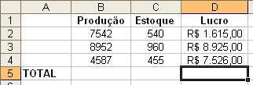

# PROVA — Camara_Campo_Mourao_2006_Agente_Administrativo

## 1. Análise geral da prova

- **Identificação:** Camara_Campo_Mourao_2006_Agente_Administrativo
- **Quantidade total de questões:** 50
- **Quantidade de textos de apoio (grupos):** 0
- **Quantidade de imagens:** 3
- **Quantidade de gráficos e tabelas:** incluídos nas imagens e no texto extraído, quando presentes no PDF original
- **Quantidade de grupos identificados:** 0
- **Quantidade de questões independentes:** 50
- **Questões que compartilham materiais:** nenhuma identificada automaticamente

### Transcrição integral da capa/instruções (conforme extraída do PDF)

> [!NOTE]
> Conteúdo integral das páginas anteriores à primeira questão, sem cortes.

> 
>
>
>
> 
>
> Câmara Municipal de Campo Mourão
> Estado do Paraná
> REALIZAÇÃO
> R E F . E D I T A L D E C O N C U R S O P Ú B L I C O N º . 0 0 1 / 2 0 0 6
> INSTRUÇÕES
> •
> Você está recebendo do fiscal um caderno de questões com 50 (cinqüenta) questões que compõem a prova objetiva numeradas
> seqüencialmente.
> •
> E receberá também uma Folha de Respostas personalizada para transcrever as respostas da prova objetiva.
> ATENÇÃO:
> 1-
> Observe se o caderno de questões é o correspondente ao cargo no qual você fez a inscrição. Caso não esteja correto solicite a
> substituição para o fiscal de sala, o qual deverá lhe fornecer o caderno de questões correto.
> 2-
> Verifique se esse caderno está completo e se a numeração das questões está correta.
> 3-
> Confira seu nome completo, o número de seu documento e a sua data de nascimento na Folha de Respostas, e caso encontre
> alguma irregularidade, solicite a um dos fiscais que faça a correção.
> 4-
> Leia atentamente cada questão da prova e assinale na Folha de Respostas a opção que a responda corretamente.
> 5-
> A Folha de Respostas não pode ser dobrada, amassada, rasurada ou conter qualquer marcação fora dos campos destinados às
> respostas.
> 6-
> Você dispõe de 4 (quatro) horas para fazer a prova, incluindo a marcação da Folha de Respostas. Faça com tranqüilidade, mas
> controle seu tempo.
> 7-
> Após o término da prova, entregue ao fiscal a Folha de Respostas devidamente assinada.
> 8-
> Qualquer tentativa de fraude, se descoberta, implicará em imediata denúncia à polícia federal, que tomará as medidas cabíveis,
> inclusive com prisão em flagrante dos envolvidos.
> P O R T U G U Ê S

### Gabarito

| Questão | 01 | 02 | 03 | 04 | 05 |
|---|---|---|---|---|---|
| Resposta | C | D | A | A | D |

| Questão | 06 | 07 | 08 | 09 | 10 |
|---|---|---|---|---|---|
| Resposta | C | E | E | C | C |

| Questão | 11 | 12 | 13 | 14 | 15 |
|---|---|---|---|---|---|
| Resposta | D | B | A | B | C |

| Questão | 16 | 17 | 18 | 19 | 20 |
|---|---|---|---|---|---|
| Resposta | C | C | A | B | D |

| Questão | 21 | 22 | 23 | 24 | 25 |
|---|---|---|---|---|---|
| Resposta | E | E | A | A | D |

| Questão | 26 | 27 | 28 | 29 | 30 |
|---|---|---|---|---|---|
| Resposta | C | B | D | C | B |

| Questão | 31 | 32 | 33 | 34 | 35 |
|---|---|---|---|---|---|
| Resposta | A | C | B | ANULADA | ANULADA |

| Questão | 36 | 37 | 38 | 39 | 40 |
|---|---|---|---|---|---|
| Resposta | ANULADA | C | D | B | B |

| Questão | 41 | 42 | 43 | 44 | 45 |
|---|---|---|---|---|---|
| Resposta | C | D | B | E | D |

| Questão | 46 | 47 | 48 | 49 | 50 |
|---|---|---|---|---|---|
| Resposta | B | E | D | B | D |

## 2. Questões agrupadas

Nenhum grupo de questões compartilhando material foi identificado automaticamente nesta prova.

## 3. Questões independentes

#### QUESTÃO 01

✅ **Gabarito: C** (gabarito.pdf (bloco CARGO: AGENTE ADMINISTRATIVO; Ref. Edital nº 001/2006, prova com 50 questões))

**Enunciado:**

Destaque a alternativa em que o termo sublinhado
não é um substantivo:

**Alternativas:**

A) O vôo de balão é uma aventura ao sabor do vento.
B) No horizonte, o perigo da guerra.
C) Ele vinha pela estrada e foi picado por várias
abelhas.
D) Li alguns livros interessantes.
E) Estamos voando para Barcelona.

**Referências visuais:**

Nenhuma.

---

#### QUESTÃO 02

✅ **Gabarito: D** (gabarito.pdf (bloco CARGO: AGENTE ADMINISTRATIVO; Ref. Edital nº 001/2006, prova com 50 questões))

**Enunciado:**

Destaque a alternativa em que o verbo sublinhado
está flexionado no modo subjuntivo:

**Alternativas:**

A) João
Romão
fez-se
participante
direto
dos
sofrimentos da vizinha.
B) Bertoleza representava agora ao lado de João
Romão o papel tríplice de caixeiro.
C) A roupa lavada umedecia o ar e punha-lhe um farto
acre de sabão ordinário.
D) Firmo fora intimado pelo vendeiro a que lhe não
pusesse, nunca mais, os pés em casa, sob pena de
ser entregue a polícia.
E) Dona Isabel chorava como criança, abraçando as
amigas, uma por uma.

**Referências visuais:**

Nenhuma.

---

#### QUESTÃO 03

✅ **Gabarito: A** (gabarito.pdf (bloco CARGO: AGENTE ADMINISTRATIVO; Ref. Edital nº 001/2006, prova com 50 questões))

**Enunciado:**

Assinale a alternativa em que a conjunção
sublinhada evidencia uma oração subordinada
adverbial temporal:

**Alternativas:**

A) Quando voltou à sala, Sofia foi olhar o espelho e viu
que sua imagem piscava os olhos para ela.
B) Sofia concluiu que alguém morava ali, pois havia
resquícios de fumaça num velho fogão à lenha.
C) Sofia tinha trazido fósforo e acendeu uma vela que lá
havia.
D) O médico não veio nem me telefonou.
E) Essa desculpa não serve, porque, afinal de contas,
teus negócios vão bem.

**Referências visuais:**

Nenhuma.

---

#### QUESTÃO 04

✅ **Gabarito: A** (gabarito.pdf (bloco CARGO: AGENTE ADMINISTRATIVO; Ref. Edital nº 001/2006, prova com 50 questões))

**Enunciado:**

Aponte a alternativa em que há um verbo
transitivo direto e indireto:

**Alternativas:**

A) Não lhe arranquei mais nada.
B) A população da Vila assistia ao embarque.
C) Cedo, a noite caía.
D) Ele ficou pasmo, sem palavras.
E) Os olhos pareciam uma posta de sangue.

**Referências visuais:**

Nenhuma.

---

#### QUESTÃO 05

✅ **Gabarito: D** (gabarito.pdf (bloco CARGO: AGENTE ADMINISTRATIVO; Ref. Edital nº 001/2006, prova com 50 questões))

**Enunciado:**

Identifique a alternativa em há palavra(s) em
desacordo com as regras de acentuação gráfica:

**Alternativas:**

A) Os raios moribundos do sol no ocaso pareciam
dormir nos bastos olivais que coroavam a crista dos
outeiros.
B) Ele, belo com essa beleza que distingue o homem;
ela, bela com essa beleza que Deus dá só às
mulheres!
C) Fernando pôs-se de joelhos aos pés de Carolina,
cingindo-lhe a cintura flexível e delicada, com seus
braços nervosos.
D) No meio daquela mudez aterradora, soôu um grito de
mulher, abafado logo por algum beijo.
E) Á claridade da lua que se mostrou de súbito, um vulto
de mulher atravessava apressado a alameda.

**Referências visuais:**

Nenhuma.

---

#### QUESTÃO 06

✅ **Gabarito: C** (gabarito.pdf (bloco CARGO: AGENTE ADMINISTRATIVO; Ref. Edital nº 001/2006, prova com 50 questões))

**Enunciado:**

Aponte a alternativa em que o emprego da vírgula
está em desacordo com normas gramaticais de
língua portuguesa:

**Alternativas:**

A) Era preciso, entretanto, explicar o fato ao leitor.
B) A razão destas linhas é outra, muito outra, e eu
explico já.
C) A nossa Grécia, varia muito, e o que nos resta dela
são ossos descamados.
D) O doutor Maximiliano bebeu ainda uma cerveja e,
acabada que foi a cerveja, saiu vagarosamente um
tanto trôpego.
E) A frase, mal desenhada, era curta, logo cortada,
interrompida, sacudida pelos rufos, pelo ranger, pelos
guinchos de instrumentos selvagens e ingênuos.

**Referências visuais:**

Nenhuma.

---

#### QUESTÃO 07

✅ **Gabarito: E** (gabarito.pdf (bloco CARGO: AGENTE ADMINISTRATIVO; Ref. Edital nº 001/2006, prova com 50 questões))

**Enunciado:**

Destaque a alternativa em que o termo sublinhado
não é uma preposição:

**Alternativas:**

A) Fazia-me ele a impressão de um perene tarumã
verdejante.
B) Com a guaiaca empanzinada de onças de ouro, vim
varar aqui neste mesmo passo.
C) Ali logo frenteei com uma comitiva de tropeiros, com
grande cavalhada por diante, e que por certo vinha
tomar pouso na estância.
D) Á esquerda os campos desdobravam-se a perder de
vista, serenos, verdes, clareados pela luz macia do
sol morrente,
E) E já todo no meu sossego de homem, meti a pistola
no cinto. Fechei um baio, bati o isqueiro e comecei a
pitar.

**Referências visuais:**

Nenhuma.

---

#### QUESTÃO 08

✅ **Gabarito: E** (gabarito.pdf (bloco CARGO: AGENTE ADMINISTRATIVO; Ref. Edital nº 001/2006, prova com 50 questões))

**Enunciado:**

Assinale a alternativa com palavra(s) grafada(s)
em desacordo com a ortografia oficial de língua
portuguesa:

**Alternativas:**

A) A minha curiosidade começou à ceia, quando eu
desfazia o peito de uma galinha afogado em arroz
branco.
B) A mim, o que me lançara na quimera e no sonho fora
o aspecto do Mosteiro de Restelo.
C) O tabelião era homem letrado, latinista, e amigo das
musas.
D) Quando se viu assim, só e pobre, Macário desatou a
chorar.
E) Via o fim da sua vida prenchido, completo, radioso.

**Referências visuais:**

Nenhuma.

---

#### QUESTÃO 09

✅ **Gabarito: C** (gabarito.pdf (bloco CARGO: AGENTE ADMINISTRATIVO; Ref. Edital nº 001/2006, prova com 50 questões))

**Enunciado:**

Indique a opção em que o termo sublinhado não é
um advérbio:

**Alternativas:**

A) Não quero parecer que me detenho em coisas
miúdas.
B) Debalde o Diabo tentou proferir alguma coisa mais.
C) Ele prometia aos seus discípulos e fiéis as delícias da
terra, todas as glórias, os deleites mais íntimos.
D) Os que se vão calados, raramente é por orgulho; na
maior parte dos casos ou não têm tempo, ou não
sabem escrever.
E) Fomos até o estábulo, mas o Antunes não estava lá.

**Referências visuais:**

Nenhuma.

---

#### QUESTÃO 10

✅ **Gabarito: C** (gabarito.pdf (bloco CARGO: AGENTE ADMINISTRATIVO; Ref. Edital nº 001/2006, prova com 50 questões))

**Enunciado:**

Identifique a alternativa em que a classificação do
pronome sublinhado está errada:

**Alternativas:**

A) Ele tinha um pangaré que, aos seus olhos, parecia
um garanhão. (pronome possessivo)
B) Dom Quixote pediu ao dono da hospedaria que o
fizesse um cavaleiro andante. (pronome pessoal do
caso oblíquo)
C) Quando os dois estavam na cama, aquele que
esperava pela moça começou a bater no fidalgo.
(pronome relativo)
D) Inconformado com isso, Quixote acabou com os dois
soldados e libertou os prisioneiros. (pronome
demonstrativo)
E) Ele sabia que Dulcinéia não era princesa. (pronome
pessoal do caso reto)

**Referências visuais:**

Nenhuma.

---

#### QUESTÃO 11

✅ **Gabarito: D** (gabarito.pdf (bloco CARGO: AGENTE ADMINISTRATIVO; Ref. Edital nº 001/2006, prova com 50 questões))

**Enunciado:**

Aponte a alternativa em que há erro de
concordância entre substantivo(s) e adjetivo(s):

**Alternativas:**

A) João é uma boa criatura.
B) O cônjuge de Marcela faleceu.
C) Naquela biblioteca só há romances policiais!
D) Os trabalhadores estavam bastantes cansados.
E) Havia bastantes opções de trabalho naquela cidade.

**Referências visuais:**

Nenhuma.

---

#### QUESTÃO 12

✅ **Gabarito: B** (gabarito.pdf (bloco CARGO: AGENTE ADMINISTRATIVO; Ref. Edital nº 001/2006, prova com 50 questões))

**Enunciado:**

Destaque a alternativa em que há oração na voz
passiva:

**Alternativas:**

A) O casarão todo dormia.
B) Antes de deixar a cidade, foi visto por um amigo
madrugador.
C) A festa inaugural esteve animada.
D) Eu jamais tinha ouvido coisa igual.
E) Trata-se de um assunto muito grave, senhor.
M A T E M Á T I C A

**Referências visuais:**

Nenhuma.

---

#### QUESTÃO 13

✅ **Gabarito: A** (gabarito.pdf (bloco CARGO: AGENTE ADMINISTRATIVO; Ref. Edital nº 001/2006, prova com 50 questões))

**Enunciado:**

Qual é o tempo necessário para obter 5
12 de um
capital aplicado a juros simples à taxa de 20% ao
mês?

**Alternativas:**

A) 12 meses
B) 3 meses
C) 20 meses
D) 9 meses
E) 15 meses

**Referências visuais:**

Nenhuma.

---

#### QUESTÃO 14

✅ **Gabarito: B** (gabarito.pdf (bloco CARGO: AGENTE ADMINISTRATIVO; Ref. Edital nº 001/2006, prova com 50 questões))

**Enunciado:**

Para construir uma ponte em 75 dias, foram
contratados 100 operários, trabalhando 8 horas
diárias. Para que a obra fique pronta em 40 dias,
quantos operários a mais devem ser contratados,
trabalhando 10 horas diárias?

**Alternativas:**

A) 100 operários
B) 50 operários
C) 150 operários
D) 30 operários
E) 90 operários

**Referências visuais:**

Nenhuma.

---

#### QUESTÃO 15

✅ **Gabarito: C** (gabarito.pdf (bloco CARGO: AGENTE ADMINISTRATIVO; Ref. Edital nº 001/2006, prova com 50 questões))

**Enunciado:**

Dada à função f: N  N, definida por f(x) = 2x + 1,
calcule:
f(2) + f(3) = f(x) + 3

**Alternativas:**

A) S = { 0 }
B) S = { 1 }
C) S = { 4 }
D) S = { -2 }
E) S = { 8 }

**Referências visuais:**

Nenhuma.

---

#### QUESTÃO 16

✅ **Gabarito: C** (gabarito.pdf (bloco CARGO: AGENTE ADMINISTRATIVO; Ref. Edital nº 001/2006, prova com 50 questões))

**Enunciado:**

Descubra o preço de uma tábua, sabendo que um
aumento de R$ 3,60 reais representa 18% do seu
preço. O preço da tábua é:

**Alternativas:**

A) R$ 9,00
B) R$ 18,00
C) R$ 20,00
D) R$ 50,00
E) R$ 13,00

**Referências visuais:**

Nenhuma.

---

#### QUESTÃO 17

✅ **Gabarito: C** (gabarito.pdf (bloco CARGO: AGENTE ADMINISTRATIVO; Ref. Edital nº 001/2006, prova com 50 questões))

**Enunciado:**

Sabendo que a fórmula do termo geral de uma
P.A. (progressão aritmética) é:
an = a1 + (n – 1)r
Calcule o primeiro termo a1 de uma P.A. de 8
termos em que a8 = 35 a razão é 3:

**Alternativas:**

A) 10
B) 12
C) 14
D) 16
E) 18

**Referências visuais:**

Nenhuma.

---

#### QUESTÃO 18

✅ **Gabarito: A** (gabarito.pdf (bloco CARGO: AGENTE ADMINISTRATIVO; Ref. Edital nº 001/2006, prova com 50 questões))

**Enunciado:**

Resolva a equação exponencial:
X
X






=






−

**Alternativas:**

A) S = {-6; 2}
B) S = {6; -2}
C) S = {4; 3}
D) S = {-6; 3}
E) S = {5; 2}

**Referências visuais:**

Nenhuma.

---

#### QUESTÃO 19

✅ **Gabarito: B** (gabarito.pdf (bloco CARGO: AGENTE ADMINISTRATIVO; Ref. Edital nº 001/2006, prova com 50 questões))

**Enunciado:**

Um poste de 9 m de altura é sustentado por um
cabo de aço que é preso ao solo a 12 m da base
do poste. Qual é a medida do cabo de aço?

**Alternativas:**

A) 12 m
B) 15 m
C) 18 m
D) 20 m
E) 22 m

**Referências visuais:**

Nenhuma.

---

#### QUESTÃO 20

✅ **Gabarito: D** (gabarito.pdf (bloco CARGO: AGENTE ADMINISTRATIVO; Ref. Edital nº 001/2006, prova com 50 questões))

**Enunciado:**

Calcule o valor de “m” de modo que o ponto m(-1,
2) pertença à parábola que representa a função
f(x) = x² + (m – 1)x + 3:

**Alternativas:**

A) m = 1
B) m = 6
C) m = 4
D) m = 3
E) m = 2

**Referências visuais:**

Nenhuma.

---

#### QUESTÃO 21

✅ **Gabarito: E** (gabarito.pdf (bloco CARGO: AGENTE ADMINISTRATIVO; Ref. Edital nº 001/2006, prova com 50 questões))

**Enunciado:**

Um vendedor recebe um salário fixo de R$ 400,00
mais uma comissão sobre o total de suas vendas
no mês, dada pela fórmula
+
=
x
Z
, onde
Z é o salário final e x é o número de produtos
vendidos. Para receber um salário de R$ 2.000,00,
quanto deve vender em produtos?

**Alternativas:**

A) x = 2000 produtos
B) x = 900 produtos
C) x = 1800 produtos
D) x = 1400 produtos
E) x = 1200 produtos

**Referências visuais:**

Nenhuma.

---

#### QUESTÃO 22

✅ **Gabarito: E** (gabarito.pdf (bloco CARGO: AGENTE ADMINISTRATIVO; Ref. Edital nº 001/2006, prova com 50 questões))

**Enunciado:**

Dado o triângulo retângulo EFG, determine: sen Ê
+ cos Ê – tg Ê

**Alternativas:**

A) 
B) 5
C) 
D) 20
E) 20

**Referências visuais:**

Nenhuma.

---

#### QUESTÃO 23

✅ **Gabarito: A** (gabarito.pdf (bloco CARGO: AGENTE ADMINISTRATIVO; Ref. Edital nº 001/2006, prova com 50 questões))

**Enunciado:**

Terminadas as provas de um concurso municipal,
todos os candidatos foram entrevistados para
opinarem sobre o grau de dificuldade das provas
de português e matemática. Foram feitas as
seguintes perguntas, para que respondessem sim
ou não:
* A prova de matemática estava fácil?
* A prova de português estava fácil?
Responderam sim à primeira pergunta 900
candidatos; 700 responderam sim à segunda; 250
responderam sim a ambas; 400 responderam não
a ambas.
Quantas pessoas participaram do concurso?

**Alternativas:**

A) 1750 pessoas
B) 2250 pessoas
C) 1850 pessoas
D) 1600 pessoas
E) 1500 pessoas

**Referências visuais:**

Nenhuma.

---

#### QUESTÃO 24

✅ **Gabarito: A** (gabarito.pdf (bloco CARGO: AGENTE ADMINISTRATIVO; Ref. Edital nº 001/2006, prova com 50 questões))

**Enunciado:**

Numa das delegacias de uma grande cidade, há
uma tabela das pessoas que se queixaram de
roubo ou furto. Na última semana, a referida
tabela apresentava os seguintes dados:
Dia da semana
Número de queixas
Segunda
Terça
Quarta
Quinta
Sexta
Sábado
Domingo
Com base nestes dados, determine a média
aritmética dessa semana:

**Alternativas:**

A) 10
B) 9
C) 20
D) 15
E) 12
L E G I S L A Ç Ã O

**Referências visuais:**

Nenhuma.

---

#### QUESTÃO 25

✅ **Gabarito: D** (gabarito.pdf (bloco CARGO: AGENTE ADMINISTRATIVO; Ref. Edital nº 001/2006, prova com 50 questões))

**Enunciado:**

De acordo com o que dispõe a Lei Orgânica do
Município
de
Campo
Mourão,
assinale
a
alternativa correta:

**Alternativas:**

A) Compete privativamente ao município legislar sobre
administração, utilização e alienação dos bens do
Estado.
B) O município pode exigir ou aumentar tributo sem que
a lei o estabeleça.
C) O município está autorizado pela Lei Orgânica a
instituir tributo aos templos de qualquer culto.
D) Compete privativamente ao município conceder
licença para serviços de táxis.
E) O Poder Legislativo é exercido somente pelo prefeito
de Campo Mourão.

**Referências visuais:**

Nenhuma.

---

#### QUESTÃO 26

✅ **Gabarito: C** (gabarito.pdf (bloco CARGO: AGENTE ADMINISTRATIVO; Ref. Edital nº 001/2006, prova com 50 questões))

**Enunciado:**

Quanto à Organização dos Poderes, no que se
refere ao Poder Legislativo, assinale a alternativa
incorreta:

**Alternativas:**

A) Cada legislatura da Câmara Municipal terá a duração
de 4(quatro) anos.
B) É de competência exclusiva da Câmara municipal de
Campo Mourão elaborar o seu Regimento Interno.
C) A câmara municipal compõe-se de vereadores
maiores de 25 anos, eleitos por pleito direto,
realizado em todo o país.
D) Perderá o mandato o vereador cujo procedimento for
declarado incompatível com o decoro parlamentar.
E) Não perderá o mandato o vereador por motivo de
paternidade ausentado no prazo previsto pela lei.
E
G
F

**Referências visuais:**

Nenhuma.

---

#### QUESTÃO 27

✅ **Gabarito: B** (gabarito.pdf (bloco CARGO: AGENTE ADMINISTRATIVO; Ref. Edital nº 001/2006, prova com 50 questões))

**Enunciado:**

De acordo como o Estatuto do Servidor Público,
todas são penalidades disciplinares, exceto:

**Alternativas:**

A) Advertência
B) Censura
C) Suspensão
D) Demissão
E) Cassação de aposentadoria

**Referências visuais:**

Nenhuma.

---

#### QUESTÃO 28

✅ **Gabarito: D** (gabarito.pdf (bloco CARGO: AGENTE ADMINISTRATIVO; Ref. Edital nº 001/2006, prova com 50 questões))

**Enunciado:**

Quanto ao Regime Disciplinar dos servidores
públicos, assinale a opção correta:

**Alternativas:**

A) O servidor responde apenas administrativamente
pelo exercício irregular de suas atribuições.
B) A responsabilidade administrativa do servidor persiste
no caso de absolvição criminal que negue a
existência de fato ou sua autoria.
C) É ilícito ao servidor criticar atos do Poder Público do
ponto de vista da organização do serviço.
D) A responsabilidade penal abrange os crimes e
contravenções
imputados
ao
servidor
nessa
qualidade.
E) Na responsabilidade civil, a obrigação de reparar o
dano não se estende aos sucessores do servidor
público.

**Referências visuais:**

Nenhuma.

---

#### QUESTÃO 29

✅ **Gabarito: C** (gabarito.pdf (bloco CARGO: AGENTE ADMINISTRATIVO; Ref. Edital nº 001/2006, prova com 50 questões))

**Enunciado:**

De acordo como a Constituição Federal da
República de 1988, com relação à Administração
Pública, assinale a alternativa correta:

**Alternativas:**

A) O servidor público civil não tem direito à associação
sindical.
B) A Constituição não admite em nenhum caso a
acumulação remunerada de cargos públicos.
C) O prazo de validade do concurso público será de até
dois anos, prorrogável uma vez por igual período.
D) A Administração Pública indireta não deve obedecer
ao princípio da publicidade.
E) Os vencimentos dos cargos do Poder Legislativo
poderão ser superiores ao pagos ao Poder Executivo.

**Referências visuais:**

Nenhuma.

---

#### QUESTÃO 30

✅ **Gabarito: B** (gabarito.pdf (bloco CARGO: AGENTE ADMINISTRATIVO; Ref. Edital nº 001/2006, prova com 50 questões))

**Enunciado:**

Sobre os Municípios, dispõe a Constituição:

**Alternativas:**

A) Haverá eleição para os cargos de prefeito, vice-
prefeito e vereador para mandato de cinco anos.
B) O número de vereadores do município é obtido de
forma proporcional à população do município,
devendo respeitar o limite de no mínimo 9(nove) e no
máximo 21(vinte e um), para municípios de até 1
(um) milhão de habitantes.
C) O total de despesa com a remuneração dos
vereadores não poderá ultrapassar o montante de 6%
(seis por cento) da receita do Estado.
D) Não pode haver iniciativa popular para projeto de lei,
mesmo que de interesse específico do município.
E) Os vereadores não têm inviolabilidade de opinião,
palavra ou voto durante o exercício do mandato.

**Referências visuais:**

Nenhuma.

---

#### QUESTÃO 31

✅ **Gabarito: A** (gabarito.pdf (bloco CARGO: AGENTE ADMINISTRATIVO; Ref. Edital nº 001/2006, prova com 50 questões))

**Enunciado:**

Sobre licitação, assinale a alternativa correta:

**Alternativas:**

A) As licitações serão efetuadas no local onde se situar
a repartição interessada, salvo por motivo de
interesse público, devidamente justificado.
B) Interessados em licitações, residentes ou sediados
em outros locais não poderão habilitar-se.
C) São modalidades de licitação: concorrência, tomada
de preços, convite, concurso, leilão e concessão.
D) É possível a criação de outras modalidades de
licitação, além daquelas previstas na Lei nº 8.666/93.
E) A licitação é indispensável nos casos de guerra.

**Referências visuais:**

Nenhuma.

---

#### QUESTÃO 32

✅ **Gabarito: C** (gabarito.pdf (bloco CARGO: AGENTE ADMINISTRATIVO; Ref. Edital nº 001/2006, prova com 50 questões))

**Enunciado:**

Assinale a alternativa correta de acordo com a Lei
de Licitações:

**Alternativas:**

A) Nas licitações a Administração pode descumprir as
condições do edital, pois não está vinculada a ele.
B) O licitante inabilitado não está impedido de participar
das fases subseqüentes.
C) Serão desclassificadas as propostas que não
atendam às exigências do ato convocatório da
licitação.
D) A Administração poderá celebrar o contrato com
terceiros estranhos ao procedimento licitatório.
E) Os bens a serem leiloados não passam por prévia
avaliação.

**Referências visuais:**

Nenhuma.

---

#### QUESTÃO 33

✅ **Gabarito: B** (gabarito.pdf (bloco CARGO: AGENTE ADMINISTRATIVO; Ref. Edital nº 001/2006, prova com 50 questões))

**Enunciado:**

Com relação aos órgãos da Câmara, sobre a
Mesa, assinale a alternativa correta:

**Alternativas:**

A) O presidente da Câmara não tem atribuição de
suspender a sessão, ainda que necessário.
B) Incumbe ao vice-presidente substituir o presidente
durante sua ausência, ou impedimento.
C) O segundo secretário não assina os atos da Mesa.
D) O primeiro secretário não pode decidir, em primeira
instância, recursos contra atos da Diretoria Geral da
Câmara.
E) A Procuradoria Parlamentar será exercida por
qualquer vereador da Câmara.

**Referências visuais:**

Nenhuma.

---

#### QUESTÃO 34

⚠️ **Gabarito: ANULADA**

**Enunciado:**

Apoiado no Regimento Interno da Câmara,
assinale a alternativa incorreta:

**Alternativas:**

A) O vereador que perder lugar em uma Comissão
poderá retornar na mesma sessão legislativa após 30
(trinta) dias.
B) A Comissão de Finanças e Orçamento deve elaborar
projetos de resolução fixando a remuneração do
Prefeito.
C) As Comissões Temporárias são Especiais, de
Inquérito, de Representação, de Exame, Especial de
Ética e Processante.
D) A Câmara compõe-se das seguintes Comissões
Permanentes: Comissão de Legislação e Redação,
Comissão de Finanças e Orçamento e Comissão de
Méritos Temáticos.
E) Cabe à Câmara, com a sanção do Prefeito dispor
sobre matérias de interesse local, especialmente o
regime jurídico único dos servidores.

**Referências visuais:**

Nenhuma.

---

#### QUESTÃO 35

⚠️ **Gabarito: ANULADA**

**Enunciado:**

De acordo com a Lei Complementar Municipal,
quanto à Estruturação das Leis, assinale a
alternativa correta:

**Alternativas:**

A) A ementa indicará o órgão ou instituição competente
para a prática do ato e sua base legal.
B) O preâmbulo será grafado por meio de caracteres
que o realcem e explicará de forma concisa o objeto
da lei.
C) A lei pode conter matéria estranha ao seu objeto, ou
não vinculada a este por afinidade, pertinência ou
conexão.
D) A cláusula de revogação não precisa enumerar as
leis ou disposições legais revogadas.
E) O primeiro artigo do texto indicará o objeto da lei e o
respectivo âmbito de aplicação.

**Referências visuais:**

Nenhuma.

---

#### QUESTÃO 36

⚠️ **Gabarito: ANULADA**

**Enunciado:**

Assinale a alternativa correta:

**Alternativas:**

A) A alteração das leis será feita mediante reprodução
parcial em novo texto, quando se tratar de alteração
considerável.
B) Para obter precisão, na redação das leis, devem-se
construir as orações na ordem direta, evitando
preciosismo,
neologismo
e
adjetivações
dispensáveis.

C) Para obtenção de clareza, na redação das leis, deve-
se indicar expressamente o dispositivo objeto da
remissão.
D) As disposições normativas não serão redigidas com
clareza, precisão e lógica.
E) Para a obtenção de ordem lógica deve-se restringir o
conteúdo de cada artigo da lei a um único assunto ou
princípio.
C O N H E C I M E N T O S G E R A I S

**Referências visuais:**

Nenhuma.

---

#### QUESTÃO 37

✅ **Gabarito: C** (gabarito.pdf (bloco CARGO: AGENTE ADMINISTRATIVO; Ref. Edital nº 001/2006, prova com 50 questões))

**Enunciado:**

Os ícones têm como função da esquerda
para a direita, respectivamente:

**Alternativas:**

A) Negrito, Realce e Sublinhado.
B) Negrito, Itálico e Subscrito.
C) Negrito, Itálico e Sublinhado.
D) Negrito, Subscrito e Sublinhado.
E) Negro, alinhado à direita e Sublinhado.

**Referências visuais:**

Nenhuma.

---

#### QUESTÃO 38

✅ **Gabarito: D** (gabarito.pdf (bloco CARGO: AGENTE ADMINISTRATIVO; Ref. Edital nº 001/2006, prova com 50 questões))

**Enunciado:**

A opção do menu arquivo que nos possibilita ajustar as
opções de papel bem como “Tipo”, “Largura” e
“Altura” é:

**Alternativas:**

A) “Imprimir...”
B) “Visualizar Impressão”
C) “Permissão”
D) “Configurar Página”
E) “Layout”

**Referências visuais:**

Nenhuma.

---

#### QUESTÃO 39

✅ **Gabarito: B** (gabarito.pdf (bloco CARGO: AGENTE ADMINISTRATIVO; Ref. Edital nº 001/2006, prova com 50 questões))

**Enunciado:**

Acerca do Microsoft Excel assinale a alternativa
correta.

**Alternativas:**

A) O Microsoft tem um total de 10.000 linhas
B) É possível inserirmos um gráfico em planilhas do
Microsoft Excel
C) Para classificarmos uma seqüência de valores de
ordem crescente ou decrescente, é preciso acessar o
menu
“Editar”,
“Classificação
de
dados”.
“Crescente”/”Decrescente”
D) O ícone representa a Função f(x) a qual nos
referimos
E) Não é possível a inserção de hyperlinks no Microsoft
Excel

**Referências visuais:**

Nenhuma.

---

#### QUESTÃO 40

✅ **Gabarito: B** (gabarito.pdf (bloco CARGO: AGENTE ADMINISTRATIVO; Ref. Edital nº 001/2006, prova com 50 questões))

**Enunciado:**

A respeito da figura a seguir é correto afirmar.

**Alternativas:**

A) Para obtermos a soma do total de lucros a fórmula
utilizada é: =TOTAL (D2:D4)
B) O estoque total disponível nos seria fornecido através
da fórmula: =SOMA (C2:C4)
C) Não há a possibilidade de fazer a diferença entre a
Produção e o Estoque
D) Para ordenarmos o Lucro de maneira crescente é
necessário selecionar a coluna D em seguida o Menu
“Dados”, “Classificar”, “Expandir a Seleção” e por fim
“Decrescente”
E) A fórmula aplicada para se verificar o lucro total é
diferente da aplicada para a verificação de produção
e estoque final

**Referências visuais:**

Nenhuma.

---

#### QUESTÃO 41

✅ **Gabarito: C** (gabarito.pdf (bloco CARGO: AGENTE ADMINISTRATIVO; Ref. Edital nº 001/2006, prova com 50 questões))

**Enunciado:**

Acerca das características históricas de Campo Mourão
é incorreto afirmar:

**Alternativas:**

A) Campo Mourão já pertenceu ao município de
Guarapuava
B) Os serrados nativos dos “Campos do Mourão”
serviram de pontos de descanso dos tropeiros que
por aqui passavam, tocando boiadas para negociar
no Mato Grosso do Sul.
C) Campo Mourão aguarda ansiosamente pela sua
emancipação política.
D) Campo Mourão é Município sede da Microrregião 12,
a qual agrega 25 Municípios, totalizando uma
população de aproximadamente 356.191 habitantes
E) O período que compreende às visitas espanholas no
município é 1524 – 1541

**Referências visuais:**

Nenhuma.

---

#### QUESTÃO 42

✅ **Gabarito: D** (gabarito.pdf (bloco CARGO: AGENTE ADMINISTRATIVO; Ref. Edital nº 001/2006, prova com 50 questões))

**Enunciado:**

A respeito do clima do município de Campo Mourão
assinale a alternativa correta:

**Alternativas:**

A) As geadas são freqüentes em todas as épocas do
ano
B) Os meses do inverno são os meses que possuem a
maior concentração de chuvas.
C) O clima do município não propicia uma agricultura
muito rentável
D) A temperatura média anual está entre 20 e 21 graus
centígrados
E) O município possui uma estação seca muito bem
definida

**Referências visuais:**

Nenhuma.

---

#### QUESTÃO 43

✅ **Gabarito: B** (gabarito.pdf (bloco CARGO: AGENTE ADMINISTRATIVO; Ref. Edital nº 001/2006, prova com 50 questões))

**Enunciado:**

De acordo com as características gerais de Campo
Mourão é correto afirmar:

**Alternativas:**

A) O solo de Campo Mourão não é muito fértil
inviabilizando, dessa forma, a atividade agrícola.
B) O maior potencial hidrodinâmico do município está
associado ao Rio Mourão juntamente com a
topografia de seu vale
C) Não
há
utilização
de
poços
artesianos
no
abastecimento hídrico de Campo Mourão
D) A instituição hospitalar Santa Casa de Campo
Mourão não tem caráter beneficente
E) Nunca houve a cogitação de instalação de um
hospital do câncer no município, visto que, toda a
demanda de pacientes com câncer sempre foi tratada
em municípios vizinho sem prejuízos à saúde dos
mesmos.

**Referências visuais:**

Nenhuma.

---

#### QUESTÃO 44

✅ **Gabarito: E** (gabarito.pdf (bloco CARGO: AGENTE ADMINISTRATIVO; Ref. Edital nº 001/2006, prova com 50 questões))

**Enunciado:**

Analise as afirmativas a seguir e assinale a alternativa
correta
I. A necessidade de redução de custos provocou a
transferência de várias indústrias para regiões
diferente do sudeste brasileiro.
II. Os governos estaduais começaram a oferecer
vantagens, como isenção de impostos e doação
de
infra-estrutura,
às
empresas
que
se
instalassem em seu território.
III. Está
havendo
um
estímulo
federal
à
regionalização industrial, pois o governo concluiu
que o país não poderia continuar crescendo de
forma tão desigual.
Estão corretas:

**Alternativas:**

A) Apenas I
B) Apenas I e II
C) Apenas I e III
D) Apenas II e III
E) Todas estão corretas

**Referências visuais:**

Nenhuma.

---

#### QUESTÃO 45

✅ **Gabarito: D** (gabarito.pdf (bloco CARGO: AGENTE ADMINISTRATIVO; Ref. Edital nº 001/2006, prova com 50 questões))

**Enunciado:**

Acerca das eleições ocorridas em 2006 assinale a
alternativa incorreta

**Alternativas:**

A) Antes do início das eleições a dúvida que rondava
entre o partido político PSDB era a de quem seria o
candidato do partido. A dúvida rondava entre José
Serra e Geraldo Alckmin
B) Após a divulgação da notícia de que haveria o
segundo turno, os partido políticos dos candidatos
Cristovam Buarque e Heloísa Helena decidiram por
não apoiar nenhum dos dois candidatos.
C) No estado do Paraná ocorreu a disputa mais acirrada
na disputa pelo governo estadual, no entanto, o
candidato vencedor foi Roberto Requião.
D) Apesar do candidato do PSDB não ter participado de
todos os debates promovidos pelas transmissoras de
TV, o candidato petista, Luis Inácio Lula da Silva
consagrou-se vencedor por mais um mandato de 4
anos.
E) Alguns destaques das eleições foram à eleição de
candidatos um tanto quanto curiosos como Frank
Aguiar e Clodovil

**Referências visuais:**

Nenhuma.

---

#### QUESTÃO 46

✅ **Gabarito: B** (gabarito.pdf (bloco CARGO: AGENTE ADMINISTRATIVO; Ref. Edital nº 001/2006, prova com 50 questões))

**Enunciado:**

Analise as afirmações a seguir e assinale a alternativa
correta
I. O agronegócio não inclui só a pecuária e a
agricultura, engloba ainda os demais setores que
produzem equipamentos e serviços (os insumos)
para a zona rural e os que transformam as
matérias-primas vindas do campo.
II. O agronegócio bateu recorde na soma de janeiro
a maio desse ano com 18 bilhões de dólares
aproximadamente 6% maior que os valores do
ano passado
III. Apesar do agronegócio ter grande importância na
economia brasileira, sua modernização é tardia,
além das condições geográficas e do clima não
propiciarem ao Brasil realizar a modernização da
agricultura
Estão corretas:

**Alternativas:**

A) Apenas I
B) Apenas I e II
C) Apenas I e III
D) Apenas II e III
E) Todas estão corretas

**Referências visuais:**

Nenhuma.

---

#### QUESTÃO 47

✅ **Gabarito: E** (gabarito.pdf (bloco CARGO: AGENTE ADMINISTRATIVO; Ref. Edital nº 001/2006, prova com 50 questões))

**Enunciado:**

A
busca
por
combustíveis
alternativos
se
dá
principalmente por:

**Alternativas:**

A) A procura de combustíveis que sejam mais rentáveis
aos investidores, uma vez que, o Álcool e a gasolina
não dão mais lucros como antigamente.
B) Escassez de terras produtivas para o plantio da cana-
de-açúcar, matéria-prima do álcool, inviabilizando a
produção do mesmo.
C) Desvalorização
da
gasolina
no
mercado
internacional, transformando-a em ume negócio não
muito rentável.
D) Inviabilização da produção de jazidas de petróleo
pelo fato da improdutividade das terras do nordeste
E) Escassez dos combustíveis não-renováveis e a
preocupação com a questão ambiental

**Referências visuais:**

Nenhuma.

---

#### QUESTÃO 48

✅ **Gabarito: D** (gabarito.pdf (bloco CARGO: AGENTE ADMINISTRATIVO; Ref. Edital nº 001/2006, prova com 50 questões))

**Enunciado:**

Após o término da copa do mundo de futebol, o
assunto voltou novamente a ser manchete nos
principais jornais e revistas do país. A notícia era a de
que o Brasil havia ganhado um novo treinador. Que
treinador foi esse?

**Alternativas:**

A) Luís Felipe Scolari
B) Carlos Alberto Parrera
C) Garrincha
D) Dunga
E) Zagallo

**Referências visuais:**

Nenhuma.

---

#### QUESTÃO 49

✅ **Gabarito: B** (gabarito.pdf (bloco CARGO: AGENTE ADMINISTRATIVO; Ref. Edital nº 001/2006, prova com 50 questões))

**Enunciado:**

Assinale a alternativa correta

**Alternativas:**

A) A CPI da sanguessugas foi a CPI aberta pelo
descobrimento da compra de parlamentares para
votarem em projetos do governo
B) O cenário político brasileiro foi abalado pelo motivo
de Ângela Gudaguin ter dançado dentro do plenário
após a absolvição de seu colega de partido
C) Fernando Meirelles assumiu o ministério da fazendo
após o afastamento de Antônio Palocci
D) José Serra se elegeu governador do estado de São
Paulo após uma fácil vitória no 2º turno
E) Contrariando
as
pesquisas
eleitorais,
Geraldo
Alckmin obteve a maior porcentagem de votos no 1º
turno.

**Referências visuais:**

Nenhuma.

---

#### QUESTÃO 50

✅ **Gabarito: D** (gabarito.pdf (bloco CARGO: AGENTE ADMINISTRATIVO; Ref. Edital nº 001/2006, prova com 50 questões))

**Enunciado:**

Analise as alternativas a seguir e assinale a alternativa
correta
I. Brasil está atualmente passando por um processo
de alteração em sua estrutura demográfica fato
que se dá pelo aumento da longevidade e queda
na fertilidade
II. De acordo com estatísticas do Instituto Brasileiro
de Geografia e Estatística – IBGE, os homens
tendem a viver menos que as mulheres.
III. Apesar do aumento da longevidade e a queda da
fertilidade temos no Brasil um número ainda
assustador no que diz respeito às taxas de
mortalidade infantil comparativamente à anos
anteriores
Estão corretas:

**Alternativas:**

A) Apenas I
B) Apenas II
C) Apenas III
D) Apenas I e II
E) Apenas II e III

**Referências visuais:**

Nenhuma.

---

## 4. Observações e limitações da extração

- Extração automática (texto selecionável do PDF via PyMuPDF), sem OCR: PDFs escaneados podem perder texto.
- Imagens repetidas (logos/marcas d'água) foram descartadas; as imagens de conteúdo foram salvas em `imagens/` com nomenclatura `imagem_00N`.
- A detecção de grupos usa os avisos padrão das bancas ("o texto seguinte servirá de base..."). Bancas sem esse aviso podem ter grupos não identificados — o conteúdo, porém, permanece integral.
- Se houver divergência entre esta versão e o PDF original, vale o PDF original; corrija manualmente o Markdown.
