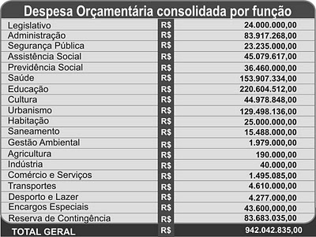

# PROVA — Camara_Canaa_dos_Carajas_2014_Agente_Legislativo

## 1. Análise geral da prova

- **Identificação:** Camara_Canaa_dos_Carajas_2014_Agente_Legislativo
- **Quantidade total de questões:** 40
- **Quantidade de textos de apoio (grupos):** 0
- **Quantidade de imagens:** 1
- **Quantidade de gráficos e tabelas:** incluídos nas imagens e no texto extraído, quando presentes no PDF original
- **Quantidade de grupos identificados:** 0
- **Quantidade de questões independentes:** 40
- **Questões que compartilham materiais:** nenhuma identificada automaticamente

### Transcrição integral da capa/instruções (conforme extraída do PDF)

> [!NOTE]
> Conteúdo integral das páginas anteriores à primeira questão, sem cortes.

> CÂMARA MUNICIPAL DE CANAÃ DOS CARAJÁS – CONCURSO PÚBLICO
> PROVA OBJETIVA: 04 de maio de 2014
> NÍVEL MÉDIO
> AGENTE LEGISLATIVO
> INSTRUÇÕES AO CANDIDATO
> 1. Confira se a prova que você recebeu corresponde ao cargo/nível de escolaridade ao
> qual você está inscrito, conforme consta no seu cartão de inscrição e cartão-resposta.
> Caso contrário comunique imediatamente ao fiscal de sala.
>
> 2. Confira se, além deste BOLETIM DE QUESTÕES, você recebeu o CARTÃO-RESPOSTA, destinado à marcação
> das respostas das questões objetivas.
>
> 3. Este BOLETIM DE QUESTÕES contém 40 (quarenta) questões objetivas, sendo 10 de Português, 05 de
> Matemática, 05 de Informática e 20 de Conhecimento Específico. Caso exista alguma falha de impressão,
> comunique imediatamente ao fiscal de sala. Na prova há espaço reservado para rascunho. Esta prova terá
> duração de 04 (quatro) horas, tendo seu início às 8:00h e término às 12:00h (horário local).
>
> 4. Cada questão objetiva apresenta 04 (quatro) opções de resposta, identificadas com as letras (A), (B), (C) e (D).
> Apenas uma responde adequadamente à questão, considerando a numeração de 01 a 40.
>
> 5. Confira se seu nome, número de inscrição, cargo de opção e data de nascimento, consta na parte superior do
> CARTÃO-RESPOSTA que você recebeu. Caso exista algum erro de impressão, comunique imediatamente ao
> fiscal de sala, a fim de que o fiscal registre na Ata de Sala a devida correção.
>
> 6. O candidato deverá permanecer, obrigatoriamente, na sala de realização da prova por, no mínimo, uma hora
> após o início da prova. A inobservância acarretará a eliminação do concurso.
>
> 7. É obrigatório que você assine a LISTA DE PRESENÇA e o CARTÃO-RESPOSTA do mesmo modo como está
> assinado no seu documento de identificação.
>
> 8. A marcação do CARTÃO-RESPOSTA deve ser feita somente com caneta esferográfica de tinta preta ou azul,
> pois lápis não será considerado.
>
> 9. A maneira correta de marcar as respostas no CARTÃO-RESPOSTA é cobrir totalmente o espaço
> correspondente à letra a ser assinalada, conforme o exemplo constante no CARTÃO-RESPOSTA.
>
> 10. Em hipótese alguma haverá substituição do CARTÃO-RESPOSTA por erro do candidato. A substituição só
> será autorizada se for constatada falha de impressão.
>
> 11. O CARTÃO-RESPOSTA é o único documento válido para o processamento de suas respostas.
>
> 12. O candidato deverá devolver no final da prova, o BOLETIM DE QUESTÕES e o CARTÃO-RESPOSTA.
>
> 13. Será automaticamente eliminado do Concurso Público da Câmara Municipal de Canaã dos Carajás o candidato
> que durante a realização da prova descumprir os procedimentos definidos no Edital Nº 001/2014 do referido
> concurso.
> Boa Prova.
> Nome do Candidato: ______________________________________________________
>
> Nº de Inscrição: ________________________
> ________________________________________
> Assinatura
>
>
>
>
>
>
> PORTUGUÊS
> A prova de Língua Portuguesa foi elaborada com base em excertos
> do relatório divulgado no Fórum Econômico de Davos, na Suíça.
> Relatório em Davos mostra que
> 85 pessoas detêm 46% da riqueza mundial
>
> EXCERTO 1 – QUESTÕES 01 A 03
> Apenas 85 pessoas no mundo detêm 46% de toda a riqueza produzida no planeta
> – mesmo percentual de metade da população – segundo um novo relatório, divulgado no
> Fórum Econômico de Davos, na Suíça. O documento realça a incapacidade de políticos e
> líderes empresariais em deter o crescimento da desigualdade econômica.
> “Os resultados apresentados no estudo minam a democracia e tornam mais difícil
> a luta contra a pobreza”, afirmou o grupo humanitário britânico Oxfam International, que
> assina o relatório.
> – É impressionante que, em pleno Século XXI, metade da população mundial
> tenha apenas um pouco mais do que uma elite cujos números permitem tê-los, todos,
> sentados confortavelmente em um único vagão de um trem. Ampliando-se a
> desigualdade, cria-se um círculo vicioso no qual a riqueza e o poder concentram-se, cada
> vez mais, nas mãos de poucos, deixando o resto de nós a lutar por migalhas da mesa
> superior – disse Winnie Byanuima, diretora executiva do grupo.
> Disponível em: <http://correiodobrasil.com.br/ultimas/relatorio-em-davos-mostra-que-85-pessoas-
> detem-46-da-riqueza-mundial/678819/>
> Acesso em 2 abril 2014

### Gabarito

| Questão | 01 | 02 | 03 | 04 | 05 |
|---|---|---|---|---|---|
| Resposta | D | A | B | C | B |

| Questão | 06 | 07 | 08 | 09 | 10 |
|---|---|---|---|---|---|
| Resposta | B | C | D | C | B |

| Questão | 11 | 12 | 13 | 14 | 15 |
|---|---|---|---|---|---|
| Resposta | B | D | A | C | B |

| Questão | 16 | 17 | 18 | 19 | 20 |
|---|---|---|---|---|---|
| Resposta | C | D | B | B | A |

| Questão | 21 | 22 | 23 | 24 | 25 |
|---|---|---|---|---|---|
| Resposta | A | C | D | B | A |

| Questão | 26 | 27 | 28 | 29 | 30 |
|---|---|---|---|---|---|
| Resposta | C | A | D | A | A |

| Questão | 31 | 32 | 33 | 34 | 35 |
|---|---|---|---|---|---|
| Resposta | C | B | C | D | B |

| Questão | 36 | 37 | 38 | 39 | 40 |
|---|---|---|---|---|---|
| Resposta | A | D | D | B | C |

## 2. Questões agrupadas

Nenhum grupo de questões compartilhando material foi identificado automaticamente nesta prova.

## 3. Questões independentes

#### QUESTÃO 01

✅ **Gabarito: D** (gabarito oficial pareado — cargo AGENTE LEGISLATIVO)

**Enunciado:**

O título que melhor resume as ideias do excerto 1 é

**Alternativas:**

A) A riqueza mundial.
B) A luta pela democracia.
C) Cresce a riqueza do planeta.
D) Concentração de riqueza e desigualdade.

**Referências visuais:**

Nenhuma.

---

#### QUESTÃO 02

✅ **Gabarito: A** (gabarito oficial pareado — cargo AGENTE LEGISLATIVO)

**Enunciado:**

O enunciado em que Winnie Byanuima inclui-se entre os mais pobres é

**Alternativas:**

A) “deixando o resto de nós a lutar por migalhas da mesa superior” (linhas 12 e 13).
B) “Apenas 85 pessoas no mundo detêm 46% de toda a riqueza produzida no planeta” (linha 1).
C) “metade da população mundial tenha apenas um pouco mais do que uma elite” (linhas 8 e 9).
D) “Ampliando-se a desigualdade, cria-se um círculo vicioso no qual a riqueza e o poder concentram-
se, cada vez mais, nas mãos de poucos” (linhas 10 a 12).

**Referências visuais:**

Nenhuma.

---

#### QUESTÃO 03

✅ **Gabarito: B** (gabarito oficial pareado — cargo AGENTE LEGISLATIVO)

**Enunciado:**

Julgue as afirmações abaixo com base nos fatos linguísticos.
I.
O verbo em “cria-se um círculo vicioso” (linha 11) está na voz passiva.
II.
O vocábulo “cujos” (linha 9) é um pronome relativo e refere-se a “números” (linha 9).
III. Embora “deter” (linha 4) não tenha marca de tempo, subentende-se que indica uma ação ocorrida
em um passado remoto.
IV. Se substituíssemos a preposição “em” por “para”, em “O documento realça a incapacidade de
políticos e líderes empresariais em deter...” (linhas 3 e 4), estaríamos corrigindo um desvio de
regência.
Está correto o que se afirma em

**Alternativas:**

A) I e III.
B) I e IV.
C) II e III.
D) III e IV.
EXCERTO 2 – QUESTÕES 04 A 06
A Organização Internacional de Trabalho (OIT), em linha com a miséria causada
por um sistema global intrinsecamente injusto, registra a existência de mais de 200 milhões
de trabalhadores desempregados no mundo. Apenas a União Europeia tem mais de 30
milhões de pessoas sem emprego e 127 milhões vivendo na pobreza extrema. Na França,
mil empregos são destruídos por dia e cinco milhões estão sem trabalho. Na América
Latina e Caribe, a taxa de desemprego entre os jovens é de 13,7%, ou 22 milhões; na
Espanha, 56%, e na Grécia, 61%. Ainda de acordo com a OIT, 73 milhões de jovens estão
desempregados e este índice continua crescendo.
Na Alemanha, um dos maiores exportadores do mundo e país mais rico da União
Europeia, 30% da população vivem abaixo da linha de pobreza e 7,45 milhões de
trabalhadores têm “miniempregos”, nos quais o trabalhador recebe 450 euros (R$ 1.200)
por mês. Caso esses trabalhadores fossem somados à população desempregada, o
desemprego pularia de 7% para 24%.
Na principal cidade dos Estados Unidos, Nova York, 50 mil trabalhadores moram
em abrigos porque seus empregos são de baixa remuneração e na Espanha, até junho de
2013, 20 mil famílias foram despejadas de suas casas.
Disponível em: <http://correiodobrasil.com.br/ultimas/relatorio-em-davos-mostra-que-85-pessoas-
detem-46-da-riqueza-mundial/678819/>
Acesso em 2 abril 2014

**Referências visuais:**

Nenhuma.

---

#### QUESTÃO 04

✅ **Gabarito: C** (gabarito oficial pareado — cargo AGENTE LEGISLATIVO)

**Enunciado:**

Os dados apresentados no excerto 2 do relatório divulgado no Fórum Econômico de Davos revelam
que

**Alternativas:**

A) a Alemanha é o país com o mais alto índice de desemprego.
B) mais da metade da população mundial vive abaixo da linha de pobreza.
C) o desemprego e a pobreza atingem o mundo inteiro, inclusive os países ricos.
D) a taxa mais alta de desemprego, entre os jovens, é a dos países da América Latina.

**Referências visuais:**

Nenhuma.

---

#### QUESTÃO 05

✅ **Gabarito: B** (gabarito oficial pareado — cargo AGENTE LEGISLATIVO)

**Enunciado:**

Em relação aos números citados no texto, é falsa a relação indicada em

**Alternativas:**

A) 200 milhões (linha 2) → população mundial de desempregados.
B) 73 milhões (linha 7) → número de jovens desempregados na Grécia.
C) 30 milhões (linhas 3 e 4) → população de desempregados na União Europeia.
D) 127 milhões (linha 4) → população que vive na pobreza extrema na União Europeia.

**Referências visuais:**

Nenhuma.

---

#### QUESTÃO 06

✅ **Gabarito: B** (gabarito oficial pareado — cargo AGENTE LEGISLATIVO)

**Enunciado:**

Em relação aos fatos linguísticos, é falso afirmar que

**Alternativas:**

A) não se prejudicam a correção gramatical e as relações de sentido ao se usar a locução “já que” no
lugar de “porque” (linha 15).
B) se altera a correção gramatical, embora se complete o sentido do enunciado, ao se inserir “de
pessoas” após “cinco milhões” (linha 5).
C) se mantêm a correção e a coerência textual ao se substituir a forma nominal “vivendo” (linha 4) pela
forma flexionada “vivem”, desde que se insira antes dela o pronome relativo “que”.
D) a oração “e este índice continua crescendo” (linha 8) poderia ser reformulada, sem prejuízo da
correção e do sentido textual, da seguinte forma: “índice que se mantém em crescimento”, desde
que precedida de uma vírgula.
EXCERTO 3 – QUESTÕES 07 A 10
A fome segue como a principal causa de morte no planeta. Na década de 1950,
60 milhões de pessoas passavam fome. Atualmente, são quase um bilhão. Mas, de
acordo com a Organização das Nações Unidas para a Alimentação e a Agricultura (FAO),
o número de pessoas com desnutrição – que sofrem de uma ou mais deficiências em
micronutrientes (vitaminas e outros) – já alcança dois bilhões. Segundo Jean Ziegler, ex-
relator especial para o Direito à Alimentação das Nações Unidas (ONU), 18 milhões
morrem de fome por ano e, a cada 5 segundos, uma criança morre de fome.
O desenvolvimento do capitalismo, portanto, não trouxe mais progresso nem uma
vida melhor para a maioria da população, mas sim desemprego, fome e sofrimento. Porém
se a pobreza aumenta, cresce a riqueza daqueles 85 capitalistas. Em 2000, apenas 1%
dos norte-americanos detinha 32,8% da riqueza do país; em 2013, passaram a abocanhar
40%.
Disponível em: <http://correiodobrasil.com.br/ultimas/relatorio-em-davos-mostra-que-85-pessoas-
detem-46-da-riqueza-mundial/678819/>
Acesso em 2 abril 2014

**Referências visuais:**

Nenhuma.

---

#### QUESTÃO 07

✅ **Gabarito: C** (gabarito oficial pareado — cargo AGENTE LEGISLATIVO)

**Enunciado:**

Os números citados no excerto 3 demonstram que o(a)

**Alternativas:**

A) quantidade de crianças que passam fome é menor nos países capitalistas.
B) número de pessoas que sofrem de desnutrição é inferior ao de pessoas que passam fome.
C) capitalismo tem trazido mais progresso e mais qualidade de vida para uma minoria da população.
D) distância entre o pequeno número de ricos e a maioria pobre tem-se mantido sem alterações.

**Referências visuais:**

Nenhuma.

---

#### QUESTÃO 08

✅ **Gabarito: D** (gabarito oficial pareado — cargo AGENTE LEGISLATIVO)

**Enunciado:**

Quanto às relações de sentido, é correto afirmar que o vocábulo

**Alternativas:**

A) “se” (linha 10) indica dúvida, incerteza.
B) “como” (linha 1) introduz uma comparação.
C) “mas” (linha 9) indica mudança de assunto.
D) “portanto” (linha 8) expressa uma conclusão.

**Referências visuais:**

Nenhuma.

---

#### QUESTÃO 09

✅ **Gabarito: C** (gabarito oficial pareado — cargo AGENTE LEGISLATIVO)

**Enunciado:**

Em “... deficiências em micronutrientes (vitaminas e outros)...” (linhas 4 e 5), os parênteses são
usados para

**Alternativas:**

A) isolar uma restrição.
B) introduzir uma digressão.
C) precisar a informação precedente.
D) acrescentar um comentário de Jean Ziegler.

**Referências visuais:**

Nenhuma.

---

#### QUESTÃO 10

✅ **Gabarito: B** (gabarito oficial pareado — cargo AGENTE LEGISLATIVO)

**Enunciado:**

O pronome “que” (linha 4) remete a

**Alternativas:**

A) “quase um bilhão” (linha 2).
B) “pessoas com desnutrição” (linha 4).
C) “Organização das Nações Unidas” (linha 3).
D) “60 milhões de pessoas passavam fome” (linha 2).
MATEMÁTICA

**Referências visuais:**

Nenhuma.

---

#### QUESTÃO 11

✅ **Gabarito: B** (gabarito oficial pareado — cargo AGENTE LEGISLATIVO)

**Enunciado:**

Em uma Câmara Municipal, há dois assessores para cada três vereadores. Se nessa Câmara há 12
vereadores, para os mesmos haverá

**Alternativas:**

A) 9 assessores.
B) 8 assessores.
C) 7 assessores.
D) 6 assessores.

**Referências visuais:**

Nenhuma.

---

#### QUESTÃO 12

✅ **Gabarito: D** (gabarito oficial pareado — cargo AGENTE LEGISLATIVO)

**Enunciado:**

Os servidores de um município tiveram aumento salarial de 7%, e o abono complementar ao salário,
que antes era de R$ 200,00 aumentou 50%. Um servidor que antes recebia R$ 1.400,00 de salário e
abono, com esses novos reajustes, passará a receber

**Alternativas:**

A) R$ 1.554,00.
B) R$ 1.564,00.
C) R$ 1.574,00.
D) R$ 1.584,00.

**Referências visuais:**

Nenhuma.

---

#### QUESTÃO 13

✅ **Gabarito: A** (gabarito oficial pareado — cargo AGENTE LEGISLATIVO)

**Enunciado:**

Certa quantidade de cadeiras custaria R$ 4.800,00. O vendedor, para não perder a venda, ofertou
20% de descontos no preço de cada cadeira, sendo, nesse caso, possível comprar a quantidade
anterior mais 10 cadeiras por esse mesmo preço. Inicialmente, seriam compradas

**Alternativas:**

A) 40 cadeiras.
B) 44 cadeiras.
C) 50 cadeiras.
D) 60 cadeiras.

**Referências visuais:**

Nenhuma.

---

#### QUESTÃO 14

✅ **Gabarito: C** (gabarito oficial pareado — cargo AGENTE LEGISLATIVO)

**Enunciado:**

Em uma arena de futebol retangular em que o comprimento media o quádruplo da largura, foi
realizado um show com a presença de 2.400 pessoas. Se havia uma pessoa e meia por metro
quadrado, o perímetro dessa arena media

**Alternativas:**

A) 280m.
B) 240m.
C) 200m.
D) 160m.
ANALISE O QUADRO ABAIXO PARA A PRÓXIMA QUESTÃO.

**Referências visuais:**

Nenhuma.

---

#### QUESTÃO 15

✅ **Gabarito: B** (gabarito oficial pareado — cargo AGENTE LEGISLATIVO)

**Enunciado:**

A despesa orçamentária para Educação é

**Alternativas:**

A) superada pela soma das despesas com Cultura e Saúde.
B) inferior à soma das despesas orçamentárias com Urbanismo e Saúde.
C) equivalente a 25% do Total Geral das despesas orçamentárias.
D) o dobro das despesas orçamentárias com Urbanismo.
INFORMÁTICA

**Referências visuais:**

Nenhuma.

---

#### QUESTÃO 16

✅ **Gabarito: C** (gabarito oficial pareado — cargo AGENTE LEGISLATIVO)

**Enunciado:**

A opção do menu “Iniciar” do Windows 7 (instalação padrão) que, ao clicar, abre uma janela na qual
o usuário pode consultar unidades de disco e outros itens de hardware ligados ao computador é a
denominada

**Alternativas:**

A) Hardware e Software.
B) Discos e Hardware.
C) Computador.
D) Suporte.

**Referências visuais:**

Nenhuma.

---

#### QUESTÃO 17

✅ **Gabarito: D** (gabarito oficial pareado — cargo AGENTE LEGISLATIVO)

**Enunciado:**

Analise os nomes dos arquivos:
Item
Arquivo
doc%texto.txt
Doc=texto.txt
doc_texto.txt
doc*texto.txt
Doc+texto.txt
doc@texto.txt

- Um item acima cujo nome de arquivo contém um caractere inválido na sua composição é o de número

**Alternativas:**

A) 02.
B) 01.
C) 06.
D) 04.

**Referências visuais:**

Nenhuma.

---

#### QUESTÃO 18

✅ **Gabarito: B** (gabarito oficial pareado — cargo AGENTE LEGISLATIVO)

**Enunciado:**

A ferramenta que permite que um grupo de pessoas troque mensagens via e-mail entre todos os
participantes do grupo denomina-se

**Alternativas:**

A) InPrivate.
B) Lista de discussão.
C) Wikis.
D) Correio Privado.

**Referências visuais:**

Nenhuma.

---

#### QUESTÃO 19

✅ **Gabarito: B** (gabarito oficial pareado — cargo AGENTE LEGISLATIVO)

**Enunciado:**

Através dos dados (10, 20, 30, 40) fornecidos nas células H1, H2, H3, H4, o resultado que será
visualizado na célula H5 após a aplicação da fórmula abaixo é
Fórmula (célula H 5)

=MENOR(H1:H4;3)+MAIOR(H1:H3;3)

**Alternativas:**

A) 50.
B) 40.
C) 60.
D) 30.

**Referências visuais:**

Nenhuma.

---

#### QUESTÃO 20

✅ **Gabarito: A** (gabarito oficial pareado — cargo AGENTE LEGISLATIVO)

**Enunciado:**

No navegador web denominado Internet Explorer 8, o botão Favoritos permite o acesso a diversas
pastas, dentre elas, a denominada

**Alternativas:**

A) Histórico.
B) Documentos.
C) Downloads.
D) Área de Trabalho.
CONHECIMENTO ESPECÍFICO

**Referências visuais:**

Nenhuma.

---

#### QUESTÃO 21

✅ **Gabarito: A** (gabarito oficial pareado — cargo AGENTE LEGISLATIVO)

**Enunciado:**

Se distinguirmos o projeto de uma organização em quatro fases distintas, aquela na qual, em linhas
gerais, vantagens e desvantagens de levar avante a realização de um investimento são comparadas
denomina-se

**Alternativas:**

A) anteprojeto.
B) projeto final.
C) implantação.
D) funcionamento.

**Referências visuais:**

Nenhuma.

---

#### QUESTÃO 22

✅ **Gabarito: C** (gabarito oficial pareado — cargo AGENTE LEGISLATIVO)

**Enunciado:**

Tanto no âmbito público como no privado, as organizações são __________ sociais em que a ação
desenvolvida por seus membros é dirigida por __________. Elas são projetadas como sistemas de
__________ e autoridade deliberadamente estruturados e coordenados, além de atuarem de maneira
__________ com o meio ambiente que as cerca.

- As palavras que completam corretamente o trecho acima são, respectivamente:

**Alternativas:**

A) convenções / chefias / funcionamento / individual.
B) pactos / metas / inércia / inflexível.
C) instituições / objetivos / atividades / interativa.
D) construções / motivações / atividades / independente.

**Referências visuais:**

Nenhuma.

---

#### QUESTÃO 23

✅ **Gabarito: D** (gabarito oficial pareado — cargo AGENTE LEGISLATIVO)

**Enunciado:**

De acordo com o Artigo 3° da Lei 8.666/93, a licitação destina-se a garantir a observância do
princípio constitucional da _________, a seleção da proposta mais _________ para a administração e a
promoção do desenvolvimento _________ sustentável. Ela será processada e julgada em estrita
conformidade com os princípios básicos da legalidade, da impessoalidade, da moralidade, da igualdade,
da publicidade, da _________ administrativa, da vinculação ao instrumento convocatório, do julgamento
_________ e dos que lhes são correlatos

- As palavras que completam corretamente o trecho acima são, respectivamente:

**Alternativas:**

A) competitividade / barata / econômico / integridade / subjetivo.
B) equidade / adequada / regional / gestão / crítico.
C) igualdade / em conta / socioeconômico / atuação / idôneo.
D) isonomia / vantajosa / nacional / probidade / objetivo.

**Referências visuais:**

Nenhuma.

---

#### QUESTÃO 24

✅ **Gabarito: B** (gabarito oficial pareado — cargo AGENTE LEGISLATIVO)

**Enunciado:**

Na licitação, no caso da igualdade de condições, um dos critérios de desempate para aquisição de
bens e serviços é que eles sejam produzidos

**Alternativas:**

A) no período compreendido entre doze e vinte e quatro meses.
B) por empresas que invistam em pesquisa e no desenvolvimento de tecnologia no País.
C) com garantia de, no mínimo, mais de vinte e quatro anos.
D) nas regiões mais carentes de mão de obra e de financiamento público.

**Referências visuais:**

Nenhuma.

---

#### QUESTÃO 25

✅ **Gabarito: A** (gabarito oficial pareado — cargo AGENTE LEGISLATIVO)

**Enunciado:**

Para os fins da Lei 8.666/93, toda transferência de domínio de bens a terceiros é considerada

**Alternativas:**

A) alienação.
B) repasse.
C) transpasse.
D) doação.

**Referências visuais:**

Nenhuma.

---

#### QUESTÃO 26

✅ **Gabarito: C** (gabarito oficial pareado — cargo AGENTE LEGISLATIVO)

**Enunciado:**

Com base na Lei 10.520/02, a fase preparatória de um pregão deverá observar o seguinte:

**Alternativas:**

A) A autoridade competente apontará as entidades mais adequadas ao cumprimento do objeto do
certame.
B) A definição do objeto deverá ser complexa, técnica e prolixa.
C) Dos autos do procedimento constarão a justificativa das definições do objeto e os indispensáveis
elementos técnicos.
D) A autoridade competente designará, dentre pessoas sem vínculo com o órgão, o pregoeiro e
respectiva equipe de apoio.

**Referências visuais:**

Nenhuma.

---

#### QUESTÃO 27

✅ **Gabarito: A** (gabarito oficial pareado — cargo AGENTE LEGISLATIVO)

**Enunciado:**

A modalidade de licitação entre interessados devidamente cadastrados ou que atenderem a todas
as condições exigidas para cadastramento até o terceiro dia anterior à data do recebimento das
propostas, observada a necessária qualificação, é denominada de

**Alternativas:**

A) Tomada de preços.
B) Concorrência.
C) Leilão.
D) Convite.

**Referências visuais:**

Nenhuma.

---

#### QUESTÃO 28

✅ **Gabarito: D** (gabarito oficial pareado — cargo AGENTE LEGISLATIVO)

**Enunciado:**

Nos marcos da legislação vigente, a fase externa começa com a convocação dos interessados, que
deverá ser efetuada

**Alternativas:**

A) obrigatoriamente por meio televisivo.
B) mesmo existindo diário oficial, em jornal de circulação local.
C) no caso de licitação vultosa, em meio radiofônico.
D) no diário oficial do município.

**Referências visuais:**

Nenhuma.

---

#### QUESTÃO 29

✅ **Gabarito: A** (gabarito oficial pareado — cargo AGENTE LEGISLATIVO)

**Enunciado:**

Uma das razões relacionadas pela Lei para impedir uma empresa convocada dentro do prazo de
validade da sua proposta, de licitar e contratar com a União, Estados, Distrito Federal ou Municípios e
ser descredenciada no SICAF é que essa firma

**Alternativas:**

A) enseje o retardamento da execução de seu objeto.
B) apresente documentação antiga para o certame.
C) mantenha a mesma proposta original.
D) comporte-se ou aja de modo idôneo.

**Referências visuais:**

Nenhuma.

---

#### QUESTÃO 30

✅ **Gabarito: A** (gabarito oficial pareado — cargo AGENTE LEGISLATIVO)

**Enunciado:**

Uma maneira coerente de estocar material é por meio do empilhamento. Uma das regras básicas
que devem ser observadas para empilhar o material do estoque é

**Alternativas:**

A) utilizar estrados de madeira adequados ao uso da empilhadeira de garfo.
B) usar todo o espaço até o teto, permitindo uma fresta de 5 cm.
C) utilizar sempre o recurso de caixas de papel sobrepostas.
D) garantir que as pilhas de material sejam flexíveis para fácil manipulação.

**Referências visuais:**

Nenhuma.

---

#### QUESTÃO 31

✅ **Gabarito: C** (gabarito oficial pareado — cargo AGENTE LEGISLATIVO)

**Enunciado:**

O controle de materiais consiste em __________ segundo um plano __________ capaz de
__________ cada produto, ou grupo deles, de maneira que possam ser facilmente __________.

- As palavras que completam corretamente o trecho estão na alternativa acima são, respectivamente:

**Alternativas:**

A) classificá-los / administrativo / enumerar / ocultados.
B) adquiri-los / estratégico / proteger / utilizados.
C) ordená-los / sistemático / classificar / localizados.
D) distribuí-los / rigoroso / guardar / consumidos.

**Referências visuais:**

Nenhuma.

---

#### QUESTÃO 32

✅ **Gabarito: B** (gabarito oficial pareado — cargo AGENTE LEGISLATIVO)

**Enunciado:**

Uma característica fundamental para o bom atendimento ao público é

**Alternativas:**

A) possuir habilidade de lidar sem emoção com outras pessoas.
B) ter autopercepção e autoconhecimento.
C) saber o momento de provocar e de contornar um conflito.
D) evitar empatia com as pessoas, tratando-as de modo profissional.

**Referências visuais:**

Nenhuma.

---

#### QUESTÃO 33

✅ **Gabarito: C** (gabarito oficial pareado — cargo AGENTE LEGISLATIVO)

**Enunciado:**

A configuração que assume um documento de acordo com a disposição e a natureza das
informações nele contidas chama-se

**Alternativas:**

A) formato.
B) gênero.
C) espécie.
D) tipo.

**Referências visuais:**

Nenhuma.

---

#### QUESTÃO 34

✅ **Gabarito: D** (gabarito oficial pareado — cargo AGENTE LEGISLATIVO)

**Enunciado:**

Os documentos que, não sendo de uso regular nos órgãos produtores, por razões de interesse
administrativo aguardam a sua eliminação ou recolhimento para guarda permanente são identificados
como

**Alternativas:**

A) correntes.
B) permanentes.
C) reservados.
D) intermediários.

**Referências visuais:**

Nenhuma.

---

#### QUESTÃO 35

✅ **Gabarito: B** (gabarito oficial pareado — cargo AGENTE LEGISLATIVO)

**Enunciado:**

Uma das características dos documentos no padrão ofício é a de que nele

**Alternativas:**

A) é utilizada fonte do tipo Arial de corpo 11.
B) deve constar o número da página a partir da segunda página.
C) deve haver intenso uso de negrito, itálico e sublinhado.
D) a impressão deve ser feita na cor preta, em papel tamanho Carta.

**Referências visuais:**

Nenhuma.

---

#### QUESTÃO 36

✅ **Gabarito: A** (gabarito oficial pareado — cargo AGENTE LEGISLATIVO)

**Enunciado:**

Uma característica importante para se obter clareza em um texto oficial é a

**Alternativas:**

A) formalidade e a padronização, que possibilitam a imprescindível uniformidade dos textos.
B) pessoalidade, que possibilita a duplicidade de interpretações, importante para o tratamento
personalista dado ao texto.
C) flexibilização do padrão culto de linguagem, que favorece o uso de jargões técnicos e profissionais.
D) prolixidade, que enriquece o texto com figuras linguísticas importantes para valorizar remetente e
destinatário.

**Referências visuais:**

Nenhuma.

---

#### QUESTÃO 37

✅ **Gabarito: D** (gabarito oficial pareado — cargo AGENTE LEGISLATIVO)

**Enunciado:**

É competência essencial do bom administrador:

**Alternativas:**

A) distribuir as tarefas sob sua responsabilidade, considerando a independência de funções.
B) trabalhar sempre individualmente, buscando informações e exercendo sua liderança.
C) comunicar-se com rigidez, negociando e evitando relações de natureza interpessoal.
D) ser pró-ativo e trabalhar participativamente em todos os setores da instituição.

**Referências visuais:**

Nenhuma.

---

#### QUESTÃO 38

✅ **Gabarito: D** (gabarito oficial pareado — cargo AGENTE LEGISLATIVO)

**Enunciado:**

A elaboração de uma comunicação oficial deve obsevar sempre

**Alternativas:**

A) o uso de palavras raras e arcaicas.
B) o emprego de neologismos.
C) a colocação da assinatura em página isolada.
D) a identificação do signatário.

**Referências visuais:**

Nenhuma.

---

#### QUESTÃO 39

✅ **Gabarito: B** (gabarito oficial pareado — cargo AGENTE LEGISLATIVO)

**Enunciado:**

No que tange ao controle de patrimônio e material público, um dos motivos legais para sua
inutilização é o(a)

**Alternativas:**

A) desgaste devido ao tempo de existência.
B) sua contaminação por radioatividade.
C) falta de uso regular por parte do público.
D) sua natureza secreta ou ultrassecreta.

**Referências visuais:**

Nenhuma.

---

#### QUESTÃO 40

✅ **Gabarito: C** (gabarito oficial pareado — cargo AGENTE LEGISLATIVO)

**Enunciado:**

Na administração pública, o material cuja manutenção for onerosa ou seu rendimento precário, em
virtude de uso prolongado, desgaste prematuro ou obsoletismo, deve ser classificado como

**Alternativas:**

A) ocioso.
B) transferível.
C) antieconômico.
D) irrecuperável.

**Referências visuais:**

Nenhuma.

---

## 4. Observações e limitações da extração

- Extração automática (texto selecionável do PDF via PyMuPDF), sem OCR: PDFs escaneados podem perder texto.
- Imagens repetidas (logos/marcas d'água) foram descartadas; as imagens de conteúdo foram salvas em `imagens/` com nomenclatura `imagem_00N`.
- A detecção de grupos usa os avisos padrão das bancas ("o texto seguinte servirá de base..."). Bancas sem esse aviso podem ter grupos não identificados — o conteúdo, porém, permanece integral.
- Se houver divergência entre esta versão e o PDF original, vale o PDF original; corrija manualmente o Markdown.
