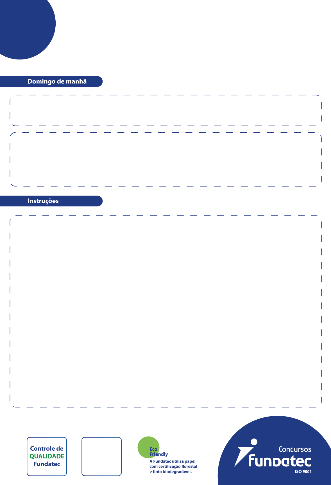
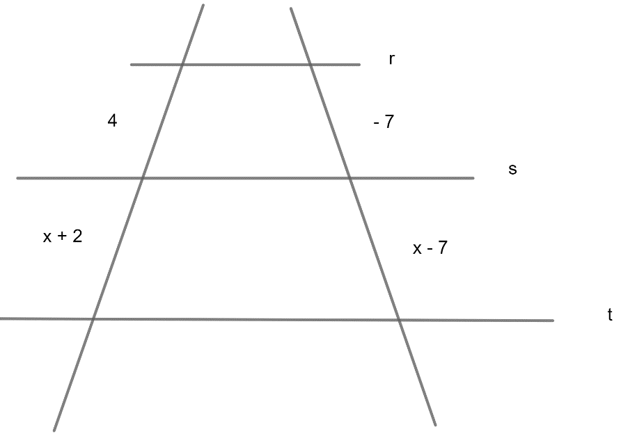

# PROVA — Camara_Candiota_2024_Agente_Administrativo

## 1. Análise geral da prova

- **Identificação:** Camara_Candiota_2024_Agente_Administrativo
- **Quantidade total de questões:** 40
- **Quantidade de textos de apoio (grupos):** 0
- **Quantidade de imagens:** 4
- **Quantidade de gráficos e tabelas:** incluídos nas imagens e no texto extraído, quando presentes no PDF original
- **Quantidade de grupos identificados:** 0
- **Quantidade de questões independentes:** 40
- **Questões que compartilham materiais:** nenhuma identificada automaticamente

### Transcrição integral da capa/instruções (conforme extraída do PDF)

> [!NOTE]
> Conteúdo integral das páginas anteriores à primeira questão, sem cortes.

> 
>
>
>
> 
>
> CÂMARA MUNICIPAL DE CANDIOTA/RS
> CONCURSO PÚBLICO Nº 01/2024
> QR
> code
> Leia atentamente e cumpra rigorosamente as instruções que seguem, pois elas são parte integrante das provas e das
> normas que regem esse certame.
> 1. Atente-se aos avisos contidos no quadro da sala e aguarde o 2º sinal sonoro para abrir este caderno de questões e
> iniciar a prova.
> 2. Seus pertences deverão estar armazenados dentro do saco plástico fornecido pelo fiscal, permanecendo em sua posse
> somente caneta esferográfica de ponta grossa, de material transparente, com tinta preferencialmente preta, documento
> de identidade, lanche e água, se houver. A utilização de qualquer material não permitido em edital é expressamente
> proibida, acarretando a sua imediata exclusão do certame.
> 3. Após o 2º sinal, certifique-se de que este caderno de questões:
> - contém 40 (quarenta) questões;
> - refere-se ao cargo para o qual realizou a inscrição.
> 4. Cada questão oferece 5 (cinco) alternativas de respostas, representadas pelas letras A, B, C, D e E, sendo apenas 1
> (uma) a resposta correta.
> 5. Será respeitado o tempo para realização da prova conforme previsto em edital, incluindo o preenchimento da grade
> de respostas.
> 6. Os três últimos candidatos deverão retirar-se da sala de prova ao mesmo tempo, devendo assinar a Ata de Prova.
> 7. A responsabilidade referente à interpretação dos conteúdos das questões é exclusiva do candidato.
> 8. No caderno de questões, você poderá rabiscar, riscar e calcular.
> 9. Os gabaritos preliminares da prova objetiva serão divulgados na data descrita no Cronograma de Execução desse
> certame.
>
>
> 
>
> V1_31/01/2025 10:09:03
> AGENTE ADMINISTRATIVO
>
>
>
> RASCUNHO
> Utilize esse espaço para anotar suas respostas
> *A anotação neste rascunho NÃO substitui o preenchimento da grade de respostas.
>
>
>
> 961_BASE_NM_DM
> 14/02/2025 12:26:59
> Execução: Fundatec
> NÍVEL MÉDIO
> LÍNGUA PORTUGUESA
> Escola do crime: a operação que desmontou um curso online para aplicar golpes
> Por Fantástico
>
> A equipe do Fantástico mostrou como funcionava uma escola online para estelionatários.
> Em um ano em que o número de golpes digitais disparou, a polícia de São Paulo prendeu uma
> espécie de professor desse tipo de crime. Pela internet, BG ensinava técnicas para enganar as
> vítimas e vendia dados pessoais, contas bancárias e cartões clonados.
> BG operava em um site ilegal que se trata de uma loja virtual exclusiva para criminosos.
> O site oferecia acesso a informações sigilosas para que o interessado em aplicar golpes pudesse
> abrir contas bancárias e fazer compras virtuais em nome de outras pessoas. “Tudo o que eu
> vendo eu procuro vender com garantia e regras para que vocês estejam sempre assegurados”,
> diz BG em uma gravação. A atuação do criminoso atingiu um público de mais de 50 mil pessoas
> e ele chegou a disponibilizar mais de 10 mil cartões bancários clonados para os clientes
> criminosos apenas no fim de 2024.
> “Ele ensinava os nomes as técnicas, os equipamentos e como deveria ser praticado o
> crime. Ele tinha uma apostila que dava uma verdadeira aula”, destaca JLC, diretor do DEINTER
> 5. Depois de um ano e meio de investigação, BG foi preso em dezembro de 2024. Na casa dele,
> os investigadores encontraram drogas e duas armas com numeração raspada. A perícia
> descobriu que BG tinha no computador um total de 180 mil cartões clonados. Segundo a
> polícia o faturamento dele com seus alunos golpistas chegava a R$ 1,5 milhão por mês.
> Procurada pela imprensa, a defesa de BG diz que “___ acusações são infundadas e
> superficiais, sendo certo que todos os esclarecimentos serão devidamente prestados no curso
> da investigação”. A nota afirma também que ele “é primário, sem antecedentes criminais e está
> ___ disposição da justiça para prestar quaisquer esclarecimentos necessários”. O site de BG foi
> retirado do ar. Agora, a polícia tentar identificar e punir quem pôs em prática as aulas do crime.
> Em 2024, houve um aumento de 45% no número de golpes digitais, em comparação com
> 2023. O levantamento é da Associação de Defesa de Dados Pessoais e do Consumidor. “Todos
> nós somos possíveis vítimas e precisamos estar atentos. ___ primeira medida que todo
> consumidor deve adotar é ter cuidado com os seus dados pessoais”, destaca AV, membro do
> Comitê de Prevenção a Fraudes.
> (Disponível em: https://g1.globo.com/fantastico/noticia/2025/01/05/escola-do-crime-a-operacao-que-
> desmontou-um-curso-online-para-aplicar-golpes.ghtml – texto adaptado especialmente para esta prova).

### Gabarito

| Questão | 01 | 02 | 03 | 04 | 05 |
|---|---|---|---|---|---|
| Resposta | B | C | E | A | B |

| Questão | 06 | 07 | 08 | 09 | 10 |
|---|---|---|---|---|---|
| Resposta | B | D | E | B | D |

| Questão | 11 | 12 | 13 | 14 | 15 |
|---|---|---|---|---|---|
| Resposta | A | E | C | D | A |

| Questão | 16 | 17 | 18 | 19 | 20 |
|---|---|---|---|---|---|
| Resposta | E | A | D | B | C |

| Questão | 21 | 22 | 23 | 24 | 25 |
|---|---|---|---|---|---|
| Resposta | E | D | A | C | C |

| Questão | 26 | 27 | 28 | 29 | 30 |
|---|---|---|---|---|---|
| Resposta | A | B | B | C | D |

| Questão | 31 | 32 | 33 | 34 | 35 |
|---|---|---|---|---|---|
| Resposta | A | B | B | E | C |

| Questão | 36 | 37 | 38 | 39 | 40 |
|---|---|---|---|---|---|
| Resposta | D | A | C | D | E |

## 2. Questões agrupadas

Nenhum grupo de questões compartilhando material foi identificado automaticamente nesta prova.

## 3. Questões independentes

#### QUESTÃO 01

✅ **Gabarito: B** (gabarito.pdf (Edital 05/2025, Anexo I - Gabarito Preliminar, cargo 2 - Agente Administrativo; Concurso Público nº 01/2024))

**Enunciado:**

QUESTÃO 01 – A partir da leitura do texto, pode-se inferir corretamente que a prisão de BG
representa:

**Alternativas:**

A) Uma vitória definitiva contra os crimes digitais no Brasil, visto que o site foi retirado do ar.
B) Um passo importante na luta contra o estelionato digital, mas que exige atenção contínua para
combater outros estelionatários.
C) A punição exemplar de um indivíduo, mas que não terá nenhum impacto na redução dos golpes
digitais.
D) O fim dos golpes digitais, já que BG se encontra preso e é o único responsável pelos crimes.
E) A comprovação de que a legislação brasileira é avançada no que se refere aos crimes digitais.

**Referências visuais:**

Nenhuma.

---

#### QUESTÃO 02

✅ **Gabarito: C** (gabarito.pdf (Edital 05/2025, Anexo I - Gabarito Preliminar, cargo 2 - Agente Administrativo; Concurso Público nº 01/2024))

**Enunciado:**

QUESTÃO 02 – Qual das alternativas abaixo expressa o principal objetivo discursivo do texto?

**Alternativas:**

A) Denunciar a falta de segurança na internet, que torna os usuários presas fáceis para golpistas.
B) Criticar a legislação brasileira, que permite a atuação de estelionatários por ser muito branda.
C) Alertar a população sobre o aumento de golpes digitais e a importância de proteger os dados
pessoais.
D) Elogiar o trabalho da polícia, que prendeu diversas pessoas de uma rede de estelionato.
E) Descrever o passo a passo dos golpes aplicados na internet para que os leitores se protejam.
961_BASE_NM_DM
14/02/2025 12:26:59
NÍVEL MÉDIO

**Referências visuais:**

Nenhuma.

---

#### QUESTÃO 03

✅ **Gabarito: E** (gabarito.pdf (Edital 05/2025, Anexo I - Gabarito Preliminar, cargo 2 - Agente Administrativo; Concurso Público nº 01/2024))

**Enunciado:**

QUESTÃO 03 – No trecho retirado do texto “‘Tudo o que eu vendo eu procuro vender com garantia
e regras para que vocês estejam sempre assegurados’, diz BG em uma gravação”, qual é a ironia em
relação a essa fala, caso ele seja realmente um criminoso?

**Alternativas:**

A) BG se considera um empresário honesto, oferecendo um serviço legítimo aos seus clientes.
B) A garantia oferecida por BG demonstra a sua preocupação com a ética em suas atividades.
C) As regras mencionadas por BG visam proteger os seus clientes de serem enganados por outros
criminosos.
D) O uso da palavra “assegurados” por BG revela sua intenção de proteger as pessoas dos crimes
digitais.
E) BG utiliza uma linguagem típica de vendedores honestos que buscam passar confiança aos seus
clientes, mesmo que suas ações sejam de natureza criminosa.

**Referências visuais:**

Nenhuma.

---

#### QUESTÃO 04

✅ **Gabarito: A** (gabarito.pdf (Edital 05/2025, Anexo I - Gabarito Preliminar, cargo 2 - Agente Administrativo; Concurso Público nº 01/2024))

**Enunciado:**

QUESTÃO 04 – Em relação à regência verbal e ao acento indicativo de crase, assinale a alternativa
que preenche, correta e respectivamente, as lacunas nas linhas 18, 21 e 25 do texto.

**Alternativas:**

A) as – à – A
B) às – à – A
C) às – a – À
D) as – a – A
E) às – à – À

**Referências visuais:**

Nenhuma.

---

#### QUESTÃO 05

✅ **Gabarito: B** (gabarito.pdf (Edital 05/2025, Anexo I - Gabarito Preliminar, cargo 2 - Agente Administrativo; Concurso Público nº 01/2024))

**Enunciado:**

QUESTÃO 05 – Os símbolos nas linhas 12 e 17 podem ser substituídos, respectivamente, por quais
sinais de pontuação?

**Alternativas:**

A) Vírgula – dois-pontos.
B) Vírgula – vírgula.
C) Ponto-final – ponto e vírgula.
D) Vírgula – ponto de exclamação.
E) Dois-pontos – travessão.

**Referências visuais:**

Nenhuma.

---

#### QUESTÃO 06

✅ **Gabarito: B** (gabarito.pdf (Edital 05/2025, Anexo I - Gabarito Preliminar, cargo 2 - Agente Administrativo; Concurso Público nº 01/2024))

**Enunciado:**

QUESTÃO 06 – No trecho retirado do texto “A atuação do criminoso atingiu um público de mais de
50 mil pessoas”, se a palavra sublinhada fosse flexionada no plural, quantas outras alterações seriam
necessárias no fragmento?

**Alternativas:**

A) 1.
B) 2.
C) 3.
D) 5.
E) 6.

**Referências visuais:**

Nenhuma.

---

#### QUESTÃO 07

✅ **Gabarito: D** (gabarito.pdf (Edital 05/2025, Anexo I - Gabarito Preliminar, cargo 2 - Agente Administrativo; Concurso Público nº 01/2024))

**Enunciado:**

QUESTÃO 07 – A palavra “infundadas” (l. 18) pode ser substituída, sem alteração de sentido, por:

**Alternativas:**

A) Procedentes.
B) Consistentes.
C) Fundamentadas.
D) Descabidas.
E) Incontestáveis.
961_BASE_NM_DM
14/02/2025 12:26:59
NÍVEL MÉDIO

**Referências visuais:**

Nenhuma.

---

#### QUESTÃO 08

✅ **Gabarito: E** (gabarito.pdf (Edital 05/2025, Anexo I - Gabarito Preliminar, cargo 2 - Agente Administrativo; Concurso Público nº 01/2024))

**Enunciado:**

QUESTÃO 08 – No trecho retirado do texto “A perícia descobriu que BG tinha no computador um
total de 180 mil cartões clonados”, qual é a voz verbal utilizada e o seu efeito produzido no texto?

**Alternativas:**

A) Voz passiva sintética, enfatizando a ação da perícia na descoberta dos cartões clonados.
B) Voz ativa, destacando o ato de clonagem dos cartões.
C) Voz passiva analítica, evidenciando os cartões clonados como objeto da ação.
D) Voz reflexiva, indicando que BG clonou os cartões para uso próprio.
E) Voz ativa, realçando a posse dos cartões clonados por BG.

**Referências visuais:**

Nenhuma.

---

#### QUESTÃO 09

✅ **Gabarito: B** (gabarito.pdf (Edital 05/2025, Anexo I - Gabarito Preliminar, cargo 2 - Agente Administrativo; Concurso Público nº 01/2024))

**Enunciado:**

QUESTÃO 09 – Analise as seguintes assertivas sobre o emprego de conjunções, locuções conjuntivas
e pronomes relativos no texto:
I. No trecho “Depois de um ano e meio de investigação, BG foi preso em dezembro de 2024”, a
locução conjuntiva em destaque introduz uma ideia de consequência em relação à investigação
policial.
II. Em “‘Tudo o que eu vendo eu procuro vender com garantia e regras para que vocês estejam
sempre assegurados’, diz BG em uma gravação”, a locução conjuntiva destacada expressa a
finalidade das ações do criminoso.
III. O pronome relativo “que” presente em “A perícia descobriu que BG tinha no computador um total
de 180 mil cartões clonados” retoma o termo “perícia” e introduz uma oração subordinada adjetiva
restritiva.

Quais estão corretas?

**Alternativas:**

A) Apenas I.
B) Apenas II.
C) Apenas III.
D) Apenas I e II.
E) I, II e III.

**Referências visuais:**

Nenhuma.

---

#### QUESTÃO 10

✅ **Gabarito: D** (gabarito.pdf (Edital 05/2025, Anexo I - Gabarito Preliminar, cargo 2 - Agente Administrativo; Concurso Público nº 01/2024))

**Enunciado:**

QUESTÃO 10 – Analise as seguintes assertivas sobre a sintaxe de concordância verbal e nominal no
texto:
I. No trecho “Na casa dele, os investigadores encontraram drogas e duas armas com numeração
raspada”, o verbo “encontrar” está corretamente flexionado no plural para concordar com o sujeito
composto “drogas e duas armas”.
II. Em “A perícia descobriu que BG tinha no computador um total de 180 mil cartões clonados”, a
concordância verbal está correta, pois o verbo “tinha” concorda com o sujeito “BG”, enquanto o
verbo “descobriu” concorda com o sujeito “perícia”.
III. A concordância nominal está correta em “é primário, sem antecedentes criminais e está ___
disposição da justiça” (l. 20-21), pois os adjetivos “primário” e “sem antecedentes” concordam
em gênero e número com o sujeito “ele” (BG), que está implícito na frase.

Quais estão corretas?

**Alternativas:**

A) Apenas I.
B) Apenas II.
C) Apenas III.
D) Apenas II e III.
E) I, II e III.
961_BASE_NM_DM
14/02/2025 12:26:59
NÍVEL MÉDIO

**Referências visuais:**

Nenhuma.

---

#### QUESTÃO 11

✅ **Gabarito: A** (gabarito.pdf (Edital 05/2025, Anexo I - Gabarito Preliminar, cargo 2 - Agente Administrativo; Concurso Público nº 01/2024))

**Enunciado:**

QUESTÃO 11 – Assinale a alternativa em que todas as palavras apresentadas estão grafadas
corretamente de acordo com as normas ortográficas da Língua Portuguesa.

**Alternativas:**

A) Pretencioso, concessão, acessório.
B) Extensão, excesso, enchurrada.
C) Ancioso, pretenssão, excêntrico.
D) Suspenção, ascensão, esseto.
E) Submissão, obcessão, escessivo.

**Referências visuais:**

Nenhuma.

---

#### QUESTÃO 12

✅ **Gabarito: E** (gabarito.pdf (Edital 05/2025, Anexo I - Gabarito Preliminar, cargo 2 - Agente Administrativo; Concurso Público nº 01/2024))

**Enunciado:**

QUESTÃO 12 – Analise as assertivas abaixo sobre aspectos ortográficos e fonológicos da Língua
Portuguesa:
I. A palavra “sub-reino” leva hífen pelo mesmo motivo de “super-revista”.
II. A palavra “devêssemos” é acentuada pelo mesmo motivo de “exército”.
III. As palavras “timbre” e “colar” apresentam o mesmo número de fonemas.
Quais estão corretas?

**Alternativas:**

A) Apenas I.
B) Apenas II.
C) Apenas III.
D) Apenas I e II.
E) I, II e III.

**Referências visuais:**

Nenhuma.

---

#### QUESTÃO 13

✅ **Gabarito: C** (gabarito.pdf (Edital 05/2025, Anexo I - Gabarito Preliminar, cargo 2 - Agente Administrativo; Concurso Público nº 01/2024))

**Enunciado:**

QUESTÃO 13 – A figura de linguagem metáfora está presente em qual das alternativas abaixo?

**Alternativas:**

A) O céu estava cheio de estrelas brilhantes.
B) Ele correu tão rápido quanto um raio.
C) Aquele homem é uma rocha em momentos difíceis.
D) A criança brincava alegremente no parque.
E) Os pássaros cantavam ao amanhecer.

**Referências visuais:**

Nenhuma.

---

#### QUESTÃO 14

✅ **Gabarito: D** (gabarito.pdf (Edital 05/2025, Anexo I - Gabarito Preliminar, cargo 2 - Agente Administrativo; Concurso Público nº 01/2024))

**Enunciado:**

QUESTÃO 14 – Qual das lacunas abaixo é corretamente preenchida com a letra “s”?

**Alternativas:**

A) A__idente.
B) A__ão.
C) So__ial.
D) Di__cente.
E) Ex__elente.

**Referências visuais:**

Nenhuma.

---

#### QUESTÃO 15

✅ **Gabarito: A** (gabarito.pdf (Edital 05/2025, Anexo I - Gabarito Preliminar, cargo 2 - Agente Administrativo; Concurso Público nº 01/2024))

**Enunciado:**

QUESTÃO 15 – Em “Os jovens estudantes brasileiros clamavam ferozmente por uma educação de
qualidade”, a palavra destacada se classifica como:

**Alternativas:**

A) Advérbio.
B) Substantivo.
C) Adjetivo.
D) Verbo.
E) Pronome.
961_BASE_NM_DM
14/02/2025 12:26:59
NÍVEL MÉDIO

**Referências visuais:**

Nenhuma.

---

#### QUESTÃO 16

✅ **Gabarito: E** (gabarito.pdf (Edital 05/2025, Anexo I - Gabarito Preliminar, cargo 2 - Agente Administrativo; Concurso Público nº 01/2024))

**Enunciado:**

QUESTÃO 16 – Conforme o Regimento Interno da Câmara Municipal de Candiota, são deveres dos
Vereadores:
I. Não se eximir de trabalho algum relativo ao desempenho do mandato.
II. Impugnar medidas que lhe pareçam prejudiciais ao interesse público.
III. Comunicar à Mesa a sua ausência do Município, quando esta for superior a sete dias, especificando
o destino com dados que permitam sua localização.

Quais estão corretos?

**Alternativas:**

A) Apenas I.
B) Apenas III.
C) Apenas I e II.
D) Apenas II e III.
E) I, II e III.

**Referências visuais:**

Nenhuma.

---

#### QUESTÃO 17

✅ **Gabarito: A** (gabarito.pdf (Edital 05/2025, Anexo I - Gabarito Preliminar, cargo 2 - Agente Administrativo; Concurso Público nº 01/2024))

**Enunciado:**

QUESTÃO 17 – De acordo com o Regimento Interno da Câmara Municipal de Candiota em relação às
atribuições do Presidente da Câmara, assinale C, se corretas, ou I, se incorretas.

( ) Representar a Câmara Municipal em juízo ou fora dele.
( ) Ler a matéria do expediente.
( ) Dar posse aos Vereadores.

A ordem correta de preenchimento dos parênteses, de cima para baixo, é:

**Alternativas:**

A) C – I – C.
B) C – C – I.
C) C – I – I.
D) I – C – I.
E) I – I – C.
I. Enquanto não for eleito o presidente da Comissão, exercerá a presidência o mais antigo da casa.
II. Cada Comissão terá um livro especial para a redação de suas atas e um livro para controle de
presenças.
III. As Comissões disporão do apoio funcional da Secretaria da Câmara Municipal para o cumprimento
de suas atribuições.
Quais estão corretas?

**Referências visuais:**

Nenhuma.

---

#### QUESTÃO 18

✅ **Gabarito: D** (gabarito.pdf (Edital 05/2025, Anexo I - Gabarito Preliminar, cargo 2 - Agente Administrativo; Concurso Público nº 01/2024))

**Enunciado:**

QUESTÃO 18 – Analise as assertivas abaixo em relação às Comissões, conforme prevê o Regimento
Interno da Câmara Municipal de Candiota:

961_BASE_NM_DM
14/02/2025 12:26:59
Execução: Fundatec
NÍVEL MÉDIO

**Referências visuais:**

Nenhuma.

---

#### QUESTÃO 19

✅ **Gabarito: B** (gabarito.pdf (Edital 05/2025, Anexo I - Gabarito Preliminar, cargo 2 - Agente Administrativo; Concurso Público nº 01/2024))

**Enunciado:**

QUESTÃO 19 – O Regimento Interno da Câmara Municipal de Candiota refere que após apresentação
ao Plenário, as matérias serão distribuídas simultaneamente, através de cópias, às Comissões
Permanentes, observada a competência para análise, as quais emitirão parecer de acordo com alguns
prazos, a contar da distribuição. Com base nisso, relacione a Coluna 1 à Coluna 2, associando os
prazos aos seus respectivos processos.

Coluna 1
1. Até 72 horas.
2. Até 15 dias.
3. Até 30 dias.

Coluna 2
( ) Para as matérias em regime de urgência urgentíssima.
( ) Para as matérias em regime de tramitação ordinária.
( ) Para as matérias em regime de urgência.

A ordem correta de preenchimento dos parênteses, de cima para baixo, é:

**Alternativas:**

A) 1 – 2 – 3.
B) 1 – 3 – 2.
C) 2 – 1 – 3.
D) 2 – 3 – 1.
E) 3 – 2 – 1.

**Referências visuais:**

Nenhuma.

---

#### QUESTÃO 20

✅ **Gabarito: C** (gabarito.pdf (Edital 05/2025, Anexo I - Gabarito Preliminar, cargo 2 - Agente Administrativo; Concurso Público nº 01/2024))

**Enunciado:**

QUESTÃO 20 – De acordo com o Regimento Interno da Câmara Municipal de Candiota em relação às
atas e aos anais, analise as assertivas abaixo:
I. Não se realizando a sessão por falta de quórum, deverá ser lavrada a respectiva ata, dela
constando o expediente despachado.
II. A ata da última sessão, ao encerrar o período legislativo, será redigida e submetida à aprovação,
antes do término da sessão.
III. A ata é o retrato dos trabalhos legislativos e deve ser organizada e arquivada pela Secretaria
da Câmara Municipal.

Quais estão corretas?

**Alternativas:**

A) Apenas I.
B) Apenas II.
C) Apenas I e II.
D) Apenas II e III.
E) I, II e III.

**Referências visuais:**

Nenhuma.

---

#### QUESTÃO 21

✅ **Gabarito: E** (gabarito.pdf (Edital 05/2025, Anexo I - Gabarito Preliminar, cargo 2 - Agente Administrativo; Concurso Público nº 01/2024))

**Enunciado:**

QUESTÃO 21 – O projeto de lei será enviado ao prefeito após a elaboração da redação final para
sanção, promulgação ou veto. De acordo com o Regimento Interno da Câmara Municipal de Candiota,
analise as assertivas abaixo:
I. Será obrigatório o parecer da Comissão de Constituição, Justiça e Bem-Estar Social no caso de
veto.
II. A apreciação do veto será feita em única discussão e votação.
III. A discussão será englobada e a votação poderá ser feita em partes, mediante requerimento
aprovado em Plenário.

Quais estão corretas?

**Alternativas:**

A) Apenas I.
B) Apenas III.
C) Apenas I e II.
D) Apenas II e III.
E) I, II e III.
961_BASE_NM_DM
14/02/2025 12:26:59
NÍVEL MÉDIO

**Referências visuais:**

Nenhuma.

---

#### QUESTÃO 22

✅ **Gabarito: D** (gabarito.pdf (Edital 05/2025, Anexo I - Gabarito Preliminar, cargo 2 - Agente Administrativo; Concurso Público nº 01/2024))

**Enunciado:**

QUESTÃO 22 – De acordo com o Estatuto dos Servidores Públicos Municipais de Candiota em relação
à disponibilidade e ao aproveitamento, analise as assertivas abaixo, assinalando V, se verdadeiras, ou
F, se falsas.

( ) A disponibilidade exclui a possibilidade de designação para função gratificada.
( ) O servidor em disponibilidade não poderá ser aposentado.
( ) Na disponibilidade por extinção ou desnecessidade, o servidor receberá remuneração integral até
o seu adequado aproveitamento.

A ordem correta de preenchimento dos parênteses, de cima para baixo, é:

**Alternativas:**

A) V – F – V.
B) V – V – F.
C) V – F – F.
D) F – F – V.
E) F – V – F.

**Referências visuais:**

Nenhuma.

---

#### QUESTÃO 23

✅ **Gabarito: A** (gabarito.pdf (Edital 05/2025, Anexo I - Gabarito Preliminar, cargo 2 - Agente Administrativo; Concurso Público nº 01/2024))

**Enunciado:**

QUESTÃO 23 – Segundo o Estatuto dos Servidores Públicos Municipais de Candiota em relação às
férias, analise as assertivas abaixo, assinalando V, se verdadeiras, ou F, se falsas.

( ) O servidor que tiver sua situação funcional alterada, na forma da Lei, quando em gozo de férias,
não é obrigado a apresentar-se antes de concluí-las.
( ) É obrigatório o gozo de férias em dois períodos de 15 dias, desde que não prejudique o serviço.
( ) À família do servidor que faleceu com direito a férias será paga a retribuição relativa a todo
período.

A ordem correta de preenchimento dos parênteses, de cima para baixo, é:

**Alternativas:**

A) V – F – V.
B) V – V – F.
C) V – F – F.
D) F – F – V.
E) F – V – F.

**Referências visuais:**

Nenhuma.

---

#### QUESTÃO 24

✅ **Gabarito: C** (gabarito.pdf (Edital 05/2025, Anexo I - Gabarito Preliminar, cargo 2 - Agente Administrativo; Concurso Público nº 01/2024))

**Enunciado:**

QUESTÃO 24 – De acordo com o Estatuto dos Servidores Públicos Municipais de Candiota, constatada
em inquérito administrativo a acumulação proibida e provada a boa-fé, o servidor deverá optar por
um dos cargos; porém, se provada a má-fé, o servidor:
I. Será demitido do cargo municipal, comunicando-se o fato à outra entidade governamental na qual
detenha cargo ou função.
II. Perderá ambos os cargos se a acumulação se verificar na esfera municipal.
III. Restituirá o que tiver percebido indevidamente, porém sem incidência dos juros legais e da
atualização monetária.

Quais estão corretas?

**Alternativas:**

A) Apenas I.
B) Apenas III.
C) Apenas I e II.
D) Apenas II e III.
E) I, II e III.
961_BASE_NM_DM
14/02/2025 12:26:59
NÍVEL MÉDIO

**Referências visuais:**

Nenhuma.

---

#### QUESTÃO 25

✅ **Gabarito: C** (gabarito.pdf (Edital 05/2025, Anexo I - Gabarito Preliminar, cargo 2 - Agente Administrativo; Concurso Público nº 01/2024))

**Enunciado:**

QUESTÃO 25 – De acordo com as disposições gerais do processo administrativo disciplinar previstas
no Estatuto dos Servidores Públicos Municipais de Candiota, as irregularidades e faltas funcionais
serão apuradas por meio de:
I. Sindicância, quando a ciência ou notícia não for suficiente para sua determinação ou para apontar
o servidor faltoso.
II. Processo administrativo disciplinar, quando na sindicância ficar comprovada a ocorrência de
irregularidade ou falta funcional grave, ainda que sem indicação de autoria.
III. Processo administrativo disciplinar, quando, sendo determinado o indiciado, não for a falta
confessada documentalmente provada ou manifestamente evidente.

Quais estão corretas?

**Alternativas:**

A) Apenas I.
B) Apenas III.
C) Apenas I e II.
D) Apenas II e III.
E) I, II e III.

**Referências visuais:**

Nenhuma.

---

#### QUESTÃO 26

✅ **Gabarito: A** (gabarito.pdf (Edital 05/2025, Anexo I - Gabarito Preliminar, cargo 2 - Agente Administrativo; Concurso Público nº 01/2024))

**Enunciado:**

QUESTÃO 26 – O município de Candiota localiza-se na metade Sul do Estado do Rio Grande do Sul.
No cenário turístico, o município integra-se à região do pampa gaúcho e é conhecido por sua rica
história e cultura. Diante do exposto, assinale a alternativa correta.

**Alternativas:**

A) Sua importância histórica está vinculada à Batalha do Seival, que ocorreu no Campo dos Menezes
e deu origem à República Rio-Grandense.
B) O município de Candiota é conhecido por seu turismo de estudos e intercâmbio, recebendo
estudantes de todo o país.
C) O turismo cultural e histórico de Candiota foca apenas em quem vem de fora do município.
D) A principal atração turística de Candiota é a estátua de Elis Regina, famosa cantora gaúcha.
E) O município de Candiota é famoso pela prática de lidas campeiras e danças folclóricas, mas não
possui nenhum marco histórico relevante.

**Referências visuais:**

Nenhuma.

---

#### QUESTÃO 27

✅ **Gabarito: B** (gabarito.pdf (Edital 05/2025, Anexo I - Gabarito Preliminar, cargo 2 - Agente Administrativo; Concurso Público nº 01/2024))

**Enunciado:**

QUESTÃO 27 – O nome de Candiota deve-se aos imigrantes de Cândia-Grécia, que eram chamados
de Candiotos. Ao fixarem-se na região, originaram o nome do município. Um desses imigrantes teria
alterado o sobrenome de Candioto para Candiota, daí resultando a denominação do(a) ____________
que corta o município de norte a sul.

Assinale a alternativa que preenche corretamente a lacuna do trecho acima.

**Alternativas:**

A) avenida
B) curso d’água
C) rua
D) povoado
E) comunidade

**Referências visuais:**

Nenhuma.

---

#### QUESTÃO 28

✅ **Gabarito: B** (gabarito.pdf (Edital 05/2025, Anexo I - Gabarito Preliminar, cargo 2 - Agente Administrativo; Concurso Público nº 01/2024))

**Enunciado:**

QUESTÃO 28 – Sobre a biodiversidade do Brasil, assinale a alternativa correta.

**Alternativas:**

A) O Brasil possui dois biomas, a Floresta Amazônica e o Cerrado, com poucas espécies animais e
vegetais.
B) O Brasil é o país com a maior biodiversidade do mundo, abrigando mais de 116 mil espécies animais
e 46 mil espécies vegetais, distribuídas por diferentes biomas e ecossistemas marinhos.
C) O Brasil possui pouca diversidade nos ecossistemas marinhos.
D) O Brasil é o país com a menor biodiversidade da América do Sul.
E) A Floresta Amazônica, um dos maiores biomas brasileiros, não apresenta ecossistemas marinhos.
961_BASE_NM_DM
14/02/2025 12:26:59
NÍVEL MÉDIO

**Referências visuais:**

Nenhuma.

---

#### QUESTÃO 29

✅ **Gabarito: C** (gabarito.pdf (Edital 05/2025, Anexo I - Gabarito Preliminar, cargo 2 - Agente Administrativo; Concurso Público nº 01/2024))

**Enunciado:**

QUESTÃO 29 – O Poder Legislativo desempenha várias funções essenciais em um regime
democrático. No contexto brasileiro, é correto afirmar que o Poder Legislativo:

**Alternativas:**

A) Tem a função de julgar, de acordo com a lei.
B) É composto pelos tribunais estaduais e pelos juízes.
C) É responsável por criar leis, fiscalizar o Executivo e representar o povo, sendo essencial para o
funcionamento do regime democrático.
D) Deve atuar no âmbito federal, sem interferir em questões estaduais e municipais.
E) Não tem função de fiscalização, mas de criar leis que regulamentam as relações entre cidadãos.

**Referências visuais:**

Nenhuma.

---

#### QUESTÃO 30

✅ **Gabarito: D** (gabarito.pdf (Edital 05/2025, Anexo I - Gabarito Preliminar, cargo 2 - Agente Administrativo; Concurso Público nº 01/2024))

**Enunciado:**

QUESTÃO 30 – São fatos que ocorreram em 2024, EXCETO:

**Alternativas:**

A) Realização dos Jogos Olímpicos em Paris, na França.
B) Ocorrência de enchentes históricas no Rio Grande do Sul.
C) Concurso de Miss Universo é realizado no México, e a dinamarquesa Victoria Kjær Theilvig ganha a
coroa, a primeira da Dinamarca na história do concurso.
D) Fernanda Torres faz história no Globo de Ouro, ganhando o prêmio de Melhor Atriz.
E) Morre Silvio Santos, apresentador e empresário brasileiro.

**Referências visuais:**

Nenhuma.

---

#### QUESTÃO 31

✅ **Gabarito: A** (gabarito.pdf (Edital 05/2025, Anexo I - Gabarito Preliminar, cargo 2 - Agente Administrativo; Concurso Público nº 01/2024))

**Enunciado:**

QUESTÃO 31 – Dados os conjuntos abaixo, o conjunto que representa A ∩ B é:
A = {1, 2, 4, 6, 8, 10, 12}
B = {1, 3, 6, 9, 12, 15}

**Alternativas:**

A) {1, 6, 12}
B) {1, 2, 3, 4, 6, 8, 9, 10, 12, 15}
C) {2, 4, 8, 10}
D) {3, 9, 15}
E) {6, 12}

**Referências visuais:**

Nenhuma.

---

#### QUESTÃO 32

✅ **Gabarito: B** (gabarito.pdf (Edital 05/2025, Anexo I - Gabarito Preliminar, cargo 2 - Agente Administrativo; Concurso Público nº 01/2024))

**Enunciado:**

QUESTÃO 32 – Considerando que x =
12 +3 .9
e y = √64
+7
, o valor de y – x é igual a:

**Alternativas:**

A) –35.
B) –27.
C) –6.
D) 27.
E) 35.

**Referências visuais:**

Nenhuma.

---

#### QUESTÃO 33

✅ **Gabarito: B** (gabarito.pdf (Edital 05/2025, Anexo I - Gabarito Preliminar, cargo 2 - Agente Administrativo; Concurso Público nº 01/2024))

**Enunciado:**

QUESTÃO 33 – Sendo f(x) = 2x – 10 e g(x) = x + 8 , o valor de f(–2) + g(9) é igual a:

**Alternativas:**

A) –7.
B) 3.
C) 11.
D) 23.
E) 31.

**Referências visuais:**

Nenhuma.

---

#### QUESTÃO 34

✅ **Gabarito: E** (gabarito.pdf (Edital 05/2025, Anexo I - Gabarito Preliminar, cargo 2 - Agente Administrativo; Concurso Público nº 01/2024))

**Enunciado:**

QUESTÃO 34 – Um triângulo pode ser classificado como obtusângulo quando:

**Alternativas:**

A) Possui todos os lados com a mesma medida.
B) Possui um ângulo interno de 90°.
C) Todos seus ângulos internos possuem medida inferior a 90°.
D) Possui todos os lados com medidas diferentes.
E) Apresenta um dos ângulos internos maior que 90°.
961_BASE_NM_DM
14/02/2025 12:26:59
NÍVEL MÉDIO

**Referências visuais:**

Nenhuma.

---

#### QUESTÃO 35

✅ **Gabarito: C** (gabarito.pdf (Edital 05/2025, Anexo I - Gabarito Preliminar, cargo 2 - Agente Administrativo; Concurso Público nº 01/2024))

**Enunciado:**

QUESTÃO 35 – Qual é o volume de uma pirâmide com base quadrada, altura de 23 cm e lado do
polígono da base medindo 12 cm?

**Alternativas:**

A) 92 cm3.
B) 114 cm3.
C) 1.104 cm3.
D) 1.656 cm3.
E) 3.312 cm3.

**Referências visuais:**

Nenhuma.

---

#### QUESTÃO 36

✅ **Gabarito: D** (gabarito.pdf (Edital 05/2025, Anexo I - Gabarito Preliminar, cargo 2 - Agente Administrativo; Concurso Público nº 01/2024))

**Enunciado:**

QUESTÃO 36 – Se Amanda vai ao cinema, então Ju vai ao parque. Se Ju vai ao parque, então Renan
joga bola. Se Renan joga bola, então Carlinha não brinca de boneca. Se Carlinha não brinca de boneca,
então Alana dança jazz. Se Alana dança jazz, então Bela gosta de matemática. Considerando que Bela
não goste de matemática, é correto afirmar que:

**Alternativas:**

A) Ju vai ao parque e Renan gosta de matemática.
B) Alana dança jazz e ballet.
C) Carlinha não brinca de boneca.
D) Amanda não vai ao cinema.
E) Renan joga bola.

**Referências visuais:**

Nenhuma.

---

#### QUESTÃO 37

✅ **Gabarito: A** (gabarito.pdf (Edital 05/2025, Anexo I - Gabarito Preliminar, cargo 2 - Agente Administrativo; Concurso Público nº 01/2024))

**Enunciado:**

QUESTÃO 37 – Anita fez um bolo com massa de 1,2 kg. Ela reservou 40% do bolo para levar em um
piquenique. Quantos gramas do bolo Anita levou para o piquenique?

**Alternativas:**

A) 480.
B) 680.
C) 720.
D) 1.200.
E) 4.800.

**Referências visuais:**

Nenhuma.

---

#### QUESTÃO 38

✅ **Gabarito: C** (gabarito.pdf (Edital 05/2025, Anexo I - Gabarito Preliminar, cargo 2 - Agente Administrativo; Concurso Público nº 01/2024))

**Enunciado:**

QUESTÃO 38 – Com base na sequência lógica a seguir, os valores de x e y são, respectivamente,
iguais a:
7, 21, 28, 84, 91, x, 280, 840, y, 2.541, ...

**Alternativas:**

A) 97 e 847
B) 97 e 2.520
C) 273 e 847
D) 273 e 2.510
E) 273 e 2.520

**Referências visuais:**

Nenhuma.

---

#### QUESTÃO 39

✅ **Gabarito: D** (gabarito.pdf (Edital 05/2025, Anexo I - Gabarito Preliminar, cargo 2 - Agente Administrativo; Concurso Público nº 01/2024))

**Enunciado:**

QUESTÃO 39 – O triplo do máximo divisor comum entre os números 42 e 36 é igual a:

**Alternativas:**

A) 2.
B) 6.
C) 12.
D) 18.
E) 252.
961_BASE_NM_DM
14/02/2025 12:26:59
NÍVEL MÉDIO

**Referências visuais:**

Nenhuma.

---

#### QUESTÃO 40

✅ **Gabarito: E** (gabarito.pdf (Edital 05/2025, Anexo I - Gabarito Preliminar, cargo 2 - Agente Administrativo; Concurso Público nº 01/2024))

**Enunciado:**

QUESTÃO 40 – Considerando que na figura a seguir r, s e t são retas paralelas entre si, o valor de x
é igual a:

**Alternativas:**

A) −
B) −
C) 
D) 
E) 

**Referências visuais:**

---

## 4. Observações e limitações da extração

- Extração automática (texto selecionável do PDF via PyMuPDF), sem OCR: PDFs escaneados podem perder texto.
- Imagens repetidas (logos/marcas d'água) foram descartadas; as imagens de conteúdo foram salvas em `imagens/` com nomenclatura `imagem_00N`.
- A detecção de grupos usa os avisos padrão das bancas ("o texto seguinte servirá de base..."). Bancas sem esse aviso podem ter grupos não identificados — o conteúdo, porém, permanece integral.
- Se houver divergência entre esta versão e o PDF original, vale o PDF original; corrija manualmente o Markdown.
