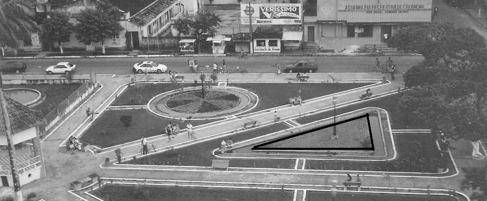
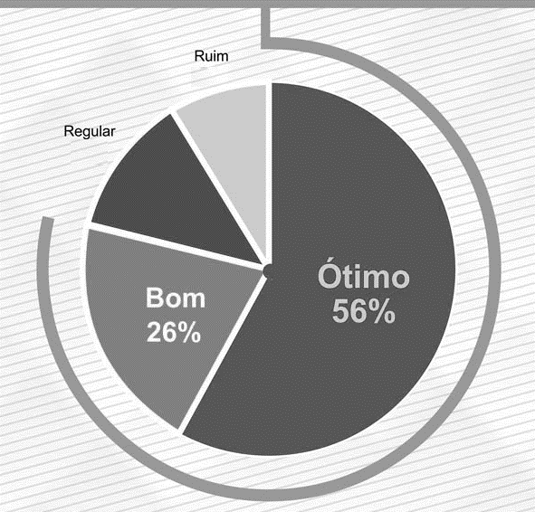

# PROVA — Camara_Capanema_2017_Agente_Administrativo

## 1. Análise geral da prova

- **Identificação:** Camara_Capanema_2017_Agente_Administrativo
- **Quantidade total de questões:** 30
- **Quantidade de textos de apoio (grupos):** 0
- **Quantidade de imagens:** 4
- **Quantidade de gráficos e tabelas:** incluídos nas imagens e no texto extraído, quando presentes no PDF original
- **Quantidade de grupos identificados:** 0
- **Quantidade de questões independentes:** 30
- **Questões que compartilham materiais:** nenhuma identificada automaticamente

### Transcrição integral da capa/instruções (conforme extraída do PDF)

> [!NOTE]
> Conteúdo integral das páginas anteriores à primeira questão, sem cortes.

> 
>
>
>
> 
>
> CÂMARA MUNICIPAL DE CAPANEMA
> CONCURSO PÚBLICO - PROVA OBJETIVA: 29 de outubro de 2017
> NÍVEL MÉDIO
> AGENTE ADMINISTRATIVO
> INSTRUÇÕES AO CANDIDATO
> 1. Confira se a prova que você recebeu corresponde ao cargo/nível de escolaridade ao qual você está inscrito,
> conforme consta no seu cartão de inscrição e cartão resposta. Caso contrário comunique imediatamente ao fiscal de
> sala.
>
> 2. Confira se, além deste BOLETIM DE QUESTÕES, você recebeu o CARTÃO RESPOSTA, destinado à marcação das
> respostas das questões objetivas.
>
> 3. Este BOLETIM DE QUESTÕES contém a Prova Objetiva com 30 (trinta) questões, sendo 10 de Português, 05 de Matemática
> e Raciocínio Lógico. 05 de Noções de Informática e 10 de conhecimento específico. Caso exista alguma falha de impressão,
> comunique imediatamente ao fiscal de sala. Na prova há espaço reservado para rascunho. Esta prova terá duração de 04
> (quatro) horas, tendo seu início às 14h30min e término às 18h30min (horário local).
>
> 4. Cada questão objetiva apresenta 04 (quatro) opções de resposta, identificadas com as letras (A), (B), (C) e (D). Apenas uma
> responde adequadamente à questão, considerando a numeração de 01 a 30.
>
> 5. Confira se seu nome, número de inscrição, cargo de opção e data de nascimento, consta na parte superior do CARTÃO
> RESPOSTA que você recebeu. Caso exista algum erro de impressão, comunique imediatamente ao fiscal de sala, a fim de que
> o fiscal registre no formulário de Correção de Dados a devida correção.
>
> 6. O candidato deverá permanecer, obrigatoriamente, no local de realização da prova por, no mínimo, uma hora após o início da
> prova. A inobservância acarretará a eliminação do concurso.
>
> 7. É obrigatório que você assine a LISTA DE PRESENÇA e o CARTÃO RESPOSTA do mesmo modo como está assinado no seu
> documento de identificação.
>
> 8. A marcação do CARTÃO RESPOSTA deve ser feita somente com caneta esferográfica de tinta preta ou azul, pois lápis não
> será considerado.
>
> 9. A maneira correta de marcar as respostas no CARTÃO RESPOSTA é cobrir totalmente o espaço correspondente à letra a
> ser assinalada, conforme o exemplo constante no CARTÃO RESPOSTA.
>
> 10. Em hipótese alguma haverá substituição do CARTÃO RESPOSTA por erro do candidato. A substituição só será autorizada
> se for constatada falha de impressão.
>
> 11. O BOLETIM DE QUESTÕES deverá ser devolvido ao final da sua prova, juntamente com seu CARTÃO RESPOSTA, pois é
> o único documento válido para o processamento de suas respostas.
>
> 12. Será automaticamente eliminado do Concurso Público da Câmara Municipal de CAPANEMA o candidato que durante a
> realização da prova descumprir os procedimentos definidos no Edital nº 001/2017 do referido concurso.
> Boa Prova.
> Nome do Candidato: _________________________________________________________
>
> Nº de Inscrição: ________________________
> _____________________________________________
> Assinatura
>
>
>
>
>
>
> PORTUGUÊS
> LEIA ATENTAMENTE O TEXTO ABAIXO PARA RESPONDER ÀS QUESTÕES DE 1 A 10.
> O outro Brasil
> Houve um tempo em que sonhei coisas — não foi ser eleito senador federal nem
> nada, eram coisas humildes e vagabundas que entretanto não fiz, nem com certeza farei.
> Era, por exemplo, arrumar um barco de uns quinze, vinte metros de comprido, com motor e
> vela, e sair tocando devagar por toda a costa do Brasil, parando para pescar, vendendo
> banana ou comprando fumo de rolo, não sei, me demorando em todo portinho simpático —
> Barra de São João, Piúma, Regência, Conceição da Barra, Serinhaém, Turiaçu, Curuçá,
> Ubatuba, Garopaba — ir indo ao léu, vendo as coisas, conversando com as pessoas — e
> fazer um livro tão simples, tão bom, que até talvez fosse melhor não fazer livro nenhum,
> apenas ir vivendo devagar a vida lenta dos mares do Brasil, tomando a cachacinha de cada
> lugar, sem pressa e com respeito. Isso devia ser bom, talvez eu me tornasse conhecido
> como um homem direito, cedendo anzóis pelo custo e comprando esteiras das mulheres dos
> pescadores, aprendendo a fazer as coisas singelas que vivem fora das estatísticas e dos
> relatórios — quantos monjolos há no Brasil, quantos puçás e paris? Sim, entraria pelos rios
> lentamente, de canoa, levando aralém, que poderia trocar por toscas amanteigadas,
> pamonha ou beiju, pois ainda há um Brasil bom que a gente desperdiça de bobagem, um
> Brasil que a gente deixa para depois, e entretanto parece que vai acabando; tenho ouvido
> falar em tanques de carpa, entretanto meu tio Cristóvão na fazenda da Boa Esperança tinha
> um pequeno açude no ribeirão onde criava cascudos, tem dias que dá vontade de beber
> jenipapina.
> Já tomei muito avião para fazer reportagem, mas o certo não é assim, é fazer como
> Saint-Hilaire ou o Príncipe Maximiliano, ir tocando por essas roças de Deus a cavalo, nada
> de Rio-Bahia, ir pelos caminhos que acompanham com todo carinho os lombos e curvas da
> terra, aceitando uma caneca de café na casa de um colono. Só de repente a gente se
> lembra de que esse Brasil ainda existe, o Brasil ainda funciona a lenha e lombo de burro, as
> noites do Brasil são pretas com assombração, dizem que ainda tem até luar no sertão, até
> capivara e suçuarana — não, eu não sou contra o progresso ("o progresso é natural") mas
> uma garrafinha de refrigerante americano não é capaz de ser como um refresco de
> maracujá feito de fruta mesmo — o Brasil ainda tem safras e estações, vazantes e
> piracemas com manjuba frita, e a lua nova continua sendo o tempo de cortar iba de bambu
> para pescar piau. E como ainda há tanta coisa, quem sabe que é capaz de haver uma
> mulher também, uma certa mulher que ainda seja assim, modesta porém limpinha, com os
> cabelos ainda molhados de seu banho de rio, parece que até banho de cachoeira ainda
> existe, até namoro debaixo de pitangueiras como antigamente, muito antigamente.
> BRAGA, Rubem. Crônicas do Espírito Santo. São Paulo: Global, 2013, p. 11-12.

### Gabarito

| Questão | 01 | 02 | 03 | 04 | 05 |
|---|---|---|---|---|---|
| Resposta | B | B | A | B | C |

| Questão | 06 | 07 | 08 | 09 | 10 |
|---|---|---|---|---|---|
| Resposta | B | C | D | A | B |

| Questão | 11 | 12 | 13 | 14 | 15 |
|---|---|---|---|---|---|
| Resposta | D | A | A | B | C |

| Questão | 16 | 17 | 18 | 19 | 20 |
|---|---|---|---|---|---|
| Resposta | C | B | D | A | C |

| Questão | 21 | 22 | 23 | 24 | 25 |
|---|---|---|---|---|---|
| Resposta | A | C | B | D | A |

| Questão | 26 | 27 | 28 | 29 | 30 |
|---|---|---|---|---|---|
| Resposta | D | B | C | A | D |

## 2. Questões agrupadas

Nenhum grupo de questões compartilhando material foi identificado automaticamente nesta prova.

## 3. Questões independentes

#### QUESTÃO 01

✅ **Gabarito: B** (gabarito.pdf (bloco NÍVEL MÉDIO - Cargo: AGENTE ADMINISTRATIVO, Edital 001/2017, gabarito oficial preliminar))

**Enunciado:**

1 O texto “O Outro Brasil” é uma crônica em que Rubem Braga

**Alternativas:**

A) elabora uma reflexão de alcance geral com base em fatos políticos.
B) descreve, com nostalgia e lirismo, lugares, hábitos e cenas que lhe são caros.
C) apresenta, com sarcasmo e pessimismo, sua visão da realidade de sua época.
D) defende explicitamente sua opinião, com base em argumentos racionais e convincentes, sobre o
outro Brasil.

**Referências visuais:**

Nenhuma.

---

#### QUESTÃO 02

✅ **Gabarito: B** (gabarito.pdf (bloco NÍVEL MÉDIO - Cargo: AGENTE ADMINISTRATIVO, Edital 001/2017, gabarito oficial preliminar))

**Enunciado:**

2 Leia os enunciados a seguir.
I.
O sonho do autor era seguir carreira política e tornar-se um homem direito.
II.
O autor evoca um Brasil que ele conheceu antes e que ainda está muito vivo em sua memória.
III.
Na contrapartida do sonho do autor está também seu desejo de tornar-se senador federal do
Brasil.
IV.
No início do texto, Rubem Braga dá a entender que não tem mais esperança de um dia realizar
seus sonhos.
As afirmações que contêm interpretações permitidas pelo texto são

**Alternativas:**

A) II e III.
B) II e IV.
C) I, II e IV.
D) I, III e IV.

**Referências visuais:**

Nenhuma.

---

#### QUESTÃO 03

✅ **Gabarito: A** (gabarito.pdf (bloco NÍVEL MÉDIO - Cargo: AGENTE ADMINISTRATIVO, Edital 001/2017, gabarito oficial preliminar))

**Enunciado:**

3 Rubem Braga constrói seu texto com base na ideia de que existem dois brasis diferentes. O Brasil
que ele sutilmente critica é

**Alternativas:**

A) o das estatísticas e dos relatórios.
B) aquele que ainda tem safras e estações.
C) o que funciona a lenha e lombo de burro.
D) aquele em que se vive sem pressa e com respeito.

**Referências visuais:**

Nenhuma.

---

#### QUESTÃO 04

✅ **Gabarito: B** (gabarito.pdf (bloco NÍVEL MÉDIO - Cargo: AGENTE ADMINISTRATIVO, Edital 001/2017, gabarito oficial preliminar))

**Enunciado:**

4 O único fragmento de texto que não caracteriza a viagem de que fala o autor é

**Alternativas:**

A) “ir indo ao léu” (l. 7).
B) “tão simples, tão bom” (l. 8).
C) “lentamente, de canoa” (l. 14).
D) “sem pressa e com respeito” (l. 10).

**Referências visuais:**

Nenhuma.

---

#### QUESTÃO 05

✅ **Gabarito: C** (gabarito.pdf (bloco NÍVEL MÉDIO - Cargo: AGENTE ADMINISTRATIVO, Edital 001/2017, gabarito oficial preliminar))

**Enunciado:**

5 Releia a seguinte passagem do texto:
não, eu não sou contra o progresso (...) mas uma garrafinha de refrigerante americano não é
capaz de ser como um refresco de maracujá feito de fruta mesmo (l. 26 a 28).
Nesse trecho, o autor deixa claro que

**Alternativas:**

A) o progresso é algo benéfico.
B) é preciso lutar contra o progresso.
C) não abre mão dos produtos naturais.
D) vê com bons olhos o progresso americano.

**Referências visuais:**

Nenhuma.

---

#### QUESTÃO 06

✅ **Gabarito: B** (gabarito.pdf (bloco NÍVEL MÉDIO - Cargo: AGENTE ADMINISTRATIVO, Edital 001/2017, gabarito oficial preliminar))

**Enunciado:**

6 Há um tom de lamentação nas palavras do autor no seguinte trecho:

**Alternativas:**

A) “parece que até banho de cachoeira ainda existe, até namoro debaixo de pitangueiras como
antigamente, muito antigamente” (l. 32 e 33).
B) “ainda há um Brasil bom que a gente desperdiça de bobagem, um Brasil que a gente deixa para
depois, e entretanto parece que vai acabando” (l. 15 e 16).
C) “ir pelos caminhos que acompanham com todo carinho os lombos e curvas da terra, aceitando uma
caneca de café na casa de um colono” (l. 22 e 23).
D) “o Brasil ainda tem safras e estações, vazantes e piracemas com manjuba frita, e a lua nova
continua sendo o tempo de cortar iba de bambu para pescar piau” (l. 28 a 30).

**Referências visuais:**

Nenhuma.

---

#### QUESTÃO 07

✅ **Gabarito: C** (gabarito.pdf (bloco NÍVEL MÉDIO - Cargo: AGENTE ADMINISTRATIVO, Edital 001/2017, gabarito oficial preliminar))

**Enunciado:**

7 O sentido da expressão “ir indo ao léu” (l. 7), só não é preservado em

**Alternativas:**

A) “ir indo à toa”.
B) “ir indo a esmo”.
C) “ir indo precavidamente”.
D) “ir indo ao sabor do acaso”.

**Referências visuais:**

Nenhuma.

---

#### QUESTÃO 08

✅ **Gabarito: D** (gabarito.pdf (bloco NÍVEL MÉDIO - Cargo: AGENTE ADMINISTRATIVO, Edital 001/2017, gabarito oficial preliminar))

**Enunciado:**

8 Com base no contexto linguístico, pode-se inferir que o vocábulo “paris” (l. 13) significa um(a)

**Alternativas:**

A) tipo de árvore.
B) espécie de animal.
C) determinada religião.
D) instrumento de pesca.

**Referências visuais:**

Nenhuma.

---

#### QUESTÃO 09

✅ **Gabarito: A** (gabarito.pdf (bloco NÍVEL MÉDIO - Cargo: AGENTE ADMINISTRATIVO, Edital 001/2017, gabarito oficial preliminar))

**Enunciado:**

9 As aspas em "o progresso é natural" (l. 26) sinalizam

**Alternativas:**

A) citação irônica.
B) impropriedade lexical.
C) uso de expressão coloquial.
D) emprego figurado de termo.

**Referências visuais:**

Nenhuma.

---

#### QUESTÃO 10

✅ **Gabarito: B** (gabarito.pdf (bloco NÍVEL MÉDIO - Cargo: AGENTE ADMINISTRATIVO, Edital 001/2017, gabarito oficial preliminar))

**Enunciado:**

10 A inversão da ordem das palavras provocaria mudança de sentido em

**Alternativas:**

A) “vida lenta” (l. 9).
B) “certa mulher” (l. 31).
C) “coisas humildes” (l. 2).
D) “pequeno açude” (l. 18).

**Referências visuais:**

Nenhuma.

---

#### QUESTÃO 11

✅ **Gabarito: D** (gabarito.pdf (bloco NÍVEL MÉDIO - Cargo: AGENTE ADMINISTRATIVO, Edital 001/2017, gabarito oficial preliminar))

**Enunciado:**

11 Considere o triângulo retângulo destacado na fotografia abaixo, de uma praça em Capanema. Se a
hipotenusa desse triângulo medir 13 m e o menor dos catetos medir 5 m, sua área medirá

**Alternativas:**

A) 60 m2.
B) 50 m2.
C) 40 m2.
D) 30 m2.

**Referências visuais:**

---

#### QUESTÃO 12

✅ **Gabarito: A** (gabarito.pdf (bloco NÍVEL MÉDIO - Cargo: AGENTE ADMINISTRATIVO, Edital 001/2017, gabarito oficial preliminar))

**Enunciado:**

12 Um serviço de transporte de calcário é feito por 3 caminhões, usando-se a capacidade máxima de 6
toneladas, em 4 dias, trabalhando-se 6 horas por dia. A quantidade de dias necessários para transportar
a mesma carga, em 2 caminhões, fazendo-se uso da capacidade máxima de 10 toneladas, trabalhando-
se 4 horas por dia, seria igual a

**Alternativas:**

A) 15 dias.
B) 12 dias.
C) 10 dias.
D) 8 dias.

**Referências visuais:**

Nenhuma.

---

#### QUESTÃO 13

✅ **Gabarito: A** (gabarito.pdf (bloco NÍVEL MÉDIO - Cargo: AGENTE ADMINISTRATIVO, Edital 001/2017, gabarito oficial preliminar))

**Enunciado:**

13 Para realizar a compra de um produto para a Câmara de Vereadores, estabeleceu-se que os
critérios seriam: o menor preço e o tempo que a empresa atuava no município. As empresas Caeté,
Nordestina e Paraense se habilitaram a vender esse produto, sendo que:
- Caeté era a empresa que atuava há mais tempo no município;
- a empresa Nordestina apresentava o produto com o menor preço;
- Paraense não era a empresa que apresentava o produto com o maior preço e nem atuava há
menos tempo no município do que as demais.
Com base nas informações acima, é correto afirmar que a empresa

**Alternativas:**

A) Paraense não atuava no município há mais, nem a menos, tempo do que as outras.
B) Nordestina atuava no município há mais tempo do que a Paraense.
C) Caeté oferecia o produto com o menor preço.
D) Caeté não oferecia o produto com maior preço.

**Referências visuais:**

Nenhuma.

---

#### QUESTÃO 14

✅ **Gabarito: B** (gabarito.pdf (bloco NÍVEL MÉDIO - Cargo: AGENTE ADMINISTRATIVO, Edital 001/2017, gabarito oficial preliminar))

**Enunciado:**

14 Ao solicitar o orçamento de uma compra direta de crachás, o setor financeiro recebeu a seguinte
resposta do único fornecedor da cidade:
“Para a quantidade requerida, o preço total é de R$ 1.000,00. Se dobrar a quantidade requerida, o
preço de cada crachá reduzirá em 25%.”
Optando por dobrar a quantidade requerida de crachás, o preço total da compra seria

**Alternativas:**

A) R$ 2.000,00.
B) R$ 1.500,00.
C) R$ 1.750,00.
D) impossível de calcular sem conhecer a quantidade requerida.

**Referências visuais:**

Nenhuma.

---

#### QUESTÃO 15

✅ **Gabarito: C** (gabarito.pdf (bloco NÍVEL MÉDIO - Cargo: AGENTE ADMINISTRATIVO, Edital 001/2017, gabarito oficial preliminar))

**Enunciado:**

15 Uma pesquisa de opinião sobre os primeiros 150 dias do governo de um prefeito foi apresentada
conforme o gráfico abaixo.

O percentual dos que consideraram o governo como Regular excedeu o dos que o consideraram Ruim
em 2 %. Se 850 foram os pesquisados, a quantidade que considerou o governo como ruim foi de

**Alternativas:**

A) 85 pessoas.
B) 80 pessoas.
C) 68 pessoas.
D) 60 pessoas.

**Referências visuais:**

---

#### QUESTÃO 16

✅ **Gabarito: C** (gabarito.pdf (bloco NÍVEL MÉDIO - Cargo: AGENTE ADMINISTRATIVO, Edital 001/2017, gabarito oficial preliminar))

**Enunciado:**

16 Para ir a uma determinada página em um documento, que está sendo editado no Microsoft Office
Word 2010, o usuário pode pressionar a tecla _______, a qual abrirá a janela “Localizar e substituir”,
que possui a guia “Ir para”, onde pode ser informada a página desejada.

A tecla que preenche corretamente a lacuna acima é a

**Alternativas:**

A) <F2>.
B) <F8>.
C) <F5>.
D) <F10>

**Referências visuais:**

Nenhuma.

---

#### QUESTÃO 17

✅ **Gabarito: B** (gabarito.pdf (bloco NÍVEL MÉDIO - Cargo: AGENTE ADMINISTRATIVO, Edital 001/2017, gabarito oficial preliminar))

**Enunciado:**

17 Os números 13, 31, 12, 17 estão presentes, respectivamente, nas células A1, A2, A3 e A4, numa
planilha eletrônica no Microsoft Office Excel 2010. Aplicando-se a fórmula abaixo na célula A5 desta
mesma planilha eletrônica, o resultado obtido é
Fórmula:
=SOMA(MÉDIA(A1;A3;A4);A1;10)

**Alternativas:**

A) 55.
B) 37.
C) 63.
D) 47.

**Referências visuais:**

Nenhuma.

---

#### QUESTÃO 18

✅ **Gabarito: D** (gabarito.pdf (bloco NÍVEL MÉDIO - Cargo: AGENTE ADMINISTRATIVO, Edital 001/2017, gabarito oficial preliminar))

**Enunciado:**

18 Para selecionar todos os arquivos da pasta “c:\concurso01” de uma só vez, no Windows Explorer
do Microsoft Windows 7 (instalação padrão), o usuário utiliza as teclas Ctrl +

**Alternativas:**

A) B.
B) S.
C) P.
D) A.

**Referências visuais:**

Nenhuma.

---

#### QUESTÃO 19

✅ **Gabarito: A** (gabarito.pdf (bloco NÍVEL MÉDIO - Cargo: AGENTE ADMINISTRATIVO, Edital 001/2017, gabarito oficial preliminar))

**Enunciado:**

19 Sobre o navegador Web “Mozilla Firefox”, os itens abaixo que possuem características descritas
corretamente são
Item Característica
Suporte à navegação através de abas/separadores, possibilitando a abertura
de várias páginas web numa única janela do navegador.
Funciona apenas no sistema operacional Windows 7 (instalação padrão).
Suporte a padrões web, como o HTML.

**Alternativas:**

A) 01 e 03.
B) 02 e 03.
C) 01 e 02.
D) 01, 02 e 03.

**Referências visuais:**

Nenhuma.

---

#### QUESTÃO 20

✅ **Gabarito: C** (gabarito.pdf (bloco NÍVEL MÉDIO - Cargo: AGENTE ADMINISTRATIVO, Edital 001/2017, gabarito oficial preliminar))

**Enunciado:**

20 Para marcar uma mensagem como “Lixo Eletrônico” no Windows Live Mail 2011, é possível utilizar a
opção “Lixo Eletrônico” do grupo “Excluir”, que pertence a guia

**Alternativas:**

A) “Pastas”.
B) “Exibir”.
C) “Início”.
D) “Contas”.
AGENTE ADMINISTRATIVO

**Referências visuais:**

Nenhuma.

---

#### QUESTÃO 21

✅ **Gabarito: A** (gabarito.pdf (bloco NÍVEL MÉDIO - Cargo: AGENTE ADMINISTRATIVO, Edital 001/2017, gabarito oficial preliminar))

**Enunciado:**

21 Uma das funções representativas do parlamentar é

**Alternativas:**

A) mediar conflitos intermediando demandas sociais.
B) evitar confrontos impedindo debates acalorados.
C) negociar a submissão dos interesses populares aos do governo.
D) resguardar a sociedade de discutir assuntos da política.

**Referências visuais:**

Nenhuma.

---

#### QUESTÃO 22

✅ **Gabarito: C** (gabarito.pdf (bloco NÍVEL MÉDIO - Cargo: AGENTE ADMINISTRATIVO, Edital 001/2017, gabarito oficial preliminar))

**Enunciado:**

22 A administração pública no Brasil passou por três grandes reformas. A mais recente, na década de
90, se caracterizou por ter um perfil claramente

**Alternativas:**

A) tradicional.
B) burocrático.
C) gerencial.
D) militarizado.

**Referências visuais:**

Nenhuma.

---

#### QUESTÃO 23

✅ **Gabarito: B** (gabarito.pdf (bloco NÍVEL MÉDIO - Cargo: AGENTE ADMINISTRATIVO, Edital 001/2017, gabarito oficial preliminar))

**Enunciado:**

23 O modelo de administração pública implantado no Brasil pelo Estado Colonial Português, no qual
não era possível distinguir o público do privado, tornando-se "natural" desde o período colonial até a
República Velha, é conhecido como

**Alternativas:**

A) generalista.
B) patrimonialista.
C) liberalista.
D) imperialista.

**Referências visuais:**

Nenhuma.

---

#### QUESTÃO 24

✅ **Gabarito: D** (gabarito.pdf (bloco NÍVEL MÉDIO - Cargo: AGENTE ADMINISTRATIVO, Edital 001/2017, gabarito oficial preliminar))

**Enunciado:**

24 Com base no decreto 5450/2005, no que se refere à licitação na modalidade de pregão, é
incumbência da autoridade competente, de acordo com as atribuições previstas no regimento ou
estatuto do órgão ou da entidade,

**Alternativas:**

A) solicitar aos participantes do certame o credenciamento do pregoeiro e da equipe.
B) determinar, em conjunto com os participantes, a abertura do processo licitatório.
C) encaminhar, ao conjunto de concorrentes, pedido de homologação do resultado da licitação.
D) decidir os recursos contra atos do pregoeiro, quando este mantiver sua decisão.

**Referências visuais:**

Nenhuma.

---

#### QUESTÃO 25

✅ **Gabarito: A** (gabarito.pdf (bloco NÍVEL MÉDIO - Cargo: AGENTE ADMINISTRATIVO, Edital 001/2017, gabarito oficial preliminar))

**Enunciado:**

25 De acordo com o decreto 5504/2005, os instrumentos de formalização, renovação ou aditamento de
convênios, instrumentos congêneres ou de consórcios públicos que envolvam repasse voluntário de
recursos públicos da União deverão conter cláusula que determine que as obras, compras, serviços e
alienações a serem realizadas por entes públicos ou privados, com os recursos ou bens repassados
voluntariamente pela União, sejam contratadas

**Alternativas:**

A) mediante processo de licitação pública, de acordo com o estabelecido na legislação federal
pertinente.
B) sem a obrigação de licitação ou qualquer outra forma de concorrência, desde que se preste ao
financiamento de serviço ou bem que seja de utilidade pública.
C) em comum acordo entre a entidade contratante e a entidade contratada, de modo a eximir ou
dirimir prejuízos futuros.
D) somente após estudo e confirmação de viabilidade técnica e econômica da maior empresa
prestadora do serviço na região.

**Referências visuais:**

Nenhuma.

---

#### QUESTÃO 26

✅ **Gabarito: D** (gabarito.pdf (bloco NÍVEL MÉDIO - Cargo: AGENTE ADMINISTRATIVO, Edital 001/2017, gabarito oficial preliminar))

**Enunciado:**

26 Quando o gestor de materiais e estoque leva em conta a alteração das propriedades físico-químicas
do material, ele o está classificando por

**Alternativas:**

A) demanda.
B) aplicação.
C) periculosidade.
D) perecibilidade.

**Referências visuais:**

Nenhuma.

---

#### QUESTÃO 27

✅ **Gabarito: B** (gabarito.pdf (bloco NÍVEL MÉDIO - Cargo: AGENTE ADMINISTRATIVO, Edital 001/2017, gabarito oficial preliminar))

**Enunciado:**

27 O ato pelo qual um processo que, tendo deixado de atender às formalidades indispensáveis ou de
cumprir alguma disposição legal, é devolvido ao órgão que assim procedeu, a fim de corrigir ou sanar as
falhas apontadas, é denominado de

**Alternativas:**

A) autuação.
B) diligência.
C) juntada.
D) requerimento.

**Referências visuais:**

Nenhuma.

---

#### QUESTÃO 28

✅ **Gabarito: C** (gabarito.pdf (bloco NÍVEL MÉDIO - Cargo: AGENTE ADMINISTRATIVO, Edital 001/2017, gabarito oficial preliminar))

**Enunciado:**

28 O ato administrativo que ocorre quando houver a ciência de desaparecimento ou extravio de um
processo é denominado de

**Alternativas:**

A) encerramento.
B) despacho.
C) reconstituição.
D) registro.

**Referências visuais:**

Nenhuma.

---

#### QUESTÃO 29

✅ **Gabarito: A** (gabarito.pdf (bloco NÍVEL MÉDIO - Cargo: AGENTE ADMINISTRATIVO, Edital 001/2017, gabarito oficial preliminar))

**Enunciado:**

29 O documento que se caracteriza pela descrição de fatos passados, analisados com o objetivo de
orientar o servidor interessado ou o superior imediato para uma determinada ação, sendo, ainda, um
documento oficial, no qual uma autoridade expõe a atividade de uma repartição ou presta conta de seus
atos a uma autoridade de nível superior, é chamado de

**Alternativas:**

A) relatório.
B) ata.
C) memorando.
D) ofício.

**Referências visuais:**

Nenhuma.

---

#### QUESTÃO 30

✅ **Gabarito: D** (gabarito.pdf (bloco NÍVEL MÉDIO - Cargo: AGENTE ADMINISTRATIVO, Edital 001/2017, gabarito oficial preliminar))

**Enunciado:**

30 A nota utilizada para informar que uma peça foi retirada do processo quando do ato da anexação,
isto é, que ao proceder à anexação foi constada a ausência de uma peça e que pode ser feita por
intermédio de carimbo específico, denomina-se termo de

**Alternativas:**

A) desentranhamento.
B) desapensação.
C) juntada de peça.
D) ressalva.

**Referências visuais:**

Nenhuma.

---

## 4. Observações e limitações da extração

- Extração automática (texto selecionável do PDF via PyMuPDF), sem OCR: PDFs escaneados podem perder texto.
- Imagens repetidas (logos/marcas d'água) foram descartadas; as imagens de conteúdo foram salvas em `imagens/` com nomenclatura `imagem_00N`.
- A detecção de grupos usa os avisos padrão das bancas ("o texto seguinte servirá de base..."). Bancas sem esse aviso podem ter grupos não identificados — o conteúdo, porém, permanece integral.
- Se houver divergência entre esta versão e o PDF original, vale o PDF original; corrija manualmente o Markdown.
