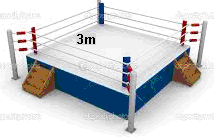
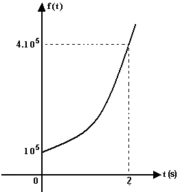
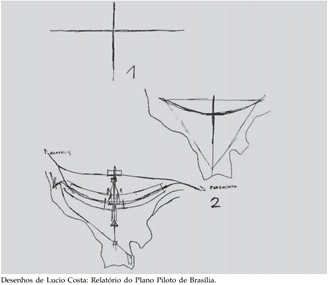

# PROVA — CÂMARA MUNICIPAL DE CAROEBE – RR · CONCURSO PÚBLICO 2014 — NÍVEL MÉDIO (Fundação AJURI)

## 1. Análise geral da prova

**Identificação da prova:**

- **Concurso:** Concurso Público da Câmara Municipal de Caroebe/RR — Edital Nº 001/2014 CONSOLIDADO – CMC (26/09/2014)
- **Prova:** Prova Objetiva — NÍVEL MÉDIO (30 questões A–E) — aplicada em 04/12/2014, Boa Vista/RR
- **Banca:** Fundação AJURI (Fundação de Apoio ao Desenvolvimento da Universidade Federal de Roraima)
- **Gabarito:** Edital Nº 091/2014, publicado em 22/12/2014 (anexo único de todos os cargos; "N*" = questão anulada)
- **Estrutura:** Língua Portuguesa (01–06; texto compartilhado pelas Q01–Q05), Matemática (07–12), História (13–18), Geografia (19–24), Informática (25–30)

**Composição quantitativa:**

| Item | Quantidade |
|---|---|
| Total de questões | 30 |
| Textos de apoio compartilhados (grupos) | 1 — questões 01 a 05 (texto sobre networking) |
| Imagens de conteúdo | 3 figuras + 1 gráfico (Q07, Q08, Q11 e Q21); demais imagens do PDF (QR code por página, logotipos da capa) são não-conteúdo |
| Gráficos e tabelas | 1 gráfico (Q11) |
| Grupos identificados | 1 |
| Questões independentes | 25 (Q06–Q30) |

**Composição por bloco:**

| Bloco | Questões | Quantidade |
|---|---|---|
| Língua Portuguesa | 01–06 | 6 |
| Matemática | 07–12 | 6 |
| História | 13–18 | 6 |
| Geografia | 19–24 | 6 |
| Informática | 25–30 | 6 |

**Observações sobre a estrutura original:**

- A prova original é diagramada em duas colunas; na transcrição, as linhas de continuação foram reunidas em leitura de coluna única.
- Cabeçalhos de seção originais: LÍNGUA PORTUGUESA (antes da Q01), MATEMÁTICA (antes da Q07), HISTÓRIA (antes da Q13), GEOGRAFIA (antes da Q19, impresso logo após o cabeçalho da QUESTÃO 19) e INFORMÁTICA (antes da Q25).
- Q07 ANULADA (N*) no gabarito oficial do Edital Nº 091/2014.

> **Transcrição integral da capa e das instruções oficiais do caderno** (linhas de continuação reunidas; a capa original exibe, ainda, logotipos da banca e código QR — imagens não-conteúdo, ver relatório):
> 
> CÂMARA MUNICIPAL DE CAROEBE — FUNDAÇÃO AJURI
> 
> CAROEBE - 2014 · CONCURSO PÚBLICO PARA PROVIMENTO DE VAGAS · DO QUADRO DE PESSOAL
> 
> NÍVEL MÉDIO
> 
> INSTRUÇÕES GERAIS
> Ø O candidato receberá do fiscal:
> Ÿ Um caderno de provas contendo 30 (trinta) questões de múltipla escolha.
> Ÿ Uma folha de respostas personalizada para a Prova Objetiva.
> Ø Ao ser autorizado o início da prova, verifique no caderno de provas se a numeração das questões e a paginação estão corretas.
> Ø Você dispõe de 3 (três) horas para fazer a Prova Objetiva. Faça com tranquilidade, mas controle o seu tempo. Esse tempo inclui a marcação da folha de respostas.
> Ø Somente após 1 (uma) hora do início da prova, o candidato poderá entregar sua folha de respostas e, em seguida, retirar-se definitivamente da sala. Se o candidato resolver sair antes, deverá assinar um termo de desistência.
> Ø Após o término da prova, o candidato deverá entregar, obrigatoriamente, o caderno de provas e a folha de respostas devidamente assinada no local indicado.
> Ø Os dois últimos candidatos de cada sala só poderão ser liberados juntos.
> Se você precisar de algum esclarecimento, fale com o fiscal ou solicite a presença do responsável pelo local.
> 
> INSTRUÇÕES PROVA OBJETIVA
> Ø Verifique se os seus dados estão corretos na folha de respostas. Em caso de erro, solicite ao fiscal para efetuar as correções na Ata da Prova.
> Ø Assine no local indicado na folha de respostas.
> Ø Leia atentamente cada questão e assinale na folha de respostas a alternativa que você julgar correta.
> Ø A folha de respostas NÃO pode ser dobrada, amassada, rasurada, manchada ou conter qualquer registro fora dos locais destinados às respostas, sob pena de eliminação do processo.
> Ø A maneira correta de assinalar a alternativa na folha de respostas é cobrindo, completamente, com caneta esferográfica azul ou preta todo o espaço a ela correspondente, conforme o exemplo a seguir:
> 
> A B C D E
> 
> ATENÇÃO: Formas de marcação diferentes da que foi determinada implicarão a rejeição da folha de respostas pela leitora ótica.
> 
> Na última página do caderno consta a grade "RASCUNHO DE GABARITO" (espaços numerados de 01 a 30 para o rascunho das respostas, impressos em duas colunas de 18 e 12 números).

**Gabarito oficial — tabela "Gabarito oficial — anexo do Edital Nº 091/2014, publicado em 22/12/2014 (Fundação AJURI)":**

| Questão | Resposta | Questão | Resposta | Questão | Resposta | Questão | Resposta | Questão | Resposta |
|---|---|---|---|---|---|---|---|---|---|
| 01 | **B** | 02 | **C** | 03 | **A** | 04 | **C** | 05 | **E** |
| 06 | **D** | 07 | **ANULADA** | 08 | **D** | 09 | **B** | 10 | **C** |
| 11 | **A** | 12 | **E** | 13 | **E** | 14 | **D** | 15 | **A** |
| 16 | **E** | 17 | **B** | 18 | **C** | 19 | **B** | 20 | **B** |
| 21 | **D** | 22 | **E** | 23 | **A** | 24 | **C** | 25 | **D** |
| 26 | **B** | 27 | **A** | 28 | **E** | 29 | **D** | 30 | **C** |

> 📌 Fonte: Gabarito oficial — anexo do Edital Nº 091/2014, publicado em 22/12/2014 (Fundação AJURI)

---

## 2. Questões agrupadas

### GRUPO 01 — Texto de Língua Portuguesa — "Do que você sente falta quando está desempregado? Dinheiro? Não! Networking!" — compartilhado pelas questões 01 a 05

**Questões relacionadas:** 01, 02, 03, 04 e 05.

**Material de apoio compartilhado:**

> Texto para as questões de 1 a 5:
> Do que você sente falta quando está
> desempregado?
> Dinheiro? Não! Networking!
> Você não deve se preocupar com sua 
> rede de relacionamentos somente quando ficar 
> desempregado. Afinal, nesses momentos, se 
> você tem de falar com alguém que não vê há 
> muito tempo, ficará muito constrangido. Ainda 
> assim, não demore a pedir ajuda.
> É comum pessoas não fazerem 
> networking quando estão empregadas. Isso 
> ocorre porque o tempo mental acaba por ficar 
> 100% dedicado à empresa. Os profissionais se 
> esquecem de que a vida é feita de ciclos e que 
> precisam dedicar um tempo para si mesmos, 
> tanto quanto para a companhia.
> Portanto, networking deve estar sempre 
> na agenda.
> Quando estiver nos bons momentos de 
> sua carreira, lembre-se de auxiliar aqueles que 
> precisam de sua ajuda. Por vezes, um simples 
> bate-papo em uma cafeteria pode dar a energia 
> que alguém precisa para lidar com momentos 
> muito difíceis. Auxilie as pessoas, e não se 
> sentirá tão constrangido quando estiver por baixo 
> e precisar contatá-las.
> Tenha sempre uma agenda para os 
> profissionais que fazem parte de sua rede de 
> contatos. Você não precisa sair tanto assim de 
> sua rotina. Use, uma ou duas vezes por semana, 
> o café da manhã, o almoço, o happy hour e o 
> jantar para conversar com os amigos. Tenha interesse em saber como pode contribuir com 
> eles. É normal que você esteja a maior parte do 
> tempo auxiliando as pessoas de sua rede. Mas, 
> quando o momento difícil chegar, seja humilde e 
> peça ajuda.
> Acima de tudo, quando o mau período 
> terminar, não se esqueça de manter seu 
> networking ativo.
> Essas ações são para o bem de sua 
> carreira e daqueles que você admira.
> Afinal, todos nós precisamos de ajuda e 
> contribuição em certos momentos da vida. 
> Saibamos oferecer ambas.
> Vamos em frente!
> Disponível em: <http://www.administradores.com.br/artigos/carreira/ do-que-
> voce-sente-falta-quando-esta-desempregado/82474/> Acesso em: 8 nov 2014.

---

#### QUESTÃO 01

✅ **Gabarito: B** (Gabarito oficial — anexo do Edital Nº 091/2014, publicado em 22/12/2014 (Fundação AJURI))

**Material de apoio:**

> Texto para as questões de 1 a 5:
> Do que você sente falta quando está
> desempregado?
> Dinheiro? Não! Networking!
> Você não deve se preocupar com sua 
> rede de relacionamentos somente quando ficar 
> desempregado. Afinal, nesses momentos, se 
> você tem de falar com alguém que não vê há 
> muito tempo, ficará muito constrangido. Ainda 
> assim, não demore a pedir ajuda.
> É comum pessoas não fazerem 
> networking quando estão empregadas. Isso 
> ocorre porque o tempo mental acaba por ficar 
> 100% dedicado à empresa. Os profissionais se 
> esquecem de que a vida é feita de ciclos e que 
> precisam dedicar um tempo para si mesmos, 
> tanto quanto para a companhia.
> Portanto, networking deve estar sempre 
> na agenda.
> Quando estiver nos bons momentos de 
> sua carreira, lembre-se de auxiliar aqueles que 
> precisam de sua ajuda. Por vezes, um simples 
> bate-papo em uma cafeteria pode dar a energia 
> que alguém precisa para lidar com momentos 
> muito difíceis. Auxilie as pessoas, e não se 
> sentirá tão constrangido quando estiver por baixo 
> e precisar contatá-las.
> Tenha sempre uma agenda para os 
> profissionais que fazem parte de sua rede de 
> contatos. Você não precisa sair tanto assim de 
> sua rotina. Use, uma ou duas vezes por semana, 
> o café da manhã, o almoço, o happy hour e o 
> jantar para conversar com os amigos. Tenha interesse em saber como pode contribuir com 
> eles. É normal que você esteja a maior parte do 
> tempo auxiliando as pessoas de sua rede. Mas, 
> quando o momento difícil chegar, seja humilde e 
> peça ajuda.
> Acima de tudo, quando o mau período 
> terminar, não se esqueça de manter seu 
> networking ativo.
> Essas ações são para o bem de sua 
> carreira e daqueles que você admira.
> Afinal, todos nós precisamos de ajuda e 
> contribuição em certos momentos da vida. 
> Saibamos oferecer ambas.
> Vamos em frente!
> Disponível em: <http://www.administradores.com.br/artigos/carreira/ do-que-
> voce-sente-falta-quando-esta-desempregado/82474/> Acesso em: 8 nov 2014.

**Enunciado:**

Sobre o conceito de networking, é incorreto afirmar
que:

**Alternativas:**

A) diz respeito a criar nossa própria rede de contatos profissionais e pessoais;

B) é uma atividade egoísta, em que você se aproveita de uma pessoa para conquistar seus objetivos pessoais ou receber promoções no trabalho;

C) indica uma atitude de procura de contatos com a possibilidade de conseguir subir na carreira;

D) é conhecer as pessoas certas, que podem dar uma referência ou fazer uma indicação;

E) consiste em compartilhar informações, conhecimentos, ideias, permitindo conhecer pessoas novas e fortalecer relações já existentes. ===== PAGE 4 =====

**Referências visuais:**

Nenhuma.

---

#### QUESTÃO 02

✅ **Gabarito: C** (Gabarito oficial — anexo do Edital Nº 091/2014, publicado em 22/12/2014 (Fundação AJURI))

**Material de apoio:**

> Texto para as questões de 1 a 5:
> Do que você sente falta quando está
> desempregado?
> Dinheiro? Não! Networking!
> Você não deve se preocupar com sua 
> rede de relacionamentos somente quando ficar 
> desempregado. Afinal, nesses momentos, se 
> você tem de falar com alguém que não vê há 
> muito tempo, ficará muito constrangido. Ainda 
> assim, não demore a pedir ajuda.
> É comum pessoas não fazerem 
> networking quando estão empregadas. Isso 
> ocorre porque o tempo mental acaba por ficar 
> 100% dedicado à empresa. Os profissionais se 
> esquecem de que a vida é feita de ciclos e que 
> precisam dedicar um tempo para si mesmos, 
> tanto quanto para a companhia.
> Portanto, networking deve estar sempre 
> na agenda.
> Quando estiver nos bons momentos de 
> sua carreira, lembre-se de auxiliar aqueles que 
> precisam de sua ajuda. Por vezes, um simples 
> bate-papo em uma cafeteria pode dar a energia 
> que alguém precisa para lidar com momentos 
> muito difíceis. Auxilie as pessoas, e não se 
> sentirá tão constrangido quando estiver por baixo 
> e precisar contatá-las.
> Tenha sempre uma agenda para os 
> profissionais que fazem parte de sua rede de 
> contatos. Você não precisa sair tanto assim de 
> sua rotina. Use, uma ou duas vezes por semana, 
> o café da manhã, o almoço, o happy hour e o 
> jantar para conversar com os amigos. Tenha interesse em saber como pode contribuir com 
> eles. É normal que você esteja a maior parte do 
> tempo auxiliando as pessoas de sua rede. Mas, 
> quando o momento difícil chegar, seja humilde e 
> peça ajuda.
> Acima de tudo, quando o mau período 
> terminar, não se esqueça de manter seu 
> networking ativo.
> Essas ações são para o bem de sua 
> carreira e daqueles que você admira.
> Afinal, todos nós precisamos de ajuda e 
> contribuição em certos momentos da vida. 
> Saibamos oferecer ambas.
> Vamos em frente!
> Disponível em: <http://www.administradores.com.br/artigos/carreira/ do-que-
> voce-sente-falta-quando-esta-desempregado/82474/> Acesso em: 8 nov 2014.

**Enunciado:**

Assinale a alternativa em que o processo de
formação da palavra grifada está
INCORRETAMENTE identificado.

**Alternativas:**

A) Por vezes, um simples bate-papo em uma cafeteria pode dar a energia [...] – composição por justaposição;

B) Você não deve se preocupar com sua rede de relacionamentos somente quando ficar desempregado – derivação por prefixação e sufixação;

C) Essas ações são para o bem de sua carreira e daqueles que você admira – derivação prefixal;

D) Por vezes, um simples bate-papo em uma cafeteria pode dar a energia [...] – derivação por sufixação;

E) Use, uma ou duas vezes por semana, o café da manhã, o almoço, o happy hour e o jantar para conversar com os amigos. – derivação imprópria.

**Referências visuais:**

Nenhuma.

---

#### QUESTÃO 03

✅ **Gabarito: A** (Gabarito oficial — anexo do Edital Nº 091/2014, publicado em 22/12/2014 (Fundação AJURI))

**Material de apoio:**

> Texto para as questões de 1 a 5:
> Do que você sente falta quando está
> desempregado?
> Dinheiro? Não! Networking!
> Você não deve se preocupar com sua 
> rede de relacionamentos somente quando ficar 
> desempregado. Afinal, nesses momentos, se 
> você tem de falar com alguém que não vê há 
> muito tempo, ficará muito constrangido. Ainda 
> assim, não demore a pedir ajuda.
> É comum pessoas não fazerem 
> networking quando estão empregadas. Isso 
> ocorre porque o tempo mental acaba por ficar 
> 100% dedicado à empresa. Os profissionais se 
> esquecem de que a vida é feita de ciclos e que 
> precisam dedicar um tempo para si mesmos, 
> tanto quanto para a companhia.
> Portanto, networking deve estar sempre 
> na agenda.
> Quando estiver nos bons momentos de 
> sua carreira, lembre-se de auxiliar aqueles que 
> precisam de sua ajuda. Por vezes, um simples 
> bate-papo em uma cafeteria pode dar a energia 
> que alguém precisa para lidar com momentos 
> muito difíceis. Auxilie as pessoas, e não se 
> sentirá tão constrangido quando estiver por baixo 
> e precisar contatá-las.
> Tenha sempre uma agenda para os 
> profissionais que fazem parte de sua rede de 
> contatos. Você não precisa sair tanto assim de 
> sua rotina. Use, uma ou duas vezes por semana, 
> o café da manhã, o almoço, o happy hour e o 
> jantar para conversar com os amigos. Tenha interesse em saber como pode contribuir com 
> eles. É normal que você esteja a maior parte do 
> tempo auxiliando as pessoas de sua rede. Mas, 
> quando o momento difícil chegar, seja humilde e 
> peça ajuda.
> Acima de tudo, quando o mau período 
> terminar, não se esqueça de manter seu 
> networking ativo.
> Essas ações são para o bem de sua 
> carreira e daqueles que você admira.
> Afinal, todos nós precisamos de ajuda e 
> contribuição em certos momentos da vida. 
> Saibamos oferecer ambas.
> Vamos em frente!
> Disponível em: <http://www.administradores.com.br/artigos/carreira/ do-que-
> voce-sente-falta-quando-esta-desempregado/82474/> Acesso em: 8 nov 2014.

**Enunciado:**

Assinale a alternativa em que a flexão da forma
verbal retirada do texto encontra-se
corretamente identificada:

**Alternativas:**

A) É normal que você esteja a maior parte do tempo auxiliando as pessoas de sua rede. (3ª pessoa do singular do presente do subjuntivo)

B) Ainda assim, não demore a pedir ajuda. ( 2ª pessoa do singular do imperativo negativo)

C) Tenha sempre uma agenda para os profissionais. (2ª pessoa do singular do imperativo afirmativo)

D) Você não precisa sair tanto assim de sua rotina. (3ª pessoa do singular do presente do subjuntivo)

E) Saibamos oferecer ambas. (1ª pessoa do plural do futuro do subjuntivo)

**Referências visuais:**

Nenhuma.

---

#### QUESTÃO 04

✅ **Gabarito: C** (Gabarito oficial — anexo do Edital Nº 091/2014, publicado em 22/12/2014 (Fundação AJURI))

**Material de apoio:**

> Texto para as questões de 1 a 5:
> Do que você sente falta quando está
> desempregado?
> Dinheiro? Não! Networking!
> Você não deve se preocupar com sua 
> rede de relacionamentos somente quando ficar 
> desempregado. Afinal, nesses momentos, se 
> você tem de falar com alguém que não vê há 
> muito tempo, ficará muito constrangido. Ainda 
> assim, não demore a pedir ajuda.
> É comum pessoas não fazerem 
> networking quando estão empregadas. Isso 
> ocorre porque o tempo mental acaba por ficar 
> 100% dedicado à empresa. Os profissionais se 
> esquecem de que a vida é feita de ciclos e que 
> precisam dedicar um tempo para si mesmos, 
> tanto quanto para a companhia.
> Portanto, networking deve estar sempre 
> na agenda.
> Quando estiver nos bons momentos de 
> sua carreira, lembre-se de auxiliar aqueles que 
> precisam de sua ajuda. Por vezes, um simples 
> bate-papo em uma cafeteria pode dar a energia 
> que alguém precisa para lidar com momentos 
> muito difíceis. Auxilie as pessoas, e não se 
> sentirá tão constrangido quando estiver por baixo 
> e precisar contatá-las.
> Tenha sempre uma agenda para os 
> profissionais que fazem parte de sua rede de 
> contatos. Você não precisa sair tanto assim de 
> sua rotina. Use, uma ou duas vezes por semana, 
> o café da manhã, o almoço, o happy hour e o 
> jantar para conversar com os amigos. Tenha interesse em saber como pode contribuir com 
> eles. É normal que você esteja a maior parte do 
> tempo auxiliando as pessoas de sua rede. Mas, 
> quando o momento difícil chegar, seja humilde e 
> peça ajuda.
> Acima de tudo, quando o mau período 
> terminar, não se esqueça de manter seu 
> networking ativo.
> Essas ações são para o bem de sua 
> carreira e daqueles que você admira.
> Afinal, todos nós precisamos de ajuda e 
> contribuição em certos momentos da vida. 
> Saibamos oferecer ambas.
> Vamos em frente!
> Disponível em: <http://www.administradores.com.br/artigos/carreira/ do-que-
> voce-sente-falta-quando-esta-desempregado/82474/> Acesso em: 8 nov 2014.

**Enunciado:**

Assinale a alternativa em que a palavra grifada
pode ser substituída pela palavra entre
parênteses, sem prejuízo para o sentido do texto.

**Alternativas:**

A) [...] ficará muito constrangido. (à-vontade)

B) [...]alguém precisa para lidar com momentos muito difíceis. (manusear)

C) [...]a vida é feita de ciclos. (etapas)

D) Tenha sempre uma agenda para os profissionais que fazem parte de sua rede de contatos. (pauta)

E) Você não precisa sair tanto assim de sua rotina. (eventualidade)

**Referências visuais:**

Nenhuma.

---

#### QUESTÃO 05

✅ **Gabarito: E** (Gabarito oficial — anexo do Edital Nº 091/2014, publicado em 22/12/2014 (Fundação AJURI))

**Material de apoio:**

> Texto para as questões de 1 a 5:
> Do que você sente falta quando está
> desempregado?
> Dinheiro? Não! Networking!
> Você não deve se preocupar com sua 
> rede de relacionamentos somente quando ficar 
> desempregado. Afinal, nesses momentos, se 
> você tem de falar com alguém que não vê há 
> muito tempo, ficará muito constrangido. Ainda 
> assim, não demore a pedir ajuda.
> É comum pessoas não fazerem 
> networking quando estão empregadas. Isso 
> ocorre porque o tempo mental acaba por ficar 
> 100% dedicado à empresa. Os profissionais se 
> esquecem de que a vida é feita de ciclos e que 
> precisam dedicar um tempo para si mesmos, 
> tanto quanto para a companhia.
> Portanto, networking deve estar sempre 
> na agenda.
> Quando estiver nos bons momentos de 
> sua carreira, lembre-se de auxiliar aqueles que 
> precisam de sua ajuda. Por vezes, um simples 
> bate-papo em uma cafeteria pode dar a energia 
> que alguém precisa para lidar com momentos 
> muito difíceis. Auxilie as pessoas, e não se 
> sentirá tão constrangido quando estiver por baixo 
> e precisar contatá-las.
> Tenha sempre uma agenda para os 
> profissionais que fazem parte de sua rede de 
> contatos. Você não precisa sair tanto assim de 
> sua rotina. Use, uma ou duas vezes por semana, 
> o café da manhã, o almoço, o happy hour e o 
> jantar para conversar com os amigos. Tenha interesse em saber como pode contribuir com 
> eles. É normal que você esteja a maior parte do 
> tempo auxiliando as pessoas de sua rede. Mas, 
> quando o momento difícil chegar, seja humilde e 
> peça ajuda.
> Acima de tudo, quando o mau período 
> terminar, não se esqueça de manter seu 
> networking ativo.
> Essas ações são para o bem de sua 
> carreira e daqueles que você admira.
> Afinal, todos nós precisamos de ajuda e 
> contribuição em certos momentos da vida. 
> Saibamos oferecer ambas.
> Vamos em frente!
> Disponível em: <http://www.administradores.com.br/artigos/carreira/ do-que-
> voce-sente-falta-quando-esta-desempregado/82474/> Acesso em: 8 nov 2014.

**Enunciado:**

Observe o uso dos verbos esquecer e lembrar no
texto:
“Os profissionais se esquecem de que a vida é
feita de ciclos [...]”
“[...] lembre-se de auxiliar aqueles que precisam
de sua ajuda [...]”
Sabendo que esses verbos podem assumir
distintas regências, identifique o texto em que a
regência desses verbos está sempre correta:

**Alternativas:**

A) - A prova de hoje será muito difícil! - Você esqueceu da prova?

B) - Uh, Haroldo? ... Eu esqueci de comprar seu presente. Eu não fiz nem um cartão... - Me desculpe Haroldo. Eu não queria ter esquecido. - Tudo bem amiguinho. Eu também não comprei nada pra você. - Mas aqui vai um abraço de tigre por ser meu melhor amigo. - Não tão forte. Garotinha. Você está espremendo minhas lágrimas pra fora. - Feliz Natal.

C) - Você esqueceu do algodão pra fazer a neve.

D) - Os homens são todos uns insensíveis!.. - Eles nunca lembram uma data importante! - Nada a ver... - ... Lembro do dia de nossa primeira briga feia...

E) - Se lembra de como você prometeu que se eu me casasse com você, teria uma vida de conto de fadas? - Sim - Até agora só tenho vivido um conto de terror! ===== PAGE 5 =====

**Referências visuais:**

Nenhuma.

---

## 3. Questões independentes

#### QUESTÃO 06

✅ **Gabarito: D** (Gabarito oficial — anexo do Edital Nº 091/2014, publicado em 22/12/2014 (Fundação AJURI))

**Material de apoio:**

> Distritais só poderão ter mandato cassado após
> decisão judicial
> Thaís Paranhos
> Arthur Paganini
> Sem passar pelo protocolo da Câmara Legislativa,
> os deputados conseguiram, em apenas um dia,
> apresentar e aprovar, em primeiro turno, um
> controverso projeto de resolução. Ontem, 17
> parlamentares endossaram a matéria que
> pretende dificultar a cassação do mandato de
> distritais envolvidos em quebra de decoro. Pela
> proposta, um deputado só poderá ser cassado
> quando houver decisão judicial transitada em
> julgado, ou seja, quando não houver mais
> possibilidade de recursos. Em outro projeto de
> resolução, os parlamentares querem impedir que
> qualquer cidadão entre com representação contra
> eles por quebra de decoro. Apenas partidos
> políticos poderiam apresentar denúncias à Casa.
> ( T r e c h o c o m a l t e r a ç õ e s .  D i s p o n í v e l e m :
> <http://www.correiobraziliense.com.br/app/noticia/cidades/2014
> /11/13/ interna_cidadesdf,457399/distritais-so-poderao-ter-
> mandato-cassado-apos-decisao-judicial.shtml> Acesso em: 13
> nov 2014)

**Enunciado:**

Observe o uso das palavras terminadas em “ão” no
texto e assinale a alternativa em que o plural de
uma delas está INCORRETO:

**Alternativas:**

A) cassações

B) decisões

C) resoluções

D) cidadões

E) representações

**Referências visuais:**

Nenhuma.

---

#### QUESTÃO 07

⚠️ **Gabarito: ANULADA**

**Enunciado:**

Em um jogo de basquete dos Jogos Escolares
realizado no Caroebe, um jogador do time local
lançou a bola da linha de três pontos em direção à
cesta, como mostra a figura abaixo. A equação que
representa a trajetória da bola é dada por h(t) = −2t² + 3,4t + 0,5, onde h(t) representa a altura
atingida pela bola em metros, e t o tempo em
segundos. A altura máxima atingida pela bola foi de:

*(Nota de transcrição: no PDF original, esta fórmula foi impressa com os glifos fora de ordem — extração literal: "05,34)(2++-=ttth", seguida de ")(th", antes de ", onde ... representa a altura ...". A forma reconstruída h(t) = −2t² + 3,4t + 0,5 é hipótese interpretativa, confirmada por verificação visual em alta resolução e pela conferência do conjunto de caracteres da forma extraída; ver Observações e limitações. A questão 07 foi ANULADA (N*) no gabarito oficial.)*

**Alternativas:**

A) 7,05m

B) 6,10m

C) 6,15m

D) 5,00m

E) 4,75m

**Referências visuais:**

---

#### QUESTÃO 08

✅ **Gabarito: D** (Gabarito oficial — anexo do Edital Nº 091/2014, publicado em 22/12/2014 (Fundação AJURI))

**Enunciado:**

O administrador do município de São Luiz do
Anauá deseja construir na praça um espaço para
prática de boxe para os esportistas
frequentadores dessa praça. No projeto consta o
desenho de um ringue no formato de um
quadrado de lado 3m, como mostra a figura
abaixo.
O valor da diagonal e da área desse quadrado
que representa a base do ringue são
respectivamente:

**Alternativas:**

A) 9 m e 3√2 m²

B) 2√3 m e 6 m²

C) 9√2 m e 9 m²

D) 3√2 m e 9 m²

E) (3√2)/2 m e 9 m²

**Referências visuais:**

---

#### QUESTÃO 09

✅ **Gabarito: B** (Gabarito oficial — anexo do Edital Nº 091/2014, publicado em 22/12/2014 (Fundação AJURI))

**Enunciado:**

Seu João vai fazer um concurso público no
município de São João da Baliza. Ele mora em
uma das vicinais que cortam esse município a
uma distância de 35km do local da prova. No dia
da realização do concurso, seu João perdeu o
ônibus que o levaria a cede do município e
precisou fretar um carro particular para chegar a
tempo no local da prova. Sabendo que o dono do
veículo cobrou R$1,50 por quilômetros rodados e
que seu João ainda terá que pagar pelo conserto
de um pneu furado que custou R$10,00, o valor
pago  por ele ao chegar no local da prova foi de:

**Alternativas:**

A) R$ 52,50

B) R$ 62,50

C) R$ 57,75

D) R$ 47,75

E) R$ 42,50 ===== PAGE 6 =====

**Referências visuais:**

Nenhuma.

---

#### QUESTÃO 10

✅ **Gabarito: C** (Gabarito oficial — anexo do Edital Nº 091/2014, publicado em 22/12/2014 (Fundação AJURI))

**Enunciado:**

Para uma turma de 45 alunos do terceiro ano da
escola estadual Professor Alan Kardec Dantas
Haddad no município de São Luiz do Anauá
foram oferecidos cursos de Informática e
Técnicas agrícolas. Sabendo que 25 desses
alunos escolheram Informática, 30 escolheram
Técnicas Agrícolas e 8 não escolheram nenhum
dos dois cursos, quantos alunos dessa turma
optaram por fazer os dois cursos?

**Alternativas:**

A) 16

B) 12

C) 18

D) 21

E) 22

**Referências visuais:**

Nenhuma.

---

#### QUESTÃO 11

✅ **Gabarito: A** (Gabarito oficial — anexo do Edital Nº 091/2014, publicado em 22/12/2014 (Fundação AJURI))

**Enunciado:**

Os antibióticos  são fármacos empregados no
tratamento de infecções. Algumas destas substâncias
são totalmente artificiais, mas existem aquelas
produzidas a partir de organismos vivos, tais como
fungos e bactérias. Estes medicamentos tem o poder
de destruir ou controlar o crescimento de organismos
infecciosos do corpo.
http://www.infoescola.com/medicina/antibioticos/
O gráfico abaixo mostra o crescimento do número
de bactérias de uma cultura que está sendo
utilizada na produção de determinado antibiótico.
Essas bactérias se reproduzem exponencialmente
segundo a função f(t) = b·aᵗ, onde f(t) representa a
quantidade de bactérias produzidas em função do
tempo t em horas.
Sabendo que √2 ≈ 1,4, o número de bactérias
existentes nessa cultura decorrido 1h e 30
minutos será de:

**Alternativas:**

A) 280.000

B) 140.000

C) 28.000

D) 14.000

E) 100.000 ta b t f . ) ( = ) (t f 4,1 2 @

**Referências visuais:**

---

#### QUESTÃO 12

✅ **Gabarito: E** (Gabarito oficial — anexo do Edital Nº 091/2014, publicado em 22/12/2014 (Fundação AJURI))

**Enunciado:**

Marcos que faz o 1º ano, ficou com média anual
6,9. Isso significa que ele já está de recuperação
final, sendo que a média para passar de ano é 7. A
mãe, sabendo da situação do filho, foi conversar
com o professor. Na conversa ela argumentou que
o filho havia ficado por apenas um décimo e que no
ultimo bimestre ele havia perdido algumas aulas
por motivo de doença e justificadas com atestado
médico. O professor se sensibilizou com a
situação do aluno e resolveu dar uma chance a ele.
Propôs que Marcos resolvesse a seguinte questão
de logaritmo: 2^(log₂ 5). Marcos resolveu e acertou. O
valor que Marcos encontrou foi:

**Alternativas:**

A) 32

B) 2

C) 10

D) 25 E) 5 5 log2 2

**Referências visuais:**

Nenhuma.

---

#### QUESTÃO 13

✅ **Gabarito: E** (Gabarito oficial — anexo do Edital Nº 091/2014, publicado em 22/12/2014 (Fundação AJURI))

**Enunciado:**

O pó branco tornou-se o principal nervo e
substância da riqueza da terra, segundo um antigo
cronista. Com os dividendos – de qualquer forma
logo emigrados para Portugal e, dalí, para a
Holanda – vieram a devastação das matas, a
escravização indígena em larga escala, os
desatinos do monopólio e da monocultura, ...”
BUENO, Eduardo. “Brasil: Uma História” de
Eduardo Bueno. – São Paulo: Leia, 2010.
O trecho acima refere-se a fase inicial da História
brasileira, quando Portugal percebe que o clima
de sua então colônia é favorável ao plantio de uma
monocultura que nesta época (Séculos XVI e XVII)
vale seu peso em ouro. Tomando como base o
Trecho acima citado marque a alternativa que
define qual foi esta monocultura:

**Alternativas:**

A) Urucum

B) Café

C) Algodão

D) Pau – brasil

E) Açúcar ===== PAGE 7 =====

**Referências visuais:**

Nenhuma.

---

#### QUESTÃO 14

✅ **Gabarito: D** (Gabarito oficial — anexo do Edital Nº 091/2014, publicado em 22/12/2014 (Fundação AJURI))

**Enunciado:**

O processo de abolição da escravidão brasileira,
foi muito lendo e impulsionado pelas pressões
Inglesas, que ansiavam por ampliar seu mercado
consumidor. A escravidão porém, sustentava a
economia brasileira, os grandes proprietários de
terra não queriam perder sua força de trabalho.
Diante destas divergências o Brasil começou a
pensar esta abolição com leis que fariam deste
um processo lento e gradual. Dentre as leis de
iniciativa da coroa brasileira que marcam este
processo, podem ser apontadas:

**Alternativas:**

A) Lei Eusébio de Queiroz, Bill Aberdeen e Proteção dos Portos;

B) Lei Ventre livre, Sexagenário e Proteção dos Portos;

C) Lei de proteção dos Portos, sexagenário e Bill Aberdeen;

D) Lei Eusébio de Queiroz, Ventre livre, Sexagenário;

E) Lei do Ventre Livre, Eusébio de Queiroz e Bill Aberdeen.

**Referências visuais:**

Nenhuma.

---

#### QUESTÃO 15

✅ **Gabarito: A** (Gabarito oficial — anexo do Edital Nº 091/2014, publicado em 22/12/2014 (Fundação AJURI))

**Material de apoio:**

> Quando se fala em golpe militar, a imagem da rebelião dos quartéis tende a se impor na imaginação do leitor: movimentação de tropas, cerco da sede do poder constitucional, pronunciamentos raivosos das lideranças militares carrancudas, deposição forçada do presidente eleito, coerção das forças civis que resistem aos golpistas. Obviamente, nosso golpe teve tudo isso e mais um pouco. Mas é este “pouco” a mais que faz toda a diferença, transformando o golpe de 1964 em uma complexa trama de engenharia política.

**Enunciado:**

NAPOLITANO, Marcos. 1964: História do Regime Militar
Brasileiro. São Paulo: Contexto, 2014.
O texto acima retrata o Regime Militar imposto no
Brasil que iniciou-se em 1964 com a deposição
do presidente eleito:

**Alternativas:**

A) João Goulart

B) Juscelino Kubitschek

C) José Sarney

D) Jânio Quadros

E) Humberto Castelo Branco

**Referências visuais:**

Nenhuma.

---

#### QUESTÃO 16

✅ **Gabarito: E** (Gabarito oficial — anexo do Edital Nº 091/2014, publicado em 22/12/2014 (Fundação AJURI))

**Material de apoio:**

> Por essas razões, o encontro na noite de 11 de novembro, segunda-feira, apesar de rápido, foi tenso. Benjamin Constant afirmou que não bastava derrubar o ministério sem trocar o regime. A preservação da Monarquia, segundo ele, serviria apenas para agravar os problemas. Era preciso fazer a República. “Está provado que a Monarquia no Brasil é incompatível com um regime de liberdade política”, argumentou Benjamin. “Para que a intervenção do Exército se legitime aos olhos da nação e pelo julgamento de nossas próprias consciências, é necessário que sua ação se dirija à destruição da Monarquia e à proclamação da República, recolhendo-se em seguida aos seus quartéis e entregando o governo ao poder civil.”

**Enunciado:**

GOMES, Laurentino. 1889: Como um imperador cansado, um marechal vaidoso e um professor injustiçado contribuíram para o fim da Monarquia e a Proclamação da República no Brasil. São Paulo: Globo, 2013. O trecho do texto acima trata-se das vésperas da proclamação da República brasileira no 15 de novembro de 1889 pelo(a):

**Alternativas:**

A) Rui Barbosa

B) Benjamin Constant

C) Anita Garibaldi

D) Getúlio Vargas

E) Deodoro da Fonseca

**Referências visuais:**

Nenhuma.

---

#### QUESTÃO 17

✅ **Gabarito: B** (Gabarito oficial — anexo do Edital Nº 091/2014, publicado em 22/12/2014 (Fundação AJURI))

**Enunciado:**

“No campo jurídico e institucional, o presidente
Castelo Branco estruturou o novo regime de caráter
autoritário, independentemente das suas intenções
“democratizantes”. Com a economia em crise, parte
da classe média logo se desiludiu com o novo
governo. Acuado pela classe média e suas lideranças
políticas, muitas delas formadas por políticos
conservadores que o apoiaram na ocasião do golpe
...”
NAPOLITANO, Marcos. História do Regime Militar Brasileiro. – São
Paulo: Contexto, 2014.
O Golpe Militar de 1964 manteve os militares no
poder até 1985, marcando a História Brasileira
com perseguições e rigidez. Sobre o Regime
Militar no Brasil, identifique o instrumento serviu
como reforço legal do Poder Executivo, e
Particularmente da Presidência da República,
dentro do Sistema Político neste período de 1964 à
1985:

**Alternativas:**

A) As Emendas parlamentares.

B) Os Atos Institucionais.

C) A Marcha da família com Deus pela Liberdade.

D) A Lei de Segurança Nacional.

E) Os Atos Adicionais.

**Referências visuais:**

Nenhuma.

---

#### QUESTÃO 18

✅ **Gabarito: C** (Gabarito oficial — anexo do Edital Nº 091/2014, publicado em 22/12/2014 (Fundação AJURI))

**Enunciado:**

A Segunda Guerra Mundial (1939-1945), devastou
diversas nações, principalmente as Europeias. As
cidades, especialmente da Alemanha estavam em
ruinas e os vencedores reúnem em Conferencias
para definir o rumo dos acontecimentos.
Sobre o fim da Segunda Guerra Mundial julgue os
itens a seguir:
I - Após o fim a guerra a Liga das Nações cede
lugar à Organização das Nações Unidas (ONU),
que visa garantir a paz entre as nações;
II- Os Estados Unidos da América (EUA), ajudam
na reconstrução do Japão, país devastado pelas
Bombas Atômicas de Hiroshima e Nagazaki;
III - Após o fim da Guerra, iniciaram-se tenções
política e ideológicas entre Estados Unidos da
América (EUA) e a União das Repúblicas
Socialistas Soviéticas (URSS);
IV - A Conferência de Potsdam ocorreu em
Potsdam (Alemanha) em Julho de 1945. Os
participantes foram os vitoriosos Aliados da II
Guerra Mundial, que se juntaram para definir o
estabelecimento da ordem pós guerra, assuntos
relacionados com tratados de paz e contornar os
efeitos da guerra;
Sobre os itens acima é correto afirmar:

**Alternativas:**

A) Apenas os Itens II, III e V estão Corretos;

B) Apenas os Itens I, II, III estão corretos;

C) Todos os itens estão Corretos;

D) Apenas os itens I e IV estão Corretos;

E) Todos os itens estão incorretos.

**Referências visuais:**

Nenhuma.

---

#### QUESTÃO 19

✅ **Gabarito: B** (Gabarito oficial — anexo do Edital Nº 091/2014, publicado em 22/12/2014 (Fundação AJURI))

**Enunciado:**

Sobre as causas e consequências do
desmatamento no Brasil, julgue os itens abaixo:
I. O desmatamento provoca perca da
biodiversidade.
II. A pecuária é uma das grandes responsáveis pela
diminuição da vegetação nativa no Brasil.
III. As atividades econômicas não são responsáveis
pela devastação das florestas.
 IV. A diminuição dos índices de umidade na
atmosfera, podem ser associados a retirada de
grandes extensões de cobertura vegetal.
Os itens corretos são:

**Alternativas:**

A) I, II e III

B) I, II e IV

C) II, III e IV

D) II, IV

E) III, IV

**Referências visuais:**

Nenhuma.

---

#### QUESTÃO 20

✅ **Gabarito: B** (Gabarito oficial — anexo do Edital Nº 091/2014, publicado em 22/12/2014 (Fundação AJURI))

**Enunciado:**

Leia atentamente o texto:
“Grande parte dos produtores familiares foi
excluída por não serem contemplados pelos
benefícios governamentais. As monoculturas de
grãos, altamente mecanizadas, exigem uma
escala de produção mínima que os menores não
conseguiam atingir. Além disso, muitos produtores
não podiam arcar com os altos custos dos insumos
modernos necessários à produção competitiva do
mercado e foram obrigados a vender suas
propriedades. Com isso a concentração da posse
da terra foi ampliada, bem como o tamanho das
propriedades. Muitos produtores, após venderem
suas terras, migraram para as fronteiras agrícolas
do centro-oeste ou para os centros urbanos que
propiciavam mais ofertas de emprego.”
(MAROUELLI, Rodrigo Pedrosa. O desenvolvimento sustentável da
Agricultura no cerrado brasileiro, Brasília, 2003. <Disponível em:
<http://www.iica.org.br/docs/publicacoes/publicacoesiica/rodrigo
marouelli.pdf> acesso em 21 de nov. de 2011.)
Conforme a leitura do texto e seus conhecimentos
sobre a modernização da agricultura brasileira e
suas implicações no espaço geográfico, pode-se
identificar um movimento populacional produto
dos fatores descritos por MAROUELLI no texto, na
alternativa:

**Alternativas:**

A) transumância.

B) êxodo rural.

C) refugiados.

D) pendular.

E) nomandismo.

**Referências visuais:**

Nenhuma.

---

#### QUESTÃO 21

✅ **Gabarito: D** (Gabarito oficial — anexo do Edital Nº 091/2014, publicado em 22/12/2014 (Fundação AJURI))

**Enunciado:**

A construção de Brasília apresentou como marcas
no ideário das pessoas que vislumbravam a região
Centro-Oeste como capital do governo brasileiro.
Inaugurada na década de 60, Brasília teve sua
concepção atrelada a uma ideologia capitalista,
traduzida em grandiosidade e monumentalidade.
De acordo com seus conhecimentos de geografia
urbana, o projeto inicial da construção de Brasília a
caracteriza como uma cidade:

**Alternativas:**

A) organizacional

B) artificial

C) espontânea

D) planejada

E) estruturada ===== PAGE 9 =====

**Referências visuais:**

---

#### QUESTÃO 22

✅ **Gabarito: E** (Gabarito oficial — anexo do Edital Nº 091/2014, publicado em 22/12/2014 (Fundação AJURI))

**Enunciado:**

“Seca histórica deixa concessionárias de energia
elétrica em alerta. Nível está em 18% da capacidade, o
menor da história. A ordem é economizar.”
http://g1.globo.com/jornal-hoje/noticia/2014/11/seca-historica-deixa-
concessionarias-de-energia-eletrica-em-alerta.html
A falta de chuvas tem acarretado sérios problemas
à população brasileira, ocasionando uma crise sem
precedentes principalmente as regiões Sudeste e
Centro-Oeste. Julgue as afirmativas abaixo
referentes à crise energética.
I. A matriz energética afetada pela falta de chuvas
são as hidrelétricas.
II. As indústrias não foram afetadas, já que não
dependem de energia elétrica.
III. A crise não existe já que grande parte da energia
elétrica gerada para as regiões Sudeste e Centro-
Oeste provém de centrais nucleares.
Estão corretas:

**Alternativas:**

A) Apenas III.

B) I e II.

C) I, II e III.

D) II e III.

E) Apenas I.

**Referências visuais:**

Nenhuma.

---

#### QUESTÃO 23

✅ **Gabarito: A** (Gabarito oficial — anexo do Edital Nº 091/2014, publicado em 22/12/2014 (Fundação AJURI))

**Enunciado:**

Instalada em 30 de novembro de 1966, como
substituição a Superintendência do Plano de
Valorização Econômica da Amazônia (SPVEA),
ganha status de autarquia sendo vinculada
inicialmente a Secretaria Especial de Políticas
Regionais do Ministério do Planejamento e
Orçamento e posteriormente ao Ministério do
Interior. A instituição tinha como objetivos gerais:
1. Transformar a economia da Amazônia;
2. Soberania sob  suas áreas de fronteiras;
3. Integrar o espaço amazônico no cenário
nacional.
O texto e os objetivos tratam:

**Alternativas:**

A) Superintendência do desenvolvimento da Amazônia (SUDAM).

B) Superintendência do desenvolvimento econômico e social da Amazônia (SUDESA).

C) Agência de fomento da Amazônia (AFA).

D) Superintendência do desenvolvimento do norte (SDN).

E) Agência econômica da Amazônia (AEA).

**Referências visuais:**

Nenhuma.

---

#### QUESTÃO 24

✅ **Gabarito: C** (Gabarito oficial — anexo do Edital Nº 091/2014, publicado em 22/12/2014 (Fundação AJURI))

**Enunciado:**

Na porção oriental do estado de Roraima na
margem esquerda do rio Branco, encontram-se
formações residuais que fazem parte do domínio
da Guiana Central (REIS, 2003), explicitado por
três unidades estruturais principais: a serra da
Balata, a nordeste de Caracarai; a serra da Lua, no
interflúvio dos rios Barauana, Urubu e Quitauau; e a
serra Grande, ao sul de Boa Vista na margem
esquerda do rio Branco. As formações se
configuram como dissecações através de cristas e
pontões, na orientação NE – SW (FRANCO;
DEL'ARCO; RIVETTI, 1975).
A unidade geomorfológica descrita no texto é
denominada:

**Alternativas:**

A) Planalto Dissecado do Norte da Amazônia

B) Planalto Sedimentar de Roraima

C) Planaltos Residuais de Roraima

D) Planalto do Interflúvio Amazonas-Orenoco

E) Patamar Dissecado de Roraima.

**Referências visuais:**

Nenhuma.

---

#### QUESTÃO 25

✅ **Gabarito: D** (Gabarito oficial — anexo do Edital Nº 091/2014, publicado em 22/12/2014 (Fundação AJURI))

**Enunciado:**

Um sistema computacional moderno consiste em
um ou mais processadores, memória principal,
discos, impressoras, teclados, monitores e
outros dispositivos. Assinale abaixo o item
responsável por manter o controle de todos
esses componentes:

**Alternativas:**

A) Sistema de Controle.

B) Microsoft Office 2010.

C) Sistema de Máquina.

D) Sistema Operacional.

E) Sistema de Arquivos.

**Referências visuais:**

Nenhuma.

---

#### QUESTÃO 26

✅ **Gabarito: B** (Gabarito oficial — anexo do Edital Nº 091/2014, publicado em 22/12/2014 (Fundação AJURI))

**Enunciado:**

A cerca de redes de computadores, assinale o
nome dado ao protocolo que permite a
interconexão de redes de computadores que
utilizam a tecnologia de comutação de pacotes:

**Alternativas:**

A) SMTP (Simple Mail Transfe Protocol).

B) IP (Internet Protocol).

C) FTP (File Transfer Protocol).

D) DNS (Domain Name System).

E) POP3 (Post Office Protocol) ===== PAGE 10 =====

**Referências visuais:**

Nenhuma.

---

#### QUESTÃO 27

✅ **Gabarito: A** (Gabarito oficial — anexo do Edital Nº 091/2014, publicado em 22/12/2014 (Fundação AJURI))

**Enunciado:**

À medida que digitamos um texto no Microsoft
Word 2010,  o programa efetua algumas
verificações quanto à ortografia das palavras ou
às concordâncias. Quando uma palavra não é
reconhecida, uma linha serrilhada de cor
vermelha é apresentada abaixo dela. Caso uma
expressão não apresente a concordância
correta, a expressão inteira é destacada com
uma linda serrilhada de cor:

**Alternativas:**

A) Verde.

B) Marron.

C) Rosa.

D) Laranja.

E) Vermelha.

**Referências visuais:**

Nenhuma.

---

#### QUESTÃO 28

✅ **Gabarito: E** (Gabarito oficial — anexo do Edital Nº 091/2014, publicado em 22/12/2014 (Fundação AJURI))

**Enunciado:**

Na edição de textos, as caixas de texto
representam áreas retangulares definidas dentro
de um documento, sendo totalmente
independentes em relação ao restante do texto.
Assinale a opção correta quanto à caixa de texto:

**Alternativas:**

A) Somente textos e equações.

B) Pode conter somente textos.

C) Somente equações.

D) Somente imagens.

E) Pode conter textos, imagens e equações.

**Referências visuais:**

Nenhuma.

---

#### QUESTÃO 29

✅ **Gabarito: D** (Gabarito oficial — anexo do Edital Nº 091/2014, publicado em 22/12/2014 (Fundação AJURI))

**Enunciado:**

Um vírus de computador pode se esconder em
um disco rígido infectado por semanas, ou até
mesmo por meses, enquanto o computador
infectado está rodando. Acerca de vírus de
computador assinale a opção correta:

**Alternativas:**

A) Todas estão incorretas.

B) Vírus não necessitam de programas hospedeiros.

C) Vírus de computados não se replicam.

D) O vírus apenas espera até que alguma condição dispare a destruição.

E) Vírus é um anti-spyware.

**Referências visuais:**

Nenhuma.

---

#### QUESTÃO 30

✅ **Gabarito: C** (Gabarito oficial — anexo do Edital Nº 091/2014, publicado em 22/12/2014 (Fundação AJURI))

**Enunciado:**

A internet é uma grande teia mundial de
computadores. A respeito das ferramentas que
possibilitam a utilização da internet, assinale a
opção que representa um instrumento
responsável por habilitar os usuários a
interagirem com documentos virtuais da internet
(páginas web):

**Alternativas:**

A) Picasa

B) Microsoft Office

C) Navegador

D) WinRAR

E) Adobe Reader

**Referências visuais:**

Nenhuma.

---

## 4. Observações e limitações da extração

- Q07 (ANULADA): a equação da trajetória foi impressa no PDF original com os glifos fora de ordem (forma literal extraída: "05,34)(2++-=ttth" e ")(th"). A reconstrução h(t) = −2t² + 3,4t + 0,5 é hipótese interpretativa (verificação visual em alta resolução + conferência do conjunto de caracteres) e está assinalada como tal dentro da questão; o vértice da forma reconstruída (t=0,85 → 1,945 m) não coincide com nenhuma alternativa — coerente com a anulação oficial.
- Q08: as alternativas contêm frações e radicais impressos com glifos destacados do fluxo (fragmentos soltos "m 9 2 2 3 ..."); cada uma foi reconstituída por recorte visual individual em alta resolução (A) 9 m e 3√2 m²; B) 2√3 m e 6 m²; C) 9√2 m e 9 m²; D) 3√2 m e 9 m²; E) (3√2)/2 m e 9 m²) e conferida aritmeticamente (quadrado de lado 3 m → diagonal 3√2 m e área 9 m² — coerente com o gabarito oficial D).
- Q11: a função (fragmentos desordenados "ta b t f . ) ( = ) (t f") foi reconstituída por verificação visual como f(t) = b·aᵗ, e a condição impressa (fragmentos "4,1" e "2 @") confirmada como «Sabendo que √2 ≈ 1,4». Conferência aritmética: f(1,5) = 10⁵·2^1,5 ≈ 2,8·10⁵ = 280.000 — coerente com o gabarito oficial A.
- Q12: a expressão do logaritmo (fragmentos "5 log2 2") foi confirmada por recorte visual como 2^(log₂ 5), cujo valor é 5 — coerente com o gabarito oficial E.
- Página 7 do caderno original: o enunciado e as alternativas da QUESTÃO 16 e o texto de apoio da QUESTÃO 15 foram impressos fora do fluxo, junto ao rodapé da página (após a Q17). A reconstituição, pelos cruzamentos de conteúdo e confirmada pelo gabarito oficial (Q15 = A — João Goulart, presidente deposto em 1964; Q16 = E — Deodoro da Fonseca, proclamador da República em 15/11/1889), reúne: o texto "Quando se fala em golpe militar..." como apoio da Q15 (cuja referência NAPOLITANO está impressa no início do bloco da Q15) e o trecho de Benjamin Constant como apoio da Q16, com "GOMES, Laurentino..." como referência impressa junto ao enunciado órfão.
- Páginas 9 e 10 trazem cabeçalhos de questão impressos em duplicidade ("QUESTÃO 24" logo após o cabeçalho "QUESTÃO 22"; "QUESTÃO 30" logo após o cabeçalho "QUESTÃO 27") — artefatos da diagramação original; cada conteúdo segue o cabeçalho correto.
- Imagens não-conteúdo do PDF (código QR de 350×350 px repetido em todas as páginas e dois logotipos da capa) foram descartadas conforme as regras da ferramenta; as 4 imagens de conteúdo foram extraídas e referenciadas inline em cada questão correspondente.
- Elementos de diagramação registrados e não transcritos corpo a corpo: cabeçalhos de página ("FUNDAÇÃO AJURI", "CAROEBE - 2014", "CONCURSO PÚBLICO PARA PROVIMENTO DE VAGAS", "DO QUADRO DE PESSOAL", "NÍVEL MÉDIO"), rodapés "Página N de 11", páginas "FOLHA EM BRANCO" (2 e 6) e a grade "RASCUNHO DE GABARITO" da última página (transcrita na capa).
