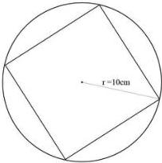

# PROVA — CÂMARA MUNICIPAL DE CATAS ALTAS DA NORUEGA (MG) — AGENTE LEGISLATIVO

## 1. Análise geral da prova

**Identificação da prova:**

- **Órgão:** Câmara Municipal de **Catas Altas da Noruega** — MG (cabeçalho da página 1 do PDF: "CÂMARA MUNICIPAL CATAS ALTAS DA NORUEGA — MINAS GERAIS")
- **Banca:** não identificada no PDF (nenhum logotipo ou nome de banca organizadora consta nos arquivos da prova e do gabarito)
- **Concurso:** Concurso Público nº 01/2009/2010
- **Realização da prova:** 07/08/2010
- **Cargo desta prova:** **Agente Legislativo** (questões 21 a 40 — prova de conhecimentos específicos)
- **Gabarito aplicado:** **GABARITO PRELIMINAR** (assim identificado na página 1 do PDF; trata-se de gabarito preliminar, não definitivo)

**Observação sobre o nome do arquivo enviado:** o arquivo chegou como "Câmara Municipal de Catas Altas - MG", mas o cabeçalho do próprio PDF confirma que o órgão é a Câmara Municipal de **Catas Altas da Noruega** — MG (município distinto de Catas Altas/MG).

**Observação importante sobre a estrutura do PDF:** a página 1 do PDF da prova contém o **gabarito preliminar completo do concurso** (Português, Matemática, Agente Legislativo e Secretário), e as páginas 2 a 12 contêm as provas. Este PDF **não inclui a prova do cargo Secretário** (apenas o gabarito correspondente consta na página 1).

**Transcrição integral da página 1 do PDF (gabarito preliminar):**

> **CÂMARA MUNICIPAL CATAS ALTAS DA NORUEGA — MINAS GERAIS**
> **CONCURSO PÚBLICO Nº 01/2009/2010 — REALIZAÇÃO: 07/08/2010**
> **GABARITO PRELIMINAR**

| PORTUGUÊS | MATEMÁTICA | AGENTE LEGISLATIVO (ESPECÍFICA) | SECRETÁRIO (ESPECÍFICA) |
|---|---|---|---|
| 01 – D | 11 – C | 21 – C | 21 – A |
| 02 – A | 12 – B | 22 – C | 22 – D |
| 03 – C | 13 – C | 23 – A | 23 – B |
| 04 – D | 14 – B | 24 – B | 24 – C |
| 05 – B | 15 – D | 25 – D | 25 – C |
| 06 – B | 16 – B | 26 – C | 26 – B |
| 07 – D | 17 – D | 27 – D | 27 – A |
| 08 – C | 18 – C | 28 – D | 28 – A |
| 09 – B | 19 – A | 29 – B | 29 – D |
| 10 – D | 20 – A | 30 – B | 30 – D |
|  |  | 31 – A | 31 – C |
|  |  | 32 – D | 32 – A |
|  |  | 33 – C | 33 – B |
|  |  | 34 – B | 34 – A |
|  |  | 35 – B | 35 – C |
|  |  | 36 – D | 36 – C |
|  |  | 37 – B | 37 – A |
|  |  | 38 – A | 38 – B |
|  |  | 39 – D | 39 – B |
|  |  | 40 – A | 40 – C |

**Composição quantitativa (prova contida neste PDF — Agente Legislativo):**

| Item | Quantidade |
|---|---|
| Total de questões | 40 (Português 01–10, Matemática 11–20, Agente Legislativo 21–40) |
| Alternativas por questão | 4 (A, B, C, D) |
| Textos de apoio | 1 (conto "Vista Cansada", de Otto Lara Resende, com nota de rodapé sobre Hemingway) |
| Imagens | 1 (figura geométrica da questão 20) |
| Gráficos e tabelas | 0 |
| Grupos identificados | 1 |
| Questões independentes | 35 |
| Questões anuladas | 0 |

**Composição por bloco (títulos originais do caderno):**

| Bloco | Questões | Quantidade |
|---|---|---|
| Português (texto "Vista Cansada") | 01 a 05 | 5 |
| Português (questões independentes) | 06 a 10 | 5 |
| Matemática | 11 a 20 | 10 |
| Agente Legislativo (conhecimentos específicos) | 21 a 40 | 20 |

**Gabarito preliminar aplicado — Agente Legislativo (questões 01 a 40):**

| Questão | Resposta | Questão | Resposta | Questão | Resposta | Questão | Resposta | Questão | Resposta |
|---|---|---|---|---|---|---|---|---|---|
|| 01 | **D** || 02 | **A** || 03 | **C** || 04 | **D** || 05 | **B** |
|| 06 | **B** || 07 | **D** || 08 | **C** || 09 | **B** || 10 | **D** |
|| 11 | **C** || 12 | **B** || 13 | **C** || 14 | **B** || 15 | **D** |
|| 16 | **B** || 17 | **D** || 18 | **C** || 19 | **A** || 20 | **A** |
|| 21 | **C** || 22 | **C** || 23 | **A** || 24 | **B** || 25 | **D** |
|| 26 | **C** || 27 | **D** || 28 | **D** || 29 | **B** || 30 | **B** |
|| 31 | **A** || 32 | **D** || 33 | **C** || 34 | **B** || 35 | **B** |
|| 36 | **D** || 37 | **B** || 38 | **A** || 39 | **D** || 40 | **A** |

> 📌 Fonte: página 1 do próprio PDF da prova (GABARITO PRELIMINAR — Concurso Público nº 01/2009/2010, realização 07/08/2010). O arquivo de gabarito pareado enviado contém a mesma tabela, idêntica.

## 2. Questões agrupadas

### GRUPO 01 — Texto "Vista Cansada" (Otto Lara Resende), com nota de rodapé sobre HEMINGWAY

**Questões relacionadas:** 01, 02, 03, 04 e 05.

---

#### QUESTÃO 01

✅ **Gabarito: D** (gabarito oficial preliminar — Impellizieri, concurso 01/2009/2010 (PDF do acervo, ID 018; coluna Agente Legislativo))

✅ **Gabarito preliminar: D**
**Material de apoio:**

**Texto integral da prova (reproduzido da página 2 do PDF):**

> - Português
> - Matemática
> - Agente Legislativo
> - Secretário
> Vista Cansada
> Otto Lara Resende
> Acho que foi Hemingway¹ quem disse que olhava cada coisa à sua volta como se a visse pela última vez. Pela última ou pela primeira vez ? Pela primeira vez foi outro escritor quem disse. Essa idéia de olhar pela última vez tem algo de deprimente. Olhar de despedida, de quem não crê que a vida continua, não admira que Hemingway tenha acabado como acabou. Fugiu enquanto pôde do desespero que o roía - e daquele tiro brutal.
> Se eu morrer, morre comigo um certo modo de ver, disse o poeta. Um poeta é só isto: um certo modo de ver. O diabo é que, de tanto ver, a gente banaliza o olhar. Vê não-vendo. Experimente ver pela primeira vez o que você vê todo dia, sem ver. Parece fácil, mas não é. O que nos cerca, o que nos é familiar, já não desperta curiosidade. O campo visual da nossa rotina é como um vazio.
> Você sai todo dia, por exemplo, pela mesma porta. Se alguém lhe perguntar o que é que você vê no seu caminho, você não sabe. De tanto ver, você não vê. Sei de um profissional que passou 32 anos a fio pelo mesmo hall do prédio do seu escritório. Lá estava sempre, pontualíssimo, o mesmo porteiro. Dava-lhe bom-dia e às vezes lhe passava um recado ou uma correspondência. Um dia o porteiro cometeu a descortesia de falecer.
> Como era ele? Sua cara? Sua voz? Como se vestia? Não fazia a mínima idéia. Em 32 anos, nunca o viu. Para ser notado, o porteiro teve que morrer. Se um dia no seu lugar estivesse uma girafa, cumprindo o rito, pode ser que também ninguém desse por sua ausência. O hábito suja os olhos e lhes baixa a voltagem. Mas há sempre o que ver. Gente, coisas, bichos. E vemos? Não, não vemos.
> Uma criança vê o que o adulto não vê . Tem olhos atentos e limpos para o espetáculo do mundo. O poeta é capaz de ver pela primeira vez o que, de fato, ninguém vê. Há pai que nunca viu o próprio filho. Marido que nunca viu a própria mulher, isso existe às pampas. Nossos olhos se gastam no dia-a-dia, opacos. É por aí que se instala o monstro da indiferença.
> HEMINGWAY – Ernest Miller ( 1898 – 1951 ), escritor norte-americano. Autor de vários livros, como Adeus às Armas, O Velho e o Mar e Por Quem os Sinos Dobram. Suicidou-se com um tiro.

**Enunciado:**

O texto procura elaborar uma distinção entre “dirigir os olhos” e “enxergar”, utilizando, para isso, os verbos **olhar** e **ver**. Assinale a opção em que, de acordo com o texto, o verbo **ver**, negritado, pode ser substituído pelo verbo **olhar**, sem que haja mudança no significado da frase:

**Alternativas:**

A) “Uma criança **vê** o que um adulto não vê.”

B) “Experimente ver pela primeira vez o que você vê todo dia, sem **ver**.”

C) “Marido que nunca **viu** a própria esposa.”

D) “Experimente ver pela primeira vez o que você **vê** todo dia.”

**Referências visuais:**

Nenhuma.

---

#### QUESTÃO 02

✅ **Gabarito: A** (gabarito oficial preliminar — Impellizieri, concurso 01/2009/2010 (PDF do acervo, ID 018; coluna Agente Legislativo))

✅ **Gabarito preliminar: A**
**Material de apoio:**

**Texto integral da prova (reproduzido da página 2 do PDF):**

> - Português
> - Matemática
> - Agente Legislativo
> - Secretário
> Vista Cansada
> Otto Lara Resende
> Acho que foi Hemingway¹ quem disse que olhava cada coisa à sua volta como se a visse pela última vez. Pela última ou pela primeira vez ? Pela primeira vez foi outro escritor quem disse. Essa idéia de olhar pela última vez tem algo de deprimente. Olhar de despedida, de quem não crê que a vida continua, não admira que Hemingway tenha acabado como acabou. Fugiu enquanto pôde do desespero que o roía - e daquele tiro brutal.
> Se eu morrer, morre comigo um certo modo de ver, disse o poeta. Um poeta é só isto: um certo modo de ver. O diabo é que, de tanto ver, a gente banaliza o olhar. Vê não-vendo. Experimente ver pela primeira vez o que você vê todo dia, sem ver. Parece fácil, mas não é. O que nos cerca, o que nos é familiar, já não desperta curiosidade. O campo visual da nossa rotina é como um vazio.
> Você sai todo dia, por exemplo, pela mesma porta. Se alguém lhe perguntar o que é que você vê no seu caminho, você não sabe. De tanto ver, você não vê. Sei de um profissional que passou 32 anos a fio pelo mesmo hall do prédio do seu escritório. Lá estava sempre, pontualíssimo, o mesmo porteiro. Dava-lhe bom-dia e às vezes lhe passava um recado ou uma correspondência. Um dia o porteiro cometeu a descortesia de falecer.
> Como era ele? Sua cara? Sua voz? Como se vestia? Não fazia a mínima idéia. Em 32 anos, nunca o viu. Para ser notado, o porteiro teve que morrer. Se um dia no seu lugar estivesse uma girafa, cumprindo o rito, pode ser que também ninguém desse por sua ausência. O hábito suja os olhos e lhes baixa a voltagem. Mas há sempre o que ver. Gente, coisas, bichos. E vemos? Não, não vemos.
> Uma criança vê o que o adulto não vê . Tem olhos atentos e limpos para o espetáculo do mundo. O poeta é capaz de ver pela primeira vez o que, de fato, ninguém vê. Há pai que nunca viu o próprio filho. Marido que nunca viu a própria mulher, isso existe às pampas. Nossos olhos se gastam no dia-a-dia, opacos. É por aí que se instala o monstro da indiferença.
> HEMINGWAY – Ernest Miller ( 1898 – 1951 ), escritor norte-americano. Autor de vários livros, como Adeus às Armas, O Velho e o Mar e Por Quem os Sinos Dobram. Suicidou-se com um tiro.

**Enunciado:**

Todos os trechos, abaixo, constituem indícios da “vista cansada” sugerida pelo título, Exceto:

**Alternativas:**

A) “O poeta é capaz de ver pela primeira vez o que, de fato, ninguém vê.”

B) “O hábito suja os olhos e lhes baixa a voltagem.”

C) “Se alguém lhe perguntar o que é que você vê no seu caminho, você não sabe.”

D) “O diabo é que, de tanto ver, a gente banaliza o olhar.”

**Referências visuais:**

Nenhuma.

---

#### QUESTÃO 03

✅ **Gabarito: C** (gabarito oficial preliminar — Impellizieri, concurso 01/2009/2010 (PDF do acervo, ID 018; coluna Agente Legislativo))

✅ **Gabarito preliminar: C**
**Material de apoio:**

**Texto integral da prova (reproduzido da página 2 do PDF):**

> - Português
> - Matemática
> - Agente Legislativo
> - Secretário
> Vista Cansada
> Otto Lara Resende
> Acho que foi Hemingway¹ quem disse que olhava cada coisa à sua volta como se a visse pela última vez. Pela última ou pela primeira vez ? Pela primeira vez foi outro escritor quem disse. Essa idéia de olhar pela última vez tem algo de deprimente. Olhar de despedida, de quem não crê que a vida continua, não admira que Hemingway tenha acabado como acabou. Fugiu enquanto pôde do desespero que o roía - e daquele tiro brutal.
> Se eu morrer, morre comigo um certo modo de ver, disse o poeta. Um poeta é só isto: um certo modo de ver. O diabo é que, de tanto ver, a gente banaliza o olhar. Vê não-vendo. Experimente ver pela primeira vez o que você vê todo dia, sem ver. Parece fácil, mas não é. O que nos cerca, o que nos é familiar, já não desperta curiosidade. O campo visual da nossa rotina é como um vazio.
> Você sai todo dia, por exemplo, pela mesma porta. Se alguém lhe perguntar o que é que você vê no seu caminho, você não sabe. De tanto ver, você não vê. Sei de um profissional que passou 32 anos a fio pelo mesmo hall do prédio do seu escritório. Lá estava sempre, pontualíssimo, o mesmo porteiro. Dava-lhe bom-dia e às vezes lhe passava um recado ou uma correspondência. Um dia o porteiro cometeu a descortesia de falecer.
> Como era ele? Sua cara? Sua voz? Como se vestia? Não fazia a mínima idéia. Em 32 anos, nunca o viu. Para ser notado, o porteiro teve que morrer. Se um dia no seu lugar estivesse uma girafa, cumprindo o rito, pode ser que também ninguém desse por sua ausência. O hábito suja os olhos e lhes baixa a voltagem. Mas há sempre o que ver. Gente, coisas, bichos. E vemos? Não, não vemos.
> Uma criança vê o que o adulto não vê . Tem olhos atentos e limpos para o espetáculo do mundo. O poeta é capaz de ver pela primeira vez o que, de fato, ninguém vê. Há pai que nunca viu o próprio filho. Marido que nunca viu a própria mulher, isso existe às pampas. Nossos olhos se gastam no dia-a-dia, opacos. É por aí que se instala o monstro da indiferença.
> HEMINGWAY – Ernest Miller ( 1898 – 1951 ), escritor norte-americano. Autor de vários livros, como Adeus às Armas, O Velho e o Mar e Por Quem os Sinos Dobram. Suicidou-se com um tiro.

**Enunciado:**

De acordo com o texto, pode-se apontar como causa da banalização do olhar:

**Alternativas:**

A) O descaso do homem moderno em relação à sua família, o que o impede de ver seus próprios filhos.

B) A rotina familiar e do trabalho.

C) A familiaridade dos indivíduos com os elementos do seu cotidiano.

D) O excesso de elementos a serem vistos que existe no mundo.

**Referências visuais:**

Nenhuma.

---

#### QUESTÃO 04

✅ **Gabarito: D** (gabarito oficial preliminar — Impellizieri, concurso 01/2009/2010 (PDF do acervo, ID 018; coluna Agente Legislativo))

✅ **Gabarito preliminar: D**
**Material de apoio:**

**Texto integral da prova (reproduzido da página 2 do PDF):**

> - Português
> - Matemática
> - Agente Legislativo
> - Secretário
> Vista Cansada
> Otto Lara Resende
> Acho que foi Hemingway¹ quem disse que olhava cada coisa à sua volta como se a visse pela última vez. Pela última ou pela primeira vez ? Pela primeira vez foi outro escritor quem disse. Essa idéia de olhar pela última vez tem algo de deprimente. Olhar de despedida, de quem não crê que a vida continua, não admira que Hemingway tenha acabado como acabou. Fugiu enquanto pôde do desespero que o roía - e daquele tiro brutal.
> Se eu morrer, morre comigo um certo modo de ver, disse o poeta. Um poeta é só isto: um certo modo de ver. O diabo é que, de tanto ver, a gente banaliza o olhar. Vê não-vendo. Experimente ver pela primeira vez o que você vê todo dia, sem ver. Parece fácil, mas não é. O que nos cerca, o que nos é familiar, já não desperta curiosidade. O campo visual da nossa rotina é como um vazio.
> Você sai todo dia, por exemplo, pela mesma porta. Se alguém lhe perguntar o que é que você vê no seu caminho, você não sabe. De tanto ver, você não vê. Sei de um profissional que passou 32 anos a fio pelo mesmo hall do prédio do seu escritório. Lá estava sempre, pontualíssimo, o mesmo porteiro. Dava-lhe bom-dia e às vezes lhe passava um recado ou uma correspondência. Um dia o porteiro cometeu a descortesia de falecer.
> Como era ele? Sua cara? Sua voz? Como se vestia? Não fazia a mínima idéia. Em 32 anos, nunca o viu. Para ser notado, o porteiro teve que morrer. Se um dia no seu lugar estivesse uma girafa, cumprindo o rito, pode ser que também ninguém desse por sua ausência. O hábito suja os olhos e lhes baixa a voltagem. Mas há sempre o que ver. Gente, coisas, bichos. E vemos? Não, não vemos.
> Uma criança vê o que o adulto não vê . Tem olhos atentos e limpos para o espetáculo do mundo. O poeta é capaz de ver pela primeira vez o que, de fato, ninguém vê. Há pai que nunca viu o próprio filho. Marido que nunca viu a própria mulher, isso existe às pampas. Nossos olhos se gastam no dia-a-dia, opacos. É por aí que se instala o monstro da indiferença.
> HEMINGWAY – Ernest Miller ( 1898 – 1951 ), escritor norte-americano. Autor de vários livros, como Adeus às Armas, O Velho e o Mar e Por Quem os Sinos Dobram. Suicidou-se com um tiro.

**Enunciado:**

Ao contrário do primeiro parágrafo, em que há exclusiva utilização do verbo olhar, predomina, no restante do texto, o emprego do verbo ver. Isso pode ser explicado porque:

**Alternativas:**

A) O verbo olhar indica, no texto, apenas “**dirigir os olhos para**”, tendo, portanto, significado adequado apenas à declaração de Hemingway, mas não aos demais exemplos e situações apresentadas.

B) O verbo ver é empregado com o sentido de “**enxergar**”, sentido este que não pode ser recuperado em nenhum momento pelo verbo olhar.

C) O verbo ver, sendo empregado no sentido de “**perceber pelo sentido da visão**”, pretende significar que o ato de direcionar a visão não garante a percepção dos fatos ou eventos da realidade.

D) Apenas as alternativas **b** e **c** estão corretas.

**Referências visuais:**

Nenhuma.

---

#### QUESTÃO 05

✅ **Gabarito: B** (gabarito oficial preliminar — Impellizieri, concurso 01/2009/2010 (PDF do acervo, ID 018; coluna Agente Legislativo))

✅ **Gabarito preliminar: B**
**Material de apoio:**

**Texto integral da prova (reproduzido da página 2 do PDF):**

> - Português
> - Matemática
> - Agente Legislativo
> - Secretário
> Vista Cansada
> Otto Lara Resende
> Acho que foi Hemingway¹ quem disse que olhava cada coisa à sua volta como se a visse pela última vez. Pela última ou pela primeira vez ? Pela primeira vez foi outro escritor quem disse. Essa idéia de olhar pela última vez tem algo de deprimente. Olhar de despedida, de quem não crê que a vida continua, não admira que Hemingway tenha acabado como acabou. Fugiu enquanto pôde do desespero que o roía - e daquele tiro brutal.
> Se eu morrer, morre comigo um certo modo de ver, disse o poeta. Um poeta é só isto: um certo modo de ver. O diabo é que, de tanto ver, a gente banaliza o olhar. Vê não-vendo. Experimente ver pela primeira vez o que você vê todo dia, sem ver. Parece fácil, mas não é. O que nos cerca, o que nos é familiar, já não desperta curiosidade. O campo visual da nossa rotina é como um vazio.
> Você sai todo dia, por exemplo, pela mesma porta. Se alguém lhe perguntar o que é que você vê no seu caminho, você não sabe. De tanto ver, você não vê. Sei de um profissional que passou 32 anos a fio pelo mesmo hall do prédio do seu escritório. Lá estava sempre, pontualíssimo, o mesmo porteiro. Dava-lhe bom-dia e às vezes lhe passava um recado ou uma correspondência. Um dia o porteiro cometeu a descortesia de falecer.
> Como era ele? Sua cara? Sua voz? Como se vestia? Não fazia a mínima idéia. Em 32 anos, nunca o viu. Para ser notado, o porteiro teve que morrer. Se um dia no seu lugar estivesse uma girafa, cumprindo o rito, pode ser que também ninguém desse por sua ausência. O hábito suja os olhos e lhes baixa a voltagem. Mas há sempre o que ver. Gente, coisas, bichos. E vemos? Não, não vemos.
> Uma criança vê o que o adulto não vê . Tem olhos atentos e limpos para o espetáculo do mundo. O poeta é capaz de ver pela primeira vez o que, de fato, ninguém vê. Há pai que nunca viu o próprio filho. Marido que nunca viu a própria mulher, isso existe às pampas. Nossos olhos se gastam no dia-a-dia, opacos. É por aí que se instala o monstro da indiferença.
> HEMINGWAY – Ernest Miller ( 1898 – 1951 ), escritor norte-americano. Autor de vários livros, como Adeus às Armas, O Velho e o Mar e Por Quem os Sinos Dobram. Suicidou-se com um tiro.

**Enunciado:**

É possível afirmar a partir do texto, Exceto:

**Alternativas:**

A) As relações profissionais e até mesmo as relações familiares estão perpassadas pelo monstro da indiferença.

B) A banalização do olhar é condição do cotidiano moderno.

C) A indiferença é fruto da impossibilidade de enxergar a realidade, de forma curiosa e investigativa, como fazem o poeta e a criança, por exemplo.

D) O olhar é uma atitude particular; a visão que cada ser humano tem do mundo é exclusiva e única.

**Referências visuais:**

Nenhuma.

---

## 3. Questões independentes

#### QUESTÃO 06

✅ **Gabarito: B** (gabarito oficial preliminar — Impellizieri, concurso 01/2009/2010 (PDF do acervo, ID 018; coluna Agente Legislativo))

✅ **Gabarito preliminar: B**
**Enunciado:**

Observe a estrofe
“Lembra-me que, em certo dia.
Na rua, ao sol de verão,
Envenenado morria
Um pobre cão.”
Aparece nesse trecho a inversão do:

**Alternativas:**

A) sujeito: **certo dia**

B) sujeito: **um pobre cão**

C) objeto direto: **ao sol de verão**

D) agente da passiva: **envenenado morria**

**Referências visuais:**

Nenhuma.

---

#### QUESTÃO 07

✅ **Gabarito: D** (gabarito oficial preliminar — Impellizieri, concurso 01/2009/2010 (PDF do acervo, ID 018; coluna Agente Legislativo))

✅ **Gabarito preliminar: D**
**Enunciado:**

Nas frases:
I - O rapaz necessita **de cuidados médicos**.
II - Isto é útil **a você**.
III - Ele foi agredido **por torcedores irresponsáveis**.
IV - **Ao policial** o marginal matou.
Os termos destacados exercem, respectivamente, a função sintática de:

**Alternativas:**

A) complemento nominal - objeto direto - objeto indireto - objeto direto preposicionado

B) agente da passiva - objeto direto preposicionado - objeto direto - vocativo

C) aposto - agente da passiva - complemento nominal - objeto indireto

D) objeto indireto - complemento nominal - agente da passiva - objeto direto preposicionado

**Referências visuais:**

Nenhuma.

---

#### QUESTÃO 08

✅ **Gabarito: C** (gabarito oficial preliminar — Impellizieri, concurso 01/2009/2010 (PDF do acervo, ID 018; coluna Agente Legislativo))

✅ **Gabarito preliminar: C**
**Enunciado:**

“As críticas _______________ está sujeito o trabalho do jornalista o auxiliam e fortificam a sua crença _______________ ainda pode melhorar muito.”
Marque a resposta certa.

**Alternativas:**

A) que - que

B) de que - em que

C) a que - em que

D) em que – que

**Referências visuais:**

Nenhuma.

---

#### QUESTÃO 09

✅ **Gabarito: B** (gabarito oficial preliminar — Impellizieri, concurso 01/2009/2010 (PDF do acervo, ID 018; coluna Agente Legislativo))

✅ **Gabarito preliminar: B**
**Enunciado:**

“Maria das Dores entra e vai abrir o comutador. Detenho-a: não quero luz.”
Os dois pontos ( : ) usados acima estabelecem uma relação de subordinação entre as orações. O tipo de subordinação é:

**Alternativas:**

A) temporal

B) causal

C) concessiva

D) consecutiva

**Referências visuais:**

Nenhuma.

---

#### QUESTÃO 10

✅ **Gabarito: D** (gabarito oficial preliminar — Impellizieri, concurso 01/2009/2010 (PDF do acervo, ID 018; coluna Agente Legislativo))

✅ **Gabarito preliminar: D**
**Enunciado:**

Identifique a frase em que a concordância se estabelece com o sentido e não com a forma gramatical, ocorrendo, pois, um caso de silepse:

**Alternativas:**

A) Tudo eram alegrias naquela casa.

B) “Havia jardins, havia manhãs, naquele tempo.”

C) Sabem-no, hajam vista as notas da prova.

D) Entenda-se que todos somos brasileiros.

**Referências visuais:**

Nenhuma.

---

#### QUESTÃO 11

✅ **Gabarito: C** (gabarito oficial preliminar — Impellizieri, concurso 01/2009/2010 (PDF do acervo, ID 018; coluna Agente Legislativo))

✅ **Gabarito preliminar: C**
**Enunciado:**

O m.d.c. de 40 e 48 é:

**Alternativas:**

A) 16

B) 120

C) 08

D) 96

**Referências visuais:**

Nenhuma.

---

#### QUESTÃO 12

✅ **Gabarito: B** (gabarito oficial preliminar — Impellizieri, concurso 01/2009/2010 (PDF do acervo, ID 018; coluna Agente Legislativo))

✅ **Gabarito preliminar: B**
**Enunciado:**

Dois carros de corrida percorrem um circuito fechado. O primeiro dá uma volta completa a cada 10 minutos e o segundo a cada 8 minutos. Sabendo-se que os dois partiram de um mesmo local às 8 horas, pergunta-se a que horas os dois vão se encontrar no ponto de partida pela primeira vez?

**Alternativas:**

A) 8h 50min

B) 8h 40min

C) 8h 18min

D) 9h 20min

**Referências visuais:**

Nenhuma.

---

#### QUESTÃO 13

✅ **Gabarito: C** (gabarito oficial preliminar — Impellizieri, concurso 01/2009/2010 (PDF do acervo, ID 018; coluna Agente Legislativo))

✅ **Gabarito preliminar: C**
**Enunciado:**

Das afirmativas abaixo assinale a opção Falsa:

**Alternativas:**

A) Todo número positivo é maior que zero.

B) Qualquer número positivo é maior que qualquer número negativo.

C) Qualquer número negativo é maior que zero.

D) Se a é um número negativo – a é um número positivo.

**Referências visuais:**

Nenhuma.

---

#### QUESTÃO 14

✅ **Gabarito: B** (gabarito oficial preliminar — Impellizieri, concurso 01/2009/2010 (PDF do acervo, ID 018; coluna Agente Legislativo))

✅ **Gabarito preliminar: B**
**Enunciado:**

Um investidor aplicou a quantia de R$ 400.000,00 à taxa de juro composto de 9% ao mês. Que montante este capital irá gerar após 4 meses?

**Alternativas:**

A) R$ 524.632,64

B) R$ 564.632,64

C) R$ 562.630,60

D) R$ 564.630,60

**Referências visuais:**

Nenhuma.

---

#### QUESTÃO 15

✅ **Gabarito: D** (gabarito oficial preliminar — Impellizieri, concurso 01/2009/2010 (PDF do acervo, ID 018; coluna Agente Legislativo))

✅ **Gabarito preliminar: D**
**Enunciado:**

Um colégio ofereceu cursos de Inglês e Francês, devendo os alunos se matricularem, pelo menos, em um deles. Dos 50 alunos de uma classe, 14 resolveram estudar tanto Inglês quanto Francês. Em Francês matricularam-se 27 alunos e, em Inglês?

**Alternativas:**

A) 09 alunos

B) 36 alunos

C) 32 alunos

D) 37 alunos

**Referências visuais:**

Nenhuma.

---

#### QUESTÃO 16

✅ **Gabarito: B** (gabarito oficial preliminar — Impellizieri, concurso 01/2009/2010 (PDF do acervo, ID 018; coluna Agente Legislativo))

✅ **Gabarito preliminar: B**
**Enunciado:**

Um relógio bate a cada 10 minutos, outro a cada 36 minutos e um terceiro a cada 60 minutos. O menor intervalo de tempo decorrido entre duas batidas simultâneas dos três relógios é de:

**Alternativas:**

A) 1 hora

B) 3 horas

C) 10 horas

D) 7 horas

**Referências visuais:**

Nenhuma.

---

#### QUESTÃO 17

✅ **Gabarito: D** (gabarito oficial preliminar — Impellizieri, concurso 01/2009/2010 (PDF do acervo, ID 018; coluna Agente Legislativo))

✅ **Gabarito preliminar: D**
**Enunciado:**

Duas moedas têm, hoje, exatamente a mesma cotação. Se a primeira se valoriza 26% ao ano e a segunda se desvaloriza 16% ao ano, a primeiro valerá a mais que a segundo, daqui a 2 anos,

**Alternativas:**

A) 100%

B) 52%

C) 225%

D) 125%

**Referências visuais:**

Nenhuma.

---

#### QUESTÃO 18

✅ **Gabarito: C** (gabarito oficial preliminar — Impellizieri, concurso 01/2009/2010 (PDF do acervo, ID 018; coluna Agente Legislativo))

✅ **Gabarito preliminar: C**
**Enunciado:**

Multiplicar um número por 0,625 equivale a dividi-lo por:

**Alternativas:**

A) $\frac{1}{625}$

B) $\frac{625}{9}$

C) $\frac{16}{10}$

D) 1,125

**Referências visuais:**

Nenhuma.

---

#### QUESTÃO 19

✅ **Gabarito: A** (gabarito oficial preliminar — Impellizieri, concurso 01/2009/2010 (PDF do acervo, ID 018; coluna Agente Legislativo))

✅ **Gabarito preliminar: A**
**Enunciado:**

Um trem tem 54 filas de poltronas e em cada fila existe 6 lugares. Em uma de suas viagens, todos os lugares estavam ocupados. Calcule a arrecadação nesta viagem, sabendo que o preço da passagem custava R$ 33,00.

**Alternativas:**

A) R$ 10.692,00

B) R$ 12.867,00

C) R$ 10.369,00

D) R$ 11.854,00

**Referências visuais:**

Nenhuma.

---

#### QUESTÃO 20

✅ **Gabarito: A** (gabarito oficial preliminar — Impellizieri, concurso 01/2009/2010 (PDF do acervo, ID 018; coluna Agente Legislativo))

✅ **Gabarito preliminar: A**
**Enunciado:**

Considere o quadrado circunscrito em uma circunferência de raio 10cm conforme o mostrado na figura abaixo.

Qual a área do quadrado?

**Alternativas:**

A) 200cm²

B) 100cm²

C) 300cm²

D) 400cm²

**Referências visuais:**

---

#### QUESTÃO 21

✅ **Gabarito: C** (gabarito oficial preliminar — Impellizieri, concurso 01/2009/2010 (PDF do acervo, ID 018; coluna Agente Legislativo))

✅ **Gabarito preliminar: C**

**Enunciado:**

De acordo com a Ética do Servidor Público, todas as afirmativas estão corretas, EXCETO:

**Alternativas:**

A) A dignidade, o decoro, o zelo, a eficácia e a consciência dos princípios morais são primados maiores que devem nortear o servidor público, seja no exercício do cargo ou função, ou fora dele, já que refletirá o exercício da vocação do próprio poder estatal. Seus atos, comportamentos e atitudes serão direcionados para a preservação da honra e da tradição dos serviços públicos;

B) O servidor público não poderá jamais desprezar o elemento ético de sua conduta. Assim, não terá que decidir somente entre o legal e o ilegal, o justo e o injusto, o conveniente e o inconveniente, o oportuno e o inoportuno, mas principalmente entre o honesto e o desonesto, consoante as regras contidas no Art. 37, caput e Parágrafo 4° da Constituição Federal;

C) A remuneração do servidor público é custeada pelos tributos pagos direta ou indiretamente por todos, até por ele próprio, e por isso não se exige, como contrapartida, que a moralidade administrativa se integre no Direito, como elemento indissociável de sua aplicação e de sua finalidade;

D) O trabalho desenvolvido pelo servidor público perante a comunidade deve ser entendido como acréscimo ao seu próprio bem-estar, já que, como cidadão, integrante da sociedade, o êxito desse trabalho pode ser considerado como seu maior patrimônio.

**Referências visuais:**

Nenhuma.

---

#### QUESTÃO 22

✅ **Gabarito: C** (gabarito oficial preliminar — Impellizieri, concurso 01/2009/2010 (PDF do acervo, ID 018; coluna Agente Legislativo))

✅ **Gabarito preliminar: C**

**Enunciado:**

Toda administração pública recebe um grande número de visitantes e o agente legislativo deve estar bem preparado para proporcionar-lhes um bom atendimento.
Acerca dos cuidados especiais que se devem ter para prestar um bom atendimento, todas as alternativas estão corretas, exceto:

**Alternativas:**

A) Manter postura adequada

B) Olhar diretamente para o visitante com um sorriso amável

C) Evitar o diálogo para economizar tempo

D) Apresentar o (a) visitante à chefia, no momento oportuno

**Referências visuais:**

Nenhuma.

---

#### QUESTÃO 23

✅ **Gabarito: A** (gabarito oficial preliminar — Impellizieri, concurso 01/2009/2010 (PDF do acervo, ID 018; coluna Agente Legislativo))

✅ **Gabarito preliminar: A**

**Enunciado:**

O telefone é um meio de comunicação rápido e eficiente e, por isso mesmo, bastante prático e um importante instrumento de trabalho para todo o profissional, inclusive para o agente legislativo.
Acerca da correta execução de uma ligação, todas as alternativas estão corretas, exceto:

**Alternativas:**

A) Divulgar de modo geral o motivo da ligação.

B) Planejar a ligação.

C) Identificar-se.

D) Solucionar a situação transferindo a ligação, anotando o recado, considerando a ligação concluída.

**Referências visuais:**

Nenhuma.

---

#### QUESTÃO 24

✅ **Gabarito: B** (gabarito oficial preliminar — Impellizieri, concurso 01/2009/2010 (PDF do acervo, ID 018; coluna Agente Legislativo))

✅ **Gabarito preliminar: B**

**Enunciado:**

Toda organização, incluído a Câmara Municipal, utiliza reuniões para discussão e resolução dos problemas existentes e para tomada de decisões.
Acerca das características de uma reunião todas as alternativas estão corretas, exceto:

**Alternativas:**

A) As decisões tomadas nas assembleias ordinárias e extraordinárias devem ser transcritas em ata.

B) As reuniões de caráter ordinário são de emergência, marcadas sempre de última hora e servem para a deliberação de assuntos importantes;

C) As reuniões de caráter extraordinário são reuniões imprevistas, para tratar de assuntos importantes e urgentes, cuja deliberação não pode ser adiada;

D) As reuniões de caráter ordinário são previstas pelo estatuto e calendário.

**Referências visuais:**

Nenhuma.

---

#### QUESTÃO 25

✅ **Gabarito: D** (gabarito oficial preliminar — Impellizieri, concurso 01/2009/2010 (PDF do acervo, ID 018; coluna Agente Legislativo))

✅ **Gabarito preliminar: D**

**Enunciado:**

O agente legislativo, muitas vezes é responsável pela organização e controle de documentos, por meio dos quais a informação é veiculada.
Acerca das formas de controle de documentos, todas as alternativas estão corretas, exceto:

**Alternativas:**

A) O controle de entrada e saída de documentos é feito por meio de um recibo de entrega denominado protocolo.

B) O livro/caderno de protocolo apresenta suas folhas numeradas.

C) Ao receber o documento o destinatário assina o livro de protocolo como prova de recebimento.

D) O protocolo é um registro cumulativo usado quando o documento deve transitar pela empresa.

**Referências visuais:**

Nenhuma.

---

#### QUESTÃO 26

✅ **Gabarito: C** (gabarito oficial preliminar — Impellizieri, concurso 01/2009/2010 (PDF do acervo, ID 018; coluna Agente Legislativo))

✅ **Gabarito preliminar: C**

**Enunciado:**

De acordo com os objetivos, são utilizados diferentes tipos de texto ou linguagem no envio de mensagens. Quando se escreve algo, seja um bilhete, um recado, uma carta, sabe-se que o principal alvo é o leitor. Por isso, é importante que se tenha a preocupação de ser o mais claro possível, fazendo a adequação da linguagem ao contexto do leitor.
Acerca dos tipos de correspondência, assinale a alternativa incorreta.

**Alternativas:**

A) O recado é utilizado dentro de uma organização, como anotações de telefonemas, ordens, pedidos ou informações dirigidas a pessoas ausentes no momento.

B) O Memorando é uma correspondência interna, trocada entre diretores, chefes de serviços e funcionários de uma organização, para tratar de assuntos administrativos.

C) Declaração ou atestado é uma petição escrita, dirigida a uma autoridade.

D) Ofício é um meio normal de comunicação escrita junto a repartições públicas, entidades sociais, culturais, políticas, etc.

**Referências visuais:**

Nenhuma.

---

#### QUESTÃO 27

✅ **Gabarito: D** (gabarito oficial preliminar — Impellizieri, concurso 01/2009/2010 (PDF do acervo, ID 018; coluna Agente Legislativo))

✅ **Gabarito preliminar: D**

**Enunciado:**

Qualquer que seja a posição assumida dentro da organização, o agente legislativo precisa saber trabalhar em equipe. Equipe é um conjunto de pessoas que trabalham com um objetivo comum. Considerando a eficácia no trabalho em equipe, todas as alternativas estão corretas, exceto:

**Alternativas:**

A) Não fazer prejulgamentos.

B) Perceber o outro.

C) Saber administrar conflitos e sentimentos.

D) Parcialidade.

**Referências visuais:**

Nenhuma.

---

#### QUESTÃO 28

✅ **Gabarito: D** (gabarito oficial preliminar — Impellizieri, concurso 01/2009/2010 (PDF do acervo, ID 018; coluna Agente Legislativo))

✅ **Gabarito preliminar: D**

**Enunciado:**

Toda a organização deve manter seus documentos classificados e conservados em determinada ordem, permitindo a utilização, tanto imediata quanto futura.
Analise as afirmativas abaixo:
**I- O arquivo ativo** - possui documentos que são consultados constantemente, Devem permanecer em locais de fácil manuseio.
**II- O arquivo semi-ativo** - é aquele arquivo que é usado com menos frequência. Normalmente contém documentos do ano inteiro.
**III- O arquivo inativo** - é pouco usado, Fica normalmente em depósitos. Documentos deste arquivo podem ser solicitados pela administração como por fiscais e peritos das diversas esferas (municipais, estaduais e federais).
Considerando as descrições acima sobre os tipos de arquivo, assinale a afirmativa correta.

**Alternativas:**

A) As afirmativas I e III estão corretas.

B) As afirmativas II e III estão corretas.

C) As afirmativas I e II estão corretas.

D) Todas as afirmativas estão corretas.

**Referências visuais:**

Nenhuma.

---

#### QUESTÃO 29

✅ **Gabarito: B** (gabarito oficial preliminar — Impellizieri, concurso 01/2009/2010 (PDF do acervo, ID 018; coluna Agente Legislativo))

✅ **Gabarito preliminar: B**

**Enunciado:**

Quando falamos em comunicação, não podemos nos esquecer dos correios. Este órgão presta vários serviços muito utilizados pelo agente legislativo.
Acerca dos serviços do correio, todas as alternativas estão corretas, exceto:

**Alternativas:**

A) O código de endereçamento postal - CEP - serve para facilitar e agilizar a distribuição da correspondência.

B) O código de endereçamento postal - CEP - é um número constituído de oito algarismos, separados por ponto e vírgula.

C) Encomenda expressa – SEDEX – consiste em remeter encomendas e documentos para todo o território nacional com a máxima rapidez.

D) Aviso de recebimento (AR) tem a finalidade de comprovar ao remetente que a correspondência chegou ao destino especificado.

**Referências visuais:**

Nenhuma.

---

#### QUESTÃO 30

✅ **Gabarito: B** (gabarito oficial preliminar — Impellizieri, concurso 01/2009/2010 (PDF do acervo, ID 018; coluna Agente Legislativo))

✅ **Gabarito preliminar: B**

**Enunciado:**

Arquivo é toda coleção de documentos classificados, conservados em determinada ordem, permitindo a utilização, tanto imediata quanto futura.
Acerca da localização dos arquivos, analise as afirmativas abaixo:
**I- Arquivo centralizado** – é o local onde se recebe a documentação de toda a empresa.
**II- Arquivo descentralizado** – quando cada departamento ou seção tem seu próprio arquivo.
**III- Arquivo misto** - é quando os arquivos centralizado e descentralizado estão presentes na mesma empresa.
Com base nas afirmativas acima, assinale a alternativa correta:

**Alternativas:**

A) Apenas as afirmativas I e III estão corretas.

B) Todas as afirmativas estão corretas.

C) Apenas as afirmativas II e III estão corretas

D) Apenas as afirmativas I e II estão corretas.

**Referências visuais:**

Nenhuma.

---

#### QUESTÃO 31

✅ **Gabarito: A** (gabarito oficial preliminar — Impellizieri, concurso 01/2009/2010 (PDF do acervo, ID 018; coluna Agente Legislativo))

✅ **Gabarito preliminar: A**

**Enunciado:**

Podemos chamar de processo administrativo, o movimento das ações administrativas realizadas dentro de cada área/setor de uma organização.
Acerca da definição de alguns componentes do processo administrativo, assinale a alternativa que não está correta:

**Alternativas:**

A) **Arquivo** é o local onde são guardados produtos para consumo próprio da empresa ou organização.

B) **Contratos** são compromissos firmados entre as partes para um determinado fim. Para terem valor devem seguir a legislação pertinente.

C) **Nota fiscal** é um documento legal, utilizado para acobertar o trânsito e a transmissão de propriedade de bens e serviços.

D) **Documentos** são registros gráficos revestidos de natureza jurídica, ou seja, têm validade legal.

**Referências visuais:**

Nenhuma.

---

#### QUESTÃO 32

✅ **Gabarito: D** (gabarito oficial preliminar — Impellizieri, concurso 01/2009/2010 (PDF do acervo, ID 018; coluna Agente Legislativo))

✅ **Gabarito preliminar: D**

**Enunciado:**

Nos termos da lei, a administração pública deve pautar a sua ação obedecendo aos princípios de legalidade, impessoalidade, moralidade e de publicidade.
Esses princípios são assim conceituados:
I- Legalidade, enquanto princípio de sujeição ao que determina a lei e aos interesses de bem-comum;
II- Impessoalidade, ou seja, o interesse público sobrepõe-se ao interesse privado;
III- Moralidade, ou seja, as ações administrativas estão pautadas por regramento de natureza ética;
IV- Publicidade, ou a validade jurídica dos atos administrativos está diretamente atrelada a sua divulgação oficial.
Assinale:

**Alternativas:**

A) As afirmativas I, III e IV estão corretas;

B) As afirmativas II, III e IV estão corretas;

C) As afirmativas I, II e IV estão corretas;

D) Todas as afirmativas estão corretas.

**Referências visuais:**

Nenhuma.

---

#### QUESTÃO 33

✅ **Gabarito: C** (gabarito oficial preliminar — Impellizieri, concurso 01/2009/2010 (PDF do acervo, ID 018; coluna Agente Legislativo))

✅ **Gabarito preliminar: C**

**Enunciado:**

Com relação ao trabalho infantil é correto afirmar que:

**Alternativas:**

A) É o resultado da desagregação familiar e do modelo nuclear tradicional, ou seja, das famílias compostas de pai, mãe e filhos;

B) Nos países que adotaram regimes especiais de trabalho infantil nota-se aumento nos níveis de renda e diminuição das desigualdades sociais;

C) No Brasil, a Constituição Federal proíbe o trabalho de menores de 16 anos, em qualquer circunstância admitindo, porém, o trabalho de maiores de 16 anos na condição de aprendiz;

D) O trabalho infantil é indispensável para conter a violência, desde que sejam respeitadas algumas condições como o ambiente condizente de trabalho, os horários, o emprego de força física adequada, etc.

**Referências visuais:**

Nenhuma.

---

#### QUESTÃO 34

✅ **Gabarito: B** (gabarito oficial preliminar — Impellizieri, concurso 01/2009/2010 (PDF do acervo, ID 018; coluna Agente Legislativo))

✅ **Gabarito preliminar: B**

**Enunciado:**

Com relação à política adotada pelo governo federal de prover as famílias que não têm outra condição de sobrevivência além da bolsa família, a denominação mais correta para essa ação é:

**Alternativas:**

A) Política de segurança pública;

B) Política de distribuição de renda;

C) Política de preservação ambiental;

D) Política de trabalho, emprego e renda.

**Referências visuais:**

Nenhuma.

---

#### QUESTÃO 35

✅ **Gabarito: C** (gabarito oficial preliminar — Impellizieri, concurso 01/2009/2010 (PDF do acervo, ID 018; coluna Agente Legislativo))

✅ **Gabarito preliminar: B**

**Enunciado:**

Todos os órgãos abaixo integram a Administração Pública Indireta, EXCETO:

**Alternativas:**

A) Fundações Públicas de qualquer finalidade;

B) Organizações sociais de assistência social;

C) Empresas públicas;

D) Autarquias.

**Referências visuais:**

Nenhuma.

---

#### QUESTÃO 36

✅ **Gabarito: B** (gabarito oficial preliminar — Impellizieri, concurso 01/2009/2010 (PDF do acervo, ID 018; coluna Agente Legislativo))

✅ **Gabarito preliminar: D**

**Enunciado:**

O Chefe do Legislativo Municipal pretende extinguir um cargo que integra o quadro da Administração Direta do Legislativo. Nesse cargo estão lotados servidores efetivos e estáveis. A respeito da afirmativa é CORRETO dizer que:

**Alternativas:**

A) Não existe hipótese de extinção de cargos nessa situação;

B) Os cargos poderão ser extintos desde que os servidores que os ocupam sejam exonerados.

C) A extinção do cargo poderá ser feita por meio de decreto do Presidente do Legislativo;

D) O cargo poderá ser extinto por meio de Lei específica e o servidor nele lotado ficará em disponibilidade remunerada;

**Referências visuais:**

Nenhuma.

---

#### QUESTÃO 37

✅ **Gabarito: B** (gabarito oficial preliminar — Impellizieri, concurso 01/2009/2010 (PDF do acervo, ID 018; coluna Agente Legislativo))

✅ **Gabarito preliminar: B**

**Enunciado:**

O usuário do Outlook, por meio de “Opções de mensagem” pode configurá-lo para que, enviada uma mensagem obtenha-se como resposta, EXCETO:

**Alternativas:**

A) Entregar a mensagem numa data definida;

B) A confirmação de sua remoção;

C) A confirmação de sua leitura;

D) A prioridade da mensagem.

**Referências visuais:**

Nenhuma.

---

#### QUESTÃO 38

✅ **Gabarito: A** (gabarito oficial preliminar — Impellizieri, concurso 01/2009/2010 (PDF do acervo, ID 018; coluna Agente Legislativo))

✅ **Gabarito preliminar: A**

**Enunciado:**

O usuário do Outlook tendo recebido uma mensagem com anexos pode enviá-la para outro endereço eletrônico, desde que use uma ferramenta do programa. Assinale a opção correta:

**Alternativas:**

A) Encaminhar;

B) Responder a todos;

C) Responder;

D) Salvar anexos.

**Referências visuais:**

Nenhuma.

---

#### QUESTÃO 39

✅ **Gabarito: D** (gabarito oficial preliminar — Impellizieri, concurso 01/2009/2010 (PDF do acervo, ID 018; coluna Agente Legislativo))

✅ **Gabarito preliminar: D**

**Enunciado:**

As afirmativas abaixo dizem respeito aos recursos que o Word dispõe. Analise cada uma delas identificando as Verdadeiras e as Falsas.
- I- O Word permite inserir fórmulas de soma que são atualizadas sempre que um valor for alterado;
- II- O Word permite mesclar duas linhas em uma única, ou duas colunas em uma única, mas não mesclam juntas, mais de uma linha e mais de uma coluna;
- III- Utilizando a função Classificar - Tabela, o Word permite ordenar parágrafos mesmo que eles não estejam em uma tabela;
- IV- O Word permite criar tabelas com uma quantidade de linha e colunas, sem a necessidade de inserir linha por linha.
Assinale :

**Alternativas:**

A) Se as afirmativas I e III estão corretas;

B) Se as afirmativas II e III estão corretas;

C) Se as afirmativas I e IV estão corretas;

D) Se as afirmativas III e IV estão corretas.

**Referências visuais:**

Nenhuma.

---

#### QUESTÃO 40

✅ **Gabarito: A** (gabarito oficial preliminar — Impellizieri, concurso 01/2009/2010 (PDF do acervo, ID 018; coluna Agente Legislativo))

✅ **Gabarito preliminar: A**

**Enunciado:**

Num documento elaborado utilizando-se o Word, com doze páginas e tendo sido comandada a ordem para impressão da seguinte maneira “1-2;3-7;8-12”, a impressora imprimirá:

**Alternativas:**

A) Todo o documento;

B) Todas as páginas com exceção das páginas 4, 5 e 6;

C) Todas as páginas com exceção das páginas 4, 5, 6, 9, 10 e 11;

D) Nenhuma página será impressa.

**Referências visuais:**

Nenhuma.

---

## 4. Observações e limitações da extração

- **Gabarito preliminar:** o gabarito aplicado é o GABARITO PRELIMINAR (assim rotulado na página 1 do PDF). Caso tenha havido recursos, o gabarito definitivo pode diferir; nenhuma questão consta como anulada.
- **Banca organizadora não identificada:** o PDF não traz nome ou logotipo da banca organizadora (apenas o cabeçalho da Câmara e a marca do site de origem, descartada por não ser conteúdo).
- **Prova do cargo Secretário ausente:** a página 1 traz o gabarito preliminar do cargo Secretário (questões 21–40), mas o PDF enviado não contém as questões dessa prova — apenas a prova aplicável ao cargo Agente Legislativo (questões 01–40). Nada foi omitido: as questões do cargo Secretário não existem no arquivo original.
- **Marca d'água descartada:** a imagem extraída da página 12 do PDF é a marca d'água "PCI Concursos" (site de origem do arquivo), não sendo conteúdo de questão; por isso não foi incluída na pasta `imagens/`. O mesmo vale para o logotipo da página 1.
- **Questão 20 (figura):** a figura do quadrado circunscrito na circunferência foi extraída e referenciada no enunciado e em "Referências visuais" (`imagens/imagem_001.jpg`).
- **Questão 39 (quebra de página):** o enunciado termina com "Assinale :" no fim da página 11 e as alternativas a)–d) iniciam a página 12 — recompostas na mesma questão, sem perda de conteúdo.
- **Questão 34 (quebra de página):** as alternativas a)–c) fecham a página 10 e a alternativa d) inicia a página 11 — recomposta sem perda.
- **Ruídos do original preservados sem correção:** questão 17 ("a primeiro valerá a mais que a segundo"), questão 24 ("Toda organização, incluído a Câmara Municipal"), questão 33 (alternativa c com vírgula em "em qualquer circunstância admitindo"), questão 39 ("Assinale :"), entre outros pequenos desvios de digitação/pontuação do documento original, reproduzidos exatamente como constam.
- **Numeração original:** preservada de 01 a 40; o formato original "01-", "10 -" foi normalizado apenas para o rótulo estrutural "QUESTÃO NN", sem alteração do conteúdo.
- **Nenhum trecho ilegível.** Nada foi resumido ou omitido.
