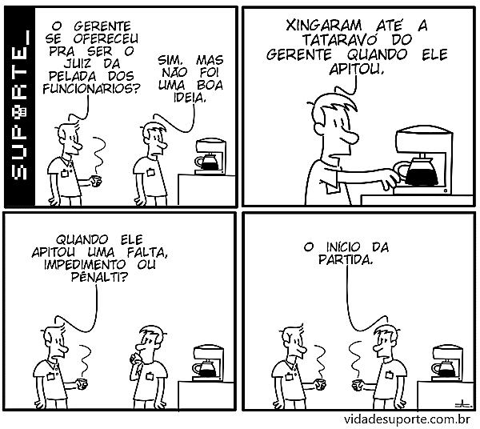
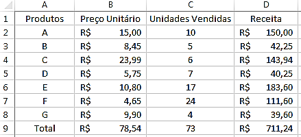

# PROVA — Camara_Caucaia_2024_Agente_Administrativo_do_Legislativo

## 1. Análise geral da prova

- **Identificação:** Camara_Caucaia_2024_Agente_Administrativo_do_Legislativo
- **Quantidade total de questões:** 60
- **Quantidade de textos de apoio (grupos):** 1
- **Quantidade de imagens:** 3
- **Quantidade de gráficos e tabelas:** incluídos nas imagens e no texto extraído, quando presentes no PDF original
- **Quantidade de grupos identificados:** 1
- **Quantidade de questões independentes:** 51
- **Questões que compartilham materiais:** texto-base das questões 01 a 09 → questões 01, 02, 03, 04, 05, 06, 07, 08, 09

### Transcrição integral da capa/instruções (conforme extraída do PDF)

> [!NOTE]
> Conteúdo integral das páginas anteriores à primeira questão, sem cortes.

> CÂMARA MUNICIPAL DE CAUCAIA – CE – AGENTE ADMINISTRATIVO DO LEGISLATIVO – 28/07/2024
> CÂMARA MUNICIPAL DE CAUCAIA – CE
> C O N C U R S O P Ú B L I C O
> EDITAL Nº 001/2024 DE 25 DE ABRIL 2024
> AGENTE ADMINISTRATIVO DO LEGISLATIVO
> NOME DO CANDIDATO: ____________________________________________________________________________________
> RG: ______________________________ ÓRGÃO EXPEDIDOR: _________________________________________
> Nº DE INSCRIÇÃO
> ASSINATURA: _____________________________________________________
> LEIA COM ATENÇÃO E SIGA RIGOROSAMENTE ESTAS INSTRUÇÕES:
> 1. Este caderno contém 60 (sessenta) questões de
> múltipla escolha, numeradas de 1 (um) a 60
> (sessenta).
> 2. Cada uma das questões apresenta um enunciado
> seguido de 5 (cinco) alternativas, das quais somente
> uma deve ser assinalada.
> 3. Examine se a prova está completa com a sequência
> numérica
> das
> questões,
> se
> há
> falhas
> ou
> imperfeições
> gráficas
> que
> causem
> dúvidas.
> Qualquer reclamação deverá ser feita durante os 20
> minutos iniciais. Após esse tempo, qualquer
> reclamação será desconsiderada.
> 4. Depois de decorridas 2 (duas) horas do início da
> prova, será distribuído a folha de respostas, o qual
> será o único documento válido para a correção. Ao
> recebê-lo, verifique se seu nome e seu número de
> inscrição estão corretos. Reclame imediatamente se
> houver discrepância.
> 5. A folha de respostas não pode ser dobrada,
> amassada, rasurada ou manchada. Exceto sua
> assinatura e data de nascimento, nada deve ser
> escrito ou registrado fora dos locais destinados às
> respostas. Tenha muita atenção ao marcar sua folha
> de respostas, pois não haverá substituição por erro
> do candidato. Marque sua resposta pintando
> completamente
> o
> espaço
> correspondente
> à
> alternativa de sua opção.
> Ex.: A
>
> B
>
> C
>
> D
>
> E
> 6. A leitora de marcas não registrará as respostas em
> que houver falta de nitidez, uso de corretivo,
> marcação a lápis ou marcação de mais de uma letra.
> Não serão computadas questões não assinaladas.
> 7. Durante a prova, é proibido o intercâmbio e o
> empréstimo de material de qualquer natureza entre
> os candidatos. A tentativa de fraude, a indisciplina e
> o desrespeito às autoridades encarregadas dos
> trabalhos
> são
> faltas
> que
> implicarão
> a
> desclassificação do candidato.
> 8. Qualquer forma de comunicação entre candidatos
> implicará a eliminação de ambos do certame.
> 9. Não será permitido ao candidato, durante a
> realização das provas, portar armas, aparelhos
> eletrônicos de qualquer natureza, relógios, bolsas,
> livros, jornais e impressos em geral; bonés,
> chapéus, lenço de cabelo, bandanas etc.
> 10. É vedado o uso de telefone celular ou de qualquer
> outro meio de comunicação. O candidato que for
> flagrado portando aparelho celular ou qualquer outro
> meio de comunicação, durante o período de
> realização da prova, e/ou o aparelho celular tocar
> será sumariamente eliminado do certame.
> 11. Em caso de dúvida, durante a prova, levante o braço
> para solicitar atendimento da fiscalização. Jamais
> pergunte em voz alta.
> 12. Ao terminar a resolução da prova, entregue-a ao
> fiscal de sala juntamente com a folha de respostas.
> Não se esqueça de assinar a folha de respostas e
> a folha de frequência.
> 13. O candidato que permanecer na sala de provas, por
> mais de 3h30min, poderá levar consigo o caderno
> de provas, fornecido pela ORGANIZADORA.
> 14. As provas terão duração de 4 (quatro) horas com
> início às 08h e término às 12h. O candidato só
> poderá ausentar-se da sala depois de decorridas
> duas horas do início das provas.
> 15. Os Gabaritos Preliminares das Provas Objetivas
> serão divulgados 72 (setenta e duas) horas após a
> realização das mesmas.
>
>
>
> CÂMARA MUNICIPAL DE CAUCAIA – CE – AGENTE ADMINISTRATIVO DO LEGISLATIVO – 28/07/2024
>
>
>
>
>
>
> CÂMARA MUNICIPAL DE CAUCAIA – CE – AGENTE ADMINISTRATIVO DO LEGISLATIVO – 28/07/2024
> CONHECIMENTOS GERAIS
> Leia o texto para responder às questões de 1 a 9.
> Os oceanos e as mudanças climáticas.
> Para ter os mares como aliados, é necessário voltar a eles como
> fizeram nossos ancestrais. É preciso mantê-los com políticas de
> conservação
> marinha,
> investimento
> em
> pesquisa
> e
> monitoramento oceânico
> Segen Estefen | 12/06/24
> Apesar de se chamar Terra, é de água que é coberta a maior
> parte do planeta — cerca de 71% de toda a superfície é oceano,
> 80% no Hemisfério Sul. A importância não é desproporcional ao
> tamanho dos mares ou de duas moléculas de hidrogênio para
> uma de oxigênio na vida. Antigos guardiões do clima terrestre,
> são os oceanos que TEM/TÊM regulado a temperatura do
> planeta, influenciado padrões atmosféricos e sustentado a
> biodiversidade marinha. Os oceanos absorvem 90% do excesso
> de todo o calor atmosférico gerado pelas emissões de dióxido de
> carbono (CO2). A água tem uma alta capacidade térmica,
> permitindo que se armazene grandes quantidades de calor. É
> exatamente o que os oceanos fazem com a Terra. Sem eles, a
> temperatura global seria insustentável.
>
> Os oceanos também desempenham um papel significativo no
> que se refere à absorção dos gases do efeito estufa que causam
> o aquecimento da Terra. Segundo o Programa das Nações
> Unidas para o Meio Ambiente, os oceanos captaram cerca de um
> terço de todo o CO2 emitido pela humanidade desde a Revolução
> Industrial.
> No
> entanto,
> essa
> absorção
> tem
> um
> custo,
> especialmente em um planeta que aumentou em cerca de 1,4°C
> a sua temperatura em um período de 40 anos.
>
> As mudanças climáticas e os oceanos estão intrinsecamente
> conectados, em uma via de mão dupla. Enquanto os oceanos
> naturalmente mitigam boa parte dos efeitos do aquecimento do
> planeta, as mudanças climáticas também impactam os oceanos
> pelo degelo nos polos e aumento da absorção de CO2, o que
> resulta em uma série de problemas, como o aumento do nível do
> mar, da temperatura e da acidificação. O aquecimento dos
> oceanos Pacífico e Atlântico TEM/TÊM contribuído para eventos
> climáticos extremos, devido à potencialização de fenômenos
> naturais como ciclones e furacões. A elevação da temperatura
> das águas dos oceanos TEM/TÊM efeito deletério nos corais e na
> biodiversidade marinha.
>
> Recentemente, a BBC publicou uma análise baseada em
> dados do Serviço Climático Copernicus, da União Europeia,
> mostrando que os oceanos bateram recordes de temperatura
> todos os dias por 12 meses. O dado é o prenúncio da condição
> crítica
> das
> mudanças
> climáticas.
> Segundo
> o
> Painel
> Intergovernamental para Mudanças Climáticas, o IPCC, se o
> planeta aquecer 1,5°C, cerca de 70% dos corais, que suportam
> um quarto da vida marinha, desaparecerão.
>
> Para além dos mares, esse cenário nos afeta também, pois
> os oceanos funcionam como um grande reservatório de carbono,
> armazenando-o em taxas muito superiores às florestas tropicais
> terrestres. Além de reconhecer a importância dos oceanos para a
> vida e combater a crise climática, é preciso entender o papel
> crucial que esse aliado muitas vezes desconhecido, TEM/TÊM.
> Não dá para enfrentar esse desafio do século 21 sem considerá-
> lo.
>
> O caminho para isso é conhecido. Inclui a redução das
> emissões de gases de efeito estufa, o que passa invariavelmente,
> por transicionar as matrizes energéticas do fóssil para o
> renovável. O surpreendente é que os oceanos também podem
> dar uma alternativa para isso. O potencial energético dos mares
> é vasto. As energias oceânicas — ainda muito pouco exploradas
> — TEM/TÊM um potencial de produzir dezenas de vezes mais
> energia do que o mundo será capaz de consumir em 2040. Os
> oceanos podem ser não apenas um regulador climático, mas
> também uma das fontes de energia renovável que vai viabilizar o
> futuro do clima na Terra.
>
> No entanto, para ter os mares como aliados, é necessário
> voltar a eles como fizeram nossos ancestrais. É preciso mantê-
> los com políticas de conservação marinha, investimento em
> pesquisa e monitoramento oceânico. Somente com dados
> constantes, a ciência conseguirá abastecer aqueles que
> TEM/TÊM o poder de tomar as decisões, da política à economia.
> Isso pode gerar iniciativas, como a criação de áreas marinhas
> protegidas e o desenvolvimento de tecnologias de baixo carbono
> a partir do mar. Sem essa integração e se deixarmos tudo como
> está, corremos o risco de perder a nossa primeira e última barreira
> contra a crise climática.
> Segen Estefen: Diretor-geral do Instituto Nacional de Pesquisas Oceânicas (Inpo) e
> professor emérito da Universidade Federal do Rio de Janeiro (UFRJ) ESTEFEN,
> Segen. Os oceanos e as mudanças climáticas. Correio Braziliense, 12 de junho de
> 2024. Disponível em: https://www.correiobraziliense.com.br/opiniao/
> 2024/06/6875725-artigo-os-oceanos-e-as-mudancas-climaticas.html.
> Acesso em: 13 jun. 2024.

### Gabarito oficial

**Gabarito oficial — tabela do gabarito preliminar (cargo do bloco correspondente):**

| Questão | Resposta | Questão | Resposta | Questão | Resposta | Questão | Resposta | Questão | Resposta |
|---|---|---|---|---|---|---|---|---|---|
| 01 | **D** | 02 | **C** | 03 | **ANULADA** | 04 | **E** | 05 | **A** | 06 | **B** | 07 | **E** | 08 | **D** | 09 | **A** | 10 | **C** |
| 11 | **E** | 12 | **C** | 13 | **C** | 14 | **D** | 15 | **C** | 16 | **E** | 17 | **B** | 18 | **A** | 19 | **E** | 20 | **C** |
| 21 | **B** | 22 | **D** | 23 | **E** | 24 | **A** | 25 | **D** | 26 | **B** | 27 | **C** | 28 | **B** | 29 | **C** | 30 | **C** |
| 31 | **A** | 32 | **C** | 33 | **B** | 34 | **D** | 35 | **A** | 36 | **C** | 37 | **D** | 38 | **D** | 39 | **C** | 40 | **E** |
| 41 | **B** | 42 | **C** | 43 | **A** | 44 | **D** | 45 | **E** | 46 | **C** | 47 | **B** | 48 | **D** | 49 | **A** | 50 | **D** |
| 51 | **A** | 52 | **E** | 53 | **A** | 54 | **B** | 55 | **C** | 56 | **B** | 57 | **D** | 58 | **C** | 59 | **E** | 60 | **C** |

> 📌 Fonte: gabarito oficial preliminar (PDF de gabarito pareado)

---

## 2. Questões agrupadas

### GRUPO 01 — Texto-base compartilhado pelas questões 01 a 09

**Questões relacionadas:** 01, 02, 03, 04, 05, 06, 07, 08, 09.

> Leia o texto para responder às questões de 1 a 9.

#### QUESTÃO 01

✅ **Gabarito: D** (gabarito oficial preliminar — bloco "AGENTE ADMINISTRATIVO DO LEGISLATIVO" (NÍVEL MÉDIO))

**Material de apoio:**

Leia o texto para responder às questões de 1 a 9.

Os oceanos e as mudanças climáticas.
Para ter os mares como aliados, é necessário voltar a eles como
fizeram nossos ancestrais. É preciso mantê-los com políticas de
conservação
marinha,
investimento
em
pesquisa
e
monitoramento oceânico
Segen Estefen | 12/06/24
Apesar de se chamar Terra, é de água que é coberta a maior
parte do planeta — cerca de 71% de toda a superfície é oceano,
80% no Hemisfério Sul. A importância não é desproporcional ao
tamanho dos mares ou de duas moléculas de hidrogênio para
uma de oxigênio na vida. Antigos guardiões do clima terrestre,
são os oceanos que TEM/TÊM regulado a temperatura do
planeta, influenciado padrões atmosféricos e sustentado a
biodiversidade marinha. Os oceanos absorvem 90% do excesso
de todo o calor atmosférico gerado pelas emissões de dióxido de
carbono (CO2). A água tem uma alta capacidade térmica,
permitindo que se armazene grandes quantidades de calor. É
exatamente o que os oceanos fazem com a Terra. Sem eles, a
temperatura global seria insustentável.

Os oceanos também desempenham um papel significativo no
que se refere à absorção dos gases do efeito estufa que causam
o aquecimento da Terra. Segundo o Programa das Nações
Unidas para o Meio Ambiente, os oceanos captaram cerca de um
terço de todo o CO2 emitido pela humanidade desde a Revolução
Industrial.
No
entanto,
essa
absorção
tem
um
custo,
especialmente em um planeta que aumentou em cerca de 1,4°C
a sua temperatura em um período de 40 anos.

As mudanças climáticas e os oceanos estão intrinsecamente
conectados, em uma via de mão dupla. Enquanto os oceanos
naturalmente mitigam boa parte dos efeitos do aquecimento do
planeta, as mudanças climáticas também impactam os oceanos
pelo degelo nos polos e aumento da absorção de CO2, o que
resulta em uma série de problemas, como o aumento do nível do
mar, da temperatura e da acidificação. O aquecimento dos
oceanos Pacífico e Atlântico TEM/TÊM contribuído para eventos
climáticos extremos, devido à potencialização de fenômenos
naturais como ciclones e furacões. A elevação da temperatura
das águas dos oceanos TEM/TÊM efeito deletério nos corais e na
biodiversidade marinha.

Recentemente, a BBC publicou uma análise baseada em
dados do Serviço Climático Copernicus, da União Europeia,
mostrando que os oceanos bateram recordes de temperatura
todos os dias por 12 meses. O dado é o prenúncio da condição
crítica
das
mudanças
climáticas.
Segundo
o
Painel
Intergovernamental para Mudanças Climáticas, o IPCC, se o
planeta aquecer 1,5°C, cerca de 70% dos corais, que suportam
um quarto da vida marinha, desaparecerão.

Para além dos mares, esse cenário nos afeta também, pois
os oceanos funcionam como um grande reservatório de carbono,
armazenando-o em taxas muito superiores às florestas tropicais
terrestres. Além de reconhecer a importância dos oceanos para a
vida e combater a crise climática, é preciso entender o papel
crucial que esse aliado muitas vezes desconhecido, TEM/TÊM.
Não dá para enfrentar esse desafio do século 21 sem considerá-
lo.

O caminho para isso é conhecido. Inclui a redução das
emissões de gases de efeito estufa, o que passa invariavelmente,
por transicionar as matrizes energéticas do fóssil para o
renovável. O surpreendente é que os oceanos também podem
dar uma alternativa para isso. O potencial energético dos mares
é vasto. As energias oceânicas — ainda muito pouco exploradas
— TEM/TÊM um potencial de produzir dezenas de vezes mais
energia do que o mundo será capaz de consumir em 2040. Os
oceanos podem ser não apenas um regulador climático, mas
também uma das fontes de energia renovável que vai viabilizar o
futuro do clima na Terra.

No entanto, para ter os mares como aliados, é necessário
voltar a eles como fizeram nossos ancestrais. É preciso mantê-
los com políticas de conservação marinha, investimento em
pesquisa e monitoramento oceânico. Somente com dados
constantes, a ciência conseguirá abastecer aqueles que
TEM/TÊM o poder de tomar as decisões, da política à economia.
Isso pode gerar iniciativas, como a criação de áreas marinhas
protegidas e o desenvolvimento de tecnologias de baixo carbono
a partir do mar. Sem essa integração e se deixarmos tudo como
está, corremos o risco de perder a nossa primeira e última barreira
contra a crise climática.
Segen Estefen: Diretor-geral do Instituto Nacional de Pesquisas Oceânicas (Inpo) e
professor emérito da Universidade Federal do Rio de Janeiro (UFRJ) ESTEFEN,
Segen. Os oceanos e as mudanças climáticas. Correio Braziliense, 12 de junho de
2024. Disponível em: https://www.correiobraziliense.com.br/opiniao/
2024/06/6875725-artigo-os-oceanos-e-as-mudancas-climaticas.html.
Acesso em: 13 jun. 2024.

**Enunciado:**

Segundo as informações do texto, os oceanos e seus
mares

**Alternativas:**

A) absorvem muito pouco o CO2 da atmosfera terrestre.
B) influenciam negativamente os padrões atmosféricos.
C) provocam efeitos adversos nos corais devido às baixas
temperaturas.
D) apresentam potencial para a geração de energia.
E) contêm somente fontes de energia não renovável.

**Referências visuais:**

Nenhuma.

---

#### QUESTÃO 02

✅ **Gabarito: C** (gabarito oficial preliminar — bloco "AGENTE ADMINISTRATIVO DO LEGISLATIVO" (NÍVEL MÉDIO))

**Material de apoio:**

Leia o texto para responder às questões de 1 a 9.

Os oceanos e as mudanças climáticas.
Para ter os mares como aliados, é necessário voltar a eles como
fizeram nossos ancestrais. É preciso mantê-los com políticas de
conservação
marinha,
investimento
em
pesquisa
e
monitoramento oceânico
Segen Estefen | 12/06/24
Apesar de se chamar Terra, é de água que é coberta a maior
parte do planeta — cerca de 71% de toda a superfície é oceano,
80% no Hemisfério Sul. A importância não é desproporcional ao
tamanho dos mares ou de duas moléculas de hidrogênio para
uma de oxigênio na vida. Antigos guardiões do clima terrestre,
são os oceanos que TEM/TÊM regulado a temperatura do
planeta, influenciado padrões atmosféricos e sustentado a
biodiversidade marinha. Os oceanos absorvem 90% do excesso
de todo o calor atmosférico gerado pelas emissões de dióxido de
carbono (CO2). A água tem uma alta capacidade térmica,
permitindo que se armazene grandes quantidades de calor. É
exatamente o que os oceanos fazem com a Terra. Sem eles, a
temperatura global seria insustentável.

Os oceanos também desempenham um papel significativo no
que se refere à absorção dos gases do efeito estufa que causam
o aquecimento da Terra. Segundo o Programa das Nações
Unidas para o Meio Ambiente, os oceanos captaram cerca de um
terço de todo o CO2 emitido pela humanidade desde a Revolução
Industrial.
No
entanto,
essa
absorção
tem
um
custo,
especialmente em um planeta que aumentou em cerca de 1,4°C
a sua temperatura em um período de 40 anos.

As mudanças climáticas e os oceanos estão intrinsecamente
conectados, em uma via de mão dupla. Enquanto os oceanos
naturalmente mitigam boa parte dos efeitos do aquecimento do
planeta, as mudanças climáticas também impactam os oceanos
pelo degelo nos polos e aumento da absorção de CO2, o que
resulta em uma série de problemas, como o aumento do nível do
mar, da temperatura e da acidificação. O aquecimento dos
oceanos Pacífico e Atlântico TEM/TÊM contribuído para eventos
climáticos extremos, devido à potencialização de fenômenos
naturais como ciclones e furacões. A elevação da temperatura
das águas dos oceanos TEM/TÊM efeito deletério nos corais e na
biodiversidade marinha.

Recentemente, a BBC publicou uma análise baseada em
dados do Serviço Climático Copernicus, da União Europeia,
mostrando que os oceanos bateram recordes de temperatura
todos os dias por 12 meses. O dado é o prenúncio da condição
crítica
das
mudanças
climáticas.
Segundo
o
Painel
Intergovernamental para Mudanças Climáticas, o IPCC, se o
planeta aquecer 1,5°C, cerca de 70% dos corais, que suportam
um quarto da vida marinha, desaparecerão.

Para além dos mares, esse cenário nos afeta também, pois
os oceanos funcionam como um grande reservatório de carbono,
armazenando-o em taxas muito superiores às florestas tropicais
terrestres. Além de reconhecer a importância dos oceanos para a
vida e combater a crise climática, é preciso entender o papel
crucial que esse aliado muitas vezes desconhecido, TEM/TÊM.
Não dá para enfrentar esse desafio do século 21 sem considerá-
lo.

O caminho para isso é conhecido. Inclui a redução das
emissões de gases de efeito estufa, o que passa invariavelmente,
por transicionar as matrizes energéticas do fóssil para o
renovável. O surpreendente é que os oceanos também podem
dar uma alternativa para isso. O potencial energético dos mares
é vasto. As energias oceânicas — ainda muito pouco exploradas
— TEM/TÊM um potencial de produzir dezenas de vezes mais
energia do que o mundo será capaz de consumir em 2040. Os
oceanos podem ser não apenas um regulador climático, mas
também uma das fontes de energia renovável que vai viabilizar o
futuro do clima na Terra.

No entanto, para ter os mares como aliados, é necessário
voltar a eles como fizeram nossos ancestrais. É preciso mantê-
los com políticas de conservação marinha, investimento em
pesquisa e monitoramento oceânico. Somente com dados
constantes, a ciência conseguirá abastecer aqueles que
TEM/TÊM o poder de tomar as decisões, da política à economia.
Isso pode gerar iniciativas, como a criação de áreas marinhas
protegidas e o desenvolvimento de tecnologias de baixo carbono
a partir do mar. Sem essa integração e se deixarmos tudo como
está, corremos o risco de perder a nossa primeira e última barreira
contra a crise climática.
Segen Estefen: Diretor-geral do Instituto Nacional de Pesquisas Oceânicas (Inpo) e
professor emérito da Universidade Federal do Rio de Janeiro (UFRJ) ESTEFEN,
Segen. Os oceanos e as mudanças climáticas. Correio Braziliense, 12 de junho de
2024. Disponível em: https://www.correiobraziliense.com.br/opiniao/
2024/06/6875725-artigo-os-oceanos-e-as-mudancas-climaticas.html.
Acesso em: 13 jun. 2024.

**Enunciado:**

Observando suas características, é possível afirmar que
o texto apresentado se baseia em uma estrutura

**Alternativas:**

A) narrativa.
B) dialogal.
C) dissertativa.
D) injuntiva.
E) descritiva.

**Referências visuais:**

Nenhuma.

---

#### QUESTÃO 03

⚠️ **Gabarito: ANULADA** (questão anulada no gabarito oficial)

**Material de apoio:**

Leia o texto para responder às questões de 1 a 9.

Os oceanos e as mudanças climáticas.
Para ter os mares como aliados, é necessário voltar a eles como
fizeram nossos ancestrais. É preciso mantê-los com políticas de
conservação
marinha,
investimento
em
pesquisa
e
monitoramento oceânico
Segen Estefen | 12/06/24
Apesar de se chamar Terra, é de água que é coberta a maior
parte do planeta — cerca de 71% de toda a superfície é oceano,
80% no Hemisfério Sul. A importância não é desproporcional ao
tamanho dos mares ou de duas moléculas de hidrogênio para
uma de oxigênio na vida. Antigos guardiões do clima terrestre,
são os oceanos que TEM/TÊM regulado a temperatura do
planeta, influenciado padrões atmosféricos e sustentado a
biodiversidade marinha. Os oceanos absorvem 90% do excesso
de todo o calor atmosférico gerado pelas emissões de dióxido de
carbono (CO2). A água tem uma alta capacidade térmica,
permitindo que se armazene grandes quantidades de calor. É
exatamente o que os oceanos fazem com a Terra. Sem eles, a
temperatura global seria insustentável.

Os oceanos também desempenham um papel significativo no
que se refere à absorção dos gases do efeito estufa que causam
o aquecimento da Terra. Segundo o Programa das Nações
Unidas para o Meio Ambiente, os oceanos captaram cerca de um
terço de todo o CO2 emitido pela humanidade desde a Revolução
Industrial.
No
entanto,
essa
absorção
tem
um
custo,
especialmente em um planeta que aumentou em cerca de 1,4°C
a sua temperatura em um período de 40 anos.

As mudanças climáticas e os oceanos estão intrinsecamente
conectados, em uma via de mão dupla. Enquanto os oceanos
naturalmente mitigam boa parte dos efeitos do aquecimento do
planeta, as mudanças climáticas também impactam os oceanos
pelo degelo nos polos e aumento da absorção de CO2, o que
resulta em uma série de problemas, como o aumento do nível do
mar, da temperatura e da acidificação. O aquecimento dos
oceanos Pacífico e Atlântico TEM/TÊM contribuído para eventos
climáticos extremos, devido à potencialização de fenômenos
naturais como ciclones e furacões. A elevação da temperatura
das águas dos oceanos TEM/TÊM efeito deletério nos corais e na
biodiversidade marinha.

Recentemente, a BBC publicou uma análise baseada em
dados do Serviço Climático Copernicus, da União Europeia,
mostrando que os oceanos bateram recordes de temperatura
todos os dias por 12 meses. O dado é o prenúncio da condição
crítica
das
mudanças
climáticas.
Segundo
o
Painel
Intergovernamental para Mudanças Climáticas, o IPCC, se o
planeta aquecer 1,5°C, cerca de 70% dos corais, que suportam
um quarto da vida marinha, desaparecerão.

Para além dos mares, esse cenário nos afeta também, pois
os oceanos funcionam como um grande reservatório de carbono,
armazenando-o em taxas muito superiores às florestas tropicais
terrestres. Além de reconhecer a importância dos oceanos para a
vida e combater a crise climática, é preciso entender o papel
crucial que esse aliado muitas vezes desconhecido, TEM/TÊM.
Não dá para enfrentar esse desafio do século 21 sem considerá-
lo.

O caminho para isso é conhecido. Inclui a redução das
emissões de gases de efeito estufa, o que passa invariavelmente,
por transicionar as matrizes energéticas do fóssil para o
renovável. O surpreendente é que os oceanos também podem
dar uma alternativa para isso. O potencial energético dos mares
é vasto. As energias oceânicas — ainda muito pouco exploradas
— TEM/TÊM um potencial de produzir dezenas de vezes mais
energia do que o mundo será capaz de consumir em 2040. Os
oceanos podem ser não apenas um regulador climático, mas
também uma das fontes de energia renovável que vai viabilizar o
futuro do clima na Terra.

No entanto, para ter os mares como aliados, é necessário
voltar a eles como fizeram nossos ancestrais. É preciso mantê-
los com políticas de conservação marinha, investimento em
pesquisa e monitoramento oceânico. Somente com dados
constantes, a ciência conseguirá abastecer aqueles que
TEM/TÊM o poder de tomar as decisões, da política à economia.
Isso pode gerar iniciativas, como a criação de áreas marinhas
protegidas e o desenvolvimento de tecnologias de baixo carbono
a partir do mar. Sem essa integração e se deixarmos tudo como
está, corremos o risco de perder a nossa primeira e última barreira
contra a crise climática.
Segen Estefen: Diretor-geral do Instituto Nacional de Pesquisas Oceânicas (Inpo) e
professor emérito da Universidade Federal do Rio de Janeiro (UFRJ) ESTEFEN,
Segen. Os oceanos e as mudanças climáticas. Correio Braziliense, 12 de junho de
2024. Disponível em: https://www.correiobraziliense.com.br/opiniao/
2024/06/6875725-artigo-os-oceanos-e-as-mudancas-climaticas.html.
Acesso em: 13 jun. 2024.

**Enunciado:**

Como se classifica sintaticamente a estrutura grifada
em: “O caminho para isso é conhecido.” (6º parágrafo)?

**Alternativas:**

A) Objeto direto.
B) Objeto indireto.
C) Predicativo do sujeito.
D) Predicativo do objeto.
E) Complemento nominal.

**Referências visuais:**

Nenhuma.

---

#### QUESTÃO 04

✅ **Gabarito: E** (gabarito oficial preliminar — bloco "AGENTE ADMINISTRATIVO DO LEGISLATIVO" (NÍVEL MÉDIO))

**Material de apoio:**

Leia o texto para responder às questões de 1 a 9.

Os oceanos e as mudanças climáticas.
Para ter os mares como aliados, é necessário voltar a eles como
fizeram nossos ancestrais. É preciso mantê-los com políticas de
conservação
marinha,
investimento
em
pesquisa
e
monitoramento oceânico
Segen Estefen | 12/06/24
Apesar de se chamar Terra, é de água que é coberta a maior
parte do planeta — cerca de 71% de toda a superfície é oceano,
80% no Hemisfério Sul. A importância não é desproporcional ao
tamanho dos mares ou de duas moléculas de hidrogênio para
uma de oxigênio na vida. Antigos guardiões do clima terrestre,
são os oceanos que TEM/TÊM regulado a temperatura do
planeta, influenciado padrões atmosféricos e sustentado a
biodiversidade marinha. Os oceanos absorvem 90% do excesso
de todo o calor atmosférico gerado pelas emissões de dióxido de
carbono (CO2). A água tem uma alta capacidade térmica,
permitindo que se armazene grandes quantidades de calor. É
exatamente o que os oceanos fazem com a Terra. Sem eles, a
temperatura global seria insustentável.

Os oceanos também desempenham um papel significativo no
que se refere à absorção dos gases do efeito estufa que causam
o aquecimento da Terra. Segundo o Programa das Nações
Unidas para o Meio Ambiente, os oceanos captaram cerca de um
terço de todo o CO2 emitido pela humanidade desde a Revolução
Industrial.
No
entanto,
essa
absorção
tem
um
custo,
especialmente em um planeta que aumentou em cerca de 1,4°C
a sua temperatura em um período de 40 anos.

As mudanças climáticas e os oceanos estão intrinsecamente
conectados, em uma via de mão dupla. Enquanto os oceanos
naturalmente mitigam boa parte dos efeitos do aquecimento do
planeta, as mudanças climáticas também impactam os oceanos
pelo degelo nos polos e aumento da absorção de CO2, o que
resulta em uma série de problemas, como o aumento do nível do
mar, da temperatura e da acidificação. O aquecimento dos
oceanos Pacífico e Atlântico TEM/TÊM contribuído para eventos
climáticos extremos, devido à potencialização de fenômenos
naturais como ciclones e furacões. A elevação da temperatura
das águas dos oceanos TEM/TÊM efeito deletério nos corais e na
biodiversidade marinha.

Recentemente, a BBC publicou uma análise baseada em
dados do Serviço Climático Copernicus, da União Europeia,
mostrando que os oceanos bateram recordes de temperatura
todos os dias por 12 meses. O dado é o prenúncio da condição
crítica
das
mudanças
climáticas.
Segundo
o
Painel
Intergovernamental para Mudanças Climáticas, o IPCC, se o
planeta aquecer 1,5°C, cerca de 70% dos corais, que suportam
um quarto da vida marinha, desaparecerão.

Para além dos mares, esse cenário nos afeta também, pois
os oceanos funcionam como um grande reservatório de carbono,
armazenando-o em taxas muito superiores às florestas tropicais
terrestres. Além de reconhecer a importância dos oceanos para a
vida e combater a crise climática, é preciso entender o papel
crucial que esse aliado muitas vezes desconhecido, TEM/TÊM.
Não dá para enfrentar esse desafio do século 21 sem considerá-
lo.

O caminho para isso é conhecido. Inclui a redução das
emissões de gases de efeito estufa, o que passa invariavelmente,
por transicionar as matrizes energéticas do fóssil para o
renovável. O surpreendente é que os oceanos também podem
dar uma alternativa para isso. O potencial energético dos mares
é vasto. As energias oceânicas — ainda muito pouco exploradas
— TEM/TÊM um potencial de produzir dezenas de vezes mais
energia do que o mundo será capaz de consumir em 2040. Os
oceanos podem ser não apenas um regulador climático, mas
também uma das fontes de energia renovável que vai viabilizar o
futuro do clima na Terra.

No entanto, para ter os mares como aliados, é necessário
voltar a eles como fizeram nossos ancestrais. É preciso mantê-
los com políticas de conservação marinha, investimento em
pesquisa e monitoramento oceânico. Somente com dados
constantes, a ciência conseguirá abastecer aqueles que
TEM/TÊM o poder de tomar as decisões, da política à economia.
Isso pode gerar iniciativas, como a criação de áreas marinhas
protegidas e o desenvolvimento de tecnologias de baixo carbono
a partir do mar. Sem essa integração e se deixarmos tudo como
está, corremos o risco de perder a nossa primeira e última barreira
contra a crise climática.
Segen Estefen: Diretor-geral do Instituto Nacional de Pesquisas Oceânicas (Inpo) e
professor emérito da Universidade Federal do Rio de Janeiro (UFRJ) ESTEFEN,
Segen. Os oceanos e as mudanças climáticas. Correio Braziliense, 12 de junho de
2024. Disponível em: https://www.correiobraziliense.com.br/opiniao/
2024/06/6875725-artigo-os-oceanos-e-as-mudancas-climaticas.html.
Acesso em: 13 jun. 2024.

**Enunciado:**

No trecho: “Para além dos mares, esse cenário nos afeta
também, pois os oceanos funcionam como um grande
reservatório de carbono, armazenando-o em taxas muito
superiores às florestas tropicais terrestres.” (5º parágrafo).
A que se refere o pronome em destaque?

**Alternativas:**

A) “os mares”
B) “esse cenário”
C) “os oceanos”
D) “um grande reservatório de carbono”
E) “carbono”

**Referências visuais:**

Nenhuma.

---

#### QUESTÃO 05

✅ **Gabarito: A** (gabarito oficial preliminar — bloco "AGENTE ADMINISTRATIVO DO LEGISLATIVO" (NÍVEL MÉDIO))

**Material de apoio:**

Leia o texto para responder às questões de 1 a 9.

Os oceanos e as mudanças climáticas.
Para ter os mares como aliados, é necessário voltar a eles como
fizeram nossos ancestrais. É preciso mantê-los com políticas de
conservação
marinha,
investimento
em
pesquisa
e
monitoramento oceânico
Segen Estefen | 12/06/24
Apesar de se chamar Terra, é de água que é coberta a maior
parte do planeta — cerca de 71% de toda a superfície é oceano,
80% no Hemisfério Sul. A importância não é desproporcional ao
tamanho dos mares ou de duas moléculas de hidrogênio para
uma de oxigênio na vida. Antigos guardiões do clima terrestre,
são os oceanos que TEM/TÊM regulado a temperatura do
planeta, influenciado padrões atmosféricos e sustentado a
biodiversidade marinha. Os oceanos absorvem 90% do excesso
de todo o calor atmosférico gerado pelas emissões de dióxido de
carbono (CO2). A água tem uma alta capacidade térmica,
permitindo que se armazene grandes quantidades de calor. É
exatamente o que os oceanos fazem com a Terra. Sem eles, a
temperatura global seria insustentável.

Os oceanos também desempenham um papel significativo no
que se refere à absorção dos gases do efeito estufa que causam
o aquecimento da Terra. Segundo o Programa das Nações
Unidas para o Meio Ambiente, os oceanos captaram cerca de um
terço de todo o CO2 emitido pela humanidade desde a Revolução
Industrial.
No
entanto,
essa
absorção
tem
um
custo,
especialmente em um planeta que aumentou em cerca de 1,4°C
a sua temperatura em um período de 40 anos.

As mudanças climáticas e os oceanos estão intrinsecamente
conectados, em uma via de mão dupla. Enquanto os oceanos
naturalmente mitigam boa parte dos efeitos do aquecimento do
planeta, as mudanças climáticas também impactam os oceanos
pelo degelo nos polos e aumento da absorção de CO2, o que
resulta em uma série de problemas, como o aumento do nível do
mar, da temperatura e da acidificação. O aquecimento dos
oceanos Pacífico e Atlântico TEM/TÊM contribuído para eventos
climáticos extremos, devido à potencialização de fenômenos
naturais como ciclones e furacões. A elevação da temperatura
das águas dos oceanos TEM/TÊM efeito deletério nos corais e na
biodiversidade marinha.

Recentemente, a BBC publicou uma análise baseada em
dados do Serviço Climático Copernicus, da União Europeia,
mostrando que os oceanos bateram recordes de temperatura
todos os dias por 12 meses. O dado é o prenúncio da condição
crítica
das
mudanças
climáticas.
Segundo
o
Painel
Intergovernamental para Mudanças Climáticas, o IPCC, se o
planeta aquecer 1,5°C, cerca de 70% dos corais, que suportam
um quarto da vida marinha, desaparecerão.

Para além dos mares, esse cenário nos afeta também, pois
os oceanos funcionam como um grande reservatório de carbono,
armazenando-o em taxas muito superiores às florestas tropicais
terrestres. Além de reconhecer a importância dos oceanos para a
vida e combater a crise climática, é preciso entender o papel
crucial que esse aliado muitas vezes desconhecido, TEM/TÊM.
Não dá para enfrentar esse desafio do século 21 sem considerá-
lo.

O caminho para isso é conhecido. Inclui a redução das
emissões de gases de efeito estufa, o que passa invariavelmente,
por transicionar as matrizes energéticas do fóssil para o
renovável. O surpreendente é que os oceanos também podem
dar uma alternativa para isso. O potencial energético dos mares
é vasto. As energias oceânicas — ainda muito pouco exploradas
— TEM/TÊM um potencial de produzir dezenas de vezes mais
energia do que o mundo será capaz de consumir em 2040. Os
oceanos podem ser não apenas um regulador climático, mas
também uma das fontes de energia renovável que vai viabilizar o
futuro do clima na Terra.

No entanto, para ter os mares como aliados, é necessário
voltar a eles como fizeram nossos ancestrais. É preciso mantê-
los com políticas de conservação marinha, investimento em
pesquisa e monitoramento oceânico. Somente com dados
constantes, a ciência conseguirá abastecer aqueles que
TEM/TÊM o poder de tomar as decisões, da política à economia.
Isso pode gerar iniciativas, como a criação de áreas marinhas
protegidas e o desenvolvimento de tecnologias de baixo carbono
a partir do mar. Sem essa integração e se deixarmos tudo como
está, corremos o risco de perder a nossa primeira e última barreira
contra a crise climática.
Segen Estefen: Diretor-geral do Instituto Nacional de Pesquisas Oceânicas (Inpo) e
professor emérito da Universidade Federal do Rio de Janeiro (UFRJ) ESTEFEN,
Segen. Os oceanos e as mudanças climáticas. Correio Braziliense, 12 de junho de
2024. Disponível em: https://www.correiobraziliense.com.br/opiniao/
2024/06/6875725-artigo-os-oceanos-e-as-mudancas-climaticas.html.
Acesso em: 13 jun. 2024.

**Enunciado:**

O verbo “transicionar”, empregado no sexto parágrafo
do texto, significa, no contexto,

**Alternativas:**

A) mudar.
B) inspecionar.
C) amenizar.
D) renovar.
E) auxiliar.

**Referências visuais:**

Nenhuma.

---

#### QUESTÃO 06

✅ **Gabarito: B** (gabarito oficial preliminar — bloco "AGENTE ADMINISTRATIVO DO LEGISLATIVO" (NÍVEL MÉDIO))

**Material de apoio:**

Leia o texto para responder às questões de 1 a 9.

Os oceanos e as mudanças climáticas.
Para ter os mares como aliados, é necessário voltar a eles como
fizeram nossos ancestrais. É preciso mantê-los com políticas de
conservação
marinha,
investimento
em
pesquisa
e
monitoramento oceânico
Segen Estefen | 12/06/24
Apesar de se chamar Terra, é de água que é coberta a maior
parte do planeta — cerca de 71% de toda a superfície é oceano,
80% no Hemisfério Sul. A importância não é desproporcional ao
tamanho dos mares ou de duas moléculas de hidrogênio para
uma de oxigênio na vida. Antigos guardiões do clima terrestre,
são os oceanos que TEM/TÊM regulado a temperatura do
planeta, influenciado padrões atmosféricos e sustentado a
biodiversidade marinha. Os oceanos absorvem 90% do excesso
de todo o calor atmosférico gerado pelas emissões de dióxido de
carbono (CO2). A água tem uma alta capacidade térmica,
permitindo que se armazene grandes quantidades de calor. É
exatamente o que os oceanos fazem com a Terra. Sem eles, a
temperatura global seria insustentável.

Os oceanos também desempenham um papel significativo no
que se refere à absorção dos gases do efeito estufa que causam
o aquecimento da Terra. Segundo o Programa das Nações
Unidas para o Meio Ambiente, os oceanos captaram cerca de um
terço de todo o CO2 emitido pela humanidade desde a Revolução
Industrial.
No
entanto,
essa
absorção
tem
um
custo,
especialmente em um planeta que aumentou em cerca de 1,4°C
a sua temperatura em um período de 40 anos.

As mudanças climáticas e os oceanos estão intrinsecamente
conectados, em uma via de mão dupla. Enquanto os oceanos
naturalmente mitigam boa parte dos efeitos do aquecimento do
planeta, as mudanças climáticas também impactam os oceanos
pelo degelo nos polos e aumento da absorção de CO2, o que
resulta em uma série de problemas, como o aumento do nível do
mar, da temperatura e da acidificação. O aquecimento dos
oceanos Pacífico e Atlântico TEM/TÊM contribuído para eventos
climáticos extremos, devido à potencialização de fenômenos
naturais como ciclones e furacões. A elevação da temperatura
das águas dos oceanos TEM/TÊM efeito deletério nos corais e na
biodiversidade marinha.

Recentemente, a BBC publicou uma análise baseada em
dados do Serviço Climático Copernicus, da União Europeia,
mostrando que os oceanos bateram recordes de temperatura
todos os dias por 12 meses. O dado é o prenúncio da condição
crítica
das
mudanças
climáticas.
Segundo
o
Painel
Intergovernamental para Mudanças Climáticas, o IPCC, se o
planeta aquecer 1,5°C, cerca de 70% dos corais, que suportam
um quarto da vida marinha, desaparecerão.

Para além dos mares, esse cenário nos afeta também, pois
os oceanos funcionam como um grande reservatório de carbono,
armazenando-o em taxas muito superiores às florestas tropicais
terrestres. Além de reconhecer a importância dos oceanos para a
vida e combater a crise climática, é preciso entender o papel
crucial que esse aliado muitas vezes desconhecido, TEM/TÊM.
Não dá para enfrentar esse desafio do século 21 sem considerá-
lo.

O caminho para isso é conhecido. Inclui a redução das
emissões de gases de efeito estufa, o que passa invariavelmente,
por transicionar as matrizes energéticas do fóssil para o
renovável. O surpreendente é que os oceanos também podem
dar uma alternativa para isso. O potencial energético dos mares
é vasto. As energias oceânicas — ainda muito pouco exploradas
— TEM/TÊM um potencial de produzir dezenas de vezes mais
energia do que o mundo será capaz de consumir em 2040. Os
oceanos podem ser não apenas um regulador climático, mas
também uma das fontes de energia renovável que vai viabilizar o
futuro do clima na Terra.

No entanto, para ter os mares como aliados, é necessário
voltar a eles como fizeram nossos ancestrais. É preciso mantê-
los com políticas de conservação marinha, investimento em
pesquisa e monitoramento oceânico. Somente com dados
constantes, a ciência conseguirá abastecer aqueles que
TEM/TÊM o poder de tomar as decisões, da política à economia.
Isso pode gerar iniciativas, como a criação de áreas marinhas
protegidas e o desenvolvimento de tecnologias de baixo carbono
a partir do mar. Sem essa integração e se deixarmos tudo como
está, corremos o risco de perder a nossa primeira e última barreira
contra a crise climática.
Segen Estefen: Diretor-geral do Instituto Nacional de Pesquisas Oceânicas (Inpo) e
professor emérito da Universidade Federal do Rio de Janeiro (UFRJ) ESTEFEN,
Segen. Os oceanos e as mudanças climáticas. Correio Braziliense, 12 de junho de
2024. Disponível em: https://www.correiobraziliense.com.br/opiniao/
2024/06/6875725-artigo-os-oceanos-e-as-mudancas-climaticas.html.
Acesso em: 13 jun. 2024.

**Enunciado:**

No texto: Os oceanos e as mudanças climáticas, foram
sublinhados três conectivos. Analise-os e, em seguida,
assinale a alternativa que apresenta corretamente os
sentidos por eles veiculados nos trechos em que ocorrem.

**Alternativas:**

A) Condição, consequência e proporção.
B) Concessão, causa e conformidade.
C) Condição, consequência e conformidade.
D) Concessão, finalidade e causa.
E) Finalidade, causa e condição.

**Referências visuais:**

Nenhuma.

---

#### QUESTÃO 07

✅ **Gabarito: E** (gabarito oficial preliminar — bloco "AGENTE ADMINISTRATIVO DO LEGISLATIVO" (NÍVEL MÉDIO))

**Material de apoio:**

Leia o texto para responder às questões de 1 a 9.

Os oceanos e as mudanças climáticas.
Para ter os mares como aliados, é necessário voltar a eles como
fizeram nossos ancestrais. É preciso mantê-los com políticas de
conservação
marinha,
investimento
em
pesquisa
e
monitoramento oceânico
Segen Estefen | 12/06/24
Apesar de se chamar Terra, é de água que é coberta a maior
parte do planeta — cerca de 71% de toda a superfície é oceano,
80% no Hemisfério Sul. A importância não é desproporcional ao
tamanho dos mares ou de duas moléculas de hidrogênio para
uma de oxigênio na vida. Antigos guardiões do clima terrestre,
são os oceanos que TEM/TÊM regulado a temperatura do
planeta, influenciado padrões atmosféricos e sustentado a
biodiversidade marinha. Os oceanos absorvem 90% do excesso
de todo o calor atmosférico gerado pelas emissões de dióxido de
carbono (CO2). A água tem uma alta capacidade térmica,
permitindo que se armazene grandes quantidades de calor. É
exatamente o que os oceanos fazem com a Terra. Sem eles, a
temperatura global seria insustentável.

Os oceanos também desempenham um papel significativo no
que se refere à absorção dos gases do efeito estufa que causam
o aquecimento da Terra. Segundo o Programa das Nações
Unidas para o Meio Ambiente, os oceanos captaram cerca de um
terço de todo o CO2 emitido pela humanidade desde a Revolução
Industrial.
No
entanto,
essa
absorção
tem
um
custo,
especialmente em um planeta que aumentou em cerca de 1,4°C
a sua temperatura em um período de 40 anos.

As mudanças climáticas e os oceanos estão intrinsecamente
conectados, em uma via de mão dupla. Enquanto os oceanos
naturalmente mitigam boa parte dos efeitos do aquecimento do
planeta, as mudanças climáticas também impactam os oceanos
pelo degelo nos polos e aumento da absorção de CO2, o que
resulta em uma série de problemas, como o aumento do nível do
mar, da temperatura e da acidificação. O aquecimento dos
oceanos Pacífico e Atlântico TEM/TÊM contribuído para eventos
climáticos extremos, devido à potencialização de fenômenos
naturais como ciclones e furacões. A elevação da temperatura
das águas dos oceanos TEM/TÊM efeito deletério nos corais e na
biodiversidade marinha.

Recentemente, a BBC publicou uma análise baseada em
dados do Serviço Climático Copernicus, da União Europeia,
mostrando que os oceanos bateram recordes de temperatura
todos os dias por 12 meses. O dado é o prenúncio da condição
crítica
das
mudanças
climáticas.
Segundo
o
Painel
Intergovernamental para Mudanças Climáticas, o IPCC, se o
planeta aquecer 1,5°C, cerca de 70% dos corais, que suportam
um quarto da vida marinha, desaparecerão.

Para além dos mares, esse cenário nos afeta também, pois
os oceanos funcionam como um grande reservatório de carbono,
armazenando-o em taxas muito superiores às florestas tropicais
terrestres. Além de reconhecer a importância dos oceanos para a
vida e combater a crise climática, é preciso entender o papel
crucial que esse aliado muitas vezes desconhecido, TEM/TÊM.
Não dá para enfrentar esse desafio do século 21 sem considerá-
lo.

O caminho para isso é conhecido. Inclui a redução das
emissões de gases de efeito estufa, o que passa invariavelmente,
por transicionar as matrizes energéticas do fóssil para o
renovável. O surpreendente é que os oceanos também podem
dar uma alternativa para isso. O potencial energético dos mares
é vasto. As energias oceânicas — ainda muito pouco exploradas
— TEM/TÊM um potencial de produzir dezenas de vezes mais
energia do que o mundo será capaz de consumir em 2040. Os
oceanos podem ser não apenas um regulador climático, mas
também uma das fontes de energia renovável que vai viabilizar o
futuro do clima na Terra.

No entanto, para ter os mares como aliados, é necessário
voltar a eles como fizeram nossos ancestrais. É preciso mantê-
los com políticas de conservação marinha, investimento em
pesquisa e monitoramento oceânico. Somente com dados
constantes, a ciência conseguirá abastecer aqueles que
TEM/TÊM o poder de tomar as decisões, da política à economia.
Isso pode gerar iniciativas, como a criação de áreas marinhas
protegidas e o desenvolvimento de tecnologias de baixo carbono
a partir do mar. Sem essa integração e se deixarmos tudo como
está, corremos o risco de perder a nossa primeira e última barreira
contra a crise climática.
Segen Estefen: Diretor-geral do Instituto Nacional de Pesquisas Oceânicas (Inpo) e
professor emérito da Universidade Federal do Rio de Janeiro (UFRJ) ESTEFEN,
Segen. Os oceanos e as mudanças climáticas. Correio Braziliense, 12 de junho de
2024. Disponível em: https://www.correiobraziliense.com.br/opiniao/
2024/06/6875725-artigo-os-oceanos-e-as-mudancas-climaticas.html.
Acesso em: 13 jun. 2024.

**Enunciado:**

observe o excerto a seguir.
“No entanto, para ter os mares como aliados, é necessário voltar
a eles como fizeram nossos ancestrais.” (7º parágrafo)

CÂMARA MUNICIPAL DE CAUCAIA – CE – AGENTE ADMINISTRATIVO DO LEGISLATIVO – 28/07/2024
Qual é o sentido que o vocábulo em destaque no excerto
confere ao enunciado?

**Alternativas:**

A) Causa.
B) Conformidade.
C) Exemplificação.
D) Estatuto de algo ou de alguém.
E) Comparação.

**Referências visuais:**

Nenhuma.

---

#### QUESTÃO 08

✅ **Gabarito: D** (gabarito oficial preliminar — bloco "AGENTE ADMINISTRATIVO DO LEGISLATIVO" (NÍVEL MÉDIO))

**Material de apoio:**

Leia o texto para responder às questões de 1 a 9.

Os oceanos e as mudanças climáticas.
Para ter os mares como aliados, é necessário voltar a eles como
fizeram nossos ancestrais. É preciso mantê-los com políticas de
conservação
marinha,
investimento
em
pesquisa
e
monitoramento oceânico
Segen Estefen | 12/06/24
Apesar de se chamar Terra, é de água que é coberta a maior
parte do planeta — cerca de 71% de toda a superfície é oceano,
80% no Hemisfério Sul. A importância não é desproporcional ao
tamanho dos mares ou de duas moléculas de hidrogênio para
uma de oxigênio na vida. Antigos guardiões do clima terrestre,
são os oceanos que TEM/TÊM regulado a temperatura do
planeta, influenciado padrões atmosféricos e sustentado a
biodiversidade marinha. Os oceanos absorvem 90% do excesso
de todo o calor atmosférico gerado pelas emissões de dióxido de
carbono (CO2). A água tem uma alta capacidade térmica,
permitindo que se armazene grandes quantidades de calor. É
exatamente o que os oceanos fazem com a Terra. Sem eles, a
temperatura global seria insustentável.

Os oceanos também desempenham um papel significativo no
que se refere à absorção dos gases do efeito estufa que causam
o aquecimento da Terra. Segundo o Programa das Nações
Unidas para o Meio Ambiente, os oceanos captaram cerca de um
terço de todo o CO2 emitido pela humanidade desde a Revolução
Industrial.
No
entanto,
essa
absorção
tem
um
custo,
especialmente em um planeta que aumentou em cerca de 1,4°C
a sua temperatura em um período de 40 anos.

As mudanças climáticas e os oceanos estão intrinsecamente
conectados, em uma via de mão dupla. Enquanto os oceanos
naturalmente mitigam boa parte dos efeitos do aquecimento do
planeta, as mudanças climáticas também impactam os oceanos
pelo degelo nos polos e aumento da absorção de CO2, o que
resulta em uma série de problemas, como o aumento do nível do
mar, da temperatura e da acidificação. O aquecimento dos
oceanos Pacífico e Atlântico TEM/TÊM contribuído para eventos
climáticos extremos, devido à potencialização de fenômenos
naturais como ciclones e furacões. A elevação da temperatura
das águas dos oceanos TEM/TÊM efeito deletério nos corais e na
biodiversidade marinha.

Recentemente, a BBC publicou uma análise baseada em
dados do Serviço Climático Copernicus, da União Europeia,
mostrando que os oceanos bateram recordes de temperatura
todos os dias por 12 meses. O dado é o prenúncio da condição
crítica
das
mudanças
climáticas.
Segundo
o
Painel
Intergovernamental para Mudanças Climáticas, o IPCC, se o
planeta aquecer 1,5°C, cerca de 70% dos corais, que suportam
um quarto da vida marinha, desaparecerão.

Para além dos mares, esse cenário nos afeta também, pois
os oceanos funcionam como um grande reservatório de carbono,
armazenando-o em taxas muito superiores às florestas tropicais
terrestres. Além de reconhecer a importância dos oceanos para a
vida e combater a crise climática, é preciso entender o papel
crucial que esse aliado muitas vezes desconhecido, TEM/TÊM.
Não dá para enfrentar esse desafio do século 21 sem considerá-
lo.

O caminho para isso é conhecido. Inclui a redução das
emissões de gases de efeito estufa, o que passa invariavelmente,
por transicionar as matrizes energéticas do fóssil para o
renovável. O surpreendente é que os oceanos também podem
dar uma alternativa para isso. O potencial energético dos mares
é vasto. As energias oceânicas — ainda muito pouco exploradas
— TEM/TÊM um potencial de produzir dezenas de vezes mais
energia do que o mundo será capaz de consumir em 2040. Os
oceanos podem ser não apenas um regulador climático, mas
também uma das fontes de energia renovável que vai viabilizar o
futuro do clima na Terra.

No entanto, para ter os mares como aliados, é necessário
voltar a eles como fizeram nossos ancestrais. É preciso mantê-
los com políticas de conservação marinha, investimento em
pesquisa e monitoramento oceânico. Somente com dados
constantes, a ciência conseguirá abastecer aqueles que
TEM/TÊM o poder de tomar as decisões, da política à economia.
Isso pode gerar iniciativas, como a criação de áreas marinhas
protegidas e o desenvolvimento de tecnologias de baixo carbono
a partir do mar. Sem essa integração e se deixarmos tudo como
está, corremos o risco de perder a nossa primeira e última barreira
contra a crise climática.
Segen Estefen: Diretor-geral do Instituto Nacional de Pesquisas Oceânicas (Inpo) e
professor emérito da Universidade Federal do Rio de Janeiro (UFRJ) ESTEFEN,
Segen. Os oceanos e as mudanças climáticas. Correio Braziliense, 12 de junho de
2024. Disponível em: https://www.correiobraziliense.com.br/opiniao/
2024/06/6875725-artigo-os-oceanos-e-as-mudancas-climaticas.html.
Acesso em: 13 jun. 2024.

**Enunciado:**

Observe as ocorrências do verbo “ter” destacadas, em
letras maiúsculas, no texto: Os oceanos e as mudanças
climáticas. Em seguida, indique a alternativa que apresenta a
concordância verbal adequada para cada uma dessas
ocorrências.

**Alternativas:**

A) tem | tem | tem | têm | têm | têm
B) tem | têm | têm | têm | tem | tem
C) tem | tem | tem | tem | tem | tem
D) têm | tem | tem | tem | têm | têm
E) têm | têm | têm | têm | têm | têm

**Referências visuais:**

Nenhuma.

---

#### QUESTÃO 09

✅ **Gabarito: A** (gabarito oficial preliminar — bloco "AGENTE ADMINISTRATIVO DO LEGISLATIVO" (NÍVEL MÉDIO))

**Material de apoio:**

Leia o texto para responder às questões de 1 a 9.

Os oceanos e as mudanças climáticas.
Para ter os mares como aliados, é necessário voltar a eles como
fizeram nossos ancestrais. É preciso mantê-los com políticas de
conservação
marinha,
investimento
em
pesquisa
e
monitoramento oceânico
Segen Estefen | 12/06/24
Apesar de se chamar Terra, é de água que é coberta a maior
parte do planeta — cerca de 71% de toda a superfície é oceano,
80% no Hemisfério Sul. A importância não é desproporcional ao
tamanho dos mares ou de duas moléculas de hidrogênio para
uma de oxigênio na vida. Antigos guardiões do clima terrestre,
são os oceanos que TEM/TÊM regulado a temperatura do
planeta, influenciado padrões atmosféricos e sustentado a
biodiversidade marinha. Os oceanos absorvem 90% do excesso
de todo o calor atmosférico gerado pelas emissões de dióxido de
carbono (CO2). A água tem uma alta capacidade térmica,
permitindo que se armazene grandes quantidades de calor. É
exatamente o que os oceanos fazem com a Terra. Sem eles, a
temperatura global seria insustentável.

Os oceanos também desempenham um papel significativo no
que se refere à absorção dos gases do efeito estufa que causam
o aquecimento da Terra. Segundo o Programa das Nações
Unidas para o Meio Ambiente, os oceanos captaram cerca de um
terço de todo o CO2 emitido pela humanidade desde a Revolução
Industrial.
No
entanto,
essa
absorção
tem
um
custo,
especialmente em um planeta que aumentou em cerca de 1,4°C
a sua temperatura em um período de 40 anos.

As mudanças climáticas e os oceanos estão intrinsecamente
conectados, em uma via de mão dupla. Enquanto os oceanos
naturalmente mitigam boa parte dos efeitos do aquecimento do
planeta, as mudanças climáticas também impactam os oceanos
pelo degelo nos polos e aumento da absorção de CO2, o que
resulta em uma série de problemas, como o aumento do nível do
mar, da temperatura e da acidificação. O aquecimento dos
oceanos Pacífico e Atlântico TEM/TÊM contribuído para eventos
climáticos extremos, devido à potencialização de fenômenos
naturais como ciclones e furacões. A elevação da temperatura
das águas dos oceanos TEM/TÊM efeito deletério nos corais e na
biodiversidade marinha.

Recentemente, a BBC publicou uma análise baseada em
dados do Serviço Climático Copernicus, da União Europeia,
mostrando que os oceanos bateram recordes de temperatura
todos os dias por 12 meses. O dado é o prenúncio da condição
crítica
das
mudanças
climáticas.
Segundo
o
Painel
Intergovernamental para Mudanças Climáticas, o IPCC, se o
planeta aquecer 1,5°C, cerca de 70% dos corais, que suportam
um quarto da vida marinha, desaparecerão.

Para além dos mares, esse cenário nos afeta também, pois
os oceanos funcionam como um grande reservatório de carbono,
armazenando-o em taxas muito superiores às florestas tropicais
terrestres. Além de reconhecer a importância dos oceanos para a
vida e combater a crise climática, é preciso entender o papel
crucial que esse aliado muitas vezes desconhecido, TEM/TÊM.
Não dá para enfrentar esse desafio do século 21 sem considerá-
lo.

O caminho para isso é conhecido. Inclui a redução das
emissões de gases de efeito estufa, o que passa invariavelmente,
por transicionar as matrizes energéticas do fóssil para o
renovável. O surpreendente é que os oceanos também podem
dar uma alternativa para isso. O potencial energético dos mares
é vasto. As energias oceânicas — ainda muito pouco exploradas
— TEM/TÊM um potencial de produzir dezenas de vezes mais
energia do que o mundo será capaz de consumir em 2040. Os
oceanos podem ser não apenas um regulador climático, mas
também uma das fontes de energia renovável que vai viabilizar o
futuro do clima na Terra.

No entanto, para ter os mares como aliados, é necessário
voltar a eles como fizeram nossos ancestrais. É preciso mantê-
los com políticas de conservação marinha, investimento em
pesquisa e monitoramento oceânico. Somente com dados
constantes, a ciência conseguirá abastecer aqueles que
TEM/TÊM o poder de tomar as decisões, da política à economia.
Isso pode gerar iniciativas, como a criação de áreas marinhas
protegidas e o desenvolvimento de tecnologias de baixo carbono
a partir do mar. Sem essa integração e se deixarmos tudo como
está, corremos o risco de perder a nossa primeira e última barreira
contra a crise climática.
Segen Estefen: Diretor-geral do Instituto Nacional de Pesquisas Oceânicas (Inpo) e
professor emérito da Universidade Federal do Rio de Janeiro (UFRJ) ESTEFEN,
Segen. Os oceanos e as mudanças climáticas. Correio Braziliense, 12 de junho de
2024. Disponível em: https://www.correiobraziliense.com.br/opiniao/
2024/06/6875725-artigo-os-oceanos-e-as-mudancas-climaticas.html.
Acesso em: 13 jun. 2024.

**Enunciado:**

Qual é a justificativa para a utilização dos travessões no
penúltimo parágrafo do texto?

**Alternativas:**

A) Eles intercalam um trecho a que se pretende dar ênfase.
B) Eles indicam uma citação em discurso direto.
C) Eles substituem as aspas duplas na indicação de uma
expressão irônica.
D) Eles indicam uma citação em discurso indireto.
E) Eles substituem as aspas duplas na indicação de uma
expressão informal.

**Referências visuais:**

Nenhuma.

---

## 3. Questões independentes

#### QUESTÃO 10

✅ **Gabarito: C** (gabarito oficial preliminar — bloco "AGENTE ADMINISTRATIVO DO LEGISLATIVO" (NÍVEL MÉDIO))

**Enunciado:**

Leia a tirinha a seguir.
GONSALES, Fernando. Níquel Náusea. Folha de São Paulo, 14 de junho de 2024.
Disponível em: https://cartum.folha.uol.com.br/quadrinhos/2024/06/14/niquel-
nausea-fernando-gonsales.shtml. Acesso em: 14 jun. 2024.
Para causar a quebra de expectativa característica do gênero
textual apresentado, foi utilizada, no último quadrinho, uma
estratégia de conexão entre linguagem verbal e não-verbal
pautada no/na

**Alternativas:**

A) antonímia.
B) coloquialidade linguística.
C) ambiguidade.
D) formalidade linguística.
E) paronímia.

**Referências visuais:**

Nenhuma.

---

#### QUESTÃO 11

✅ **Gabarito: E** (gabarito oficial preliminar — bloco "AGENTE ADMINISTRATIVO DO LEGISLATIVO" (NÍVEL MÉDIO))

**Enunciado:**

Leia e analise o parágrafo a seguir.
“Clebson Teixeira, marido de Lulu Santos, fez um clique do
marido repousando em casa [...]. A imagem foi compartilhada no
Instagram oficial do artista com um emoji de coração remendado.
O cantor se recupera das complicações de um quadro de
gastroenterite aguda e influenza A e, recentemente, do
diagnóstico de dengue.”
NEVES, Carla. Marido de Lulu Santos mostra cantor em repouso após dengue.
Quem, 14 de junho de 2024. Disponível em: https://revistaquem.globo.com/
noticias/noticia/2024/06/marido-de-lulu-santos-mostra-cantor-em-repouso-apos-
dengue.ghtml. Acesso em: 14 jun. 2024. Adaptado.
Quantas palavras dissílabas (excetuando-se os nomes
próprios) foram empregadas no parágrafo?

**Alternativas:**

A) Uma.
B) Duas.
C) Três.
D) Quatro.
E) Cinco.

**Referências visuais:**

Nenhuma.

---

#### QUESTÃO 12

✅ **Gabarito: C** (gabarito oficial preliminar — bloco "AGENTE ADMINISTRATIVO DO LEGISLATIVO" (NÍVEL MÉDIO))

**Enunciado:**

Analise o texto a seguir.
POYNTING, Mark; RIVAULT, Erwan. 2023 é confirmado como ano mais quente já
registrado: 2024 pode bater esse recorde? BBC Brasil, 09 de janeiro de 2024.
Disponível em: https://www.bbc.com/portuguese/articles/ced7pl4l74vo.
Acesso em: 14 jun. 2024.
Qual é a função da linguagem que embasa o texto?

**Alternativas:**

A) Apelativa.
B) Metalinguística.
C) Referencial.
D) Poética.
E) Fática.

**Referências visuais:**

Nenhuma.

---

#### QUESTÃO 13

✅ **Gabarito: C** (gabarito oficial preliminar — bloco "AGENTE ADMINISTRATIVO DO LEGISLATIVO" (NÍVEL MÉDIO))

**Enunciado:**

Qual dos pares de vocábulos a seguir apresenta,
respectivamente, uma palavra com ditongo crescente e uma
com hiato?

**Alternativas:**

A) Sinistro | meiguice
B) Relva | atrocidade
C) Contraditório | hiena
D) Saúde | cabisbaixo
E) Boneca | militância

**Referências visuais:**

Nenhuma.

---

#### QUESTÃO 14

✅ **Gabarito: D** (gabarito oficial preliminar — bloco "AGENTE ADMINISTRATIVO DO LEGISLATIVO" (NÍVEL MÉDIO))

**Enunciado:**

Leia e analise o parágrafo a seguir.
“Ele estava caminhando pelo longo corredor do Ministério e
estava quase no lugar onde Júlia havia colocado o bilhete em sua
mão quando se deu conta de que alguém maior do que ele estava
seguindo-o. A pessoa, quem quer que fosse, deu uma pequena
tosse, evidentemente como um prelúdio para falar. Winston parou
abruptamente e virou-se. Era O’Brien.”
ORWELL, George. 1984. Curitiba: Gazeta do Povo, 2022. Disponível em:
https://multimidia.gazetadopovo.com.br/media/info/2022/202209/1984/e-book-
1984.pdf. Acesso em: 13 jun. 2024.
A qual informação textual se refere o pronome pessoal que
inicia o parágrafo?

**Alternativas:**

A) “o Ministério”
B) “o bilhete”
C) “a pessoa”
D) “Winston”
E) “O’Brien”

**Referências visuais:**

Nenhuma.

---

#### QUESTÃO 15

✅ **Gabarito: C** (gabarito oficial preliminar — bloco "AGENTE ADMINISTRATIVO DO LEGISLATIVO" (NÍVEL MÉDIO))

**Enunciado:**

Observe o excerto a seguir.
“Ao longo dos anos, pesquisadores que estudam elefantes
notaram um fenômeno intrigante. Algumas vezes, quando um
elefante vocaliza algo para um grupo de outros elefantes, todos
respondem. Mas, às vezes, quando aquele mesmo elefante faz
um chamado similar ao grupo, apenas um deles responde.”
ELEFANTES podem chamar uns aos outros por nomes, mostra estudo. Planeta,
10 de junho de 2024. Disponível em: https://revistaplaneta.com.br/elefantes-
podem-chamar-uns-aos-outros-por-nomes-mostra-estudo/. Acesso em: 13 jun.
2024.

CÂMARA MUNICIPAL DE CAUCAIA – CE – AGENTE ADMINISTRATIVO DO LEGISLATIVO – 28/07/2024
Qual é a função das vírgulas empregadas junto das
expressões sublinhadas no excerto?

**Alternativas:**

A) Isolar apostos explicativos.
B) Coordenar termos de mesma função sintática enumerados.
C) Isolar adjuntos adverbiais intercalados.
D) Separar orações coordenadas assindéticas.
E) Isolar vocativos.

**Referências visuais:**

---

#### QUESTÃO 16

✅ **Gabarito: E** (gabarito oficial preliminar — bloco "AGENTE ADMINISTRATIVO DO LEGISLATIVO" (NÍVEL MÉDIO))

**Enunciado:**

Leia a tirinha a seguir.
VIDA DE SUPORTE. Juiz. 10/06/2024. Disponível em:
https://vidadesuporte.com.br/suporte-a-serie/juiz/. Acesso em: 13 jun. 2024.
Analise as proposições acerca dos fatos apresentados na
tirinha.
I.
Os funcionários jogavam “peladas” (partidas informais de
futebol).
II.
O gerente era muito querido pelos funcionários.
III. No início da “pelada”, já houve um pênalti marcado pelo
gerente.
IV. O gerente não gostou de se oferecer para ser juiz em uma
“pelada”.
Qual(is) dessas proposições pode(m) ser considerada(s)
adequada(s) para uma interpretação da tirinha?

**Alternativas:**

A) Somente a primeira proposição.
B) A primeira e a terceira proposições.
C) Somente a segunda proposição.
D) A terceira e a quarta proposições.
E) Todas as proposições são inadequadas.

**Referências visuais:**

Nenhuma.

---

#### QUESTÃO 17

✅ **Gabarito: B** (gabarito oficial preliminar — bloco "AGENTE ADMINISTRATIVO DO LEGISLATIVO" (NÍVEL MÉDIO))

**Enunciado:**

Assinale a alternativa cujo elemento sublinhado é um
objeto indireto.

**Alternativas:**

A) A necessidade de carinho o tornou triste.
B) Precisamos de voluntários para a montagem do cenário.
C) O copo de suco caiu no chão e sujou a sala.
D) O gosto do limão é bem ácido.
E) O aeroporto de Guarulhos é muito famoso.

**Referências visuais:**

Nenhuma.

---

#### QUESTÃO 18

✅ **Gabarito: A** (gabarito oficial preliminar — bloco "AGENTE ADMINISTRATIVO DO LEGISLATIVO" (NÍVEL MÉDIO))

**Enunciado:**

João e Maria estão jogando um jogo em que precisam
se movimentar sobre uma trajetória reta. João está na
posição -4, enquanto Maria está na posição 3. Se João
avança 7 posições e Maria retrocede 5 posições, em que
posições eles ficarão respectivamente?

**Alternativas:**

A) 3 e -2
B) -2 e 3
C) -3 e 2
D) -3 e -2
E) 2 e 3

**Referências visuais:**

Nenhuma.

---

#### QUESTÃO 19

✅ **Gabarito: E** (gabarito oficial preliminar — bloco "AGENTE ADMINISTRATIVO DO LEGISLATIVO" (NÍVEL MÉDIO))

**Enunciado:**

Duas máquinas industriais precisam de manutenção
regular. A máquina A requer manutenção a cada 12 dias, e a
máquina B a cada 18 dias. Se ambas as máquinas foram
mantidas hoje, neste dia, em quantos dias elas precisarão de
manutenção simultaneamente, novamente?

**Alternativas:**

A) 
B) 
C) 
D) 
E) 

**Referências visuais:**

Nenhuma.

---

#### QUESTÃO 20

✅ **Gabarito: C** (gabarito oficial preliminar — bloco "AGENTE ADMINISTRATIVO DO LEGISLATIVO" (NÍVEL MÉDIO))

**Enunciado:**

Em uma receita, precisa-se de 3/4 de xícara de açúcar e
2/5 de xícara de óleo. Qual fração representa a quantidade de
xícaras de açúcar e óleo juntas?

**Alternativas:**

A) 
B) 
C) 
D) 
E) 

**Referências visuais:**

Nenhuma.

---

#### QUESTÃO 21

✅ **Gabarito: B** (gabarito oficial preliminar — bloco "AGENTE ADMINISTRATIVO DO LEGISLATIVO" (NÍVEL MÉDIO))

**Enunciado:**

Pedro comprou 2,3 kg de maçãs e 1,75 kg de uvas.
Quantos quilos de frutas ele comprou no total?

**Alternativas:**

A) 4,00
B) 4,05
C) 4,12
D) 5,12
E) 5,05

**Referências visuais:**

Nenhuma.

---

#### QUESTÃO 22

✅ **Gabarito: D** (gabarito oficial preliminar — bloco "AGENTE ADMINISTRATIVO DO LEGISLATIVO" (NÍVEL MÉDIO))

**Enunciado:**

Uma bola é lançada para cima em um instante 𝒕𝟏 e atinge
o solo em um instante 𝒕𝟐. Sua altura 𝒉(𝒕) em metros após t
segundos é dada pela função 𝒉(𝒕) = −𝟓𝒕𝟐+ 𝟐𝟎𝒕−𝟏𝟓. Em que
instante a bola atinge o solo?

**Alternativas:**

A) 
B) 
C) 
D) 
E) 

**Referências visuais:**

Nenhuma.

---

#### QUESTÃO 23

✅ **Gabarito: E** (gabarito oficial preliminar — bloco "AGENTE ADMINISTRATIVO DO LEGISLATIVO" (NÍVEL MÉDIO))

**Enunciado:**

Ana começou a trabalhar às 8h45 e terminou às 17h30
com uma pausa de 1 hora e 15 minutos para o almoço.
Quanto tempo efetivamente Ana trabalhou?

**Alternativas:**

A) 9 horas
B) 8 horas e 45 minutos
C) 6 horas e 45 minutos
D) 7 horas e 15 minutos
E) 7 horas e 30 minutos

**Referências visuais:**

Nenhuma.

---

#### QUESTÃO 24

✅ **Gabarito: A** (gabarito oficial preliminar — bloco "AGENTE ADMINISTRATIVO DO LEGISLATIVO" (NÍVEL MÉDIO))

**Enunciado:**

Uma piscina retangular tem 25 metros de comprimento
e 10 metros de largura. Qual é a área do piso dessa piscina
em metros quadrados?

**Alternativas:**

A) 250 m²
B) 125 m²
C) 105 m²
D) 100 m²
E) 80 m²

**Referências visuais:**

Nenhuma.

---

#### QUESTÃO 25

✅ **Gabarito: D** (gabarito oficial preliminar — bloco "AGENTE ADMINISTRATIVO DO LEGISLATIVO" (NÍVEL MÉDIO))

**Enunciado:**

Carlos tem R$ 150,00. Ele quer comprar 3 livros que
custam R$ 45,00 cada. Quanto em dinheiro restará após a
compra?

**Alternativas:**

A) R$ 6,00
B) R$ 8,50
C) R$ 10,00
D) R$ 15,00
E) R$ 20,00

CÂMARA MUNICIPAL DE CAUCAIA – CE – AGENTE ADMINISTRATIVO DO LEGISLATIVO – 28/07/2024

**Referências visuais:**

---

#### QUESTÃO 26

✅ **Gabarito: B** (gabarito oficial preliminar — bloco "AGENTE ADMINISTRATIVO DO LEGISLATIVO" (NÍVEL MÉDIO))

**Enunciado:**

Em uma receita de bolo, a razão de farinha para açúcar
é de 3:2. Se você usar 300g de farinha, quantos gramas de
açúcar são necessários?

**Alternativas:**

A) 100 g
B) 200 g
C) 300 g
D) 500 g
E) 600 g

**Referências visuais:**

Nenhuma.

---

#### QUESTÃO 27

✅ **Gabarito: C** (gabarito oficial preliminar — bloco "AGENTE ADMINISTRATIVO DO LEGISLATIVO" (NÍVEL MÉDIO))

**Enunciado:**

Um computador custa R$ 2.500,00 e está com um
desconto de 20%. Qual é o preço final do computador após o
desconto?

**Alternativas:**

A) R$ 1.500,00
B) R$ 1.800,00
C) R$ 2.000,00
D) R$ 2.500,00
E) R$ 2.700,00

**Referências visuais:**

Nenhuma.

---

#### QUESTÃO 28

✅ **Gabarito: B** (gabarito oficial preliminar — bloco "AGENTE ADMINISTRATIVO DO LEGISLATIVO" (NÍVEL MÉDIO))

**Enunciado:**

As festas juninas fazem parte do calendário nacional e
homenageiam três santos do Catolicismo. Assim sendo, os
santos homenageados nos dias 13, 24 e 29 de junho
respectivamente, são

**Alternativas:**

A) São João, São Pedro e Santo Antônio.
B) Santo Antônio, São João e São Pedro.
C) Santo Antônio, São Pedro e São João.
D) São João, Santo Antônio e São Pedro.
E) São Pedro, São João e Santo Antônio.

**Referências visuais:**

Nenhuma.

---

#### QUESTÃO 29

✅ **Gabarito: C** (gabarito oficial preliminar — bloco "AGENTE ADMINISTRATIVO DO LEGISLATIVO" (NÍVEL MÉDIO))

**Enunciado:**

Historicamente, as populações indígenas no Brasil vêm
sendo impactadas por projetos agroindustriais, como

**Alternativas:**

A) rotação de culturas.
B) produção agroflorestal
C) extração ilegal de madeira.
D) criação de parques ecológicos.
E) construção civil.

**Referências visuais:**

Nenhuma.

---

#### QUESTÃO 30

✅ **Gabarito: C** (gabarito oficial preliminar — bloco "AGENTE ADMINISTRATIVO DO LEGISLATIVO" (NÍVEL MÉDIO))

**Enunciado:**

A cultura brasileira é rica e diversa, tendo como uma de
suas expressões as tradições afro-brasileiras. Assim sendo,
são consideradas danças de origem africana, EXCETO o(a)

**Alternativas:**

A) capoeira.
B) maracatu.
C) folia de reis.
D) congada.
E) jongo.

**Referências visuais:**

Nenhuma.

---

#### QUESTÃO 31

✅ **Gabarito: A** (gabarito oficial preliminar — bloco "AGENTE ADMINISTRATIVO DO LEGISLATIVO" (NÍVEL MÉDIO))

**Enunciado:**

“Os movimentos sociais querem mais contato direto
com Lula em 2024”, diz coordenadora do MST à CNN.
(Fonte: CNN, 01 de janeiro de 2024).
O movimento intitulado pela sigla MST tem, como principal
reivindicação, o(a)

**Alternativas:**

A) acesso à terra.
B) atualização do fundo rural.
C) revogação da titulação fundiária.
D) aprovação do marco temporal indígena.
E) criação do mercado de carbono.

**Referências visuais:**

Nenhuma.

---

#### QUESTÃO 32

✅ **Gabarito: C** (gabarito oficial preliminar — bloco "AGENTE ADMINISTRATIVO DO LEGISLATIVO" (NÍVEL MÉDIO))

**Enunciado:**

São impactos causados pela atividade minerária a(o)
I.
degradação da paisagem.
II.
desmatamento.
III. contaminação recursos hídricos.
IV. reflorestamento.
V. erosão e compostagem.
Marque a opção que apresenta as afirmativas CORRETAS.

**Alternativas:**

A) I – III – IV.
B) II – III – V.
C) I – II – III.
D) III – IV – V.
E) I – IV – V.

**Referências visuais:**

Nenhuma.

---

#### QUESTÃO 33

✅ **Gabarito: B** (gabarito oficial preliminar — bloco "AGENTE ADMINISTRATIVO DO LEGISLATIVO" (NÍVEL MÉDIO))

**Enunciado:**

Um dos países maiores compradores de minério de
ferro do Brasil é o(a)

**Alternativas:**

A) Canadá.
B) China.
C) Rússia.
D) Noruega.
E) Índia.

**Referências visuais:**

Nenhuma.

---

#### QUESTÃO 34

✅ **Gabarito: D** (gabarito oficial preliminar — bloco "AGENTE ADMINISTRATIVO DO LEGISLATIVO" (NÍVEL MÉDIO))

**Enunciado:**

Ao longo da história, a formação histórica do Brasil é
influenciada por diferentes correntes filosóficas. Neste
sentido, pode-se dizer que o período de independência do
Brasil, a cisão entre os grupos conservadores e liberais foi
marcada pelos ideais da Revolução

**Alternativas:**

A) Cubana.
B) Russa.
C) Inglesa.
D) Francesa.
E) Portuguesa.

**Referências visuais:**

Nenhuma.

---

#### QUESTÃO 35

✅ **Gabarito: A** (gabarito oficial preliminar — bloco "AGENTE ADMINISTRATIVO DO LEGISLATIVO" (NÍVEL MÉDIO))

**Enunciado:**

Durante a cúpula do G7, realizada na Itália, no mês de
junho de 2024, o presidente brasileiro em seu discurso,
pontuou dois assuntos polêmicos na agenda geopolítica
internacional, inclusive, informações veiculadas afirmam
que o líder brasileiro

**Alternativas:**

A) condenou a invasão da Ucrânia pela Rússia.
B) reprovou a posição da França em relação ao aborto no
documento do G7.
C) negou apoio à Palestina em favor de Israel.
D) rompeu relações diplomáticas com a Itália.
E) divergiu da China em relação ao conflito na faixa de Gaza.

**Referências visuais:**

Nenhuma.

---

#### QUESTÃO 36

✅ **Gabarito: C** (gabarito oficial preliminar — bloco "AGENTE ADMINISTRATIVO DO LEGISLATIVO" (NÍVEL MÉDIO))

**Enunciado:**

Leia a afirmativa a seguir.
Na história da formação do Município, Caucaia se transformou em
_________ por determinação do Marquês de Pombal.
Marque a opção que preenche corretamente a lacuna.

**Alternativas:**

A) aldeia
B) povoado
C) vila
D) comarca
E) município.

**Referências visuais:**

Nenhuma.

---

#### QUESTÃO 37

✅ **Gabarito: D** (gabarito oficial preliminar — bloco "AGENTE ADMINISTRATIVO DO LEGISLATIVO" (NÍVEL MÉDIO))

**Enunciado:**

Considerando a data de fundação do Município, neste
ano de 2024, Caucaia completa

**Alternativas:**

A) 260 anos.
B) 263 anos.
C) 264 anos.
D) 265 anos.
E) 268 anos.

**Referências visuais:**

Nenhuma.

---

#### QUESTÃO 38

✅ **Gabarito: D** (gabarito oficial preliminar — bloco "AGENTE ADMINISTRATIVO DO LEGISLATIVO" (NÍVEL MÉDIO))

**Enunciado:**

Em 2024, foi anunciado pela atual gestão municipal, a
ampliação do plano de cargos e carreiras e remuneração dos
servidores municipais de Caucaia, que passa a contemplar
30 (trinta) referências progressivas, sendo que o plano
anterior possuía

**Alternativas:**

A) 5 referências progressivas.
B) 10 referências progressivas.
C) 15 referências progressivas.
D) 20 referências progressivas.
E) 25 referências progressivas.

**Referências visuais:**

Nenhuma.

---

#### QUESTÃO 39

✅ **Gabarito: C** (gabarito oficial preliminar — bloco "AGENTE ADMINISTRATIVO DO LEGISLATIVO" (NÍVEL MÉDIO))

**Enunciado:**

Cor presente na bandeira do Município de Caucaia.

**Alternativas:**

A) Verde.
B) Azul.
C) Branco.
D) Marrom.
E) Amarelo.

**Referências visuais:**

Nenhuma.

---

#### QUESTÃO 40

✅ **Gabarito: E** (gabarito oficial preliminar — bloco "AGENTE ADMINISTRATIVO DO LEGISLATIVO" (NÍVEL MÉDIO))

**Enunciado:**

Clima dominante no Município de Caucaia.

**Alternativas:**

A) Temperado.
B) Tropical de altitude.
C) Equatorial.
D) Monções.
E) Tropical semiárido.
CÂMARA MUNICIPAL DE CAUCAIA – CE – AGENTE ADMINISTRATIVO DO LEGISLATIVO – 28/07/2024

**Referências visuais:**

Nenhuma.

---

#### QUESTÃO 41

✅ **Gabarito: B** (gabarito oficial preliminar — bloco "AGENTE ADMINISTRATIVO DO LEGISLATIVO" (NÍVEL MÉDIO))

**Enunciado:**

Assinale a alternativa que apresenta duas formas de
provimento de cargo público previstas no art. 8 da Lei nº
8.112 de 1990.

**Alternativas:**

A) Promoção e Ascensão.
B) Nomeação e Readaptação.
C) Aproveitamento e Preferência.
D) Transferência e Reversão.
E) Ascensão e Recondução.

**Referências visuais:**

Nenhuma.

---

#### QUESTÃO 42

✅ **Gabarito: C** (gabarito oficial preliminar — bloco "AGENTE ADMINISTRATIVO DO LEGISLATIVO" (NÍVEL MÉDIO))

**Enunciado:**

Leia com atenção as afirmações nos termos da Lei nº
8.112 de 1990.
I.
A posse em cargo público ________ de prévia inspeção
médica oficial.
II.
É de _______ dias o prazo para o servidor empossado em
cargo público entrar em exercício, contados da data da
posse.
III. Os servidores cumprirão jornada de trabalho fixada em razão
das
atribuições
pertinentes
aos
respectivos
cargos,
respeitada a duração máxima do trabalho semanal de
_________ horas e observados os limites mínimo e máximo
de seis horas e oito horas diárias, respectivamente.
IV. A investidura em cargo público ocorrerá com a _________.
Marque a opção que apresenta os termos que preenchem
CORRETA e respectivamente as lacunas.

**Alternativas:**

A) I. dependerá – II. sete – III. vinte – IV. posse
B) I. independerá – II. doze – III. trinta – IV. exercício
C) I. dependerá – II. quinze – III. quarenta – IV. posse
D) I. independerá – II. quinze – III. quarenta – IV. exercício
E) I. dependerá – II. trinta – III. sessenta – IV. posse

**Referências visuais:**

Nenhuma.

---

#### QUESTÃO 43

✅ **Gabarito: A** (gabarito oficial preliminar — bloco "AGENTE ADMINISTRATIVO DO LEGISLATIVO" (NÍVEL MÉDIO))

**Enunciado:**

Segundo o art. 59 da Lei nº 8.112 de 1990, o servidor que
receber diárias e não se afastar da sede, por qualquer motivo,
fica obrigado a restituí-las integralmente, no prazo de

**Alternativas:**

A) cinco dias.
B) uma semana.
C) dez dias.
D) duas semanas.
E) trinta dias.

**Referências visuais:**

Nenhuma.

---

#### QUESTÃO 44

✅ **Gabarito: D** (gabarito oficial preliminar — bloco "AGENTE ADMINISTRATIVO DO LEGISLATIVO" (NÍVEL MÉDIO))

**Enunciado:**

Assinale a alternativa INCORRETA, com base no
Capítulo III (Das Férias) da Lei nº 8.112 de 1990.

**Alternativas:**

A) O servidor fará jus a trinta dias de férias, que podem ser
acumuladas, até o máximo de dois períodos, no caso de
necessidade do serviço, ressalvadas as hipóteses em que
haja legislação específica.
B) Para o primeiro período aquisitivo de férias serão exigidos
doze meses de exercício.
C) O servidor exonerado do cargo efetivo, ou em comissão,
perceberá indenização relativa ao período das férias a que
tiver direito e ao incompleto, na proporção de um doze avos
por mês de efetivo exercício, ou fração superior a quatorze
dias.
D) O pagamento da remuneração das férias será efetuado até
cinco dias antes do início do respectivo período.
E) As férias poderão ser parceladas em até três etapas, desde
que assim requeridas pelo servidor, e no interesse da
administração pública.

**Referências visuais:**

Nenhuma.

---

#### QUESTÃO 45

✅ **Gabarito: E** (gabarito oficial preliminar — bloco "AGENTE ADMINISTRATIVO DO LEGISLATIVO" (NÍVEL MÉDIO))

**Enunciado:**

Arquivo é o conjunto de documentos produzidos e
acumulados por uma entidade coletiva, pública ou privada,
pessoa ou família, no desempenho de suas atividades,
independentemente da

**Alternativas:**

A) formação do requerimento.
B) atividade protocolar.
C) emissão de carta oficial.
D) característica da licitação.
E) natureza do suporte.

**Referências visuais:**

Nenhuma.

---

#### QUESTÃO 46

✅ **Gabarito: C** (gabarito oficial preliminar — bloco "AGENTE ADMINISTRATIVO DO LEGISLATIVO" (NÍVEL MÉDIO))

**Enunciado:**

Assinale (V) para as VERDADEIRAS e (F) para as
FALSAS. São métodos de arquivamento:
(
) variadex.
(
) dígito-terminal.
(
) sonoro-padrão.
Marque a opção que apresenta a sequência CORRETA.

**Alternativas:**

A) V – F – V.
B) F – F – V.
C) V – V – F.
D) F – V – V.
E) V – F – F.

**Referências visuais:**

Nenhuma.

---

#### QUESTÃO 47

✅ **Gabarito: B** (gabarito oficial preliminar — bloco "AGENTE ADMINISTRATIVO DO LEGISLATIVO" (NÍVEL MÉDIO))

**Enunciado:**

Qual das alternativas a seguir apresenta dois exemplos
de navegadores de internet?

**Alternativas:**

A) Google Chrome e MEGA.
B) Opera e Microsoft Edge.
C) Copilot e Quizlet.
D) Cambly e Mozilla Firefox.
E) WPS e Brave.

**Referências visuais:**

Nenhuma.

---

#### QUESTÃO 48

✅ **Gabarito: D** (gabarito oficial preliminar — bloco "AGENTE ADMINISTRATIVO DO LEGISLATIVO" (NÍVEL MÉDIO))

**Enunciado:**

Em um computador com o sistema operacional
Windows, Pedro abriu o Explorador de Arquivos e utilizou um
atalho de teclado para percorrer elementos na tela. Assim
sendo, é correto afirmar que o atalho de teclado utilizado por
Pedro foi

**Alternativas:**

A) F2.
B) F11.
C) Ctrl + E.
D) F6.
E) Ctrl + Shift + E.

**Referências visuais:**

Nenhuma.

---

#### QUESTÃO 49

✅ **Gabarito: A** (gabarito oficial preliminar — bloco "AGENTE ADMINISTRATIVO DO LEGISLATIVO" (NÍVEL MÉDIO))

**Enunciado:**

No Excel, qual é o significado do símbolo a seguir?

**Alternativas:**

A) AutoSoma.
B) Classificar.
C) Preencher.
D) Tradução.
E) Filtro.

**Referências visuais:**

Nenhuma.

---

#### QUESTÃO 50

✅ **Gabarito: D** (gabarito oficial preliminar — bloco "AGENTE ADMINISTRATIVO DO LEGISLATIVO" (NÍVEL MÉDIO))

**Enunciado:**

Observe a planilha elaborada no Excel a seguir.
Julgue as afirmativas a seguir, com base na planilha
elaborada no Excel.
I.
=(SOMA:D2+D8) foi a fórmula utilizada na célula D9 para
calcular a receita total.
II.
Nas células B4 e B7 estão, respectivamente, o maior e o
menor preço unitário.
III. Exceto pelas linhas 1 e 9, os dados da coluna D são resultado
da multiplicação dos dados disponíveis nas colunas A e C.
Marque a opção que indica a(s) afirmativa(s) CORRETA(S).

**Alternativas:**

A) I – II.
B) I – III.
C) II – III.
D) II.
E) I.

CÂMARA MUNICIPAL DE CAUCAIA – CE – AGENTE ADMINISTRATIVO DO LEGISLATIVO – 28/07/2024

**Referências visuais:**

---

#### QUESTÃO 51

✅ **Gabarito: A** (gabarito oficial preliminar — bloco "AGENTE ADMINISTRATIVO DO LEGISLATIVO" (NÍVEL MÉDIO))

**Enunciado:**

Assinale (V) para as verdadeiras e (F) para as falsas, a
ação da Joana. Ao editar um projeto no Word, Joana
selecionou a guia INSERIR e encontrou as opções:
(
) Tabela.
(
) Iniciar Mala Direta.
(
) Colar.
(
) Formas.
Marque a opção que apresenta a sequência CORRETA.

**Alternativas:**

A) V – F – F – V.
B) F – V – F – F.
C) V – V – V – F.
D) F – V – V – F.
E) V – F – V – V.

**Referências visuais:**

Nenhuma.

---

#### QUESTÃO 52

✅ **Gabarito: E** (gabarito oficial preliminar — bloco "AGENTE ADMINISTRATIVO DO LEGISLATIVO" (NÍVEL MÉDIO))

**Enunciado:**

Compete ao Município de Caucaia,

**Alternativas:**

A) combater a geração de emprego e renda para a população
excluída das atividades econômicas formais, dando
prioridade ao cooperativismo e às demais formas de
autogestão econômica.
B) criar mecanismos que promovam a discriminação à mulher,
à criança e ao adolescente em situação de risco.
C) atribuir nome de pessoas vivas a avenidas, praças, ruas,
logradouros públicos, pontes, reservatórios de água, viaduto,
praça de esporte, biblioteca, hospitais e maternidade
públicos, auditórios, distritos, salas de aulas e bairros.
D) elaborar o plano plurianual e recusar fé aos documentos
públicos.
E) realizar atividades de defesa civil, inclusive as de combate a
incêndios
e
prevenção
de
acidentes
naturais,
em
coordenação com a União e o Estado.

**Referências visuais:**

Nenhuma.

---

#### QUESTÃO 53

✅ **Gabarito: A** (gabarito oficial preliminar — bloco "AGENTE ADMINISTRATIVO DO LEGISLATIVO" (NÍVEL MÉDIO))

**Enunciado:**

Segundo a Lei Orgânica do Município de Caucaia, é
vedado(a)
I.
a delegação legislativa.
II.
a cobrança de taxa, a qualquer título, nas escolas municipais.
III. delegar, entre o Estado e o Município de Caucaia, também
por convênio, os serviços de competência concorrente,
assegurados os recursos necessários.
IV. ao Município, sem prejuízo de outras garantias ao
contribuinte, aumentar ou exigir tributo sem prévia lei que o
estabeleça.
Marque a opção que indica a(s) afirmativa(s) CORRETA(S).

**Alternativas:**

A) I – II – IV.
B) II – III – IV.
C) IV.
D) II – IV.
E) I – II – III.

**Referências visuais:**

Nenhuma.

---

#### QUESTÃO 54

✅ **Gabarito: B** (gabarito oficial preliminar — bloco "AGENTE ADMINISTRATIVO DO LEGISLATIVO" (NÍVEL MÉDIO))

**Enunciado:**

De acordo com as disposições do art. 41 da Lei
Orgânica do Município de Caucaia, as leis que disponham
sobre servidores públicos, seu regime jurídico, provimento
de cargos, estabilidade e aposentadoria são de iniciativa
privativa do(a)

**Alternativas:**

A) Gestor de RH.
B) Prefeito Municipal.
C) Secretário de Gestão e Finanças.
D) Tribunal de Contas do Município.
E) Secretaria Orçamentária.

**Referências visuais:**

Nenhuma.

---

#### QUESTÃO 55

✅ **Gabarito: C** (gabarito oficial preliminar — bloco "AGENTE ADMINISTRATIVO DO LEGISLATIVO" (NÍVEL MÉDIO))

**Enunciado:**

O art. 92 da Lei Orgânica do Município de Caucaia
estabelece que a despesa com pessoal ativo e inativo do
Município
I.
não poderá exceder os limites estabelecidos em lei
complementar federal.
II.
poderá
exceder
os
limites
estabelecidos
em
lei
complementar federal.
III. será fixada como especial e extraordinária, com recorrência
no próximo exercício financeiro.
Marque a opção que indica a(s) afirmativa(s) CORRETA(S).

**Alternativas:**

A) I – III.
B) II – III.
C) I.
D) II.
E) III.

**Referências visuais:**

Nenhuma.

---

#### QUESTÃO 56

✅ **Gabarito: B** (gabarito oficial preliminar — bloco "AGENTE ADMINISTRATIVO DO LEGISLATIVO" (NÍVEL MÉDIO))

**Enunciado:**

Com base na Lei Orgânica do Município de Caucaia.
O Poder Executivo publicará e enviará ao Poder Legislativo, no
máximo ________ dias após o encerramento de cada ________,
relatório completo sobre os gastos publicitários da administração
direta, indireta, fundações e órgãos controlados pelo Poder
Público, na forma da lei.
Assinale a alternativa que contém os termos que preenchem,
CORRETA e respectivamente, as lacunas.

**Alternativas:**

A) quinze / bimestre
B) trinta / trimestre
C) sessenta / semestre
D) trinta / semestre
E) quinze / trimestre

**Referências visuais:**

Nenhuma.

---

#### QUESTÃO 57

✅ **Gabarito: D** (gabarito oficial preliminar — bloco "AGENTE ADMINISTRATIVO DO LEGISLATIVO" (NÍVEL MÉDIO))

**Enunciado:**

É um princípio da Administração Pública,

**Alternativas:**

A) equidade organizativa.
B) financiamento.
C) referência.
D) moralidade.
E) adaptação.

**Referências visuais:**

Nenhuma.

---

#### QUESTÃO 58

✅ **Gabarito: C** (gabarito oficial preliminar — bloco "AGENTE ADMINISTRATIVO DO LEGISLATIVO" (NÍVEL MÉDIO))

**Enunciado:**

No contexto dos atos administrativos, analise os itens a
seguir.
I.
Disponibilidade.
II.
Forma.
III. Atos normativos.
IV. Atos enunciativos.
V. Preparação.
Assinale a alternativa que apresenta a afirmativa CORRETA.

**Alternativas:**

A) Os itens III, IV e V são condicionantes da externalidade dos
atos administrativos.
B) Apenas o item II é um atributo dos atos administrativos.
C) Os itens III e IV são espécies de atos administrativos.
D) Apenas os itens I e IV são categorias fixas de classificação
dos atos administrativos.
E) Os itens I, II e III são requisitos dos atos administrativos.

**Referências visuais:**

Nenhuma.

---

#### QUESTÃO 59

✅ **Gabarito: E** (gabarito oficial preliminar — bloco "AGENTE ADMINISTRATIVO DO LEGISLATIVO" (NÍVEL MÉDIO))

**Enunciado:**

São poderes administrativos, EXCETO o

**Alternativas:**

A) Poder de Polícia.
B) Poder regulamentar.
C) Poder hierárquico.
D) Poder disciplinar.
E) Poder de reparação histórica.

**Referências visuais:**

Nenhuma.

---

#### QUESTÃO 60

✅ **Gabarito: C** (gabarito oficial preliminar — bloco "AGENTE ADMINISTRATIVO DO LEGISLATIVO" (NÍVEL MÉDIO))

**Enunciado:**

Para se comunicar de forma assertiva em redações
oficiais, João participou de um treinamento organizado pela
empresa na qual trabalha. Durante dois dias, ele aprendeu
alguns aspectos que caracterizam uma redação oficial,
sendo:
A1 – informalidade.
A2 – clareza.
A3 – objetividade.
A4 – pessoalidade.
Nesse cenário, estão CORRETOS os aspectos descritos na
opção

**Alternativas:**

A) A1, apenas.
B) A1, A2 e A4, apenas
C) A2 e A3, apenas.
D) A4, apenas.
E) A3 e A4, apenas.

**Referências visuais:**

Nenhuma.

---

## 4. Observações e limitações da extração

- Extração automática (texto selecionável do PDF via PyMuPDF), sem OCR: PDFs escaneados podem perder texto.
- Imagens repetidas (logos/marcas d'água) foram descartadas; as imagens de conteúdo foram salvas em `imagens/` com nomenclatura `imagem_00N`.
- A detecção de grupos usa os avisos padrão das bancas ("o texto seguinte servirá de base..."). Bancas sem esse aviso podem ter grupos não identificados — o conteúdo, porém, permanece integral.
- Se houver divergência entre esta versão e o PDF original, vale o PDF original; corrija manualmente o Markdown.
- Gabarito oficial preenchido a partir do gabarito preliminar pareado (bloco AGENTE ADMINISTRATIVO DO LEGISLATIVO, NÍVEL MÉDIO); os demais blocos de carga do gabarito foram ignorados.
- Questão 03 constava como NULA no gabarito oficial (registrada como ANULADA).
