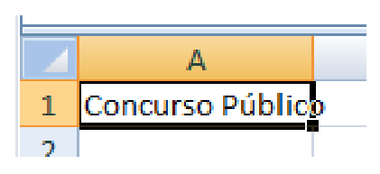
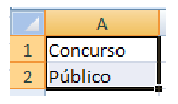
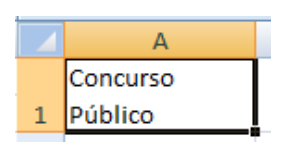
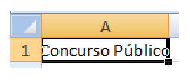
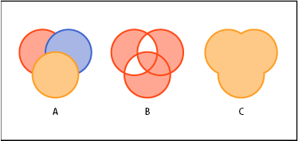
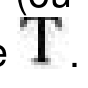
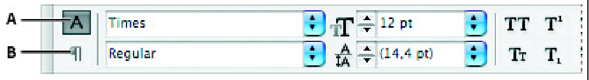
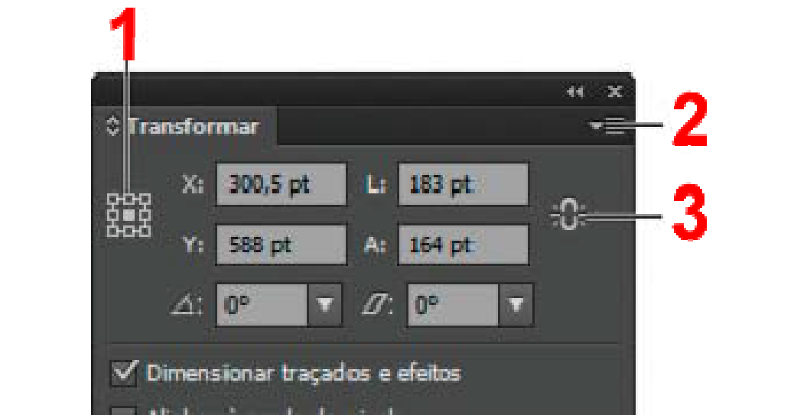

# PROVA — Camara_Chapeco_2007_Analista_de_Comunicacao

## 1. Análise geral da prova

- **Identificação:** Camara_Chapeco_2007_Analista_de_Comunicacao
- **Quantidade total de questões:** 50
- **Quantidade de textos de apoio (grupos):** 0
- **Quantidade de imagens:** 22 (incluindo ícones de ferramentas da interface e figuras recuperadas na revisão)
- **Quantidade de gráficos e tabelas:** incluídos nas imagens e no texto extraído, quando presentes no PDF original
- **Quantidade de grupos identificados:** 0
- **Quantidade de questões independentes:** 50
- **Questões que compartilham materiais:** nenhuma identificada automaticamente

### Transcrição integral da capa/instruções (conforme extraída do PDF)

> [!NOTE]
> Conteúdo integral das páginas anteriores à primeira questão, sem cortes.

> Concurso Público
> Código: 395
> ANALISTA DE COMUNICAÇÃO
> Escreva seu nome e número de inscrição de forma legível nos locais indicados:
> Nome do(a) Candidato(a)
>
>
>
>
>
>
>
>
>
>
>
>
>
>
>
> Nº de inscrição
> Este caderno de questões está assim constituído:
> DISCIPLINAS
> Nº QUESTÕES
> Conhecimentos Gerais
> - Português
> Conhecimentos Específicos
> Total de questões - 50
>
>
> INSTRUÇÕES:
> •
> Confira devidamente o material (CARTÃO DE RESPOSTAS e CADERNO DE QUESTÕES); se houver falha, solicite a
> presença do fiscal.
>
> •
> Confira seus dados no CARTÃO DE RESPOSTAS: NOME, Nº da INSCRIÇÃO e CARGO. ASSINE no espaço indicado na
> frente do cartão.
>
> •
> O CARTÃO DE RESPOSTAS deverá ser preenchido a caneta esferográfica, azul ou preta, ponta grossa, sem rasuras e
> apenas uma ÚNICA alternativa poderá ser marcada em cada questão. Não amasse nem dobre o CARTÃO DE
> RESPOSTAS; evite usar borracha. É vedada a substituição do CARTÃO DE RESPOSTAS decorrente de erro cometido por
> candidato.
> •
> Durante a prova, não é permitida a comunicação entre candidatos nem a utilização de máquina calculadora e/ou similares,
> livros, anotações, réguas de cálculo, impressos ou qualquer outro material de consulta.
>
> •
> Se o CARTÃO DE RESPOSTAS contiver maior número de alternativas e de questões, preencha apenas as correspondentes
> à sua prova; as demais ficam em branco.
>
> •
> O tempo de duração da prova será de até 4 horas.
>
> •
> Ao final dos trabalhos, DEVOLVA ao Fiscal da sala, juntamente com o CARTÃO DE RESPOSTAS devidamente
> preenchido e assinado, o CADERNO DE QUESTÕES, tendo em vista a obrigatoriedade de arquivo na Câmara.
>
> •
> A parte destacável no final desta capa, que serve para copiar as suas respostas, somente poderá ser destacada no ato da
> entrega do material na mesa do fiscal.
>
> •
> Os três últimos candidatos deverão permanecer no recinto, a fim de acompanhar os fiscais até a coordenação para o lacre
> dos envelopes, quando, então, poderão retirar-se do local simultaneamente, após concluído.
>
> •
> Direitos autorais reservados à Objetiva Concursos Ltda. Proibida a reprodução, ainda que parcial, sem autorização prévia.
> . . . . . . . . . . . . . . . . . . . . . . . . . . . . . . . . . . . . . . . . . . . . . . . . . . . . . . . . . . . . . . (dobre e destaque esta parte para copiar suas respostas) . . . . . . . . . . . . . . . . . . . . . . . . . . . . . . . . . . . . . . . . . . . . . . . . . . . .
> 01 
> 02 
> 03 
> 04 
> 05 
> 06 
> 07 
> 08 
> 09 
> 10 
> 11 
> 12 
> 13 
> 14 
> 15 
> 16 
> 17 
> 18 
> 19 
> 20 
> 21 
> 22 
> 23 
> 24 
> 25 
> 26 
> 27 
> 28 
> 29 
> 30 
> 31 
> 32 
> 33 
> 34 
> 35 
> 36 
> 37 
> 38 
> 39 
> 40 
> 41 
> 42 
> 43 
> 44 
> 45 
> 46 
> 47 
> 48 
> 49 
> 50 
>
>
>
>
>
>
>
>
>
>
>
> www.objetivas.com.br
>
>
>
> CONHECIMENTOS GERAIS
> Português
> Um relatório divulgado pela OCDE (Organização
> para a Cooperação e Desenvolvimento Econômico), que
> reúne 34 dos países mais industrializados do mundo,
> afirma que o Brasil não conseguirá atingir o nível de renda
> média dos países desenvolvidos até 2050 caso sejam
> mantidas ___ taxas de crescimento atuais. A previsão
> distancia o Brasil de outros países cujo crescimento
> chamou atenção nos últimos anos, como a China.
> Segundo
> o
> relatório,
> China,
> Panamá
> e
> Cazaquistão estão no caminho certo para equiparar sua
> renda ___ de países desenvolvidos nos próximos 35 anos.
> Assim como o Brasil, ficaram para trás o México, a
> Colômbia, a África do Sul, entre outros.
> “Muitos dos países que esperávamos que se
> aproximassem das economias avançadas até ___ metade
> do século não vão conseguir com as taxas de crescimento
> de hoje”, disse o secretário-geral da OCDE, Angel Gurría.
> http://economia.uol.com.br/noticias/... - adaptado

### Gabarito oficial

**Gabarito oficial — tabela do gabarito oficial (bloco do cargo da prova):**

| Questão | Resposta | Questão | Resposta | Questão | Resposta | Questão | Resposta | Questão | Resposta |
|---|---|---|---|---|---|---|---|---|---|
| 01 | **C** | 02 | **B** | 03 | **A** | 04 | **D** | 05 | **B** | 06 | **A** | 07 | **C** | 08 | **D** | 09 | **B** | 10 | **C** |
| 11 | **C** | 12 | **B** | 13 | **A** | 14 | **D** | 15 | **A** | 16 | **C** | 17 | **B** | 18 | **B** | 19 | **D** | 20 | **C** |
| 21 | **D** | 22 | **D** | 23 | **B** | 24 | **C** | 25 | **A** | 26 | **C** | 27 | **A** | 28 | **A** | 29 | **B** | 30 | **C** |
| 31 | **A** | 32 | **B** | 33 | **D** | 34 | **C** | 35 | **B** | 36 | **A** | 37 | **C** | 38 | **B** | 39 | **A** | 40 | **D** |
| 41 | **B** | 42 | **D** | 43 | **A** | 44 | **A** | 45 | **B** | 46 | **A** | 47 | **C** | 48 | **A** | 49 | **B** | 50 | **C** |

> 📌 Fonte: gabarito oficial pareado (PDF de gabarito)

---

## 2. Questões agrupadas

Nenhum grupo de questões compartilhando material foi identificado automaticamente nesta prova.

## 3. Questões independentes

#### QUESTÃO 01

✅ **Gabarito: C** (gabarito oficial — bloco "ANALISTA DE COMUNICAÇÃO" da página 1 do gabarito oficial multi-cargo)

**Enunciado:**

Assinalar a alternativa que preenche as lacunas do
texto CORRETAMENTE:

**Alternativas:**

A) às - a - à
B) as - a - a
C) as - à - a
D) às - à - à

**Referências visuais:**

Nenhuma.

---

#### QUESTÃO 02

✅ **Gabarito: B** (gabarito oficial — bloco "ANALISTA DE COMUNICAÇÃO" da página 1 do gabarito oficial multi-cargo)

**Enunciado:**

De acordo com o texto, assinalar a alternativa
CORRETA:

**Alternativas:**

A) O Brasil, assim como muitos outros países, inclusive a
China, está no caminho certo para se desenvolver
economicamente.
B) O Brasil é um dos países do qual se esperava uma
economia avançada até 2050, mas, se mantidas as
taxas de crescimento atuais, isso não será possível.
C) De acordo com o relatório, o Brasil é considerado um
dos 34 países mais industrializados do mundo.
D) China, Panamá, Cazaquistão, Brasil, México, Colômbia
e África do Sul são países que atingirão o nível de
renda média dos países desenvolvidos até o ano de
2050.

**Referências visuais:**

Nenhuma.

---

#### QUESTÃO 03

✅ **Gabarito: A** (gabarito oficial — bloco "ANALISTA DE COMUNICAÇÃO" da página 1 do gabarito oficial multi-cargo)

**Enunciado:**

No período “... o Brasil não conseguirá atingir o nível de
renda média dos países desenvolvidos até 2050 caso
sejam mantidas...”, o termo sublinhado NÃO pode ser
substituído, porque altera o sentido, por:

**Alternativas:**

A) Modificadas.
B) Conservadas.
C) Asseguradas.
D) Sustentadas.

**Referências visuais:**

Nenhuma.

---

#### QUESTÃO 04

✅ **Gabarito: D** (gabarito oficial — bloco "ANALISTA DE COMUNICAÇÃO" da página 1 do gabarito oficial multi-cargo)

**Enunciado:**

Quanto aos verbos empregados no período “Muitos dos
países que esperávamos que se aproximassem das
economias avançadas...”, é CORRETO afirmar que:

**Alternativas:**

A) Ambos estão no pretérito imperfeito do indicativo.
B) Ambos estão no pretérito imperfeito do subjuntivo.
C) O primeiro está no pretérito imperfeito do subjuntivo, e o
segundo está no pretérito imperfeito do indicativo.
D) O primeiro está no pretérito imperfeito do indicativo, e o
segundo está no pretérito imperfeito do subjuntivo.

**Referências visuais:**

Nenhuma.

---

#### QUESTÃO 05

✅ **Gabarito: B** (gabarito oficial — bloco "ANALISTA DE COMUNICAÇÃO" da página 1 do gabarito oficial multi-cargo)

**Enunciado:**

Assinalar a alternativa cuja concordância nominal está
INCORRETA:

**Alternativas:**

A) Estão em anexo os arquivos solicitados.
B) Estou meia cansada após os exercícios físicos.
C) É necessária a aquisição de materiais de consumo.
D) Sua Santidade fidelíssima foi atencioso com o povo.

**Referências visuais:**

Nenhuma.

---

#### QUESTÃO 06

✅ **Gabarito: A** (gabarito oficial — bloco "ANALISTA DE COMUNICAÇÃO" da página 1 do gabarito oficial multi-cargo)

**Enunciado:**

Em relação ao período “Segundo pesquisas, a
desigualdade social no Brasil está diminuindo.”, assinalar
a alternativa que NÃO pode substituir o termo sublinhado,
pois altera o sentido:

**Alternativas:**

A) Devido às.
B) Conforme.
C) Consoante.
D) De acordo com.

**Referências visuais:**

Nenhuma.

---

#### QUESTÃO 07

✅ **Gabarito: C** (gabarito oficial — bloco "ANALISTA DE COMUNICAÇÃO" da página 1 do gabarito oficial multi-cargo)

**Enunciado:**

A expressão sublinhada em “Henrique Paim, ministro
da Educação, informou que o sistema do FIES será aberto
para adesão das instituições privadas e, depois, para
adesão dos estudantes.” corresponde sintaticamente a
um:

**Alternativas:**

A) Vocativo.
B) Objeto direto.
C) Aposto.
D) Objeto indireto.
www.objetivas.com.br

**Referências visuais:**

Nenhuma.

---

#### QUESTÃO 08

✅ **Gabarito: D** (gabarito oficial — bloco "ANALISTA DE COMUNICAÇÃO" da página 1 do gabarito oficial multi-cargo)

**Enunciado:**

Assinalar a alternativa em que todas as palavras estão
grafadas CORRETAMENTE:

**Alternativas:**

A) Excessão - arritmia - mausoléu.
B) Pressentimento - absissa - expectativa.
C) Impresciso - convicção - autorização.
D) Esplendoroso - obséquio - rescisão.

**Referências visuais:**

Nenhuma.

---

#### QUESTÃO 09

✅ **Gabarito: B** (gabarito oficial — bloco "ANALISTA DE COMUNICAÇÃO" da página 1 do gabarito oficial multi-cargo)

**Enunciado:**

Assinalar a alternativa cuja frase apresenta pleonasmo:

**Alternativas:**

A) Sentou-se no braço da poltrona para descansar.
B) O pai desceu para baixo quando ouviu o filho chorando
no térreo.
C) Dois gatinhos miando no muro; conversávamos sobre
como é complicada a vida dos animais.
D) Ele prefere um passeio pela praia.

**Referências visuais:**

Nenhuma.

---

#### QUESTÃO 10

✅ **Gabarito: C** (gabarito oficial — bloco "ANALISTA DE COMUNICAÇÃO" da página 1 do gabarito oficial multi-cargo)

**Enunciado:**

Assinalar a alternativa em que a pontuação está
INCORRETA:

**Alternativas:**

A) O importante, conforme os pais, é a segurança na
escola.
B) Estudamos bastante, Maria. Por isso, merecemos
férias.
C) Esforçou-se muito porém não conseguiu o prêmio.
D) Daniel ficou alegre; eu, triste.
CONHECIMENTOS ESPECÍFICOS
Atenção! Nas questões de legislação, serão consideradas
as leis e suas alterações até a data do início das
inscrições deste concurso.
Atenção! Para responder às questões de Informática de
nº 11 a nº 17, a menos que seja explicitamente informado
o contrário, considerar que os programas mencionados
encontram-se na versão Português-BR e em sua
configuração padrão de instalação, possuem licença de
uso, o mouse está configurado para destros, um clique ou
duplo clique correspondem ao botão esquerdo do mouse
e teclar corresponde à operação de pressionar uma tecla
e, rapidamente, liberá-la, acionando-a apenas uma vez.
Dessa forma, as teclas de atalho, os menus, os
submenus, as barras, os ícones e os demais itens que
compõem
os
programas
abordados
nesta
prova
encontram-se na configuração padrão, conforme exposto
anteriormente.

**Referências visuais:**

Nenhuma.

---

#### QUESTÃO 11

✅ **Gabarito: C** (gabarito oficial — bloco "ANALISTA DE COMUNICAÇÃO" da página 1 do gabarito oficial multi-cargo)

**Enunciado:**

Em relação ao menu Iniciar do Windows Seven,
assinalar a alternativa INCORRETA:

**Alternativas:**

A) Chama-se menu, pois oferece uma lista de opções.
B) É o portão de entrada para programas, pastas e
configurações do computador.
C) É, unicamente através dele, que o usuário poderá abrir
os programas do computador.
D) É o local onde o usuário poderá iniciar ou abrir itens.

**Referências visuais:**

Nenhuma.

---

#### QUESTÃO 12

✅ **Gabarito: B** (gabarito oficial — bloco "ANALISTA DE COMUNICAÇÃO" da página 1 do gabarito oficial multi-cargo)

**Enunciado:**

Em uma planilha do Excel 2007, o texto “Concurso
Público” é digitado na célula A1, conforme a figura abaixo

e com essa célula selecionada clica-se no botão

. O
resultado dessa ação está apresentado na alternativa:

**Alternativas:**

A)

B)

C)

D)

**Referências visuais:**

---

#### QUESTÃO 13

✅ **Gabarito: A** (gabarito oficial — bloco "ANALISTA DE COMUNICAÇÃO" da página 1 do gabarito oficial multi-cargo)

**Enunciado:**

Em relação à ferramenta Pincel

do
Word 2007, analisar os itens abaixo:

I - Copia a formatação de um local para aplicá-la em outro.
II - Com duplo clique no botão Pincel é possível aplicar a
mesma formatação a vários locais do documento.

**Alternativas:**

A) Os itens I e II estão corretos.
B) Somente o item I está correto.
C) Somente o item II está correto.
D) Os itens I e II estão incorretos.
www.objetivas.com.br

**Referências visuais:**

---

#### QUESTÃO 14

✅ **Gabarito: D** (gabarito oficial — bloco "ANALISTA DE COMUNICAÇÃO" da página 1 do gabarito oficial multi-cargo)

**Enunciado:**

No Word 2007 o botão representado pela figura

, tem a função de:

**Alternativas:**

A) Limpar toda a formatação da seleção, deixando o texto
sem formatação.
B) Colocar o texto selecionado em ordem alfabética ou
classificar dados numéricos.
C) Criar letras pequenas abaixo da linha de base do texto.
D) Alterar todo o texto selecionado para maiúsculas,
minúsculas
ou
outros
usos
comuns
de
maiúsculas/minúsculas.

**Referências visuais:**

---

#### QUESTÃO 15

✅ **Gabarito: A** (gabarito oficial — bloco "ANALISTA DE COMUNICAÇÃO" da página 1 do gabarito oficial multi-cargo)

**Enunciado:**

Em relação ao uso de listas de distribuição no Outlook
2007, analisar a sentença abaixo:

As listas de distribuição fornecem uma maneira fácil de
enviar mensagens para um grupo de pessoas (1ª parte).
Uma mensagem enviada para uma lista de distribuição é
entregue a todos os destinatários incluídos nela (2ª parte).

A sentença está:

**Alternativas:**

A) Totalmente correta.
B) Correta somente em sua 1ª parte.
C) Correta somente em sua 2ª parte.
D) Totalmente incorreta.

**Referências visuais:**

Nenhuma.

---

#### QUESTÃO 16

✅ **Gabarito: C** (gabarito oficial — bloco "ANALISTA DE COMUNICAÇÃO" da página 1 do gabarito oficial multi-cargo)

**Enunciado:**

Em relação aos cookies do Internet Explorer 11,
marcar C para as afirmativas Certas, E para as Erradas e,
após, assinalar a alternativa que apresenta a sequência
CORRETA:

(---) São pequenos arquivos que os sites colocam no
computador para armazenar informações sobre o
usuário e suas preferências.
(---) Podem melhorar a experiência de navegação,
permitindo que os sites lembrem-se das preferências,
ou evitando que o usuário tenha que se conectar
sempre que visitar determinados sites.
(---) Alguns cookies podem colocar a privacidade do
usuário em risco ao rastrear os sites visitados.

**Alternativas:**

A) C - E - E.
B) E - E - C.
C) C - C - C.
D) E - C - E.

**Referências visuais:**

Nenhuma.

---

#### QUESTÃO 17

✅ **Gabarito: B** (gabarito oficial — bloco "ANALISTA DE COMUNICAÇÃO" da página 1 do gabarito oficial multi-cargo)

**Enunciado:**

Segundo o CERT.BR, é o termo usado para se referir
aos e-mails não solicitados, que geralmente são enviados
para um grande número de pessoas:

**Alternativas:**

A) Vírus.
B) Spam.
C) Pop-up.
D) Spyware.

**Referências visuais:**

Nenhuma.

---

#### QUESTÃO 18

✅ **Gabarito: B** (gabarito oficial — bloco "ANALISTA DE COMUNICAÇÃO" da página 1 do gabarito oficial multi-cargo)

**Enunciado:**

Em relação aos direitos e às garantias fundamentais
previstos na Constituição Federal, marcar C para as
afirmativas Certas, E para as Erradas e, após, assinalar a
alternativa que apresenta a sequência CORRETA:

(---) É a todos assegurada, mediante o pagamento de
taxas, a obtenção de certidões em repartições
públicas, para defesa de direitos e esclarecimento de
situações de interesse pessoal.
(---) Constitui crime inafiançável e imprescritível a ação de
grupos armados, civis ou militares, contra a ordem
constitucional e o Estado Democrático.
(---) Conceder-se-á habeas corpus sempre que alguém
sofrer ou achar-se ameaçado de sofrer violência ou
coação em sua liberdade de locomoção, por
ilegalidade ou abuso de poder.

**Alternativas:**

A) C - E - E.
B) E - C - C.
C) C - E - C.
D) E - C - E.

**Referências visuais:**

Nenhuma.

---

#### QUESTÃO 19

✅ **Gabarito: D** (gabarito oficial — bloco "ANALISTA DE COMUNICAÇÃO" da página 1 do gabarito oficial multi-cargo)

**Enunciado:**

Em conformidade com a Constituição Federal, desde
que preenchidos os requisitos estabelecidos em lei, os
cargos, os empregos e as funções públicas são acessíveis
aos:

I - Brasileiros natos.
II - Brasileiros naturalizados.
III - Estrangeiros.

Está(ão) CORRETO(S):

**Alternativas:**

A) Somente o item I.
B) Somente os itens I e II.
C) Somente os itens II e III.
D) Todos os itens.

**Referências visuais:**

Nenhuma.

---

#### QUESTÃO 20

✅ **Gabarito: C** (gabarito oficial — bloco "ANALISTA DE COMUNICAÇÃO" da página 1 do gabarito oficial multi-cargo)

**Enunciado:**

No caso de ato de improbidade administrativa que
importa enriquecimento ilícito em que o responsável pelo
ato tenha os seus direitos políticos suspensos, segundo a
Lei nº 8.429/92, a suspensão:

**Alternativas:**

A) Será por tempo indeterminado.
B) Incompatibiliza o responsável para retorno à vida
política.
C) Terá duração de oito a dez anos.
D) Terá duração de, no máximo, dois anos.
www.objetivas.com.br

**Referências visuais:**

Nenhuma.

---

#### QUESTÃO 21

✅ **Gabarito: D** (gabarito oficial — bloco "ANALISTA DE COMUNICAÇÃO" da página 1 do gabarito oficial multi-cargo)

**Enunciado:**

De acordo com a Lei nº 12.527/11, são consideradas
imprescindíveis à segurança da sociedade ou do Estado
e, portanto, passíveis de classificação, as informações
cuja divulgação ou acesso irrestrito possam:

I - Oferecer elevado risco à estabilidade financeira,
econômica ou monetária do país.
II - Prejudicar ou causar risco a planos ou operações
estratégicos das Forças Armadas.
III - Prejudicar ou causar risco a projetos de pesquisa e
desenvolvimento científico ou tecnológico, assim como
a sistemas, bens, instalações ou áreas de interesse
estratégico nacional.
IV - Pôr em risco a segurança de instituições ou de altas
autoridades
nacionais
ou
estrangeiras
e
seus
familiares.

Estão CORRETOS:

**Alternativas:**

A) Somente os itens I e II.
B) Somente os itens II e IV.
C) Somente os itens I e III.
D) Todos os itens.

**Referências visuais:**

Nenhuma.

---

#### QUESTÃO 22

✅ **Gabarito: D** (gabarito oficial — bloco "ANALISTA DE COMUNICAÇÃO" da página 1 do gabarito oficial multi-cargo)

**Enunciado:**

De acordo com a Lei Orgânica Municipal, compete ao
Presidente da Câmara, dentre outras atribuições:

I - Representar a Câmara, em juízo ou fora dele.
II - Dirigir, executar e disciplinar os trabalhos legislativos e
administrativos da Câmara.
III - Interpretar e fazer cumprir o Regimento Interno.
IV - Promulgar Resoluções e Decretos Legislativos.

Estão CORRETOS:

**Alternativas:**

A) Somente os itens I e IV.
B) Somente os itens II e III.
C) Somente os itens III e IV.
D) Todos os itens.

**Referências visuais:**

Nenhuma.

---

#### QUESTÃO 23

✅ **Gabarito: B** (gabarito oficial — bloco "ANALISTA DE COMUNICAÇÃO" da página 1 do gabarito oficial multi-cargo)

**Enunciado:**

De acordo com a Lei Orgânica Municipal, o Vereador
poderá licenciar-se:

I - Por motivo de doença pelo prazo de 10 dias.
II - Para tratar de interesse particular, desde que o
afastamento não ultrapasse a 180 dias por sessão
legislativa.
III - Para desempenhar missões temporárias, de caráter
cultural ou de interesse do Município.

Está(ão) CORRETO(S):

**Alternativas:**

A) Somente o item I.
B) Somente o item III.
C) Somente os itens II e III.
D) Todos os itens.

**Referências visuais:**

Nenhuma.

---

#### QUESTÃO 24

✅ **Gabarito: C** (gabarito oficial — bloco "ANALISTA DE COMUNICAÇÃO" da página 1 do gabarito oficial multi-cargo)

**Enunciado:**

De acordo com a Lei Complementar nº 130/01,
analisar a sentença abaixo:

O servidor público municipal que receber diárias e não se
afastar da sede, por qualquer motivo, fica obrigado a
restituí-las integralmente, no prazo mínimo de nove dias
(1ª parte). A gratificação natalina corresponde a 1/12 da
média da remuneração a que o servidor público municipal
percebeu no respectivo ano (2ª parte).

A sentença está:

**Alternativas:**

A) Totalmente correta.
B) Correta somente em sua 1ª parte.
C) Correta somente em sua 2ª parte.
D) Totalmente incorreta.

**Referências visuais:**

Nenhuma.

---

#### QUESTÃO 25

✅ **Gabarito: A** (gabarito oficial — bloco "ANALISTA DE COMUNICAÇÃO" da página 1 do gabarito oficial multi-cargo)

**Enunciado:**

De acordo com a Lei Complementar nº 130/01, é
CORRETO afirmar que:

**Alternativas:**

A) Por motivo de crença religiosa ou de convicção
filosófica ou política, o servidor público municipal não
poderá ser privado de quaisquer dos seus direitos,
sofrer discriminação em sua vida funcional, nem eximir-
se do cumprimento de seus deveres.
B) Em caso de falecimento do servidor público municipal,
quando em serviço, porém fora do seu habitual de
trabalho, as despesas de translado correrão por conta
da família do servidor.
C) O auxílio-natalidade é devido à segurada por motivo de
nascimento de parente, em quantia equivalente ao
maior vencimento base do Município, inclusive no caso
de natimorto.
D) O auxílio funeral é devido à família do servidor público
municipal enquanto na atividade em valor inferior a um
mês de remuneração ou provento, respectivamente.

**Referências visuais:**

Nenhuma.

---

#### QUESTÃO 26

✅ **Gabarito: C** (gabarito oficial — bloco "ANALISTA DE COMUNICAÇÃO" da página 1 do gabarito oficial multi-cargo)

**Enunciado:**

De acordo com a Lei Complementar nº 130/01, é
CORRETO afirmar que:

**Alternativas:**

A) Os servidores públicos municipais serão submetidos à
avaliações temporárias, realizadas por comissões,
formadas
por
servidores
instáveis,
mediante
o
preenchimento de formulário próprio, aprovado em
regulamento,
levando-se
em
conta
os
fatores
estabelecidos em lei.
B) Será reprovado o servidor público municipal que, ao
final
do
estágio
probatório,
segundo
avaliação,
apresentar desempenho suficiente para o cumprimento
das atribuições inerentes ao cargo respectivo, conforme
especificar o formulário de avaliação, aprovado em
regulamento.
C) Como condição para a aquisição da estabilidade do
servidor público municipal, é obrigatória a avaliação
especial de desempenho por comissão instituída para
essa finalidade.
D) Não é de competência dos membros da Comissão de
Avaliação a realização de novos levantamentos,
entrevistas ou mesmo solicitação de informações por
escrito, que visem à justa e isenta avaliação dos
servidores públicos municipais.
www.objetivas.com.br

**Referências visuais:**

Nenhuma.

---

#### QUESTÃO 27

✅ **Gabarito: A** (gabarito oficial — bloco "ANALISTA DE COMUNICAÇÃO" da página 1 do gabarito oficial multi-cargo)

**Enunciado:**

De acordo com o Regimento Interno nº 15/90, analisar
a sentença abaixo:

O Vereador investido no cargo de secretário municipal ou
equivalente será considerado automaticamente licenciado,
podendo optar pela remuneração da Vereança (1ª parte).
Em qualquer caso de vaga, licença ou investidura no
cargo de secretário municipal ou equivalente, o Presidente
da Câmara convocará imediatamente o respectivo
suplente (2ª parte).

A sentença está:

**Alternativas:**

A) Totalmente correta.
B) Correta somente em sua 1ª parte.
C) Correta somente em sua 2ª parte.
D) Totalmente incorreta.

**Referências visuais:**

Nenhuma.

---

#### QUESTÃO 28

✅ **Gabarito: A** (gabarito oficial — bloco "ANALISTA DE COMUNICAÇÃO" da página 1 do gabarito oficial multi-cargo)

**Enunciado:**

Sobre a Escola de Frankfurt, analisar a sentença
abaixo:

Horkheimer, Adorno, Marcuse e outros referiram-se com o
termo indústria cultural à conversão da cultura em
mercadoria, ao processo de subordinação da consciência
à racionalidade capitalista, ocorrido nas primeiras décadas
do século XX (1ª parte). A expressão indústria cultural
designa uma prática social, através da qual a produção
cultural e intelectual passa a ser orientada em função de
sua possibilidade de consumo no mercado. Nessa fase,
aparecem
poderosas
empresas
de
multimídia
e
conglomerados privados que passam a conferir um poder
cada vez maior às tecnologias de reprodução e difusão de
bens culturais, encaixando-as na estratégia de utilizar
plenamente a capacidade de produção de bens e de
serviços de acordo com o princípio do consumo estético
massificado (2ª parte).

A sentença está:

**Alternativas:**

A) Totalmente correta.
B) Correta somente em sua 1ª parte.
C) Correta somente em sua 2ª parte.
D) Totalmente incorreta.

**Referências visuais:**

Nenhuma.

---

#### QUESTÃO 29

✅ **Gabarito: B** (gabarito oficial — bloco "ANALISTA DE COMUNICAÇÃO" da página 1 do gabarito oficial multi-cargo)

**Enunciado:**

Sobre a Comunicação Pública, a partir das análises de
DUARTE, marcar C para as afirmativas Certas, E para as
Erradas e, após, assinalar a alternativa que apresenta a
sequência CORRETA:

(---) A Comunicação Pública coloca a centralidade do
processo de comunicação no cidadão, não apenas por
meio da garantia do direito à informação e à
expressão, mas também do diálogo, do respeito a
suas características e suas necessidades, do estímulo
à participação ativa, racional e corresponsável.
(---) A atuação em Comunicação Pública exige: (a)
compromisso em privilegiar o interesse público em
relação ao interesse individual ou corporativo; (b)
centralizar
o
processo
no
cidadão;
(c)
tratar
comunicação como um processo mais amplo que
informação; (d) adaptação dos instrumentos às
necessidades,
possibilidades
e
interesses
dos
públicos;
(e)
assumir
a
complexidade
da
comunicação, tratando-a como um todo uno.
(---) Um conceito frequentemente citado nos debates
sobre Comunicação Pública é o de direito à
informação. Ele é particularmente relevante, porque é
um meio para acesso e uso dos outros direitos
referentes à cidadania.
(---) A expressão “Comunicação Pública” tem sido
fomentadora de interesse a respeito de suas
diferentes interpretações, implicações e potencial de
adoção. Embora toda comunicação possa ser
considerada pública, o esforço de caracterizar a
expressão com um significado específico faz com que,
às vezes, seja usada para referir-se aos veículos
públicos, tratada como a estrutura técnica das redes
de TV e rádio, em alguns casos como comunicação
governamental.

**Alternativas:**

A) C - E - E - C.
B) C - C - C - C.
C) E - E - C - E.
D) C - C - C - E.

**Referências visuais:**

Nenhuma.

---

#### QUESTÃO 30

✅ **Gabarito: C** (gabarito oficial — bloco "ANALISTA DE COMUNICAÇÃO" da página 1 do gabarito oficial multi-cargo)

**Enunciado:**

Em conformidade com BARBEIRO, é CORRETO
afirmar que no jornalismo:

**Alternativas:**

A) Ler palavras no plural é mais fácil do que no singular.
B) Na dúvida, procurar substituir palavras difíceis por
palavras fáceis.
C) A gíria, de uma forma geral, tem o poder de tornar as
conversas mais informais.
D) O uso de pronomes possessivos (seu, sua, seus e
suas) são normas para quem acompanha o noticiário
jornalístico.
www.objetivas.com.br

**Referências visuais:**

Nenhuma.

---

#### QUESTÃO 31

✅ **Gabarito: A** (gabarito oficial — bloco "ANALISTA DE COMUNICAÇÃO" da página 1 do gabarito oficial multi-cargo)

**Enunciado:**

Com relação à comunicação em situações de crise,
marcar C para as afirmativas Certas, E para as Erradas e,
após, assinalar a alternativa que apresenta a sequência
CORRETA:

(---) Um Plano de Gerenciamento de Crises tem como
desafio
estratégico
definir
a
forma
como
a
organização se comportará em cada situação de crise,
quais as ações que precisarão ser adotadas
preliminarmente, que pessoas deverão ser acionadas,
o que cada uma delas fará.
(---) Em uma situação de crise de imagem de uma
organização, a melhor alternativa é depender do
talento individual de um executivo, ou da intuição de
um
grupo,
que
poderão
improvisar
a
melhor
alternativa
para
a
condução
do
processo
de
gerenciamento.
(---) Um elemento constitutivo do Plano de Gerenciamento
de Crises é a Auditoria de Crise, que consiste em
auditar permanentemente a organização tentando
descobrir potenciais focos de crise.
(---) O Plano de Gerenciamento de Crises deve também
buscar definir o comando das situações de crise, ou
seja, treinar um comando que possa lidar com
acontecimentos dessa natureza e criar a cultura da
organização para enfrentar esse processo.

**Alternativas:**

A) C - E - C - C.
B) C - C - C - E.
C) E - C - C - C.
D) C - E - E - C.

**Referências visuais:**

Nenhuma.

---

#### QUESTÃO 32

✅ **Gabarito: B** (gabarito oficial — bloco "ANALISTA DE COMUNICAÇÃO" da página 1 do gabarito oficial multi-cargo)

**Enunciado:**

O Boletim de empresa:

**Alternativas:**

A) É um jornal interno e periódico de maior expressão.
B) Possui poucas páginas e acabamento simples,
geralmente dos próprios funcionários.
C) Transmite informações urgentes.
D) Apresenta maior número de termos perante outras
publicações internas.

**Referências visuais:**

Nenhuma.

---

#### QUESTÃO 33

✅ **Gabarito: D** (gabarito oficial — bloco "ANALISTA DE COMUNICAÇÃO" da página 1 do gabarito oficial multi-cargo)

**Enunciado:**

De acordo com HOHLFELDT, MARTINO e FRANÇA,
analisar os itens abaixo:

I - A comunicação de massa pressupõe a urbanização
massiva, fenômeno que ocorreu em especial ao longo
do século XIX.
II - O termo comunicação não se aplica nem às
propriedades ou ao modo de ser das coisas.
III - A comunicação assume sua acepção mais geral,
justamente como relação.

Está(ão) CORRETO(S):

**Alternativas:**

A) Somente o item I.
B) Somente o item II.
C) Somente os itens I e III.
D) Todos os itens.

**Referências visuais:**

Nenhuma.

---

#### QUESTÃO 34

✅ **Gabarito: C** (gabarito oficial — bloco "ANALISTA DE COMUNICAÇÃO" da página 1 do gabarito oficial multi-cargo)

**Enunciado:**

Em relação ao cerimonial e ao protocolo no âmbito
das organizações, marcar C para as afirmativas Certas, E
para as Erradas e, após, assinalar a alternativa que
apresenta a sequência CORRETA:

(---) O profissional que está organizando um evento deve
lembrar que cada empresa tem o seu próprio sistema
hierárquico, o qual precisa ser observado. A par deste
fato, pode estabelecer normas que formalizem a
ordem de precedência, de modo claro, conforme o tipo
de cerimônia que se desenvolverá.
(---) Normas que podem influenciar na formação da ordem
de
precedência
são
os
critérios
culturais
(a
precedência
é
dada
a
alguém
de
renomado
conhecimento e alto saber); critérios de sexo (muito
empregado na cultura ocidental); e critérios de
antiguidade histórica (determina a precedência de
pessoas jurídicas e de unidades administrativas).
(---) O anfitrião, geralmente a pessoa de maior importância
na empresa, é o ponto de partida para a formação da
ordem de precedência.
(---) Um dos critérios que pode auxiliar na escolha dos
membros que se posicionarão mais próximos ao
anfitrião é a opção por executivos ligados ao centro de
decisão da empresa, como vice-presidentes ou
diretores.

**Alternativas:**

A) C - E - E - C.
B) E - C - C - E.
C) C - C - C - C.
D) C - E - C - C.

**Referências visuais:**

Nenhuma.

---

#### QUESTÃO 35

✅ **Gabarito: B** (gabarito oficial — bloco "ANALISTA DE COMUNICAÇÃO" da página 1 do gabarito oficial multi-cargo)

**Enunciado:**

Sobre produtos jornalísticos adequados à assessoria
de imprensa no setor público, analisar os itens abaixo:

I - Notícias com linguagem de agência e avisos de pauta
são produtos jornalísticos rotineiros eficientes para o
relacionamento diário com a imprensa.
II - É importante manter boletins diários para o rádio,
dirigidos aos editores, assim como pautas para a
televisão com possibilidades de boas imagens e
propostas
de
matérias
adequadas
ao
interesse
específico dos distintos segmentos da mídia.
III - A abordagem da mídia na área estatal não precisa ser
feita
de
forma
personalizada,
considerando-se
peculiaridades de linguagem de cada veículo, pois esta
é uma regra somente útil para o setor privado.
IV - Notas para colunistas de jornais e de revistas são um
canal excelente para a divulgação de notícias do
governo, inclusive de caráter político. Entretanto, essas
notas devem ser absolutamente exclusivas para cada
coluna.

Estão CORRETOS:

**Alternativas:**

A) Somente os itens I e IV.
B) Somente os itens I, II e IV.
C) Somente os itens II e IV.
D) Somente os itens I, II e III.
www.objetivas.com.br

**Referências visuais:**

Nenhuma.

---

#### QUESTÃO 36

✅ **Gabarito: A** (gabarito oficial — bloco "ANALISTA DE COMUNICAÇÃO" da página 1 do gabarito oficial multi-cargo)

**Enunciado:**

De acordo com KUNSCH, sobre o planejamento,
analisar os itens abaixo:

I - Deve ser entendido como um processo técnico,
racional, lógico e político.
II - Aproveita-se das oportunidades disponíveis em
distintos âmbitos socioeconômicos.
III - É dividido em aspectos formais, expressos por
regulamentos, normas e procedimentos.
IV - É classificado por ascendentes, laterais e circulares.

Está(ão) CORRETO(S):

**Alternativas:**

A) Somente o item I.
B) Somente os itens I e III.
C) Somente os itens II, III e IV.
D) Todos os itens.

**Referências visuais:**

Nenhuma.

---

#### QUESTÃO 37

✅ **Gabarito: C** (gabarito oficial — bloco "ANALISTA DE COMUNICAÇÃO" da página 1 do gabarito oficial multi-cargo)

**Enunciado:**

Assinalar a alternativa que preenche as lacunas
abaixo CORRETAMENTE:

É a vocação turística o fator determinante do processo de
captação de eventos. Ela pode ser _____________ ou
_______________.

**Alternativas:**

A) natural - seletiva
B) predominante - intuitiva
C) natural - induzida
D) verdadeira - natural

**Referências visuais:**

Nenhuma.

---

#### QUESTÃO 38

✅ **Gabarito: B** (gabarito oficial — bloco "ANALISTA DE COMUNICAÇÃO" da página 1 do gabarito oficial multi-cargo)

**Enunciado:**

De acordo com NEVES, numerar a 2ª coluna de
acordo com a 1ª e, após, assinalar a alternativa que
apresenta a sequência CORRETA:

(1) Execução do plano de ação.
(2) Análise de issue.
(3) Avaliação dos resultados.
(4) Desenvolvimento da estratégia.
(5) Identificação do issue.

(---) Entende a questão por completo: anatomia, origem,
extensão e intensidade.
(---) Corresponde ao trabalho de campo propriamente dito.
(---) Acompanha paralelamente a execução do plano de
ação.
(---) Expõe questões que possam vir a afetar ou que já
afetam o negócio ou a imagem da empresa.
(---) Desenha o método a ser utilizado pela empresa com
relação às questões: o “que fazer” e o “como fazer”
com cada uma delas.

**Alternativas:**

A) 3 - 2 - 5 - 1 - 4.
B) 2 - 1 - 3 - 5 - 4.
C) 3 - 5 - 2 - 1 - 4.
D) 4 - 2 - 3 - 5 - 1.

**Referências visuais:**

Nenhuma.

---

#### QUESTÃO 39

✅ **Gabarito: A** (gabarito oficial — bloco "ANALISTA DE COMUNICAÇÃO" da página 1 do gabarito oficial multi-cargo)

**Enunciado:**

Em conformidade com NOGUEIRA, é CORRETO
afirmar que:

**Alternativas:**

A) Para compreender a importância do trabalho de
relacionamento entre empresa e mídia, é necessário
situá-lo no contexto da comunicação social ou das
relações públicas.
B) O trabalho de comunicação social tem como objetivo
facilitar um possível desgaste da empresa ou da
entidade
no
seu
relacionamento
com
áreas
governamentais e demais setores específicos da
opinião pública.
C) Cabe ao profissional de comunicação empresarial ou de
relações públicas a função de advogado de defesa da
entidade, priorizando informações cruciais em prol de
seus interesses pessoais.
D) Tanto empresa quanto setores de opinião pública não
possuem o total direito de divulgar informações
confidenciais para o público em geral.

**Referências visuais:**

Nenhuma.

---

#### QUESTÃO 40

✅ **Gabarito: D** (gabarito oficial — bloco "ANALISTA DE COMUNICAÇÃO" da página 1 do gabarito oficial multi-cargo)

**Enunciado:**

Sobre a perspectiva de SODRÈ, a Ciberocracia:

**Alternativas:**

A) É formada por bases materiais que se agrupam em
instituições ou formas reguladoras.
B) Significa a necessidade da formação de bases
materiais que tornam o processo informacional, híbrido
e reciclável.
C) É um dos níveis operativos do processo mediador.
D) É regida pela tendência de midiatização das relações
humanas.

**Referências visuais:**

Nenhuma.

---

#### QUESTÃO 41

✅ **Gabarito: B** (gabarito oficial — bloco "ANALISTA DE COMUNICAÇÃO" da página 1 do gabarito oficial multi-cargo)

**Enunciado:**

Assinalar a alternativa que preenche a lacuna abaixo
CORRETAMENTE:

A chamada _______________ midiática ou tecnológica
resulta, por sua vez, do enfraquecimento ético político das
antigas mediações e do fortalecimento da midiatização.

**Alternativas:**

A) idealização
B) despolitização
C) pluralização
D) separação
www.objetivas.com.br

**Referências visuais:**

Nenhuma.

---

#### QUESTÃO 42

✅ **Gabarito: D** (gabarito oficial — bloco "ANALISTA DE COMUNICAÇÃO" da página 1 do gabarito oficial multi-cargo)

**Enunciado:**

Considerando-se
os
produtos
e
os
serviços
produzidos por uma assessoria de imprensa, numerar a 2ª
coluna de acordo com a 1ª e, após, assinalar a alternativa
que apresenta a sequência CORRETA:

(1) Dossiê.
(2) Levantamento de pautas.
(3) Release.
(4) Press-kit.

(---) Material distribuído à imprensa para sugestão de
pauta ou veiculação gratuita. É o instrumento mais
tradicional em uma assessoria de imprensa e objetiva
informar ou chamar a atenção do jornalista para um
assunto que possa tornar-se notícia.
(---) Documento distribuído à imprensa, muitas vezes
também veiculado de forma paga, como declaração,
posicionamento
oficial
ou
esclarecimento
sobre
assunto relevante, urgente e de grande interesse
público.
(---) Tarefa sistemática e fundamental para o bom trabalho
jornalístico de um assessor. Uma das hipóteses de
operacionalização desse serviço é a criação de uma
rede de informantes que permita ao assessor manter-
se atualizado sobre tudo o que ocorre e sobre o que
pode interessar à imprensa.
(---) Conjunto de material, geralmente reunido em uma
pasta ou envelope, enviado à redação ou distribuído
aos jornalistas durante uma cobertura, lançamento,
coletiva ou visita, que busca informar a respeito de
determinado assunto.

**Alternativas:**

A) 3 - 2 - 4 - 1.
B) 4 - 1 - 2 - 3.
C) 3 - 1 - 4 - 2.
D) 3 - 1 - 2 - 4.

**Referências visuais:**

Nenhuma.

---

#### QUESTÃO 43

✅ **Gabarito: A** (gabarito oficial — bloco "ANALISTA DE COMUNICAÇÃO" da página 1 do gabarito oficial multi-cargo)

**Enunciado:**

Em conformidade com NEVES, é CORRETO afirmar
que:

**Alternativas:**

A) O ambiente moderno requer outra abordagem de
comunicação. A velha ideia de soberania de mercado já
não é mais utilizada.
B) O cliente/consumidor, o acionista e o funcionário, nos
dias de hoje, não se importam tanto em exercer o papel
de cidadão.
C) Um empregado jamais pode ser investidor da empresa
a qual trabalha.
D) Uma empresa bem consolidada no mercado não
precisa de aliados, pois ela é capaz de competir em
vários segmentos por conta própria.

**Referências visuais:**

Nenhuma.

---

#### QUESTÃO 44

✅ **Gabarito: A** (gabarito oficial — bloco "ANALISTA DE COMUNICAÇÃO" da página 1 do gabarito oficial multi-cargo)

**Enunciado:**

CorelDRAW é um aplicativo de desenho vetorial
bidimensional, usado para a criação de logotipos, capas
de revista, desenhos artísticos etc. A ferramenta Mão
Livre (FreeHand), que como o nome já diz, serve para
desenhar de forma livre (como se fosse com um lápis ou
caneta em uma folha de papel). Assinalar a alternativa
que apresenta o ícone e o respectivo atalho para essa
ferramenta:

**Alternativas:**

A)

F5

B)

F5

C)

F12

D)

F5

**Referências visuais:**

---

#### QUESTÃO 45

✅ **Gabarito: B** (gabarito oficial — bloco "ANALISTA DE COMUNICAÇÃO" da página 1 do gabarito oficial multi-cargo)

**Enunciado:**

Adobe InDesign é um software preferencialmente
utilizado para a criação e edição de livros, de revistas etc.
Também possui diversas ferramentas utilizadas na edição
de imagens vetoriais, de caminhos e de formas. A imagem
a seguir representa os três tipos de caminhos e de formas
que o InDesign cria:

As
letras
A,
B
e
C
na
imagem
representam,
respectivamente, as seguintes formas:

**Alternativas:**

A) Caminho composto, caminho simples, forma composta.
B) Três caminhos simples, caminho composto, forma
composta.
C) Forma composta, caminho simples, caminho composto.
D) Caminho composto, forma simples, forma composta.
www.objetivas.com.br

**Referências visuais:**

---

#### QUESTÃO 46

✅ **Gabarito: A** (gabarito oficial — bloco "ANALISTA DE COMUNICAÇÃO" da página 1 do gabarito oficial multi-cargo)

**Enunciado:**

Adobe Photoshop é o editor mais utilizado em
tratamentos de imagens bitmap do mercado. A imagem
abaixo
refere-se
a
algumas
ferramentas
básicas.
Relacionar o nome da ferramenta ao número, sempre
considerando o primeiro item da ferramenta, caso haja
submenu e, após, assinalar a alternativa CORRETA:

**Alternativas:**

A) 1 - PenTool, 2 - HorizontalType, 3 - Path Selection.
B) 1 - PenTool, 2 - VerticalType, 4 - FreeHand.
C) 1 - FreeHand, 2 - HorizontalType, 4 - Elipse.
D) 1 - PenTool, 2 - Tebas, 4 - Circle.

**Referências visuais:**

---

#### QUESTÃO 47

✅ **Gabarito: C** (gabarito oficial — bloco "ANALISTA DE COMUNICAÇÃO" da página 1 do gabarito oficial multi-cargo)

**Enunciado:**

O Adobe InDesign utiliza a Ferramenta Tipo (ou Type
nas versões em Inglês) representadas pelo ícone

.

As letras A e B na figura acima representam,
respectivamente, os controles de formatação de:

**Alternativas:**

A) Caractere e os controles de formatação de tamanho de
fonte.
B) Parágrafo e os controles de formatação de numeração.
C) Caractere e os controles de formatação de parágrafo.
D) Caractere e do parágrafo e os controles de formatação
de numeração de páginas.

**Referências visuais:**

---

#### QUESTÃO 48

✅ **Gabarito: A** (gabarito oficial — bloco "ANALISTA DE COMUNICAÇÃO" da página 1 do gabarito oficial multi-cargo)

**Enunciado:**

No Adobe InDesign, é possível trabalhar o texto de
uma maneira artística:

A imagem acima mostra um exemplo da utilização da
ferramenta Tipo no Traçado. Qual dos ícones abaixo
representa essa ferramenta?

**Alternativas:**

A) 

B) 

C) 

D) 

**Referências visuais:**

---

#### QUESTÃO 49

✅ **Gabarito: B** (gabarito oficial — bloco "ANALISTA DE COMUNICAÇÃO" da página 1 do gabarito oficial multi-cargo)

**Enunciado:**

O painel Transformar (Janela > Transformar) exibe
informações sobre o local, o tamanho e a orientação de
um ou mais objetos selecionados. Ao digitar novos
valores, é possível modificar os objetos selecionados e/ou
seus preenchimentos de padrão. Também é possível
alterar o ponto de referência de transformação e bloquear
as proporções do objeto.

Observando-se as ferramentas numeradas na figura
acima, assinalar a alternativa CORRETA:

**Alternativas:**

A) 1 - Localizador de Ponto de Referência, 3 - Eixo de
Rotação.
B) 1 - Localizador de Ponto de Referência, 3 - Ícone de
Bloqueio de Proporções.
C) 2 - Menu do Painel Transformar, 3 - Eixo de Rotação.
D) 1 - Alinhamento, 2 - Menu do Painel Transformar.

**Referências visuais:**

---

#### QUESTÃO 50

✅ **Gabarito: C** (gabarito oficial — bloco "ANALISTA DE COMUNICAÇÃO" da página 1 do gabarito oficial multi-cargo)

**Enunciado:**

O software Adobe Illustrator é um excelente editor
para trabalhos artísticos, pois possui diversas ferramentas
de criação automatizadas. Assinalar a alternativa que
apresenta uma opção que o Adobe Illustrator possui em
seu ferramental:

**Alternativas:**

A) Editar vídeos.
B) Editar plantas em CAD.
C) Criar imagens 3D.
D) Nenhuma das alternativas acima está correta.

**Referências visuais:**

Nenhuma.

---

## 4. Observações e limitações da extração

- Extração automática (texto selecionável do PDF via PyMuPDF), sem OCR: PDFs escaneados podem perder texto.
- Revisão do pente fino recuperou **ícones e figuras de interface (GUI) perdidos na extração automática**, incluídos como `imagem_003` a `imagem_022` e referenciados inline nas questões 12, 13, 14, 44, 47, 48 e 49 (a Q12 e a Q48 também têm alternativas inteiramente em imagem).
- Imagens repetidas (logos/marcas d'água) foram descartadas; as imagens de conteúdo foram salvas em `imagens/` com nomenclatura `imagem_00N`.
- A detecção de grupos usa os avisos padrão das bancas ("o texto seguinte servirá de base..."). Bancas sem esse aviso podem ter grupos não identificados — o conteúdo, porém, permanece integral.
- Se houver divergência entre esta versão e o PDF original, vale o PDF original; corrija manualmente o Markdown.
- Gabarito preenchido a partir do bloco "ANALISTA DE COMUNICAÇÃO" do gabarito oficial multi-cargo (revisão do pente fino; antes registrava incorretamente que não havia gabarito).
