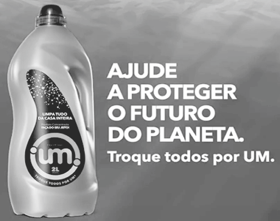
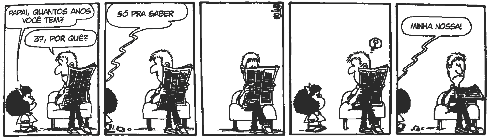
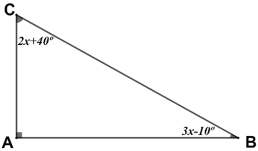
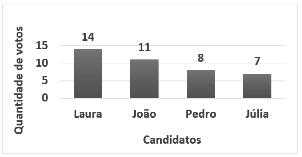
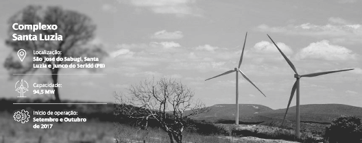

# PROVA — Camara_Conde_2022_Nivel_Fundamental_Completo

## 1. Análise geral da prova

- **Identificação:** Camara_Conde_2022_Nivel_Fundamental_Completo
- **Quantidade total de questões:** 40
- **Quantidade de textos de apoio (grupos):** 4
- **Quantidade de imagens:** 10
- **Quantidade de gráficos e tabelas:** incluídos nas imagens e no texto extraído, quando presentes no PDF original
- **Quantidade de grupos identificados:** 4
- **Quantidade de questões independentes:** 20
- **Questões que compartilham materiais:** texto-base das questões 01 a 10 → questões 01, 02, 03, 04, 05, 06, 07, 08, 09, 10; texto-base das questões 11 a 15 → questões 11, 12, 13, 14, 15; texto-base das questões 16 a 18 → questões 16, 17, 18; texto-base das questões 19 a 20 → questões 19, 20

### Transcrição integral da capa/instruções (conforme extraída do PDF)

> [!NOTE]
> Conteúdo integral das páginas anteriores à primeira questão, sem cortes.

> CMC 2 0 2 2 - F UND COMPL ET O
> Agente Administrativo - Agente de Segurança -
> Auxiliar de Serviços Gerais - Recepcionista - Sonoplasta
> NÍVEL FUNDAMENTAL COMPLETO
> CARGOS:
> EXAME GRAFOTÉCNICO:
> (Transcreva a frase abaixo no local indicado na sua Folha de Respostas)
> “Teu doce nome é motivo de nobreza”
> INSTRUÇÕES:
> CÂMARA MUNICIPAL DE CONDE - PB
> Observe se há falhas ou imperfeições gráficas que causem dúvidas. Caso existam, comunique imediatamente ao Fiscal
> de Sala.
> Verifique se os dados existentes na Folha de Respostas conferem com os dados do Cartão de Inscrição.
> Esta Prova tem duração de 4 (quatro) horas. Não é permitida a saída do candidato antes de esgotado o tempo mínimo de
> 2 (duas) horas. Após esse prazo o candidato poderá destacar o gabarito rascunho da última folha da prova, e levá-lo para
> sua conferência.
> É vetado, durante a prova, o intercâmbio ou empréstimo de material de qualquer natureza entre os candidatos, bem como
> o uso de celulares, calculadoras e/ou qualquer outro tipo de equipamento eletrônico. A fraude, ou tentativa, a indisciplina e
> o desrespeito às autoridades encarregadas dos trabalhos são faltas que eliminam o candidato.
> Assine a Lista de Presença e entregue ao Fiscal de Sala a Folha de Respostas devidamente assinada, bem como o
> Caderno de Prova. O candidato poderá destacar o gabarito rascunho da última folha da prova, e levá-lo para sua
> conferência.
> Verifique se este caderno de provas contém 40 (quarenta) questões de múltipla escolha, sendo Português de 01 a 20,
> Matemática de 21 a 30 e Conhecimentos Gerais de 31 a 40.
>
>
>
>
>
>
> CMC 2 0 2 2 - F UND COMPL ET O
> PÁGINA 03
> Leia os textos I e II para responder às questões 1 a 10:
> Texto I
> A força das embalagens sustentáveis
> Única empresa brasileira de capital aberto focada em embalagens sustentáveis, a receita líquida da Irani cresceu 23% ao
> ano nos últimos cinco anos
> O mercado de embalagens no Brasil movimentou mais de R$ 110 bilhões no ano passado. Desse total, quase R$ 27 bilhões se
> devem ao segmento no qual a Irani atua: o de embalagens sustentáveis. Única empresa brasileira de capital aberto focada em produtos
> do tipo, ela tem ajudado estabelecimentos dos mais diversos setores a diminuir o plástico de uso único.
>
> A Irani produz embalagens sustentáveis com papelão ondulado e papel para embalagens sustentáveis, usado principalmente
> para sacos e sacolas, cada vez mais valorizadas pelas empresas e pelos consumidores.
> Embalagens sustentáveis
> Não à toa, o varejo como um todo está migrando as embalagens de seus produtos para embalagens sustentáveis. A grife Louis
> Vuitton se comprometeu a aderir à tendência e dar adeus completamente ao plástico de uso único até 2030. Já a Heinz anunciou que está
> desenvolvendo embalagens à base de fibra de papel para sua linha de ketchup e demais produtos. São exemplos de um movimento, uma
> tendência secular, que está apenas no começo.
>
> Sustentabilidade é um dos grandes pilares da Irani, que registrou R$ 1,7 bilhão de receita líquida nos últimos 12 meses – e
> produziu 287 mil toneladas de papel para embalagens sustentáveis no mesmo período. Biodegradáveis, elas apresentam menor risco
> ambiental na hora do descarte e são facilmente recicláveis.
> Economia circular
> A Irani, por sinal, aposta na economia circular e é por isso que 72,3% da matéria-prima que ela utiliza é reciclada – a matéria-
> prima de fibra virgem vem de base florestal própria com manejos adequados e certificações ambientais.
>
> A companhia, que viu sua receita líquida crescer 23% nos últimos cinco anos, possui departamentos de pesquisa,
> desenvolvimento e inovação focados em papel, celulose e papelão ondulado e nas áreas florestal, de resina, ambiental e de energia.
> [...] Disponível em: https://exame.com/negocios/embalagens-sustentaveis/. Data do acesso: 20/09/22.
> Texto II
> Disponível em: https://g1.globo.com/sp/itapetininga-regiao/especial-publicitario/um/troque-todos-por-um/noticia/2018/08/01/o-que-e-consumo-consciente-e-por-
> que-ele-e-tao-necessario.ghtml. Data do acesso: 21/09/22.
> PORTUGUÊS
>
>
> 
>
>
>
>
> CMC 2 0 2 2 - F UND COMPL ET O
> PÁGINA 04

## 2. Questões agrupadas

### GRUPO 01 — Texto-base compartilhado pelas questões 01 a 10

**Questões relacionadas:** 01, 02, 03, 04, 05, 06, 07, 08, 09, 10.

#### QUESTÃO 01

⚠️ **Gabarito: oficial não disponível** (sem gabarito no acervo (o PDF 'Gabarito', ID 106, contém a prova; quadro de gabarito rascunho não preenchido))

**Material de apoio:**

Texto I
A força das embalagens sustentáveis
Única empresa brasileira de capital aberto focada em embalagens sustentáveis, a receita líquida da Irani cresceu 23% ao
ano nos últimos cinco anos
O mercado de embalagens no Brasil movimentou mais de R$ 110 bilhões no ano passado. Desse total, quase R$ 27 bilhões se
devem ao segmento no qual a Irani atua: o de embalagens sustentáveis. Única empresa brasileira de capital aberto focada em produtos
do tipo, ela tem ajudado estabelecimentos dos mais diversos setores a diminuir o plástico de uso único.

A Irani produz embalagens sustentáveis com papelão ondulado e papel para embalagens sustentáveis, usado principalmente
para sacos e sacolas, cada vez mais valorizadas pelas empresas e pelos consumidores.
Embalagens sustentáveis
Não à toa, o varejo como um todo está migrando as embalagens de seus produtos para embalagens sustentáveis. A grife Louis
Vuitton se comprometeu a aderir à tendência e dar adeus completamente ao plástico de uso único até 2030. Já a Heinz anunciou que está
desenvolvendo embalagens à base de fibra de papel para sua linha de ketchup e demais produtos. São exemplos de um movimento, uma
tendência secular, que está apenas no começo.

Sustentabilidade é um dos grandes pilares da Irani, que registrou R$ 1,7 bilhão de receita líquida nos últimos 12 meses – e
produziu 287 mil toneladas de papel para embalagens sustentáveis no mesmo período. Biodegradáveis, elas apresentam menor risco
ambiental na hora do descarte e são facilmente recicláveis.
Economia circular
A Irani, por sinal, aposta na economia circular e é por isso que 72,3% da matéria-prima que ela utiliza é reciclada – a matéria-
prima de fibra virgem vem de base florestal própria com manejos adequados e certificações ambientais.

A companhia, que viu sua receita líquida crescer 23% nos últimos cinco anos, possui departamentos de pesquisa,
desenvolvimento e inovação focados em papel, celulose e papelão ondulado e nas áreas florestal, de resina, ambiental e de energia.
[...] Disponível em: https://exame.com/negocios/embalagens-sustentaveis/. Data do acesso: 20/09/22.
Texto II
Disponível em: https://g1.globo.com/sp/itapetininga-regiao/especial-publicitario/um/troque-todos-por-um/noticia/2018/08/01/o-que-e-consumo-consciente-e-por-
que-ele-e-tao-necessario.ghtml. Data do acesso: 21/09/22.
PORTUGUÊS

CMC 2 0 2 2 - F UND COMPL ET O
PÁGINA 04

**Enunciado:**

No que se refere à interpretação textual, ao relacionar os textos I e II, pode-se afirmar que:
I-
Os textos I e II evidenciam ações benéficas ao meio ambiente, realizadas por empresas distintas.
II- Os textos I e II tratam da obsolescência programada, técnica utilizada pelas empresas para aumentar o consumismo, a partir da
fabricação de produtos de forma que se tornem obsoletos.
III- Apenas o texto II trata da obsolescência programada, técnica utilizada pelas empresas para aumentar o consumismo, a partir da
fabricação de produtos de forma que se tornem obsoletos.
IV- A fabricação de embalagens sustentáveis, apresentada nos textos I e II, revela o interesse das empresas no desenvolvimento de um
mercado cada vez mais consciente com a conservação dos recursos naturais.
É CORRETO afirmar apenas em:

**Alternativas:**

A) I.
B) I, III e IV.
C) I, II e IV.
D) I e IV.
E) I e III.

**Referências visuais:**

---

#### QUESTÃO 02

⚠️ **Gabarito: oficial não disponível** (sem gabarito no acervo (o PDF 'Gabarito', ID 106, contém a prova; quadro de gabarito rascunho não preenchido))

**Material de apoio:**

Texto I
A força das embalagens sustentáveis
Única empresa brasileira de capital aberto focada em embalagens sustentáveis, a receita líquida da Irani cresceu 23% ao
ano nos últimos cinco anos
O mercado de embalagens no Brasil movimentou mais de R$ 110 bilhões no ano passado. Desse total, quase R$ 27 bilhões se
devem ao segmento no qual a Irani atua: o de embalagens sustentáveis. Única empresa brasileira de capital aberto focada em produtos
do tipo, ela tem ajudado estabelecimentos dos mais diversos setores a diminuir o plástico de uso único.

A Irani produz embalagens sustentáveis com papelão ondulado e papel para embalagens sustentáveis, usado principalmente
para sacos e sacolas, cada vez mais valorizadas pelas empresas e pelos consumidores.
Embalagens sustentáveis
Não à toa, o varejo como um todo está migrando as embalagens de seus produtos para embalagens sustentáveis. A grife Louis
Vuitton se comprometeu a aderir à tendência e dar adeus completamente ao plástico de uso único até 2030. Já a Heinz anunciou que está
desenvolvendo embalagens à base de fibra de papel para sua linha de ketchup e demais produtos. São exemplos de um movimento, uma
tendência secular, que está apenas no começo.

Sustentabilidade é um dos grandes pilares da Irani, que registrou R$ 1,7 bilhão de receita líquida nos últimos 12 meses – e
produziu 287 mil toneladas de papel para embalagens sustentáveis no mesmo período. Biodegradáveis, elas apresentam menor risco
ambiental na hora do descarte e são facilmente recicláveis.
Economia circular
A Irani, por sinal, aposta na economia circular e é por isso que 72,3% da matéria-prima que ela utiliza é reciclada – a matéria-
prima de fibra virgem vem de base florestal própria com manejos adequados e certificações ambientais.

A companhia, que viu sua receita líquida crescer 23% nos últimos cinco anos, possui departamentos de pesquisa,
desenvolvimento e inovação focados em papel, celulose e papelão ondulado e nas áreas florestal, de resina, ambiental e de energia.
[...] Disponível em: https://exame.com/negocios/embalagens-sustentaveis/. Data do acesso: 20/09/22.
Texto II
Disponível em: https://g1.globo.com/sp/itapetininga-regiao/especial-publicitario/um/troque-todos-por-um/noticia/2018/08/01/o-que-e-consumo-consciente-e-por-
que-ele-e-tao-necessario.ghtml. Data do acesso: 21/09/22.
PORTUGUÊS

CMC 2 0 2 2 - F UND COMPL ET O
PÁGINA 04

**Enunciado:**

De acordo com o texto I, é INCORRETO afirmar que a empresa Irani:

**Alternativas:**

A) Contribuiu para o mercado de embalagens sustentáveis no Brasil movimentar, em apenas um ano, aproximadamente R$ 27 bilhões.
B) Fabrica embalagens que são biodegradáveis.
C) É a única do Brasil que produz embalagens sustentáveis.
D) Desenvolve papel para embalagens sustentáveis, destinado, precipuamente, à produção de sacos e sacolas.
E) Abrange setores de desenvolvimento e inovação voltados para papel, celulose e papelão ondulado, além das áreas florestal, de
resina, ambiental e de energia.

**Referências visuais:**

---

#### QUESTÃO 03

⚠️ **Gabarito: oficial não disponível** (sem gabarito no acervo (o PDF 'Gabarito', ID 106, contém a prova; quadro de gabarito rascunho não preenchido))

**Material de apoio:**

Texto I
A força das embalagens sustentáveis
Única empresa brasileira de capital aberto focada em embalagens sustentáveis, a receita líquida da Irani cresceu 23% ao
ano nos últimos cinco anos
O mercado de embalagens no Brasil movimentou mais de R$ 110 bilhões no ano passado. Desse total, quase R$ 27 bilhões se
devem ao segmento no qual a Irani atua: o de embalagens sustentáveis. Única empresa brasileira de capital aberto focada em produtos
do tipo, ela tem ajudado estabelecimentos dos mais diversos setores a diminuir o plástico de uso único.

A Irani produz embalagens sustentáveis com papelão ondulado e papel para embalagens sustentáveis, usado principalmente
para sacos e sacolas, cada vez mais valorizadas pelas empresas e pelos consumidores.
Embalagens sustentáveis
Não à toa, o varejo como um todo está migrando as embalagens de seus produtos para embalagens sustentáveis. A grife Louis
Vuitton se comprometeu a aderir à tendência e dar adeus completamente ao plástico de uso único até 2030. Já a Heinz anunciou que está
desenvolvendo embalagens à base de fibra de papel para sua linha de ketchup e demais produtos. São exemplos de um movimento, uma
tendência secular, que está apenas no começo.

Sustentabilidade é um dos grandes pilares da Irani, que registrou R$ 1,7 bilhão de receita líquida nos últimos 12 meses – e
produziu 287 mil toneladas de papel para embalagens sustentáveis no mesmo período. Biodegradáveis, elas apresentam menor risco
ambiental na hora do descarte e são facilmente recicláveis.
Economia circular
A Irani, por sinal, aposta na economia circular e é por isso que 72,3% da matéria-prima que ela utiliza é reciclada – a matéria-
prima de fibra virgem vem de base florestal própria com manejos adequados e certificações ambientais.

A companhia, que viu sua receita líquida crescer 23% nos últimos cinco anos, possui departamentos de pesquisa,
desenvolvimento e inovação focados em papel, celulose e papelão ondulado e nas áreas florestal, de resina, ambiental e de energia.
[...] Disponível em: https://exame.com/negocios/embalagens-sustentaveis/. Data do acesso: 20/09/22.
Texto II
Disponível em: https://g1.globo.com/sp/itapetininga-regiao/especial-publicitario/um/troque-todos-por-um/noticia/2018/08/01/o-que-e-consumo-consciente-e-por-
que-ele-e-tao-necessario.ghtml. Data do acesso: 21/09/22.
PORTUGUÊS

CMC 2 0 2 2 - F UND COMPL ET O
PÁGINA 04

**Enunciado:**

Com base na leitura dos recursos visuais não-verbais e verbais presentes no texto II, percebe-se que o termo “UM” gera efeito de humor
ao apresentar duas possibilidades de classificação gramatical:

**Alternativas:**

A) Artigo e numeral.
B) Numeral e adjetivo.
C) Numeral e substantivo.
D) Artigo e substantivo.
E) Artigo e adjetivo.

**Referências visuais:**

---

#### QUESTÃO 04

⚠️ **Gabarito: oficial não disponível** (sem gabarito no acervo (o PDF 'Gabarito', ID 106, contém a prova; quadro de gabarito rascunho não preenchido))

**Material de apoio:**

Texto I
A força das embalagens sustentáveis
Única empresa brasileira de capital aberto focada em embalagens sustentáveis, a receita líquida da Irani cresceu 23% ao
ano nos últimos cinco anos
O mercado de embalagens no Brasil movimentou mais de R$ 110 bilhões no ano passado. Desse total, quase R$ 27 bilhões se
devem ao segmento no qual a Irani atua: o de embalagens sustentáveis. Única empresa brasileira de capital aberto focada em produtos
do tipo, ela tem ajudado estabelecimentos dos mais diversos setores a diminuir o plástico de uso único.

A Irani produz embalagens sustentáveis com papelão ondulado e papel para embalagens sustentáveis, usado principalmente
para sacos e sacolas, cada vez mais valorizadas pelas empresas e pelos consumidores.
Embalagens sustentáveis
Não à toa, o varejo como um todo está migrando as embalagens de seus produtos para embalagens sustentáveis. A grife Louis
Vuitton se comprometeu a aderir à tendência e dar adeus completamente ao plástico de uso único até 2030. Já a Heinz anunciou que está
desenvolvendo embalagens à base de fibra de papel para sua linha de ketchup e demais produtos. São exemplos de um movimento, uma
tendência secular, que está apenas no começo.

Sustentabilidade é um dos grandes pilares da Irani, que registrou R$ 1,7 bilhão de receita líquida nos últimos 12 meses – e
produziu 287 mil toneladas de papel para embalagens sustentáveis no mesmo período. Biodegradáveis, elas apresentam menor risco
ambiental na hora do descarte e são facilmente recicláveis.
Economia circular
A Irani, por sinal, aposta na economia circular e é por isso que 72,3% da matéria-prima que ela utiliza é reciclada – a matéria-
prima de fibra virgem vem de base florestal própria com manejos adequados e certificações ambientais.

A companhia, que viu sua receita líquida crescer 23% nos últimos cinco anos, possui departamentos de pesquisa,
desenvolvimento e inovação focados em papel, celulose e papelão ondulado e nas áreas florestal, de resina, ambiental e de energia.
[...] Disponível em: https://exame.com/negocios/embalagens-sustentaveis/. Data do acesso: 20/09/22.
Texto II
Disponível em: https://g1.globo.com/sp/itapetininga-regiao/especial-publicitario/um/troque-todos-por-um/noticia/2018/08/01/o-que-e-consumo-consciente-e-por-
que-ele-e-tao-necessario.ghtml. Data do acesso: 21/09/22.
PORTUGUÊS

CMC 2 0 2 2 - F UND COMPL ET O
PÁGINA 04

**Enunciado:**

O termo sublinhado no trecho “Não à toa, o varejo como um todo está migrando as embalagens de seus produtos para embalagens
sustentáveis” é classificado como:

**Alternativas:**

A) Locução prepositiva, podendo ser substituído, sem prejuízo de função e sentido, por “Sem dúvida”.
B) Locução adverbial, podendo ser substituído, sem prejuízo de função e sentido, por “Com efeito”.
C) Locução prepositiva, podendo ser substituído, sem prejuízo de função e sentido, por “Não por acaso”.
D) Locução adverbial, podendo ser substituído, sem prejuízo de função e sentido, por “ Sem dúvida”.
E) Locução adverbial, podendo ser substituído, sem prejuízo de função e de sentido, por “Não por acaso”.

**Referências visuais:**

---

#### QUESTÃO 05

⚠️ **Gabarito: oficial não disponível** (sem gabarito no acervo (o PDF 'Gabarito', ID 106, contém a prova; quadro de gabarito rascunho não preenchido))

**Material de apoio:**

Texto I
A força das embalagens sustentáveis
Única empresa brasileira de capital aberto focada em embalagens sustentáveis, a receita líquida da Irani cresceu 23% ao
ano nos últimos cinco anos
O mercado de embalagens no Brasil movimentou mais de R$ 110 bilhões no ano passado. Desse total, quase R$ 27 bilhões se
devem ao segmento no qual a Irani atua: o de embalagens sustentáveis. Única empresa brasileira de capital aberto focada em produtos
do tipo, ela tem ajudado estabelecimentos dos mais diversos setores a diminuir o plástico de uso único.

A Irani produz embalagens sustentáveis com papelão ondulado e papel para embalagens sustentáveis, usado principalmente
para sacos e sacolas, cada vez mais valorizadas pelas empresas e pelos consumidores.
Embalagens sustentáveis
Não à toa, o varejo como um todo está migrando as embalagens de seus produtos para embalagens sustentáveis. A grife Louis
Vuitton se comprometeu a aderir à tendência e dar adeus completamente ao plástico de uso único até 2030. Já a Heinz anunciou que está
desenvolvendo embalagens à base de fibra de papel para sua linha de ketchup e demais produtos. São exemplos de um movimento, uma
tendência secular, que está apenas no começo.

Sustentabilidade é um dos grandes pilares da Irani, que registrou R$ 1,7 bilhão de receita líquida nos últimos 12 meses – e
produziu 287 mil toneladas de papel para embalagens sustentáveis no mesmo período. Biodegradáveis, elas apresentam menor risco
ambiental na hora do descarte e são facilmente recicláveis.
Economia circular
A Irani, por sinal, aposta na economia circular e é por isso que 72,3% da matéria-prima que ela utiliza é reciclada – a matéria-
prima de fibra virgem vem de base florestal própria com manejos adequados e certificações ambientais.

A companhia, que viu sua receita líquida crescer 23% nos últimos cinco anos, possui departamentos de pesquisa,
desenvolvimento e inovação focados em papel, celulose e papelão ondulado e nas áreas florestal, de resina, ambiental e de energia.
[...] Disponível em: https://exame.com/negocios/embalagens-sustentaveis/. Data do acesso: 20/09/22.
Texto II
Disponível em: https://g1.globo.com/sp/itapetininga-regiao/especial-publicitario/um/troque-todos-por-um/noticia/2018/08/01/o-que-e-consumo-consciente-e-por-
que-ele-e-tao-necessario.ghtml. Data do acesso: 21/09/22.
PORTUGUÊS

CMC 2 0 2 2 - F UND COMPL ET O
PÁGINA 04

**Enunciado:**

Leia o seguinte trecho do texto I:

“[…] a matéria-prima de fibra virgem vem de base florestal própria com manejos adequados e certificações ambientais.”
Considerando a concordância verbo-nominal, ao se passar o termo em destaque para o plural, a estrutura, de acordo com a norma
padrão, ficará:

**Alternativas:**

A) As matéria-primas de fibra virgem vem de base florestal própria com manejos adequados e certificações ambientais.
B) As matéria-primas de fibra virgem vêm de base florestal própria com manejos adequados e certificações ambientais.
C) As matérias-prima de fibra virgem vêm de base florestal própria com manejos adequados e certificações ambientais.
D) As matérias-primas de fibra virgem vem de base florestal própria com manejos adequados e certificações ambientais.
E) As matérias-primas de fibra virgem vêm de base florestal própria com manejos adequados e certificações ambientais.
CMC 2 0 2 2 - F UND COMPL ET O
PÁGINA 05

**Referências visuais:**

---

#### QUESTÃO 06

⚠️ **Gabarito: oficial não disponível** (sem gabarito no acervo (o PDF 'Gabarito', ID 106, contém a prova; quadro de gabarito rascunho não preenchido))

**Material de apoio:**

Texto I
A força das embalagens sustentáveis
Única empresa brasileira de capital aberto focada em embalagens sustentáveis, a receita líquida da Irani cresceu 23% ao
ano nos últimos cinco anos
O mercado de embalagens no Brasil movimentou mais de R$ 110 bilhões no ano passado. Desse total, quase R$ 27 bilhões se
devem ao segmento no qual a Irani atua: o de embalagens sustentáveis. Única empresa brasileira de capital aberto focada em produtos
do tipo, ela tem ajudado estabelecimentos dos mais diversos setores a diminuir o plástico de uso único.

A Irani produz embalagens sustentáveis com papelão ondulado e papel para embalagens sustentáveis, usado principalmente
para sacos e sacolas, cada vez mais valorizadas pelas empresas e pelos consumidores.
Embalagens sustentáveis
Não à toa, o varejo como um todo está migrando as embalagens de seus produtos para embalagens sustentáveis. A grife Louis
Vuitton se comprometeu a aderir à tendência e dar adeus completamente ao plástico de uso único até 2030. Já a Heinz anunciou que está
desenvolvendo embalagens à base de fibra de papel para sua linha de ketchup e demais produtos. São exemplos de um movimento, uma
tendência secular, que está apenas no começo.

Sustentabilidade é um dos grandes pilares da Irani, que registrou R$ 1,7 bilhão de receita líquida nos últimos 12 meses – e
produziu 287 mil toneladas de papel para embalagens sustentáveis no mesmo período. Biodegradáveis, elas apresentam menor risco
ambiental na hora do descarte e são facilmente recicláveis.
Economia circular
A Irani, por sinal, aposta na economia circular e é por isso que 72,3% da matéria-prima que ela utiliza é reciclada – a matéria-
prima de fibra virgem vem de base florestal própria com manejos adequados e certificações ambientais.

A companhia, que viu sua receita líquida crescer 23% nos últimos cinco anos, possui departamentos de pesquisa,
desenvolvimento e inovação focados em papel, celulose e papelão ondulado e nas áreas florestal, de resina, ambiental e de energia.
[...] Disponível em: https://exame.com/negocios/embalagens-sustentaveis/. Data do acesso: 20/09/22.
Texto II
Disponível em: https://g1.globo.com/sp/itapetininga-regiao/especial-publicitario/um/troque-todos-por-um/noticia/2018/08/01/o-que-e-consumo-consciente-e-por-
que-ele-e-tao-necessario.ghtml. Data do acesso: 21/09/22.
PORTUGUÊS

CMC 2 0 2 2 - F UND COMPL ET O
PÁGINA 04

**Enunciado:**

Do ponto de vista da classificação gramatical, a sequência que apresenta a classificação CORRETA das palavras que formam a oração
“Limpa tudo da casa inteira” é:

**Alternativas:**

A) verbo, pronome, preposição, substantivo, substantivo.
B) substantivo, pronome, preposição, substantivo, substantivo.
C) verbo, pronome, preposição, substantivo, adjetivo.
D) adjetivo, conjunção, preposição, adjetivo, pronome .
E) verbo, adjetivo, preposição, substantivo, substantivo.

**Referências visuais:**

---

#### QUESTÃO 07

⚠️ **Gabarito: oficial não disponível** (sem gabarito no acervo (o PDF 'Gabarito', ID 106, contém a prova; quadro de gabarito rascunho não preenchido))

**Material de apoio:**

Texto I
A força das embalagens sustentáveis
Única empresa brasileira de capital aberto focada em embalagens sustentáveis, a receita líquida da Irani cresceu 23% ao
ano nos últimos cinco anos
O mercado de embalagens no Brasil movimentou mais de R$ 110 bilhões no ano passado. Desse total, quase R$ 27 bilhões se
devem ao segmento no qual a Irani atua: o de embalagens sustentáveis. Única empresa brasileira de capital aberto focada em produtos
do tipo, ela tem ajudado estabelecimentos dos mais diversos setores a diminuir o plástico de uso único.

A Irani produz embalagens sustentáveis com papelão ondulado e papel para embalagens sustentáveis, usado principalmente
para sacos e sacolas, cada vez mais valorizadas pelas empresas e pelos consumidores.
Embalagens sustentáveis
Não à toa, o varejo como um todo está migrando as embalagens de seus produtos para embalagens sustentáveis. A grife Louis
Vuitton se comprometeu a aderir à tendência e dar adeus completamente ao plástico de uso único até 2030. Já a Heinz anunciou que está
desenvolvendo embalagens à base de fibra de papel para sua linha de ketchup e demais produtos. São exemplos de um movimento, uma
tendência secular, que está apenas no começo.

Sustentabilidade é um dos grandes pilares da Irani, que registrou R$ 1,7 bilhão de receita líquida nos últimos 12 meses – e
produziu 287 mil toneladas de papel para embalagens sustentáveis no mesmo período. Biodegradáveis, elas apresentam menor risco
ambiental na hora do descarte e são facilmente recicláveis.
Economia circular
A Irani, por sinal, aposta na economia circular e é por isso que 72,3% da matéria-prima que ela utiliza é reciclada – a matéria-
prima de fibra virgem vem de base florestal própria com manejos adequados e certificações ambientais.

A companhia, que viu sua receita líquida crescer 23% nos últimos cinco anos, possui departamentos de pesquisa,
desenvolvimento e inovação focados em papel, celulose e papelão ondulado e nas áreas florestal, de resina, ambiental e de energia.
[...] Disponível em: https://exame.com/negocios/embalagens-sustentaveis/. Data do acesso: 20/09/22.
Texto II
Disponível em: https://g1.globo.com/sp/itapetininga-regiao/especial-publicitario/um/troque-todos-por-um/noticia/2018/08/01/o-que-e-consumo-consciente-e-por-
que-ele-e-tao-necessario.ghtml. Data do acesso: 21/09/22.
PORTUGUÊS

CMC 2 0 2 2 - F UND COMPL ET O
PÁGINA 04

**Enunciado:**

Com base na leitura do texto II, pode-se dizer que o sujeito da oração “Limpa tudo da casa inteira” é:
a) Simples.

c) Composto.

e) Indeterminado.
b) Oculto.

d) Inexistente.

**Referências visuais:**

---

#### QUESTÃO 08

⚠️ **Gabarito: oficial não disponível** (sem gabarito no acervo (o PDF 'Gabarito', ID 106, contém a prova; quadro de gabarito rascunho não preenchido))

**Material de apoio:**

Texto I
A força das embalagens sustentáveis
Única empresa brasileira de capital aberto focada em embalagens sustentáveis, a receita líquida da Irani cresceu 23% ao
ano nos últimos cinco anos
O mercado de embalagens no Brasil movimentou mais de R$ 110 bilhões no ano passado. Desse total, quase R$ 27 bilhões se
devem ao segmento no qual a Irani atua: o de embalagens sustentáveis. Única empresa brasileira de capital aberto focada em produtos
do tipo, ela tem ajudado estabelecimentos dos mais diversos setores a diminuir o plástico de uso único.

A Irani produz embalagens sustentáveis com papelão ondulado e papel para embalagens sustentáveis, usado principalmente
para sacos e sacolas, cada vez mais valorizadas pelas empresas e pelos consumidores.
Embalagens sustentáveis
Não à toa, o varejo como um todo está migrando as embalagens de seus produtos para embalagens sustentáveis. A grife Louis
Vuitton se comprometeu a aderir à tendência e dar adeus completamente ao plástico de uso único até 2030. Já a Heinz anunciou que está
desenvolvendo embalagens à base de fibra de papel para sua linha de ketchup e demais produtos. São exemplos de um movimento, uma
tendência secular, que está apenas no começo.

Sustentabilidade é um dos grandes pilares da Irani, que registrou R$ 1,7 bilhão de receita líquida nos últimos 12 meses – e
produziu 287 mil toneladas de papel para embalagens sustentáveis no mesmo período. Biodegradáveis, elas apresentam menor risco
ambiental na hora do descarte e são facilmente recicláveis.
Economia circular
A Irani, por sinal, aposta na economia circular e é por isso que 72,3% da matéria-prima que ela utiliza é reciclada – a matéria-
prima de fibra virgem vem de base florestal própria com manejos adequados e certificações ambientais.

A companhia, que viu sua receita líquida crescer 23% nos últimos cinco anos, possui departamentos de pesquisa,
desenvolvimento e inovação focados em papel, celulose e papelão ondulado e nas áreas florestal, de resina, ambiental e de energia.
[...] Disponível em: https://exame.com/negocios/embalagens-sustentaveis/. Data do acesso: 20/09/22.
Texto II
Disponível em: https://g1.globo.com/sp/itapetininga-regiao/especial-publicitario/um/troque-todos-por-um/noticia/2018/08/01/o-que-e-consumo-consciente-e-por-
que-ele-e-tao-necessario.ghtml. Data do acesso: 21/09/22.
PORTUGUÊS

CMC 2 0 2 2 - F UND COMPL ET O
PÁGINA 04

**Enunciado:**

Leia os trechos a seguir, retirados do texto I:
I-
“Sustentabilidade é um dos grandes pilares da Irani, que registrou R$ 1,7 bilhão de receita líquida nos últimos 12 meses – e
produziu 287 mil toneladas de papel para embalagens sustentáveis no mesmo período.”
II- “A Irani, por sinal, aposta na economia circular e é por isso que 72,3% da matéria-prima que ela utiliza é reciclada – a matéria-
prima de fibra virgem vem de base florestal própria com manejos adequados e certificações ambientais.”
III- “A companhia, que viu sua receita líquida crescer 23% nos últimos cinco anos, possui departamentos de pesquisa,
desenvolvimento e inovação focados em papel, celulose e papelão ondulado e nas áreas florestal, de resina, ambiental e de
energia.”
Acerca dos usos dos sinais de pontuação que aparecem sublinhados, atribua (F), se falsa, e (V), se verdadeira, para cada assertiva
abaixo:
( ) No trecho I, as vírgulas foram empregadas para separar oração de valor explicativo.
( ) No trecho II, o uso das vírgulas se justifica por separar uma expressão que indica uma nova informação relacionada ao que foi
apresentado anteriormente.
( ) No trecho III, as vírgulas foram utilizadas pela necessidade de enumerar os ramos de atuação da empresa Irani em
desenvolvimento e inovação.
( ) No trecho I, o emprego do travessão destaca uma informação considerada relevante, indicando pausa maior quando comparado
ao emprego da vírgula.
( ) No trecho II, o travessão foi empregado com a função de enfatizar uma informação considerada relevante, indicando pausa menor
quando comparado ao emprego da vírgula.
A sequência CORRETA obtida no sentido de cima para baixo é:

**Alternativas:**

A) V, V, V, V, F.
B) F, F, V, F, V.
C) V, V, V, F, V.
D) V, F, F, V, F.
E) F, V, F, V, V.

**Referências visuais:**

---

#### QUESTÃO 09

⚠️ **Gabarito: oficial não disponível** (sem gabarito no acervo (o PDF 'Gabarito', ID 106, contém a prova; quadro de gabarito rascunho não preenchido))

**Material de apoio:**

Texto I
A força das embalagens sustentáveis
Única empresa brasileira de capital aberto focada em embalagens sustentáveis, a receita líquida da Irani cresceu 23% ao
ano nos últimos cinco anos
O mercado de embalagens no Brasil movimentou mais de R$ 110 bilhões no ano passado. Desse total, quase R$ 27 bilhões se
devem ao segmento no qual a Irani atua: o de embalagens sustentáveis. Única empresa brasileira de capital aberto focada em produtos
do tipo, ela tem ajudado estabelecimentos dos mais diversos setores a diminuir o plástico de uso único.

A Irani produz embalagens sustentáveis com papelão ondulado e papel para embalagens sustentáveis, usado principalmente
para sacos e sacolas, cada vez mais valorizadas pelas empresas e pelos consumidores.
Embalagens sustentáveis
Não à toa, o varejo como um todo está migrando as embalagens de seus produtos para embalagens sustentáveis. A grife Louis
Vuitton se comprometeu a aderir à tendência e dar adeus completamente ao plástico de uso único até 2030. Já a Heinz anunciou que está
desenvolvendo embalagens à base de fibra de papel para sua linha de ketchup e demais produtos. São exemplos de um movimento, uma
tendência secular, que está apenas no começo.

Sustentabilidade é um dos grandes pilares da Irani, que registrou R$ 1,7 bilhão de receita líquida nos últimos 12 meses – e
produziu 287 mil toneladas de papel para embalagens sustentáveis no mesmo período. Biodegradáveis, elas apresentam menor risco
ambiental na hora do descarte e são facilmente recicláveis.
Economia circular
A Irani, por sinal, aposta na economia circular e é por isso que 72,3% da matéria-prima que ela utiliza é reciclada – a matéria-
prima de fibra virgem vem de base florestal própria com manejos adequados e certificações ambientais.

A companhia, que viu sua receita líquida crescer 23% nos últimos cinco anos, possui departamentos de pesquisa,
desenvolvimento e inovação focados em papel, celulose e papelão ondulado e nas áreas florestal, de resina, ambiental e de energia.
[...] Disponível em: https://exame.com/negocios/embalagens-sustentaveis/. Data do acesso: 20/09/22.
Texto II
Disponível em: https://g1.globo.com/sp/itapetininga-regiao/especial-publicitario/um/troque-todos-por-um/noticia/2018/08/01/o-que-e-consumo-consciente-e-por-
que-ele-e-tao-necessario.ghtml. Data do acesso: 21/09/22.
PORTUGUÊS

CMC 2 0 2 2 - F UND COMPL ET O
PÁGINA 04

**Enunciado:**

Quanto à acentuação gráfica, considerando os vocábulos sustentáveis, plástico e tendência, é CORRETO afirmar que:

**Alternativas:**

A) Dois vocábulos são proparoxítonos e um vocábulo é oxítono.
B) Dois vocábulos são proparoxítonos e um vocábulo é paroxítono.
C) Todos os vocábulos são proparoxítonos.
D) Dois vocábulos são paroxítonos e um vocábulo é proparoxítono.
E) Todos os vocábulos são paroxítonos.

**Referências visuais:**

---

#### QUESTÃO 10

⚠️ **Gabarito: oficial não disponível** (sem gabarito no acervo (o PDF 'Gabarito', ID 106, contém a prova; quadro de gabarito rascunho não preenchido))

**Material de apoio:**

Texto I
A força das embalagens sustentáveis
Única empresa brasileira de capital aberto focada em embalagens sustentáveis, a receita líquida da Irani cresceu 23% ao
ano nos últimos cinco anos
O mercado de embalagens no Brasil movimentou mais de R$ 110 bilhões no ano passado. Desse total, quase R$ 27 bilhões se
devem ao segmento no qual a Irani atua: o de embalagens sustentáveis. Única empresa brasileira de capital aberto focada em produtos
do tipo, ela tem ajudado estabelecimentos dos mais diversos setores a diminuir o plástico de uso único.

A Irani produz embalagens sustentáveis com papelão ondulado e papel para embalagens sustentáveis, usado principalmente
para sacos e sacolas, cada vez mais valorizadas pelas empresas e pelos consumidores.
Embalagens sustentáveis
Não à toa, o varejo como um todo está migrando as embalagens de seus produtos para embalagens sustentáveis. A grife Louis
Vuitton se comprometeu a aderir à tendência e dar adeus completamente ao plástico de uso único até 2030. Já a Heinz anunciou que está
desenvolvendo embalagens à base de fibra de papel para sua linha de ketchup e demais produtos. São exemplos de um movimento, uma
tendência secular, que está apenas no começo.

Sustentabilidade é um dos grandes pilares da Irani, que registrou R$ 1,7 bilhão de receita líquida nos últimos 12 meses – e
produziu 287 mil toneladas de papel para embalagens sustentáveis no mesmo período. Biodegradáveis, elas apresentam menor risco
ambiental na hora do descarte e são facilmente recicláveis.
Economia circular
A Irani, por sinal, aposta na economia circular e é por isso que 72,3% da matéria-prima que ela utiliza é reciclada – a matéria-
prima de fibra virgem vem de base florestal própria com manejos adequados e certificações ambientais.

A companhia, que viu sua receita líquida crescer 23% nos últimos cinco anos, possui departamentos de pesquisa,
desenvolvimento e inovação focados em papel, celulose e papelão ondulado e nas áreas florestal, de resina, ambiental e de energia.
[...] Disponível em: https://exame.com/negocios/embalagens-sustentaveis/. Data do acesso: 20/09/22.
Texto II
Disponível em: https://g1.globo.com/sp/itapetininga-regiao/especial-publicitario/um/troque-todos-por-um/noticia/2018/08/01/o-que-e-consumo-consciente-e-por-
que-ele-e-tao-necessario.ghtml. Data do acesso: 21/09/22.
PORTUGUÊS

CMC 2 0 2 2 - F UND COMPL ET O
PÁGINA 04

**Enunciado:**

As palavras destacadas em “[…] plástico de uso único” e “[…] está apenas no começo” se formaram, respectivamente, por:

**Alternativas:**

A) Derivação regressiva e derivação regressiva.
B) Composição por aglutinação e derivação regressiva.
C) Derivação imprópria e derivação imprópria.
D) Derivação imprópria e derivação regressiva.
E) Derivação regressiva e composição por aglutinação.
CMC 2 0 2 2 - F UND COMPL ET O
PÁGINA 06
Leia o texto III para responder às questões 11 a 15:
Texto III
Manual: como ter uma coleção de discos de vinil?
Aprenda os truques na hora da compra, como escolher a vitrola ideal – e como conservar os LPs do jeito certo.
1 – Pense se vale a pena
Colecionar discos de vinil é um hobby caro: os mais vendidos no site da Amazon custam uns R$ 200. E a qualidade do som não é
necessariamente maior. Streaming de boa qualidade (320 kbps) passa até pelo crivo de audiófilos radicais.
A graça é o fetiche com o objeto e com a mecânica da reprodução sonora. Os apreciadores costumam reservar um tempo para ouvir
as músicas com calma, ler a ficha técnica de cada faixa, admirar o encarte... Se não for a sua praia, fique só com o streaming.
2 – Bico de arqueólogo
Garimpe sebos e lojas especializadas. Bazares beneficentes e vendas de garagem costumam ter discos raros por preços mais
atraentes. Para saber se o achado está em boas condições, use a lanterna do celular para procurar por ranhuras e passe o dedo nelas. Se
sentir alguma saliência, o LP vai dar problema.
3 – A vitrola
Há dois caminhos: comprar um equipamento antigo (ótimos na fidelidade do som, mas que costumam precisar de reparos) ou um
novo. Preste atenção se o modelo tem opções como velocidade de rotação, contrapeso e antitasking – os dois últimos estão
relacionados ao braço e à agulha, o que ajuda a evitar riscos.
4 – Xô, poeira
Para conservar os discos, lave-os com sabão neutro, usando sempre o lado macio da esponja. Depois, enxague em água corrente e
deixe secar. Troque os plásticos interno e externo do LP (dá para comprar embalagens novas pela internet), guarde-os longe do sol e na
vertical – empilhá-los pode fazer com que os discos entortem com o tempo.
Consultoria: Bento Araújo (@poeirazine), escritor, podcaster e colecionador de discos.
Disponível em: https://super.abril.com.br/cultura/manual-como-ter-uma-colecao-de-discos-de-vinil/. Data do acesso: 20/09/22.

**Referências visuais:**

---

### GRUPO 02 — Texto-base compartilhado pelas questões 11 a 15

**Questões relacionadas:** 11, 12, 13, 14, 15.

#### QUESTÃO 11

⚠️ **Gabarito: oficial não disponível** (sem gabarito no acervo (o PDF 'Gabarito', ID 106, contém a prova; quadro de gabarito rascunho não preenchido))

**Material de apoio:**

10ª QUESTÃO
As palavras destacadas em “[…] plástico de uso único” e “[…] está apenas no começo” se formaram, respectivamente, por:
a) Derivação regressiva e derivação regressiva.
b) Composição por aglutinação e derivação regressiva.
c) Derivação imprópria e derivação imprópria.
d) Derivação imprópria e derivação regressiva.
e) Derivação regressiva e composição por aglutinação.

CMC 2 0 2 2 - F UND COMPL ET O
PÁGINA 06
Leia o texto III para responder às :
Texto III
Manual: como ter uma coleção de discos de vinil?
Aprenda os truques na hora da compra, como escolher a vitrola ideal – e como conservar os LPs do jeito certo.
1 – Pense se vale a pena
Colecionar discos de vinil é um hobby caro: os mais vendidos no site da Amazon custam uns R$ 200. E a qualidade do som não é
necessariamente maior. Streaming de boa qualidade (320 kbps) passa até pelo crivo de audiófilos radicais.

A graça é o fetiche com o objeto e com a mecânica da reprodução sonora. Os apreciadores costumam reservar um tempo para ouvir
as músicas com calma, ler a ficha técnica de cada faixa, admirar o encarte... Se não for a sua praia, fique só com o streaming.
2 – Bico de arqueólogo
Garimpe sebos e lojas especializadas. Bazares beneficentes e vendas de garagem costumam ter discos raros por preços mais
atraentes. Para saber se o achado está em boas condições, use a lanterna do celular para procurar por ranhuras e passe o dedo nelas. Se
sentir alguma saliência, o LP vai dar problema.
3 – A vitrola
Há dois caminhos: comprar um equipamento antigo (ótimos na fidelidade do som, mas que costumam precisar de reparos) ou um
novo. Preste atenção se o modelo tem opções como velocidade de rotação, contrapeso e antitasking – os dois últimos estão
relacionados ao braço e à agulha, o que ajuda a evitar riscos.
4 – Xô, poeira
Para conservar os discos, lave-os com sabão neutro, usando sempre o lado macio da esponja. Depois, enxague em água corrente e
deixe secar. Troque os plásticos interno e externo do LP (dá para comprar embalagens novas pela internet), guarde-os longe do sol e na
vertical – empilhá-los pode fazer com que os discos entortem com o tempo.
Consultoria: Bento Araújo (@poeirazine), escritor, podcaster e colecionador de discos.
Disponível em: https://super.abril.com.br/cultura/manual-como-ter-uma-colecao-de-discos-de-vinil/. Data do acesso: 20/09/22.

**Enunciado:**

Com base na leitura do texto III, pode-se afirmar que:
I-
O texto apresenta truques relacionados à compra de discos de vinil e de vitrola em “1- Pense se vale a pena”.
II- Pode-se notar que o autor do texto, através do uso de termo em sentido conotativo, considera que os discos de vinil são objetos
raros e antigos.
III- De acordo com as informações presentes no texto, colecionar discos é algo inútil, sem proveito.
IV- O autor do texto afirma que é melhor ouvir músicas pelo streaming que através dos discos de vinil.
Está CORRETO o que se afirma apenas em:

**Alternativas:**

A) II e IV.
B) I e II.
C) I e III.
D) II.
E) I, III e IV.

**Referências visuais:**

Nenhuma.

---

#### QUESTÃO 12

⚠️ **Gabarito: oficial não disponível** (sem gabarito no acervo (o PDF 'Gabarito', ID 106, contém a prova; quadro de gabarito rascunho não preenchido))

**Material de apoio:**

10ª QUESTÃO
As palavras destacadas em “[…] plástico de uso único” e “[…] está apenas no começo” se formaram, respectivamente, por:
a) Derivação regressiva e derivação regressiva.
b) Composição por aglutinação e derivação regressiva.
c) Derivação imprópria e derivação imprópria.
d) Derivação imprópria e derivação regressiva.
e) Derivação regressiva e composição por aglutinação.

CMC 2 0 2 2 - F UND COMPL ET O
PÁGINA 06
Leia o texto III para responder às :
Texto III
Manual: como ter uma coleção de discos de vinil?
Aprenda os truques na hora da compra, como escolher a vitrola ideal – e como conservar os LPs do jeito certo.
1 – Pense se vale a pena
Colecionar discos de vinil é um hobby caro: os mais vendidos no site da Amazon custam uns R$ 200. E a qualidade do som não é
necessariamente maior. Streaming de boa qualidade (320 kbps) passa até pelo crivo de audiófilos radicais.

A graça é o fetiche com o objeto e com a mecânica da reprodução sonora. Os apreciadores costumam reservar um tempo para ouvir
as músicas com calma, ler a ficha técnica de cada faixa, admirar o encarte... Se não for a sua praia, fique só com o streaming.
2 – Bico de arqueólogo
Garimpe sebos e lojas especializadas. Bazares beneficentes e vendas de garagem costumam ter discos raros por preços mais
atraentes. Para saber se o achado está em boas condições, use a lanterna do celular para procurar por ranhuras e passe o dedo nelas. Se
sentir alguma saliência, o LP vai dar problema.
3 – A vitrola
Há dois caminhos: comprar um equipamento antigo (ótimos na fidelidade do som, mas que costumam precisar de reparos) ou um
novo. Preste atenção se o modelo tem opções como velocidade de rotação, contrapeso e antitasking – os dois últimos estão
relacionados ao braço e à agulha, o que ajuda a evitar riscos.
4 – Xô, poeira
Para conservar os discos, lave-os com sabão neutro, usando sempre o lado macio da esponja. Depois, enxague em água corrente e
deixe secar. Troque os plásticos interno e externo do LP (dá para comprar embalagens novas pela internet), guarde-os longe do sol e na
vertical – empilhá-los pode fazer com que os discos entortem com o tempo.
Consultoria: Bento Araújo (@poeirazine), escritor, podcaster e colecionador de discos.
Disponível em: https://super.abril.com.br/cultura/manual-como-ter-uma-colecao-de-discos-de-vinil/. Data do acesso: 20/09/22.

**Enunciado:**

Assinale a alternativa que melhor aponta o objetivo central do texto:

**Alternativas:**

A) Instruir, o que justifica a prevalência de verbos no modo subjuntivo.
B) Informar, o que justifica a prevalência de verbos no modo indicativo.
C) Relatar, o que justifica a prevalência de verbos no modo indicativo.
D) Orientar, o que justifica a prevalência de verbos no modo imperativo.
E) Expor, o que justifica a prevalência de verbos no modo imperativo.
CMC 2 0 2 2 - F UND COMPL ET O
PÁGINA 07

**Referências visuais:**

Nenhuma.

---

#### QUESTÃO 13

⚠️ **Gabarito: oficial não disponível** (sem gabarito no acervo (o PDF 'Gabarito', ID 106, contém a prova; quadro de gabarito rascunho não preenchido))

**Material de apoio:**

10ª QUESTÃO
As palavras destacadas em “[…] plástico de uso único” e “[…] está apenas no começo” se formaram, respectivamente, por:
a) Derivação regressiva e derivação regressiva.
b) Composição por aglutinação e derivação regressiva.
c) Derivação imprópria e derivação imprópria.
d) Derivação imprópria e derivação regressiva.
e) Derivação regressiva e composição por aglutinação.

CMC 2 0 2 2 - F UND COMPL ET O
PÁGINA 06
Leia o texto III para responder às :
Texto III
Manual: como ter uma coleção de discos de vinil?
Aprenda os truques na hora da compra, como escolher a vitrola ideal – e como conservar os LPs do jeito certo.
1 – Pense se vale a pena
Colecionar discos de vinil é um hobby caro: os mais vendidos no site da Amazon custam uns R$ 200. E a qualidade do som não é
necessariamente maior. Streaming de boa qualidade (320 kbps) passa até pelo crivo de audiófilos radicais.

A graça é o fetiche com o objeto e com a mecânica da reprodução sonora. Os apreciadores costumam reservar um tempo para ouvir
as músicas com calma, ler a ficha técnica de cada faixa, admirar o encarte... Se não for a sua praia, fique só com o streaming.
2 – Bico de arqueólogo
Garimpe sebos e lojas especializadas. Bazares beneficentes e vendas de garagem costumam ter discos raros por preços mais
atraentes. Para saber se o achado está em boas condições, use a lanterna do celular para procurar por ranhuras e passe o dedo nelas. Se
sentir alguma saliência, o LP vai dar problema.
3 – A vitrola
Há dois caminhos: comprar um equipamento antigo (ótimos na fidelidade do som, mas que costumam precisar de reparos) ou um
novo. Preste atenção se o modelo tem opções como velocidade de rotação, contrapeso e antitasking – os dois últimos estão
relacionados ao braço e à agulha, o que ajuda a evitar riscos.
4 – Xô, poeira
Para conservar os discos, lave-os com sabão neutro, usando sempre o lado macio da esponja. Depois, enxague em água corrente e
deixe secar. Troque os plásticos interno e externo do LP (dá para comprar embalagens novas pela internet), guarde-os longe do sol e na
vertical – empilhá-los pode fazer com que os discos entortem com o tempo.
Consultoria: Bento Araújo (@poeirazine), escritor, podcaster e colecionador de discos.
Disponível em: https://super.abril.com.br/cultura/manual-como-ter-uma-colecao-de-discos-de-vinil/. Data do acesso: 20/09/22.

**Enunciado:**

Acerca do trecho “Se não for a sua praia, fique só com o streaming”, pode-se afirmar que:
I-
O termo “se” é classificado como conjunção e estabelece relação condicional.
II- A expressão “Se não for a sua praia” estabelece sentido denotativo e pode ser substituído por “Se não for do seu interesse”.
III- O termo “só” é classificado como advérbio e estabelece relação restritiva.
Está CORRETO o que se afirma apenas em:
a) I e II.

c) II e III.

e) II.
b) I e III.

d) I.

**Referências visuais:**

Nenhuma.

---

#### QUESTÃO 14

⚠️ **Gabarito: oficial não disponível** (sem gabarito no acervo (o PDF 'Gabarito', ID 106, contém a prova; quadro de gabarito rascunho não preenchido))

**Material de apoio:**

10ª QUESTÃO
As palavras destacadas em “[…] plástico de uso único” e “[…] está apenas no começo” se formaram, respectivamente, por:
a) Derivação regressiva e derivação regressiva.
b) Composição por aglutinação e derivação regressiva.
c) Derivação imprópria e derivação imprópria.
d) Derivação imprópria e derivação regressiva.
e) Derivação regressiva e composição por aglutinação.

CMC 2 0 2 2 - F UND COMPL ET O
PÁGINA 06
Leia o texto III para responder às :
Texto III
Manual: como ter uma coleção de discos de vinil?
Aprenda os truques na hora da compra, como escolher a vitrola ideal – e como conservar os LPs do jeito certo.
1 – Pense se vale a pena
Colecionar discos de vinil é um hobby caro: os mais vendidos no site da Amazon custam uns R$ 200. E a qualidade do som não é
necessariamente maior. Streaming de boa qualidade (320 kbps) passa até pelo crivo de audiófilos radicais.

A graça é o fetiche com o objeto e com a mecânica da reprodução sonora. Os apreciadores costumam reservar um tempo para ouvir
as músicas com calma, ler a ficha técnica de cada faixa, admirar o encarte... Se não for a sua praia, fique só com o streaming.
2 – Bico de arqueólogo
Garimpe sebos e lojas especializadas. Bazares beneficentes e vendas de garagem costumam ter discos raros por preços mais
atraentes. Para saber se o achado está em boas condições, use a lanterna do celular para procurar por ranhuras e passe o dedo nelas. Se
sentir alguma saliência, o LP vai dar problema.
3 – A vitrola
Há dois caminhos: comprar um equipamento antigo (ótimos na fidelidade do som, mas que costumam precisar de reparos) ou um
novo. Preste atenção se o modelo tem opções como velocidade de rotação, contrapeso e antitasking – os dois últimos estão
relacionados ao braço e à agulha, o que ajuda a evitar riscos.
4 – Xô, poeira
Para conservar os discos, lave-os com sabão neutro, usando sempre o lado macio da esponja. Depois, enxague em água corrente e
deixe secar. Troque os plásticos interno e externo do LP (dá para comprar embalagens novas pela internet), guarde-os longe do sol e na
vertical – empilhá-los pode fazer com que os discos entortem com o tempo.
Consultoria: Bento Araújo (@poeirazine), escritor, podcaster e colecionador de discos.
Disponível em: https://super.abril.com.br/cultura/manual-como-ter-uma-colecao-de-discos-de-vinil/. Data do acesso: 20/09/22.

**Enunciado:**

No trecho “Preste atenção se o modelo tem opções como velocidade de rotação, contrapeso e antitasking [...]”, nota-se a prevalência do
emprego da linguagem:

**Alternativas:**

A) Técnica.
B) Coloquial.
C) Vulgar.
D) Regional.
E) Padrão.

**Referências visuais:**

Nenhuma.

---

#### QUESTÃO 15

⚠️ **Gabarito: oficial não disponível** (sem gabarito no acervo (o PDF 'Gabarito', ID 106, contém a prova; quadro de gabarito rascunho não preenchido))

**Material de apoio:**

10ª QUESTÃO
As palavras destacadas em “[…] plástico de uso único” e “[…] está apenas no começo” se formaram, respectivamente, por:
a) Derivação regressiva e derivação regressiva.
b) Composição por aglutinação e derivação regressiva.
c) Derivação imprópria e derivação imprópria.
d) Derivação imprópria e derivação regressiva.
e) Derivação regressiva e composição por aglutinação.

CMC 2 0 2 2 - F UND COMPL ET O
PÁGINA 06
Leia o texto III para responder às :
Texto III
Manual: como ter uma coleção de discos de vinil?
Aprenda os truques na hora da compra, como escolher a vitrola ideal – e como conservar os LPs do jeito certo.
1 – Pense se vale a pena
Colecionar discos de vinil é um hobby caro: os mais vendidos no site da Amazon custam uns R$ 200. E a qualidade do som não é
necessariamente maior. Streaming de boa qualidade (320 kbps) passa até pelo crivo de audiófilos radicais.

A graça é o fetiche com o objeto e com a mecânica da reprodução sonora. Os apreciadores costumam reservar um tempo para ouvir
as músicas com calma, ler a ficha técnica de cada faixa, admirar o encarte... Se não for a sua praia, fique só com o streaming.
2 – Bico de arqueólogo
Garimpe sebos e lojas especializadas. Bazares beneficentes e vendas de garagem costumam ter discos raros por preços mais
atraentes. Para saber se o achado está em boas condições, use a lanterna do celular para procurar por ranhuras e passe o dedo nelas. Se
sentir alguma saliência, o LP vai dar problema.
3 – A vitrola
Há dois caminhos: comprar um equipamento antigo (ótimos na fidelidade do som, mas que costumam precisar de reparos) ou um
novo. Preste atenção se o modelo tem opções como velocidade de rotação, contrapeso e antitasking – os dois últimos estão
relacionados ao braço e à agulha, o que ajuda a evitar riscos.
4 – Xô, poeira
Para conservar os discos, lave-os com sabão neutro, usando sempre o lado macio da esponja. Depois, enxague em água corrente e
deixe secar. Troque os plásticos interno e externo do LP (dá para comprar embalagens novas pela internet), guarde-os longe do sol e na
vertical – empilhá-los pode fazer com que os discos entortem com o tempo.
Consultoria: Bento Araújo (@poeirazine), escritor, podcaster e colecionador de discos.
Disponível em: https://super.abril.com.br/cultura/manual-como-ter-uma-colecao-de-discos-de-vinil/. Data do acesso: 20/09/22.

**Enunciado:**

Os vocábulos “necessariamente” e “contrapeso” se formaram, respectivamente, por:

**Alternativas:**

A) Composição por aglutinação e derivação prefixal.
B) Derivação sufixal e composição por justaposição.
C) Derivação parassintética e derivação prefixal.
D) Derivação parassintética e composição por justaposição.
E) Derivação sufixal e derivação prefixal.
Leia o texto IV, abaixo, para responder às questões 16 a 18:
Texto IV
Fonte: QUINO [tradução Monica Stahel]. 10 anos com Mafalda. São Paulo: Editora Martins Fontes, 2010.

**Referências visuais:**

Nenhuma.

---

### GRUPO 03 — Texto-base compartilhado pelas questões 16 a 18

**Questões relacionadas:** 16, 17, 18.

#### QUESTÃO 16

⚠️ **Gabarito: oficial não disponível** (sem gabarito no acervo (o PDF 'Gabarito', ID 106, contém a prova; quadro de gabarito rascunho não preenchido))

**Material de apoio:**

15ª QUESTÃO
Os vocábulos “necessariamente” e “contrapeso” se formaram, respectivamente, por:
a) Composição por aglutinação e derivação prefixal.
b) Derivação sufixal e composição por justaposição.
c) Derivação parassintética e derivação prefixal.
d) Derivação parassintética e composição por justaposição.
e) Derivação sufixal e derivação prefixal.
Leia o texto IV, abaixo, para responder às :
Texto IV
Fonte: QUINO [tradução Monica Stahel]. 10 anos com Mafalda. São Paulo: Editora Martins Fontes, 2010.

**Enunciado:**

O efeito de humor na tirinha (Texto IV) é evidenciado pela:

**Alternativas:**

A) Manifestação de indignação de Mafalda em relação à pergunta que o pai fez a ela.
B) Manifestação de espanto de Mafalda em relação à idade que o pai tem.
C) Manifestação de curiosidade de Mafalda em relação à idade do pai.
D) Manifestação de indiferença do pai de Mafalda em relação à pergunta dela.
E) Manifestação de desinteresse do pai de Mafalda em relação ao comportamento da filha quando ouve que o pai tem 37 anos.

**Referências visuais:**

---

#### QUESTÃO 17

⚠️ **Gabarito: oficial não disponível** (sem gabarito no acervo (o PDF 'Gabarito', ID 106, contém a prova; quadro de gabarito rascunho não preenchido))

**Material de apoio:**

15ª QUESTÃO
Os vocábulos “necessariamente” e “contrapeso” se formaram, respectivamente, por:
a) Composição por aglutinação e derivação prefixal.
b) Derivação sufixal e composição por justaposição.
c) Derivação parassintética e derivação prefixal.
d) Derivação parassintética e composição por justaposição.
e) Derivação sufixal e derivação prefixal.
Leia o texto IV, abaixo, para responder às :
Texto IV
Fonte: QUINO [tradução Monica Stahel]. 10 anos com Mafalda. São Paulo: Editora Martins Fontes, 2010.

**Enunciado:**

Sobre o uso de “pra”, no segundo quadrinho, é CORRETO afirmar que:

**Alternativas:**

A) Embora esteja em desacordo com a norma padrão, não compromete o sentido do texto, considerando que é comumente utilizado
em contextos informais de uso da língua falada. Trata-se de um caso de variação diafásica.
B) Está em desacordo com a norma padrão, comprometendo o sentido do texto.
C) Está de acordo com a norma padrão, podendo ser utilizado tanto em contextos formais de uso da língua escrita e falada quanto em
contextos informais de uso da língua escrita e falada.
D) Embora esteja em desacordo com a norma padrão, não compromete o sentido do texto, já que pode ser utilizado em contextos
formais de uso da língua falada e da língua escrita.
E) Está em desacordo com a norma padrão, demonstrando um caso de variação diatópica.

CMC 2 0 2 2 - F UND COMPL ET O
PÁGINA 08

**Referências visuais:**

---

#### QUESTÃO 18

⚠️ **Gabarito: oficial não disponível** (sem gabarito no acervo (o PDF 'Gabarito', ID 106, contém a prova; quadro de gabarito rascunho não preenchido))

**Material de apoio:**

15ª QUESTÃO
Os vocábulos “necessariamente” e “contrapeso” se formaram, respectivamente, por:
a) Composição por aglutinação e derivação prefixal.
b) Derivação sufixal e composição por justaposição.
c) Derivação parassintética e derivação prefixal.
d) Derivação parassintética e composição por justaposição.
e) Derivação sufixal e derivação prefixal.
Leia o texto IV, abaixo, para responder às :
Texto IV
Fonte: QUINO [tradução Monica Stahel]. 10 anos com Mafalda. São Paulo: Editora Martins Fontes, 2010.

**Enunciado:**

A expressão “minha nossa”, no terceiro quadrinho, pode ser classificada, morfologicamente, como:

**Alternativas:**

A) Locução pronominal.
B) Locução interjetiva.
C) Locução prepositiva.
D) Locução conjuncional.
E) Locução adverbial.
Leia o texto V, a seguir, para responder às questões 19 e 20:
Texto V:
Disponível em: https://entretenimento.r7.com/humor/fotos/quem-escreveu-veja-os-anuncios-mais-engracados-e-malucos-dos-supermercados-26082019#/foto/4.
Data do acesso: 25/09/22.

**Referências visuais:**

---

### GRUPO 04 — Texto-base compartilhado pelas questões 19 a 20

**Questões relacionadas:** 19, 20.

#### QUESTÃO 19

⚠️ **Gabarito: oficial não disponível** (sem gabarito no acervo (o PDF 'Gabarito', ID 106, contém a prova; quadro de gabarito rascunho não preenchido))

**Material de apoio:**

18ª QUESTÃO
A expressão “minha nossa”, no terceiro quadrinho, pode ser classificada, morfologicamente, como:
a) Locução pronominal.
b) Locução interjetiva.
c) Locução prepositiva.
d) Locução conjuncional.
e) Locução adverbial.
Leia o texto V, a seguir, para responder às :
Texto V:
Disponível em: https://entretenimento.r7.com/humor/fotos/quem-escreveu-veja-os-anuncios-mais-engracados-e-malucos-dos-supermercados-26082019#/foto/4.
Data do acesso: 25/09/22.

**Enunciado:**

Considerando-se, com base no contexto comunicativo, os eventuais erros ortográficos e problemas de concordância verbo-nominal
presentes no anúncio, pode-se afirmar que:

**Alternativas:**

A) Não há erro de concordância verbal, apenas um desvio de acentuação gráfica e um desvio de ortografia, resultante do uso
equivocado da palavra “glúteos”.
B) Não há erro de concordância verbal, nem desvio de acentuação gráfica.
C) Há um erro de concordância verbal, resultante do desvio de acentuação gráfica da palavra “contém”, e um desvio de ortografia,
resultante do uso equivocado da palavra “glúteos”.
D) Há dois desvios de acentuação gráfica: “contém” e “glúteos”.
E) Há um desvio de acentuação gráfica e um desvio de ortografia na palavra “glúteos”.

**Referências visuais:**

---

#### QUESTÃO 20

⚠️ **Gabarito: oficial não disponível** (sem gabarito no acervo (o PDF 'Gabarito', ID 106, contém a prova; quadro de gabarito rascunho não preenchido))

**Material de apoio:**

18ª QUESTÃO
A expressão “minha nossa”, no terceiro quadrinho, pode ser classificada, morfologicamente, como:
a) Locução pronominal.
b) Locução interjetiva.
c) Locução prepositiva.
d) Locução conjuncional.
e) Locução adverbial.
Leia o texto V, a seguir, para responder às :
Texto V:
Disponível em: https://entretenimento.r7.com/humor/fotos/quem-escreveu-veja-os-anuncios-mais-engracados-e-malucos-dos-supermercados-26082019#/foto/4.
Data do acesso: 25/09/22.

**Enunciado:**

Na oração “Todos os produtos desta mesa contém glúteos em sua composição”, quanto à classificação de sujeito e predicado, pode-se
afirmar que:

**Alternativas:**

A) O sujeito é “os produtos desta mesa”, classificado como composto, e o predicado é nominal.
B) O sujeito é “os produtos desta mesa”, classificado como simples, e o predicado é verbal.
C) O sujeito é “todos os produtos desta mesa”, classificado como composto, e o predicado é verbal.
D) O sujeito é “todos os produtos desta mesa”, classificado como simples, e o predicado é nominal.
E) O sujeito é “todos os produtos desta mesa”, classificado como simples, e o predicado é verbal.

CMC 2 0 2 2 - F UND COMPL ET O
PÁGINA 09

**Referências visuais:**

---

## 3. Questões independentes

#### QUESTÃO 21

⚠️ **Gabarito: oficial não disponível** (sem gabarito no acervo (o PDF 'Gabarito', ID 106, contém a prova; quadro de gabarito rascunho não preenchido))

**Enunciado:**

No mês de janeiro Carlos recebeu um salário de 2500 reais e gastou 10% desse valor em gasolina. Em fevereiro ele ganhou um
,
,
aumento de 12% em seu salário e gastou 26 reais a menos em gasolina, em comparação com o mês anterior. É CORRETO afirmar que,
no mês de fevereiro, a porcentagem do salário de Carlos usada para a compra do combustível foi de:
a)

c) 8%

e) 7%
6%

b)

d) 10%
9%

**Referências visuais:**

Nenhuma.

---

#### QUESTÃO 22

⚠️ **Gabarito: oficial não disponível** (sem gabarito no acervo (o PDF 'Gabarito', ID 106, contém a prova; quadro de gabarito rascunho não preenchido))

**Enunciado:**

O proprietário de uma residência deseja aplicar um revestimento cerâmico na parte externa do muro de sua casa. O muro tem o formato
retangular com 15 de comprimento por 3
de altura e possui um portão que ocupa 2/9 da sua área. Para realizar o serviço, a empresa
m
m
contratada cobra R$ 40,00 por cada
Nestas condições, o valor total a ser cobrado pela empresa é de:
m .
a)
c) R$ 1.550,00

e) R$ 1.600,00
R$ 1.450,00

b) R$ 1.400,00

d) R$ 1.500,00

**Referências visuais:**

Nenhuma.

---

#### QUESTÃO 23

⚠️ **Gabarito: oficial não disponível** (sem gabarito no acervo (o PDF 'Gabarito', ID 106, contém a prova; quadro de gabarito rascunho não preenchido))

**Enunciado:**

Um aplicativo de celular possui um serviço de entrega de comida em domicílio, conectando restaurantes e consumidores. Com o
objetivo de atrair clientes, são oferecidos cupons de descontos de 5 e 10 reais, em vários dos restaurantes. Certo mês, um cliente
utilizou 34 cupons, totalizando R$ 235,00 de descontos. É CORRETO afirmar que a quantidade de cupons de 10 reais que ele utilizou
foi de:
a)
c) 13

e) 16

b)
d) 17

**Referências visuais:**

Nenhuma.

---

#### QUESTÃO 24

⚠️ **Gabarito: oficial não disponível** (sem gabarito no acervo (o PDF 'Gabarito', ID 106, contém a prova; quadro de gabarito rascunho não preenchido))

**Enunciado:**

Para calcular a média de gols por partida de um time de futebol, divide-se a quantidade total de gols marcados pelo número de partidas
ocorridas. Durante uma competição de futebol, um determinado time apresentava uma média de 2,6 gols por partida, referente aos
cinco primeiros jogos. Porém, após o 6º jogo essa média subiu para 3. Quantos gols o time marcou nessa última partida?
a)
c) 2

e) 5

b)
d) 3

**Referências visuais:**

Nenhuma.

---

#### QUESTÃO 25

⚠️ **Gabarito: oficial não disponível** (sem gabarito no acervo (o PDF 'Gabarito', ID 106, contém a prova; quadro de gabarito rascunho não preenchido))

**Enunciado:**

Na figura, ABC é um triângulo retângulo e seus ângulos agudos medem 3x - 10° e 2x + 40°, respectivamente. Qual
é a medida do ângulo correspondente ao vértice ?
C

**Alternativas:**

A) 64°
70°
B) 
C) 68°
D) 72°
E) 58°

**Referências visuais:**

---

#### QUESTÃO 26

⚠️ **Gabarito: oficial não disponível** (sem gabarito no acervo (o PDF 'Gabarito', ID 106, contém a prova; quadro de gabarito rascunho não preenchido))

**Enunciado:**

Marcos gastava em média R$ 450,00 por mês em transporte para ir ao trabalho, até decidir comprar uma bicicleta elétrica por R$
5.400,00. Com esse novo transporte, ele está tendo um custo mensal 80% menor para se deslocar ao trabalho. Dessa forma, em quanto
tempo ele irá economizar todo o valor gasto com a compra da bicicleta?
a)
c)
e)
18 meses

16 meses

14 meses
b)
d) 15 meses
12 meses

CMC 2 0 2 2 - F UND COMPL ET O
PÁGINA 10

**Referências visuais:**

---

#### QUESTÃO 27

⚠️ **Gabarito: oficial não disponível** (sem gabarito no acervo (o PDF 'Gabarito', ID 106, contém a prova; quadro de gabarito rascunho não preenchido))

**Enunciado:**

Hoje, a idade de Rui é o triplo da idade de seu filho e daqui a 12 anos será o dobro. A idade que Rui tinha quando seu filho nasceu era de:
a)

c)
e)
27 anos
28 anos

30 anos
b)
d) 24 anos
25 anos

**Referências visuais:**

Nenhuma.

---

#### QUESTÃO 28

⚠️ **Gabarito: oficial não disponível** (sem gabarito no acervo (o PDF 'Gabarito', ID 106, contém a prova; quadro de gabarito rascunho não preenchido))

**Enunciado:**

Em sala de aula, os alunos organizaram uma eleição para escolher um representante da turma, da qual 4 alunos se candidataram. O
resultado da votação está representado no gráfico de colunas abaixo.
Analise as seguintes afirmações de acordo com o gráfico:
I-
João teve mais de 30% do total de votos.
II- 1/5 da turma votou em Júlia.
III- Pedro obteve apenas 20% do total de votos.
IV- Laura foi eleita com 35% dos votos.
É CORRETO o que se afirma apenas em:
a) III e IV.

c) I e II.

e) I e IV.
b)
d)
II, III e IV.

I e III.

**Referências visuais:**

---

#### QUESTÃO 29

⚠️ **Gabarito: oficial não disponível** (sem gabarito no acervo (o PDF 'Gabarito', ID 106, contém a prova; quadro de gabarito rascunho não preenchido))

**Enunciado:**

Uma confeiteira trabalha com a produção de doces e os vende em dois tipos de potes, cada um contendo uma certa quantidade do
produto. A tabela abaixo apresenta as informações sobre a quantidade de doce e o preço de venda de cada um deles.

| Potes | Quantidade de doce | Preço de venda |
|---|---|---|
| Tipo 1 | 200 g | R$ 5,00 |
| Tipo 2 | 100 g | R$ 3,00 |
Certo dia, ela produziu 8 kg de doce e armazenou 3/5 do produto nos potes do tipo 1 e o restante nos do tipo 2. É CORRETO afirmar que,
com a venda desses doces, ela arrecadará o total de:

**Alternativas:**

A) R$ 210,00
B) R$ 216,00
C) R$ 192,00
D) R$ 184,00
E) R$ 180,00

**Referências visuais:**

Nenhuma.

---

#### QUESTÃO 30

⚠️ **Gabarito: oficial não disponível** (sem gabarito no acervo (o PDF 'Gabarito', ID 106, contém a prova; quadro de gabarito rascunho não preenchido))

**Enunciado:**

Um reservatório de água tem um formato de bloco retangular com as seguintes dimensões: 2 de comprimento, 2 de largura e 1,5
m
m
m
de altura. Nele, foi colocada uma mangueira com vazão de 15 litros de água por minuto. Ao desligá-la nota-se que o tanque está com 2/5
de sua capacidade preenchida. Durante quanto tempo a torneira ficou ligada?

**Alternativas:**

A) 2h 30min
B) 2h 35min
C) 2h 20min
D) 2h 25min
E) 2h 40min
Potes
Quantidade de doce
Preço de venda
Tipo 1
200 g
R$ 5,00
Tipo 2
100 g
R$ 3,00
CMC 2 0 2 2 - F UND COMPL ET O
PÁGINA 11

**Referências visuais:**

Nenhuma.

---

#### QUESTÃO 31

⚠️ **Gabarito: oficial não disponível** (sem gabarito no acervo (o PDF 'Gabarito', ID 106, contém a prova; quadro de gabarito rascunho não preenchido))

**Enunciado:**

O Estado da Paraíba é constituído por 223 cidades, distribuídas ao longo de suas diversas regiões. O número de municípios também
corresponde ao mesmo número de cidades. Refletindo sobre a distribuição destas cidades ou municípios e sua importância para o
Estado da Paraíba, assinale a alternativa CORRETA:

**Alternativas:**

A) João Pessoa encontra-se localizada no Agreste. A cidade de Campina Grande localiza-se no litoral do Estado.
B) No Sertão paraibano localizam-se importantes cidades do Estado: Patos, Sousa, Guarabira e Areia.
C) Todas as cidades são igualmente importantes economicamente para o Estado, havendo diferenças apenas no tamanho.
D) As cidades mais importantes da Paraíba, em população e na economia, estão apenas nas regiões do interior.
E) João Pessoa e Campina Grande são as duas maiores e mais importantes cidades do Estado.

**Referências visuais:**

Nenhuma.

---

#### QUESTÃO 32

⚠️ **Gabarito: oficial não disponível** (sem gabarito no acervo (o PDF 'Gabarito', ID 106, contém a prova; quadro de gabarito rascunho não preenchido))

**Enunciado:**

O Petróleo é a mais importante fonte de energia do mundo atual e é fundamental para o funcionamento da economia global. O petróleo
também é importante como fonte de matéria prima para diversos produtos que consumimos diariamente. Sobre o petróleo, seu
consumo e sua importância, assinale a alternativa CORRETA:

**Alternativas:**

A) O petróleo é uma fonte inesgotável de energia. Suas reservas devem durar para sempre em todo o mundo.
B) No Brasil, os três derivados mais importantes do petróleo para os transportes são Gasolina, Diesel e Etanol.
C) A diminuição na oferta mundial de petróleo pode provocar crises econômicas, devido ao aumento do preço de seus derivados.
D) O Brasil é um dos maiores exportadores mundiais de petróleo, sendo este o seu produto mais exportado.
E) O petróleo é utilizado apenas para produzir óleo diesel e gasolina, os únicos combustíveis utilizados pelos meios de transporte.

**Referências visuais:**

Nenhuma.

---

#### QUESTÃO 33

⚠️ **Gabarito: oficial não disponível** (sem gabarito no acervo (o PDF 'Gabarito', ID 106, contém a prova; quadro de gabarito rascunho não preenchido))

**Enunciado:**

Conforme a Constituição Brasileira de 1988, o nome oficial do Brasil, que estabelece sua forma de organização política e
administrativa, é o seguinte:
a)
d) Estado Federativo do Brasil
Estado Democrático do Brasil

b)
e) República Federativa do Brasil
República Parlamentarista do Brasil

c) República Unitária do Brasil

**Referências visuais:**

Nenhuma.

---

#### QUESTÃO 34

⚠️ **Gabarito: oficial não disponível** (sem gabarito no acervo (o PDF 'Gabarito', ID 106, contém a prova; quadro de gabarito rascunho não preenchido))

**Enunciado:**

Observe a figura abaixo sobre alguns impactos provocados pelo coronavírus.
A pandemia do Coronavírus e as medidas de prevenção adotadas em vários países, conforme a figura acima, para evitar o contágio,
resultaram também em diversos impactos na vida das pessoas. Sobre os impactos decorrentes da pandemia, é CORRETO afirmar:

**Alternativas:**

A) As medidas de isolamento social não afetaram a economia nem a saúde.
B) Os impactos atingiram igualmente os países e todas as pessoas.
C) Aumento da mobilidade social e da aproximação entre as pessoas.
D) Diminuição da mobilidade social, com isolamento e quarentena.
E) Os impactos foram apenas econômicos, com o aumento do emprego.
(Disponível em:
https://unimedavare.coop.br/painel/imagens/noticias/o-
impacto-da-pandemia. Acesso em: 19/09/2022)

CMC 2 0 2 2 - F UND COMPL ET O
PÁGINA 12

**Referências visuais:**

---

#### QUESTÃO 35

⚠️ **Gabarito: oficial não disponível** (sem gabarito no acervo (o PDF 'Gabarito', ID 106, contém a prova; quadro de gabarito rascunho não preenchido))

**Enunciado:**

Observe a imagem abaixo e em seguida responda a questão:
(Disponível em: https://www.google.com.br/search?q=energia+na+paraiba&hl=pt. Acesso em 19/09/2022).
As instalações e equipamentos observados na imagem acima estão presentes em alguns municípios do Estado da Paraíba, como em
Santa Luzia. Estes equipamentos são denominados de aerogeradores e objetivam a geração e produção de energia. Assinale a
alternativa que indica, CORRETAMENTE, o nome desta fonte de energia e uma de suas características importantes:

**Alternativas:**

A) Energia solar, fonte não renovável.
B) Energia solar, fonte renovável.
C) Energia eólica, fonte não renovável.
D) Energia eólica, fonte renovável.
E) Energia mecânica, fonte não renovável.

**Referências visuais:**

---

#### QUESTÃO 36

⚠️ **Gabarito: oficial não disponível** (sem gabarito no acervo (o PDF 'Gabarito', ID 106, contém a prova; quadro de gabarito rascunho não preenchido))

**Enunciado:**

A atual Constituição Brasileira permite a existência de diversos partidos políticos. Esses partidos reúnem, como seus afiliados,
cidadãos brasileiros que podem se candidatar para os diferentes cargos nos poderes Executivo e Legislativo, nos diferentes níveis da
Federação, através das eleições que ocorrem periodicamente no Brasil. A Constituição Brasileira estabelece que o sistema partidário e
as eleições no Brasil, são:

**Alternativas:**

A) Sistema bipartidário com eleições indiretas.
B) Sistema unipartidário com eleições livres.
C) Sistema pluripartidário com eleições diretas.
D) Sistema pluripartidário com eleições indiretas.
E) Sistema bipartidário com eleições diretas.

**Referências visuais:**

Nenhuma.

---

#### QUESTÃO 37

⚠️ **Gabarito: oficial não disponível** (sem gabarito no acervo (o PDF 'Gabarito', ID 106, contém a prova; quadro de gabarito rascunho não preenchido))

**Enunciado:**

A floresta Amazônica é uma das maiores e mais importantes florestas do globo. O Brasil possui, em seu território, a maior parte da
cobertura desta floresta, constituindo-se em um importante e rico patrimônio ecológico para o país e para a nação. Contudo, conforme
notícias veiculadas pela imprensa, a floresta amazônica tem sido ameaçada, devido ao constante desmatamento, resultando em graves
consequências para seu ecossistema, para o Brasil e para o mundo. Assinale a alternativa que indica, CORRETAMENTE, possíveis
consequências do desmatamento na Amazônia:

**Alternativas:**

A) Diminuição das temperaturas e das chuvas no globo.
B) Extinção de espécies de animais e de vegetais.
C) Aumento da fertilidade e da proteção dos solos.
D) Secas no Nordeste e preservação de espécies.
E) Poluição atmosférica e esfriamento global.
CMC 2 0 2 2 - F UND COMPL ET O
PÁGINA 13

**Referências visuais:**

Nenhuma.

---

#### QUESTÃO 38

⚠️ **Gabarito: oficial não disponível** (sem gabarito no acervo (o PDF 'Gabarito', ID 106, contém a prova; quadro de gabarito rascunho não preenchido))

**Enunciado:**

Observe a charge abaixo, que retrata aspectos da realidade social brasileira:
(Disponível em: https://blogs.correiobraziliense.com.br/aricunha/desigualdade-nos-mantem-na-pobreza. Acessos em 19/09/2022).
Analisando a charge acima e refletindo sobre a realidade da população brasileira quanto à distribuição de renda e a qualidade de vida, é
CORRETO afirmar:

**Alternativas:**

A) No Brasil ainda existem grandes desigualdades sociais e parte considerável da população não tem acesso a condições dignas de
habitação.
B) As desigualdades sociais no Brasil ocorrem apenas nas cidades. Na zona rural não existem problemas sociais e habitacionais.
C) Os problemas relacionados com a moradia e a má distribuição de renda ocorrem apenas nas grandes cidades brasileiras.
D) Na atualidade, são pequenas as diferenças na distribuição de renda do Brasil e a população não enfrenta mais problemas como o
verificado na charge.
E) No Brasil, persistem grandes desigualdades sociais e econômicas e os problemas relacionados com a habitação ocorrem apenas na
região Nordeste.

**Referências visuais:**

---

#### QUESTÃO 39

⚠️ **Gabarito: oficial não disponível** (sem gabarito no acervo (o PDF 'Gabarito', ID 106, contém a prova; quadro de gabarito rascunho não preenchido))

**Enunciado:**

Leia o texto abaixo:
“O subemprego é relacionado ao desemprego, pois ele surge quando pessoas sem nenhuma ou pouca formação profissional necessitam
de trabalho e optam por empregos como, diaristas, catadores de papel, entre outros. Assim, os subempregos quase que em sua
totalidade oferecem baixas remunerações, o que resulta em baixa qualidade de vida aos subempregados, além de certa instabilidade
com relação ao salário, por exemplo.”
(Disponível em: https://meuartigo.brasilescola.uol.com.br/atualidades/subemprego-unica-oportunidade-aqueles-sem-oportunidade.htm. Acesso em: 19/09/2022)
A partir da leitura do texto acima e considerando a situação econômica do Brasil quanto ao nível de emprego, é CORRETO afirmar:

**Alternativas:**

A) Normalmente, os salários obtidos pelos subempregados são superiores àqueles obtidos pelos empregados.
B) O crescimento do número de desempregados também faz crescer o subemprego no Brasil.
C) Desempregados e subempregados possuem os mesmos direitos trabalhistas, as diferenças são salariais.
D) Os subempregados são constituídos por uma população trabalhadora com ótima formação profissional e educacional.
E) Os subempregados são formados exclusivamente por vendedores ambulantes na maioria das cidades do Brasil.
CMC 2 0 2 2 - F UND COMPL ET O
PÁGINA 14

**Referências visuais:**

Nenhuma.

---

#### QUESTÃO 40

⚠️ **Gabarito: oficial não disponível** (sem gabarito no acervo (o PDF 'Gabarito', ID 106, contém a prova; quadro de gabarito rascunho não preenchido))

**Enunciado:**

Observe o quadro abaixo, com alguns dados e estatísticas dos crimes contra as mulheres no Brasil, e, em seguida, leia o texto acerca da
violência contra a mulher.
(Disponível em: https://www.google.com.br/search?q=violência+contra+a+mulher+no+brasil. Acesso em 20/09/2022)
"A violência contra a mulher é todo ato lesivo que resulte em dano físico, psicológico, sexual, patrimonial, que tenha por motivação
principal o gênero.”
(Disponível em: https://brasilescola.uol.com.br/sociologia/violencia-contra-a-mulher.htm. Acesso em 20/09/2022).
Considerando os dados do quadro e o texto, é CORRETO afirmar acerca da violência contra a mulher no Brasil:

**Alternativas:**

A) As mulheres negras são as principais vítimas dos crimes contra as mulheres no Brasil.
B) A violência atinge igualmente todas as mulheres, independentemente de sua cor, nível de renda e nível educacional.
C) No Brasil, não existe desigualdade entre homens e mulheres, sendo esta uma das causas da violência.
D) A violência contra a mulher é representada apenas por atos e agressões de ordem física.
E) A maioria dos crimes contra a mulher ocorrem no local de trabalho, devido ao assédios sexual.

**Referências visuais:**

---

## 4. Observações e limitações da extração

- Extração automática (texto selecionável do PDF via PyMuPDF), sem OCR: PDFs escaneados podem perder texto.
- Imagens repetidas (logos/marcas d'água) foram descartadas; as imagens de conteúdo foram salvas em `imagens/` com nomenclatura `imagem_00N`.
- A detecção de grupos usa os avisos padrão das bancas ("o texto seguinte servirá de base..."). Bancas sem esse aviso podem ter grupos não identificados — o conteúdo, porém, permanece integral.
- Se houver divergência entre esta versão e o PDF original, vale o PDF original; corrija manualmente o Markdown.
- Gabarito oficial não disponível/pareado — nenhuma resposta foi preenchida.
- Gabarito contém vários cargos e nenhum corresponde ao cargo identificado na prova; gabarito não preenchido automaticamente.
