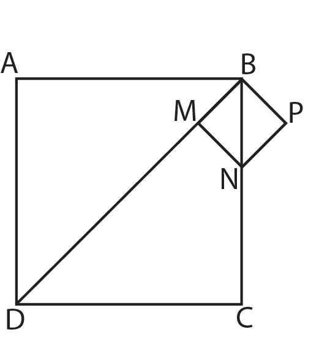

# PROVA — Camara_Conselheiro_Lafaiete_2018_Agente_Legislativo

## 1. Análise geral da prova

- **Identificação:** Camara_Conselheiro_Lafaiete_2018_Agente_Legislativo
- **Quantidade total de questões:** 40
- **Quantidade de textos de apoio (grupos):** 4
- **Quantidade de imagens:** 2
- **Quantidade de gráficos e tabelas:** incluídos nas imagens e no texto extraído, quando presentes no PDF original
- **Quantidade de grupos identificados:** 4
- **Quantidade de questões independentes:** 28
- **Questões que compartilham materiais:** texto-base das questões 01 a 03 → questões 01, 02, 03; texto-base das questões 08 a 09 → questões 08, 09; texto-base das questões 11 a 14 → questões 11, 12, 13, 14; texto-base das questões 16 a 18 → questões 16, 17, 18

### Transcrição integral da capa/instruções (conforme extraída do PDF)

> [!NOTE]
> Conteúdo integral das páginas anteriores à primeira questão, sem cortes.

> 1. A prova terá, no máximo, 4 (quatro) horas de duração, incluído o tempo desti nado à transcrição do gabarito
> na Folha de Respostas, único documento válido para correção.
> 2. O candidato deverá conferir os seus dados pessoais na Folha de Respostas, em especial seu nome e o núme-
> ro do documento de identi dade.
> 3. Não haverá substi tuição da Folha de Respostas por erro do candidato ou por qualquer outro dano.
> 4. O candidato só poderá se reti rar do recinto após 1 (uma) hora, contada a parti r do efeti vo início da prova.
> 5. Este caderno contém 40 questões de múlti pla escolha, assim distribuídas: Língua portuguesa (numeradas de
> 01 a 20), Conhecimentos gerais sobre o Município (numeradas de 21 a 30) e Matemáti ca (numeradas de 31
> a 40).
> 6. Cada questão apresenta 5 alternati vas, de (a) a (e). O candidato deverá lê-las, atentamente, antes de respon-
> der a elas.
> 7. Caso o Caderno não corresponda ao cargo de inscrição, esteja incompleto ou com defeito, o candidato deve-
> rá solicitar ao aplicador, durante os primeiros 20 minutos, as providências cabíveis.
> 8. O canditado deverá entregar ao aplicador este caderno de provas e a Folha de Respostas.
> 9. O candidato passará o gabarito para a Folha de Respostas, uti lizando caneta esferográfi ca azul ou preta.
> CÂmara muniCipaL de ConseLheiro Lafaiete
> instruÇões gerais
> atenÇão: foLha de respostas sem assinatura não tem VaLidade
> a folha de respostas não deve ser dobrada, amassada ou rasurada
> o gabarito e o Caderno de proVas serão diVuLgados no endereÇo eLetÔniCo:
> ConCurso.fundaCaoCefetminas.org.br
> Agente Legislati vo
>
>
>
> __________________________________________
> Nome do candidato
> Por favor, abra somente quando autorizado.
>
>
>
>
>
>
> Concurso da Câmara MUNICIPAL de Conselheiro Lafaiete • 2018 • Agente Legislativo
> Língua portuguesa
> As questões 01 a 03 se referem à fábula a
> seguir.
> A fábula é um texto narrativo alegórico e curto, escri-
> to em prosa ou verso, no qual as personagens são ge-
> ralmente animais com características humanas como
> a fala, os costumes, por exemplo, e apresenta uma
> lição moral, ou seja, traz um ensinamento para o ser
> humano.
> A esse respeito, leia o texto seguinte.
> A raposa e as uvas
> A raposa vinha pela estrada quando viu uma
> parreira carregada de suculentas uvas vermelhas.
> – Essas uvas já estão no papo – pensou.
>
> Doce ilusão. A raposa tentou de tudo, mas os
> cachos estavam tão altos que não conseguiu apanhar
> um bago que fosse.
> Matreira, ela comentou para quem quisesse
> ouvir:
> – Reparando bem, essas uvas estão muito
> verdes. Raposas não comem uvas verdes, pois dão
> dor de barriga.
> E foi embora.
>
> Quando já tinha percorrido algumas léguas,
> um vento forte começou a soprar. Então a raposa vol-
> tou depressa e pôs-se a farejar o chão em busca de
> bagos de uva.
> Quem desdenha quer comprar.
> (DE LA FONTAINE, Jean. Fábulas de Esopo. São Paulo: Scipione, 1998, p.
> 18. Adaptado.)

### Gabarito

| Questão | 01 | 02 | 03 | 04 | 05 |
|---|---|---|---|---|---|
| Resposta | D | B | C | A | C |

| Questão | 06 | 07 | 08 | 09 | 10 |
|---|---|---|---|---|---|
| Resposta | A | A | D | B | A |

| Questão | 11 | 12 | 13 | 14 | 15 |
|---|---|---|---|---|---|
| Resposta | C | C | B | B | D |

| Questão | 16 | 17 | 18 | 19 | 20 |
|---|---|---|---|---|---|
| Resposta | E | D | C | B | C |

| Questão | 21 | 22 | 23 | 24 | 25 |
|---|---|---|---|---|---|
| Resposta | C | A | A | A | B |

| Questão | 26 | 27 | 28 | 29 | 30 |
|---|---|---|---|---|---|
| Resposta | A | D | D | C | A |

| Questão | 31 | 32 | 33 | 34 | 35 |
|---|---|---|---|---|---|
| Resposta | D | D | E | A | B |

| Questão | 36 | 37 | 38 | 39 | 40 |
|---|---|---|---|---|---|
| Resposta | D | A | C | D | C |

## 2. Questões agrupadas

### GRUPO 01 — Texto-base compartilhado pelas questões 01 a 03

**Questões relacionadas:** 01, 02, 03.

#### QUESTÃO 01

✅ **Gabarito: D** (gabarito oficial — bloco “Agente Legislativo” da página 1 do gabarito multi-cargo)

**Material de apoio:**

seguir.
A fábula é um texto narrativo alegórico e curto, escri-
to em prosa ou verso, no qual as personagens são ge-
ralmente animais com características humanas como
a fala, os costumes, por exemplo, e apresenta uma
lição moral, ou seja, traz um ensinamento para o ser
humano.
A esse respeito, leia o texto seguinte.
A raposa e as uvas
A raposa vinha pela estrada quando viu uma
parreira carregada de suculentas uvas vermelhas.
– Essas uvas já estão no papo – pensou.

Doce ilusão. A raposa tentou de tudo, mas os
cachos estavam tão altos que não conseguiu apanhar
um bago que fosse.
Matreira, ela comentou para quem quisesse
ouvir:
– Reparando bem, essas uvas estão muito
verdes. Raposas não comem uvas verdes, pois dão
dor de barriga.
E foi embora.

Quando já tinha percorrido algumas léguas,
um vento forte começou a soprar. Então a raposa vol-
tou depressa e pôs-se a farejar o chão em busca de
bagos de uva.
Quem desdenha quer comprar.
(DE LA FONTAINE, Jean. Fábulas de Esopo. São Paulo: Scipione, 1998, p.
18. Adaptado.)

**Enunciado:**

Após a leitura atenta da fábula, é correto afirmar que

**Alternativas:**

A) a raposa desistiu de comer as uvas porque elas es-
tavam verdes.
B) a raposa não se importou com a dor de barriga
após comer as uvas verdes.
C) a expressão “doce ilusão” se refere às saborosas
uvas que estavam vermelhas.
D) “Raposas não comem uvas verdes” é uma justifica-
tiva para a dificuldade da raposa.
E) a raposa é “inocente” porque se comportou como
alguém ingênua ao desdenhar das uvas.

**Referências visuais:**

Nenhuma.

---

#### QUESTÃO 02

✅ **Gabarito: B** (gabarito oficial — bloco “Agente Legislativo” da página 1 do gabarito multi-cargo)

**Material de apoio:**

seguir.
A fábula é um texto narrativo alegórico e curto, escri-
to em prosa ou verso, no qual as personagens são ge-
ralmente animais com características humanas como
a fala, os costumes, por exemplo, e apresenta uma
lição moral, ou seja, traz um ensinamento para o ser
humano.
A esse respeito, leia o texto seguinte.
A raposa e as uvas
A raposa vinha pela estrada quando viu uma
parreira carregada de suculentas uvas vermelhas.
– Essas uvas já estão no papo – pensou.

Doce ilusão. A raposa tentou de tudo, mas os
cachos estavam tão altos que não conseguiu apanhar
um bago que fosse.
Matreira, ela comentou para quem quisesse
ouvir:
– Reparando bem, essas uvas estão muito
verdes. Raposas não comem uvas verdes, pois dão
dor de barriga.
E foi embora.

Quando já tinha percorrido algumas léguas,
um vento forte começou a soprar. Então a raposa vol-
tou depressa e pôs-se a farejar o chão em busca de
bagos de uva.
Quem desdenha quer comprar.
(DE LA FONTAINE, Jean. Fábulas de Esopo. São Paulo: Scipione, 1998, p.
18. Adaptado.)

**Enunciado:**

Atente para os vocábulos numerados e, em seguida,
associe corretamente a palavra à sua respectiva de-
finição.
A sequência correta dessa associação é

**Alternativas:**

A) 3 ,1, 5, 4, 2.
B) 5, 2, 1, 3, 4.
C) 2, 1, 5, 4, 3.
D) 5, 2, 3, 1, 4.
E) 2, 3, 4, 5, 1.

**Referências visuais:**

Nenhuma.

---

#### QUESTÃO 03

✅ **Gabarito: C** (gabarito oficial — bloco “Agente Legislativo” da página 1 do gabarito multi-cargo)

**Material de apoio:**

seguir.
A fábula é um texto narrativo alegórico e curto, escri-
to em prosa ou verso, no qual as personagens são ge-
ralmente animais com características humanas como
a fala, os costumes, por exemplo, e apresenta uma
lição moral, ou seja, traz um ensinamento para o ser
humano.
A esse respeito, leia o texto seguinte.
A raposa e as uvas
A raposa vinha pela estrada quando viu uma
parreira carregada de suculentas uvas vermelhas.
– Essas uvas já estão no papo – pensou.

Doce ilusão. A raposa tentou de tudo, mas os
cachos estavam tão altos que não conseguiu apanhar
um bago que fosse.
Matreira, ela comentou para quem quisesse
ouvir:
– Reparando bem, essas uvas estão muito
verdes. Raposas não comem uvas verdes, pois dão
dor de barriga.
E foi embora.

Quando já tinha percorrido algumas léguas,
um vento forte começou a soprar. Então a raposa vol-
tou depressa e pôs-se a farejar o chão em busca de
bagos de uva.
Quem desdenha quer comprar.
(DE LA FONTAINE, Jean. Fábulas de Esopo. São Paulo: Scipione, 1998, p.
18. Adaptado.)

**Enunciado:**

Podemos distribuir sistematicamente os gêneros tex-
tuais, o que não significa que estejamos fazendo clas-
sificações. Portanto, segundo alguns critérios gerais e
subdividindo a produção textual entre fala e escrita,
considere o gênero fábula e preencha corretamente
as lacunas.
O domínio discursivo da fábula, com seus operadores
comunicativos, é o texto __________ e a modalidade
retórica que corresponde ao tipo textual se refere ao
ato de __________. Quanto à modalidade de uso da
língua, a fábula pode ser __________ .
A sequência que preenche corretamente as lacunas
do texto é

**Alternativas:**

A) religioso / narrar / escrita.
B) ficcional / argumentar / oral.
C) ficcional / narrar / oral e escrita.
D) técnico / informar / oral e escrita.
E) instrucional / descrever / oral e escrita.
Definições
( ) significa falta de conside-
ração.
( ) designa
alguns
grãos
miúdos.
( ) é comum a certas trepa-
deiras.
( ) indica experiência e saga-
cidade.
( ) traduz a aspiração de um
cheiro.
Palavras
1) Parreira
2) Bago
3) Matreira
4) Farejar
5) Desdenha
Concurso da Câmara MUNICIPAL de Conselheiro Lafaiete • 2018 • Agente Legislativo

**Referências visuais:**

Nenhuma.

---

### GRUPO 02 — Texto-base compartilhado pelas questões 08 a 09

**Questões relacionadas:** 08, 09.

#### QUESTÃO 08

✅ **Gabarito: D** (gabarito oficial — bloco “Agente Legislativo” da página 1 do gabarito multi-cargo)

**Material de apoio:**

Questão 07
O texto a seguir trata de um acontecimento recente
do universo do cinema.
Você sabe por que a Cinderela tem esse nome?
Você sabe por que uma das princesas da Dis-
ney leva o nome Cinderela? O novo filme da persona-
gem traz uma explicação.
A palavra seria uma junção de “cinder”, que
significa cinzas em inglês, com “Ella”, o nome verda-
deiro da jovem.
Na cena inédita do longa, divulgada pela em-
presa nesta segunda (16), o apelido surge porque as
irmãs malvadas debocham do aspecto sujo da meni-
na, que está coberta de pó da lareira. A nova produ-
ção traz personagens interpretados por atores reais,
inspirados na clássica animação de 1950.
Disponível
em:
˂https://www1.folha.uol.com.br/
folhinha/2015/03/1604106-voce-sabe-por-que-a-cinderela-tem-
esse-nome-veja-cena-do-novo-filme.shtml˃. Acesso em 22 jan. 2019.
Adaptado.)
A propósito do emprego da palavra “porque”, avalie
as seguintes afirmações.
I.
Nos títulos, geralmente, utiliza-se a forma “por
que” que equivale a “por qual motivo”.
II. A palavra grifada na frase “Surge porque as ir-
mãs” equivale a “pois”, “uma vez que”.
III. Na primeira linha do texto, o vocábulo “por que”
pode ser substituído por “pela qual”.
IV. No título do texto, o termo “por que” é adjetiva-
do e é sinônimo de “motivo”, “razão”.
Está correto apenas o que se afirma em
a) I e II.
b) II e III.
c) III e IV.
d) I, II e IV.
e) II, III e IV.
As  se referem ao texto a
seguir.
Conjugação
Eu falo

Eu defendo
tu ouves

tu combates
ele cala.

ele entrega.
Eu procuro

Eu canto

tu indagas

tu calas
ele esconde.

ele vaia.
Eu planto

Eu escrevo
tu adubas

tu me lês
ele colhe.

ele apaga
Eu ajunto
tu conservas
ele rouba.
(SANT’ANNA, Affonso Romano de. Poesias reunidas: 1965-1999. Porto
Alegre: L&PM, 2004, p.157-158.)

**Enunciado:**

Com referência à compreensão e à interpretação do
poema, é correto afirmar que

**Alternativas:**

A) as ações do pronome “ele” contradizem as ações
do “eu”, e o “tu” é um amenizador.
B) os versos causam um efeito de respeito e subordi-
nação ao interlocutor do sujeito lírico.
C) o pronome “Eu” assume, em todas as estrofes, o
controle da situação em relação às outras pessoas.
D) o título “Conjugação” enuncia a união de esforços
do “eu”, do “tu” e do “ele”, relacionados à vida hu-
mana.
E) os versos do poeta são pobres, pois ele constrói
o poema apenas com verbos conjugados das três
pessoas do singular.

**Referências visuais:**

Nenhuma.

---

#### QUESTÃO 09

✅ **Gabarito: B** (gabarito oficial — bloco “Agente Legislativo” da página 1 do gabarito multi-cargo)

**Material de apoio:**

Questão 07
O texto a seguir trata de um acontecimento recente
do universo do cinema.
Você sabe por que a Cinderela tem esse nome?
Você sabe por que uma das princesas da Dis-
ney leva o nome Cinderela? O novo filme da persona-
gem traz uma explicação.
A palavra seria uma junção de “cinder”, que
significa cinzas em inglês, com “Ella”, o nome verda-
deiro da jovem.
Na cena inédita do longa, divulgada pela em-
presa nesta segunda (16), o apelido surge porque as
irmãs malvadas debocham do aspecto sujo da meni-
na, que está coberta de pó da lareira. A nova produ-
ção traz personagens interpretados por atores reais,
inspirados na clássica animação de 1950.
Disponível
em:
˂https://www1.folha.uol.com.br/
folhinha/2015/03/1604106-voce-sabe-por-que-a-cinderela-tem-
esse-nome-veja-cena-do-novo-filme.shtml˃. Acesso em 22 jan. 2019.
Adaptado.)
A propósito do emprego da palavra “porque”, avalie
as seguintes afirmações.
I.
Nos títulos, geralmente, utiliza-se a forma “por
que” que equivale a “por qual motivo”.
II. A palavra grifada na frase “Surge porque as ir-
mãs” equivale a “pois”, “uma vez que”.
III. Na primeira linha do texto, o vocábulo “por que”
pode ser substituído por “pela qual”.
IV. No título do texto, o termo “por que” é adjetiva-
do e é sinônimo de “motivo”, “razão”.
Está correto apenas o que se afirma em
a) I e II.
b) II e III.
c) III e IV.
d) I, II e IV.
e) II, III e IV.
As  se referem ao texto a
seguir.
Conjugação
Eu falo

Eu defendo
tu ouves

tu combates
ele cala.

ele entrega.
Eu procuro

Eu canto

tu indagas

tu calas
ele esconde.

ele vaia.
Eu planto

Eu escrevo
tu adubas

tu me lês
ele colhe.

ele apaga
Eu ajunto
tu conservas
ele rouba.
(SANT’ANNA, Affonso Romano de. Poesias reunidas: 1965-1999. Porto
Alegre: L&PM, 2004, p.157-158.)

**Enunciado:**

O fato expresso pelos verbos do poema é

**Alternativas:**

A) sofrido pelo sujeito.
B) praticado pelo sujeito.
C) praticado pelo apassivador.
D) sofrido e praticado pelo sujeito.
E) sofrido e praticado pelo apassivador.
Concurso da Câmara MUNICIPAL de Conselheiro Lafaiete • 2018 • Agente Legislativo

**Referências visuais:**

Nenhuma.

---

### GRUPO 03 — Texto-base compartilhado pelas questões 11 a 14

**Questões relacionadas:** 11, 12, 13, 14.

#### QUESTÃO 11

✅ **Gabarito: C** (gabarito oficial — bloco “Agente Legislativo” da página 1 do gabarito multi-cargo)

**Material de apoio:**

Questão 10
Considerando que o Novo Acordo Ortográfico alterou
o emprego do hífen nos compostos e nas formações
por prefixação, preencha corretamente as lacunas do
texto a seguir com as respectivas palavras.
O conceito de relacionamento ____________ reme-
te para a aptidão de uma pessoa de se relacionar
com os seus próprios sentimentos e emoções e é de
elevada importância porque vai determinar como
cada pessoa age quando é confrontada com situa-
ções do ____________. Para ter um relacionamento
saudável, um indivíduo deve exercitar áreas como a
____________.
(Disponível em: ˂https://www.significados.com.br/relacionamento-in-
terpessoal/˃. Acesso em 23 jan. 2019. Adaptado.)
A sequência que preenche corretamente as lacunas
do texto é
a) intrapessoal / dia a dia / automotivação.
b) intrapessoal / dia-a-dia / automotivação.
c) intra-pessoal / dia a dia / auto-motivação.
d) intra-pessoal / dia-a-dia / auto-motivação.
e) intrapessoal / dia a dia / auto-motivação.
As  se referem ao texto
a seguir.
Piedade de Minas
Dom Walmor Oliveira de Azevedo*

Piedade de Minas, grito que brota do cora-
ção de cada pessoa, uma vez mais, convocando toda
a sociedade mineira a buscar novos rumos. Caminhos
que sejam condizentes com a história tricentenária
do Estado, suas tradições religiosas e culturais, com
o coração bom de seu povo, adornado por valores e
princípios. Todos se unam por uma nova etapa civili-
zatória que respeite as singulares belezas naturais de
Minas – dos campos aos sertões, da Mata Atlântica
ao alto das montanhas. Piedade de Minas! Precisa-
mos de preces fortes, por compaixão, que devem ins-
pirar gestos cidadãos, alicerçados na solidariedade
com os que sofrem as consequências de tragédias
criminosas – a exemplo das ocorridas em Brumadi-
nho, em Bento Rodrigues e em tantos outros lugares.
[...] No Brasil e, particularmente, em Minas Gerais, é
necessário parar tudo o que está comprovadamente
errado e promover recomeços, a partir de um hori-
zonte humanitário. [...]
Dia após dia, o luto do povo mineiro cobre
todos, indicando que é hora de ousar e efetivar mu-
danças para que não ocorram novas tragédias. Minas
não pode ser a mesma. Sobre os alicerces de sua rica
história, a partir do exercício da cidadania, de modo
condizente com os nobres valores de seu povo, o Es-
tado deve iniciar um novo ciclo para a sua história.
Tenham todos Piedade de Minas!
* Arcebispo metropolitano de Belo Horizonte.
(Estado de Minas, Caderno Opinião, 01 fev. 2019, p. 7. Adaptado.)

**Enunciado:**

É correto afirmar que na frase “Caminhos que sejam
condizentes com a história tricentenária do Estado,
suas tradições religiosas e culturais...”, a palavra em
destaque pertence à mesma classe gramatical da que
está grifada em

**Alternativas:**

A) “... uma prece por compaixão...”
B) “... adornado por valores e princípios...”
C) “... convocando toda a sociedade mineira...”
D) “... em Bento Rodrigues e em tantos outros lugares.”
E) “... a exemplo das que ocorreram em Brumadinho...”

**Referências visuais:**

Nenhuma.

---

#### QUESTÃO 12

✅ **Gabarito: C** (gabarito oficial — bloco “Agente Legislativo” da página 1 do gabarito multi-cargo)

**Material de apoio:**

Questão 10
Considerando que o Novo Acordo Ortográfico alterou
o emprego do hífen nos compostos e nas formações
por prefixação, preencha corretamente as lacunas do
texto a seguir com as respectivas palavras.
O conceito de relacionamento ____________ reme-
te para a aptidão de uma pessoa de se relacionar
com os seus próprios sentimentos e emoções e é de
elevada importância porque vai determinar como
cada pessoa age quando é confrontada com situa-
ções do ____________. Para ter um relacionamento
saudável, um indivíduo deve exercitar áreas como a
____________.
(Disponível em: ˂https://www.significados.com.br/relacionamento-in-
terpessoal/˃. Acesso em 23 jan. 2019. Adaptado.)
A sequência que preenche corretamente as lacunas
do texto é
a) intrapessoal / dia a dia / automotivação.
b) intrapessoal / dia-a-dia / automotivação.
c) intra-pessoal / dia a dia / auto-motivação.
d) intra-pessoal / dia-a-dia / auto-motivação.
e) intrapessoal / dia a dia / auto-motivação.
As  se referem ao texto
a seguir.
Piedade de Minas
Dom Walmor Oliveira de Azevedo*

Piedade de Minas, grito que brota do cora-
ção de cada pessoa, uma vez mais, convocando toda
a sociedade mineira a buscar novos rumos. Caminhos
que sejam condizentes com a história tricentenária
do Estado, suas tradições religiosas e culturais, com
o coração bom de seu povo, adornado por valores e
princípios. Todos se unam por uma nova etapa civili-
zatória que respeite as singulares belezas naturais de
Minas – dos campos aos sertões, da Mata Atlântica
ao alto das montanhas. Piedade de Minas! Precisa-
mos de preces fortes, por compaixão, que devem ins-
pirar gestos cidadãos, alicerçados na solidariedade
com os que sofrem as consequências de tragédias
criminosas – a exemplo das ocorridas em Brumadi-
nho, em Bento Rodrigues e em tantos outros lugares.
[...] No Brasil e, particularmente, em Minas Gerais, é
necessário parar tudo o que está comprovadamente
errado e promover recomeços, a partir de um hori-
zonte humanitário. [...]
Dia após dia, o luto do povo mineiro cobre
todos, indicando que é hora de ousar e efetivar mu-
danças para que não ocorram novas tragédias. Minas
não pode ser a mesma. Sobre os alicerces de sua rica
história, a partir do exercício da cidadania, de modo
condizente com os nobres valores de seu povo, o Es-
tado deve iniciar um novo ciclo para a sua história.
Tenham todos Piedade de Minas!
* Arcebispo metropolitano de Belo Horizonte.
(Estado de Minas, Caderno Opinião, 01 fev. 2019, p. 7. Adaptado.)

**Enunciado:**

Sobre a passagem transcrita do texto “Piedade de
Minas, grito que brota do coração de cada pessoa,
uma vez mais, convocando toda a sociedade mineira
a buscar novos rumos.”, é correto afirmar que o ver-
bo destacado, sem que haja prejuízo para o sentido,
pode ser substituído por

**Alternativas:**

A) foge.
B) seca.
C) nasce.
D) fenece.
E) expira.

**Referências visuais:**

Nenhuma.

---

#### QUESTÃO 13

✅ **Gabarito: B** (gabarito oficial — bloco “Agente Legislativo” da página 1 do gabarito multi-cargo)

**Material de apoio:**

Questão 10
Considerando que o Novo Acordo Ortográfico alterou
o emprego do hífen nos compostos e nas formações
por prefixação, preencha corretamente as lacunas do
texto a seguir com as respectivas palavras.
O conceito de relacionamento ____________ reme-
te para a aptidão de uma pessoa de se relacionar
com os seus próprios sentimentos e emoções e é de
elevada importância porque vai determinar como
cada pessoa age quando é confrontada com situa-
ções do ____________. Para ter um relacionamento
saudável, um indivíduo deve exercitar áreas como a
____________.
(Disponível em: ˂https://www.significados.com.br/relacionamento-in-
terpessoal/˃. Acesso em 23 jan. 2019. Adaptado.)
A sequência que preenche corretamente as lacunas
do texto é
a) intrapessoal / dia a dia / automotivação.
b) intrapessoal / dia-a-dia / automotivação.
c) intra-pessoal / dia a dia / auto-motivação.
d) intra-pessoal / dia-a-dia / auto-motivação.
e) intrapessoal / dia a dia / auto-motivação.
As  se referem ao texto
a seguir.
Piedade de Minas
Dom Walmor Oliveira de Azevedo*

Piedade de Minas, grito que brota do cora-
ção de cada pessoa, uma vez mais, convocando toda
a sociedade mineira a buscar novos rumos. Caminhos
que sejam condizentes com a história tricentenária
do Estado, suas tradições religiosas e culturais, com
o coração bom de seu povo, adornado por valores e
princípios. Todos se unam por uma nova etapa civili-
zatória que respeite as singulares belezas naturais de
Minas – dos campos aos sertões, da Mata Atlântica
ao alto das montanhas. Piedade de Minas! Precisa-
mos de preces fortes, por compaixão, que devem ins-
pirar gestos cidadãos, alicerçados na solidariedade
com os que sofrem as consequências de tragédias
criminosas – a exemplo das ocorridas em Brumadi-
nho, em Bento Rodrigues e em tantos outros lugares.
[...] No Brasil e, particularmente, em Minas Gerais, é
necessário parar tudo o que está comprovadamente
errado e promover recomeços, a partir de um hori-
zonte humanitário. [...]
Dia após dia, o luto do povo mineiro cobre
todos, indicando que é hora de ousar e efetivar mu-
danças para que não ocorram novas tragédias. Minas
não pode ser a mesma. Sobre os alicerces de sua rica
história, a partir do exercício da cidadania, de modo
condizente com os nobres valores de seu povo, o Es-
tado deve iniciar um novo ciclo para a sua história.
Tenham todos Piedade de Minas!
* Arcebispo metropolitano de Belo Horizonte.
(Estado de Minas, Caderno Opinião, 01 fev. 2019, p. 7. Adaptado.)

**Enunciado:**

A acentuação é um tema inerente aos postulados gra-
maticais que, indiscutivelmente, concebe-se como
um fator relevante, em se tratando da linguagem es-
crita.
A esse respeito, preencha corretamente as lacunas.
Em “_______________” e em “_______________”,
a sílaba que é pronunciada com maior força em
relação às outras indica que ambas são palavras
_______________.
A sequência que preenche corretamente as lacunas
do texto é

**Alternativas:**

A) naturais / Piedade / oxítonas.
B) coração / também / oxítonas.
C) buscar / tragédias / paroxítonas.
D) Brumadinho / sertões / paroxítonas.
E) Atlântica / tradições / proparoxítonas.
Concurso da Câmara MUNICIPAL de Conselheiro Lafaiete • 2018 • Agente Legislativo

**Referências visuais:**

Nenhuma.

---

#### QUESTÃO 14

✅ **Gabarito: B** (gabarito oficial — bloco “Agente Legislativo” da página 1 do gabarito multi-cargo)

**Material de apoio:**

Questão 10
Considerando que o Novo Acordo Ortográfico alterou
o emprego do hífen nos compostos e nas formações
por prefixação, preencha corretamente as lacunas do
texto a seguir com as respectivas palavras.
O conceito de relacionamento ____________ reme-
te para a aptidão de uma pessoa de se relacionar
com os seus próprios sentimentos e emoções e é de
elevada importância porque vai determinar como
cada pessoa age quando é confrontada com situa-
ções do ____________. Para ter um relacionamento
saudável, um indivíduo deve exercitar áreas como a
____________.
(Disponível em: ˂https://www.significados.com.br/relacionamento-in-
terpessoal/˃. Acesso em 23 jan. 2019. Adaptado.)
A sequência que preenche corretamente as lacunas
do texto é
a) intrapessoal / dia a dia / automotivação.
b) intrapessoal / dia-a-dia / automotivação.
c) intra-pessoal / dia a dia / auto-motivação.
d) intra-pessoal / dia-a-dia / auto-motivação.
e) intrapessoal / dia a dia / auto-motivação.
As  se referem ao texto
a seguir.
Piedade de Minas
Dom Walmor Oliveira de Azevedo*

Piedade de Minas, grito que brota do cora-
ção de cada pessoa, uma vez mais, convocando toda
a sociedade mineira a buscar novos rumos. Caminhos
que sejam condizentes com a história tricentenária
do Estado, suas tradições religiosas e culturais, com
o coração bom de seu povo, adornado por valores e
princípios. Todos se unam por uma nova etapa civili-
zatória que respeite as singulares belezas naturais de
Minas – dos campos aos sertões, da Mata Atlântica
ao alto das montanhas. Piedade de Minas! Precisa-
mos de preces fortes, por compaixão, que devem ins-
pirar gestos cidadãos, alicerçados na solidariedade
com os que sofrem as consequências de tragédias
criminosas – a exemplo das ocorridas em Brumadi-
nho, em Bento Rodrigues e em tantos outros lugares.
[...] No Brasil e, particularmente, em Minas Gerais, é
necessário parar tudo o que está comprovadamente
errado e promover recomeços, a partir de um hori-
zonte humanitário. [...]
Dia após dia, o luto do povo mineiro cobre
todos, indicando que é hora de ousar e efetivar mu-
danças para que não ocorram novas tragédias. Minas
não pode ser a mesma. Sobre os alicerces de sua rica
história, a partir do exercício da cidadania, de modo
condizente com os nobres valores de seu povo, o Es-
tado deve iniciar um novo ciclo para a sua história.
Tenham todos Piedade de Minas!
* Arcebispo metropolitano de Belo Horizonte.
(Estado de Minas, Caderno Opinião, 01 fev. 2019, p. 7. Adaptado.)

**Enunciado:**

A função sintática do termo grifado está corretamen-
te indicada em

**Alternativas:**

A) “ Tenham todos Piedade de Minas!” (sujeito)
B) “... precisamos de preces fortes, por compaixão...”
(predicativo)
C) “Dia após dia, o luto do povo mineiro cobre todos,”
(objeto direto)
D) “Todos se unam por uma nova etapa civilizatória...”
(complemento nominal)
E) “... e, particularmente, em Minas Gerais, é necessá-
rio parar tudo...” (objeto indireto)

**Referências visuais:**

Nenhuma.

---

### GRUPO 04 — Texto-base compartilhado pelas questões 16 a 18

**Questões relacionadas:** 16, 17, 18.

#### QUESTÃO 16

✅ **Gabarito: E** (gabarito oficial — bloco “Agente Legislativo” da página 1 do gabarito multi-cargo)

**Material de apoio:**

Questão 15
Há composições literárias compostas em linhas bre-
ves, nas quais o autor expressa diretamente seus sen-
timentos e visões pessoais.
A esse respeito, leia o texto seguinte.
(Disponível em: < http://cidadedasartes.rio.rj.gov.br/programacao/inter-
na/458>. Acesso em 28 fev. 2019)
É correto afirmar que esse tipo de texto é estudado
fudamentalmente em
a) panfletos e anúncios.
b) propagandas e avisos.
c) instagrams e reportagens.
d) livros e manuais didáticos.
e) blogs e classificados de jornal.
As  se referem ao texto seguinte.
(Disponível em: < https://vidadeprogramador.com.br/2017/05/24/efeitos-do-cafe/>. Acesso em 28 fev. 2019. Adaptado)

**Enunciado:**

Avalie o que se afirmar a respeito da tirinha.
I.
A palavra “alucinações” pode ser substituída por
“lucidezes”, sem que haja qualquer prejuízo para
o sentido.
II. O termo grifado na frase “... já registrei o domí-
nio...” insere-se no campo lexical da profissão
exercida pelos personagens criados.
III. A menção a um ritual comumente partilhado por
pessoas no seu cotidiano pode ser identificada
em dois momentos do texto.
IV. A frase “... tenho que confessar que nem sempre
eu entendo essas tirinhas” indica a interação de
um dos personagens com o gênero que dá ori-
gem ao texto.
Está correto apenas o que se afirma em

**Alternativas:**

A) I e II.
B) I e IV.
C) II e III.
D) I, III e IV.
E) II, III e IV.
Concurso da Câmara MUNICIPAL de Conselheiro Lafaiete • 2018 • Agente Legislativo

**Referências visuais:**

Nenhuma.

---

#### QUESTÃO 17

✅ **Gabarito: D** (gabarito oficial — bloco “Agente Legislativo” da página 1 do gabarito multi-cargo)

**Material de apoio:**

Questão 15
Há composições literárias compostas em linhas bre-
ves, nas quais o autor expressa diretamente seus sen-
timentos e visões pessoais.
A esse respeito, leia o texto seguinte.
(Disponível em: < http://cidadedasartes.rio.rj.gov.br/programacao/inter-
na/458>. Acesso em 28 fev. 2019)
É correto afirmar que esse tipo de texto é estudado
fudamentalmente em
a) panfletos e anúncios.
b) propagandas e avisos.
c) instagrams e reportagens.
d) livros e manuais didáticos.
e) blogs e classificados de jornal.
As  se referem ao texto seguinte.
(Disponível em: < https://vidadeprogramador.com.br/2017/05/24/efeitos-do-cafe/>. Acesso em 28 fev. 2019. Adaptado)

**Enunciado:**

Um trecho dos diálogos que NÃO exemplifica uma
variação linguística é

**Alternativas:**

A) “Como tá indo?”
B) “Legal, já registrei o domínio.”
C) “Daí então essa ideia pode fazer a gente ficar rico.”
D) “... ele está fazendo tudo rápido ou tendo alucina-
ções?”
E) “Cara, tenho que confessar que nem sempre eu en-
tendo essas tirinhas...”

**Referências visuais:**

Nenhuma.

---

#### QUESTÃO 18

✅ **Gabarito: C** (gabarito oficial — bloco “Agente Legislativo” da página 1 do gabarito multi-cargo)

**Material de apoio:**

Questão 15
Há composições literárias compostas em linhas bre-
ves, nas quais o autor expressa diretamente seus sen-
timentos e visões pessoais.
A esse respeito, leia o texto seguinte.
(Disponível em: < http://cidadedasartes.rio.rj.gov.br/programacao/inter-
na/458>. Acesso em 28 fev. 2019)
É correto afirmar que esse tipo de texto é estudado
fudamentalmente em
a) panfletos e anúncios.
b) propagandas e avisos.
c) instagrams e reportagens.
d) livros e manuais didáticos.
e) blogs e classificados de jornal.
As  se referem ao texto seguinte.
(Disponível em: < https://vidadeprogramador.com.br/2017/05/24/efeitos-do-cafe/>. Acesso em 28 fev. 2019. Adaptado)

**Enunciado:**

As palavras transcritas do texto que pertencem à
mesma classe gramatical estão corretamente indica-
das em

**Alternativas:**

A) mas / já / alucinações.
B) ideia / problema / essa.
C) rico / novinho / rápido.
D) nada / domínio / trabalhar.
E) duas / arame 2.0 / quantidade.

**Referências visuais:**

Nenhuma.

---

## 3. Questões independentes

#### QUESTÃO 04

✅ **Gabarito: A** (gabarito oficial — bloco “Agente Legislativo” da página 1 do gabarito multi-cargo)

**Enunciado:**

Na teoria da comunicação, linguagem é a expressão individual e social do ser humano e, ao mesmo tempo, o
elemento comum que possibilita o processo comunicativo entre as pessoas que vivem em sociedade. Essa ex-
pressão pode acontecer de forma verbal (uso de palavras), não verbal (sem palavras) ou mista.
A esse respeito, leia a tirinha.

(Disponível em: ˂https://midiatividades.wordpress.com/2014/09/08/onomatopeias-atividade-6o-ano/˃. Acesso em: 22 jan. 2019.)
Segundo os tipos de linguagem presentes na tirinha,
informe se é verdadeiro (V) ou falso (F) o que se afir-
ma.
( ) Em todos os quadrinhos, há a linguagem não ver-
bal.
( ) A personagem utiliza a linguagem oral para se ex-
pressar.
( ) Na hierarquia das linguagens, a verbal predomina
na tirinha.
( ) Na tirinha, a construção de sentido se estabelece
pela linguagem mista.
( ) A repetição da onomatopeia “CHOMP” refere-se
à linguagem não verbal.
De acordo com as afirmações, a sequência correta é

**Alternativas:**

A) V, V, F, V, F.
B) F, V, F, V, V.
C) F, F, V, F, V.
D) V, F, V, F, F.
E) V, V, F, F, V.

**Referências visuais:**

---

#### QUESTÃO 05

✅ **Gabarito: C** (gabarito oficial — bloco “Agente Legislativo” da página 1 do gabarito multi-cargo)

**Enunciado:**

O artigo é um signo que exige a presença de outro
(ou outros) com o qual se associa. Ele se classifica em
definido e em indefinido.
Considere esse princípio e leia o texto seguinte.
A noite/2
Eu adormeço às margens de uma mulher: eu
adormeço às margens de um abismo.
(GALEANO, Eduardo. Mulheres. Porto Alegre: L&PM, 1997, p. 28.)
Analise as afirmações a seguir e a relação proposta
entre elas.
I.
Os artigos grifados nas frases apresentadas, an-
tepostos aos substantivos, são classificados como
indefinidos
PORQUE
II. atribuem aos seres que acompanham um sentido
preciso, particularizando as palavras “mulher” e
“abismo”.
Sobre as afirmações, é correto afirmar que

**Alternativas:**

A) as duas são falsas.
B) a primeira é falsa e a segunda é verdadeira.
C) a primeira é verdadeira e a segunda é falsa.
D) as duas são verdadeiras e a segunda é uma justifica-
tiva correta da primeira.
E) as duas são verdadeiras, mas a segunda não é uma
justificativa da primeira.

**Referências visuais:**

Nenhuma.

---

#### QUESTÃO 06

✅ **Gabarito: A** (gabarito oficial — bloco “Agente Legislativo” da página 1 do gabarito multi-cargo)

**Enunciado:**

Considerando a ortografia da língua portuguesa, to-
das as palavras estão escritas corretamente em

**Alternativas:**

A) encher / jiló / embaçado / riqueza.
B) enxurrada / pajé / fiçura / visitante.
C) enxarcar / viagem / pinça / analizar.
D) mexer / vertijem / passoca / enraisar.
E) quizer / enchaqueca / pólen / conciência.
Concurso da Câmara MUNICIPAL de Conselheiro Lafaiete • 2018 • Agente Legislativo

**Referências visuais:**

Nenhuma.

---

#### QUESTÃO 07

✅ **Gabarito: A** (gabarito oficial — bloco “Agente Legislativo” da página 1 do gabarito multi-cargo)

**Enunciado:**

O texto a seguir trata de um acontecimento recente
do universo do cinema.
Você sabe por que a Cinderela tem esse nome?
Você sabe por que uma das princesas da Dis-
ney leva o nome Cinderela? O novo filme da persona-
gem traz uma explicação.
A palavra seria uma junção de “cinder”, que
significa cinzas em inglês, com “Ella”, o nome verda-
deiro da jovem.
Na cena inédita do longa, divulgada pela em-
presa nesta segunda (16), o apelido surge porque as
irmãs malvadas debocham do aspecto sujo da meni-
na, que está coberta de pó da lareira. A nova produ-
ção traz personagens interpretados por atores reais,
inspirados na clássica animação de 1950.
Disponível
em:
˂https://www1.folha.uol.com.br/
folhinha/2015/03/1604106-voce-sabe-por-que-a-cinderela-tem-
esse-nome-veja-cena-do-novo-filme.shtml˃. Acesso em 22 jan. 2019.
Adaptado.)
A propósito do emprego da palavra “porque”, avalie
as seguintes afirmações.
I.
Nos títulos, geralmente, utiliza-se a forma “por
que” que equivale a “por qual motivo”.
II. A palavra grifada na frase “Surge porque as ir-
mãs” equivale a “pois”, “uma vez que”.
III. Na primeira linha do texto, o vocábulo “por que”
pode ser substituído por “pela qual”.
IV. No título do texto, o termo “por que” é adjetiva-
do e é sinônimo de “motivo”, “razão”.
Está correto apenas o que se afirma em

**Alternativas:**

A) I e II.
B) II e III.
C) III e IV.
D) I, II e IV.
E) II, III e IV.
As questões 08 e 09 se referem ao texto a
seguir.
Conjugação
Eu falo
Eu defendo
tu ouves
tu combates
ele cala.
ele entrega.
Eu procuro
Eu canto
tu indagas
tu calas
ele esconde.
ele vaia.
Eu planto
Eu escrevo
tu adubas
tu me lês
ele colhe.
ele apaga
Eu ajunto
tu conservas
ele rouba.
(SANT’ANNA, Affonso Romano de. Poesias reunidas: 1965-1999. Porto
Alegre: L&PM, 2004, p.157-158.)

**Referências visuais:**

Nenhuma.

---

#### QUESTÃO 10

✅ **Gabarito: A** (gabarito oficial — bloco “Agente Legislativo” da página 1 do gabarito multi-cargo)

**Enunciado:**

Considerando que o Novo Acordo Ortográfico alterou
o emprego do hífen nos compostos e nas formações
por prefixação, preencha corretamente as lacunas do
texto a seguir com as respectivas palavras.
O conceito de relacionamento ____________ reme-
te para a aptidão de uma pessoa de se relacionar
com os seus próprios sentimentos e emoções e é de
elevada importância porque vai determinar como
cada pessoa age quando é confrontada com situa-
ções do ____________. Para ter um relacionamento
saudável, um indivíduo deve exercitar áreas como a
____________.
(Disponível em: ˂https://www.significados.com.br/relacionamento-in-
terpessoal/˃. Acesso em 23 jan. 2019. Adaptado.)
A sequência que preenche corretamente as lacunas
do texto é

**Alternativas:**

A) intrapessoal / dia a dia / automotivação.
B) intrapessoal / dia-a-dia / automotivação.
C) intra-pessoal / dia a dia / auto-motivação.
D) intra-pessoal / dia-a-dia / auto-motivação.
E) intrapessoal / dia a dia / auto-motivação.
As questões de 11 a 14 se referem ao texto
a seguir.
Piedade de Minas
Dom Walmor Oliveira de Azevedo*
Piedade de Minas, grito que brota do cora-
ção de cada pessoa, uma vez mais, convocando toda
a sociedade mineira a buscar novos rumos. Caminhos
que sejam condizentes com a história tricentenária
do Estado, suas tradições religiosas e culturais, com
o coração bom de seu povo, adornado por valores e
princípios. Todos se unam por uma nova etapa civili-
zatória que respeite as singulares belezas naturais de
Minas – dos campos aos sertões, da Mata Atlântica
ao alto das montanhas. Piedade de Minas! Precisa-
mos de preces fortes, por compaixão, que devem ins-
pirar gestos cidadãos, alicerçados na solidariedade
com os que sofrem as consequências de tragédias
criminosas – a exemplo das ocorridas em Brumadi-
nho, em Bento Rodrigues e em tantos outros lugares.
[...] No Brasil e, particularmente, em Minas Gerais, é
necessário parar tudo o que está comprovadamente
errado e promover recomeços, a partir de um hori-
zonte humanitário. [...]
Dia após dia, o luto do povo mineiro cobre
todos, indicando que é hora de ousar e efetivar mu-
danças para que não ocorram novas tragédias. Minas
não pode ser a mesma. Sobre os alicerces de sua rica
história, a partir do exercício da cidadania, de modo
condizente com os nobres valores de seu povo, o Es-
tado deve iniciar um novo ciclo para a sua história.
Tenham todos Piedade de Minas!
* Arcebispo metropolitano de Belo Horizonte.
(Estado de Minas, Caderno Opinião, 01 fev. 2019, p. 7. Adaptado.)

**Referências visuais:**

Nenhuma.

---

#### QUESTÃO 15

✅ **Gabarito: D** (gabarito oficial — bloco “Agente Legislativo” da página 1 do gabarito multi-cargo)

**Enunciado:**

Há composições literárias compostas em linhas bre-
ves, nas quais o autor expressa diretamente seus sen-
timentos e visões pessoais.
A esse respeito, leia o texto seguinte.
(Disponível em: < http://cidadedasartes.rio.rj.gov.br/programacao/inter-
na/458>. Acesso em 28 fev. 2019)
É correto afirmar que esse tipo de texto é estudado
fudamentalmente em

**Alternativas:**

A) panfletos e anúncios.
B) propagandas e avisos.
C) instagrams e reportagens.
D) livros e manuais didáticos.
E) blogs e classificados de jornal.
As questões de 16 a 18 se referem ao texto seguinte.
(Disponível em: < https://vidadeprogramador.com.br/2017/05/24/efeitos-do-cafe/>. Acesso em 28 fev. 2019. Adaptado)

**Referências visuais:**

Nenhuma.

---

#### QUESTÃO 19

✅ **Gabarito: B** (gabarito oficial — bloco “Agente Legislativo” da página 1 do gabarito multi-cargo)

**Enunciado:**

As tirinhas são histórias curtas, narrativas, que se apresentam em quadrinhos com balões e imagens. O quadrinho
é muito importante na construção do humor em tirinhas. Ele é responsável pela quebra de expectativa do leitor
que, geralmente, surpreende-se ao final da história.
A esse respeito, leia a tirinha. Ela faz menção a uma fábula muito conhecida de quase todos os leitores: “A formi-
ga e a cigarra”. Em seguida, analise as asserções e a relação proposta entre elas.
(Disponível em: <http://pigarts.blogspot.com/2014/11/turma-do-xaxado-antonio-cedraz.html>. Acesso em: 20 fev. 2019)
Na tirinha, observa-se que o efeito de humor foi um dos recursos utilizados pelo autor. Esse emprego está pre-
sente nesse gênero textual
PORQUE
no último quadrinho, um dos personagens faz uma releitura do epílogo da fábula, que pode ser lido tal como
aparece no texto original da história.
Sobre essas asserções, é correto afirmar que

**Alternativas:**

A) a primeira é uma afirmativa falsa e a segunda, verdadeira.
B) a primeira é uma afirmativa verdadeira e a segunda, falsa.
C) as duas são verdadeiras, mas não estabelecem relação entre si.
D) as duas são verdadeiras e a segunda é uma justificativa correta da primeira.
E) as duas são verdadeiras e a segunda não é uma justificativa correta da primeira.
Concurso da Câmara MUNICIPAL de Conselheiro Lafaiete • 2018 • Agente Legislativo

**Referências visuais:**

Nenhuma.

---

#### QUESTÃO 20

✅ **Gabarito: C** (gabarito oficial — bloco “Agente Legislativo” da página 1 do gabarito multi-cargo)

**Enunciado:**

Leia os textos a seguir.
Texto I
Conto é um gênero textual marcado pela narrati-
va curta, escrita em prosa e de menor complexidade
em relação aos romances. [...] Com o surgimento de
novas técnicas e estilos de escrita, o termo adquiriu
um sentido mais amplo, cujos únicos traços obri-
gatórios são a curta extensão e a escrita em prosa.
(Disponível em:< https://www.significados.com.br/conto/>. Acesso em
28 fev. 2019. Adaptado)
Texto II
(Disponível em: <https://insta-stalker.com/post/BqhnhQugaFF/>. Acesso
em 28 fev. 2019)
A partir do conceito teórico apresentado e conside-
rando como exemplo o Texto II, avalie o que se afir-
mar sobre ambos.
I.
O Texto II ultrapassa o que se afirma no Texto I.
II. O Texto II exemplifica o que foi mencionado no
Texto I.
III. O Texto II contradiz a proposição apresentado no
Texto I.
IV. O Texto I traz uma informação verdadeira, confir-
mada pelo Texto II.
V. O Texto I fere um dos postulados do conceito,
pois está escrito em versos.
Está correto apenas o que se afirma em

**Alternativas:**

A) I e II.
B) I e III.
C) II e IV.
D) II, IV e V.
E) III, IV e V.
Conhecimentos gerais sobre o
município

**Referências visuais:**

Nenhuma.

---

#### QUESTÃO 21

✅ **Gabarito: C** (gabarito oficial — bloco “Agente Legislativo” da página 1 do gabarito multi-cargo)

**Enunciado:**

Segundo o IBGE Cidades, o número de habitantes es-
timado para o município de Conselheiro Lafaiete para
o ano de 2018 foi de aproximadamente

**Alternativas:**

A) 30.000.
B) 80.000.
C) 130.000.
D) 180.000.
E) 230.000.

**Referências visuais:**

Nenhuma.

---

#### QUESTÃO 22

✅ **Gabarito: A** (gabarito oficial — bloco “Agente Legislativo” da página 1 do gabarito multi-cargo)

**Enunciado:**

O gentílico para a pessoa nascida em Conselheiro La-
faiete é

**Alternativas:**

A) lafaietense.
B) lafaietano.
C) lafaietino.
D) lafaiscando.
E) lafaindo.

**Referências visuais:**

Nenhuma.

---

#### QUESTÃO 23

✅ **Gabarito: A** (gabarito oficial — bloco “Agente Legislativo” da página 1 do gabarito multi-cargo)

**Enunciado:**

Um município que faz divisa com Conselheiro Lafaie-
te é

**Alternativas:**

A) Ouro Branco.
B) Santa Luzia.
C) Barroso.
D) Barbacena.
E) Lavras.

**Referências visuais:**

Nenhuma.

---

#### QUESTÃO 24

✅ **Gabarito: A** (gabarito oficial — bloco “Agente Legislativo” da página 1 do gabarito multi-cargo)

**Enunciado:**

Um rio que atravessa o município de Conselheiro La-
faiete é

**Alternativas:**

A) Pequeri.
B) Sena.
C) Arrudas.
D) Tietê.
E) Pinheiros.
O Jeito
-Terminar é o único jeito!
A mensagem no celular disse o que ninguém
teve coragem de dizer na discussão ao vivo.
-Concordo! À noite passo aí para pegar mi-
nhas coisas.
E me pegou!
A gente não tem jeito...
Saulo Pessato
Concurso da Câmara MUNICIPAL de Conselheiro Lafaiete • 2018 • Agente Legislativo

**Referências visuais:**

Nenhuma.

---

#### QUESTÃO 25

✅ **Gabarito: B** (gabarito oficial — bloco “Agente Legislativo” da página 1 do gabarito multi-cargo)

**Enunciado:**

A distância aproximada do município até a capital do
Estado de Minas Gerais é de

**Alternativas:**

A) 9 km.
B) 90 km.
C) 190 km.
D) 590 Km.
E) 900 km.

**Referências visuais:**

Nenhuma.

---

#### QUESTÃO 26

✅ **Gabarito: A** (gabarito oficial — bloco “Agente Legislativo” da página 1 do gabarito multi-cargo)

**Enunciado:**

Uma das principais vias de acesso ao município de
Conselheiro Lafaiete é a rodovia

**Alternativas:**

A) BR 040.
B) BR 101.
C) BR 265.
D) BR 116.
E) BR 171.

**Referências visuais:**

Nenhuma.

---

#### QUESTÃO 27

✅ **Gabarito: D** (gabarito oficial — bloco “Agente Legislativo” da página 1 do gabarito multi-cargo)

**Enunciado:**

São alguns dos principais pontos turísticos e históri-
cos da cidade de Conselheiro Lafaiete:

**Alternativas:**

A) Praça Bárbara Heliodora; Matriz São Jorge; Estátua
de Tiradentes.
B) Praça Cláudio Manuel da Costa; Matriz Nossa Se-
nhora Aparecida; Estátua do Papa .
C) Praça Tomás Antônio Gonzaga; Matriz de Sant’Ana;
Estátua do índio.
D) Praça Tiradentes; Matriz São Sebastião; Estátua do
Cristo.
E) Praça do Papa; Matriz de Nossa Senhora do Pilar;
Estátua da Liberdade.

**Referências visuais:**

Nenhuma.

---

#### QUESTÃO 28

✅ **Gabarito: D** (gabarito oficial — bloco “Agente Legislativo” da página 1 do gabarito multi-cargo)

**Enunciado:**

Os povos originários, primeiros habitantes das terras
onde foi posteriormente criado o município de Con-
selheiro Lafaiete, foram os índios

**Alternativas:**

A) Kaiowas.
B) Aruás.
C) Xapuris.
D) Carijós.
E) Sioux.

**Referências visuais:**

Nenhuma.

---

#### QUESTÃO 29

✅ **Gabarito: C** (gabarito oficial — bloco “Agente Legislativo” da página 1 do gabarito multi-cargo)

**Enunciado:**

Muitas das cidades da região um dia pertenceram e
foram distritos de Conselheiro Lafaiete. É exemplo de
uma região que permanece pertencendo ao municí-
pio, o distrito de

**Alternativas:**

A) Queluzito.
B) Casa Grande.
C) Buarque de Macedo.
D) Itaverava.
E) Catas Altas da Noruega.

**Referências visuais:**

Nenhuma.

---

#### QUESTÃO 30

✅ **Gabarito: A** (gabarito oficial — bloco “Agente Legislativo” da página 1 do gabarito multi-cargo)

**Enunciado:**

As reuniões ordinárias da Câmara Municipal de La-
faiete acontecem periodicamente às

**Alternativas:**

A) terças e quintas-feiras.
B) segundas e quartas-feiras.
C) segundas e quintas-feiras.
D) terças e quartas-feiras.
E) quartas e quintas-feiras.
Concurso da Câmara MUNICIPAL de Conselheiro Lafaiete • 2018 • Agente Legislativo
Matemática

**Referências visuais:**

Nenhuma.

---

#### QUESTÃO 31

✅ **Gabarito: D** (gabarito oficial — bloco “Agente Legislativo” da página 1 do gabarito multi-cargo)

**Enunciado:**

Dois médicos trabalham em um mesmo hospital em
regime de plantão. O primeiro vai a esse hospital a
cada 9 dias, e o segundo, a cada 5 dias. Sabendo-se
que o último plantão em que eles trabalharam jun-
tos foi em um domingo, o próximo dia da semana em
que eles trabalharão juntos será

**Alternativas:**

A) domingo.
B) segunda-feira.
C) terça-feira.
D) quarta-feira.
E) quinta-feira.

**Referências visuais:**

Nenhuma.

---

#### QUESTÃO 32

✅ **Gabarito: D** (gabarito oficial — bloco “Agente Legislativo” da página 1 do gabarito multi-cargo)

**Enunciado:**

Dois irmãos recebem juntos R$ 1800,00 de mesada.
O irmão mais velho recebe X reais e o irmão mais
novo recebe Y reais. A razão entre a mesada do irmão
mais velho e do irmão mais novo, somada com 1, é
equivalente a 12
.
Nessas condições, o valor da mesada do irmão mais
velho é igual a

**Alternativas:**

A) 750.
B) 900.
C) 1000.
D) 1050.
E) 1100.

**Referências visuais:**

Nenhuma.

---

#### QUESTÃO 33

✅ **Gabarito: E** (gabarito oficial — bloco “Agente Legislativo” da página 1 do gabarito multi-cargo)

**Enunciado:**

Um funcionário preparava café utilizando 1,5 kg de
café em uma máquina com capacidade de 8 litros de
água. Com a aquisição de uma nova máquina, com
capacidade de 36 litros, a quantidade de café a ser
utilizada por esse funcionário, considerando a mes-
ma proporção usada anteriormente, será de, aproxi-
madamente,

**Alternativas:**

A) 5,9 kg.
B) 6,1 kg.
C) 6,3 kg.
D) 6,5 kg.
E) 6,7 kg.

**Referências visuais:**

Nenhuma.

---

#### QUESTÃO 34

✅ **Gabarito: A** (gabarito oficial — bloco “Agente Legislativo” da página 1 do gabarito multi-cargo)

**Enunciado:**

O valor numérico da expressão
x
x
x
x
−
−
para
=
x
é igual a

**Alternativas:**

A) −
.
B) −
.
C) 0.
D) 5.
E) 7.

**Referências visuais:**

Nenhuma.

---

#### QUESTÃO 35

✅ **Gabarito: B** (gabarito oficial — bloco “Agente Legislativo” da página 1 do gabarito multi-cargo)

**Enunciado:**

ABC é um triângulo isósceles de base BC cujo perí-
metro é igual a 43 cm. Sendo a medida da base duas
unidades menor do que a medida de um dos outros
dois lados, pode-se afirmar que a medida dessa base
é um número

**Alternativas:**

A) par.
B) primo.
C) múltiplo de 3.
D) múltiplo de 5.
E) divisor de 60.

**Referências visuais:**

Nenhuma.

---

#### QUESTÃO 36

✅ **Gabarito: D** (gabarito oficial — bloco “Agente Legislativo” da página 1 do gabarito multi-cargo)

**Enunciado:**

Para revestir o chão de uma sala de área igual a
36 m2, um pedreiro utiliza somente um tipo de ce-
râmica. Cada cerâmica tem a forma de um quadrado
de lado igual a 20 cm que só são vendidas em caixas
contendo 70 peças cada uma. Supondo que o pedrei-
ro não tenha nenhuma cerâmica antes de começar o
serviço, a quantidade mínima de caixas de cerâmica
que ele deverá comprar para realizar o serviço é igual
a

**Alternativas:**

A) 7.
B) 9.
C) 11.
D) 13.
E) 15.

**Referências visuais:**

Nenhuma.

---

#### QUESTÃO 37

✅ **Gabarito: A** (gabarito oficial — bloco “Agente Legislativo” da página 1 do gabarito multi-cargo)

**Enunciado:**

O número de soluções inteiras positivas da inequa-
ção 2
x
x
+
>
+
é igual a

**Alternativas:**

A) 2.
B) 3.
C) 5.
D) 9.
E) 10.
Concurso da Câmara MUNICIPAL de Conselheiro Lafaiete • 2018 • Agente Legislativo

**Referências visuais:**

Nenhuma.

---

#### QUESTÃO 38

✅ **Gabarito: C** (gabarito oficial — bloco “Agente Legislativo” da página 1 do gabarito multi-cargo)

**Enunciado:**

Na figura, a seguir, ABCD e BMNP são quadrados de
lados 12cm e x cm, respectivamente.
Se AB
DM
≡
e M
DB
∈
, então o valor de x, em
cm, é igual a

**Alternativas:**

A) .
B) 12 2 .
C) (
)
−
.
D) (
)
−
.
E) (
)
−
.

**Referências visuais:**

Nenhuma.

---

#### QUESTÃO 39

✅ **Gabarito: D** (gabarito oficial — bloco “Agente Legislativo” da página 1 do gabarito multi-cargo)

**Enunciado:**

A Densidade Demográfica é calculada pela razão
entre o total de habitantes e a área de determina-
da região. Com o intuito de publicar um panorama
relacionado à Densidade Demográfica no estado de
Minas Gerais, um site criou cinco faixas, conforme
apresentado no quadro abaixo:
Faixa 1
Faixa 2
Faixa 3
Faixa 4
Faixa 5
de 0 a
de 101 a
de 201 a
de 301 a
acima de
Para determinada cidade, foi considerada uma área
de 370 km2 com 120.000 habitantes, nessas condi-
ções essa cidade será classificada em determinada
faixa.
Nessas condições, a cidade de Conselheiro Lafaiete
será classificada na faixa

**Alternativas:**

A) 1.
B) 2.
C) 3.
D) 4.
E) 5.

**Referências visuais:**

Nenhuma.

---

#### QUESTÃO 40

✅ **Gabarito: C** (gabarito oficial — bloco “Agente Legislativo” da página 1 do gabarito multi-cargo)

**Enunciado:**

Uma empresa permite que seus funcionários traba-
lhem sem a utilização de uniforme, desde que as co-
res das camisas, calças e sapatos sejam as apresenta-
das no quadro a seguir:
Item
Cores Permitidas
Camisa polo
amarela
laranja
lilás
roxa
Calça jeans
azul marinho
cinza
preta
Sapato
marrom
preta
Uma pessoa que possui uma peça de cada um desses
itens, com as cores permitidas pela empresa, decidiu
ir trabalhar sem uniforme.
O número de vezes que essa pessoa irá trabalhar com
suas roupas e sapatos vestindo-se de forma distinta é

**Alternativas:**

A) 12.
B) 16.
C) 24.
D) 32.
E) 36.

Concurso da Câmara Municipal de Conselheiro Lafaiete
2018
GABARITO (RASCUNHO)
A
B
C
D
A
B
C
D
A
B
C
D
A
B
C
D
A
B
C
D
A
B
C
D
A
B
C
D
A
B
C
D
A
B
C
D
A
B
C
D
A
B
C
D
A
B
C
D
A
B
C
D
A
B
C
D
A
B
C
D
A
B
C
D
A
B
C
D
A
B
C
D
A
B
C
D
A
B
C
D
E
E
E
E
E
E
E
E
E
E
E
E
E
E
E
E
E
E
E
E
O gabarito e o caderno de provas serão divulgados no endereço eletônico:
concurso.fundacaocefetminas.org.br
Agente legislativo
Língua Portuguesa
A
B
C
D
A
B
C
D
A
B
C
D
A
B
C
D
A
B
C
D
A
B
C
D
A
B
C
D
A
B
C
D
A
B
C
D
A
B
C
D
A
B
C
D
A
B
C
D
A
B
C
D
A
B
C
D
A
B
C
D
A
B
C
D
A
B
C
D
A
B
C
D
A
B
C
D
A
B
C
D
E
E
E
E
E
E
E
E
E
E
E
E
E
E
E
E
E
E
E
E
Conhecimentos gerais
sobre o município
matemática
ATENÇÃO:
AGUARDE AUTORIZAÇÃO
PARA VIRAR O CADERNO DE PROVA.

**Referências visuais:**

---

## 4. Observações e limitações da extração

- Extração automática (texto selecionável do PDF via PyMuPDF), sem OCR: PDFs escaneados podem perder texto.
- Imagens repetidas (logos/marcas d'água) foram descartadas; as imagens de conteúdo foram salvas em `imagens/` com nomenclatura `imagem_00N`.
- A detecção de grupos usa os avisos padrão das bancas ("o texto seguinte servirá de base..."). Bancas sem esse aviso podem ter grupos não identificados — o conteúdo, porém, permanece integral.
- Se houver divergência entre esta versão e o PDF original, vale o PDF original; corrija manualmente o Markdown.
