# PROVA — Camara_Conselheiro_Lafaiete_2018_Analista_de_Sistemas

## 1. Análise geral da prova

- **Identificação:** Camara_Conselheiro_Lafaiete_2018_Analista_de_Sistemas
- **Quantidade total de questões:** 40
- **Quantidade de textos de apoio (grupos):** 1
- **Quantidade de imagens:** 20
- **Quantidade de gráficos e tabelas:** incluídos nas imagens e no texto extraído, quando presentes no PDF original
- **Quantidade de grupos identificados:** 1
- **Quantidade de questões independentes:** 35
- **Questões que compartilham materiais:** texto-base das questões 01 a 05 → questões 01, 02, 03, 04, 05

### Transcrição integral da capa/instruções (conforme extraída do PDF)

> [!NOTE]
> Conteúdo integral das páginas anteriores à primeira questão, sem cortes.

> 1. A prova terá, no máximo, 4 (quatro) horas de duração, incluído o tempo desti nado à transcrição do gabarito
> na Folha de Respostas, único documento válido para correção.
> 2. O candidato deverá conferir os seus dados pessoais na Folha de Respostas, em especial seu nome e o núme-
> ro do documento de identi dade.
> 3. Não haverá substi tuição da Folha de Respostas por erro do candidato ou por qualquer outro dano.
> 4. O candidato só poderá se reti rar do recinto após 1 (uma) hora, contada a parti r do efeti vo início da prova.
> 5. Este caderno contém 40 questões de múlti pla escolha, assim distribuídas: Língua portuguesa (numeradas
> de 01 a 10), Conhecimentos gerais sobre o Município (numeradas de 11 a 20) e Conhecimentos específi cos
> (numeradas de 21 a 40).
> 6. Cada questão apresenta 5 alternati vas, de (a) a (e). O candidato deverá lê-las, atentamente, antes de respon-
> der a elas.
> 7. Caso o Caderno não corresponda ao cargo de inscrição, esteja incompleto ou com defeito, o candidato deve-
> rá solicitar ao aplicador, durante os primeiros 20 minutos, as providências cabíveis.
> 8. O canditado deverá entregar ao aplicador este caderno de provas e a Folha de Respostas.
> 9. O candidato passará o gabarito para a Folha de Respostas, uti lizando caneta esferográfi ca azul ou preta.
> CÂmara muniCipaL De ConseLheiro LaFaiete
> instruÇÕes gerais
> atenÇão: FoLha De respostas sem assinatura não tem VaLiDaDe
> a folha de respostas não deve ser dobrada, amassada ou rasurada
> o gabarito e o CaDerno De proVas serão DiVuLgaDos no enDereÇo eLetÔniCo:
> ConCurso.FunDaCaoCeFetminas.org.br
> Analista de Sistemas
>
>
>
> __________________________________________
> Nome do candidato
> Por favor, abra somente quando autorizado.
>
>
>
>
>
>
> CONCURSO DA CÂMARA DE CONSELHEIRO LAFAIETE • 2018 •ANALISTA DE SISTEMAS
> Língua portuguesa
> as QuestÕes 01 a 05 se reFerem ao teXto a seguir.
> adicto*
> Fraga**
> Refl eti muito antes de revelar: também sou usuário de droga. Pense! A mais traiçoeira. Sim, sou depen-
> dente químico, como tantos em nossa época, mundo a fora.
> Entenda. Eu aspiro oxigênio. Vulgo ar. Aí. Pronto, falei!
>
> Antes de me abrir, pensei primeiro em me tratar. A vergonha me impediu de procurar ajuda. Do ridículo
> de não ser compreendido ao denunciar esse vício terrível, do qual a sociedade global parece nem tomar conhe-
> cimento. Imagine chegar num AA (Aspiradores Anônimos) e declarar: Hoje fi quei quase 3 minutos sem aspirar
> ar. E anunciar a meta triunfal para a próxima semana: Talvez 4 minutos!
> Puizé, aspiro ar desde bebê. Desconfi o que minha mãe também consumia doses cavala
>
>
> 
>
> res de ar durante a gestação. Assim fui contaminado. Ainda bem
> que na maternidade suspeitaram e logo me entubaram.
> Vício remoto da espécie, de quando um anfí bio saiu d´água. Di-
> zem que hoje já somos mais de 7 bilhões de viciados. Até os animais
> dependem dessa droga. As plantas preferem gás carbônico.
> Qualquer viciado em ar sabe como é infl ar os pulmões, a ânsia
> frenéti ca, incessante, ah!, aquela sensação contí nua de bem-estar.
> Vício estúpido, sei. Porque é fatal para todos, questão de tempo.
> Ninguém sai vivo desse hábito.
> Usamos as narinas no piloto automáti co, nem pensamos no
> que fazemos. Tem gente até que respira pela boca, forma ainda
> mais perigosa de ingerir ar, já que a droga leva pra dentro de nós
> micróbios, vírus e bactérias. Ar é tão perigoso que certas bactérias
> o evitam, preferem a saudável vida anaeróbica.
> Há casos de gente que tenta permanecer o maior tempo possí-
> vel sem ar; são capazes de mergulho em apneia a grandes profundi-
> dades até quase estourarem os pulmões. Não se curam, apenas entram no Livro Guinness. Alpinistas são outros
> que sobem a alturas com ar rarefeito e lá em cima, narinas semi-abertas, suportam momentos terríveis de falta
> de ar. Experimentam uma vitória ínfi ma, só para contar para seus familiares que tentaram, mas, infelizmente,
> esse gás maldito que envolve o planeta os venceu mais uma vez. Nem o Everest consola.
> Taí o problema desse vício: a abundância da substância ao nosso redor. Tal fartura impede, pelo menos,
> o tráfi co. Somos viciados em qualquer ar: aspiramos no trânsito, em meio a plantações regadas a agrotóxicos e
> ao ar viciado de elevadores e ônibus lotados, recintos fechados.
> As autoridades sanitárias nunca tentaram entender tamanha adição. Saber porque as crises de absti -
> nência são tão dramáti cas, às vezes poucos segundos. E mesmo como pacientes terminais, ainda assim nos
> agarramos às máscaras: ar, mais ar, mais, mais!
> E nem o irrespirável clima do país em meio a campanhas políti cas arrefece o vício. Acho que o ar não será
> criminalizado.
> * Dependente; submisso.
> ** Autor do texto e colunista no jornal Extraclasse.
> (Disponível em: <htt ps://www.extraclasse.org.br/edicoes/2018/09/adicto/>. Acesso em: 04 jan. 2019. Adaptado.)
>
>
>
> Concurso da Câmara Municipal de Conselheiro Lafaiete • 2018 • analista de sistemas

### Gabarito oficial

**Gabarito oficial — tabela do gabarito oficial (bloco do cargo da prova):**

| Questão | Resposta | Questão | Resposta | Questão | Resposta | Questão | Resposta | Questão | Resposta |
|---|---|---|---|---|---|---|---|---|---|
| 01 | **C** | 02 | **A** | 03 | **A** | 04 | **C** | 05 | **B** | 06 | **A** | 07 | **D** | 08 | **B** | 09 | **C** | 10 | **B** |
| 11 | **E** | 12 | **A** | 13 | **A** | 14 | **B** | 15 | **A** | 16 | **A** | 17 | **B** | 18 | **D** | 19 | **A** | 20 | **C** |
| 21 | **E** | 22 | **A** | 23 | **ANULADA** | 24 | **D** | 25 | **C** | 26 | **E** | 27 | **B** | 28 | **ANULADA** | 29 | **A** | 30 | **B** |
| 31 | **B** | 32 | **ANULADA** | 33 | **E** | 34 | **C** | 35 | **D** | 36 | **C** | 37 | **D** | 38 | **D** | 39 | **A** | 40 | **C** |

> 📌 Fonte: gabarito oficial pareado (PDF de gabarito)

---

## 2. Questões agrupadas

### GRUPO 01 — Texto-base compartilhado pelas questões 01 a 05

**Questões relacionadas:** 01, 02, 03, 04, 05.

#### QUESTÃO 01

✅ **Gabarito: C** (gabarito oficial — bloco "Analista de Sistemas" do gabarito oficial multi-cargo (1 cargo por página))

**Material de apoio:**

adicto*
Fraga**
Refl eti muito antes de revelar: também sou usuário de droga. Pense! A mais traiçoeira. Sim, sou depen-
dente químico, como tantos em nossa época, mundo a fora.
Entenda. Eu aspiro oxigênio. Vulgo ar. Aí. Pronto, falei!

Antes de me abrir, pensei primeiro em me tratar. A vergonha me impediu de procurar ajuda. Do ridículo
de não ser compreendido ao denunciar esse vício terrível, do qual a sociedade global parece nem tomar conhe-
cimento. Imagine chegar num AA (Aspiradores Anônimos) e declarar: Hoje fi quei quase 3 minutos sem aspirar
ar. E anunciar a meta triunfal para a próxima semana: Talvez 4 minutos!
Puizé, aspiro ar desde bebê. Desconfi o que minha mãe também consumia doses cavala

res de ar durante a gestação. Assim fui contaminado. Ainda bem
que na maternidade suspeitaram e logo me entubaram.
Vício remoto da espécie, de quando um anfí bio saiu d´água. Di-
zem que hoje já somos mais de 7 bilhões de viciados. Até os animais
dependem dessa droga. As plantas preferem gás carbônico.
Qualquer viciado em ar sabe como é infl ar os pulmões, a ânsia
frenéti ca, incessante, ah!, aquela sensação contí nua de bem-estar.
Vício estúpido, sei. Porque é fatal para todos, questão de tempo.
Ninguém sai vivo desse hábito.
Usamos as narinas no piloto automáti co, nem pensamos no
que fazemos. Tem gente até que respira pela boca, forma ainda
mais perigosa de ingerir ar, já que a droga leva pra dentro de nós
micróbios, vírus e bactérias. Ar é tão perigoso que certas bactérias
o evitam, preferem a saudável vida anaeróbica.
Há casos de gente que tenta permanecer o maior tempo possí-
vel sem ar; são capazes de mergulho em apneia a grandes profundi-
dades até quase estourarem os pulmões. Não se curam, apenas entram no Livro Guinness. Alpinistas são outros
que sobem a alturas com ar rarefeito e lá em cima, narinas semi-abertas, suportam momentos terríveis de falta
de ar. Experimentam uma vitória ínfi ma, só para contar para seus familiares que tentaram, mas, infelizmente,
esse gás maldito que envolve o planeta os venceu mais uma vez. Nem o Everest consola.
Taí o problema desse vício: a abundância da substância ao nosso redor. Tal fartura impede, pelo menos,
o tráfi co. Somos viciados em qualquer ar: aspiramos no trânsito, em meio a plantações regadas a agrotóxicos e
ao ar viciado de elevadores e ônibus lotados, recintos fechados.
As autoridades sanitárias nunca tentaram entender tamanha adição. Saber porque as crises de absti -
nência são tão dramáti cas, às vezes poucos segundos. E mesmo como pacientes terminais, ainda assim nos
agarramos às máscaras: ar, mais ar, mais, mais!
E nem o irrespirável clima do país em meio a campanhas políti cas arrefece o vício. Acho que o ar não será
criminalizado.
* Dependente; submisso.
** Autor do texto e colunista no jornal Extraclasse.
(Disponível em: <htt ps://www.extraclasse.org.br/edicoes/2018/09/adicto/>. Acesso em: 04 jan. 2019. Adaptado.)

Concurso da Câmara Municipal de Conselheiro Lafaiete • 2018 • analista de sistemas

**Enunciado:**

Após a leitura atenta da crônica, é correto afirmar
que

**Alternativas:**

A) o texto é parte de um discurso argumentativo, em
que o autor, por meio de um depoimento, expõe
seu ponto de vista de forma reverenciosa.
B) o cronista, no título, projeta uma contradição
acerca do que vai expor e, com isso, a ideia central
se destaca na mensagem passada literalmente.
C) a primeira frase do texto contém uma expressão
de sentido ambíguo, resultado de um cuidadoso
planejamento do autor para obter a adesão do
leitor.
D) o produtor do texto narra um episódio cotidiano de
modo isento e imparcial, requisitos da linguagem
própria do gênero textual crônica jornalística.
E) o autor do texto usa como recurso evidente para a
progressão temática o estabelecimento de relações
de condição entre as informações na defesa de seu
ponto de vista.

**Referências visuais:**

---

#### QUESTÃO 02

✅ **Gabarito: A** (gabarito oficial — bloco "Analista de Sistemas" do gabarito oficial multi-cargo (1 cargo por página))

**Material de apoio:**

adicto*
Fraga**
Refl eti muito antes de revelar: também sou usuário de droga. Pense! A mais traiçoeira. Sim, sou depen-
dente químico, como tantos em nossa época, mundo a fora.
Entenda. Eu aspiro oxigênio. Vulgo ar. Aí. Pronto, falei!

Antes de me abrir, pensei primeiro em me tratar. A vergonha me impediu de procurar ajuda. Do ridículo
de não ser compreendido ao denunciar esse vício terrível, do qual a sociedade global parece nem tomar conhe-
cimento. Imagine chegar num AA (Aspiradores Anônimos) e declarar: Hoje fi quei quase 3 minutos sem aspirar
ar. E anunciar a meta triunfal para a próxima semana: Talvez 4 minutos!
Puizé, aspiro ar desde bebê. Desconfi o que minha mãe também consumia doses cavala

res de ar durante a gestação. Assim fui contaminado. Ainda bem
que na maternidade suspeitaram e logo me entubaram.
Vício remoto da espécie, de quando um anfí bio saiu d´água. Di-
zem que hoje já somos mais de 7 bilhões de viciados. Até os animais
dependem dessa droga. As plantas preferem gás carbônico.
Qualquer viciado em ar sabe como é infl ar os pulmões, a ânsia
frenéti ca, incessante, ah!, aquela sensação contí nua de bem-estar.
Vício estúpido, sei. Porque é fatal para todos, questão de tempo.
Ninguém sai vivo desse hábito.
Usamos as narinas no piloto automáti co, nem pensamos no
que fazemos. Tem gente até que respira pela boca, forma ainda
mais perigosa de ingerir ar, já que a droga leva pra dentro de nós
micróbios, vírus e bactérias. Ar é tão perigoso que certas bactérias
o evitam, preferem a saudável vida anaeróbica.
Há casos de gente que tenta permanecer o maior tempo possí-
vel sem ar; são capazes de mergulho em apneia a grandes profundi-
dades até quase estourarem os pulmões. Não se curam, apenas entram no Livro Guinness. Alpinistas são outros
que sobem a alturas com ar rarefeito e lá em cima, narinas semi-abertas, suportam momentos terríveis de falta
de ar. Experimentam uma vitória ínfi ma, só para contar para seus familiares que tentaram, mas, infelizmente,
esse gás maldito que envolve o planeta os venceu mais uma vez. Nem o Everest consola.
Taí o problema desse vício: a abundância da substância ao nosso redor. Tal fartura impede, pelo menos,
o tráfi co. Somos viciados em qualquer ar: aspiramos no trânsito, em meio a plantações regadas a agrotóxicos e
ao ar viciado de elevadores e ônibus lotados, recintos fechados.
As autoridades sanitárias nunca tentaram entender tamanha adição. Saber porque as crises de absti -
nência são tão dramáti cas, às vezes poucos segundos. E mesmo como pacientes terminais, ainda assim nos
agarramos às máscaras: ar, mais ar, mais, mais!
E nem o irrespirável clima do país em meio a campanhas políti cas arrefece o vício. Acho que o ar não será
criminalizado.
* Dependente; submisso.
** Autor do texto e colunista no jornal Extraclasse.
(Disponível em: <htt ps://www.extraclasse.org.br/edicoes/2018/09/adicto/>. Acesso em: 04 jan. 2019. Adaptado.)

Concurso da Câmara Municipal de Conselheiro Lafaiete • 2018 • analista de sistemas

**Enunciado:**

Toda língua se encontra em constante alteração, evo-
lução e atualização, não sendo um sistema estático
e fechado. O uso faz a regra e os falantes utilizam a
língua de modo a suprir suas necessidades comuni-
cativas, adaptando-a conforme suas intenções e ne-
cessidades.
A esse respeito, leia o texto escrito por Fraga e avalie
as afirmações apresentadas sobre variação linguísti-
ca.
I.
Observa-se que, embora o texto se apresente em
registro escrito, há ocorrências de características
típicas da linguagem oral.
II. Ocorre um distanciamento entre autor e leitor,
provocado pelo emprego de palavras com signi-
ficados pouco conhecidos.
III. São amostras do português culto urbano a ma-
neira de estruturar as frases, o vocabulário e,
em algumas passagens, o significado das pala-
vras.
IV. Verifica-se, na construção do texto, uma inade-
quação vocabular, demonstrada pela seleção de
palavras e expressões como, por exemplo, “pui-
zé” e “Vulgo ar”.
V. Identifica-se a variação situacional porque, de
acordo com o contexto, há momentos em que é
utilizado um registro formal e outros em que se
usa o coloquialismo.
Está correto apenas o que se afirma em

**Alternativas:**

A) I, III e V.
B) I, III e IV.
C) II, IV e V.
D) II, III e IV.
E) I, IV e V.

**Referências visuais:**

---

#### QUESTÃO 03

✅ **Gabarito: A** (gabarito oficial — bloco "Analista de Sistemas" do gabarito oficial multi-cargo (1 cargo por página))

**Material de apoio:**

adicto*
Fraga**
Refl eti muito antes de revelar: também sou usuário de droga. Pense! A mais traiçoeira. Sim, sou depen-
dente químico, como tantos em nossa época, mundo a fora.
Entenda. Eu aspiro oxigênio. Vulgo ar. Aí. Pronto, falei!

Antes de me abrir, pensei primeiro em me tratar. A vergonha me impediu de procurar ajuda. Do ridículo
de não ser compreendido ao denunciar esse vício terrível, do qual a sociedade global parece nem tomar conhe-
cimento. Imagine chegar num AA (Aspiradores Anônimos) e declarar: Hoje fi quei quase 3 minutos sem aspirar
ar. E anunciar a meta triunfal para a próxima semana: Talvez 4 minutos!
Puizé, aspiro ar desde bebê. Desconfi o que minha mãe também consumia doses cavala

res de ar durante a gestação. Assim fui contaminado. Ainda bem
que na maternidade suspeitaram e logo me entubaram.
Vício remoto da espécie, de quando um anfí bio saiu d´água. Di-
zem que hoje já somos mais de 7 bilhões de viciados. Até os animais
dependem dessa droga. As plantas preferem gás carbônico.
Qualquer viciado em ar sabe como é infl ar os pulmões, a ânsia
frenéti ca, incessante, ah!, aquela sensação contí nua de bem-estar.
Vício estúpido, sei. Porque é fatal para todos, questão de tempo.
Ninguém sai vivo desse hábito.
Usamos as narinas no piloto automáti co, nem pensamos no
que fazemos. Tem gente até que respira pela boca, forma ainda
mais perigosa de ingerir ar, já que a droga leva pra dentro de nós
micróbios, vírus e bactérias. Ar é tão perigoso que certas bactérias
o evitam, preferem a saudável vida anaeróbica.
Há casos de gente que tenta permanecer o maior tempo possí-
vel sem ar; são capazes de mergulho em apneia a grandes profundi-
dades até quase estourarem os pulmões. Não se curam, apenas entram no Livro Guinness. Alpinistas são outros
que sobem a alturas com ar rarefeito e lá em cima, narinas semi-abertas, suportam momentos terríveis de falta
de ar. Experimentam uma vitória ínfi ma, só para contar para seus familiares que tentaram, mas, infelizmente,
esse gás maldito que envolve o planeta os venceu mais uma vez. Nem o Everest consola.
Taí o problema desse vício: a abundância da substância ao nosso redor. Tal fartura impede, pelo menos,
o tráfi co. Somos viciados em qualquer ar: aspiramos no trânsito, em meio a plantações regadas a agrotóxicos e
ao ar viciado de elevadores e ônibus lotados, recintos fechados.
As autoridades sanitárias nunca tentaram entender tamanha adição. Saber porque as crises de absti -
nência são tão dramáti cas, às vezes poucos segundos. E mesmo como pacientes terminais, ainda assim nos
agarramos às máscaras: ar, mais ar, mais, mais!
E nem o irrespirável clima do país em meio a campanhas políti cas arrefece o vício. Acho que o ar não será
criminalizado.
* Dependente; submisso.
** Autor do texto e colunista no jornal Extraclasse.
(Disponível em: <htt ps://www.extraclasse.org.br/edicoes/2018/09/adicto/>. Acesso em: 04 jan. 2019. Adaptado.)

Concurso da Câmara Municipal de Conselheiro Lafaiete • 2018 • analista de sistemas

**Enunciado:**

Um texto sempre é construído com base na leitura
de mundo do autor, ou seja, ao se reportar a outros
textos, estabelece com eles uma relação direta ou in-
direta.
Com base na leitura do texto, informe se é verdadeiro
(V) ou falso (F) o que se afirma.
( ) A criação da sigla AA (Aspiradores Anônimos) re-
mete a uma bricolagem em relação ao texto-fon-
te, pois alude a uma irmandade que ajuda pes-
soas a se recuperarem do alcoolismo.
( ) A noção de dialogismo, pela presença de
diferentes vozes no texto, está exemplificada
em frases como «Usamos as narinas no
piloto automático» e «Acho que o ar não será
criminalizado».
( ) A menção ao “Livro Guinness” é um exemplo
de intertextualidade explícita, que, no texto em
questão, tem como objetivo conferir atenção não
só à informação, mas também à sua fonte.
( ) O uso adequado de signos verbais e não verbais
nesse tipo de texto permite que se elimine um
dos códigos, porque as informações são forne-
cidas pelo outro e há dissintonia dialógica entre
eles.
De acordo com as afirmações, a sequência correta é

**Alternativas:**

A) F, V, V, F.
B) F, V, F, F.
C) V, V, F, V.
D) V, F, V, F.
E) F, F, V, V.
CONCURSO DA CÂMARA MUNICIPAL DE CONSELHEIRO LAFAIETE • 2018 • ANALISTA DE SISTEMAS

**Referências visuais:**

---

#### QUESTÃO 04

✅ **Gabarito: C** (gabarito oficial — bloco "Analista de Sistemas" do gabarito oficial multi-cargo (1 cargo por página))

**Material de apoio:**

adicto*
Fraga**
Refl eti muito antes de revelar: também sou usuário de droga. Pense! A mais traiçoeira. Sim, sou depen-
dente químico, como tantos em nossa época, mundo a fora.
Entenda. Eu aspiro oxigênio. Vulgo ar. Aí. Pronto, falei!

Antes de me abrir, pensei primeiro em me tratar. A vergonha me impediu de procurar ajuda. Do ridículo
de não ser compreendido ao denunciar esse vício terrível, do qual a sociedade global parece nem tomar conhe-
cimento. Imagine chegar num AA (Aspiradores Anônimos) e declarar: Hoje fi quei quase 3 minutos sem aspirar
ar. E anunciar a meta triunfal para a próxima semana: Talvez 4 minutos!
Puizé, aspiro ar desde bebê. Desconfi o que minha mãe também consumia doses cavala

res de ar durante a gestação. Assim fui contaminado. Ainda bem
que na maternidade suspeitaram e logo me entubaram.
Vício remoto da espécie, de quando um anfí bio saiu d´água. Di-
zem que hoje já somos mais de 7 bilhões de viciados. Até os animais
dependem dessa droga. As plantas preferem gás carbônico.
Qualquer viciado em ar sabe como é infl ar os pulmões, a ânsia
frenéti ca, incessante, ah!, aquela sensação contí nua de bem-estar.
Vício estúpido, sei. Porque é fatal para todos, questão de tempo.
Ninguém sai vivo desse hábito.
Usamos as narinas no piloto automáti co, nem pensamos no
que fazemos. Tem gente até que respira pela boca, forma ainda
mais perigosa de ingerir ar, já que a droga leva pra dentro de nós
micróbios, vírus e bactérias. Ar é tão perigoso que certas bactérias
o evitam, preferem a saudável vida anaeróbica.
Há casos de gente que tenta permanecer o maior tempo possí-
vel sem ar; são capazes de mergulho em apneia a grandes profundi-
dades até quase estourarem os pulmões. Não se curam, apenas entram no Livro Guinness. Alpinistas são outros
que sobem a alturas com ar rarefeito e lá em cima, narinas semi-abertas, suportam momentos terríveis de falta
de ar. Experimentam uma vitória ínfi ma, só para contar para seus familiares que tentaram, mas, infelizmente,
esse gás maldito que envolve o planeta os venceu mais uma vez. Nem o Everest consola.
Taí o problema desse vício: a abundância da substância ao nosso redor. Tal fartura impede, pelo menos,
o tráfi co. Somos viciados em qualquer ar: aspiramos no trânsito, em meio a plantações regadas a agrotóxicos e
ao ar viciado de elevadores e ônibus lotados, recintos fechados.
As autoridades sanitárias nunca tentaram entender tamanha adição. Saber porque as crises de absti -
nência são tão dramáti cas, às vezes poucos segundos. E mesmo como pacientes terminais, ainda assim nos
agarramos às máscaras: ar, mais ar, mais, mais!
E nem o irrespirável clima do país em meio a campanhas políti cas arrefece o vício. Acho que o ar não será
criminalizado.
* Dependente; submisso.
** Autor do texto e colunista no jornal Extraclasse.
(Disponível em: <htt ps://www.extraclasse.org.br/edicoes/2018/09/adicto/>. Acesso em: 04 jan. 2019. Adaptado.)

Concurso da Câmara Municipal de Conselheiro Lafaiete • 2018 • analista de sistemas

**Enunciado:**

Quando lemos um texto, é possível determinar fun-
ções da linguagem com base nas característi cas do
discurso e nas intenções do locutor. Nesse senti do,
a linguagem desempenha uma, outra ou várias fun-
ções, de acordo com o elemento de comunicação
posto em foco pelo produtor do texto.
Considere esse princípio e identi fi que corretamente
qual a função da linguagem predominante na crôni-
ca.

**Alternativas:**

A) Poética, pois existe um cronista que busca informar
sobre sua maneira de lidar com os problemas
advindos do ar contaminado.
B) Fática, uma vez que se centra na expressão dos
sentimentos, emoções e opiniões do autor, sendo
um texto muito pessoal e subjetivo.
C) Conativa, visto que o locutário (receptor) é o foco,
pois o locutor busca convencê-lo dos males que
afetam sua saúde e seu bem-estar.
D) Metalinguística, já que há um trabalho sugestivo
com a sonoridade e as imagens das palavras
utilizadas e com a maneira como estão dispostas
no papel.
E) Expressiva, porque o produtor do texto, ao
transmitir uma informação objetiva da realidade,
coloca em evidência o referente, ou seja, o assunto
ao qual a mensagem se refere.

**Referências visuais:**

---

#### QUESTÃO 05

✅ **Gabarito: B** (gabarito oficial — bloco "Analista de Sistemas" do gabarito oficial multi-cargo (1 cargo por página))

**Material de apoio:**

adicto*
Fraga**
Refl eti muito antes de revelar: também sou usuário de droga. Pense! A mais traiçoeira. Sim, sou depen-
dente químico, como tantos em nossa época, mundo a fora.
Entenda. Eu aspiro oxigênio. Vulgo ar. Aí. Pronto, falei!

Antes de me abrir, pensei primeiro em me tratar. A vergonha me impediu de procurar ajuda. Do ridículo
de não ser compreendido ao denunciar esse vício terrível, do qual a sociedade global parece nem tomar conhe-
cimento. Imagine chegar num AA (Aspiradores Anônimos) e declarar: Hoje fi quei quase 3 minutos sem aspirar
ar. E anunciar a meta triunfal para a próxima semana: Talvez 4 minutos!
Puizé, aspiro ar desde bebê. Desconfi o que minha mãe também consumia doses cavala

res de ar durante a gestação. Assim fui contaminado. Ainda bem
que na maternidade suspeitaram e logo me entubaram.
Vício remoto da espécie, de quando um anfí bio saiu d´água. Di-
zem que hoje já somos mais de 7 bilhões de viciados. Até os animais
dependem dessa droga. As plantas preferem gás carbônico.
Qualquer viciado em ar sabe como é infl ar os pulmões, a ânsia
frenéti ca, incessante, ah!, aquela sensação contí nua de bem-estar.
Vício estúpido, sei. Porque é fatal para todos, questão de tempo.
Ninguém sai vivo desse hábito.
Usamos as narinas no piloto automáti co, nem pensamos no
que fazemos. Tem gente até que respira pela boca, forma ainda
mais perigosa de ingerir ar, já que a droga leva pra dentro de nós
micróbios, vírus e bactérias. Ar é tão perigoso que certas bactérias
o evitam, preferem a saudável vida anaeróbica.
Há casos de gente que tenta permanecer o maior tempo possí-
vel sem ar; são capazes de mergulho em apneia a grandes profundi-
dades até quase estourarem os pulmões. Não se curam, apenas entram no Livro Guinness. Alpinistas são outros
que sobem a alturas com ar rarefeito e lá em cima, narinas semi-abertas, suportam momentos terríveis de falta
de ar. Experimentam uma vitória ínfi ma, só para contar para seus familiares que tentaram, mas, infelizmente,
esse gás maldito que envolve o planeta os venceu mais uma vez. Nem o Everest consola.
Taí o problema desse vício: a abundância da substância ao nosso redor. Tal fartura impede, pelo menos,
o tráfi co. Somos viciados em qualquer ar: aspiramos no trânsito, em meio a plantações regadas a agrotóxicos e
ao ar viciado de elevadores e ônibus lotados, recintos fechados.
As autoridades sanitárias nunca tentaram entender tamanha adição. Saber porque as crises de absti -
nência são tão dramáti cas, às vezes poucos segundos. E mesmo como pacientes terminais, ainda assim nos
agarramos às máscaras: ar, mais ar, mais, mais!
E nem o irrespirável clima do país em meio a campanhas políti cas arrefece o vício. Acho que o ar não será
criminalizado.
* Dependente; submisso.
** Autor do texto e colunista no jornal Extraclasse.
(Disponível em: <htt ps://www.extraclasse.org.br/edicoes/2018/09/adicto/>. Acesso em: 04 jan. 2019. Adaptado.)

Concurso da Câmara Municipal de Conselheiro Lafaiete • 2018 • analista de sistemas

**Enunciado:**

Segundo o Novo Acordo Ortográfi co da Língua Portu-
guesa, está correto o que se afi rma em

**Alternativas:**

A) Na frase “Sim, sou dependente químico, como
tantos em nossa época, mundo a fora”, a expressão
sublinhada possui hífen.
B) Na estrutura frasal “Puizé, aspiro ar desde bebê”,
está prevista a dupla grafia para a palavra “bebê”,
que recebe o acento circunflexo no Brasil e o
acento agudo em Portugal.
C) Na sentença “Alpinistas são outros que sobem
a alturas com ar rarefeito e lá em cima, narinas
semi-abertas, suportam momentos terríveis de
falta de ar”, o termo em destaque está grafado
corretamente.
D) No período “... permanecer o maior tempo possível
sem ar; são capazes de mergulho em apneia a
grandes profundidades”, o termo “sem ar” teve
sua grafia alterada e deveria ser escrito com hífen.
E) Em “Até os animais dependem dessa droga. As
plantas preferem gás carbônico, a expressão em
destaque deve ser hifenizada, pois as palavras que
a constituem são compostas por aglutinação.

**Referências visuais:**

---

## 3. Questões independentes

#### QUESTÃO 06

✅ **Gabarito: A** (gabarito oficial — bloco "Analista de Sistemas" do gabarito oficial multi-cargo (1 cargo por página))

**Enunciado:**

o slogan e o hino
Carlos bozzo Junior
Em 04 de janeiro, o slogan “Pátria Amada Brasil”
e a logomarca – uma bandeira
do país esti lizada, que remete ao
nascer do sol – do novo governo
presidido por Jair Bolsonaro fo-
ram anunciados via redes so-
ciais. Reafi rmando o discurso
nacionalista manifesto durante
sua campanha, o presidente
eleito usa o últi mo verso do Hino
Nacional brasileiro como marca
da recém-iniciada administração.
Símbolos patrióti cos ofi ciais, os hinos nacio-
nais surgiram no fi nal do século 18 para despertar
o senti mento de identi dade nacional. Tanto faz se é
uma marcha simples, que sua letra seja trivial, rebus-
cada, cheia de metáforas, pretensiosa, ou escrita no
esti lo parnasiano, como é o caso do hino brasileiro.
Em ocasiões como a Copa do Mundo ou Olimpíadas,
muitos entoam o hino com orgulho e respeito à na-
ção que há dentro de nós.
(Folha de São Paulo, 9. Jan. 2019, p. B8. Adaptado.)
Preencha corretamente as lacunas, observando o
que está em discussão.
Se o slogan do governo federal “Pátria Amada Bra-
sil” fosse transcrito rigorosamente do Hino Nacio-
nal Brasileiro e obedecesse à gramáti ca, ele deveria
conter um (a) _______________ antes do nome do
país, porque nessa estrutura frasal, “Pátria amada” é
o _______________ e “Brasil”, o _______________.
A sequência que preenche corretamente as lacunas
do texto é

**Alternativas:**

A) vírgula / vocativo / aposto.
B) reticências / vocativo / vocativo.
C) ponto e vírgula / aposto /vocativo.
D) ponto de exclamação / aposto / aposto.
E) ponto de interrogação / vocativo / vocativo.
Concurso da Câmara Municipal de Conselheiro Lafaiete • 2018 • analista de sistemas

**Referências visuais:**

Nenhuma.

---

#### QUESTÃO 07

✅ **Gabarito: D** (gabarito oficial — bloco "Analista de Sistemas" do gabarito oficial multi-cargo (1 cargo por página))

**Enunciado:**

A leitura é a prática letrada mais frequente na vida
social de todas as pessoas, que leem textos em dife-
rentes situações de interação linguística.
A esse respeito, leia os textos seguintes.
Texto 1
Leitor proficiente é aquele que não só deco-
difica as palavras que compõem o texto escrito, mas
também constrói sentidos de acordo com as condi-
ções de funcionamento do gênero em foco, mobi-
lizando, para isso, um conjunto de saberes (sobre
a língua, outros textos, o gênero textual, o assunto
focalizado, o autor do texto, o suporte, os modos de
leitura). No processamento do texto, portanto, são
articulados os elementos linguísticos que compõem a
materialidade desse texto e o contexto de produção
e de leitura.
(Disponível em: <http://www.ceale.fae.ufmg.br/app/webroot/glossario-
ceale/verbetes/leitor-proficiente>. Acesso em: 04 jan. 2019. Adaptado.)
Texto 2

(Disponível
em:
<https://www.pensador.com/frase/MTk2MjkzOA/>.
Acesso em: 04 jan. 2019.)
Considerando a variedade de tipos e de gêneros tex-
tuais que circulam no dia a dia, o conceito de leitor
mencionado no Texto 1 e a produção de sentidos que
dele será exigida em relação ao Texto 2, é correto
afirmar que o segundo texto, fundamentalmente,

**Alternativas:**

A) expõe o assunto utilizando argumentações, para
abordar o tema e seu ponto de vista.
B) emprega linguagem expositiva e descritiva e o
objetivo é informar algo que aconteceu.
C) é escrito em linguagem informal e tem como
destinatário a própria pessoa que escreve.
D) apresenta relato curto, breve e conciso, foco em um
fato, com unidade de ação e de tempo.
E) registra detalhes, lembranças e desabafos cotidianos
do autor sobre uma experiência vivida.

**Referências visuais:**

---

#### QUESTÃO 08

✅ **Gabarito: B** (gabarito oficial — bloco "Analista de Sistemas" do gabarito oficial multi-cargo (1 cargo por página))

**Enunciado:**

Os fragmentos de textos a seguir foram transcritos e
adaptados de sites diversos, que tratam de fatos cien-
tíficos curiosos e, ao mesmo tempo, surpreendentes.
Após a leitura, é correto afirmar que aquele em que o
articulador destacado estabelece uma relação sintá-
tico-semântica de adição entre as frases é

**Alternativas:**

A) O Bitcoin encontra-se em uma posição legal
precária, e não mostra. Depois que descobriram
links para pornografia infantil escondidos dentro
do código blockchain, o futuro dessa criptomoeda
está em jogo.
B) As camas dos orangotangos são obras de
engenharia. Já os gorilas, como os pássaros,
dormem em ninhos construídos por eles mesmos.
Os machos repousam no chão, mas as fêmeas em
ninhos suspensos, presos em árvores.
C) O cientista não é dono da verdade, antes orienta:
se você jogar uma bola de aço e uma de vidro em
uma superfície super-resistente, elas vão pular
bem mais alto do que uma bola de futebol. Apesar
de parecer loucura, isso é pura física.
D) Os estudantes foram mal na prova, quando
poderiam ter acertado aquela questão. Não
acreditaram que a efervescência do champanhe só
existe porque há sujeira ou poeira na taça utilizada
para bebê-la. Se o copo estiver 100% limpo, não
haverá espuma alguma.
E) A noite permanecia quieta. Nenhum rumor na rua
deserta, até que se ouviu o barulho ruidoso do
despertador. O homem não costumava acordar
cedo e naquele dia quase madrugou.
CONCURSO DA CÂMARA MUNICIPAL DE CONSELHEIRO LAFAIETE • 2018 • ANALISTA DE SISTEMAS

**Referências visuais:**

Nenhuma.

---

#### QUESTÃO 09

✅ **Gabarito: C** (gabarito oficial — bloco "Analista de Sistemas" do gabarito oficial multi-cargo (1 cargo por página))

**Enunciado:**

Na sintaxe da língua portuguesa, a colocação pro-
nominal diz respeito ao modo como se dispõem os
pronomes em relação aos demais elementos de uma
oração. Há três ti pos de posição que os pronomes
átonos podem ocupar na oração: antes (próclise),
depois (ênclise) e no meio (mesóclise) do verbo.
A esse respeito, leia a ti rinha.

(Diponível em: <htt p://atl.clicrbs.com.br/preti nhobasico/2010/07/13/
ti rinhas-de-deus/>. Acesso em: 04 jan. 2019. Adaptado.)
Analise as asserções a seguir e a relação proposta
entre elas.
I.
No primeiro quadrinho, segundo os gramáti cos, a
colocação do pronome oblíquo átono está corre-
ta
porQue,
II. na frase em que foi empregada, a próclise é pre-
ferida, pois o verbo vem antecedido do advérbio
“que”.
Sobre as asserções, é correto afi rmar que

**Alternativas:**

A) as duas são falsas.
B) a primeira é falsa e a segunda é verdadeira.
C) a primeira é verdadeira e a segunda é falsa.
D) as duas são verdadeiras e a segunda é uma
justificativa correta da primeira.
E) as duas são verdadeiras, mas a segunda não é uma
justificativa da primeira.

**Referências visuais:**

---

#### QUESTÃO 10

✅ **Gabarito: B** (gabarito oficial — bloco "Analista de Sistemas" do gabarito oficial multi-cargo (1 cargo por página))

**Enunciado:**

Um folheto, ou panfl eto, consti tui um excelente meio
de divulgação de uma ideia ou de informações im-
portantes. Panfl etos são muito uti lizados para ati ngir
grande número de pessoas em tempo mínimo.
Considere o folheto e avalie os aspectos fonéti cos, de
ortografi a e de acentuação das afi rmações a seguir.

(Disponível em: <htt p://dhonemonteirogalvao.blogspot.com/2015/11/
conta-corrente-gratuita-e-sem-taxas-e.html>. Acesso em: 04 jan. 2019.)
I.
O vocábulo “livremente” quanto à acentuação
tônica é paroxítono e apresenta um acento prin-
cipal e outro secundário.
II. A separação silábica da palavra CON-FE-CÇÃO
está correta e se explica pela presença de um
dífono, ou seja, a letra “c” é pronunciada com o
som de /cs/ ou /ks/.
III. As palavras “operações”, “essenciais” e “anual”,
considerando-se a posição do acento tônico, são
oxítonas; em relação ao número de sílabas, nem
todas são polissílabas.
IV. A unidade lexical “pelo” [ê] (por+o) e o termo
“pelo” (fl exão de pelar) são homógrafas paroxíto-
nas e, segundo o Novo Acordo, não se disti nguem
mais pelo acento diferencial.
V. A pronúncia culta de “gratuito” é gratúito, com a
tônica no u do ditongo ui; por conta disso, há um
erro na sua grafi a, identi fi cado pela ausência do
acento agudo na letra “i” para consolidar o hiato.
Está correto apenas o que se afi rma em

**Alternativas:**

A) I, III e V.
B) I, III e IV.
C) II, IV e V.
D) II, III e IV.
E) I, II, IV e V.
Concurso da Câmara Municipal de Conselheiro Lafaiete • 2018 • analista de sistemas
Conhecimentos gerais sobre o
município

**Referências visuais:**

---

#### QUESTÃO 11

✅ **Gabarito: E** (gabarito oficial — bloco "Analista de Sistemas" do gabarito oficial multi-cargo (1 cargo por página))

**Enunciado:**

A bacia hidrográfica da qual fazem parte os rios que
atravessam o município de Conselheiro Lafaiete é a
bacia do Rio

**Alternativas:**

A) Negro.
B) Grande.
C) das Velhas.
D) Arrudas.
E) São Francisco.

**Referências visuais:**

Nenhuma.

---

#### QUESTÃO 12

✅ **Gabarito: A** (gabarito oficial — bloco "Analista de Sistemas" do gabarito oficial multi-cargo (1 cargo por página))

**Enunciado:**

Segundo Lobo, Matos e Carvalho (2016), do ponto de
vista da mobilidade pendular e infraestrutura rodovi-
ária, a microrregião de Conselheiro Lafaiete pode ser
caracterizada por

**Alternativas:**

A) alta mobilidade e infraestrutura rodoviária
“deficitária”.
B) baixa mobilidade e infraestrutura rodoviária
“deficitária”.
C) alta mobilidade e infraestrutura rodoviária com
“densa malha”.
D) baixa mobilidade e infraestrutura rodoviária com
“densa malha”.
E) média mobilidade e infraestrutura adequada.

**Referências visuais:**

Nenhuma.

---

#### QUESTÃO 13

✅ **Gabarito: A** (gabarito oficial — bloco "Analista de Sistemas" do gabarito oficial multi-cargo (1 cargo por página))

**Enunciado:**

O trabalho de Alvim et al. (2012) propõe uma análise
de hierarquia urbana para a compreensão da micror-
região de Conselheiro Lafaiete. Nessa análise, o mu-
nicípio de Conselheiro Lafaiete é classificado como
um lugar central de

**Alternativas:**

A) alta ordem.
B) média ordem.
C) baixa ordem.
D) baixíssima ordem.
E) nula ordem.

**Referências visuais:**

Nenhuma.

---

#### QUESTÃO 14

✅ **Gabarito: B** (gabarito oficial — bloco "Analista de Sistemas" do gabarito oficial multi-cargo (1 cargo por página))

**Enunciado:**

Segundo o Atlas de Desenvolvimento Humano
(PNUD, 2013), o Índice de Desenvolvimento Humano
Municipal (IDHM) de Conselheiro Lafaiete situa-se na
faixa de desenvolvimento

**Alternativas:**

A) muito alto (acima de 0,800).
B) alto (0,700 a 0,799).
C) médio (0,600 a 0,699).
D) baixo (0,500 a 0,599) .
E) muito baixo (inferior a 0,499).

**Referências visuais:**

Nenhuma.

---

#### QUESTÃO 15

✅ **Gabarito: A** (gabarito oficial — bloco "Analista de Sistemas" do gabarito oficial multi-cargo (1 cargo por página))

**Enunciado:**

Segundo o Atlas de Desenvolvimento Humano (PNUD,
2013), o município de Conselheiro Lafaiete ocupa a
____ posição no ranking do IDHM (Índice de Desen-
volvimento Humano Municipal). O melhor desempe-
nho do município foi no quesito _____________ e o
pior no quesito _______________. Entre os anos de
1991 e 2010, o valor do IDHM de Conselheiro Lafaie-
te _____________.
A sequência que preenche corretamente as lacunas
do texto é

**Alternativas:**

A) 350ª / longevidade / educação / subiu
B) 450ª / renda / educação / subiu
C) 250ª / educação / renda / diminuiu
D) 550ª / longevidade / renda / permaneceu estável
E) 650ª / educação / longevidade / diminuiu

**Referências visuais:**

Nenhuma.

---

#### QUESTÃO 16

✅ **Gabarito: A** (gabarito oficial — bloco "Analista de Sistemas" do gabarito oficial multi-cargo (1 cargo por página))

**Enunciado:**

De acordo com o Relatório de Programas e Ações do
Ministério do Desenvolvimento Social (MDS) para
Conselheiro Lafaiete, havia no município, em dezem-
bro de 2018, aproximadamente ______ famílias be-
neficiárias do Programa Bolsa Família, cerca de ____
da população. O benefício médio mensal pago foi de
pouco mais de ________ . Para acessar o Programa
Bolsa Família é preciso, primeiro, estar cadastrado
no CadÚnico. O Relatório estima que, em Conselhei-
ro Lafaiete, há ___________ pessoas cadastradas no
CadÚnico do que a meta do Ministério do Desenvol-
vimento Social, calculada a partir ao perfil socioeco-
nômico da população obtido no último censo.
A sequência que preenche corretamente as lacunas
do texto é

**Alternativas:**

A) 2.000 / 5% / R$ 125 / menos
B) 4.000 / 10% / R$ 250 / menos
C) 6.000 / 15% / R$ 375 / mais
D) 8.000 / 20% / R$ 500 / mais
E) 10.000 / 25% / R$625 / mais
CONCURSO DA CÂMARA MUNICIPAL DE CONSELHEIRO LAFAIETE • 2018 • ANALISTA DE SISTEMAS

**Referências visuais:**

Nenhuma.

---

#### QUESTÃO 17

✅ **Gabarito: B** (gabarito oficial — bloco "Analista de Sistemas" do gabarito oficial multi-cargo (1 cargo por página))

**Enunciado:**

Segundo o Insti tuto Estrada Real (2019), que reúne
informações turísti cas, históricas e culturais dos mu-
nicípios mineiros, os moradores de Conselheiro La-
faiete se orgulham em dizer que um grande romance
da literatura brasileira foi escrito no local, em um So-
lar à rua Barão de Suassuí. Esse famoso livro é

**Alternativas:**

A) Memórias de um sargento de milícias, de Manuel
Antônio de Almeida.
B) Escrava Isaura, de Bernardo Guimarães.
C) O guarani, de José de Alencar.
D) Memórias Póstumas de Brás Cubas, de Machado
de Assis.
E) O Cortiço, de Aloísio de Azevedo.

**Referências visuais:**

Nenhuma.

---

#### QUESTÃO 18

✅ **Gabarito: D** (gabarito oficial — bloco "Analista de Sistemas" do gabarito oficial multi-cargo (1 cargo por página))

**Enunciado:**

Os gráfi cos a seguir representam dados do IBGE Cida-
des para a série revisada do valor adicionado bruto,
a preços correntes, da ati vidade econômica dos seto-
res: agropecuário, industrial e de serviços das cidades
de Congonhas, Ouro Branco e Conselheiro Lafaiete. O
nome dos municípios está oculto nos gráfi cos.

Fonte: IBGE Cidades. Disponível em htt ps://cidades.ibge.gov.br/brasil/
mg/conselheiro-lafaiete/. Acesso em 28/02/2019 9 (Adptado)

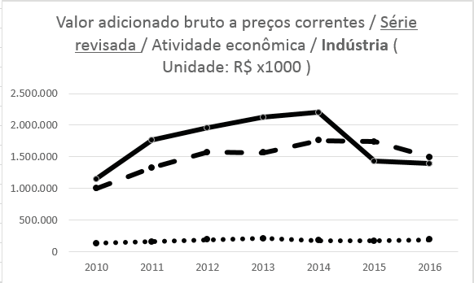

Fonte: IBGE Cidades. Disponível em htt ps://cidades.ibge.gov.br/brasil/
mg/conselheiro-lafaiete/. Acesso em 28/02/2019 (Adptado)

Fonte: IBGE Cidades. Disponível em htt ps://cidades.ibge.gov.br/brasil/
mg/conselheiro-lafaiete/. Acesso em 28/02/2019 (Adptado)
A parti r de seus conhecimentos sobre a economia da
região, é possível dizer que o município de Conselhei-
ro Lafaiete, na comparação com os demais, possui

**Alternativas:**

A) menor valor adicionado à produção agropecuária
e ao setor de serviços, e maior valor adicionado ao
setor industrial.
B) maior valor adicionado ao setor industrial, menor
valor no setor de serviços e valor intermediário no
setor agropecuário.
C) menor valor adicionado à produção agropecuária
e valores intermediários nas atividades industrial e
de serviços.
D) maior valor adicionado à produção agropecuária e
ao setor de serviços e menor valor adicionado ao
setor industrial.
E) idênticos valores adicionados aos três setores
(agrícola, industrial e de serviços).
CONCURSO DA CÂMARA MUNICIPAL DE CONSELHEIRO LAFAIETE • 2018 • ANALISTA DE SISTEMAS

**Referências visuais:**

---

#### QUESTÃO 19

✅ **Gabarito: A** (gabarito oficial — bloco "Analista de Sistemas" do gabarito oficial multi-cargo (1 cargo por página))

**Enunciado:**

Segundo o Atlas de Desenvolvimento Humano
(PNUD, 2014), entre 1991 e 2010, a taxa de natali-
dade caiu e a longevidade da população lafaietense
cresceu.
O gráfi co que melhor representa a estrutura etária da
população de Conselheiro Lafaiete no ano do últi mo
censo (2010) é:

**Alternativas:**

A) 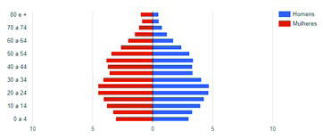
B) 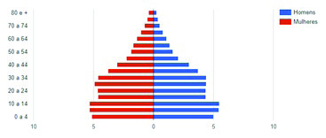
C) 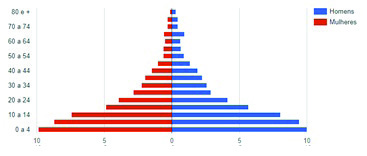
D) 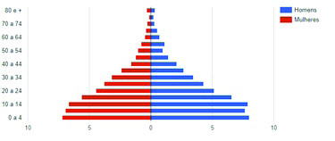
E) 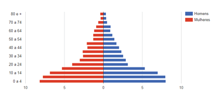

**Referências visuais:**

---

#### QUESTÃO 20

✅ **Gabarito: C** (gabarito oficial — bloco "Analista de Sistemas" do gabarito oficial multi-cargo (1 cargo por página))

**Enunciado:**

A Lei 1.116/70, disponível no Portal da Câmara de
Conselheiro Lafaiete, dispõe sobre a forma e a apre-
sentação dos símbolos do município.
não é parte do Brasão do município de Conselheiro
Lafaiete

**Alternativas:**

A) o metal argente (prata) de campo do escudo, que
simboliza em heráldica paz, trabalho, amizade,
prosperidade, religiosidade e pureza.
B) o escudete posto em abismo (centro ou coração
de escudo) com as armarias da família Rodrigues
Pereira, que lembra no brasão a figura de
Conselheiro Lafaiete Rodrigues Pereira.
C) o topônimo identificador “Conselheiro Lafaiete”,
acompanhado dos milésimos “1890” de sua
elevação a Município e “1966”, quando recebeu
feros de cidade.
D) acantonados em Chefe as Comendas das Ordens
de Gran-Cruz do Cristo e a Rosa, outorgados ao
ilustre estadista e jurisconsulto nascido na própria
cidade que hoje lhe empresta o nome.
E) oito torres, das quais apenas cinco são visíveis
em perspectiva no desenho, classifica a cidade
representada na Segunda Grandeza, ou seja, sede
de Comarca.
CONCURSO DA CÂMARA MUNICIPAL DE CONSELHEIRO LAFAIETE • 2018 • ANALISTA DE SISTEMAS
ConheCimentos espeCíFiCos

**Referências visuais:**

Nenhuma.

---

#### QUESTÃO 21

✅ **Gabarito: E** (gabarito oficial — bloco "Analista de Sistemas" do gabarito oficial multi-cargo (1 cargo por página))

**Enunciado:**

Sobre o Modelo de Referência OSI de arquitetura de
redes, analise as afi rmações e marque (V) para ver-
deiro ou (F) para falso:
( ) A camada fí sica é responsável pela transmissão
dos bits e questões como sinais para representar
os bits, intervalo de sinalização de cada bit, modo
de transmissão (nos dois senti dos ou não), ti po
do conector do cabo de rede são defi nidas nesta
camada.
( ) A camada de enlace de dados possui uma subca-
mada para realizar o controle de acesso ao meio,
que gerencia a transmissão em um canal compar-
ti lhado.
( ) Para encaminhar pacotes de uma rede para ou-
tra, a camada de rede uti liza os endereços fí sicos
das interfaces de rede da origem e do desti no.
( ) A camada de transporte é uma camada ponto a
ponto, na qual os protocolos são trocados entre
cada uma das máquinas e vizinhos imediatos,
não entre as máquinas de origem e de desti no.
( ) A camada de apresentação torna possível a co-
municação entre computadores com diferente
representações.
A sequência correta é

**Alternativas:**

A) V, F, F, V, F.
B) F, V, V, F, F.
C) F, V, V, V, F.
D) V, F, V, F, V.
E) V, V, F, F, V.

**Referências visuais:**

Nenhuma.

---

#### QUESTÃO 22

✅ **Gabarito: A** (gabarito oficial — bloco "Analista de Sistemas" do gabarito oficial multi-cargo (1 cargo por página))

**Enunciado:**

Observe a rede, representada pela imagem a seguir, na qual cada interface de rede possui um endereço fí sico,
MAC address, e um endereço lógico IP.
Fonte: o autor (2019)
Considerando que o computador A, cujo IP é 111.1.111.1, envia um pacote para o computador B, cujo IP é
222.2.222.2, e que este pacote acabou de ser recebido pelo roteador, complete o quadro a seguir, indicando
quais seriam os endereços, tanto fí sicos quanto lógicos, de origem e de desti no, conti dos neste pacote, antes de
o roteador processá-lo.
endereço Físico de origem
Endereço Físico de Desti no
(1)
endereço Lógico de origem
(2)
Endereço Lógico de Desti no
(3)
AA-AA-AA-AA-AA-AA

**Alternativas:**

A) 1: A1-A1-A1-A1-A1-A1; 2: 111.1.111.1; 3: 222.2.222.2
B) 1: A1-A1-A1-A1-A1-A1; 2: 111.1.111.1; 3: 111.1.111.10
C) 1: B2-B2-B2-B2-B2-B2; 2: 111.1.111.1; 3: 222.2.222.2
D) 1: B2-B2-B2-B2-B2-B2; 2: 111.1.111.10; 3: 111.1.111.10
E) 1: A1-A1-A1-A1-A1-A1; 2: 111.1.111.10; 3: 222.2.222.2
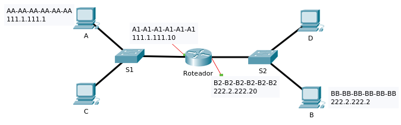
Concurso da Câmara Municipal de Conselheiro Lafaiete • 2018 • analista de sistemas

**Referências visuais:**

---

#### QUESTÃO 23

⚠️ **Gabarito: ANULADA** (questão anulada no gabarito oficial)

**Enunciado:**

As redes sem fio possuem diferentes características
se comparadas às redes com fio. A seguir, estão lista-
das algumas dessas características que são exclusivas
dos enlaces em fio, EXCETO

**Alternativas:**

A) redução da força do sinal por obstáculos.
B) interferências eletromagnéticas .
C) propagação multivias.
D) problema do terminal oculto.
E) relação entre a taxa-sinal-ruído (signal-to-noise-
ratio - SNR) e taxa de erro de bits (bits error rate
- BER).

**Referências visuais:**

Nenhuma.

---

#### QUESTÃO 24

✅ **Gabarito: D** (gabarito oficial — bloco "Analista de Sistemas" do gabarito oficial multi-cargo (1 cargo por página))

**Enunciado:**

O Secure Sockets Layer (SSL) ou o Transport Layer Se-
curity (TLS) são um dos serviços de segurança mais
utilizados atualmente como, por exemplo, ao acessar
algum endereço de URL como https://google.com,
no qual o protocolo HTTP utiliza os serviços do SSL
ou do TLS.
Analise as afirmativas a seguir.
I.
Um dos componentes do SSL é o protocolo de es-
pecificação de cifra para especificar o algoritmo
de encriptação de dados e o algoritmo de hash.
II. O uso do SSL oferece confidencialidade dos da-
dos trafegados e integridade da mensagem por
meio de algoritmos definidos pelos pares comu-
nicantes, com isso, o SSL não fica restrito a certos
algoritmos e novos algoritmos de encriptação e/
ou de hash podem ser incorporados à solução de
segurança.
Sobre as afirmativas, é correto afirmar que

**Alternativas:**

A) a sentença I é verdadeira e a sentença II é falsa.
B) a sentença I é falsa e a sentença II é verdadeira.
C) as duas sentenças são verdadeiras e a sentença I é
uma consequência da sentença II.
D) as duas sentenças são verdadeiras e a sentença I é
uma causa da sentença II.
E) as duas sentenças são verdadeiras e não há relação
de causa e consequência entre elas.

**Referências visuais:**

Nenhuma.

---

#### QUESTÃO 25

✅ **Gabarito: C** (gabarito oficial — bloco "Analista de Sistemas" do gabarito oficial multi-cargo (1 cargo por página))

**Enunciado:**

Relacione as colunas a seguir indicando as caracte-
rísticas de cada conceito relacionado aos sistemas
operacionais. Cada conceito pode aparecer uma, ne-
nhuma ou várias vezes.
Conceitos
Características Principais
1. Processo
(
) Fornece o conceito de diretó-
rio como um modo de agrupar
arquivos.
2. Thread
(
) Em muitos computadores são
de 32 ou 64 bits e indicam po-
sições da memória principal.
3. Espaço de
endereça-
mento
(
) Lê os comandos de um termi-
nal e é uma interface entre o
usuário e o sistema operacio-
nal.
4. Sistema de
Arquivo
(
) Confere a capacidade de exe-
cutar programas maiores do
que a memória física da má-
quina.
5. Entrada/
Saída
(
) Fornece a capacidade de en-
tidades paralelas compartilha-
rem de um espaço de endere-
çamento.
6. Interpre-
tador
de
comandos
(shell)
(
) Um programa em execução
com os valores do contador de
programa, dos registradores e
das variáveis.
7. Memória
virtual
(
) Capacidade de gerenciar dis-
positivos como teclados, mo-
nitores e impressoras.
A sequência correta é

**Alternativas:**

A) 4, 3, 5, 3, 1, 1, 5 .
B) 3, 7, 5, 7, 1, 2, 7.
C) 4, 3, 6, 7, 2, 1, 5.
D) 4, 7, 6, 3, 2, 1, 6.
E) 3, 4, 5, 3, 2, 2, 7.
CONCURSO DA CÂMARA MUNICIPAL DE CONSELHEIRO LAFAIETE • 2018 • ANALISTA DE SISTEMAS

**Referências visuais:**

Nenhuma.

---

#### QUESTÃO 26

✅ **Gabarito: E** (gabarito oficial — bloco "Analista de Sistemas" do gabarito oficial multi-cargo (1 cargo por página))

**Enunciado:**

Suponha que é necessário confi gurar manualmente um computador na sub-rede 192.168.0.64/26. Para confi gu-
rar a interface de rede deste computador, calcule:
1. O endereço de máscara desta sub-rede.
2. O últi mo endereço IP de host para ser atribuído a esta interface.
3. O primeiro endereço IP de host para ser atribuído ao gateway padrão.
Máscara de sub-rede
IP do computador
IP do gateway padrão
Os comandos LINUX para confi gurar a interface de rede eth0 com as confi gurações calculadas acima são:

**Alternativas:**

A) root@PC:/# ifconfi g eth0 192.168.0.127 netmask 255.255.255.192
root@PC:/# route add default gw 192.168.0.64 eth0
B) root@PC:/# ifconfi g eth0 192.168.0.65 netmask 255.255.255.192
root@PC:/# route add default gw 192.168.0.126 eth0
C) root@PC:/# ifconfi g eth0 192.168.0.126 netmask 255.255.255.0
root@PC:/# route add default gw 192.168.0.65 eth0
D) root@PC:/# ifconfi g eth0 192.168.0.254 netmask 255.255.255.0
root@PC:/# route add default gw 192.168.0.1 eth0
E) root@PC:/# ifconfi g eth0 192.168.0.126 netmask 255.255.255.192
root@PC:/# route add default gw 192.168.0.65 eth0

**Referências visuais:**

Nenhuma.

---

#### QUESTÃO 27

✅ **Gabarito: B** (gabarito oficial — bloco "Analista de Sistemas" do gabarito oficial multi-cargo (1 cargo por página))

**Enunciado:**

Observe a imagem a seguir sobre os dois ti pos de hipervisores (hypervisor) de virtualização.
Fonte: Tanenbaum (2016)

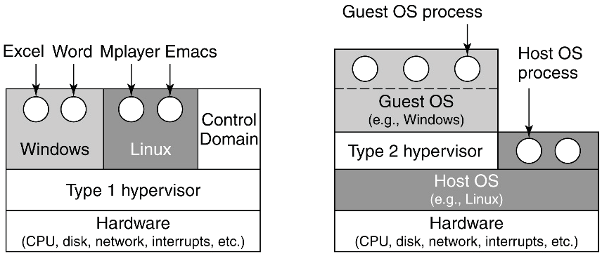

Analise as afi rmati vas abaixo e marque(V) para ver-
dadeiro ou (F) para falso.
( ) Os soft wares de virtualização VMWare e Oracle
VM VirtualBox são exemplos do tipo 2 de hiper-
visores, tendo em vista que são instalados sobre
um sistema operacional hospedeiro, como Win-
dows ou Linux.
( ) O uso de virtualização é comum em empresas
que oferecem serviços na nuvem, pois estes pro-
vedores podem comparti lhar a mesma máquina
fí sica entre diferentes clientes, sem que as aplica-
ções de um cliente afetem as de outro cliente.
( ) A virtualização não garante que um sistema ope-
racional virtualizado funcione exatamente da
mesma forma que o mesmo sistema operacional
diretamente instalado no hardware.
A sequência correta é

**Alternativas:**

A) V, V, V.
B) V, V, F.
C) V, F, F.
D) F, F, F.
E) F, V, V.
CONCURSO DA CÂMARA MUNICIPAL DE CONSELHEIRO LAFAIETE • 2018 • ANALISTA DE SISTEMAS
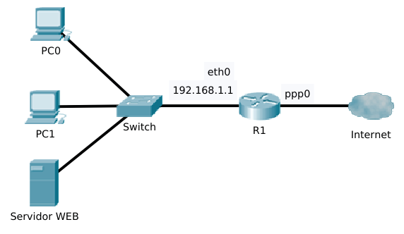

**Referências visuais:**

---

#### QUESTÃO 28

⚠️ **Gabarito: ANULADA** (questão anulada no gabarito oficial)

**Enunciado:**

Segundo Silva (SILVA, Gleydson Mazioli da. Guia Foca GNU/Linux. Guia online, 2010. Disponível em: htt p://www.
guiafoca.org.):
O Firewall é um programa que tem como objeti vo proteger a máquina contra acessos indesejados, tráfego inde-
sejado, proteger serviços que estejam rodando na máquina e bloquear a passagem de coisas que você não deseja
receber (como conexões vindas da Internet para sua segura rede local, evitando acesso aos dados corporati vos de
uma empresa ou a seus dados pessoais).
...
O iptables é um fi rewall em nível de pacotes e funciona baseado no endereço/porta de origem/desti no do pacote,
prioridade etc. Ele funciona através da comparação de regras para saber se um pacote tem ou não permissão para
passar.
Imagine o seguinte cenário, no qual um fi rewall iptables foi instalado no roteador r1, que possui duas interfaces
de redes: eth0 e ppp0. A primeira está conectada à rede interna e a segunda à Internet por um enlace ponto-a
-ponto (PPP).
Fonte: o autor (2019)
As seguintes regras foram estabelecidas:
I.
Qualquer acesso externo a máquinas da rede interna é bloqueado.
II. Os usuários da rede local têm acesso livre ao servidor WEB.
III. Qualquer acesso externo à máquina do fi rewall é bloqueado, exceto conexões para o Servidor WEB. Outras
tentati vas de conexões devem ser explicitamente registradas nos logs do sistema para conhecimento do ad-
ministrador.
IV. Todos os usuários possuem acesso livre à Internet.
não indica comandos iptables para atender as regras i a iV:

**Alternativas:**

A) iptables -t fi lter -P INPUT DROP
B) iptables -t nat -A POSTROUTING -o lo -j DROP
C) iptables -A INPUT -j LOG --log-prefi x “FIREWALL: INPUT
iptables -A INPUT -j DROP
D) iptables -A FORWARD -d 192.168.1.0/24 -i ppp+ -o eth0 -j ACCEPT
iptables -A FORWARD -s 192.168.1.0/24 -i eth0 -o ppp+ -j ACCEPT
iptables -A FORWARD -j LOG --log-prefi x “FIREWALL: FORWARD “
iptables -A FORWARD -j DROP
E) iptables -A INPUT -s 192.168.1.0/24 -i eth0 -j ACCEPT
Concurso da Câmara municipal de Conselheiro Lafaiete • 2018 • Analista de sistemas

**Referências visuais:**

Nenhuma.

---

#### QUESTÃO 29

✅ **Gabarito: A** (gabarito oficial — bloco "Analista de Sistemas" do gabarito oficial multi-cargo (1 cargo por página))

**Enunciado:**

Relacione as colunas, indicando o uso de cada tipo
de marcação XHTML. Cada opção de marcação pode
aparecer nenhuma, uma ou várias vezes.
MARCAÇÃO
SIGNIFICADO
1. DOCTYPE
(
) Indica uma lista não nume-
rada.
2. UL
(
) Auxiliam os mecanismos de
busca a encontrarem o site
na web.
3. META
(
) Aparece na aba do navega-
dor.
4. INPUT TYPE
(
) Rótulo para campos de for-
mulário.
5. LABEL
(
) Indica para o navegador a
versão de HTML usada na
página.
6. TITLE
(
) Campo de formulário.
7. OL
A sequência correta é

**Alternativas:**

A) 2, 3, 6, 5, 1, 4.
B) 2, 1, 6, 4, 3, 5.
C) 2, 1, 1, 5, 3, 4.
D) 7, 3, 6, 4, 1, 5.
E) 7, 3, 1, 5, 1, 4.

**Referências visuais:**

Nenhuma.

---

#### QUESTÃO 30

✅ **Gabarito: B** (gabarito oficial — bloco "Analista de Sistemas" do gabarito oficial multi-cargo (1 cargo por página))

**Enunciado:**

Observe o Diagrama Estendido de Entidade e Rela-
cionamento apresentado a seguir.
Fonte: o autor (2019).
Ao analisar a quantidade de linhas (tuplas) que po-
dem ser armazenadas nas entidade apresentadas, é
correto afirmar que o total de linhas em

**Alternativas:**

A) Patrimonio tem de ser igual à soma das linhas em
Veiculo e Movel.
B) Veiculo tem de ser igual à soma das linhas em
Passageiro e Carga.
C) Veiculo tem de ser maior ou igual à soma das linhas
em Passageiro e Carga.
D) Patrimonio tem de ser igual à soma das linhas em
Passageiro, Carga e Movel.
E) Patrimonio tem de ser menor ou igual à soma das
linhas em Veiculo e Movel.

**Referências visuais:**

Nenhuma.

---

#### QUESTÃO 31

✅ **Gabarito: B** (gabarito oficial — bloco "Analista de Sistemas" do gabarito oficial multi-cargo (1 cargo por página))

**Enunciado:**

Podem ser definidas como características dos siste-
mas de Recuperação de Informações, EXCETO:

**Alternativas:**

A) Lidar com dados desestrurados, sem esquema fixo.
B) Produzir resultados, baseados em combinação
exata e precisa.
C) Utilizar modelo de consulta de forma livre, a partir
de palavras-chave.
D) Retornar uma lista ou ponteiros para documentos,
a partir de uma solicitação de pesquisa.
E) Produzir resultados baseados na combinação
aproximada e medidas de eficácia, portanto podem
ser imprecisos.

**Referências visuais:**

Nenhuma.

---

#### QUESTÃO 32

⚠️ **Gabarito: ANULADA** (questão anulada no gabarito oficial)

**Enunciado:**

Considerando os conceitos de Data Warehousing, é
correto afirmar que

**Alternativas:**

A) permite operação de projeção Slice e Dice
realizadas nas dimensões.
B) permite realizar as operações de Roll-up que dão
acesso a dados mais generalizados.
C) permite realizar operações de Drill-down que
dão acesso a níveis de maior granularidade da
informação.
D) permite o uso de indexação de bitmap, o qual
constrói um vetor de bits para cada linha que está
sendo indexada.
E) os data warehouses possuem como características
lidar com uma visão conceitual multidimensional
com dimensões com objetivo de responder às
consultas transacionais.
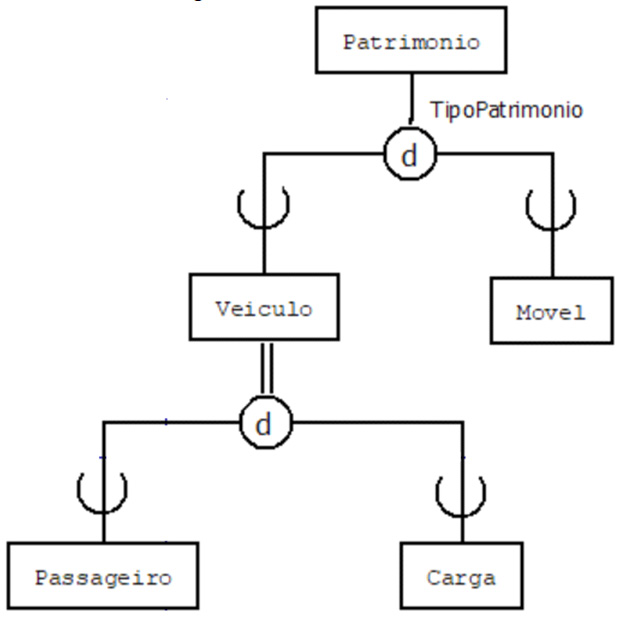
Concurso da Câmara Municipal de Conselheiro Lafaiete • 2018 • analista de sistemas

**Referências visuais:**

---

#### QUESTÃO 33

✅ **Gabarito: E** (gabarito oficial — bloco "Analista de Sistemas" do gabarito oficial multi-cargo (1 cargo por página))

**Enunciado:**

O conceito de desenvolvimento em conformidade com os Padrões Web gera dois princípios básicos que nor-
teiam o uso de Javascript: não obstrutivo e o da melhoria progressiva. Segundo Silva (2010):
Escrever JavaScript não obstrutivo implica:
•
que o conteúdo da página deve estar presente e funcional, ainda que se perca em usabilidade, caso o usuário
esteja visualizando o documento em um dispositivo (por exemplo, navegador) sem suporte para JavaScript;
•
usar a linguagem com vistas a unicamente incrementar a usabilidade da página;
•
escrever scripts em arquivos externos para serem linkados ao documento e não inserir script na marcação
HTML.
...
Outro conceito intimamente relacionado ao princípio de separação das camadas de desenvolvimento é o moder-
no conceito, introduzido com a chegada dos Padrões Web, conhecido como “melhoria progressiva” (progressive
enhancement). Segundo esse princípio, o desenvolvimento de uma página Web deve ser feito em três etapas:
•
Na primeira etapa, estruturar os conteúdos usando a linguagem HTML. Ao final dessa etapa, todos os conte-
údos devem estar disponíveis para qualquer visitante que esteja utilizando qualquer dispositivo de usuário.
•
Na segunda etapa, incrementar a apresentação da página com o uso das CSS. Essa etapa visa a melhorar a
experiência dos usuários aptos a visualizar folhas de estilos.
•
Finalmente, na terceira etapa, introduzir JavaScript com a finalidade de acrescentar interatividade à página,
melhorando ainda mais a experiência do usuário.
O sistema que representa o uso de JavaScript segundo esses princípios é

**Alternativas:**

A) <!DOCTYPE html PUBLIC “-//W3C//DTD XHTML 1.0 Transitional//EN” “http://www.w3.org/
TR/xhtml1/DTD/xhtml1-transitional.dtd”>
<html xmlns=”http://www.w3.org/1999/xhtml” lang=”pt-br”>
<head>
<title>Prova do Concurso</title>

</head>
<body>
</body>
</html>
B) <!DOCTYPE html PUBLIC "-//W3C//DTD XHTML 1.0 Transitional//EN" "http://www.w3.org/
TR/xhtml1/DTD/xhtml1-transitional.dtd">
<html xmlns="http://www.w3.org/1999/xhtml" lang="pt-br">
<head>
<title>Prova do Concurso</title>
</head>
<body>

</body>
</html>
Concurso da Câmara municipal de Conselheiro Lafaiete • 2018 • Analista de sistemas
C) <!DOCTYPE html PUBLIC "-//W3C//DTD XHTML 1.0 Transitional//EN" "http://www.w3.org/TR/xhtml1/DTD/
xhtml1-transitional.dtd">
<html xmlns="http://www.w3.org/1999/xhtml" lang="pt-br">
<head>
<title>Prova do Concurso</title>
</head>
<body>

</body>
</html>
D) <!DOCTYPE html PUBLIC "-//W3C//DTD XHTML 1.0 Transitional//EN" "http://www.w3.org/TR/xhtml1/DTD/
xhtml1-transitional.dtd">
<html xmlns="http://www.w3.org/1999/xhtml" lang="pt-br">
<head>
<title>Prova do Concurso</title>
</head>
<body>
<button type="button" onclick="alert('Caixa de alerta');">Alerta
</button>
<button type="button" onclick="confirm('Caixa de
confirmação');">Confirma
</button>
<button type="button" onclick="prompt('Caixa de dados');">Dados
</button>
</body>
</html>
E) <!DOCTYPE html PUBLIC "-//W3C//DTD XHTML 1.0 Transitional//EN" "http://www.w3.org/TR/xhtml1/DTD/
xhtml1-transitional.dtd">
<html xmlns="http://www.w3.org/1999/xhtml" lang="pt-br">
<head>
<title>Prova do Concurso</title>
<link href="../main.css" rel="stylesheet" type="text/css" />
<scripttype="text/javascript" src="scripts/script_prova.js">
</script>
</head>
<body>
</body>
</html>
Concurso da Câmara Municipal de Conselheiro Lafaiete • 2018 • analista de sistemas

**Referências visuais:**

Nenhuma.

---

#### QUESTÃO 34

✅ **Gabarito: C** (gabarito oficial — bloco "Analista de Sistemas" do gabarito oficial multi-cargo (1 cargo por página))

**Enunciado:**

Observe o Diagrama de Entidade e Relacionamento, mostrado a seguir.
Fonte: o autor (2019).
Analise as ações apresentadas a seguir e faça a correspondência das ações com as sentenças SQL que produzem
o resultado desejado, cada item pode aparecer uma, nenhuma ou várias vezes.
A sequência correta é

**Alternativas:**

A) IV, II, I, IV, III.
B) I, II, I, IV, III.
C) II, I, II, III, IV.
D) II, I, II, IV, III.
E) I, I, II, III, III.
( ) select A.nom_vereador
from vereador A
where cod_vereador in
(select cod_vereador
from autoria
group by 1
having count(*) >= all (select count(*)
from autoria
group by cod_vereador))
( ) select A.nom_vereador
from vereador A
left join autoria B
on B.cod_vereador = A.cod_vereador
where B.nro_projeto_lei is null
( ) select A.nom_vereador
from vereador A
join autoria B
on A.cod_vereador = B.cod_vereador
group by A.cod_vereador
having count(*) = (select max(tab.qtd)
from (select count(*) qtd
from autoria
group by cod_vereador) as tab)
( ) select A.nom_vereador, B.nom_partido, count(*)
from vereador A
left join partido B
on B.sigla = A.sigla
join autoria C
on C.cod_vereador = A.cod_vereador
group by A.cod_vereador,1,2
( ) select A.nom_vereador, C.nom_partido, count(*)
from vereador A
join autoria B
on B.cod_vereador = A.cod_vereador
join partido C
on C.sigla = A.sigla
group by 1,2
I.
Listar os nomes de
todos os vereadores
que não apresenta-
ram nenhum projeto
de lei.
II. Listar os nomes de
todos os vereadores
que apresentaram a
maior quantidade de
projetos.
III. Listar os nomes de to-
dos os vereadores e
o nome do partido e
a quantidade de seus
projetos.
IV. Sem
correspondên-
cia.
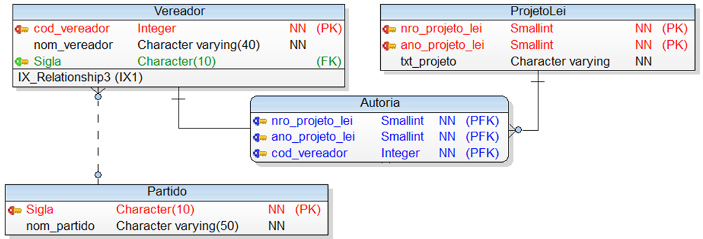
Concurso da Câmara municipal de Conselheiro Lafaiete • 2018 • Analista de sistemas

**Referências visuais:**

---

#### QUESTÃO 35

✅ **Gabarito: D** (gabarito oficial — bloco "Analista de Sistemas" do gabarito oficial multi-cargo (1 cargo por página))

**Enunciado:**

Observe o código em Java mostrado a seguir. Considere todas as classes definidas em um mesmo pacote.
public abstract class Pizza {
protected String nome;
protected double preco;
public String getNome() {
return nome;
}
public double getPreco() {
return preco;
}
}
public class Massa extends Pizza {
public Massa(String n, char tamanho) {
switch (tamanho) {
case ‘P’:
nome = n+” pequena com:”;
preco = 10.0;
break;
case ‘M’:
nome = n+” média com:”;
preco = 18.0;
break;
default:
nome = n+” grande com:”;
preco = 25.0;
}
}
}
public class Recheio extends PizzaSabor {
public Recheio(Pizza pizza, String n, double p) {
super(pizza);
nome = n;
preco = p;
}
}
public abstract class PizzaSabor extends Pizza{
Pizza pizza;
public PizzaSabor(Pizza p) {
pizza = p;
}
@Override
public String getNome() {
return pizza.getNome() + nome;
}
@Override
public double getPreco() {
return pizza.getPreco() + preco;
}
}
public class PadraoGOF {
public static void main(String[] args) {
Pizza p = new Massa(“Marguerita”, ‘P’);
p = new Recheio(p, “ Muçarela”, 3.0);
p = new Recheio(p, “ Manjericão”, 2.0);
System.out.println(p.getNome() + “ = “ + p.getPreco());
}
}
O comando que corresponde ao nome do padrão de projeto Gang of Four ( GoF) que foi utilizado é

**Alternativas:**

A) Composite.
B) Decorator.
C) Chain of Responsibility.
D) Proxy.
E) Abstract Factory.
Concurso da Câmara Municipal de Conselheiro Lafaiete • 2018 • analista de sistemas

**Referências visuais:**

Nenhuma.

---

#### QUESTÃO 36

✅ **Gabarito: C** (gabarito oficial — bloco "Analista de Sistemas" do gabarito oficial multi-cargo (1 cargo por página))

**Enunciado:**

O Scrum é um método ágil que visa a apoiar o de-
senvolvimento de produtos e de serviços em todos
os tipos de indústrias e em qualquer tipo de projeto,
independentemente de sua complexidade.
Avalie as afirmativas mostradas a seguir, consideran-
do as características do Scrum.
I.
Na reunião de restrospectiva (Retrospective
Meeting), o Time Scrum apresenta os Entregáveis
do Sprint ao Dono do Produto e aos stakeholders.
O objetivo dessa reunião é garantir a aprovação e
a aceitação do Dono do Produto para produto ou
serviço.
II. Na reunião de revisão (Sprint Review), o Scrum
Master e o Time Scrum se reúnem para discutir
as lições aprendidas durante o Sprint. Esta infor-
mação é documentada como lições aprendidas
que poderão ser aplicadas em Sprints futuros.
III. A fase de Planejar e Estimar consiste nos proces-
sos relacionados ao planejamento e à estimativa
de tarefas, que incluem Criar as Estórias de Usuá-
rio, Aprovar, Estimar e Comprometer as Estórias
de Usuário, Criar as Tarefas, Estimar as Tarefas, e
Criar o Backlog do Sprint.
Está correto, apenas, o que se afirma em

**Alternativas:**

A) I.
B) II.
C) III.
D) I e II.
E) I, II e III.

**Referências visuais:**

Nenhuma.

---

#### QUESTÃO 37

✅ **Gabarito: D** (gabarito oficial — bloco "Analista de Sistemas" do gabarito oficial multi-cargo (1 cargo por página))

**Enunciado:**

Os métodos ágeis surgiram na década de 1990 como
alternativa à abordagem de desenvolvimento de sis-
temas dirigido a planos.
São considerados princípios dos métodos ágeis,
EXCETO

**Alternativas:**

A) envolvimento do cliente.
B) entrega incremental.
C) pessoas, não processos.
D) rejeitar as mudanças.
E) manter a simplicidade.

**Referências visuais:**

Nenhuma.

---

#### QUESTÃO 38

✅ **Gabarito: D** (gabarito oficial — bloco "Analista de Sistemas" do gabarito oficial multi-cargo (1 cargo por página))

**Enunciado:**

Observe o Diagrama de Classes mostrado a seguir:
Fonte: o autor (2019).
É correto afirmar que

**Alternativas:**

A) a classe Projeto herda os membros da classe
ProjetoPiloto.
B) o relacionamento entre as classes Projeto, Material
e Alocacao é do tipo ternário.
C) o diagrama apresenta um erro de construção na
associação “cria”, pois uma relação todo-parte não
aceita conectividade muitos-para-muitos.
D) o relacionamento todo-parte “integra” é uma
composição, e a multiplicidade relativa à classe
parte pode ser omitida, já que cada objeto da classe
Componente só pode estar associado exatamente
a um objeto da classe Material.
E) a seta da associação entre as classes Material e
Componente indica o sentido de navegação: os
objetos da classe Material têm referência para
objetos da classe Componente, por outro lado,
objetos da classe Componente não têm referência
para objetos instanciados da classe Material.
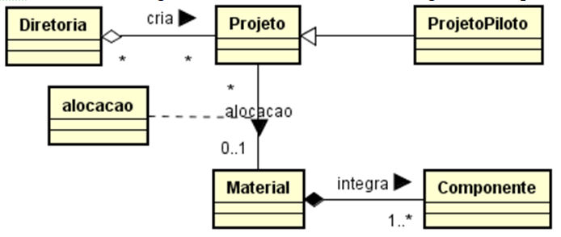
Concurso da Câmara municipal de Conselheiro Lafaiete • 2018 • Analista de sistemas

**Referências visuais:**

---

#### QUESTÃO 39

✅ **Gabarito: A** (gabarito oficial — bloco "Analista de Sistemas" do gabarito oficial multi-cargo (1 cargo por página))

**Enunciado:**

O Diagrama de Casos de Uso, apresentado a seguir, representa o contexto de um sistema de Help Desk que visa
a atender as solicitações dos usuários da Câmara dos Vereadores de Conselheiro Lafaiete.
Fonte: o autor (2019).
Tomando como base o diagrama apresentado, é INCORRETO afirmar:

**Alternativas:**

A) É permitido ao Solicitante abrir um chamado que não seja nem Normal nem Emergencial.
B) Para abrir um chamado, o Solicitante primeiro tem que acessar o caso de uso Consultar chamado.
C) Ao acessar o caso de uso Registrar Atendimento, obrigatoriamente o caso de uso Gerar log de acesso também
será executado.
D) O caso de uso Gerar log de acesso é executado sempre que os casos de uso Abrir chamado e Registrar
Atendimento são executados.
E) O Gerente tem acesso, para além de suas funcionalidades exclusivas, a todas as funcionalidades previstas para
o Técnico TI.

**Referências visuais:**

Nenhuma.

---

#### QUESTÃO 40

✅ **Gabarito: C** (gabarito oficial — bloco "Analista de Sistemas" do gabarito oficial multi-cargo (1 cargo por página))

**Enunciado:**

De acordo com Pressman, fazem parte do papel de um grupo de SQA, EXCETO

**Alternativas:**

A) registrar qualquer eventual não satisfação e relatá-la à gerência superior.
B) participar do desenvolvimento da descrição do processo de software do projeto.
C) realizar as alterações no código fonte do produto de software, visando à melhoria da qualidade.
D) garantir que os desvios do trabalho de software e dos produtos do trabalho sejam documentados e manipulados
de acordo com um procedimento predefinido.
E) auditar os produtos do trabalho de software encomendado para identificar, documentar e acompanhar se
houve desvios em relação ao que foi definido pelo processo de software.
Concurso da Câmara Municipal de Conselheiro Lafaiete • 2018 • analista de sistemas
Rascunho
Concurso da Câmara Municipal de Conselheiro Lafaiete
2018
GABARITO (RASCUNHO)
A
B
C
D
A
B
C
D
A
B
C
D
A
B
C
D
A
B
C
D
A
B
C
D
A
B
C
D
A
B
C
D
A
B
C
D
A
B
C
D
E
E
E
E
E
E
E
E
E
E
A
B
C
D
A
B
C
D
A
B
C
D
A
B
C
D
A
B
C
D
A
B
C
D
A
B
C
D
A
B
C
D
A
B
C
D
A
B
C
D
E
E
E
E
E
E
E
E
E
E
O gabarito e o caderno de provas serão divulgados no endereço eletônico:
concurso.fundacaocefetminas.org.br
Analista de Sistemas
Língua Portuguesa
A
B
C
D
A
B
C
D
A
B
C
D
A
B
C
D
A
B
C
D
A
B
C
D
A
B
C
D
A
B
C
D
A
B
C
D
A
B
C
D
A
B
C
D
A
B
C
D
A
B
C
D
A
B
C
D
A
B
C
D
A
B
C
D
A
B
C
D
A
B
C
D
A
B
C
D
A
B
C
D
E
E
E
E
E
E
E
E
E
E
E
E
E
E
E
E
E
E
E
E
Conhecimentos
específicos
Conhecimentos gerais
sobre o município
ATENÇÃO:
AGUARDE AUTORIZAÇÃO
PARA VIRAR O CADERNO DE PROVA.

**Referências visuais:**

Nenhuma.

---

## 4. Observações e limitações da extração

- Extração automática (texto selecionável do PDF via PyMuPDF), sem OCR: PDFs escaneados podem perder texto.
- Imagens repetidas (logos/marcas d'água) foram descartadas; as imagens de conteúdo foram salvas em `imagens/` com nomenclatura `imagem_00N`.
- A detecção de grupos usa os avisos padrão das bancas ("o texto seguinte servirá de base..."). Bancas sem esse aviso podem ter grupos não identificados — o conteúdo, porém, permanece integral.
- Se houver divergência entre esta versão e o PDF original, vale o PDF original; corrija manualmente o Markdown.
