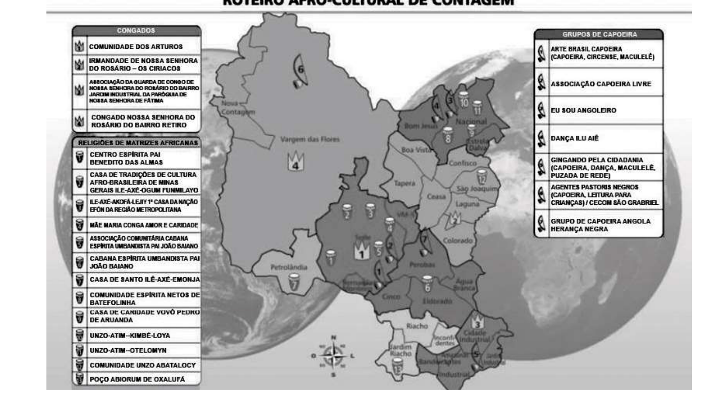
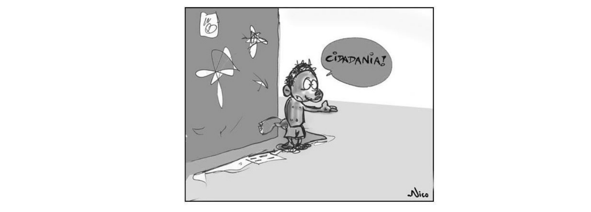

# PROVA — Camara_Contagem_2022_Analista_Tecnico_Analista_de_Sistemas

## 1. Análise geral da prova

- **Identificação:** Camara_Contagem_2022_Analista_Tecnico_Analista_de_Sistemas
- **Instituição:** Câmara Municipal de Contagem/MG
- **Órgão:** Câmara Municipal de Contagem
- **Cargo:** Analista Técnico – Analista de Sistemas (Código 304)
- **Banca organizadora:** FUNDEP (Fundação de Apoio da UFMG)
- **Ano:** 2022 (Edital nº 01/2022)
- **Quantidade total de questões:** 40 (a questão 8 consta como ANULADA no gabarito oficial pós-recursos) + Proposta de Redação
- **Quantidade de textos de apoio (grupos):** 2 (TEXTO I — questões 01 a 10; TEXTO II — questões 11 a 13), além de materiais de apoio individuais nas questões 16 a 19, 21 e 22
- **Quantidade de imagens:** 2
- **Quantidade de gráficos e tabelas:** incluídos nas imagens e no texto extraído, quando presentes no PDF original
- **Quantidade de grupos identificados:** 2
- **Quantidade de questões independentes:** 27
- **Questões que compartilham materiais:** TEXTO I → questões 01 a 10; TEXTO II → questões 11 a 13

### Transcrição integral da capa/instruções (conforme extraída do PDF)

> [!NOTE]
> Conteúdo integral das páginas anteriores à primeira questão, sem cortes.

> CÂMARA MUNICIPAL DE CONTAGEM/MG
>
> CONCURSO PÚBLICO PARA PROVIMENTO DE CARGOS DA CÂMARA MUNICIPAL DE CONTAGEM
>
> ANALISTA TÉCNICO – ANALISTA DE SISTEMAS
>
> Código: 304
>
> LEIA COM ATENÇÃO AS SEGUINTES INSTRUÇÕES
>
> 1. Este caderno contém as questões da Prova Objetiva e a Proposta de Redação.
> 2. Use a Folha de Respostas (versão do Candidato) reproduzida ao final deste caderno apenas para marcar o Gabarito.
> 3. Ao receber a Folha de Respostas da Prova Objetiva e da Redação:
>
> Confira seu nome, número de inscrição e cargo.
> Assine, A TINTA, no espaço próprio indicado.
>
> 4. ATENÇÃO: transcreva no espaço apropriado da sua FOLHA DE RESPOSTAS, com sua caligrafia usual, mantendo as letras maiúsculas e minúsculas, desconsiderando aspas e autoria, a seguinte frase:
>
> "A esperança é o sonho do homem acordado." Aristóteles
>
> FOLHA DE RESPOSTAS SEM ASSINATURA NÃO TEM VALIDADE.
>
> 5. Ao transferir as respostas para a Folha de Respostas:
>
> 01 use apenas caneta esferográfica azul ou preta.
> 02 preencha, sem forçar o papel, toda a área reservada à letra correspondente à resposta solicitada em cada questão.
> 03 assinale somente uma alternativa em cada questão.
>
> Sua resposta NÃO será computada se houver marcação de mais de uma alternativa, questões não assinaladas ou rasuras.
>
> NÃO DEIXE NENHUMA QUESTÃO SEM RESPOSTA.
>
> A Folha de Respostas não deve ser dobrada, amassada ou rasurada.
>
> ATENÇÃO: O tempo de duração das provas abrange a assinatura da Folha de Respostas, a transcrição das respostas do Caderno de Questões da Prova Objetiva (Folha de Respostas e rascunho) para o Caderno definitivo e a transcrição da Redação para o Caderno Definitivo de Redação. Deverá ser resguardado o Período de Sigilo, não sendo permitido ao candidato se ausentar em definitivo da sala de provas antes de decorridas 2 (duas) horas do início das provas. Os candidatos não poderão utilizar, em hipótese alguma, lápis, lapiseira, corretivos, borracha ou outro material distinto do constante em Edital. Quaisquer acessórios como óculos escuros, boné, chapéu, gorro, lenço ou similares não terão seu uso permitido. As instruções constantes no Caderno de Questões e na Folha de Resposta, bem como as orientações e instruções expedidas pela FUNDEP durante a realização das provas, complementam este Edital e deverão ser rigorosamente observadas e seguidas pelo candidato. Será proibida, durante a realização das provas, qualquer espécie de consulta ou comunicação entre os candidatos ou entre estes e pessoas estranhas, oralmente ou por escrito, assim como não será permitido o uso de livros, códigos, manuais, impressos, anotações ou quaisquer outros meios. Será proibido, durante a realização das provas, fazer uso ou portar, mesmo que desligados, telefone celular, relógios, pagers, beep, agenda eletrônica, calculadora, walkman, notebook, palmtop, gravador, transmissor/receptor de mensagens de qualquer tipo ou qualquer outro equipamento eletrônico. Findo o horário-limite para a realização da prova, o candidato deverá entregar a Folha de Respostas da Prova Objetiva, devidamente preenchida e assinada, ao Aplicador de Sala, assim como o Caderno de Provas. Os três últimos candidatos deverão permanecer na sala até que o último candidato termine sua prova, devendo todos assinar a Ata de Ocorrências da sala, atestando a idoneidade da fiscalização das provas, retirando-se da sala de prova de uma só vez.
>
> O Caderno de Questões e os gabaritos das Provas Objetivas serão divulgados no endereço eletrônico www.gestaodeconcursos.com.br, no primeiro dia útil subsequente à data de realização da prova.
>
> DURAÇÃO MÁXIMA DA PROVA: 4 (QUATRO) HORAS
>
> ATENÇÃO
>
> Sr.(a) Candidato(a),
>
> Antes de começar a fazer a prova, confira se este caderno contém, ao todo, 40 (quarenta) questões de múltipla escolha, cada uma constituída de 4 (quatro) alternativas de respostas, assim distribuídas: 15 (quinze) questões de Língua Portuguesa, 7 (sete) questões de Conhecimentos Gerais, 8 (oito) questões de Legislação, 10 (dez) questões de Conhecimentos Específicos e a Proposta de Redação, todas perfeitamente legíveis.
>
> Havendo algum problema, informe imediatamente ao aplicador de provas para que ele tome as providências necessárias.
>
> Caso não observe essa recomendação, não lhe caberá qualquer reclamação ou recursos posteriores.

### Gabarito oficial

**Gabarito oficial — tabela do gabarito oficial (coluna do cargo da prova):**

| Questão | Resposta | Questão | Resposta | Questão | Resposta | Questão | Resposta | Questão | Resposta |
|---|---|---|---|---|---|---|---|---|---|
| 01 | **B** | 02 | **D** | 03 | **C** | 04 | **B** | 05 | **D** |
| 06 | **B** | 07 | **A** | 08 | **ANULADA** | 09 | **A** | 10 | **B** |
| 11 | **C** | 12 | **B** | 13 | **A** | 14 | **C** | 15 | **B** |
| 16 | **C** | 17 | **A** | 18 | **A** | 19 | **A** | 20 | **D** |
| 21 | **B** | 22 | **D** | 23 | **B** | 24 | **A** | 25 | **C** |
| 26 | **D** | 27 | **C** | 28 | **D** | 29 | **C** | 30 | **C** |
| 31 | **D** | 32 | **B** | 33 | **D** | 34 | **C** | 35 | **B** |
| 36 | **C** | 37 | **C** | 38 | **B** | 39 | **B** | 40 | **A** |

> 📌 Fonte: gabarito oficial - coluna "304 - ANALISTA TÉCNICO - ANALISTA DE SISTEMAS" do GABARITO PÓS-RECURSOS (FUNDAÇÃO DE APOIO DA UFMG)

---

## 2. Questões agrupadas

### GRUPO 01 — Texto-base compartilhado pelas questões 01 a 10 (TEXTO I — "Saneamento nada básico")

**Questões relacionadas:** 01, 02, 03, 04, 05, 06, 07, 08, 09, 10.

#### QUESTÃO 01

✅ **Gabarito: B** (gabarito oficial - coluna "304 - ANALISTA TÉCNICO - ANALISTA DE SISTEMAS" do GABARITO PÓS-RECURSOS (FUNDAÇÃO DE APOIO DA UFMG))

**Material de apoio:**

**INSTRUÇÃO:** Leia o texto I a seguir para responder às questões de 1 a 10.

## TEXTO I

### Saneamento nada básico

*Parametrização centralizada no âmbito federal não necessariamente tornaria o processo mais eficiente*

Desde a antiguidade, existe preocupação com o saneamento básico [...]. No Brasil, as primeiras iniciativas remontam a 1561.

De acordo com o Sistema Nacional de Informações de Saneamento (SNIS), dados de 2017, 83,5% da população brasileira tinham acesso a água tratada, 52,4% tinham acesso a coleta de esgoto, e apenas 46% dos esgotos do país são tratados. O volume médio de perdas ainda se encontra em 38,3%.

As condições que não permitiram o desenvolvimento pleno do saneamento básico no país continuam presentes: volume incipiente de investimentos, ausência de planejamento adequado, experiências malsucedidas de gestão e dificuldade para obter financiamentos e licenças para obras. Destas, somente a última apresentou alguma evolução desde o Plano Nacional de Saneamento de 1971.

Dentre as dificuldades de planejamento, destaca-se o fato de que a titularidade dos serviços, conforme lei 11.445/07, é dos municípios. Logo, criar arcabouço regulatório, planos de saneamento e licitar concessões é uma tarefa hercúlea para a gama de 5.570 municípios existentes. O problema é grande; o diagnóstico, antigo. Mas pouco se avançou desde a criação do marco regulatório. Apresento possíveis soluções para contribuir com o debate.

Em primeiro lugar, é preciso que a reflexão sobre o marco regulatório ocorra previamente. As duas medidas provisórias de 2018 e 2019 (844 e 868) tiveram vício de origem, pois não foram fruto de uma discussão prévia com os principais agentes setoriais. Se empresas dos estados de SP, MG e PR foram responsáveis por 45% dos investimentos em saneamento no país em 2017, e 65% ao somarmos as privadas, uma reflexão deveria partir delas, juntamente com a sociedade civil e associações.

A experiência do setor elétrico quando da criação do Novo Modelo é um exemplo a ser lembrado. Houve praticamente um ano de discussões prévias com ampla adesão que culminaram com as MPs 144 e 145, de outubro de 2003. De exemplo negativo, temos a MP 579/12, cuja discussão prévia foi curta e circunscrita a agentes de mercado, em sua maioria eletrointensivos, e, portanto, interessados em redução de tarifas. O barato saiu caro, e a redução de 18% em 2013 foi sucedida por aumentos tarifários 41% acima da inflação de 2014 a 2018.

A solução proposta é a simplificação dos processos e a não concentração de responsabilidade na Agência Nacional de Águas (ANA) ou a criação de arcabouço regulatório e plano de saneamento federais.

[...]

Em segundo lugar, deve-se repensar a proposta de se criar um plano de saneamento nacional como norte para planos municipais. Essa abordagem centralizada pode desconsiderar aspectos locais como características socioeconômicas do consumidor, estrutura dos ativos, distância a fontes de captação de água, topografia, restrições ambientais, entre outros. Enfim, não necessariamente uma parametrização centralizada no âmbito federal tornaria o processo mais eficiente ou atinente às características locais.

Em terceiro lugar, por que não permitir que cada município baseie seu arcabouço regulatório em melhores práticas existentes e regras simplificadas de atualização de tarifas, qualidade e metas de cobertura dos serviços, além de penalidades claras e objetivas pelo não cumprimento destas?

Em quarto lugar, a criação de uma cartilha de regras de licitação para auxiliar municípios seria um começo. Os dois outros pilares, regulação e plano de saneamento, poderiam ser disponibilizados por instituições independentes. Dessa forma, o processo seria parametrizado de maneira simples, descentralizada e com custo baixo.

Investir em saneamento é processo civilizatório. Não há necessidade de se trazer complexidades, quando regras e melhores práticas já existem e podem nortear prefeituras a melhorar a condição de vida de seus habitantes sem uma mão visível da União.

PIRES, Adriano. Saneamento nada básico. Aesbe. Associação Brasileira das Empresas Estaduais de Saneamento. Disponível em: https://aesbe.org.br/novo/opiniao-artigo-saneamento-nada-basico/. Acesso em: 27 ago. 2022.

**Enunciado:**

**Alternativas:**

A) discutir os problemas enfrentados pelo Brasil acerca do saneamento básico, apontando causas e possíveis soluções para a questão.
B) divulgar os problemas relativos ao saneamento básico no Brasil, sem entrar no mérito da culpabilização e das possíveis intervenções.
C) explicar a situação atual do Brasil no que se refere ao saneamento básico, expondo dados estatísticos e esclarecendo as normas relativas ao tema.
D) informar os desafios do Brasil em relação ao saneamento básico, apresentando também os pontos em que o país já avançou dentro da temática.

**Referências visuais:**

Nenhuma.

---

#### QUESTÃO 02

✅ **Gabarito: D** (gabarito oficial - coluna "304 - ANALISTA TÉCNICO - ANALISTA DE SISTEMAS" do GABARITO PÓS-RECURSOS (FUNDAÇÃO DE APOIO DA UFMG))

**Material de apoio:**

**INSTRUÇÃO:** Leia o texto I a seguir para responder às questões de 1 a 10.

## TEXTO I

### Saneamento nada básico

*Parametrização centralizada no âmbito federal não necessariamente tornaria o processo mais eficiente*

Desde a antiguidade, existe preocupação com o saneamento básico [...]. No Brasil, as primeiras iniciativas remontam a 1561.

De acordo com o Sistema Nacional de Informações de Saneamento (SNIS), dados de 2017, 83,5% da população brasileira tinham acesso a água tratada, 52,4% tinham acesso a coleta de esgoto, e apenas 46% dos esgotos do país são tratados. O volume médio de perdas ainda se encontra em 38,3%.

As condições que não permitiram o desenvolvimento pleno do saneamento básico no país continuam presentes: volume incipiente de investimentos, ausência de planejamento adequado, experiências malsucedidas de gestão e dificuldade para obter financiamentos e licenças para obras. Destas, somente a última apresentou alguma evolução desde o Plano Nacional de Saneamento de 1971.

Dentre as dificuldades de planejamento, destaca-se o fato de que a titularidade dos serviços, conforme lei 11.445/07, é dos municípios. Logo, criar arcabouço regulatório, planos de saneamento e licitar concessões é uma tarefa hercúlea para a gama de 5.570 municípios existentes. O problema é grande; o diagnóstico, antigo. Mas pouco se avançou desde a criação do marco regulatório. Apresento possíveis soluções para contribuir com o debate.

Em primeiro lugar, é preciso que a reflexão sobre o marco regulatório ocorra previamente. As duas medidas provisórias de 2018 e 2019 (844 e 868) tiveram vício de origem, pois não foram fruto de uma discussão prévia com os principais agentes setoriais. Se empresas dos estados de SP, MG e PR foram responsáveis por 45% dos investimentos em saneamento no país em 2017, e 65% ao somarmos as privadas, uma reflexão deveria partir delas, juntamente com a sociedade civil e associações.

A experiência do setor elétrico quando da criação do Novo Modelo é um exemplo a ser lembrado. Houve praticamente um ano de discussões prévias com ampla adesão que culminaram com as MPs 144 e 145, de outubro de 2003. De exemplo negativo, temos a MP 579/12, cuja discussão prévia foi curta e circunscrita a agentes de mercado, em sua maioria eletrointensivos, e, portanto, interessados em redução de tarifas. O barato saiu caro, e a redução de 18% em 2013 foi sucedida por aumentos tarifários 41% acima da inflação de 2014 a 2018.

A solução proposta é a simplificação dos processos e a não concentração de responsabilidade na Agência Nacional de Águas (ANA) ou a criação de arcabouço regulatório e plano de saneamento federais.

[...]

Em segundo lugar, deve-se repensar a proposta de se criar um plano de saneamento nacional como norte para planos municipais. Essa abordagem centralizada pode desconsiderar aspectos locais como características socioeconômicas do consumidor, estrutura dos ativos, distância a fontes de captação de água, topografia, restrições ambientais, entre outros. Enfim, não necessariamente uma parametrização centralizada no âmbito federal tornaria o processo mais eficiente ou atinente às características locais.

Em terceiro lugar, por que não permitir que cada município baseie seu arcabouço regulatório em melhores práticas existentes e regras simplificadas de atualização de tarifas, qualidade e metas de cobertura dos serviços, além de penalidades claras e objetivas pelo não cumprimento destas?

Em quarto lugar, a criação de uma cartilha de regras de licitação para auxiliar municípios seria um começo. Os dois outros pilares, regulação e plano de saneamento, poderiam ser disponibilizados por instituições independentes. Dessa forma, o processo seria parametrizado de maneira simples, descentralizada e com custo baixo.

Investir em saneamento é processo civilizatório. Não há necessidade de se trazer complexidades, quando regras e melhores práticas já existem e podem nortear prefeituras a melhorar a condição de vida de seus habitantes sem uma mão visível da União.

PIRES, Adriano. Saneamento nada básico. Aesbe. Associação Brasileira das Empresas Estaduais de Saneamento. Disponível em: https://aesbe.org.br/novo/opiniao-artigo-saneamento-nada-basico/. Acesso em: 27 ago. 2022.

**Enunciado:**

**Alternativas:**

A) a responsabilidade dada aos municípios pelos serviços de saneamento.
B) a dificuldade dos municípios de criar planos de saneamento.
C) os precários conjuntos de leis relativas ao tema nos municípios.
D) a impossibilidade de aprovar financiamentos e licenças para obras.

**Referências visuais:**

Nenhuma.

---

#### QUESTÃO 03

✅ **Gabarito: C** (gabarito oficial - coluna "304 - ANALISTA TÉCNICO - ANALISTA DE SISTEMAS" do GABARITO PÓS-RECURSOS (FUNDAÇÃO DE APOIO DA UFMG))

**Material de apoio:**

**INSTRUÇÃO:** Leia o texto I a seguir para responder às questões de 1 a 10.

## TEXTO I

### Saneamento nada básico

*Parametrização centralizada no âmbito federal não necessariamente tornaria o processo mais eficiente*

Desde a antiguidade, existe preocupação com o saneamento básico [...]. No Brasil, as primeiras iniciativas remontam a 1561.

De acordo com o Sistema Nacional de Informações de Saneamento (SNIS), dados de 2017, 83,5% da população brasileira tinham acesso a água tratada, 52,4% tinham acesso a coleta de esgoto, e apenas 46% dos esgotos do país são tratados. O volume médio de perdas ainda se encontra em 38,3%.

As condições que não permitiram o desenvolvimento pleno do saneamento básico no país continuam presentes: volume incipiente de investimentos, ausência de planejamento adequado, experiências malsucedidas de gestão e dificuldade para obter financiamentos e licenças para obras. Destas, somente a última apresentou alguma evolução desde o Plano Nacional de Saneamento de 1971.

Dentre as dificuldades de planejamento, destaca-se o fato de que a titularidade dos serviços, conforme lei 11.445/07, é dos municípios. Logo, criar arcabouço regulatório, planos de saneamento e licitar concessões é uma tarefa hercúlea para a gama de 5.570 municípios existentes. O problema é grande; o diagnóstico, antigo. Mas pouco se avançou desde a criação do marco regulatório. Apresento possíveis soluções para contribuir com o debate.

Em primeiro lugar, é preciso que a reflexão sobre o marco regulatório ocorra previamente. As duas medidas provisórias de 2018 e 2019 (844 e 868) tiveram vício de origem, pois não foram fruto de uma discussão prévia com os principais agentes setoriais. Se empresas dos estados de SP, MG e PR foram responsáveis por 45% dos investimentos em saneamento no país em 2017, e 65% ao somarmos as privadas, uma reflexão deveria partir delas, juntamente com a sociedade civil e associações.

A experiência do setor elétrico quando da criação do Novo Modelo é um exemplo a ser lembrado. Houve praticamente um ano de discussões prévias com ampla adesão que culminaram com as MPs 144 e 145, de outubro de 2003. De exemplo negativo, temos a MP 579/12, cuja discussão prévia foi curta e circunscrita a agentes de mercado, em sua maioria eletrointensivos, e, portanto, interessados em redução de tarifas. O barato saiu caro, e a redução de 18% em 2013 foi sucedida por aumentos tarifários 41% acima da inflação de 2014 a 2018.

A solução proposta é a simplificação dos processos e a não concentração de responsabilidade na Agência Nacional de Águas (ANA) ou a criação de arcabouço regulatório e plano de saneamento federais.

[...]

Em segundo lugar, deve-se repensar a proposta de se criar um plano de saneamento nacional como norte para planos municipais. Essa abordagem centralizada pode desconsiderar aspectos locais como características socioeconômicas do consumidor, estrutura dos ativos, distância a fontes de captação de água, topografia, restrições ambientais, entre outros. Enfim, não necessariamente uma parametrização centralizada no âmbito federal tornaria o processo mais eficiente ou atinente às características locais.

Em terceiro lugar, por que não permitir que cada município baseie seu arcabouço regulatório em melhores práticas existentes e regras simplificadas de atualização de tarifas, qualidade e metas de cobertura dos serviços, além de penalidades claras e objetivas pelo não cumprimento destas?

Em quarto lugar, a criação de uma cartilha de regras de licitação para auxiliar municípios seria um começo. Os dois outros pilares, regulação e plano de saneamento, poderiam ser disponibilizados por instituições independentes. Dessa forma, o processo seria parametrizado de maneira simples, descentralizada e com custo baixo.

Investir em saneamento é processo civilizatório. Não há necessidade de se trazer complexidades, quando regras e melhores práticas já existem e podem nortear prefeituras a melhorar a condição de vida de seus habitantes sem uma mão visível da União.

PIRES, Adriano. Saneamento nada básico. Aesbe. Associação Brasileira das Empresas Estaduais de Saneamento. Disponível em: https://aesbe.org.br/novo/opiniao-artigo-saneamento-nada-basico/. Acesso em: 27 ago. 2022.

**Enunciado:**

Assinale a alternativa em que a oração em destaque não exerce a função sintática apresentada entre parênteses.

**Alternativas:**

A) "As condições que não permitiram o desenvolvimento pleno do saneamento básico no país continuam presentes" - (adjunto adnominal)
B) "Em primeiro lugar, é preciso que a reflexão sobre o marco regulatório ocorra previamente" - (sujeito)
C) "Apresento possíveis soluções para contribuir com o debate" - (adjunto adverbial consecutivo)
D) "Não há necessidade de se trazer complexidades [...]" - (complemento nominal)

**Referências visuais:**

Nenhuma.

---

#### QUESTÃO 04

✅ **Gabarito: B** (gabarito oficial - coluna "304 - ANALISTA TÉCNICO - ANALISTA DE SISTEMAS" do GABARITO PÓS-RECURSOS (FUNDAÇÃO DE APOIO DA UFMG))

**Material de apoio:**

**INSTRUÇÃO:** Leia o texto I a seguir para responder às questões de 1 a 10.

## TEXTO I

### Saneamento nada básico

*Parametrização centralizada no âmbito federal não necessariamente tornaria o processo mais eficiente*

Desde a antiguidade, existe preocupação com o saneamento básico [...]. No Brasil, as primeiras iniciativas remontam a 1561.

De acordo com o Sistema Nacional de Informações de Saneamento (SNIS), dados de 2017, 83,5% da população brasileira tinham acesso a água tratada, 52,4% tinham acesso a coleta de esgoto, e apenas 46% dos esgotos do país são tratados. O volume médio de perdas ainda se encontra em 38,3%.

As condições que não permitiram o desenvolvimento pleno do saneamento básico no país continuam presentes: volume incipiente de investimentos, ausência de planejamento adequado, experiências malsucedidas de gestão e dificuldade para obter financiamentos e licenças para obras. Destas, somente a última apresentou alguma evolução desde o Plano Nacional de Saneamento de 1971.

Dentre as dificuldades de planejamento, destaca-se o fato de que a titularidade dos serviços, conforme lei 11.445/07, é dos municípios. Logo, criar arcabouço regulatório, planos de saneamento e licitar concessões é uma tarefa hercúlea para a gama de 5.570 municípios existentes. O problema é grande; o diagnóstico, antigo. Mas pouco se avançou desde a criação do marco regulatório. Apresento possíveis soluções para contribuir com o debate.

Em primeiro lugar, é preciso que a reflexão sobre o marco regulatório ocorra previamente. As duas medidas provisórias de 2018 e 2019 (844 e 868) tiveram vício de origem, pois não foram fruto de uma discussão prévia com os principais agentes setoriais. Se empresas dos estados de SP, MG e PR foram responsáveis por 45% dos investimentos em saneamento no país em 2017, e 65% ao somarmos as privadas, uma reflexão deveria partir delas, juntamente com a sociedade civil e associações.

A experiência do setor elétrico quando da criação do Novo Modelo é um exemplo a ser lembrado. Houve praticamente um ano de discussões prévias com ampla adesão que culminaram com as MPs 144 e 145, de outubro de 2003. De exemplo negativo, temos a MP 579/12, cuja discussão prévia foi curta e circunscrita a agentes de mercado, em sua maioria eletrointensivos, e, portanto, interessados em redução de tarifas. O barato saiu caro, e a redução de 18% em 2013 foi sucedida por aumentos tarifários 41% acima da inflação de 2014 a 2018.

A solução proposta é a simplificação dos processos e a não concentração de responsabilidade na Agência Nacional de Águas (ANA) ou a criação de arcabouço regulatório e plano de saneamento federais.

[...]

Em segundo lugar, deve-se repensar a proposta de se criar um plano de saneamento nacional como norte para planos municipais. Essa abordagem centralizada pode desconsiderar aspectos locais como características socioeconômicas do consumidor, estrutura dos ativos, distância a fontes de captação de água, topografia, restrições ambientais, entre outros. Enfim, não necessariamente uma parametrização centralizada no âmbito federal tornaria o processo mais eficiente ou atinente às características locais.

Em terceiro lugar, por que não permitir que cada município baseie seu arcabouço regulatório em melhores práticas existentes e regras simplificadas de atualização de tarifas, qualidade e metas de cobertura dos serviços, além de penalidades claras e objetivas pelo não cumprimento destas?

Em quarto lugar, a criação de uma cartilha de regras de licitação para auxiliar municípios seria um começo. Os dois outros pilares, regulação e plano de saneamento, poderiam ser disponibilizados por instituições independentes. Dessa forma, o processo seria parametrizado de maneira simples, descentralizada e com custo baixo.

Investir em saneamento é processo civilizatório. Não há necessidade de se trazer complexidades, quando regras e melhores práticas já existem e podem nortear prefeituras a melhorar a condição de vida de seus habitantes sem uma mão visível da União.

PIRES, Adriano. Saneamento nada básico. Aesbe. Associação Brasileira das Empresas Estaduais de Saneamento. Disponível em: https://aesbe.org.br/novo/opiniao-artigo-saneamento-nada-basico/. Acesso em: 27 ago. 2022.

**Enunciado:**

Em relação às escolhas estilísticas do texto I, analise as afirmativas a seguir.

I. Há alternância de tempos verbais: o uso do pretérito perfeito do indicativo predomina, mas é acompanhado em alguns trechos pelo uso do tempo presente, sempre com valor de passado.

II. A escolha das palavras utilizadas no texto revela o uso da variedade social da língua, uma vez que a norma-padrão predominante no texto é coerente com o veículo de publicação.

III. Há predominância do uso da voz ativa do verbo, com algumas ocorrências da voz passiva.

Estão corretas as afirmativas

**Alternativas:**

A) I e III, apenas.
B) II e III, apenas.
C) I e II, apenas.
D) I, II e III.

**Referências visuais:**

Nenhuma.

---

#### QUESTÃO 05

✅ **Gabarito: D** (gabarito oficial - coluna "304 - ANALISTA TÉCNICO - ANALISTA DE SISTEMAS" do GABARITO PÓS-RECURSOS (FUNDAÇÃO DE APOIO DA UFMG))

**Material de apoio:**

**INSTRUÇÃO:** Leia o texto I a seguir para responder às questões de 1 a 10.

## TEXTO I

### Saneamento nada básico

*Parametrização centralizada no âmbito federal não necessariamente tornaria o processo mais eficiente*

Desde a antiguidade, existe preocupação com o saneamento básico [...]. No Brasil, as primeiras iniciativas remontam a 1561.

De acordo com o Sistema Nacional de Informações de Saneamento (SNIS), dados de 2017, 83,5% da população brasileira tinham acesso a água tratada, 52,4% tinham acesso a coleta de esgoto, e apenas 46% dos esgotos do país são tratados. O volume médio de perdas ainda se encontra em 38,3%.

As condições que não permitiram o desenvolvimento pleno do saneamento básico no país continuam presentes: volume incipiente de investimentos, ausência de planejamento adequado, experiências malsucedidas de gestão e dificuldade para obter financiamentos e licenças para obras. Destas, somente a última apresentou alguma evolução desde o Plano Nacional de Saneamento de 1971.

Dentre as dificuldades de planejamento, destaca-se o fato de que a titularidade dos serviços, conforme lei 11.445/07, é dos municípios. Logo, criar arcabouço regulatório, planos de saneamento e licitar concessões é uma tarefa hercúlea para a gama de 5.570 municípios existentes. O problema é grande; o diagnóstico, antigo. Mas pouco se avançou desde a criação do marco regulatório. Apresento possíveis soluções para contribuir com o debate.

Em primeiro lugar, é preciso que a reflexão sobre o marco regulatório ocorra previamente. As duas medidas provisórias de 2018 e 2019 (844 e 868) tiveram vício de origem, pois não foram fruto de uma discussão prévia com os principais agentes setoriais. Se empresas dos estados de SP, MG e PR foram responsáveis por 45% dos investimentos em saneamento no país em 2017, e 65% ao somarmos as privadas, uma reflexão deveria partir delas, juntamente com a sociedade civil e associações.

A experiência do setor elétrico quando da criação do Novo Modelo é um exemplo a ser lembrado. Houve praticamente um ano de discussões prévias com ampla adesão que culminaram com as MPs 144 e 145, de outubro de 2003. De exemplo negativo, temos a MP 579/12, cuja discussão prévia foi curta e circunscrita a agentes de mercado, em sua maioria eletrointensivos, e, portanto, interessados em redução de tarifas. O barato saiu caro, e a redução de 18% em 2013 foi sucedida por aumentos tarifários 41% acima da inflação de 2014 a 2018.

A solução proposta é a simplificação dos processos e a não concentração de responsabilidade na Agência Nacional de Águas (ANA) ou a criação de arcabouço regulatório e plano de saneamento federais.

[...]

Em segundo lugar, deve-se repensar a proposta de se criar um plano de saneamento nacional como norte para planos municipais. Essa abordagem centralizada pode desconsiderar aspectos locais como características socioeconômicas do consumidor, estrutura dos ativos, distância a fontes de captação de água, topografia, restrições ambientais, entre outros. Enfim, não necessariamente uma parametrização centralizada no âmbito federal tornaria o processo mais eficiente ou atinente às características locais.

Em terceiro lugar, por que não permitir que cada município baseie seu arcabouço regulatório em melhores práticas existentes e regras simplificadas de atualização de tarifas, qualidade e metas de cobertura dos serviços, além de penalidades claras e objetivas pelo não cumprimento destas?

Em quarto lugar, a criação de uma cartilha de regras de licitação para auxiliar municípios seria um começo. Os dois outros pilares, regulação e plano de saneamento, poderiam ser disponibilizados por instituições independentes. Dessa forma, o processo seria parametrizado de maneira simples, descentralizada e com custo baixo.

Investir em saneamento é processo civilizatório. Não há necessidade de se trazer complexidades, quando regras e melhores práticas já existem e podem nortear prefeituras a melhorar a condição de vida de seus habitantes sem uma mão visível da União.

PIRES, Adriano. Saneamento nada básico. Aesbe. Associação Brasileira das Empresas Estaduais de Saneamento. Disponível em: https://aesbe.org.br/novo/opiniao-artigo-saneamento-nada-basico/. Acesso em: 27 ago. 2022.

**Enunciado:**

Assinale a alternativa em que a palavra ou expressão destacada no trecho é usada como recurso coesivo referencial:

**Alternativas:**

A) "Logo, criar arcabouço regulatório, planos de saneamento e licitar concessões é uma tarefa [...]"
B) "Em segundo lugar, deve-se repensar a proposta de se criar um plano de saneamento nacional [...]"
C) "As duas medidas provisórias de 2018 e 2019 (844 e 868) tiveram vício de origem, pois não foram fruto de uma discussão prévia [...]"
D) "De exemplo negativo, temos a MP 579/12, cuja discussão prévia foi curta e circunscrita a agentes de mercado [...].

**Referências visuais:**

Nenhuma.

---

#### QUESTÃO 06

✅ **Gabarito: B** (gabarito oficial - coluna "304 - ANALISTA TÉCNICO - ANALISTA DE SISTEMAS" do GABARITO PÓS-RECURSOS (FUNDAÇÃO DE APOIO DA UFMG))

**Material de apoio:**

**INSTRUÇÃO:** Leia o texto I a seguir para responder às questões de 1 a 10.

## TEXTO I

### Saneamento nada básico

*Parametrização centralizada no âmbito federal não necessariamente tornaria o processo mais eficiente*

Desde a antiguidade, existe preocupação com o saneamento básico [...]. No Brasil, as primeiras iniciativas remontam a 1561.

De acordo com o Sistema Nacional de Informações de Saneamento (SNIS), dados de 2017, 83,5% da população brasileira tinham acesso a água tratada, 52,4% tinham acesso a coleta de esgoto, e apenas 46% dos esgotos do país são tratados. O volume médio de perdas ainda se encontra em 38,3%.

As condições que não permitiram o desenvolvimento pleno do saneamento básico no país continuam presentes: volume incipiente de investimentos, ausência de planejamento adequado, experiências malsucedidas de gestão e dificuldade para obter financiamentos e licenças para obras. Destas, somente a última apresentou alguma evolução desde o Plano Nacional de Saneamento de 1971.

Dentre as dificuldades de planejamento, destaca-se o fato de que a titularidade dos serviços, conforme lei 11.445/07, é dos municípios. Logo, criar arcabouço regulatório, planos de saneamento e licitar concessões é uma tarefa hercúlea para a gama de 5.570 municípios existentes. O problema é grande; o diagnóstico, antigo. Mas pouco se avançou desde a criação do marco regulatório. Apresento possíveis soluções para contribuir com o debate.

Em primeiro lugar, é preciso que a reflexão sobre o marco regulatório ocorra previamente. As duas medidas provisórias de 2018 e 2019 (844 e 868) tiveram vício de origem, pois não foram fruto de uma discussão prévia com os principais agentes setoriais. Se empresas dos estados de SP, MG e PR foram responsáveis por 45% dos investimentos em saneamento no país em 2017, e 65% ao somarmos as privadas, uma reflexão deveria partir delas, juntamente com a sociedade civil e associações.

A experiência do setor elétrico quando da criação do Novo Modelo é um exemplo a ser lembrado. Houve praticamente um ano de discussões prévias com ampla adesão que culminaram com as MPs 144 e 145, de outubro de 2003. De exemplo negativo, temos a MP 579/12, cuja discussão prévia foi curta e circunscrita a agentes de mercado, em sua maioria eletrointensivos, e, portanto, interessados em redução de tarifas. O barato saiu caro, e a redução de 18% em 2013 foi sucedida por aumentos tarifários 41% acima da inflação de 2014 a 2018.

A solução proposta é a simplificação dos processos e a não concentração de responsabilidade na Agência Nacional de Águas (ANA) ou a criação de arcabouço regulatório e plano de saneamento federais.

[...]

Em segundo lugar, deve-se repensar a proposta de se criar um plano de saneamento nacional como norte para planos municipais. Essa abordagem centralizada pode desconsiderar aspectos locais como características socioeconômicas do consumidor, estrutura dos ativos, distância a fontes de captação de água, topografia, restrições ambientais, entre outros. Enfim, não necessariamente uma parametrização centralizada no âmbito federal tornaria o processo mais eficiente ou atinente às características locais.

Em terceiro lugar, por que não permitir que cada município baseie seu arcabouço regulatório em melhores práticas existentes e regras simplificadas de atualização de tarifas, qualidade e metas de cobertura dos serviços, além de penalidades claras e objetivas pelo não cumprimento destas?

Em quarto lugar, a criação de uma cartilha de regras de licitação para auxiliar municípios seria um começo. Os dois outros pilares, regulação e plano de saneamento, poderiam ser disponibilizados por instituições independentes. Dessa forma, o processo seria parametrizado de maneira simples, descentralizada e com custo baixo.

Investir em saneamento é processo civilizatório. Não há necessidade de se trazer complexidades, quando regras e melhores práticas já existem e podem nortear prefeituras a melhorar a condição de vida de seus habitantes sem uma mão visível da União.

PIRES, Adriano. Saneamento nada básico. Aesbe. Associação Brasileira das Empresas Estaduais de Saneamento. Disponível em: https://aesbe.org.br/novo/opiniao-artigo-saneamento-nada-basico/. Acesso em: 27 ago. 2022.

**Enunciado:**

As relações entre as palavras se constituem como recurso para a elaboração de períodos mais ou menos complexos e detalhados.

Releia o trecho do texto I:

"As condições que não permitiram o desenvolvimento pleno do saneamento básico no país continuam presentes: volume incipiente de investimentos, ausência de planejamento adequado, experiências malsucedidas de gestão e dificuldade para obter financiamentos e licenças para obras."

Em relação aos determinantes dos substantivos destacados, analise as afirmativas a seguir.

I. Apenas um substantivo em destaque é determinado por uma oração subordinada.

II. Quatro dos cinco substantivos têm como determinante uma locução adjetiva. Para cada um deles há uma locução adjetiva diferente.

III. Os determinantes são usados, nesse trecho, como estratégia de manifestação de opinião.

Está(ão) correta(s) a(s) afirmativa(s)

**Alternativas:**

A) I, apenas.
B) I e II, apenas.
C) I, II e III.
D) III, apenas.

**Referências visuais:**

Nenhuma.

---

#### QUESTÃO 07

✅ **Gabarito: A** (gabarito oficial - coluna "304 - ANALISTA TÉCNICO - ANALISTA DE SISTEMAS" do GABARITO PÓS-RECURSOS (FUNDAÇÃO DE APOIO DA UFMG))

**Material de apoio:**

**INSTRUÇÃO:** Leia o texto I a seguir para responder às questões de 1 a 10.

## TEXTO I

### Saneamento nada básico

*Parametrização centralizada no âmbito federal não necessariamente tornaria o processo mais eficiente*

Desde a antiguidade, existe preocupação com o saneamento básico [...]. No Brasil, as primeiras iniciativas remontam a 1561.

De acordo com o Sistema Nacional de Informações de Saneamento (SNIS), dados de 2017, 83,5% da população brasileira tinham acesso a água tratada, 52,4% tinham acesso a coleta de esgoto, e apenas 46% dos esgotos do país são tratados. O volume médio de perdas ainda se encontra em 38,3%.

As condições que não permitiram o desenvolvimento pleno do saneamento básico no país continuam presentes: volume incipiente de investimentos, ausência de planejamento adequado, experiências malsucedidas de gestão e dificuldade para obter financiamentos e licenças para obras. Destas, somente a última apresentou alguma evolução desde o Plano Nacional de Saneamento de 1971.

Dentre as dificuldades de planejamento, destaca-se o fato de que a titularidade dos serviços, conforme lei 11.445/07, é dos municípios. Logo, criar arcabouço regulatório, planos de saneamento e licitar concessões é uma tarefa hercúlea para a gama de 5.570 municípios existentes. O problema é grande; o diagnóstico, antigo. Mas pouco se avançou desde a criação do marco regulatório. Apresento possíveis soluções para contribuir com o debate.

Em primeiro lugar, é preciso que a reflexão sobre o marco regulatório ocorra previamente. As duas medidas provisórias de 2018 e 2019 (844 e 868) tiveram vício de origem, pois não foram fruto de uma discussão prévia com os principais agentes setoriais. Se empresas dos estados de SP, MG e PR foram responsáveis por 45% dos investimentos em saneamento no país em 2017, e 65% ao somarmos as privadas, uma reflexão deveria partir delas, juntamente com a sociedade civil e associações.

A experiência do setor elétrico quando da criação do Novo Modelo é um exemplo a ser lembrado. Houve praticamente um ano de discussões prévias com ampla adesão que culminaram com as MPs 144 e 145, de outubro de 2003. De exemplo negativo, temos a MP 579/12, cuja discussão prévia foi curta e circunscrita a agentes de mercado, em sua maioria eletrointensivos, e, portanto, interessados em redução de tarifas. O barato saiu caro, e a redução de 18% em 2013 foi sucedida por aumentos tarifários 41% acima da inflação de 2014 a 2018.

A solução proposta é a simplificação dos processos e a não concentração de responsabilidade na Agência Nacional de Águas (ANA) ou a criação de arcabouço regulatório e plano de saneamento federais.

[...]

Em segundo lugar, deve-se repensar a proposta de se criar um plano de saneamento nacional como norte para planos municipais. Essa abordagem centralizada pode desconsiderar aspectos locais como características socioeconômicas do consumidor, estrutura dos ativos, distância a fontes de captação de água, topografia, restrições ambientais, entre outros. Enfim, não necessariamente uma parametrização centralizada no âmbito federal tornaria o processo mais eficiente ou atinente às características locais.

Em terceiro lugar, por que não permitir que cada município baseie seu arcabouço regulatório em melhores práticas existentes e regras simplificadas de atualização de tarifas, qualidade e metas de cobertura dos serviços, além de penalidades claras e objetivas pelo não cumprimento destas?

Em quarto lugar, a criação de uma cartilha de regras de licitação para auxiliar municípios seria um começo. Os dois outros pilares, regulação e plano de saneamento, poderiam ser disponibilizados por instituições independentes. Dessa forma, o processo seria parametrizado de maneira simples, descentralizada e com custo baixo.

Investir em saneamento é processo civilizatório. Não há necessidade de se trazer complexidades, quando regras e melhores práticas já existem e podem nortear prefeituras a melhorar a condição de vida de seus habitantes sem uma mão visível da União.

PIRES, Adriano. Saneamento nada básico. Aesbe. Associação Brasileira das Empresas Estaduais de Saneamento. Disponível em: https://aesbe.org.br/novo/opiniao-artigo-saneamento-nada-basico/. Acesso em: 27 ago. 2022.

**Enunciado:**

As expressões destacadas apresentam a mesma função morfossintática, exceto em:

**Alternativas:**

A) "As duas medidas provisórias de 2018 e 2019 (844 e 868) tiveram [...]"
B) "No Brasil, as primeiras iniciativas remontam a 1561."
C) "[...] investimentos em saneamento no país em 2017 [...]"
D) "Mas pouco se avançou desde a criação do marco regulatório."

**Referências visuais:**

Nenhuma.

---

#### QUESTÃO 08

✅ **Gabarito: ANULADA** (gabarito oficial - coluna "304 - ANALISTA TÉCNICO - ANALISTA DE SISTEMAS" do GABARITO PÓS-RECURSOS (FUNDAÇÃO DE APOIO DA UFMG))

**Material de apoio:**

**INSTRUÇÃO:** Leia o texto I a seguir para responder às questões de 1 a 10.

## TEXTO I

### Saneamento nada básico

*Parametrização centralizada no âmbito federal não necessariamente tornaria o processo mais eficiente*

Desde a antiguidade, existe preocupação com o saneamento básico [...]. No Brasil, as primeiras iniciativas remontam a 1561.

De acordo com o Sistema Nacional de Informações de Saneamento (SNIS), dados de 2017, 83,5% da população brasileira tinham acesso a água tratada, 52,4% tinham acesso a coleta de esgoto, e apenas 46% dos esgotos do país são tratados. O volume médio de perdas ainda se encontra em 38,3%.

As condições que não permitiram o desenvolvimento pleno do saneamento básico no país continuam presentes: volume incipiente de investimentos, ausência de planejamento adequado, experiências malsucedidas de gestão e dificuldade para obter financiamentos e licenças para obras. Destas, somente a última apresentou alguma evolução desde o Plano Nacional de Saneamento de 1971.

Dentre as dificuldades de planejamento, destaca-se o fato de que a titularidade dos serviços, conforme lei 11.445/07, é dos municípios. Logo, criar arcabouço regulatório, planos de saneamento e licitar concessões é uma tarefa hercúlea para a gama de 5.570 municípios existentes. O problema é grande; o diagnóstico, antigo. Mas pouco se avançou desde a criação do marco regulatório. Apresento possíveis soluções para contribuir com o debate.

Em primeiro lugar, é preciso que a reflexão sobre o marco regulatório ocorra previamente. As duas medidas provisórias de 2018 e 2019 (844 e 868) tiveram vício de origem, pois não foram fruto de uma discussão prévia com os principais agentes setoriais. Se empresas dos estados de SP, MG e PR foram responsáveis por 45% dos investimentos em saneamento no país em 2017, e 65% ao somarmos as privadas, uma reflexão deveria partir delas, juntamente com a sociedade civil e associações.

A experiência do setor elétrico quando da criação do Novo Modelo é um exemplo a ser lembrado. Houve praticamente um ano de discussões prévias com ampla adesão que culminaram com as MPs 144 e 145, de outubro de 2003. De exemplo negativo, temos a MP 579/12, cuja discussão prévia foi curta e circunscrita a agentes de mercado, em sua maioria eletrointensivos, e, portanto, interessados em redução de tarifas. O barato saiu caro, e a redução de 18% em 2013 foi sucedida por aumentos tarifários 41% acima da inflação de 2014 a 2018.

A solução proposta é a simplificação dos processos e a não concentração de responsabilidade na Agência Nacional de Águas (ANA) ou a criação de arcabouço regulatório e plano de saneamento federais.

[...]

Em segundo lugar, deve-se repensar a proposta de se criar um plano de saneamento nacional como norte para planos municipais. Essa abordagem centralizada pode desconsiderar aspectos locais como características socioeconômicas do consumidor, estrutura dos ativos, distância a fontes de captação de água, topografia, restrições ambientais, entre outros. Enfim, não necessariamente uma parametrização centralizada no âmbito federal tornaria o processo mais eficiente ou atinente às características locais.

Em terceiro lugar, por que não permitir que cada município baseie seu arcabouço regulatório em melhores práticas existentes e regras simplificadas de atualização de tarifas, qualidade e metas de cobertura dos serviços, além de penalidades claras e objetivas pelo não cumprimento destas?

Em quarto lugar, a criação de uma cartilha de regras de licitação para auxiliar municípios seria um começo. Os dois outros pilares, regulação e plano de saneamento, poderiam ser disponibilizados por instituições independentes. Dessa forma, o processo seria parametrizado de maneira simples, descentralizada e com custo baixo.

Investir em saneamento é processo civilizatório. Não há necessidade de se trazer complexidades, quando regras e melhores práticas já existem e podem nortear prefeituras a melhorar a condição de vida de seus habitantes sem uma mão visível da União.

PIRES, Adriano. Saneamento nada básico. Aesbe. Associação Brasileira das Empresas Estaduais de Saneamento. Disponível em: https://aesbe.org.br/novo/opiniao-artigo-saneamento-nada-basico/. Acesso em: 27 ago. 2022.

**Enunciado:**

Releia a seguinte passagem, observando o uso de "se", em destaque.

Em segundo lugar, deve-se repensar a proposta [...].

Assinale a alternativa em que o "se" destacado tenha a mesma função que aquela apresentada no período anterior.

**Alternativas:**

A) Precisa-se de novas normas que regulamentem a promoção do saneamento básico.
B) Fala-se muito em resolver o problema, mas pouco se concretiza.
C) Sugerem-se intervenções advindas da área política e econômica.
D) Necessita-se buscar soluções a curto prazo para a questão em debate.

**Referências visuais:**

Nenhuma.

---

#### QUESTÃO 09

✅ **Gabarito: A** (gabarito oficial - coluna "304 - ANALISTA TÉCNICO - ANALISTA DE SISTEMAS" do GABARITO PÓS-RECURSOS (FUNDAÇÃO DE APOIO DA UFMG))

**Material de apoio:**

**INSTRUÇÃO:** Leia o texto I a seguir para responder às questões de 1 a 10.

## TEXTO I

### Saneamento nada básico

*Parametrização centralizada no âmbito federal não necessariamente tornaria o processo mais eficiente*

Desde a antiguidade, existe preocupação com o saneamento básico [...]. No Brasil, as primeiras iniciativas remontam a 1561.

De acordo com o Sistema Nacional de Informações de Saneamento (SNIS), dados de 2017, 83,5% da população brasileira tinham acesso a água tratada, 52,4% tinham acesso a coleta de esgoto, e apenas 46% dos esgotos do país são tratados. O volume médio de perdas ainda se encontra em 38,3%.

As condições que não permitiram o desenvolvimento pleno do saneamento básico no país continuam presentes: volume incipiente de investimentos, ausência de planejamento adequado, experiências malsucedidas de gestão e dificuldade para obter financiamentos e licenças para obras. Destas, somente a última apresentou alguma evolução desde o Plano Nacional de Saneamento de 1971.

Dentre as dificuldades de planejamento, destaca-se o fato de que a titularidade dos serviços, conforme lei 11.445/07, é dos municípios. Logo, criar arcabouço regulatório, planos de saneamento e licitar concessões é uma tarefa hercúlea para a gama de 5.570 municípios existentes. O problema é grande; o diagnóstico, antigo. Mas pouco se avançou desde a criação do marco regulatório. Apresento possíveis soluções para contribuir com o debate.

Em primeiro lugar, é preciso que a reflexão sobre o marco regulatório ocorra previamente. As duas medidas provisórias de 2018 e 2019 (844 e 868) tiveram vício de origem, pois não foram fruto de uma discussão prévia com os principais agentes setoriais. Se empresas dos estados de SP, MG e PR foram responsáveis por 45% dos investimentos em saneamento no país em 2017, e 65% ao somarmos as privadas, uma reflexão deveria partir delas, juntamente com a sociedade civil e associações.

A experiência do setor elétrico quando da criação do Novo Modelo é um exemplo a ser lembrado. Houve praticamente um ano de discussões prévias com ampla adesão que culminaram com as MPs 144 e 145, de outubro de 2003. De exemplo negativo, temos a MP 579/12, cuja discussão prévia foi curta e circunscrita a agentes de mercado, em sua maioria eletrointensivos, e, portanto, interessados em redução de tarifas. O barato saiu caro, e a redução de 18% em 2013 foi sucedida por aumentos tarifários 41% acima da inflação de 2014 a 2018.

A solução proposta é a simplificação dos processos e a não concentração de responsabilidade na Agência Nacional de Águas (ANA) ou a criação de arcabouço regulatório e plano de saneamento federais.

[...]

Em segundo lugar, deve-se repensar a proposta de se criar um plano de saneamento nacional como norte para planos municipais. Essa abordagem centralizada pode desconsiderar aspectos locais como características socioeconômicas do consumidor, estrutura dos ativos, distância a fontes de captação de água, topografia, restrições ambientais, entre outros. Enfim, não necessariamente uma parametrização centralizada no âmbito federal tornaria o processo mais eficiente ou atinente às características locais.

Em terceiro lugar, por que não permitir que cada município baseie seu arcabouço regulatório em melhores práticas existentes e regras simplificadas de atualização de tarifas, qualidade e metas de cobertura dos serviços, além de penalidades claras e objetivas pelo não cumprimento destas?

Em quarto lugar, a criação de uma cartilha de regras de licitação para auxiliar municípios seria um começo. Os dois outros pilares, regulação e plano de saneamento, poderiam ser disponibilizados por instituições independentes. Dessa forma, o processo seria parametrizado de maneira simples, descentralizada e com custo baixo.

Investir em saneamento é processo civilizatório. Não há necessidade de se trazer complexidades, quando regras e melhores práticas já existem e podem nortear prefeituras a melhorar a condição de vida de seus habitantes sem uma mão visível da União.

PIRES, Adriano. Saneamento nada básico. Aesbe. Associação Brasileira das Empresas Estaduais de Saneamento. Disponível em: https://aesbe.org.br/novo/opiniao-artigo-saneamento-nada-basico/. Acesso em: 27 ago. 2022.

**Enunciado:**

Releia o trecho a seguir, observando o verbo destacado.

"De acordo com o Sistema Nacional de Informações de Saneamento (SNIS), dados de 2017, 83,5% da população brasileira tinham acesso à água tratada [...]."

Na passagem anterior, o verbo em destaque é transitivo direto.

Assinale a alternativa em que o verbo não possua a mesma classificação, quanto à transitividade, que o verbo destacado no trecho anterior.

**Alternativas:**

A) "Desde a antiguidade, existe preocupação com o saneamento básico."
B) "Destas, somente a última apresentou alguma evolução desde o Plano Nacional [...].
C) "Houve praticamente um ano de discussões prévias com ampla adesão [...]"
D) "[...] a proposta de se criar um plano de saneamento nacional como norte [...]"

**Referências visuais:**

Nenhuma.

---

#### QUESTÃO 10

✅ **Gabarito: B** (gabarito oficial - coluna "304 - ANALISTA TÉCNICO - ANALISTA DE SISTEMAS" do GABARITO PÓS-RECURSOS (FUNDAÇÃO DE APOIO DA UFMG))

**Material de apoio:**

**INSTRUÇÃO:** Leia o texto I a seguir para responder às questões de 1 a 10.

## TEXTO I

### Saneamento nada básico

*Parametrização centralizada no âmbito federal não necessariamente tornaria o processo mais eficiente*

Desde a antiguidade, existe preocupação com o saneamento básico [...]. No Brasil, as primeiras iniciativas remontam a 1561.

De acordo com o Sistema Nacional de Informações de Saneamento (SNIS), dados de 2017, 83,5% da população brasileira tinham acesso a água tratada, 52,4% tinham acesso a coleta de esgoto, e apenas 46% dos esgotos do país são tratados. O volume médio de perdas ainda se encontra em 38,3%.

As condições que não permitiram o desenvolvimento pleno do saneamento básico no país continuam presentes: volume incipiente de investimentos, ausência de planejamento adequado, experiências malsucedidas de gestão e dificuldade para obter financiamentos e licenças para obras. Destas, somente a última apresentou alguma evolução desde o Plano Nacional de Saneamento de 1971.

Dentre as dificuldades de planejamento, destaca-se o fato de que a titularidade dos serviços, conforme lei 11.445/07, é dos municípios. Logo, criar arcabouço regulatório, planos de saneamento e licitar concessões é uma tarefa hercúlea para a gama de 5.570 municípios existentes. O problema é grande; o diagnóstico, antigo. Mas pouco se avançou desde a criação do marco regulatório. Apresento possíveis soluções para contribuir com o debate.

Em primeiro lugar, é preciso que a reflexão sobre o marco regulatório ocorra previamente. As duas medidas provisórias de 2018 e 2019 (844 e 868) tiveram vício de origem, pois não foram fruto de uma discussão prévia com os principais agentes setoriais. Se empresas dos estados de SP, MG e PR foram responsáveis por 45% dos investimentos em saneamento no país em 2017, e 65% ao somarmos as privadas, uma reflexão deveria partir delas, juntamente com a sociedade civil e associações.

A experiência do setor elétrico quando da criação do Novo Modelo é um exemplo a ser lembrado. Houve praticamente um ano de discussões prévias com ampla adesão que culminaram com as MPs 144 e 145, de outubro de 2003. De exemplo negativo, temos a MP 579/12, cuja discussão prévia foi curta e circunscrita a agentes de mercado, em sua maioria eletrointensivos, e, portanto, interessados em redução de tarifas. O barato saiu caro, e a redução de 18% em 2013 foi sucedida por aumentos tarifários 41% acima da inflação de 2014 a 2018.

A solução proposta é a simplificação dos processos e a não concentração de responsabilidade na Agência Nacional de Águas (ANA) ou a criação de arcabouço regulatório e plano de saneamento federais.

[...]

Em segundo lugar, deve-se repensar a proposta de se criar um plano de saneamento nacional como norte para planos municipais. Essa abordagem centralizada pode desconsiderar aspectos locais como características socioeconômicas do consumidor, estrutura dos ativos, distância a fontes de captação de água, topografia, restrições ambientais, entre outros. Enfim, não necessariamente uma parametrização centralizada no âmbito federal tornaria o processo mais eficiente ou atinente às características locais.

Em terceiro lugar, por que não permitir que cada município baseie seu arcabouço regulatório em melhores práticas existentes e regras simplificadas de atualização de tarifas, qualidade e metas de cobertura dos serviços, além de penalidades claras e objetivas pelo não cumprimento destas?

Em quarto lugar, a criação de uma cartilha de regras de licitação para auxiliar municípios seria um começo. Os dois outros pilares, regulação e plano de saneamento, poderiam ser disponibilizados por instituições independentes. Dessa forma, o processo seria parametrizado de maneira simples, descentralizada e com custo baixo.

Investir em saneamento é processo civilizatório. Não há necessidade de se trazer complexidades, quando regras e melhores práticas já existem e podem nortear prefeituras a melhorar a condição de vida de seus habitantes sem uma mão visível da União.

PIRES, Adriano. Saneamento nada básico. Aesbe. Associação Brasileira das Empresas Estaduais de Saneamento. Disponível em: https://aesbe.org.br/novo/opiniao-artigo-saneamento-nada-basico/. Acesso em: 27 ago. 2022.

**Enunciado:**

Releia a passagem a seguir:

"Logo, criar arcabouço regulatório, planos de saneamento e licitar concessões é uma tarefa hercúlea para a gama de 5.570 municípios existentes."

A palavra destacada poderia ser substituída, sem prejuízo de sentido, por

**Alternativas:**

A) débil.
B) gigantesca.
C) pertinente.
D) poderosa.

**Referências visuais:**

Nenhuma.

---

### GRUPO 02 — Texto-base compartilhado pelas questões 11 a 13 (TEXTO II — "Novo Marco Legal do Saneamento")

**Questões relacionadas:** 11, 12, 13.

#### QUESTÃO 11

✅ **Gabarito: C** (gabarito oficial - coluna "304 - ANALISTA TÉCNICO - ANALISTA DE SISTEMAS" do GABARITO PÓS-RECURSOS (FUNDAÇÃO DE APOIO DA UFMG))

**Material de apoio:**

**INSTRUÇÃO:** Leia o texto II a seguir para responder às questões de 11 a 13.

## TEXTO II

### Novo Marco Legal do Saneamento já gerou mais de R$ 70 bilhões em investimentos

*Sancionada em 2020, legislação permitiu a atração de recursos para o setor com a realização de nove leilões de concessão durante o período*

O novo Marco Legal do Saneamento, sancionado em julho de 2020, já gerou cerca de R$ 72,2 bilhões em investimentos para o setor, segundo informações do Ministério do Desenvolvimento Regional (MDR). Em menos de dois anos, foram garantidos recursos com a realização de nove leilões de concessão de serviços sob as regras da nova legislação.

Ao todo, 19,3 milhões de pessoas foram beneficiadas em 212 municípios com as licitações, que ocorreram nos estados de Alagoas, Espírito Santo, Mato Grosso do Sul, Amapá, Rio de Janeiro, e nas cidades do Crato, no Ceará, e São Simão, em Goiás.

O objetivo do Marco Legal do Saneamento é que, até 2033, 99% da população brasileira tenha acesso a água potável e 90% a tratamento e coleta de esgoto. Segundo relatório do Instituto Trata Brasil (ITB), divulgado neste mês, cerca de 100 milhões de brasileiros não dispõem de rede de coleta de esgoto, e 35 milhões não têm acesso a água tratada. O levantamento mostra que somente 31,78% das pessoas, nos 20 piores municípios, são abastecidas com coleta de esgoto, enquanto nos 20 melhores o percentual chega a 95,52%.

Quando analisado o critério de acesso a redes de água potável, 99,07% da população das 20 melhores cidades tem acesso ao recurso, contra 82,52% da população entre os 20 piores municípios com o serviço.

A legislação do Marco Legal também definiu regras a serem cumpridas pelos municípios e prestadores de serviços em relação à drenagem urbana e ao manejo de resíduos sólidos urbanos. "A lei traz regras claras e dá segurança jurídica, possibilitando a atração de investidores. Precisamos de cerca de R$ 500 bilhões a R$ 700 bilhões em 10 anos para universalizar os serviços. Mas só conseguiremos chegar a esses valores com recursos públicos e privados", afirmou o ministro do Desenvolvimento Regional, Rogério Marinho.

Somente em 2021, o setor de saneamento básico no Brasil garantiu quase R$ 42,8 bilhões em investimentos, de acordo com a pasta. Os leilões de concessões de serviços realizados no período garantiram R$ 37,7 bilhões em recursos.

JULIÃO, Fabrício. Novo Marco Legal do Saneamento já gerou mais de R$ 70 bilhões em investimentos. CNN Brasil. CNN Brasil Business. 1 abr. 2022. Disponível em: https://www.cnnbrasil.com.br/business/novo-marco-legal-do-saneamento-ja-gerou-mais-de-r-70-bilhoes-em-investimentos/. Acesso em: 27 ago. 2022.

**Enunciado:**

O texto "Novo Marco Legal do Saneamento já gerou mais de R$ 70 bilhões em investimentos" é compreendido, quanto ao gênero textual, como

**Alternativas:**

A) artigo de opinião, devido ao caráter argumentativo das informações apresentadas, como citação de autoridade.
B) editorial, posto que apresenta opinião do veículo de comunicação onde foi publicado.
C) notícia, uma vez que seu propósito é informar de maneira objetiva, sem juízos de valor.
D) reportagem, dado que aprofunda em um determinado assunto trazendo informações mais acuradas.

**Referências visuais:**

Nenhuma.

---

#### QUESTÃO 12

✅ **Gabarito: B** (gabarito oficial - coluna "304 - ANALISTA TÉCNICO - ANALISTA DE SISTEMAS" do GABARITO PÓS-RECURSOS (FUNDAÇÃO DE APOIO DA UFMG))

**Material de apoio:**

**INSTRUÇÃO:** Leia o texto II a seguir para responder às questões de 11 a 13.

## TEXTO II

### Novo Marco Legal do Saneamento já gerou mais de R$ 70 bilhões em investimentos

*Sancionada em 2020, legislação permitiu a atração de recursos para o setor com a realização de nove leilões de concessão durante o período*

O novo Marco Legal do Saneamento, sancionado em julho de 2020, já gerou cerca de R$ 72,2 bilhões em investimentos para o setor, segundo informações do Ministério do Desenvolvimento Regional (MDR). Em menos de dois anos, foram garantidos recursos com a realização de nove leilões de concessão de serviços sob as regras da nova legislação.

Ao todo, 19,3 milhões de pessoas foram beneficiadas em 212 municípios com as licitações, que ocorreram nos estados de Alagoas, Espírito Santo, Mato Grosso do Sul, Amapá, Rio de Janeiro, e nas cidades do Crato, no Ceará, e São Simão, em Goiás.

O objetivo do Marco Legal do Saneamento é que, até 2033, 99% da população brasileira tenha acesso a água potável e 90% a tratamento e coleta de esgoto. Segundo relatório do Instituto Trata Brasil (ITB), divulgado neste mês, cerca de 100 milhões de brasileiros não dispõem de rede de coleta de esgoto, e 35 milhões não têm acesso a água tratada. O levantamento mostra que somente 31,78% das pessoas, nos 20 piores municípios, são abastecidas com coleta de esgoto, enquanto nos 20 melhores o percentual chega a 95,52%.

Quando analisado o critério de acesso a redes de água potável, 99,07% da população das 20 melhores cidades tem acesso ao recurso, contra 82,52% da população entre os 20 piores municípios com o serviço.

A legislação do Marco Legal também definiu regras a serem cumpridas pelos municípios e prestadores de serviços em relação à drenagem urbana e ao manejo de resíduos sólidos urbanos. "A lei traz regras claras e dá segurança jurídica, possibilitando a atração de investidores. Precisamos de cerca de R$ 500 bilhões a R$ 700 bilhões em 10 anos para universalizar os serviços. Mas só conseguiremos chegar a esses valores com recursos públicos e privados", afirmou o ministro do Desenvolvimento Regional, Rogério Marinho.

Somente em 2021, o setor de saneamento básico no Brasil garantiu quase R$ 42,8 bilhões em investimentos, de acordo com a pasta. Os leilões de concessões de serviços realizados no período garantiram R$ 37,7 bilhões em recursos.

JULIÃO, Fabrício. Novo Marco Legal do Saneamento já gerou mais de R$ 70 bilhões em investimentos. CNN Brasil. CNN Brasil Business. 1 abr. 2022. Disponível em: https://www.cnnbrasil.com.br/business/novo-marco-legal-do-saneamento-ja-gerou-mais-de-r-70-bilhoes-em-investimentos/. Acesso em: 27 ago. 2022.

**Enunciado:**

O texto publicado no site da CNN Brasil apresenta função

**Alternativas:**

A) apelativa da linguagem.
B) referencial da linguagem.
C) fática da linguagem.
D) metalinguística da linguagem.

**Referências visuais:**

Nenhuma.

---

#### QUESTÃO 13

✅ **Gabarito: A** (gabarito oficial - coluna "304 - ANALISTA TÉCNICO - ANALISTA DE SISTEMAS" do GABARITO PÓS-RECURSOS (FUNDAÇÃO DE APOIO DA UFMG))

**Material de apoio:**

**INSTRUÇÃO:** Leia o texto II a seguir para responder às questões de 11 a 13.

## TEXTO II

### Novo Marco Legal do Saneamento já gerou mais de R$ 70 bilhões em investimentos

*Sancionada em 2020, legislação permitiu a atração de recursos para o setor com a realização de nove leilões de concessão durante o período*

O novo Marco Legal do Saneamento, sancionado em julho de 2020, já gerou cerca de R$ 72,2 bilhões em investimentos para o setor, segundo informações do Ministério do Desenvolvimento Regional (MDR). Em menos de dois anos, foram garantidos recursos com a realização de nove leilões de concessão de serviços sob as regras da nova legislação.

Ao todo, 19,3 milhões de pessoas foram beneficiadas em 212 municípios com as licitações, que ocorreram nos estados de Alagoas, Espírito Santo, Mato Grosso do Sul, Amapá, Rio de Janeiro, e nas cidades do Crato, no Ceará, e São Simão, em Goiás.

O objetivo do Marco Legal do Saneamento é que, até 2033, 99% da população brasileira tenha acesso a água potável e 90% a tratamento e coleta de esgoto. Segundo relatório do Instituto Trata Brasil (ITB), divulgado neste mês, cerca de 100 milhões de brasileiros não dispõem de rede de coleta de esgoto, e 35 milhões não têm acesso a água tratada. O levantamento mostra que somente 31,78% das pessoas, nos 20 piores municípios, são abastecidas com coleta de esgoto, enquanto nos 20 melhores o percentual chega a 95,52%.

Quando analisado o critério de acesso a redes de água potável, 99,07% da população das 20 melhores cidades tem acesso ao recurso, contra 82,52% da população entre os 20 piores municípios com o serviço.

A legislação do Marco Legal também definiu regras a serem cumpridas pelos municípios e prestadores de serviços em relação à drenagem urbana e ao manejo de resíduos sólidos urbanos. "A lei traz regras claras e dá segurança jurídica, possibilitando a atração de investidores. Precisamos de cerca de R$ 500 bilhões a R$ 700 bilhões em 10 anos para universalizar os serviços. Mas só conseguiremos chegar a esses valores com recursos públicos e privados", afirmou o ministro do Desenvolvimento Regional, Rogério Marinho.

Somente em 2021, o setor de saneamento básico no Brasil garantiu quase R$ 42,8 bilhões em investimentos, de acordo com a pasta. Os leilões de concessões de serviços realizados no período garantiram R$ 37,7 bilhões em recursos.

JULIÃO, Fabrício. Novo Marco Legal do Saneamento já gerou mais de R$ 70 bilhões em investimentos. CNN Brasil. CNN Brasil Business. 1 abr. 2022. Disponível em: https://www.cnnbrasil.com.br/business/novo-marco-legal-do-saneamento-ja-gerou-mais-de-r-70-bilhoes-em-investimentos/. Acesso em: 27 ago. 2022.

**Enunciado:**

Releia os trechos a seguir e a reescrita referente a cada um:

I. "O levantamento mostra que somente 31,78% das pessoas, nos 20 piores municípios, são abastecidas com coleta de esgoto, enquanto nos 20 melhores o percentual chega a 95,52%."
- O levantamento mostra que somente 31,78% das pessoas, nos 20 piores municípios, é abastecida com coleta de esgoto, enquanto nos 20 melhores o percentual chega a 95,52%

II. "Os leilões de concessões de serviços realizados no período garantiram R$ 37,7 bilhões em recursos." - O leilão de concessões de serviços realizados no período garantiram R$ 37,7 bilhões em recursos.

Em relação à concordância verbal, a reescrita dos trechos é

**Alternativas:**

A) inadequada em ambos os casos.
B) adequada apenas em I.
C) adequada apenas em II.
D) adequada em ambos os casos.

**Referências visuais:**

Nenhuma.

---

## 3. Questões independentes

#### QUESTÃO 14

✅ **Gabarito: C** (gabarito oficial - coluna "304 - ANALISTA TÉCNICO - ANALISTA DE SISTEMAS" do GABARITO PÓS-RECURSOS (FUNDAÇÃO DE APOIO DA UFMG))

**Enunciado:**

Assinale a alternativa em que o pronome relativo se apresenta de forma incorreta.

**Alternativas:**

A) São muitas as leis sobre as quais eles devem estudar.
B) Há muitos projetos cuja eficiência verifica-se apenas na prática.
C) O projeto de lei será modificado tantas vezes quanto forem necessárias.
D) As normas com que o funcionário deve se comprometer estão no estatuto da empresa.

**Referências visuais:**

Nenhuma.

---

#### QUESTÃO 15

✅ **Gabarito: B** (gabarito oficial - coluna "304 - ANALISTA TÉCNICO - ANALISTA DE SISTEMAS" do GABARITO PÓS-RECURSOS (FUNDAÇÃO DE APOIO DA UFMG))

**Enunciado:**

Assinale a alternativa em que as palavras tenham sido acentuadas considerando as mesmas regras que levou ao acento em repórter, desânimo, escarcéu, respectivamente.

**Alternativas:**

A) abdômen, fôrceps, rodapés.
B) pôster, mágica, Ilhéus.
C) cônsul, empírico, papéis.
D) caráter, silêncio, céu.

**Referências visuais:**

Nenhuma.

---

#### QUESTÃO 16

✅ **Gabarito: C** (gabarito oficial - coluna "304 - ANALISTA TÉCNICO - ANALISTA DE SISTEMAS" do GABARITO PÓS-RECURSOS (FUNDAÇÃO DE APOIO DA UFMG))

**Material de apoio:**

## TEXTO I

"Tempo afora, nos períodos colonial, provincial, república até mais ou menos 15 anos atrás, a generosa cucurbitácea era alimento de pouca valia, embora sua exuberante produção. Desprezada por boa parte da gente de paladar refinado, era considerada "comida de porco", é de se admirar a ojeriza que o contagense, com raras exceções no passado, nutria pelo cognome das Abóboras [...]. Ora, era comum que os viajantes, tropeiros que se dirigiam à região das Minas, se preocupassem com a semeadura e o plantio de sementes de alimentos: feijão, milho, mandioca, abóbora, ao longo dos caminhos percorridos por eles. Era uma forma de garantir o sustento, driblando a fome que rondava os trechos em direção à zona de mineração, problema sério de abastecimento na região das minas. A formação de pequenas roças era a garantia de alimentação para aqueles tropeiros, viajantes, transeuntes em geral que se dirigiam a Vila Rica e região."

PREFEITURA DE CONTAGEM. Secretaria Municipal de Educação e Cultura. Atlas Escolar, Histórico, Geográfico e Cultural do Município de Contagem, Estado de Minas Gerais. Contagem, 2009. p. 15-16. Disponível em: https://www.contagem.mg.gov.br/arquivos/comunicacao/atlascontagem.pdf. Acesso em: 19 dez. 2022.

## TEXTO II

### 15ª edição do "Festival Gastronômico das Abóboras" é realizada em Contagem

[...]

O Festival Gastronômico de Abóboras teve início em 2007, com o objetivo de promover o protagonismo da população idosa. Os grupos de convivência se reuniam nos Centros de Referência de Assistência Social (CRAS), para desenvolver receitas feitas com abóbora.

G1. 15ª edição do 'Festival Gastronômico das Abóboras' é realizada em Contagem. G1. Minas Gerais. Disponível em: https://g1.globo.com/mg/minas-gerais/o-que-fazer-em-belo-horizonte/noticia/2022/08/26/15a-edicao-do-festival-gastronomico-das-aboboras-e-realizada-em-contagem.ghtml. Acesso em: 28 ago. 2022.

**Enunciado:**

Em Contagem, tem se tornado tradição a realização do Festival Gastronômico das Abóboras, que faz referência

**Alternativas:**

A) à agricultura familiar, que, com o cultivo de abóboras, incentiva a população idosa a se manter ativa, tanto na produção quanto na cultura do município.
B) à produção agrícola de Contagem, que tem no cultivo de abóbora um produto de destaque do setor econômico municipal.
C) a um dos mitos sobre a fundação de Contagem, aludindo à região como sendo um dos pontos de alimentação de viajantes que se dirigiam para a região de mineração.
D) ao cultivo de abóboras, destinadas à alimentação do gado que vinha da Bahia para as Minas, já que Contagem se situava no Caminho Geral do Sertão.

**Referências visuais:**

Nenhuma.

---

#### QUESTÃO 17

✅ **Gabarito: A** (gabarito oficial - coluna "304 - ANALISTA TÉCNICO - ANALISTA DE SISTEMAS" do GABARITO PÓS-RECURSOS (FUNDAÇÃO DE APOIO DA UFMG))

**Material de apoio:**

## ROTEIRO AFRO-CULTURAL DE CONTAGEM

CONTAGEM. Secretaria Municipal de Educação e Cultura. Atlas Escolar, Histórico, Geográfico e Cultural do Município de Contagem, Estado de Minas Gerais. Contagem, 2009. p. 22. Disponível em: https://www.contagem.mg.gov.br/arquivos/comunicacao/atlascontagem.pdf. Acesso em: 19 dez. 2022.

**Enunciado:**

No momento atual, as manifestações afroculturais no município de Contagem são expressivas e têm origem

**Alternativas:**

A) nas características econômicas coloniais da região, que demandavam o trabalho escravo.
B) no respeito às expressões étnico-identitárias definidas pelo Estatuto da Igualdade Racial.
C) nos investimentos públicos, objetivando projetar a cidade no cenário cultural nacional.
D) nos dados do censo de 2010/IBGE, indicando que a maioria da população da cidade é negra.

**Referências visuais:**

---

#### QUESTÃO 18

✅ **Gabarito: A** (gabarito oficial - coluna "304 - ANALISTA TÉCNICO - ANALISTA DE SISTEMAS" do GABARITO PÓS-RECURSOS (FUNDAÇÃO DE APOIO DA UFMG))

**Material de apoio:**

O Questionário Básico da pesquisa conta com 26 questões e investiga as principais características do domicílio e dos moradores. Além disso, uma parcela dos domicílios é selecionada para responder ao questionário da Amostra, que conta com 77 questões. A investigação nos domicílios selecionados, efetuada por meio do Questionário da Amostra, inclui, além dos quesitos presentes no Questionário Básico, outros mais detalhados, bem como quesitos sobre temas específicos: características dos domicílios, identificação étnico-racial, nupcialidade, núcleo familiar, fecundidade, religião ou culto, deficiência, migração interna ou internacional, educação, deslocamento para estudo, trabalho e rendimento, deslocamento para trabalho, mortalidade e autismo.

IBGE. O que é. Censo Demográfico. Disponível em: https://www.ibge.gov.br/estatisticas/sociais/populacao/22827-censo-2020-censo4.html?=&t=o-que-e. Acesso em: 15 ago. 2022.

**Enunciado:**

Assinale a alternativa que apresenta característica(s) do Censo 2022:

**Alternativas:**

A) As informações do Censo permitem a produção de retrato geral da sociedade brasileira, o que pode subsidiar a produção de políticas públicas específicas.
B) Campanhas de divulgação do Censo se prestam a sensibilizar os cidadãos a receber e atender aos recenseadores, uma vez que a participação é facultativa.
C) Dado o tamanho da população brasileira e a dificuldade de acesso a determinadas localidades do país, o Censo é realizado por amostragem simples.
D) Para garantir um padrão único para a coleta de dados, todos os 75 milhões de domicílios brasileiros devem responder ao mesmo questionário.

**Referências visuais:**

Nenhuma.

---

#### QUESTÃO 19

✅ **Gabarito: A** (gabarito oficial - coluna "304 - ANALISTA TÉCNICO - ANALISTA DE SISTEMAS" do GABARITO PÓS-RECURSOS (FUNDAÇÃO DE APOIO DA UFMG))

**Material de apoio:**

Os aditivos industriais usados para tornar os ultraprocessados mais palatáveis também os tornam mais baratos, práticos e acessíveis [...]. "As pessoas mais pobres estão comendo comida de baixa qualidade porque é mais barato", diz o [...] ex-secretário nacional de Segurança Alimentar e Nutricional.

[...]

Além das doenças crônicas relacionadas ao excesso de peso, muitas crianças com obesidade - incluindo os níveis mais severos - não escapam da desnutrição. Não porque elas não têm o que comer, mas porque as dietas baseadas majoritariamente em produtos ultraprocessados costumam ser pobres em nutrientes essenciais. [...]

LICHOTTI, Camille. "Espoca-bucho" com salsicha, receita pra ficar doente de comida. **Revista Piauí**. Folha de S. Paulo. 28 jul. 2022. Disponível em: https://piaui.folha.uol.com.br/espoca-bucho-salsicha-receita-ficar-doente-de-comida/. Acesso em: 2 ago. 2022.

**Enunciado:**

A reportagem indica o quadro de saúde de crianças no Brasil, sugerindo que

**Alternativas:**

A) a alimentação à base de ultraprocessados pode estar relacionada ao quadro de obesidade entre crianças.
B) a obesidade infantil, se por um lado indica sinais de doenças crônicas, por outro mostra que a desnutrição nessa faixa etária está sob controle.
C) a oferta de alimentos ultraprocessados é um meio de combate à fome, já que, por serem mais baratos, são de fácil consumo pela população mais pobre.
D) os alimentos ultraprocessados mais baratos recebem recomendação médica por serem mais palatáveis, facilitando sua aceitação por crianças.

**Referências visuais:**

Nenhuma.

---

#### QUESTÃO 20

✅ **Gabarito: D** (gabarito oficial - coluna "304 - ANALISTA TÉCNICO - ANALISTA DE SISTEMAS" do GABARITO PÓS-RECURSOS (FUNDAÇÃO DE APOIO DA UFMG))

**Enunciado:**

Contagem possui muitos bens tombados que, ao se tornarem patrimônio oficial, recebem proteção jurídica especial, considerando a sua função social. Entre esses bens materiais, está o prédio que foi construído na década de 1950 para abrigar o Seminário São José da Ordem dos Carmelitas, onde atualmente está o(a)

**Alternativas:**

A) Biblioteca Pública Municipal Doutor Edson Diniz.
B) Casa da Cultura Nair Mendes Moreira.
C) Prédio Administrativo da Itaú.
D) Prefeitura Municipal de Contagem.

**Referências visuais:**

Nenhuma.

---

#### QUESTÃO 21

✅ **Gabarito: B** (gabarito oficial - coluna "304 - ANALISTA TÉCNICO - ANALISTA DE SISTEMAS" do GABARITO PÓS-RECURSOS (FUNDAÇÃO DE APOIO DA UFMG))

**Material de apoio:**

## Síndrome de burnout

Desde 1º de janeiro, a síndrome passou a ser considerada doença ocupacional, após ser incluída na Classificação Internacional de Doenças (CID) da Organização Mundial da Saúde (OMS). Na prática, significa que os acometidos agora possuem os mesmos direitos trabalhistas e previdenciários assegurados no caso das demais doenças relacionadas ao emprego.

SALES, Amanda. Síndrome de burnout [...]. G1. Distrito Federal. DF, 14 ago. 2022. Disponível em: l1nq.com/zzxMS. Acesso em: 22 ago. 2022.

**Enunciado:**

A classificação da Síndrome de burnout como doença ocupacional se explica porque

**Alternativas:**

A) é uma doença resultante da instabilidade no emprego, em decorrência das medidas de isolamento social por causa da pandemia da Covid-19.
B) é uma enfermidade de natureza psicológica, que se desenvolve em situações de esgotamento provocado em ambiente de trabalho.
C) é uma síndrome de mulheres que, submetidas à dupla jornada, comprovadamente, recebem menos que os homens para desempenhar as mesmas funções.
D) é um mal que afeta pessoas em cargos de chefia superior, que se sentem psicologicamente pressionadas para comandar grandes equipes de subordinados.

**Referências visuais:**

Nenhuma.

---

#### QUESTÃO 22

✅ **Gabarito: D** (gabarito oficial - coluna "304 - ANALISTA TÉCNICO - ANALISTA DE SISTEMAS" do GABARITO PÓS-RECURSOS (FUNDAÇÃO DE APOIO DA UFMG))

**Material de apoio:**

O Centro Industrial de Contagem, CINCO, foi criado com o objetivo de expandir o parque fabril da cidade.

"O CINCO propiciaria ao município de Contagem participar ativamente da condução do seu processo de industrialização, papel até então representado pelo Estado. [...]"

CONTAGEM. Secretaria Municipal de Educação e Cultura. Atlas Escolar, Histórico, Geográfico e Cultural do Município de Contagem, Estado de Minas Gerais. Contagem, 2009. p. 27. Disponível em: https://www.contagem.mg.gov.br/arquivos/comunicacao/atlascontagem.pdf. Acesso em: 19 dez. 2022.

**Enunciado:**

A criação do CINCO

**Alternativas:**

A) atendeu aos reclames da população vizinha à Cidade Industrial, contrária aos altos índices de poluição industrial.
B) deu a Contagem o status de maior centro industrial do estado, com o PIB majoritariamente proveniente do setor secundário.
C) foi baseada na lógica urbana da planta do distrito industrial da cidade de Camberra, capital da Austrália.
D) resultou do interesse da expansão da área industrial e dos benefícios fiscais proporcionados pela criação do ICM.

**Referências visuais:**

Nenhuma.

---

#### QUESTÃO 23

✅ **Gabarito: B** (gabarito oficial - coluna "304 - ANALISTA TÉCNICO - ANALISTA DE SISTEMAS" do GABARITO PÓS-RECURSOS (FUNDAÇÃO DE APOIO DA UFMG))

**Enunciado:**

Segundo a Lei Orgânica, ao Município de Contagem compete prover tudo quanto diga respeito ao seu peculiar interesse e ao bem-estar de sua população, cabendo-lhe, privativamente, as seguintes atribuições, exceto:

**Alternativas:**

A) Legislar sobre assuntos de interesse local.
B) Regulamentar as disposições e o uso dos bens públicos de uso especial.
C) Criar guarda municipal para proteção dos bens, serviços e instalações municipais.
D) Estabelecer e impor penalidade por infração de suas leis e regulamentos.

**Referências visuais:**

Nenhuma.

---

#### QUESTÃO 24

✅ **Gabarito: A** (gabarito oficial - coluna "304 - ANALISTA TÉCNICO - ANALISTA DE SISTEMAS" do GABARITO PÓS-RECURSOS (FUNDAÇÃO DE APOIO DA UFMG))

**Enunciado:**

Analise as afirmativas a seguir sobre as regras previstas na Lei Orgânica do Município de Contagem sobre a Câmara Municipal e assinale com V as verdadeiras e com F as falsas.

( ) A Câmara Municipal reunir-se-á em sessão ordinária, independentemente de convocação, no período de 1º de fevereiro a 30 de junho e de 1º de agosto a 15 de dezembro de cada ano.
( ) O presidente da Câmara participa somente nas votações secretas e, quando houver empate, nas votações públicas.
( ) O secretário pode comparecer à Câmara ou a qualquer de suas Comissões, por sua iniciativa e após entendimento com a Mesa, para expor assunto de relevância de sua Secretaria.
( ) É assegurado o uso da palavra a representantes populares, na Tribuna da Câmara, durante as reuniões, na forma e nos casos definidos pelo Regimento.

Assinale a sequência correta.

**Alternativas:**

A) VVVV
B) FVFF
C) VFFF
D) FFVV

**Referências visuais:**

Nenhuma.

---

#### QUESTÃO 25

✅ **Gabarito: C** (gabarito oficial - coluna "304 - ANALISTA TÉCNICO - ANALISTA DE SISTEMAS" do GABARITO PÓS-RECURSOS (FUNDAÇÃO DE APOIO DA UFMG))

**Enunciado:**

Segundo o artigo 57 do Regimento Interno da Câmara Municipal de Contagem, não é uma modalidade de reunião prevista:

**Alternativas:**

A) As extraordinárias, que se realizam em dia ou hora diferentes dos fixados para as ordinárias.
B) As especiais, que se realizam para a eleição da Mesa ou para a exposição de assuntos de relevante interesse público.
C) As comunitárias, realizadas em bairros e distritos do município, com caráter oficial e ordinário.
D) As solenes, que se realizam para compromisso e posse dos vereadores, prefeito e vice-prefeito, e para comemorações ou homenagens.

**Referências visuais:**

Nenhuma.

---

#### QUESTÃO 26

✅ **Gabarito: D** (gabarito oficial - coluna "304 - ANALISTA TÉCNICO - ANALISTA DE SISTEMAS" do GABARITO PÓS-RECURSOS (FUNDAÇÃO DE APOIO DA UFMG))

**Enunciado:**

De acordo com o Regimento Interno da Câmara Municipal de Contagem, à Comissão de Administração e Serviços Públicos compete examinar e emitir parecer sobre a seguinte matéria:

**Alternativas:**

A) Política e desenvolvimento urbano-rural.
B) Programas governamentais de interesse da mulher.
C) Aplicação de recursos destinados à área da saúde.
D) Política de desenvolvimento científico, pesquisa, difusão e capacitação tecnológicas.

**Referências visuais:**

Nenhuma.

---

#### QUESTÃO 27

✅ **Gabarito: C** (gabarito oficial - coluna "304 - ANALISTA TÉCNICO - ANALISTA DE SISTEMAS" do GABARITO PÓS-RECURSOS (FUNDAÇÃO DE APOIO DA UFMG))

**Enunciado:**

Com base nas regras previstas na Lei nº 2160/1990, que dispõe sobre o Estatuto dos Servidores Públicos do Município de Contagem e dá outras providências, assinale a alternativa incorreta.

**Alternativas:**

A) Por motivo de crença religiosa ou de convicção filosófica ou política, nenhum servidor poderá ser privado de quaisquer de seus direitos, sofrer discriminação em sua vida funcional, nem se eximir do cumprimento de seus deveres.
B) O plano de previdência social do servidor será custeado com produto da arrecadação de contribuições sociais obrigatórias dos servidores dos poderes do município, das autarquias e das fundações públicas.
C) O auxílio-natalidade é devido à servidora por motivo de nascimento de filho, em quantia equivalente a um vencimento mínimo do plano de carreira, salvo no caso de natimorto.
D) Em caso de falecimento de servidor em serviço fora do local de trabalho, inclusive no exterior, as despesas de transporte do corpo correrão à conta dos recursos do município, autarquia ou fundação pública.

**Referências visuais:**

Nenhuma.

---

#### QUESTÃO 28

✅ **Gabarito: D** (gabarito oficial - coluna "304 - ANALISTA TÉCNICO - ANALISTA DE SISTEMAS" do GABARITO PÓS-RECURSOS (FUNDAÇÃO DE APOIO DA UFMG))

**Enunciado:**

De acordo com a Lei Complementar nº 312/2021, que institui o Plano de Carreira dos Servidores Efetivos da Câmara Municipal de Contagem, dispõe sobre a estrutura administrativa da Câmara de Contagem e dá outras providências, não é competência do Chefe da Escola do Legislativo

**Alternativas:**

A) coordenar a capacitação de agentes políticos e servidores públicos em assuntos de interesse político-institucional.
B) realizar ações para o fortalecimento da cidadania.
C) promover atividades de pesquisa e estudos em temas de interesse político-institucional.
D) gerenciar o acervo e promover sua conservação, higienização, desinfecção e restauração.

**Referências visuais:**

Nenhuma.

---

#### QUESTÃO 29

✅ **Gabarito: C** (gabarito oficial - coluna "304 - ANALISTA TÉCNICO - ANALISTA DE SISTEMAS" do GABARITO PÓS-RECURSOS (FUNDAÇÃO DE APOIO DA UFMG))

**Enunciado:**

Analise as afirmativas a seguir sobre as penalidades previstas na Lei nº 2.160/1990, que dispõe sobre o Estatuto dos Servidores Públicos do Município de Contagem e dá outras providências, e assinale com V as verdadeiras e com F as falsas.

( ) Advertência e destituição de cargo em comissão são tipos de penalidade disciplinares.
( ) A suspensão será aplicada em caso de reincidência das faltas punidas com advertência e de violação das demais proibições que não tipifiquem infração sujeita a penalidade de demissão, não podendo exceder a 120 dias.
( ) A demissão poderá ser aplicada em caso de inassiduidade habitual, de improbidade administrativa ou de insubordinação grave em serviço.
( ) Verificada em processo disciplinar acumulação proibida, e provada a boa fé, o servidor optará por um dos cargos.

Assinale a sequência correta.

**Alternativas:**

A) VVFV
B) FVFF
C) VFVV
D) FFVF

**Referências visuais:**

Nenhuma.

---

#### QUESTÃO 30

✅ **Gabarito: C** (gabarito oficial - coluna "304 - ANALISTA TÉCNICO - ANALISTA DE SISTEMAS" do GABARITO PÓS-RECURSOS (FUNDAÇÃO DE APOIO DA UFMG))

**Enunciado:**

Analise as afirmativas a seguir sobre as regras previstas na Lei Complementar nº 312/2021, que institui o Plano de Carreira dos Servidores Efetivos da Câmara Municipal de Contagem, dispõe sobre a estrutura administrativa da Câmara de Contagem e dá outras providências, e assinale com V as verdadeiras e com F as falsas.

( ) A Presidência da Mesa Diretora é gestora legal dos serviços administrativos da Câmara.
( ) Compõe a Procuradoria da Câmara a Procuradoria-Geral do Legislativo, formada pelo Procurador-Geral, pelo Procurador Adjunto e pelos Procuradores Legislativos.
( ) O Procon Câmara integra o Sistema Nacional de Defesa do Consumidor – SNDC.
( ) Os Gabinetes Legislativos exercerão as atividades atinentes aos serviços parlamentares internos e externos sob a direção do Vereador.

Assinale a sequência correta.

**Alternativas:**

A) VFFV
B) FVVF
C) VVVV
D) FFFF

**Referências visuais:**

Nenhuma.

---

#### QUESTÃO 31

✅ **Gabarito: D** (gabarito oficial - coluna "304 - ANALISTA TÉCNICO - ANALISTA DE SISTEMAS" do GABARITO PÓS-RECURSOS (FUNDAÇÃO DE APOIO DA UFMG))

**Enunciado:**

Com relação à Lei Geral de Proteção de Dados (LGPD), analise as afirmativas a seguir.

I. Antes de iniciar qualquer tipo de tratamento de dados pessoais, o agente deve se certificar de que a finalidade da operação está registrada de forma clara e explícita e os propósitos estão especificados e foram informados ao(a) titular dos dados.

II. O compartilhamento dentro da administração pública, no âmbito da execução de políticas públicas, é previsto na Lei e dispensa o consentimento específico.

III. Os direitos dos titulares de dados pessoais devem ser garantidos durante toda a existência do tratamento dos dados pessoais realizado pelo órgão ou entidade.

Estão corretas as afirmativas

**Alternativas:**

A) I e II, apenas.
B) I e III, apenas.
C) II e III, apenas.
D) I, II e III.

**Referências visuais:**

Nenhuma.

---

#### QUESTÃO 32

✅ **Gabarito: B** (gabarito oficial - coluna "304 - ANALISTA TÉCNICO - ANALISTA DE SISTEMAS" do GABARITO PÓS-RECURSOS (FUNDAÇÃO DE APOIO DA UFMG))

**Enunciado:**

Tendo em vista os tipos de funcionalidade oferecidos pelos sistemas de banco de dados, numere a COLUNA II de acordo com a COLUNA I, associando o tipo (nome) às suas respectivas funcionalidades.

**COLUNA I**

1. Front-end
2. Back-end

**COLUNA II**

( ) Controla as estruturas de acesso.
( ) Consiste em ferramentas, como interface com o usuário da SQL.
( ) Controla a otimização de consulta.

Assinale a sequência correta.

**Alternativas:**

A) 211
B) 212
C) 122
D) 121

**Referências visuais:**

Nenhuma.

---

#### QUESTÃO 33

✅ **Gabarito: D** (gabarito oficial - coluna "304 - ANALISTA TÉCNICO - ANALISTA DE SISTEMAS" do GABARITO PÓS-RECURSOS (FUNDAÇÃO DE APOIO DA UFMG))

**Enunciado:**

O diretório no sistema operacional Linux que contém os arquivos de dispositivo do sistema tem o nome de

**Alternativas:**

A) bin.
B) boot.
C) etc.
D) dev.

**Referências visuais:**

Nenhuma.

---

#### QUESTÃO 34

✅ **Gabarito: C** (gabarito oficial - coluna "304 - ANALISTA TÉCNICO - ANALISTA DE SISTEMAS" do GABARITO PÓS-RECURSOS (FUNDAÇÃO DE APOIO DA UFMG))

**Enunciado:**

Existem vários tipos de falhas que podem ocorrer em um sistema de banco de dados. A falha em que a transação não pode mais continuar com sua execução normal, devido a alguma condição interna, como entrada defeituosa, dados não encontrados, estouro ou limite de recursos ultrapassados, tem o nome de

**Alternativas:**

A) Erro de disco.
B) Erro de integridade.
C) Erro lógico.
D) Erro de sistema.

**Referências visuais:**

Nenhuma.

---

#### QUESTÃO 35

✅ **Gabarito: B** (gabarito oficial - coluna "304 - ANALISTA TÉCNICO - ANALISTA DE SISTEMAS" do GABARITO PÓS-RECURSOS (FUNDAÇÃO DE APOIO DA UFMG))

**Enunciado:**

Analise as afirmativas a seguir sobre o método de desenvolvimento ágil Scrum e assinale com V as verdadeiras e com F as falsas.

( ) O backlog é a lista com as prioridades dos requisitos ou funcionalidades do projeto que fornecem valor comercial ao cliente.
( ) As sprints consistem em unidades de trabalho solicitadas para atingir um requisito estabelecido no backlog.
( ) As reuniões do Scrum são realizadas diariamente pela equipe Scrum e têm duração média de 1 hora (60 minutos).

Assinale a sequência correta.

**Alternativas:**

A) VVV
B) VVF
C) FFV
D) FFF

**Referências visuais:**

Nenhuma.

---

#### QUESTÃO 36

✅ **Gabarito: C** (gabarito oficial - coluna "304 - ANALISTA TÉCNICO - ANALISTA DE SISTEMAS" do GABARITO PÓS-RECURSOS (FUNDAÇÃO DE APOIO DA UFMG))

**Enunciado:**

Com relação à Engenharia de Software, analise as afirmativas a seguir.

I. Requisitos funcionais podem ser descritos como um atributo de qualidade, de desempenho, de segurança ou como uma restrição geral em um sistema.

II. Rastreabilidade é o termo que se refere ao mapeamento documentado entre os artefatos de Engenharia de Software, como os requisitos e casos de teste.

III. A elicitação de requisitos combina elementos de solução de problemas, elaboração, negociação e especificação.

Estão corretas as afirmativas

**Alternativas:**

A) I e II, apenas.
B) I e III, apenas.
C) II e III, apenas.
D) I, II e III.

**Referências visuais:**

Nenhuma.

---

#### QUESTÃO 37

✅ **Gabarito: C** (gabarito oficial - coluna "304 - ANALISTA TÉCNICO - ANALISTA DE SISTEMAS" do GABARITO PÓS-RECURSOS (FUNDAÇÃO DE APOIO DA UFMG))

**Enunciado:**

Numere a COLUNA II de acordo com a COLUNA I, associando as camadas de rede do modelo OSI às suas respectivas funcionalidades.

**COLUNA I**

1. Camada de rede
2. Camada de sessão

**COLUNA II**

( ) Determina a maneira como os pacotes são roteados da origem até o destino.
( ) Mantém o controle de diálogo (controle de quem deve transmitir os dados em cada momento).
( ) Controla sincronização, realizando a verificação periódica de longas transmissões.

Assinale a sequência correta.

**Alternativas:**

A) 211
B) 212
C) 122
D) 121

**Referências visuais:**

Nenhuma.

---

#### QUESTÃO 38

✅ **Gabarito: B** (gabarito oficial - coluna "304 - ANALISTA TÉCNICO - ANALISTA DE SISTEMAS" do GABARITO PÓS-RECURSOS (FUNDAÇÃO DE APOIO DA UFMG))

**Enunciado:**

Sobre as estratégias de substituição de páginas dos sistemas operacionais, assinale com V as afirmativas verdadeiras e com F as falsas.

( ) Na estratégia de substituição de páginas FIFO, substitui-se a página que está no sistema há menos tempo.
( ) Na estratégia de página menos frequentemente usada, tomam-se decisões de substituição com base na intensidade com que cada página está sendo usada.
( ) Na estratégia de substituição de páginas não usadas recentemente, a ideia é baseada em que uma página não usada recentemente provavelmente será usada no futuro próximo.

Assinale a sequência correta.

**Alternativas:**

A) VVF
B) FVF
C) VFV
D) FFV

**Referências visuais:**

Nenhuma.

---

#### QUESTÃO 39

✅ **Gabarito: B** (gabarito oficial - coluna "304 - ANALISTA TÉCNICO - ANALISTA DE SISTEMAS" do GABARITO PÓS-RECURSOS (FUNDAÇÃO DE APOIO DA UFMG))

**Enunciado:**

O diagrama da UML que é empregado para fazer modelagem de aspectos dinâmicos do sistema, que é essencialmente um gráfico de fluxo mostrando a concorrência entre esses fluxos, bem como as ramificações de controle, é chamado de

**Alternativas:**

A) diagrama de sequência.
B) diagrama de atividades.
C) diagrama de comunicação.
D) diagrama de máquina de estados.

**Referências visuais:**

Nenhuma.

---

#### QUESTÃO 40

✅ **Gabarito: A** (gabarito oficial - coluna "304 - ANALISTA TÉCNICO - ANALISTA DE SISTEMAS" do GABARITO PÓS-RECURSOS (FUNDAÇÃO DE APOIO DA UFMG))

**Enunciado:**

Com relação ao diagrama de caso de uso da UML, analise as afirmativas a seguir.

I. Um caso de uso é uma descrição de um conjunto de sequências de ações, inclusive variantes, que um sistema executa para produzir um resultado de valor observável por um ator.

II. Um ator representa um conjunto coerente de papéis que os usuários de caso de uso desempenham quando interagem com eles.

III. Um caso de uso descreve o que um sistema faz (suas funcionalidades) e especifica como isso deve ser feito.

Estão corretas as afirmativas

**Alternativas:**

A) I e II, apenas.
B) I e III, apenas.
C) II e III, apenas.
D) I, II e III.

**Referências visuais:**

Nenhuma.

---

## 4. Redação (Proposta de Redação)

> [!NOTE]
> Proposta de Redação integral (instruções, critérios de correção e textos motivadores), conforme o PDF original.

1. A redação elaborada deve conter, no mínimo 15 (quinze) linhas para que seja corrigida e no máximo 30 (trinta) linhas. Se o candidato não atingir esse número mínimo de linhas, a ele será atribuída nota zero na Redação.
2. O que for escrito além do espaço destinado ao candidato para a Redação (30 linhas) não será corrigido, sendo penalizado pelos problemas de compreensão de seu texto (PO, M, SV, CC e / ou CP).
3. A variante linguística a ser utilizada na elaboração da Redação é a norma-padrão.
4. Na Redação, o candidato somente poderá registrar seu nome, número de inscrição ou assinatura em lugar / campo especificamente indicado, sob pena de anulação da sua prova e consequente eliminação do candidato.
5. A folha para rascunho, constante neste caderno de prova, será de preenchimento facultativo e, em nenhuma hipótese, o rascunho elaborado pelo candidato será considerado na correção da prova.
6. A Redação terá valor de 20 (vinte) pontos, sendo eliminados os candidatos a que for atribuída nota zero.
7. Os critérios de correção da Prova de Redação são os seguintes:

| CRITÉRIOS DE CORREÇÃO | | |
|---|---|---|
| ASPECTOS AVALIADOS DE ACORDO COM A NORMA-PADRÃO | TOTAL DE PONTOS | PONTOS DESCONTADOS POR ERRO |
| Pontuação, ortografia e apresentação (legibilidade, respeito às margens e indicação de parágrafos) - (PO) | 4,0 pontos | 0,25 ponto |
| Morfossintaxe (morfologia e sintaxe) - (M) | 4,0 pontos | 0,25 ponto |
| Seleção vocabular (adequação vocabular e adequação à situação linguística e ausência de marca da oralidade) - (SV) | 2,0 pontos | 0,50 ponto |
| Coesão e coerência (conexão e relação lógica entre as ideias, assim como sua distribuição entre as partes do texto) - (CC) | 5,0 pontos | 1,0 ponto |
| Compreensão e conhecimento do conteúdo proposto (relevância e propriedade de resposta à temática e ao tipo de gênero textual solicitado) - (CP) | 5,0 pontos | 1,0 ponto |
| **TOTAL** | **20 pontos** | **-** |

8. A Redação receberá nota 0 (zero) se apresentar uma das características a seguir:

a) cujo conteúdo versar sobre tema diverso do estabelecido;
b) considerada ilegível ou desenvolvida em forma de desenhos, números, versos, com espaçamento excessivo entre letras, palavras e parágrafos, bem como em códigos alheios à norma-padrão da Língua Portuguesa ou em idioma diverso;
c) cujo texto apresentar qualquer tipo de identificação do candidato;
d) que não atingir o número mínimo de 15 linhas estabelecido;
e) que for redigida fora do espaço definido;
f) que não for escrita com caneta esferográfica de tinta azul ou preta;
g) que tiver uso de corretivos; e
h) que não assinar ou preencher corretamente os dados pessoais do caderno definitivo da Prova de Redação.

9. O candidato somente poderá registrar seu nome, número de inscrição ou assinatura em lugar / campo especificamente indicado, sob pena de anulação de sua prova e consequente eliminação, caso realize marcações ou assinatura fora desses espaços / campos.
10. Não serão fornecidas folhas adicionais para complementação da Redação, devendo o candidato limitar-se à única folha padrão recebida.
11. Não haverá substituição do Caderno de Redação por erro do candidato.

### PROPOSTA DE REDAÇÃO

#### TEXTO I — O que é cidadania?

A origem da palavra cidadania vem do latim civitas, que quer dizer cidade. Na Grécia antiga, considerava-se cidadão aquele nascido em terras gregas. Em Roma a palavra cidadania era usada para indicar a situação política de uma pessoa e os direitos que essa pessoa tinha ou podia exercer.

Juridicamente, cidadão é o indivíduo no gozo dos direitos civis e políticos de um Estado. Em um conceito mais amplo, cidadania quer dizer a qualidade de ser cidadão, e consequentemente sujeito de direitos e deveres.

A relação do cidadão com o Estado é díplice: de um lado, os cidadãos participam da fundação do Estado, e, portanto, estão sujeitos ao pacto que o criou, no nosso caso a Constituição Federal de 1988. Portanto, sendo o Estado dos próprios cidadãos, os mesmos têm o dever de zelar pelo bem público e participar, seja através do voto, seja através de outros meios, formais e informais, do acompanhamento e fiscalização da atuação estatal.

Ao mesmo tempo, os agentes estatais, como cidadãos investidos de funções públicas, têm o dever de atuar com base nos princípios da legalidade, impessoalidade, moralidade e publicidade, prestando contas de todos os seus atos. Uma relação harmoniosa entre as expectativas dos cidadãos e a atuação estatal é o ideal a ser alcançado por qualquer sociedade.

Mas nem tudo depende apenas do Estado. O conceito de cidadania vai muito além, pois ser cidadão significa também tomar parte da vida em sociedade, tendo uma participação ativa no que diz respeito aos problemas da comunidade. Segundo Dalmo de Abreu Dallari: "A cidadania expressa um conjunto de direitos que dá à pessoa a possibilidade de participar ativamente da vida e do governo de seu povo".

Colocar o bem comum em primeiro lugar e atuar sempre que possível para promovê-lo é dever de todo cidadão responsável. A cidadania deve ser entendida, nesse sentido, como processo contínuo, uma construção coletiva que almeja a realização gradativa dos Direitos Humanos e de uma sociedade mais justa e solidária.

Disponível em: https://www.justica.pr.gov.br/Pagina/O-que-e-Cidadania. Acesso em: 13 dez. 2022. [Fragmento]

#### TEXTO II

**CONSTITUIÇÃO DA REPÚBLICA FEDERATIVA DO BRASIL DE 1988**

TÍTULO II - DOS DIREITOS E GARANTIAS FUNDAMENTAIS

CAPÍTULO I - DOS DIREITOS E DEVERES INDIVIDUAIS E COLETIVOS

Art. 6º São direitos sociais a educação, a saúde, a alimentação, o trabalho, a moradia, o transporte, o lazer, a segurança, a previdência social, a proteção à maternidade e à infância, a assistência aos desamparados, na forma desta Constituição.

Disponível em: https://www.planalto.gov.br/ccivil_03/constituicao/constituicao.htm. Acesso em: 13 dez. 2022. [Fragmento]

#### TEXTO III

Disponível em: https://tribunadaimprensalivre.com/a-cidadania-e-a-condicao-do-homem-sujeito-de-direitos-e-de-obrigacoes-cidadao-ideal-de-justica-e-de-bem-comum-por-jose-macedo/. Acesso em: 13 dez. 2022.

**Proposta:**

A partir da leitura dos textos motivadores e com base nos conhecimentos construídos ao longo de sua formação, REDIJA um texto dissertativo-argumentativo, em modalidade escrita formal da língua portuguesa, sobre o tema: "Como exercer a cidadania na prática diária", posicionando-se a respeito desse assunto e respeitando os direitos humanos. Selecione, organize e relacione, de forma coerente e coesa, argumentos e fatos para a defesa de seu ponto de vista.

## 5. Observações e limitações da extração

- O PDF original é vetorial, porém sem camada de texto extraível (leitura nativa retornava apenas poucos caracteres por página); todo o conteúdo foi recuperado por OCR neural de página inteira (200/300 dpi) e conferido com segunda passagem de OCR (easyocr) nas divergências, além de recortes de alta resolução para trechos críticos (Q11, Q24, Q29, Q30, Q18).
- Layout de duas colunas com sentenças cruzando as colunas: transcrições de coluna isolada fragmentavam o texto; a leitura de página inteira foi usada para recompor o conteúdo integral.
- A questão 8 consta como **ANULADA** no gabarito oficial pós-recursos (FUNDEP/UFMG); as demais respostas foram extraídas da coluna do cargo 304.
- Imagens repetidas em todas as páginas (logos FUNDEP/marca d'água do site) foram descartadas; as imagens de conteúdo foram recortadas das páginas originais e salvas em `imagens/` (`imagem_001.png` — mapa "Roteiro Afro-Cultural de Contagem", usado na questâo 17; `imagem_002.png` — charge do TEXTO III, usada na Redação).
- A Proposta de Redação foi transcrita em seção própria (seção 4), incluindo instruções, criterios de correção e os três textos motivadores.
- Se houver divergência entre esta versão e o PDF original, vale o PDF original; corrija manualmente o Markdown.
