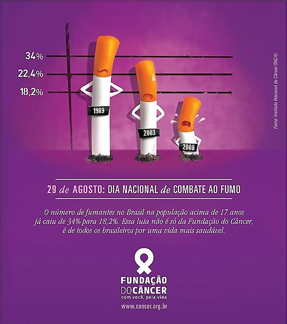
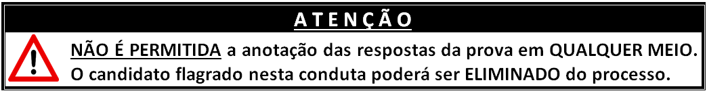

# PROVA — Camara_Coronel_Fabriciano_2017_Agente_Administrativo

## 1. Análise geral da prova

- **Identificação:** Camara_Coronel_Fabriciano_2017_Agente_Administrativo
- **Quantidade total de questões:** 10
- **Quantidade de textos de apoio (grupos):** 1
- **Quantidade de imagens:** 4
- **Quantidade de gráficos e tabelas:** incluídos nas imagens e no texto extraído, quando presentes no PDF original
- **Quantidade de grupos identificados:** 1
- **Quantidade de questões independentes:** 3
- **Questões que compartilham materiais:** texto-base das questões 01 a 07 → questões 01, 02, 03, 04, 05, 06, 07

### Transcrição integral da capa/instruções (conforme extraída do PDF)

> [!NOTE]
> Conteúdo integral das páginas anteriores à primeira questão, sem cortes.

> Agente Administrativo
> CONCURSO PÚBLICO
> Nº 001/2017
>
>
>
> Organizadora:
> Câmara Municipal de Coronel
> Fabriciano/MG
> ÚNICO
> 083306 400675
> Manhã
>
>
>
> CONCURSO PÚBLICO – CÂMARA MUNICIPAL DE CORONEL FABRICIANO/MG
> Cargo: Agente Administrativo (02-M)
> Prova aplicada em 23/12/2017 – Disponível no endereço eletrônico www.idecan.org.br a partir do dia 26/12/2017.
> - 2 -
> CARGO:
> AGENTE ADMINISTRATIVO
> Leia o texto para responder às questões de 01 a 07.
> Brasil gasta mais de 20 bilhões de reais para tratar doenças relacionadas ao tabaco
> O Brasil gastou 0,5% do Produto Interno Bruto (PIB) em 2011 para tratar doenças relacionadas ao tabaco, conforme
> levantamento feito pela organização não governamental Aliança do Controle do Tabagismo (ACT). Os gastos somaram
> quase 21 bilhões de reais no ano passado. O Dia Nacional de Combate ao Fumo é lembrado nesta quarta (29) em todo o
> país.
> De acordo com os dados da ACT, 82% dos casos de câncer de pulmão no país são causados pelo fumo. Outros
> problemas de saúde também são provocados pelo cigarro: 83% dos casos de câncer de laringe estão relacionados ao
> tabagismo, 13% dos casos de câncer do colo do útero e 17% dos casos de leucemia mieloide.
> No Distrito Federal (DF), por exemplo, a arrecadação, em média, é 6,2 milhões de reais mensais com a venda de
> cigarros (o valor corresponde a 25% do preço por maço). Por outro lado, o governo local gasta 18 milhões por mês com o
> tratamento de doenças vinculadas ao fumo, segundo o pneumologista e coordenador do Programa de Controle do
> Tabagismo da Secretaria de Saúde do Distrito Federal, Celso Rodrigues.
> Para o médico, os números mostram o impacto do vício na saúde. De acordo com Rodrigues, o tabagismo cria
> dependência química, física e psicológica, o que influencia no tratamento. “É muito importante que a pessoa entenda a
> relação dela com o cigarro. Ela tem que entender por que fuma, por que deseja parar de fumar e onde está a dificuldade,
> por que não parou até agora”, explica.
> A secretaria oferece terapia em grupo, durante um ano e três meses, em 62 unidades de saúde e em 47 empresas
> habilitadas a atender funcionários interessados em parar de fumar. Ações de prevenção e promoção de saúde também
> são promovidas em escolas.
> Em média, 500 fumantes iniciam o tratamento nas unidades de saúde a cada mês. Cerca de 400 pacientes conseguem
> deixar o fumo, sendo que 200 têm recaídas durante a terapia – quando os pacientes são orientados a buscar a secretaria
> novamente caso voltem a fumar.
> O cigarro vicia porque o principal componente – a nicotina – faz com que o cérebro libere dopamina, hormônio que
> dá uma sensação agradável. O organismo do fumante passa a pedir doses maiores de nicotina para que a sensação se
> repita e a pessoa sente necessidade de fumar cada vez mais.
> Os males causados pelo fumo não são apenas relacionados ao sistema respiratório. Segundo Mônica Andreis,
> vice-diretora da ACT, as pessoas ligam o cigarro somente ao câncer de pulmão. “Ele também causa câncer de bexiga, boca,
> língua, faringe, problemas de fertilidade e derrame cerebral.”
> (Disponível em http://www.cartacapital.com.br/sociedade/brasil-gasta-mais-de-20-bilhoes-de-reais-para-tratar-doencas-relacionadas-ao-
> tabaco/#todos-comentarios.)
>
> O tema central do texto anterior é
> A) a dependência física, química e psicológica causada pelo cigarro.
> B) a arrecadação anual do Distrito Federal com a venda de cigarros.
> C) os gastos do governo com tratamento dos males causados pelo fumo.
> D) a comemoração do dia de 29 de agosto, dia Nacional de Combate ao Fumo.
>
> Os depoimentos de Celso Rodrigues e Mônica Andreis foram utilizados com o propósito de
> A) dar credibilidade às informações veiculadas pelo autor.
> B) apresentar pontos de vista antagônicos de dois especialistas.
> C) mostrar ao leitor que os dois especialistas são coautores do texto.
> D) fazer uma síntese dos principais aspectos temáticos abordados ao longo do texto.
>
> Na passagem “No Distrito Federal (DF), por exemplo, a arrecadação, em média, é 6,2 milhões de reais mensais com a
> venda de cigarros (o valor corresponde a 25% do preço por maço).” (3º§), os parênteses foram utilizados em sua
> segunda ocorrência para
> A) fazer uma retificação.
>
>
>
>
> C) separar indicação de ordem elucidativa.
> B) evitar uma possível ambiguidade.
>
>
>
> D) indicar possibilidades alternativas de leitura.
>
>
>
> CONCURSO PÚBLICO – CÂMARA MUNICIPAL DE CORONEL FABRICIANO/MG
> Cargo: Agente Administrativo (02-M)
> Prova aplicada em 23/12/2017 – Disponível no endereço eletrônico www.idecan.org.br a partir do dia 26/12/2017.
> - 3 -
> Observe os trechos a seguir:
> I. “De acordo com os dados da ACT, 82% dos casos de câncer de pulmão no país são causados pelo fumo.” (2º§)
> II. “Por outro lado, o governo local gasta 18 milhões por mês com o tratamento de doenças vinculadas ao fumo, segundo
> o pneumologista e coordenador do Programa de Controle do Tabagismo da Secretaria de Saúde do Distrito Federal,
> Celso Rodrigues.” (3º§)
> As expressões em destaque estabelecem relação semântica de:
> A) Condição.
>
>
> B) Concessão.
>
> C) Consequência.
>
> D) Conformidade.
>
> Assinale a alternativa em que há uma palavra cujo prefixo assume valor reiterativo.
> A) Explica.
>
>
> B) Bilhões.
>
>
> C) Recaída.
>
>
> D) Impacto.
>
> Considerando o contexto, assinale a afirmativa em que a locução adjetiva destacada NÃO pode ser substituída pelo
> adjetivo entre parênteses.
> A) “Para o médico, os números mostram o impacto do vício na saúde.” (4º§) (vicinal)
> B) “... 13% dos casos de câncer do colo do útero e 17% dos casos de leucemia mieloide.” (2º§) (uterino)
> C) “Ações de prevenção e promoção de saúde também são promovidas em escolas.” (5º§) (profiláticas)
> D) “De acordo com os dados da ACT, 82% dos casos de câncer de pulmão no país são causados pelo fumo.” (2º§)
> (pulmonar)
>
> Assinale a alternativa em que a reescrita altera sensivelmente o sentido do trecho original.
> A) “Os gastos somaram quase 21 bilhões de reais no ano passado.” (1º§)
> “No ano passado, somaram quase 21 milhões de reais os gastos.”
> B) “Para o médico, os números mostram o impacto do vício na saúde.” (4º§)
> “Os números, para o médico, mostram o impacto do vício na saúde.”
> C) “Ações de prevenção e promoção de saúde também são promovidas em escolas.” (5º§)
> “Em escolas são promovidas também ações de prevenção e promoção de saúde.”
> D) “O Dia Nacional de Combate ao Fumo é lembrado nesta quarta (29) em todo o país.” (1º§)
> “Nesta quarta (29), O Dia Nacional de Combate ao Fumo é lembrado em todo país.”
>
> Leia o texto para responder às questões de 08 a 10.
> (Disponível em http://pnld.moderna.com.br/2012/08/29/dia-nacional-do-combate-ao-fumo/.)
>
>
> 
>
>
>
>
> CONCURSO PÚBLICO – CÂMARA MUNICIPAL DE CORONEL FABRICIANO/MG
> Cargo: Agente Administrativo (02-M)
> Prova aplicada em 23/12/2017 – Disponível no endereço eletrônico www.idecan.org.br a partir do dia 26/12/2017.
> - 4 -
> O texto é um(a)
> A) tirinha.
>
>
>
>
>
>
> C) cartum.
> B) charge.
>
>
>
>
>
>
> D) anúncio publicitário.
>
> De acordo com o gráfico do texto, pode-se concluir que:
> A) Em 1989 o número de fumante era inferior ao do ano de 2008.
> B) Em 2003 houve uma progressão no número de fumantes: 34%.
> C) Houve regressão no percentual de fumantes entre 1989 e 2003.
> D) O percentual de fumantes atingiu o ápice entre os anos de 2003 e 2008.
>
> Releia os textos e, em seguida, responda à questão 10.
>
> Uma declaração do segundo texto que é semelhante à do primeiro é:
> A) Dia 29 de agosto é o dia Nacional de Combate ao Fumo.
> B) 17% dos casos de leucemia mieloide atingem os fumantes acima de 17 anos.
> C) Segundo dados da ACT, 82% dos casos de câncer de pulmão são causados pelo cigarro.
> D) O governo do DF gasta 18 milhões de reais mensais com o tratamento de doenças provocadas pelo fumo.
> RACIOCÍNIO LÓGICO
>
> No diagrama a seguir em cada linha e em cada coluna estão representados um anagrama da palavra ROMA.
>
>
> 
>
> A letra que substitui corretamente a interrogação é:
> A) A.
> B) M.
>
>
> C) O.
> D) R.
>
> Para corrigir 48 provas com 12 questões um professor gastou 36 minutos. Quanto tempo esse professor gastaria para
> corrigir 80 provas com 25 questões?
> A) 1 hora e 40 minutos.
>
>
>
>
> C) 2 horas e 05 minutos.
> B) 1 hora e 55 minutos.
>
>
>
>
> D) 2 horas e 15 minutos.
>
> No período de um mês foram vendidos em uma loja notebooks, tablets e celulares das marcas A e B de acordo com a
> tabela a seguir.
> Notebooks
> Tablets
> Celulares
> Total
> Marca A
>
> x
>
> 3x
> Marca B
>
> x – 5
> x + 3
> 4x + 6
> Total
>
>
> De acordo com a tabela, a soma de notebooks da marca B e celulares da marca A é igual a:
> A) 36.
> B) 38.
> C) 42.
> D) 46.
>
>
>
> CONCURSO PÚBLICO – CÂMARA MUNICIPAL DE CORONEL FABRICIANO/MG
> Cargo: Agente Administrativo (02-M)
> Prova aplicada em 23/12/2017 – Disponível no endereço eletrônico www.idecan.org.br a partir do dia 26/12/2017.
> - 5 -
> O segundo e o oitavo termos de uma progressão aritmética são, respectivamente, iguais a 9 e 27. A razão entre o
> primeiro e o terceiro termos dessa progressão é igual a:
> A) 1/2.
>
> B) 1/3.
> C) 1/4.
>
> D) 1/5.
>
> Com a quantia contida em uma carteira é possível comprar 18 lâmpadas incandescentes e 8 lâmpadas fluorescentes ou
> então 12 lâmpadas incandescentes e 12 lâmpadas fluorescentes. Quantas lâmpadas fluorescentes é possível comprar
> com o dinheiro contido nessa carteira?
> A) 16.
>
> B) 18.
>
> C) 20.
>
> D) 22.
> CONHECIMENTOS DE INFORMÁTICA
>
> O comando format do MS-DOS (MicroSoft Disk Operating System) é um comando utilizado para formatação de
> dispositivos, seja um HD, Pen-drive, cartão de memória etc. Ainda hoje é possível utilizar esse comando, via prompt de
> comando dos Sistemas Windows. Assim como diversos outros comandos, o format também pode ser usado com
> algumas opções. Uma dessas opções é o “/U”. Assinale a alternativa que apresenta a descrição dessa opção.
> A) Executa uma formatação rápida.
> B) Formata rapidamente o disco da unidade.
> C) Formata o disco independente da condição.
> D) Formata o dispositivo, mas força uma desmontagem primeiro, se necessário.
>
> No Windows 10, Configuração Local, Idioma Português-Brasil, para Abrir a Central de Facilidade de Acesso e Exibir o
> menu Link rápido, um conjunto de teclas, combinadas, pode ser utilizado, facilitando muito para quem está
> trabalhando no sistema. Assinale a alternativa que apresenta, respectivamente, essas teclas.
> A) <Tecla Windows> + <S>; <Tela Windows> + <T>.
> B) <Tecla Windows> + <T>; <Tela Windows> + <U>.
> C) <Tecla Windows> + <U>; <Tela Windows> + <X>.
> D) <Tecla Windows> + <X>; <Tela Windows> + <S>.
>
> No Microsoft Excel 2013, Configuração Local, Idioma Português-Brasil, na elaboração de uma planilha, ao digitar a
> sequência de teclas <CTRL> + <1>, uma ação é realizada. Assinale a alternativa que apresenta tal ação.
> A) Aplica ou remove tachado.
>
>
>
> C) Abre a caixa de diálogo Formatar Células.
> B) Aplica ou remove sublinhado.
>
>
>
> D) Aplica ou remove formatação em negrito.
>
>
> “No Microsoft Word 2013, Configuração Local, Idioma Português-Brasil, essa barra situa-se ao longo da parte inferior
> da janela do programa, e exibe informações sobre o documento atual e fornece acesso a certas funções do programa.”
> Qual é o nome dessa barra?
> A) Menu.
>
>
> B) Status.
>
>
> C) Tarefa.
>
>
> D) Ferramentas.
>
> “É constituído por um condutor interno cilíndrico, no qual é injetado o sinal, envolvido por outro condutor externo. O
> condutor interno é separado do externo por um elemento isolante. Envolvendo o conjunto há uma capa externa
> (blindagem) que evita irradiação e captação de sinais.” Trata-se de:
> A) Fibra óptica.
>
>
>
>
>
> C) Cabo de rede STP (Shielded Twisted Pair).
> B) Cabo coaxial.
>
>
>
>
>
> D) Cabo de rede UTP (Unshieded Twisted Pair).
>
>
>
> CONCURSO PÚBLICO – CÂMARA MUNICIPAL DE CORONEL FABRICIANO/MG
> Cargo: Agente Administrativo (02-M)
> Prova aplicada em 23/12/2017 – Disponível no endereço eletrônico www.idecan.org.br a partir do dia 26/12/2017.
> - 6 -
> CONHECIMENTOS GERAIS
>
> O presidente Michel Temer decidiu revogar o decreto que extinguiu a reserva na região amazônica conhecida como Renca
> (Reserva Nacional do Cobre e Associados). A informação foi confirmada pelo Ministério de Minas e Energia, por meio de
> nota. O texto defende que “o debate em torno do assunto deve ser retomado em outra oportunidade” e deve ocorrer
> “da forma mais democrática possível”. “As razões que levaram a propor a adoção do decreto com a extinção da reserva
> permanecem presentes. O país necessita crescer e gerar empregos, atrair investimentos para o setor mineral, inclusive
> para explorar o potencial econômico da região”, diz a nota do ministério.
> (Disponível em: https://g1.globo.com/politica/noticia/decreto-que-extinguia-a-renca-e-revogado-informa-ministerio.ghtml.)
>
> A Reserva Nacional de Cobre e Associados (Renca) é uma extensa reserva mineral situada no nordeste da Amazônia
> entre os estados do Pará e do Amapá, com uma área maior que a Dinamarca. Sobre essa reserva, é correto afirmar que
> A) o decreto para sua extinção tinha o apoio de indígenas, ambientalistas e até da classe artística.
> B) os minerais ali encontrados têm grande valor no mercado internacional, pois as jazidas são ricas em minerais nobres.
> C) a Renca foi criada recentemente no governo de Dilma Rousseff e como não deu lucro, deveria ser extinta no governo
> Temer.
> D) a extinção da Renca traria maior atividade de mineração e melhor conservação da biodiversidade, atualmente
> ameaçada.
>
> (Disponível em: http://www.folclore.net.br/congado.php.)
>
> A imagem refere-se ao Congado, que hoje é celebrado em várias regiões do Brasil e é um movimento cultural que envolve
> danças, cantos, levantamentos de mastros, coroações e cavalgadas, expressos na festa do Rosário plenamente no mês de
> outubro. Na festa se utilizam instrumentos musicais como cuíca, caixa, pandeiro e reco-reco; os congadeiros vão atrás da
> cavalgada que segue com uma bandeira de Nossa Senhora do Rosário.
> O Congado é uma manifestação artística e cultural de origem:
> A) Lusitana.
>
>
> B) Flamenga.
>
>
> C) Hispânica.
>
>
> D) Afro-brasileira.
>
> “Portugal tornou-se o primeiro país estrangeiro a aceitar o ENEM como processo seletivo para o ensino superior. O maior
> exame educacional do país, o Exame Nacional do Ensino Médio, também pode ser utilizado para o acesso a vagas
> no ensino superior de instituições portuguesas. São vários os institutos de educação superior naquele país que
> utilizam a nota da prova Enem na seleção de estudantes brasileiros.”
> (Disponível em: http://www.ebc.com.br/educacao/2016/11/conheca-universidades-portuguesas-que-utilizam-o-enem-para-selecao-de-
> estudantes.)
>
> Em relação ao acesso numa universidade através do ENEM, tanto no Brasil quanto em Portugal,
> A) o desempenho mínimo exigido no ENEM varia conforme a universidade.
> B) o sistema de cotas ocupa mais de 80% das vagas oferecidas, pois a lei é igual nos dois países.
> C) esse processo seletivo é garantia de um estudo superior gratuito e de apoio para moradia e alimentação.
> D) o mínimo e o máximo de desempenho exigido é estabelecido unificadamente pelo governo, para todas as universidades.
>
>
> 
>
>
>
>
> CONCURSO PÚBLICO – CÂMARA MUNICIPAL DE CORONEL FABRICIANO/MG
> Cargo: Agente Administrativo (02-M)
> Prova aplicada em 23/12/2017 – Disponível no endereço eletrônico www.idecan.org.br a partir do dia 26/12/2017.
> - 7 -
> “Com mais de 11 horas de atraso, a Conferência do Clima (COP23), em Bonn, na Alemanha, chegou ao fim na manhã de
> sábado (18/11/17). Em duas semanas de negociações entre 197 países integrantes da Convenção-Quadro das Nações
> Unidas para Mudanças Climáticas (UNFCCC), discutiram inúmeros assuntos ligados aos problemas relacionados ao clima
> mundial.”
> (Disponível em: http://www.dw.com/pt-br/confer%C3%AAncia-do-clima-em-bonn-adia-decis%C3%B5es-importantes/a-41435123.)
>
> A Alemanha foi a anfitriã técnica dessa COP, que deveria ter acontecido nas Ilhas Fiji no Pacífico Sul, que propôs uma
> espécie de força-tarefa, conhecida como:
> A) Livro de regras – punições e sanções econômicas e políticas aos poluidores do planeta.
> B) Acordo de Paris – conjunto de metas a serem implementadas para manter os países sem poluição.
> C) Diálogo Talanoa – estímulo ao compartilhamento de histórias, construção de significado e realização de decisões para
> o bem coletivo.
> D) Protocolo de Kioto – usado para rastrear avanços climáticos de maneira transparente e para identificar áreas onde é
> preciso mais esforço.
>
> O futuro da pecuária brasileira, os impactos da crise vivenciada pelo setor no início deste ano e a organização da cadeia
> de valor foram temas discutidos no painel “Desafios da pecuária brasileira e desenvolvimento sustentável”, durante
> evento em comemoração aos 10 anos do GTPS (Grupo de Trabalho da Pecuária Sustentável). O evento ocorre na etapa
> paulista da Intercorte 2017.
>
>
> (Disponível em: https://www.noticiasagricolas.com.br/noticias/carnes/202637-produzir-carne-sustentavel.)
>
> Tendo em vista a criação de gado no Brasil e os impactos ambientais derivados dessa atividade, analise as afirmativas
> a seguir.
> I. A digestão das vacas e de outros animais, na forma de ventosidades e excrementos, libera muitos gases que impactam
> o meio ambiente.
> II. Vacas, frangos e porcos e também atuns, camarões e moluscos, todos influem da mesma forma no aquecimento
> global.
> III. Apesar do impacto ambiental, a criação de gado bovino é a atividade econômica que ocupa uma das maiores extensões
> de terras no país, com o segundo maior rebanho bovino do mundo.
> Está(ão) correta(s) apenas a(s) afirmativa(s)
> A) I.
>
>
>
> B) II.
>
>
>
> C) I e III.
>
>
> D) II e III.
>
> Um dos grandes ídolos do Brasil, o cantor Jerry Adriani morreu este ano, aos 70 anos. Nascido em 29 do janeiro de 1947,
> em São Paulo, Jair Alves de Souza tornou-se conhecido pelo nome de Jerry Adriani. Em 1965, o músico fez sucesso com
> “Um grande amor”, seu primeiro disco gravado em português. Na mesma época, Jerry Adriani apresentou o programa
> “Excelsior a go go” pela TV Excelsior de São Paulo em parceria com o comunicador Luiz Aguiar.
> (Disponível em: https://extra.globo.com/famosos/morre-cantor-jerry-adriani-aos-70-anos-21245217.html.)
>
> “Com Jerry Adriany e outros artistas surgiu um movimento musical que, a partir da década de 1950, incrementou o
> cenário cultural brasileiro, que passou a vivenciar tempos de impressionante efervescência.” Trata-se do(a):
> A) Bossa Nova.
>
> B) Tropicalismo.
>
> C) Jovem Guarda.
>
> D) Clube da Esquina.
>
> Na grande festa de premiação do 45º Festival de Cinema de Gramado deste ano, vinte e oito categorias foram
> destacadas com os troféus Kikitos: 12 prêmios para longas-metragens brasileiros, 6 para estrangeiros e 10 para curtas-
> metragens. Ainda houve prêmios aos melhores filmes eleitos pelo Júri da Crítica e Júri Popular. Os competidores da
> mostra de curtas nacionais concorreram também ao Prêmio Canadá 150 Jovem Cineasta e ao Prêmio Canal Brasil de
> Curtas. O vencedor como melhor longa-metragem brasileiro foi:
> A) “A Gis”, de Thiago Carvalhaes.
> B) “Como Nossos Pais”, de Laís Bodanzky.
> C) “O Quebra-Cabeça de Sara”, de Allan Ribeiro.
> D) “Sinfonia Para Ana”, de Virna Molina e Ernesto Ardito.
>
>
>
> CONCURSO PÚBLICO – CÂMARA MUNICIPAL DE CORONEL FABRICIANO/MG
> Cargo: Agente Administrativo (02-M)
> Prova aplicada em 23/12/2017 – Disponível no endereço eletrônico www.idecan.org.br a partir do dia 26/12/2017.
> - 8 -
> “Publicada em 2007, a Matriz Energética Brasileira 2030 compõe com o Plano Nacional de Energia 2030 o par de relatórios
> principais que consolidam os estudos desenvolvidos sobre a expansão da oferta e da demanda de energia no Brasil nos
> próximos 25 anos.”
> (Disponível em: http://www.mme.gov.br/web/guest/publicacoes-e-indicadores/matriz-energetica-nacional-2030.)
>
> Um dos destaques das formas alternativas de geração de energia no Brasil é a eólica. Neste ano, o País se tornou o 10º
> maior gerador de energia eólica no mundo. A região do Brasil com o maior potencial de produção de energia elétrica a
> partir dos ventos é:
> A) Sul.
>
>
> B) Nordeste.
>
>
> C) Sudeste.
>
>
> D) Centro-oeste.
>
> “O Movimento dos Trabalhadores Rurais Sem Terra (MST) comemora, em 2017, 30 anos da primeira ocupação de terra
> realizada pelo movimento no estado da Bahia, no município de Alcobaça, na região sul do estado. Na área chamada 40
> 45, onde havia monocultivo de eucalipto para produção de celulose e exportação. A ocupação, a organização e a
> resistência das famílias levaram à conquista da terra, dando origem ao Assentamento 40 45 e marcando o início da história
> do MST na Bahia.”
> (Disponível em: https://www.brasildefato.com.br/2017/09/08/mst-comemora-30-anos-de-luta-e-resistencia-na-bahia/.)
>
> O MST (Movimento dos Sem Terra) teve seu início oficial no Brasil, no contexto
> A) do governo de Figueiredo, na Ditadura Militar.
> B) das Reformas de Base, do governo de João Goulart.
> C) da onda populista concretizada no governo de Jânio Quadros.
> D) da arrancada Neoliberal guiada por Fernando Henrique Cardoso.
>
> Segundo os dados da pesquisa “Retratos da Leitura no Brasil”, realizada pelo Instituto Pró-Livro, 70% dos entrevistados
> nunca ouviram falar em livros digitais ou e-books. A pesquisa tomou como base 5 mil pessoas entre 315 municípios, sendo
> uma representação aproximada dos leitores de toda a população brasileira, ou seja, seria o mesmo que dizer que 70% da
> população brasileira nunca ouviram falar de livros digitais. Tal revelação causaria estranheza para muitos, porém, diante
> do número de usuários brasileiros que acessam a internet, tal estimativa é plausível.
> (Disponível em: http://www.folhetimonline.com.br/2012/04/19/o-que-e-um-livro-digital/.)
>
> Com o avanço da tecnologia e o aparecimento de novas plataformas, as mídias tradicionais estão sempre se adaptando
> às necessidades de portabilidade e conexão. Nesse contexto, podemos destacar os livros digitais, sobre os quais
> podemos afirmar que
> A) os livros virtuais só podem ser lidos em dispositivos eletrônicos que tenham acesso à internet.
> B) qualquer um pode escrever um livro digital, desde que no formato PDF, ou HTML, criado para esse fim.
> C) devido ao baixo custo de produção e entrega, ocorre o barateamento em comparação com um livro de papel.
> D) um dos maiores problemas dos livros digitais é que eles não podem ser arquivados devido aos direitos autorais.
> CONHECIMENTOS ESPECÍFICOS
>
> O Processo Legislativo é o conjunto de disposições que disciplinam os procedimentos a serem observados pelo
> parlamento na elaboração das suas normas jurídicas. Considerando esta premissa e o disposto no Regimento Interno
> da Câmara de Coronel Fabriciano, são proposições que integram o processo legislativo, EXCETO:
> A) Projeto de Lei.
>
>
>
>
>
> C) Projeto de Decreto Legislativo.
> B) Projeto de Resolução.
>
>
>
>
> D) Proposta de Emenda à Lei Orgânica.
>
> A condução das sessões da Câmara e a administração do Poder Legislativo estão a cargo do Presidente, que tem
> autonomia prevista no Regimento Interno, na Lei Orgânica e demais regulamentos vigentes. Contudo, o Presidente
> pode ter seus atos questionados pelos demais membros do Legislativo. Assim, a petição de vereador ao Plenário da
> Casa contra atos do Presidente é definida como:
> A) Moção.
>
>
> B) Recurso.
>
>
> C) Requerimento.
>
> D) Representação.
>
>
>
> CONCURSO PÚBLICO – CÂMARA MUNICIPAL DE CORONEL FABRICIANO/MG
> Cargo: Agente Administrativo (02-M)
> Prova aplicada em 23/12/2017 – Disponível no endereço eletrônico www.idecan.org.br a partir do dia 26/12/2017.
> - 9 -
> A participação popular direta na elaboração de projetos de lei é garantida pela Câmara Municipal. Os projetos de lei
> de iniciativa popular são uma forma de democracia direta, mas que possuem regras regimentais específicas. É condição
> determinante para a apresentação de projetos de lei e iniciativa popular:
> A) Coautoria com associações civis.
> B) Subscrição de 5% do eleitorado do município.
> C) Subscrição de 10% do eleitorado do município.
> D) Juntada de abaixo-assinado com no mínimo 20 mil assinaturas.
>
> A Administração Pública é um conceito da área do direito que descreve o conjunto de agentes, serviços e órgãos
> instituídos pelo Estado com o objetivo de fazer a gestão de certas áreas de uma sociedade. Principal componete desse
> conceito, o Estado é o norteador da nação e responsável pela condução do país e é composto pelos seguintes elementos
> originários e indissociáveis, EXCETO:
> A) Povo.
>
>
> B) Governo.
>
>
> C) Território.
>
>
> D) Legislação.
>
> A Câmara Municipal firmou contrato com empresa privada para serviços de manutenção de equipamentos dos setores
> administrativos, no valor de aproximadamente $ 50 mil. A celebração deste contrato foi precedida de:
> A) Cotação, liquidação e empenho.
> B) Empenho, liquidação e licitação.
> C) Previsão orçamentária, licitação e empenho.
> D) Autorização legislativa, dispensa de licitação e cotação.
>
> “Na elaboração da proposta de orçamento anual, a prefeitura de Coronel Fabriciano deverá estimar a receita e fixar a
> despesa levando em consideração as metas previstas na LDO e o planejamento do PPA. Dentre as receitas previstas
> estão as tributárias e as transferências governamentais.” São receitas tributárias que pertencem ao Município:
> A) IPVA, IPTU e Imposto Sindical.
> B) CPMF, Taxa de Iluminação Pública e CIDE.
> C) Imposto Territorial Rural – ITR, Imposto sobre Operações Financeiras – IOF e IPTU.
> D) Taxas de Fiscalização, IPTU e Imposto de Renda Retido na Fonte pela Administração.
>
> Sobre o processo de elaboração de leis e resoluções na Câmara Municipal, bem como sobre os processos de votação,
> analise as afirmativas a seguir.
> I. A Mesa da Câmara só poderá ser destituída pelo voto de 2/3 dos membros do Poder Legislativo.
> II. A concessão de subvenções deve ser aprovada por 1/3 dos vereadores.
> III. Leis ordinárias e complementares são de iniciativa privativa da Presidência da Câmara.
> IV. As Emendas à Lei Orgânica devem ser promulgadas pela Mesa Diretora da Câmara.
> Estão corretas apenas as afirmativas
> A) I e IV.
>
>
> B) II e III.
>
>
> C) I, II e IV.
>
>
> D) II, III e IV.
>
> “A Mesa Diretora da Câmara Municipal de Coronel Fabriciano é o órgão colegiado responsável pela direção dos
> trabalhos legislativos e dos serviços administrativos da Casa, observado o disposto no Regimento Interno da Câmara.”
> Sua composição é a seguinte:
> A) Presidente, Vice-Presidente, Secretário, Vogal e Suplente.
> B) Presidente, Vice-Presidente, 1º Secretário e Secretário Adjunto.
> C) Presidente, 1º Vice-Presidente, 2º Vice-Presidente, 1º Secretário e 2º Secretário.
> D) Presidente, 1º Vice-Presidente, Secretário Legislativo e Vice-Presidente Administrativo.
>
>
>
> CONCURSO PÚBLICO – CÂMARA MUNICIPAL DE CORONEL FABRICIANO/MG
> Cargo: Agente Administrativo (02-M)
> Prova aplicada em 23/12/2017 – Disponível no endereço eletrônico www.idecan.org.br a partir do dia 26/12/2017.
> - 10 -
> As Comissões Permanentes da Câmara de Coronel Fabriciano são órgãos técnicos que têm a finalidade de examinar e
> emitir parecer sobre matéria em tramitação na Casa, proceder a estudos sobre assunto de natureza especial e, ainda,
> investigar fatos determinados de interesse da Administração. O critério de formação das comissões, a ser observado
> pela Presidência, é:
> A) Maior idade.
>
>
>
>
>
> C) Indicação dos líderes de bancada.
> B) Eleição interna.
>
>
>
>
>
> D) Número de votos na eleição municipal.
>
> Durante as sessões da Câmara, os parlamentares podem suscitar em Plenário dúvidas quanto à interpretação e
> aplicação do Regimento Interno. Esse procedimento é definido como:
> A) Aparte.
>
>
>
>
>
>
> C) Encaminhamento.
> B) Obstrução.
>
>
>
>
>
> D) Questão de Ordem.
>
>
> 
>
>
>
>
>
>
>
> INSTRUÇÕES

## 2. Questões agrupadas

### GRUPO 01 — Texto-base compartilhado pelas questões 01 a 07

**Questões relacionadas:** 01, 02, 03, 04, 05, 06, 07.

#### QUESTÃO 01

⚠️ **Gabarito: oficial não disponível** (sem gabarito no acervo (o PDF 'Gabarito', ID 112, contém a prova/perguntas sem quadro de respostas))

**Material de apoio:**

Brasil gasta mais de 20 bilhões de reais para tratar doenças relacionadas ao tabaco
O Brasil gastou 0,5% do Produto Interno Bruto (PIB) em 2011 para tratar doenças relacionadas ao tabaco, conforme
levantamento feito pela organização não governamental Aliança do Controle do Tabagismo (ACT). Os gastos somaram
quase 21 bilhões de reais no ano passado. O Dia Nacional de Combate ao Fumo é lembrado nesta quarta (29) em todo o
país.
De acordo com os dados da ACT, 82% dos casos de câncer de pulmão no país são causados pelo fumo. Outros
problemas de saúde também são provocados pelo cigarro: 83% dos casos de câncer de laringe estão relacionados ao
tabagismo, 13% dos casos de câncer do colo do útero e 17% dos casos de leucemia mieloide.
No Distrito Federal (DF), por exemplo, a arrecadação, em média, é 6,2 milhões de reais mensais com a venda de
cigarros (o valor corresponde a 25% do preço por maço). Por outro lado, o governo local gasta 18 milhões por mês com o
tratamento de doenças vinculadas ao fumo, segundo o pneumologista e coordenador do Programa de Controle do
Tabagismo da Secretaria de Saúde do Distrito Federal, Celso Rodrigues.
Para o médico, os números mostram o impacto do vício na saúde. De acordo com Rodrigues, o tabagismo cria
dependência química, física e psicológica, o que influencia no tratamento. “É muito importante que a pessoa entenda a
relação dela com o cigarro. Ela tem que entender por que fuma, por que deseja parar de fumar e onde está a dificuldade,
por que não parou até agora”, explica.
A secretaria oferece terapia em grupo, durante um ano e três meses, em 62 unidades de saúde e em 47 empresas
habilitadas a atender funcionários interessados em parar de fumar. Ações de prevenção e promoção de saúde também
são promovidas em escolas.
Em média, 500 fumantes iniciam o tratamento nas unidades de saúde a cada mês. Cerca de 400 pacientes conseguem
deixar o fumo, sendo que 200 têm recaídas durante a terapia – quando os pacientes são orientados a buscar a secretaria
novamente caso voltem a fumar.
O cigarro vicia porque o principal componente – a nicotina – faz com que o cérebro libere dopamina, hormônio que
dá uma sensação agradável. O organismo do fumante passa a pedir doses maiores de nicotina para que a sensação se
repita e a pessoa sente necessidade de fumar cada vez mais.
Os males causados pelo fumo não são apenas relacionados ao sistema respiratório. Segundo Mônica Andreis,
vice-diretora da ACT, as pessoas ligam o cigarro somente ao câncer de pulmão. “Ele também causa câncer de bexiga, boca,
língua, faringe, problemas de fertilidade e derrame cerebral.”
(Disponível em http://www.cartacapital.com.br/sociedade/brasil-gasta-mais-de-20-bilhoes-de-reais-para-tratar-doencas-relacionadas-ao-
tabaco/#todos-comentarios.)

O tema central do texto anterior é
A) a dependência física, química e psicológica causada pelo cigarro.
B) a arrecadação anual do Distrito Federal com a venda de cigarros.
C) os gastos do governo com tratamento dos males causados pelo fumo.
D) a comemoração do dia de 29 de agosto, dia Nacional de Combate ao Fumo.

Os depoimentos de Celso Rodrigues e Mônica Andreis foram utilizados com o propósito de
A) dar credibilidade às informações veiculadas pelo autor.
B) apresentar pontos de vista antagônicos de dois especialistas.
C) mostrar ao leitor que os dois especialistas são coautores do texto.
D) fazer uma síntese dos principais aspectos temáticos abordados ao longo do texto.

Na passagem “No Distrito Federal (DF), por exemplo, a arrecadação, em média, é 6,2 milhões de reais mensais com a
venda de cigarros (o valor corresponde a 25% do preço por maço).” (3º§), os parênteses foram utilizados em sua
segunda ocorrência para
A) fazer uma retificação.

C) separar indicação de ordem elucidativa.
B) evitar uma possível ambiguidade.

D) indicar possibilidades alternativas de leitura.

CONCURSO PÚBLICO – CÂMARA MUNICIPAL DE CORONEL FABRICIANO/MG
Cargo: Agente Administrativo (02-M)
Prova aplicada em 23/12/2017 – Disponível no endereço eletrônico www.idecan.org.br a partir do dia 26/12/2017.
- 3 -
Observe os trechos a seguir:
I. “De acordo com os dados da ACT, 82% dos casos de câncer de pulmão no país são causados pelo fumo.” (2º§)
II. “Por outro lado, o governo local gasta 18 milhões por mês com o tratamento de doenças vinculadas ao fumo, segundo
o pneumologista e coordenador do Programa de Controle do Tabagismo da Secretaria de Saúde do Distrito Federal,
Celso Rodrigues.” (3º§)
As expressões em destaque estabelecem relação semântica de:
A) Condição.

B) Concessão.

C) Consequência.

D) Conformidade.

Assinale a alternativa em que há uma palavra cujo prefixo assume valor reiterativo.
A) Explica.

B) Bilhões.

C) Recaída.

D) Impacto.

Considerando o contexto, assinale a afirmativa em que a locução adjetiva destacada NÃO pode ser substituída pelo
adjetivo entre parênteses.
A) “Para o médico, os números mostram o impacto do vício na saúde.” (4º§) (vicinal)
B) “... 13% dos casos de câncer do colo do útero e 17% dos casos de leucemia mieloide.” (2º§) (uterino)
C) “Ações de prevenção e promoção de saúde também são promovidas em escolas.” (5º§) (profiláticas)
D) “De acordo com os dados da ACT, 82% dos casos de câncer de pulmão no país são causados pelo fumo.” (2º§)
(pulmonar)

Assinale a alternativa em que a reescrita altera sensivelmente o sentido do trecho original.
A) “Os gastos somaram quase 21 bilhões de reais no ano passado.” (1º§)
“No ano passado, somaram quase 21 milhões de reais os gastos.”
B) “Para o médico, os números mostram o impacto do vício na saúde.” (4º§)
“Os números, para o médico, mostram o impacto do vício na saúde.”
C) “Ações de prevenção e promoção de saúde também são promovidas em escolas.” (5º§)
“Em escolas são promovidas também ações de prevenção e promoção de saúde.”
D) “O Dia Nacional de Combate ao Fumo é lembrado nesta quarta (29) em todo o país.” (1º§)
“Nesta quarta (29), O Dia Nacional de Combate ao Fumo é lembrado em todo país.”

Leia o texto para responder às questões de 08 a 10.
(Disponível em http://pnld.moderna.com.br/2012/08/29/dia-nacional-do-combate-ao-fumo/.)

CONCURSO PÚBLICO – CÂMARA MUNICIPAL DE CORONEL FABRICIANO/MG
Cargo: Agente Administrativo (02-M)
Prova aplicada em 23/12/2017 – Disponível no endereço eletrônico www.idecan.org.br a partir do dia 26/12/2017.
- 4 -
O texto é um(a)
A) tirinha.

C) cartum.
B) charge.

D) anúncio publicitário.

De acordo com o gráfico do texto, pode-se concluir que:
A) Em 1989 o número de fumante era inferior ao do ano de 2008.
B) Em 2003 houve uma progressão no número de fumantes: 34%.
C) Houve regressão no percentual de fumantes entre 1989 e 2003.
D) O percentual de fumantes atingiu o ápice entre os anos de 2003 e 2008.

Releia os textos e, em seguida, responda à questão 10.

Uma declaração do segundo texto que é semelhante à do primeiro é:
A) Dia 29 de agosto é o dia Nacional de Combate ao Fumo.
B) 17% dos casos de leucemia mieloide atingem os fumantes acima de 17 anos.
C) Segundo dados da ACT, 82% dos casos de câncer de pulmão são causados pelo cigarro.
D) O governo do DF gasta 18 milhões de reais mensais com o tratamento de doenças provocadas pelo fumo.
RACIOCÍNIO LÓGICO

No diagrama a seguir em cada linha e em cada coluna estão representados um anagrama da palavra ROMA.

A letra que substitui corretamente a interrogação é:
A) A.
B) M.

C) O.
D) R.

Para corrigir 48 provas com 12 questões um professor gastou 36 minutos. Quanto tempo esse professor gastaria para
corrigir 80 provas com 25 questões?
A) 1 hora e 40 minutos.

C) 2 horas e 05 minutos.
B) 1 hora e 55 minutos.

D) 2 horas e 15 minutos.

No período de um mês foram vendidos em uma loja notebooks, tablets e celulares das marcas A e B de acordo com a
tabela a seguir.
Notebooks
Tablets
Celulares
Total
Marca A

x

3x
Marca B

x – 5
x + 3
4x + 6
Total

De acordo com a tabela, a soma de notebooks da marca B e celulares da marca A é igual a:
A) 36.
B) 38.
C) 42.
D) 46.

CONCURSO PÚBLICO – CÂMARA MUNICIPAL DE CORONEL FABRICIANO/MG
Cargo: Agente Administrativo (02-M)
Prova aplicada em 23/12/2017 – Disponível no endereço eletrônico www.idecan.org.br a partir do dia 26/12/2017.
- 5 -
O segundo e o oitavo termos de uma progressão aritmética são, respectivamente, iguais a 9 e 27. A razão entre o
primeiro e o terceiro termos dessa progressão é igual a:
A) 1/2.

B) 1/3.
C) 1/4.

D) 1/5.

Com a quantia contida em uma carteira é possível comprar 18 lâmpadas incandescentes e 8 lâmpadas fluorescentes ou
então 12 lâmpadas incandescentes e 12 lâmpadas fluorescentes. Quantas lâmpadas fluorescentes é possível comprar
com o dinheiro contido nessa carteira?
A) 16.

B) 18.

C) 20.

D) 22.
CONHECIMENTOS DE INFORMÁTICA

O comando format do MS-DOS (MicroSoft Disk Operating System) é um comando utilizado para formatação de
dispositivos, seja um HD, Pen-drive, cartão de memória etc. Ainda hoje é possível utilizar esse comando, via prompt de
comando dos Sistemas Windows. Assim como diversos outros comandos, o format também pode ser usado com
algumas opções. Uma dessas opções é o “/U”. Assinale a alternativa que apresenta a descrição dessa opção.
A) Executa uma formatação rápida.
B) Formata rapidamente o disco da unidade.
C) Formata o disco independente da condição.
D) Formata o dispositivo, mas força uma desmontagem primeiro, se necessário.

No Windows 10, Configuração Local, Idioma Português-Brasil, para Abrir a Central de Facilidade de Acesso e Exibir o
menu Link rápido, um conjunto de teclas, combinadas, pode ser utilizado, facilitando muito para quem está
trabalhando no sistema. Assinale a alternativa que apresenta, respectivamente, essas teclas.
A) <Tecla Windows> + <S>; <Tela Windows> + <T>.
B) <Tecla Windows> + <T>; <Tela Windows> + <U>.
C) <Tecla Windows> + <U>; <Tela Windows> + <X>.
D) <Tecla Windows> + <X>; <Tela Windows> + <S>.

No Microsoft Excel 2013, Configuração Local, Idioma Português-Brasil, na elaboração de uma planilha, ao digitar a
sequência de teclas <CTRL> + <1>, uma ação é realizada. Assinale a alternativa que apresenta tal ação.
A) Aplica ou remove tachado.

C) Abre a caixa de diálogo Formatar Células.
B) Aplica ou remove sublinhado.

D) Aplica ou remove formatação em negrito.

“No Microsoft Word 2013, Configuração Local, Idioma Português-Brasil, essa barra situa-se ao longo da parte inferior
da janela do programa, e exibe informações sobre o documento atual e fornece acesso a certas funções do programa.”
Qual é o nome dessa barra?
A) Menu.

B) Status.

C) Tarefa.

D) Ferramentas.

“É constituído por um condutor interno cilíndrico, no qual é injetado o sinal, envolvido por outro condutor externo. O
condutor interno é separado do externo por um elemento isolante. Envolvendo o conjunto há uma capa externa
(blindagem) que evita irradiação e captação de sinais.” Trata-se de:
A) Fibra óptica.

C) Cabo de rede STP (Shielded Twisted Pair).
B) Cabo coaxial.

D) Cabo de rede UTP (Unshieded Twisted Pair).

CONCURSO PÚBLICO – CÂMARA MUNICIPAL DE CORONEL FABRICIANO/MG
Cargo: Agente Administrativo (02-M)
Prova aplicada em 23/12/2017 – Disponível no endereço eletrônico www.idecan.org.br a partir do dia 26/12/2017.
- 6 -
CONHECIMENTOS GERAIS

O presidente Michel Temer decidiu revogar o decreto que extinguiu a reserva na região amazônica conhecida como Renca
(Reserva Nacional do Cobre e Associados). A informação foi confirmada pelo Ministério de Minas e Energia, por meio de
nota. O texto defende que “o debate em torno do assunto deve ser retomado em outra oportunidade” e deve ocorrer
“da forma mais democrática possível”. “As razões que levaram a propor a adoção do decreto com a extinção da reserva
permanecem presentes. O país necessita crescer e gerar empregos, atrair investimentos para o setor mineral, inclusive
para explorar o potencial econômico da região”, diz a nota do ministério.
(Disponível em: https://g1.globo.com/politica/noticia/decreto-que-extinguia-a-renca-e-revogado-informa-ministerio.ghtml.)

A Reserva Nacional de Cobre e Associados (Renca) é uma extensa reserva mineral situada no nordeste da Amazônia
entre os estados do Pará e do Amapá, com uma área maior que a Dinamarca. Sobre essa reserva, é correto afirmar que
A) o decreto para sua extinção tinha o apoio de indígenas, ambientalistas e até da classe artística.
B) os minerais ali encontrados têm grande valor no mercado internacional, pois as jazidas são ricas em minerais nobres.
C) a Renca foi criada recentemente no governo de Dilma Rousseff e como não deu lucro, deveria ser extinta no governo
Temer.
D) a extinção da Renca traria maior atividade de mineração e melhor conservação da biodiversidade, atualmente
ameaçada.

(Disponível em: http://www.folclore.net.br/congado.php.)

A imagem refere-se ao Congado, que hoje é celebrado em várias regiões do Brasil e é um movimento cultural que envolve
danças, cantos, levantamentos de mastros, coroações e cavalgadas, expressos na festa do Rosário plenamente no mês de
outubro. Na festa se utilizam instrumentos musicais como cuíca, caixa, pandeiro e reco-reco; os congadeiros vão atrás da
cavalgada que segue com uma bandeira de Nossa Senhora do Rosário.
O Congado é uma manifestação artística e cultural de origem:
A) Lusitana.

B) Flamenga.

C) Hispânica.

D) Afro-brasileira.

“Portugal tornou-se o primeiro país estrangeiro a aceitar o ENEM como processo seletivo para o ensino superior. O maior
exame educacional do país, o Exame Nacional do Ensino Médio, também pode ser utilizado para o acesso a vagas
no ensino superior de instituições portuguesas. São vários os institutos de educação superior naquele país que
utilizam a nota da prova Enem na seleção de estudantes brasileiros.”
(Disponível em: http://www.ebc.com.br/educacao/2016/11/conheca-universidades-portuguesas-que-utilizam-o-enem-para-selecao-de-
estudantes.)

Em relação ao acesso numa universidade através do ENEM, tanto no Brasil quanto em Portugal,
A) o desempenho mínimo exigido no ENEM varia conforme a universidade.
B) o sistema de cotas ocupa mais de 80% das vagas oferecidas, pois a lei é igual nos dois países.
C) esse processo seletivo é garantia de um estudo superior gratuito e de apoio para moradia e alimentação.
D) o mínimo e o máximo de desempenho exigido é estabelecido unificadamente pelo governo, para todas as universidades.

CONCURSO PÚBLICO – CÂMARA MUNICIPAL DE CORONEL FABRICIANO/MG
Cargo: Agente Administrativo (02-M)
Prova aplicada em 23/12/2017 – Disponível no endereço eletrônico www.idecan.org.br a partir do dia 26/12/2017.
- 7 -
“Com mais de 11 horas de atraso, a Conferência do Clima (COP23), em Bonn, na Alemanha, chegou ao fim na manhã de
sábado (18/11/17). Em duas semanas de negociações entre 197 países integrantes da Convenção-Quadro das Nações
Unidas para Mudanças Climáticas (UNFCCC), discutiram inúmeros assuntos ligados aos problemas relacionados ao clima
mundial.”
(Disponível em: http://www.dw.com/pt-br/confer%C3%AAncia-do-clima-em-bonn-adia-decis%C3%B5es-importantes/a-41435123.)

A Alemanha foi a anfitriã técnica dessa COP, que deveria ter acontecido nas Ilhas Fiji no Pacífico Sul, que propôs uma
espécie de força-tarefa, conhecida como:
A) Livro de regras – punições e sanções econômicas e políticas aos poluidores do planeta.
B) Acordo de Paris – conjunto de metas a serem implementadas para manter os países sem poluição.
C) Diálogo Talanoa – estímulo ao compartilhamento de histórias, construção de significado e realização de decisões para
o bem coletivo.
D) Protocolo de Kioto – usado para rastrear avanços climáticos de maneira transparente e para identificar áreas onde é
preciso mais esforço.

O futuro da pecuária brasileira, os impactos da crise vivenciada pelo setor no início deste ano e a organização da cadeia
de valor foram temas discutidos no painel “Desafios da pecuária brasileira e desenvolvimento sustentável”, durante
evento em comemoração aos 10 anos do GTPS (Grupo de Trabalho da Pecuária Sustentável). O evento ocorre na etapa
paulista da Intercorte 2017.

(Disponível em: https://www.noticiasagricolas.com.br/noticias/carnes/202637-produzir-carne-sustentavel.)

Tendo em vista a criação de gado no Brasil e os impactos ambientais derivados dessa atividade, analise as afirmativas
a seguir.
I. A digestão das vacas e de outros animais, na forma de ventosidades e excrementos, libera muitos gases que impactam
o meio ambiente.
II. Vacas, frangos e porcos e também atuns, camarões e moluscos, todos influem da mesma forma no aquecimento
global.
III. Apesar do impacto ambiental, a criação de gado bovino é a atividade econômica que ocupa uma das maiores extensões
de terras no país, com o segundo maior rebanho bovino do mundo.
Está(ão) correta(s) apenas a(s) afirmativa(s)
A) I.

B) II.

C) I e III.

D) II e III.

Um dos grandes ídolos do Brasil, o cantor Jerry Adriani morreu este ano, aos 70 anos. Nascido em 29 do janeiro de 1947,
em São Paulo, Jair Alves de Souza tornou-se conhecido pelo nome de Jerry Adriani. Em 1965, o músico fez sucesso com
“Um grande amor”, seu primeiro disco gravado em português. Na mesma época, Jerry Adriani apresentou o programa
“Excelsior a go go” pela TV Excelsior de São Paulo em parceria com o comunicador Luiz Aguiar.
(Disponível em: https://extra.globo.com/famosos/morre-cantor-jerry-adriani-aos-70-anos-21245217.html.)

“Com Jerry Adriany e outros artistas surgiu um movimento musical que, a partir da década de 1950, incrementou o
cenário cultural brasileiro, que passou a vivenciar tempos de impressionante efervescência.” Trata-se do(a):
A) Bossa Nova.

B) Tropicalismo.

C) Jovem Guarda.

D) Clube da Esquina.

Na grande festa de premiação do 45º Festival de Cinema de Gramado deste ano, vinte e oito categorias foram
destacadas com os troféus Kikitos: 12 prêmios para longas-metragens brasileiros, 6 para estrangeiros e 10 para curtas-
metragens. Ainda houve prêmios aos melhores filmes eleitos pelo Júri da Crítica e Júri Popular. Os competidores da
mostra de curtas nacionais concorreram também ao Prêmio Canadá 150 Jovem Cineasta e ao Prêmio Canal Brasil de
Curtas. O vencedor como melhor longa-metragem brasileiro foi:
A) “A Gis”, de Thiago Carvalhaes.
B) “Como Nossos Pais”, de Laís Bodanzky.
C) “O Quebra-Cabeça de Sara”, de Allan Ribeiro.
D) “Sinfonia Para Ana”, de Virna Molina e Ernesto Ardito.

CONCURSO PÚBLICO – CÂMARA MUNICIPAL DE CORONEL FABRICIANO/MG
Cargo: Agente Administrativo (02-M)
Prova aplicada em 23/12/2017 – Disponível no endereço eletrônico www.idecan.org.br a partir do dia 26/12/2017.
- 8 -
“Publicada em 2007, a Matriz Energética Brasileira 2030 compõe com o Plano Nacional de Energia 2030 o par de relatórios
principais que consolidam os estudos desenvolvidos sobre a expansão da oferta e da demanda de energia no Brasil nos
próximos 25 anos.”
(Disponível em: http://www.mme.gov.br/web/guest/publicacoes-e-indicadores/matriz-energetica-nacional-2030.)

Um dos destaques das formas alternativas de geração de energia no Brasil é a eólica. Neste ano, o País se tornou o 10º
maior gerador de energia eólica no mundo. A região do Brasil com o maior potencial de produção de energia elétrica a
partir dos ventos é:
A) Sul.

B) Nordeste.

C) Sudeste.

D) Centro-oeste.

“O Movimento dos Trabalhadores Rurais Sem Terra (MST) comemora, em 2017, 30 anos da primeira ocupação de terra
realizada pelo movimento no estado da Bahia, no município de Alcobaça, na região sul do estado. Na área chamada 40
45, onde havia monocultivo de eucalipto para produção de celulose e exportação. A ocupação, a organização e a
resistência das famílias levaram à conquista da terra, dando origem ao Assentamento 40 45 e marcando o início da história
do MST na Bahia.”
(Disponível em: https://www.brasildefato.com.br/2017/09/08/mst-comemora-30-anos-de-luta-e-resistencia-na-bahia/.)

O MST (Movimento dos Sem Terra) teve seu início oficial no Brasil, no contexto
A) do governo de Figueiredo, na Ditadura Militar.
B) das Reformas de Base, do governo de João Goulart.
C) da onda populista concretizada no governo de Jânio Quadros.
D) da arrancada Neoliberal guiada por Fernando Henrique Cardoso.

Segundo os dados da pesquisa “Retratos da Leitura no Brasil”, realizada pelo Instituto Pró-Livro, 70% dos entrevistados
nunca ouviram falar em livros digitais ou e-books. A pesquisa tomou como base 5 mil pessoas entre 315 municípios, sendo
uma representação aproximada dos leitores de toda a população brasileira, ou seja, seria o mesmo que dizer que 70% da
população brasileira nunca ouviram falar de livros digitais. Tal revelação causaria estranheza para muitos, porém, diante
do número de usuários brasileiros que acessam a internet, tal estimativa é plausível.
(Disponível em: http://www.folhetimonline.com.br/2012/04/19/o-que-e-um-livro-digital/.)

Com o avanço da tecnologia e o aparecimento de novas plataformas, as mídias tradicionais estão sempre se adaptando
às necessidades de portabilidade e conexão. Nesse contexto, podemos destacar os livros digitais, sobre os quais
podemos afirmar que
A) os livros virtuais só podem ser lidos em dispositivos eletrônicos que tenham acesso à internet.
B) qualquer um pode escrever um livro digital, desde que no formato PDF, ou HTML, criado para esse fim.
C) devido ao baixo custo de produção e entrega, ocorre o barateamento em comparação com um livro de papel.
D) um dos maiores problemas dos livros digitais é que eles não podem ser arquivados devido aos direitos autorais.
CONHECIMENTOS ESPECÍFICOS

O Processo Legislativo é o conjunto de disposições que disciplinam os procedimentos a serem observados pelo
parlamento na elaboração das suas normas jurídicas. Considerando esta premissa e o disposto no Regimento Interno
da Câmara de Coronel Fabriciano, são proposições que integram o processo legislativo, EXCETO:
A) Projeto de Lei.

C) Projeto de Decreto Legislativo.
B) Projeto de Resolução.

D) Proposta de Emenda à Lei Orgânica.

A condução das sessões da Câmara e a administração do Poder Legislativo estão a cargo do Presidente, que tem
autonomia prevista no Regimento Interno, na Lei Orgânica e demais regulamentos vigentes. Contudo, o Presidente
pode ter seus atos questionados pelos demais membros do Legislativo. Assim, a petição de vereador ao Plenário da
Casa contra atos do Presidente é definida como:
A) Moção.

B) Recurso.

C) Requerimento.

D) Representação.

CONCURSO PÚBLICO – CÂMARA MUNICIPAL DE CORONEL FABRICIANO/MG
Cargo: Agente Administrativo (02-M)
Prova aplicada em 23/12/2017 – Disponível no endereço eletrônico www.idecan.org.br a partir do dia 26/12/2017.
- 9 -
A participação popular direta na elaboração de projetos de lei é garantida pela Câmara Municipal. Os projetos de lei
de iniciativa popular são uma forma de democracia direta, mas que possuem regras regimentais específicas. É condição
determinante para a apresentação de projetos de lei e iniciativa popular:
A) Coautoria com associações civis.
B) Subscrição de 5% do eleitorado do município.
C) Subscrição de 10% do eleitorado do município.
D) Juntada de abaixo-assinado com no mínimo 20 mil assinaturas.

A Administração Pública é um conceito da área do direito que descreve o conjunto de agentes, serviços e órgãos
instituídos pelo Estado com o objetivo de fazer a gestão de certas áreas de uma sociedade. Principal componete desse
conceito, o Estado é o norteador da nação e responsável pela condução do país e é composto pelos seguintes elementos
originários e indissociáveis, EXCETO:
A) Povo.

B) Governo.

C) Território.

D) Legislação.

A Câmara Municipal firmou contrato com empresa privada para serviços de manutenção de equipamentos dos setores
administrativos, no valor de aproximadamente $ 50 mil. A celebração deste contrato foi precedida de:
A) Cotação, liquidação e empenho.
B) Empenho, liquidação e licitação.
C) Previsão orçamentária, licitação e empenho.
D) Autorização legislativa, dispensa de licitação e cotação.

“Na elaboração da proposta de orçamento anual, a prefeitura de Coronel Fabriciano deverá estimar a receita e fixar a
despesa levando em consideração as metas previstas na LDO e o planejamento do PPA. Dentre as receitas previstas
estão as tributárias e as transferências governamentais.” São receitas tributárias que pertencem ao Município:
A) IPVA, IPTU e Imposto Sindical.
B) CPMF, Taxa de Iluminação Pública e CIDE.
C) Imposto Territorial Rural – ITR, Imposto sobre Operações Financeiras – IOF e IPTU.
D) Taxas de Fiscalização, IPTU e Imposto de Renda Retido na Fonte pela Administração.

Sobre o processo de elaboração de leis e resoluções na Câmara Municipal, bem como sobre os processos de votação,
analise as afirmativas a seguir.
I. A Mesa da Câmara só poderá ser destituída pelo voto de 2/3 dos membros do Poder Legislativo.
II. A concessão de subvenções deve ser aprovada por 1/3 dos vereadores.
III. Leis ordinárias e complementares são de iniciativa privativa da Presidência da Câmara.
IV. As Emendas à Lei Orgânica devem ser promulgadas pela Mesa Diretora da Câmara.
Estão corretas apenas as afirmativas
A) I e IV.

B) II e III.

C) I, II e IV.

D) II, III e IV.

“A Mesa Diretora da Câmara Municipal de Coronel Fabriciano é o órgão colegiado responsável pela direção dos
trabalhos legislativos e dos serviços administrativos da Casa, observado o disposto no Regimento Interno da Câmara.”
Sua composição é a seguinte:
A) Presidente, Vice-Presidente, Secretário, Vogal e Suplente.
B) Presidente, Vice-Presidente, 1º Secretário e Secretário Adjunto.
C) Presidente, 1º Vice-Presidente, 2º Vice-Presidente, 1º Secretário e 2º Secretário.
D) Presidente, 1º Vice-Presidente, Secretário Legislativo e Vice-Presidente Administrativo.

CONCURSO PÚBLICO – CÂMARA MUNICIPAL DE CORONEL FABRICIANO/MG
Cargo: Agente Administrativo (02-M)
Prova aplicada em 23/12/2017 – Disponível no endereço eletrônico www.idecan.org.br a partir do dia 26/12/2017.
- 10 -
As Comissões Permanentes da Câmara de Coronel Fabriciano são órgãos técnicos que têm a finalidade de examinar e
emitir parecer sobre matéria em tramitação na Casa, proceder a estudos sobre assunto de natureza especial e, ainda,
investigar fatos determinados de interesse da Administração. O critério de formação das comissões, a ser observado
pela Presidência, é:
A) Maior idade.

C) Indicação dos líderes de bancada.
B) Eleição interna.

D) Número de votos na eleição municipal.

Durante as sessões da Câmara, os parlamentares podem suscitar em Plenário dúvidas quanto à interpretação e
aplicação do Regimento Interno. Esse procedimento é definido como:
A) Aparte.

C) Encaminhamento.
B) Obstrução.

D) Questão de Ordem.

INSTRUÇÕES

**Enunciado:**

Material a ser utilizado: caneta esferográfica de tinta azul ou preta, feita de material transparente e de ponta
grossa. Os objetos restantes devem ser colocados em local indicado pelo fiscal da sala, inclusive aparelho celular
desligado e devidamente identificado.

**Referências visuais:**

---

#### QUESTÃO 02

⚠️ **Gabarito: oficial não disponível** (sem gabarito no acervo (o PDF 'Gabarito', ID 112, contém a prova/perguntas sem quadro de respostas))

**Material de apoio:**

Brasil gasta mais de 20 bilhões de reais para tratar doenças relacionadas ao tabaco
O Brasil gastou 0,5% do Produto Interno Bruto (PIB) em 2011 para tratar doenças relacionadas ao tabaco, conforme
levantamento feito pela organização não governamental Aliança do Controle do Tabagismo (ACT). Os gastos somaram
quase 21 bilhões de reais no ano passado. O Dia Nacional de Combate ao Fumo é lembrado nesta quarta (29) em todo o
país.
De acordo com os dados da ACT, 82% dos casos de câncer de pulmão no país são causados pelo fumo. Outros
problemas de saúde também são provocados pelo cigarro: 83% dos casos de câncer de laringe estão relacionados ao
tabagismo, 13% dos casos de câncer do colo do útero e 17% dos casos de leucemia mieloide.
No Distrito Federal (DF), por exemplo, a arrecadação, em média, é 6,2 milhões de reais mensais com a venda de
cigarros (o valor corresponde a 25% do preço por maço). Por outro lado, o governo local gasta 18 milhões por mês com o
tratamento de doenças vinculadas ao fumo, segundo o pneumologista e coordenador do Programa de Controle do
Tabagismo da Secretaria de Saúde do Distrito Federal, Celso Rodrigues.
Para o médico, os números mostram o impacto do vício na saúde. De acordo com Rodrigues, o tabagismo cria
dependência química, física e psicológica, o que influencia no tratamento. “É muito importante que a pessoa entenda a
relação dela com o cigarro. Ela tem que entender por que fuma, por que deseja parar de fumar e onde está a dificuldade,
por que não parou até agora”, explica.
A secretaria oferece terapia em grupo, durante um ano e três meses, em 62 unidades de saúde e em 47 empresas
habilitadas a atender funcionários interessados em parar de fumar. Ações de prevenção e promoção de saúde também
são promovidas em escolas.
Em média, 500 fumantes iniciam o tratamento nas unidades de saúde a cada mês. Cerca de 400 pacientes conseguem
deixar o fumo, sendo que 200 têm recaídas durante a terapia – quando os pacientes são orientados a buscar a secretaria
novamente caso voltem a fumar.
O cigarro vicia porque o principal componente – a nicotina – faz com que o cérebro libere dopamina, hormônio que
dá uma sensação agradável. O organismo do fumante passa a pedir doses maiores de nicotina para que a sensação se
repita e a pessoa sente necessidade de fumar cada vez mais.
Os males causados pelo fumo não são apenas relacionados ao sistema respiratório. Segundo Mônica Andreis,
vice-diretora da ACT, as pessoas ligam o cigarro somente ao câncer de pulmão. “Ele também causa câncer de bexiga, boca,
língua, faringe, problemas de fertilidade e derrame cerebral.”
(Disponível em http://www.cartacapital.com.br/sociedade/brasil-gasta-mais-de-20-bilhoes-de-reais-para-tratar-doencas-relacionadas-ao-
tabaco/#todos-comentarios.)

O tema central do texto anterior é
A) a dependência física, química e psicológica causada pelo cigarro.
B) a arrecadação anual do Distrito Federal com a venda de cigarros.
C) os gastos do governo com tratamento dos males causados pelo fumo.
D) a comemoração do dia de 29 de agosto, dia Nacional de Combate ao Fumo.

Os depoimentos de Celso Rodrigues e Mônica Andreis foram utilizados com o propósito de
A) dar credibilidade às informações veiculadas pelo autor.
B) apresentar pontos de vista antagônicos de dois especialistas.
C) mostrar ao leitor que os dois especialistas são coautores do texto.
D) fazer uma síntese dos principais aspectos temáticos abordados ao longo do texto.

Na passagem “No Distrito Federal (DF), por exemplo, a arrecadação, em média, é 6,2 milhões de reais mensais com a
venda de cigarros (o valor corresponde a 25% do preço por maço).” (3º§), os parênteses foram utilizados em sua
segunda ocorrência para
A) fazer uma retificação.

C) separar indicação de ordem elucidativa.
B) evitar uma possível ambiguidade.

D) indicar possibilidades alternativas de leitura.

CONCURSO PÚBLICO – CÂMARA MUNICIPAL DE CORONEL FABRICIANO/MG
Cargo: Agente Administrativo (02-M)
Prova aplicada em 23/12/2017 – Disponível no endereço eletrônico www.idecan.org.br a partir do dia 26/12/2017.
- 3 -
Observe os trechos a seguir:
I. “De acordo com os dados da ACT, 82% dos casos de câncer de pulmão no país são causados pelo fumo.” (2º§)
II. “Por outro lado, o governo local gasta 18 milhões por mês com o tratamento de doenças vinculadas ao fumo, segundo
o pneumologista e coordenador do Programa de Controle do Tabagismo da Secretaria de Saúde do Distrito Federal,
Celso Rodrigues.” (3º§)
As expressões em destaque estabelecem relação semântica de:
A) Condição.

B) Concessão.

C) Consequência.

D) Conformidade.

Assinale a alternativa em que há uma palavra cujo prefixo assume valor reiterativo.
A) Explica.

B) Bilhões.

C) Recaída.

D) Impacto.

Considerando o contexto, assinale a afirmativa em que a locução adjetiva destacada NÃO pode ser substituída pelo
adjetivo entre parênteses.
A) “Para o médico, os números mostram o impacto do vício na saúde.” (4º§) (vicinal)
B) “... 13% dos casos de câncer do colo do útero e 17% dos casos de leucemia mieloide.” (2º§) (uterino)
C) “Ações de prevenção e promoção de saúde também são promovidas em escolas.” (5º§) (profiláticas)
D) “De acordo com os dados da ACT, 82% dos casos de câncer de pulmão no país são causados pelo fumo.” (2º§)
(pulmonar)

Assinale a alternativa em que a reescrita altera sensivelmente o sentido do trecho original.
A) “Os gastos somaram quase 21 bilhões de reais no ano passado.” (1º§)
“No ano passado, somaram quase 21 milhões de reais os gastos.”
B) “Para o médico, os números mostram o impacto do vício na saúde.” (4º§)
“Os números, para o médico, mostram o impacto do vício na saúde.”
C) “Ações de prevenção e promoção de saúde também são promovidas em escolas.” (5º§)
“Em escolas são promovidas também ações de prevenção e promoção de saúde.”
D) “O Dia Nacional de Combate ao Fumo é lembrado nesta quarta (29) em todo o país.” (1º§)
“Nesta quarta (29), O Dia Nacional de Combate ao Fumo é lembrado em todo país.”

Leia o texto para responder às questões de 08 a 10.
(Disponível em http://pnld.moderna.com.br/2012/08/29/dia-nacional-do-combate-ao-fumo/.)

CONCURSO PÚBLICO – CÂMARA MUNICIPAL DE CORONEL FABRICIANO/MG
Cargo: Agente Administrativo (02-M)
Prova aplicada em 23/12/2017 – Disponível no endereço eletrônico www.idecan.org.br a partir do dia 26/12/2017.
- 4 -
O texto é um(a)
A) tirinha.

C) cartum.
B) charge.

D) anúncio publicitário.

De acordo com o gráfico do texto, pode-se concluir que:
A) Em 1989 o número de fumante era inferior ao do ano de 2008.
B) Em 2003 houve uma progressão no número de fumantes: 34%.
C) Houve regressão no percentual de fumantes entre 1989 e 2003.
D) O percentual de fumantes atingiu o ápice entre os anos de 2003 e 2008.

Releia os textos e, em seguida, responda à questão 10.

Uma declaração do segundo texto que é semelhante à do primeiro é:
A) Dia 29 de agosto é o dia Nacional de Combate ao Fumo.
B) 17% dos casos de leucemia mieloide atingem os fumantes acima de 17 anos.
C) Segundo dados da ACT, 82% dos casos de câncer de pulmão são causados pelo cigarro.
D) O governo do DF gasta 18 milhões de reais mensais com o tratamento de doenças provocadas pelo fumo.
RACIOCÍNIO LÓGICO

No diagrama a seguir em cada linha e em cada coluna estão representados um anagrama da palavra ROMA.

A letra que substitui corretamente a interrogação é:
A) A.
B) M.

C) O.
D) R.

Para corrigir 48 provas com 12 questões um professor gastou 36 minutos. Quanto tempo esse professor gastaria para
corrigir 80 provas com 25 questões?
A) 1 hora e 40 minutos.

C) 2 horas e 05 minutos.
B) 1 hora e 55 minutos.

D) 2 horas e 15 minutos.

No período de um mês foram vendidos em uma loja notebooks, tablets e celulares das marcas A e B de acordo com a
tabela a seguir.
Notebooks
Tablets
Celulares
Total
Marca A

x

3x
Marca B

x – 5
x + 3
4x + 6
Total

De acordo com a tabela, a soma de notebooks da marca B e celulares da marca A é igual a:
A) 36.
B) 38.
C) 42.
D) 46.

CONCURSO PÚBLICO – CÂMARA MUNICIPAL DE CORONEL FABRICIANO/MG
Cargo: Agente Administrativo (02-M)
Prova aplicada em 23/12/2017 – Disponível no endereço eletrônico www.idecan.org.br a partir do dia 26/12/2017.
- 5 -
O segundo e o oitavo termos de uma progressão aritmética são, respectivamente, iguais a 9 e 27. A razão entre o
primeiro e o terceiro termos dessa progressão é igual a:
A) 1/2.

B) 1/3.
C) 1/4.

D) 1/5.

Com a quantia contida em uma carteira é possível comprar 18 lâmpadas incandescentes e 8 lâmpadas fluorescentes ou
então 12 lâmpadas incandescentes e 12 lâmpadas fluorescentes. Quantas lâmpadas fluorescentes é possível comprar
com o dinheiro contido nessa carteira?
A) 16.

B) 18.

C) 20.

D) 22.
CONHECIMENTOS DE INFORMÁTICA

O comando format do MS-DOS (MicroSoft Disk Operating System) é um comando utilizado para formatação de
dispositivos, seja um HD, Pen-drive, cartão de memória etc. Ainda hoje é possível utilizar esse comando, via prompt de
comando dos Sistemas Windows. Assim como diversos outros comandos, o format também pode ser usado com
algumas opções. Uma dessas opções é o “/U”. Assinale a alternativa que apresenta a descrição dessa opção.
A) Executa uma formatação rápida.
B) Formata rapidamente o disco da unidade.
C) Formata o disco independente da condição.
D) Formata o dispositivo, mas força uma desmontagem primeiro, se necessário.

No Windows 10, Configuração Local, Idioma Português-Brasil, para Abrir a Central de Facilidade de Acesso e Exibir o
menu Link rápido, um conjunto de teclas, combinadas, pode ser utilizado, facilitando muito para quem está
trabalhando no sistema. Assinale a alternativa que apresenta, respectivamente, essas teclas.
A) <Tecla Windows> + <S>; <Tela Windows> + <T>.
B) <Tecla Windows> + <T>; <Tela Windows> + <U>.
C) <Tecla Windows> + <U>; <Tela Windows> + <X>.
D) <Tecla Windows> + <X>; <Tela Windows> + <S>.

No Microsoft Excel 2013, Configuração Local, Idioma Português-Brasil, na elaboração de uma planilha, ao digitar a
sequência de teclas <CTRL> + <1>, uma ação é realizada. Assinale a alternativa que apresenta tal ação.
A) Aplica ou remove tachado.

C) Abre a caixa de diálogo Formatar Células.
B) Aplica ou remove sublinhado.

D) Aplica ou remove formatação em negrito.

“No Microsoft Word 2013, Configuração Local, Idioma Português-Brasil, essa barra situa-se ao longo da parte inferior
da janela do programa, e exibe informações sobre o documento atual e fornece acesso a certas funções do programa.”
Qual é o nome dessa barra?
A) Menu.

B) Status.

C) Tarefa.

D) Ferramentas.

“É constituído por um condutor interno cilíndrico, no qual é injetado o sinal, envolvido por outro condutor externo. O
condutor interno é separado do externo por um elemento isolante. Envolvendo o conjunto há uma capa externa
(blindagem) que evita irradiação e captação de sinais.” Trata-se de:
A) Fibra óptica.

C) Cabo de rede STP (Shielded Twisted Pair).
B) Cabo coaxial.

D) Cabo de rede UTP (Unshieded Twisted Pair).

CONCURSO PÚBLICO – CÂMARA MUNICIPAL DE CORONEL FABRICIANO/MG
Cargo: Agente Administrativo (02-M)
Prova aplicada em 23/12/2017 – Disponível no endereço eletrônico www.idecan.org.br a partir do dia 26/12/2017.
- 6 -
CONHECIMENTOS GERAIS

O presidente Michel Temer decidiu revogar o decreto que extinguiu a reserva na região amazônica conhecida como Renca
(Reserva Nacional do Cobre e Associados). A informação foi confirmada pelo Ministério de Minas e Energia, por meio de
nota. O texto defende que “o debate em torno do assunto deve ser retomado em outra oportunidade” e deve ocorrer
“da forma mais democrática possível”. “As razões que levaram a propor a adoção do decreto com a extinção da reserva
permanecem presentes. O país necessita crescer e gerar empregos, atrair investimentos para o setor mineral, inclusive
para explorar o potencial econômico da região”, diz a nota do ministério.
(Disponível em: https://g1.globo.com/politica/noticia/decreto-que-extinguia-a-renca-e-revogado-informa-ministerio.ghtml.)

A Reserva Nacional de Cobre e Associados (Renca) é uma extensa reserva mineral situada no nordeste da Amazônia
entre os estados do Pará e do Amapá, com uma área maior que a Dinamarca. Sobre essa reserva, é correto afirmar que
A) o decreto para sua extinção tinha o apoio de indígenas, ambientalistas e até da classe artística.
B) os minerais ali encontrados têm grande valor no mercado internacional, pois as jazidas são ricas em minerais nobres.
C) a Renca foi criada recentemente no governo de Dilma Rousseff e como não deu lucro, deveria ser extinta no governo
Temer.
D) a extinção da Renca traria maior atividade de mineração e melhor conservação da biodiversidade, atualmente
ameaçada.

(Disponível em: http://www.folclore.net.br/congado.php.)

A imagem refere-se ao Congado, que hoje é celebrado em várias regiões do Brasil e é um movimento cultural que envolve
danças, cantos, levantamentos de mastros, coroações e cavalgadas, expressos na festa do Rosário plenamente no mês de
outubro. Na festa se utilizam instrumentos musicais como cuíca, caixa, pandeiro e reco-reco; os congadeiros vão atrás da
cavalgada que segue com uma bandeira de Nossa Senhora do Rosário.
O Congado é uma manifestação artística e cultural de origem:
A) Lusitana.

B) Flamenga.

C) Hispânica.

D) Afro-brasileira.

“Portugal tornou-se o primeiro país estrangeiro a aceitar o ENEM como processo seletivo para o ensino superior. O maior
exame educacional do país, o Exame Nacional do Ensino Médio, também pode ser utilizado para o acesso a vagas
no ensino superior de instituições portuguesas. São vários os institutos de educação superior naquele país que
utilizam a nota da prova Enem na seleção de estudantes brasileiros.”
(Disponível em: http://www.ebc.com.br/educacao/2016/11/conheca-universidades-portuguesas-que-utilizam-o-enem-para-selecao-de-
estudantes.)

Em relação ao acesso numa universidade através do ENEM, tanto no Brasil quanto em Portugal,
A) o desempenho mínimo exigido no ENEM varia conforme a universidade.
B) o sistema de cotas ocupa mais de 80% das vagas oferecidas, pois a lei é igual nos dois países.
C) esse processo seletivo é garantia de um estudo superior gratuito e de apoio para moradia e alimentação.
D) o mínimo e o máximo de desempenho exigido é estabelecido unificadamente pelo governo, para todas as universidades.

CONCURSO PÚBLICO – CÂMARA MUNICIPAL DE CORONEL FABRICIANO/MG
Cargo: Agente Administrativo (02-M)
Prova aplicada em 23/12/2017 – Disponível no endereço eletrônico www.idecan.org.br a partir do dia 26/12/2017.
- 7 -
“Com mais de 11 horas de atraso, a Conferência do Clima (COP23), em Bonn, na Alemanha, chegou ao fim na manhã de
sábado (18/11/17). Em duas semanas de negociações entre 197 países integrantes da Convenção-Quadro das Nações
Unidas para Mudanças Climáticas (UNFCCC), discutiram inúmeros assuntos ligados aos problemas relacionados ao clima
mundial.”
(Disponível em: http://www.dw.com/pt-br/confer%C3%AAncia-do-clima-em-bonn-adia-decis%C3%B5es-importantes/a-41435123.)

A Alemanha foi a anfitriã técnica dessa COP, que deveria ter acontecido nas Ilhas Fiji no Pacífico Sul, que propôs uma
espécie de força-tarefa, conhecida como:
A) Livro de regras – punições e sanções econômicas e políticas aos poluidores do planeta.
B) Acordo de Paris – conjunto de metas a serem implementadas para manter os países sem poluição.
C) Diálogo Talanoa – estímulo ao compartilhamento de histórias, construção de significado e realização de decisões para
o bem coletivo.
D) Protocolo de Kioto – usado para rastrear avanços climáticos de maneira transparente e para identificar áreas onde é
preciso mais esforço.

O futuro da pecuária brasileira, os impactos da crise vivenciada pelo setor no início deste ano e a organização da cadeia
de valor foram temas discutidos no painel “Desafios da pecuária brasileira e desenvolvimento sustentável”, durante
evento em comemoração aos 10 anos do GTPS (Grupo de Trabalho da Pecuária Sustentável). O evento ocorre na etapa
paulista da Intercorte 2017.

(Disponível em: https://www.noticiasagricolas.com.br/noticias/carnes/202637-produzir-carne-sustentavel.)

Tendo em vista a criação de gado no Brasil e os impactos ambientais derivados dessa atividade, analise as afirmativas
a seguir.
I. A digestão das vacas e de outros animais, na forma de ventosidades e excrementos, libera muitos gases que impactam
o meio ambiente.
II. Vacas, frangos e porcos e também atuns, camarões e moluscos, todos influem da mesma forma no aquecimento
global.
III. Apesar do impacto ambiental, a criação de gado bovino é a atividade econômica que ocupa uma das maiores extensões
de terras no país, com o segundo maior rebanho bovino do mundo.
Está(ão) correta(s) apenas a(s) afirmativa(s)
A) I.

B) II.

C) I e III.

D) II e III.

Um dos grandes ídolos do Brasil, o cantor Jerry Adriani morreu este ano, aos 70 anos. Nascido em 29 do janeiro de 1947,
em São Paulo, Jair Alves de Souza tornou-se conhecido pelo nome de Jerry Adriani. Em 1965, o músico fez sucesso com
“Um grande amor”, seu primeiro disco gravado em português. Na mesma época, Jerry Adriani apresentou o programa
“Excelsior a go go” pela TV Excelsior de São Paulo em parceria com o comunicador Luiz Aguiar.
(Disponível em: https://extra.globo.com/famosos/morre-cantor-jerry-adriani-aos-70-anos-21245217.html.)

“Com Jerry Adriany e outros artistas surgiu um movimento musical que, a partir da década de 1950, incrementou o
cenário cultural brasileiro, que passou a vivenciar tempos de impressionante efervescência.” Trata-se do(a):
A) Bossa Nova.

B) Tropicalismo.

C) Jovem Guarda.

D) Clube da Esquina.

Na grande festa de premiação do 45º Festival de Cinema de Gramado deste ano, vinte e oito categorias foram
destacadas com os troféus Kikitos: 12 prêmios para longas-metragens brasileiros, 6 para estrangeiros e 10 para curtas-
metragens. Ainda houve prêmios aos melhores filmes eleitos pelo Júri da Crítica e Júri Popular. Os competidores da
mostra de curtas nacionais concorreram também ao Prêmio Canadá 150 Jovem Cineasta e ao Prêmio Canal Brasil de
Curtas. O vencedor como melhor longa-metragem brasileiro foi:
A) “A Gis”, de Thiago Carvalhaes.
B) “Como Nossos Pais”, de Laís Bodanzky.
C) “O Quebra-Cabeça de Sara”, de Allan Ribeiro.
D) “Sinfonia Para Ana”, de Virna Molina e Ernesto Ardito.

CONCURSO PÚBLICO – CÂMARA MUNICIPAL DE CORONEL FABRICIANO/MG
Cargo: Agente Administrativo (02-M)
Prova aplicada em 23/12/2017 – Disponível no endereço eletrônico www.idecan.org.br a partir do dia 26/12/2017.
- 8 -
“Publicada em 2007, a Matriz Energética Brasileira 2030 compõe com o Plano Nacional de Energia 2030 o par de relatórios
principais que consolidam os estudos desenvolvidos sobre a expansão da oferta e da demanda de energia no Brasil nos
próximos 25 anos.”
(Disponível em: http://www.mme.gov.br/web/guest/publicacoes-e-indicadores/matriz-energetica-nacional-2030.)

Um dos destaques das formas alternativas de geração de energia no Brasil é a eólica. Neste ano, o País se tornou o 10º
maior gerador de energia eólica no mundo. A região do Brasil com o maior potencial de produção de energia elétrica a
partir dos ventos é:
A) Sul.

B) Nordeste.

C) Sudeste.

D) Centro-oeste.

“O Movimento dos Trabalhadores Rurais Sem Terra (MST) comemora, em 2017, 30 anos da primeira ocupação de terra
realizada pelo movimento no estado da Bahia, no município de Alcobaça, na região sul do estado. Na área chamada 40
45, onde havia monocultivo de eucalipto para produção de celulose e exportação. A ocupação, a organização e a
resistência das famílias levaram à conquista da terra, dando origem ao Assentamento 40 45 e marcando o início da história
do MST na Bahia.”
(Disponível em: https://www.brasildefato.com.br/2017/09/08/mst-comemora-30-anos-de-luta-e-resistencia-na-bahia/.)

O MST (Movimento dos Sem Terra) teve seu início oficial no Brasil, no contexto
A) do governo de Figueiredo, na Ditadura Militar.
B) das Reformas de Base, do governo de João Goulart.
C) da onda populista concretizada no governo de Jânio Quadros.
D) da arrancada Neoliberal guiada por Fernando Henrique Cardoso.

Segundo os dados da pesquisa “Retratos da Leitura no Brasil”, realizada pelo Instituto Pró-Livro, 70% dos entrevistados
nunca ouviram falar em livros digitais ou e-books. A pesquisa tomou como base 5 mil pessoas entre 315 municípios, sendo
uma representação aproximada dos leitores de toda a população brasileira, ou seja, seria o mesmo que dizer que 70% da
população brasileira nunca ouviram falar de livros digitais. Tal revelação causaria estranheza para muitos, porém, diante
do número de usuários brasileiros que acessam a internet, tal estimativa é plausível.
(Disponível em: http://www.folhetimonline.com.br/2012/04/19/o-que-e-um-livro-digital/.)

Com o avanço da tecnologia e o aparecimento de novas plataformas, as mídias tradicionais estão sempre se adaptando
às necessidades de portabilidade e conexão. Nesse contexto, podemos destacar os livros digitais, sobre os quais
podemos afirmar que
A) os livros virtuais só podem ser lidos em dispositivos eletrônicos que tenham acesso à internet.
B) qualquer um pode escrever um livro digital, desde que no formato PDF, ou HTML, criado para esse fim.
C) devido ao baixo custo de produção e entrega, ocorre o barateamento em comparação com um livro de papel.
D) um dos maiores problemas dos livros digitais é que eles não podem ser arquivados devido aos direitos autorais.
CONHECIMENTOS ESPECÍFICOS

O Processo Legislativo é o conjunto de disposições que disciplinam os procedimentos a serem observados pelo
parlamento na elaboração das suas normas jurídicas. Considerando esta premissa e o disposto no Regimento Interno
da Câmara de Coronel Fabriciano, são proposições que integram o processo legislativo, EXCETO:
A) Projeto de Lei.

C) Projeto de Decreto Legislativo.
B) Projeto de Resolução.

D) Proposta de Emenda à Lei Orgânica.

A condução das sessões da Câmara e a administração do Poder Legislativo estão a cargo do Presidente, que tem
autonomia prevista no Regimento Interno, na Lei Orgânica e demais regulamentos vigentes. Contudo, o Presidente
pode ter seus atos questionados pelos demais membros do Legislativo. Assim, a petição de vereador ao Plenário da
Casa contra atos do Presidente é definida como:
A) Moção.

B) Recurso.

C) Requerimento.

D) Representação.

CONCURSO PÚBLICO – CÂMARA MUNICIPAL DE CORONEL FABRICIANO/MG
Cargo: Agente Administrativo (02-M)
Prova aplicada em 23/12/2017 – Disponível no endereço eletrônico www.idecan.org.br a partir do dia 26/12/2017.
- 9 -
A participação popular direta na elaboração de projetos de lei é garantida pela Câmara Municipal. Os projetos de lei
de iniciativa popular são uma forma de democracia direta, mas que possuem regras regimentais específicas. É condição
determinante para a apresentação de projetos de lei e iniciativa popular:
A) Coautoria com associações civis.
B) Subscrição de 5% do eleitorado do município.
C) Subscrição de 10% do eleitorado do município.
D) Juntada de abaixo-assinado com no mínimo 20 mil assinaturas.

A Administração Pública é um conceito da área do direito que descreve o conjunto de agentes, serviços e órgãos
instituídos pelo Estado com o objetivo de fazer a gestão de certas áreas de uma sociedade. Principal componete desse
conceito, o Estado é o norteador da nação e responsável pela condução do país e é composto pelos seguintes elementos
originários e indissociáveis, EXCETO:
A) Povo.

B) Governo.

C) Território.

D) Legislação.

A Câmara Municipal firmou contrato com empresa privada para serviços de manutenção de equipamentos dos setores
administrativos, no valor de aproximadamente $ 50 mil. A celebração deste contrato foi precedida de:
A) Cotação, liquidação e empenho.
B) Empenho, liquidação e licitação.
C) Previsão orçamentária, licitação e empenho.
D) Autorização legislativa, dispensa de licitação e cotação.

“Na elaboração da proposta de orçamento anual, a prefeitura de Coronel Fabriciano deverá estimar a receita e fixar a
despesa levando em consideração as metas previstas na LDO e o planejamento do PPA. Dentre as receitas previstas
estão as tributárias e as transferências governamentais.” São receitas tributárias que pertencem ao Município:
A) IPVA, IPTU e Imposto Sindical.
B) CPMF, Taxa de Iluminação Pública e CIDE.
C) Imposto Territorial Rural – ITR, Imposto sobre Operações Financeiras – IOF e IPTU.
D) Taxas de Fiscalização, IPTU e Imposto de Renda Retido na Fonte pela Administração.

Sobre o processo de elaboração de leis e resoluções na Câmara Municipal, bem como sobre os processos de votação,
analise as afirmativas a seguir.
I. A Mesa da Câmara só poderá ser destituída pelo voto de 2/3 dos membros do Poder Legislativo.
II. A concessão de subvenções deve ser aprovada por 1/3 dos vereadores.
III. Leis ordinárias e complementares são de iniciativa privativa da Presidência da Câmara.
IV. As Emendas à Lei Orgânica devem ser promulgadas pela Mesa Diretora da Câmara.
Estão corretas apenas as afirmativas
A) I e IV.

B) II e III.

C) I, II e IV.

D) II, III e IV.

“A Mesa Diretora da Câmara Municipal de Coronel Fabriciano é o órgão colegiado responsável pela direção dos
trabalhos legislativos e dos serviços administrativos da Casa, observado o disposto no Regimento Interno da Câmara.”
Sua composição é a seguinte:
A) Presidente, Vice-Presidente, Secretário, Vogal e Suplente.
B) Presidente, Vice-Presidente, 1º Secretário e Secretário Adjunto.
C) Presidente, 1º Vice-Presidente, 2º Vice-Presidente, 1º Secretário e 2º Secretário.
D) Presidente, 1º Vice-Presidente, Secretário Legislativo e Vice-Presidente Administrativo.

CONCURSO PÚBLICO – CÂMARA MUNICIPAL DE CORONEL FABRICIANO/MG
Cargo: Agente Administrativo (02-M)
Prova aplicada em 23/12/2017 – Disponível no endereço eletrônico www.idecan.org.br a partir do dia 26/12/2017.
- 10 -
As Comissões Permanentes da Câmara de Coronel Fabriciano são órgãos técnicos que têm a finalidade de examinar e
emitir parecer sobre matéria em tramitação na Casa, proceder a estudos sobre assunto de natureza especial e, ainda,
investigar fatos determinados de interesse da Administração. O critério de formação das comissões, a ser observado
pela Presidência, é:
A) Maior idade.

C) Indicação dos líderes de bancada.
B) Eleição interna.

D) Número de votos na eleição municipal.

Durante as sessões da Câmara, os parlamentares podem suscitar em Plenário dúvidas quanto à interpretação e
aplicação do Regimento Interno. Esse procedimento é definido como:
A) Aparte.

C) Encaminhamento.
B) Obstrução.

D) Questão de Ordem.

INSTRUÇÕES

**Enunciado:**

Não será permitida, durante a realização das provas, a comunicação entre os candidatos nem a utilização de
máquinas calculadoras e/ou similares, livros, anotações, impressos ou qualquer outro material de consulta, protetor
auricular, lápis, lapiseira, borracha ou corretivo. Especificamente, não será permitido o candidato ingressar na sala
de provas sem o devido recolhimento, com respectiva identificação, dos seguintes equipamentos: bip, telefone
celular, walkman, agenda eletrônica, notebook, palmtop, Ipod, Ipad, tablet, pendrive, fone de ouvido, Iphone,
smartphone, MP3, MP4, receptor, gravador, máquina de calcular, máquina fotográfica, controle de alarme de carro,
relógio de qualquer modelo e etc. Não será permitido ao candidato realizar anotação de informações relativas às
suas respostas no comprovante de inscrição ou em qualquer outro meio.

**Referências visuais:**

---

#### QUESTÃO 03

⚠️ **Gabarito: oficial não disponível** (sem gabarito no acervo (o PDF 'Gabarito', ID 112, contém a prova/perguntas sem quadro de respostas))

**Material de apoio:**

Brasil gasta mais de 20 bilhões de reais para tratar doenças relacionadas ao tabaco
O Brasil gastou 0,5% do Produto Interno Bruto (PIB) em 2011 para tratar doenças relacionadas ao tabaco, conforme
levantamento feito pela organização não governamental Aliança do Controle do Tabagismo (ACT). Os gastos somaram
quase 21 bilhões de reais no ano passado. O Dia Nacional de Combate ao Fumo é lembrado nesta quarta (29) em todo o
país.
De acordo com os dados da ACT, 82% dos casos de câncer de pulmão no país são causados pelo fumo. Outros
problemas de saúde também são provocados pelo cigarro: 83% dos casos de câncer de laringe estão relacionados ao
tabagismo, 13% dos casos de câncer do colo do útero e 17% dos casos de leucemia mieloide.
No Distrito Federal (DF), por exemplo, a arrecadação, em média, é 6,2 milhões de reais mensais com a venda de
cigarros (o valor corresponde a 25% do preço por maço). Por outro lado, o governo local gasta 18 milhões por mês com o
tratamento de doenças vinculadas ao fumo, segundo o pneumologista e coordenador do Programa de Controle do
Tabagismo da Secretaria de Saúde do Distrito Federal, Celso Rodrigues.
Para o médico, os números mostram o impacto do vício na saúde. De acordo com Rodrigues, o tabagismo cria
dependência química, física e psicológica, o que influencia no tratamento. “É muito importante que a pessoa entenda a
relação dela com o cigarro. Ela tem que entender por que fuma, por que deseja parar de fumar e onde está a dificuldade,
por que não parou até agora”, explica.
A secretaria oferece terapia em grupo, durante um ano e três meses, em 62 unidades de saúde e em 47 empresas
habilitadas a atender funcionários interessados em parar de fumar. Ações de prevenção e promoção de saúde também
são promovidas em escolas.
Em média, 500 fumantes iniciam o tratamento nas unidades de saúde a cada mês. Cerca de 400 pacientes conseguem
deixar o fumo, sendo que 200 têm recaídas durante a terapia – quando os pacientes são orientados a buscar a secretaria
novamente caso voltem a fumar.
O cigarro vicia porque o principal componente – a nicotina – faz com que o cérebro libere dopamina, hormônio que
dá uma sensação agradável. O organismo do fumante passa a pedir doses maiores de nicotina para que a sensação se
repita e a pessoa sente necessidade de fumar cada vez mais.
Os males causados pelo fumo não são apenas relacionados ao sistema respiratório. Segundo Mônica Andreis,
vice-diretora da ACT, as pessoas ligam o cigarro somente ao câncer de pulmão. “Ele também causa câncer de bexiga, boca,
língua, faringe, problemas de fertilidade e derrame cerebral.”
(Disponível em http://www.cartacapital.com.br/sociedade/brasil-gasta-mais-de-20-bilhoes-de-reais-para-tratar-doencas-relacionadas-ao-
tabaco/#todos-comentarios.)

O tema central do texto anterior é
A) a dependência física, química e psicológica causada pelo cigarro.
B) a arrecadação anual do Distrito Federal com a venda de cigarros.
C) os gastos do governo com tratamento dos males causados pelo fumo.
D) a comemoração do dia de 29 de agosto, dia Nacional de Combate ao Fumo.

Os depoimentos de Celso Rodrigues e Mônica Andreis foram utilizados com o propósito de
A) dar credibilidade às informações veiculadas pelo autor.
B) apresentar pontos de vista antagônicos de dois especialistas.
C) mostrar ao leitor que os dois especialistas são coautores do texto.
D) fazer uma síntese dos principais aspectos temáticos abordados ao longo do texto.

Na passagem “No Distrito Federal (DF), por exemplo, a arrecadação, em média, é 6,2 milhões de reais mensais com a
venda de cigarros (o valor corresponde a 25% do preço por maço).” (3º§), os parênteses foram utilizados em sua
segunda ocorrência para
A) fazer uma retificação.

C) separar indicação de ordem elucidativa.
B) evitar uma possível ambiguidade.

D) indicar possibilidades alternativas de leitura.

CONCURSO PÚBLICO – CÂMARA MUNICIPAL DE CORONEL FABRICIANO/MG
Cargo: Agente Administrativo (02-M)
Prova aplicada em 23/12/2017 – Disponível no endereço eletrônico www.idecan.org.br a partir do dia 26/12/2017.
- 3 -
Observe os trechos a seguir:
I. “De acordo com os dados da ACT, 82% dos casos de câncer de pulmão no país são causados pelo fumo.” (2º§)
II. “Por outro lado, o governo local gasta 18 milhões por mês com o tratamento de doenças vinculadas ao fumo, segundo
o pneumologista e coordenador do Programa de Controle do Tabagismo da Secretaria de Saúde do Distrito Federal,
Celso Rodrigues.” (3º§)
As expressões em destaque estabelecem relação semântica de:
A) Condição.

B) Concessão.

C) Consequência.

D) Conformidade.

Assinale a alternativa em que há uma palavra cujo prefixo assume valor reiterativo.
A) Explica.

B) Bilhões.

C) Recaída.

D) Impacto.

Considerando o contexto, assinale a afirmativa em que a locução adjetiva destacada NÃO pode ser substituída pelo
adjetivo entre parênteses.
A) “Para o médico, os números mostram o impacto do vício na saúde.” (4º§) (vicinal)
B) “... 13% dos casos de câncer do colo do útero e 17% dos casos de leucemia mieloide.” (2º§) (uterino)
C) “Ações de prevenção e promoção de saúde também são promovidas em escolas.” (5º§) (profiláticas)
D) “De acordo com os dados da ACT, 82% dos casos de câncer de pulmão no país são causados pelo fumo.” (2º§)
(pulmonar)

Assinale a alternativa em que a reescrita altera sensivelmente o sentido do trecho original.
A) “Os gastos somaram quase 21 bilhões de reais no ano passado.” (1º§)
“No ano passado, somaram quase 21 milhões de reais os gastos.”
B) “Para o médico, os números mostram o impacto do vício na saúde.” (4º§)
“Os números, para o médico, mostram o impacto do vício na saúde.”
C) “Ações de prevenção e promoção de saúde também são promovidas em escolas.” (5º§)
“Em escolas são promovidas também ações de prevenção e promoção de saúde.”
D) “O Dia Nacional de Combate ao Fumo é lembrado nesta quarta (29) em todo o país.” (1º§)
“Nesta quarta (29), O Dia Nacional de Combate ao Fumo é lembrado em todo país.”

Leia o texto para responder às questões de 08 a 10.
(Disponível em http://pnld.moderna.com.br/2012/08/29/dia-nacional-do-combate-ao-fumo/.)

CONCURSO PÚBLICO – CÂMARA MUNICIPAL DE CORONEL FABRICIANO/MG
Cargo: Agente Administrativo (02-M)
Prova aplicada em 23/12/2017 – Disponível no endereço eletrônico www.idecan.org.br a partir do dia 26/12/2017.
- 4 -
O texto é um(a)
A) tirinha.

C) cartum.
B) charge.

D) anúncio publicitário.

De acordo com o gráfico do texto, pode-se concluir que:
A) Em 1989 o número de fumante era inferior ao do ano de 2008.
B) Em 2003 houve uma progressão no número de fumantes: 34%.
C) Houve regressão no percentual de fumantes entre 1989 e 2003.
D) O percentual de fumantes atingiu o ápice entre os anos de 2003 e 2008.

Releia os textos e, em seguida, responda à questão 10.

Uma declaração do segundo texto que é semelhante à do primeiro é:
A) Dia 29 de agosto é o dia Nacional de Combate ao Fumo.
B) 17% dos casos de leucemia mieloide atingem os fumantes acima de 17 anos.
C) Segundo dados da ACT, 82% dos casos de câncer de pulmão são causados pelo cigarro.
D) O governo do DF gasta 18 milhões de reais mensais com o tratamento de doenças provocadas pelo fumo.
RACIOCÍNIO LÓGICO

No diagrama a seguir em cada linha e em cada coluna estão representados um anagrama da palavra ROMA.

A letra que substitui corretamente a interrogação é:
A) A.
B) M.

C) O.
D) R.

Para corrigir 48 provas com 12 questões um professor gastou 36 minutos. Quanto tempo esse professor gastaria para
corrigir 80 provas com 25 questões?
A) 1 hora e 40 minutos.

C) 2 horas e 05 minutos.
B) 1 hora e 55 minutos.

D) 2 horas e 15 minutos.

No período de um mês foram vendidos em uma loja notebooks, tablets e celulares das marcas A e B de acordo com a
tabela a seguir.
Notebooks
Tablets
Celulares
Total
Marca A

x

3x
Marca B

x – 5
x + 3
4x + 6
Total

De acordo com a tabela, a soma de notebooks da marca B e celulares da marca A é igual a:
A) 36.
B) 38.
C) 42.
D) 46.

CONCURSO PÚBLICO – CÂMARA MUNICIPAL DE CORONEL FABRICIANO/MG
Cargo: Agente Administrativo (02-M)
Prova aplicada em 23/12/2017 – Disponível no endereço eletrônico www.idecan.org.br a partir do dia 26/12/2017.
- 5 -
O segundo e o oitavo termos de uma progressão aritmética são, respectivamente, iguais a 9 e 27. A razão entre o
primeiro e o terceiro termos dessa progressão é igual a:
A) 1/2.

B) 1/3.
C) 1/4.

D) 1/5.

Com a quantia contida em uma carteira é possível comprar 18 lâmpadas incandescentes e 8 lâmpadas fluorescentes ou
então 12 lâmpadas incandescentes e 12 lâmpadas fluorescentes. Quantas lâmpadas fluorescentes é possível comprar
com o dinheiro contido nessa carteira?
A) 16.

B) 18.

C) 20.

D) 22.
CONHECIMENTOS DE INFORMÁTICA

O comando format do MS-DOS (MicroSoft Disk Operating System) é um comando utilizado para formatação de
dispositivos, seja um HD, Pen-drive, cartão de memória etc. Ainda hoje é possível utilizar esse comando, via prompt de
comando dos Sistemas Windows. Assim como diversos outros comandos, o format também pode ser usado com
algumas opções. Uma dessas opções é o “/U”. Assinale a alternativa que apresenta a descrição dessa opção.
A) Executa uma formatação rápida.
B) Formata rapidamente o disco da unidade.
C) Formata o disco independente da condição.
D) Formata o dispositivo, mas força uma desmontagem primeiro, se necessário.

No Windows 10, Configuração Local, Idioma Português-Brasil, para Abrir a Central de Facilidade de Acesso e Exibir o
menu Link rápido, um conjunto de teclas, combinadas, pode ser utilizado, facilitando muito para quem está
trabalhando no sistema. Assinale a alternativa que apresenta, respectivamente, essas teclas.
A) <Tecla Windows> + <S>; <Tela Windows> + <T>.
B) <Tecla Windows> + <T>; <Tela Windows> + <U>.
C) <Tecla Windows> + <U>; <Tela Windows> + <X>.
D) <Tecla Windows> + <X>; <Tela Windows> + <S>.

No Microsoft Excel 2013, Configuração Local, Idioma Português-Brasil, na elaboração de uma planilha, ao digitar a
sequência de teclas <CTRL> + <1>, uma ação é realizada. Assinale a alternativa que apresenta tal ação.
A) Aplica ou remove tachado.

C) Abre a caixa de diálogo Formatar Células.
B) Aplica ou remove sublinhado.

D) Aplica ou remove formatação em negrito.

“No Microsoft Word 2013, Configuração Local, Idioma Português-Brasil, essa barra situa-se ao longo da parte inferior
da janela do programa, e exibe informações sobre o documento atual e fornece acesso a certas funções do programa.”
Qual é o nome dessa barra?
A) Menu.

B) Status.

C) Tarefa.

D) Ferramentas.

“É constituído por um condutor interno cilíndrico, no qual é injetado o sinal, envolvido por outro condutor externo. O
condutor interno é separado do externo por um elemento isolante. Envolvendo o conjunto há uma capa externa
(blindagem) que evita irradiação e captação de sinais.” Trata-se de:
A) Fibra óptica.

C) Cabo de rede STP (Shielded Twisted Pair).
B) Cabo coaxial.

D) Cabo de rede UTP (Unshieded Twisted Pair).

CONCURSO PÚBLICO – CÂMARA MUNICIPAL DE CORONEL FABRICIANO/MG
Cargo: Agente Administrativo (02-M)
Prova aplicada em 23/12/2017 – Disponível no endereço eletrônico www.idecan.org.br a partir do dia 26/12/2017.
- 6 -
CONHECIMENTOS GERAIS

O presidente Michel Temer decidiu revogar o decreto que extinguiu a reserva na região amazônica conhecida como Renca
(Reserva Nacional do Cobre e Associados). A informação foi confirmada pelo Ministério de Minas e Energia, por meio de
nota. O texto defende que “o debate em torno do assunto deve ser retomado em outra oportunidade” e deve ocorrer
“da forma mais democrática possível”. “As razões que levaram a propor a adoção do decreto com a extinção da reserva
permanecem presentes. O país necessita crescer e gerar empregos, atrair investimentos para o setor mineral, inclusive
para explorar o potencial econômico da região”, diz a nota do ministério.
(Disponível em: https://g1.globo.com/politica/noticia/decreto-que-extinguia-a-renca-e-revogado-informa-ministerio.ghtml.)

A Reserva Nacional de Cobre e Associados (Renca) é uma extensa reserva mineral situada no nordeste da Amazônia
entre os estados do Pará e do Amapá, com uma área maior que a Dinamarca. Sobre essa reserva, é correto afirmar que
A) o decreto para sua extinção tinha o apoio de indígenas, ambientalistas e até da classe artística.
B) os minerais ali encontrados têm grande valor no mercado internacional, pois as jazidas são ricas em minerais nobres.
C) a Renca foi criada recentemente no governo de Dilma Rousseff e como não deu lucro, deveria ser extinta no governo
Temer.
D) a extinção da Renca traria maior atividade de mineração e melhor conservação da biodiversidade, atualmente
ameaçada.

(Disponível em: http://www.folclore.net.br/congado.php.)

A imagem refere-se ao Congado, que hoje é celebrado em várias regiões do Brasil e é um movimento cultural que envolve
danças, cantos, levantamentos de mastros, coroações e cavalgadas, expressos na festa do Rosário plenamente no mês de
outubro. Na festa se utilizam instrumentos musicais como cuíca, caixa, pandeiro e reco-reco; os congadeiros vão atrás da
cavalgada que segue com uma bandeira de Nossa Senhora do Rosário.
O Congado é uma manifestação artística e cultural de origem:
A) Lusitana.

B) Flamenga.

C) Hispânica.

D) Afro-brasileira.

“Portugal tornou-se o primeiro país estrangeiro a aceitar o ENEM como processo seletivo para o ensino superior. O maior
exame educacional do país, o Exame Nacional do Ensino Médio, também pode ser utilizado para o acesso a vagas
no ensino superior de instituições portuguesas. São vários os institutos de educação superior naquele país que
utilizam a nota da prova Enem na seleção de estudantes brasileiros.”
(Disponível em: http://www.ebc.com.br/educacao/2016/11/conheca-universidades-portuguesas-que-utilizam-o-enem-para-selecao-de-
estudantes.)

Em relação ao acesso numa universidade através do ENEM, tanto no Brasil quanto em Portugal,
A) o desempenho mínimo exigido no ENEM varia conforme a universidade.
B) o sistema de cotas ocupa mais de 80% das vagas oferecidas, pois a lei é igual nos dois países.
C) esse processo seletivo é garantia de um estudo superior gratuito e de apoio para moradia e alimentação.
D) o mínimo e o máximo de desempenho exigido é estabelecido unificadamente pelo governo, para todas as universidades.

CONCURSO PÚBLICO – CÂMARA MUNICIPAL DE CORONEL FABRICIANO/MG
Cargo: Agente Administrativo (02-M)
Prova aplicada em 23/12/2017 – Disponível no endereço eletrônico www.idecan.org.br a partir do dia 26/12/2017.
- 7 -
“Com mais de 11 horas de atraso, a Conferência do Clima (COP23), em Bonn, na Alemanha, chegou ao fim na manhã de
sábado (18/11/17). Em duas semanas de negociações entre 197 países integrantes da Convenção-Quadro das Nações
Unidas para Mudanças Climáticas (UNFCCC), discutiram inúmeros assuntos ligados aos problemas relacionados ao clima
mundial.”
(Disponível em: http://www.dw.com/pt-br/confer%C3%AAncia-do-clima-em-bonn-adia-decis%C3%B5es-importantes/a-41435123.)

A Alemanha foi a anfitriã técnica dessa COP, que deveria ter acontecido nas Ilhas Fiji no Pacífico Sul, que propôs uma
espécie de força-tarefa, conhecida como:
A) Livro de regras – punições e sanções econômicas e políticas aos poluidores do planeta.
B) Acordo de Paris – conjunto de metas a serem implementadas para manter os países sem poluição.
C) Diálogo Talanoa – estímulo ao compartilhamento de histórias, construção de significado e realização de decisões para
o bem coletivo.
D) Protocolo de Kioto – usado para rastrear avanços climáticos de maneira transparente e para identificar áreas onde é
preciso mais esforço.

O futuro da pecuária brasileira, os impactos da crise vivenciada pelo setor no início deste ano e a organização da cadeia
de valor foram temas discutidos no painel “Desafios da pecuária brasileira e desenvolvimento sustentável”, durante
evento em comemoração aos 10 anos do GTPS (Grupo de Trabalho da Pecuária Sustentável). O evento ocorre na etapa
paulista da Intercorte 2017.

(Disponível em: https://www.noticiasagricolas.com.br/noticias/carnes/202637-produzir-carne-sustentavel.)

Tendo em vista a criação de gado no Brasil e os impactos ambientais derivados dessa atividade, analise as afirmativas
a seguir.
I. A digestão das vacas e de outros animais, na forma de ventosidades e excrementos, libera muitos gases que impactam
o meio ambiente.
II. Vacas, frangos e porcos e também atuns, camarões e moluscos, todos influem da mesma forma no aquecimento
global.
III. Apesar do impacto ambiental, a criação de gado bovino é a atividade econômica que ocupa uma das maiores extensões
de terras no país, com o segundo maior rebanho bovino do mundo.
Está(ão) correta(s) apenas a(s) afirmativa(s)
A) I.

B) II.

C) I e III.

D) II e III.

Um dos grandes ídolos do Brasil, o cantor Jerry Adriani morreu este ano, aos 70 anos. Nascido em 29 do janeiro de 1947,
em São Paulo, Jair Alves de Souza tornou-se conhecido pelo nome de Jerry Adriani. Em 1965, o músico fez sucesso com
“Um grande amor”, seu primeiro disco gravado em português. Na mesma época, Jerry Adriani apresentou o programa
“Excelsior a go go” pela TV Excelsior de São Paulo em parceria com o comunicador Luiz Aguiar.
(Disponível em: https://extra.globo.com/famosos/morre-cantor-jerry-adriani-aos-70-anos-21245217.html.)

“Com Jerry Adriany e outros artistas surgiu um movimento musical que, a partir da década de 1950, incrementou o
cenário cultural brasileiro, que passou a vivenciar tempos de impressionante efervescência.” Trata-se do(a):
A) Bossa Nova.

B) Tropicalismo.

C) Jovem Guarda.

D) Clube da Esquina.

Na grande festa de premiação do 45º Festival de Cinema de Gramado deste ano, vinte e oito categorias foram
destacadas com os troféus Kikitos: 12 prêmios para longas-metragens brasileiros, 6 para estrangeiros e 10 para curtas-
metragens. Ainda houve prêmios aos melhores filmes eleitos pelo Júri da Crítica e Júri Popular. Os competidores da
mostra de curtas nacionais concorreram também ao Prêmio Canadá 150 Jovem Cineasta e ao Prêmio Canal Brasil de
Curtas. O vencedor como melhor longa-metragem brasileiro foi:
A) “A Gis”, de Thiago Carvalhaes.
B) “Como Nossos Pais”, de Laís Bodanzky.
C) “O Quebra-Cabeça de Sara”, de Allan Ribeiro.
D) “Sinfonia Para Ana”, de Virna Molina e Ernesto Ardito.

CONCURSO PÚBLICO – CÂMARA MUNICIPAL DE CORONEL FABRICIANO/MG
Cargo: Agente Administrativo (02-M)
Prova aplicada em 23/12/2017 – Disponível no endereço eletrônico www.idecan.org.br a partir do dia 26/12/2017.
- 8 -
“Publicada em 2007, a Matriz Energética Brasileira 2030 compõe com o Plano Nacional de Energia 2030 o par de relatórios
principais que consolidam os estudos desenvolvidos sobre a expansão da oferta e da demanda de energia no Brasil nos
próximos 25 anos.”
(Disponível em: http://www.mme.gov.br/web/guest/publicacoes-e-indicadores/matriz-energetica-nacional-2030.)

Um dos destaques das formas alternativas de geração de energia no Brasil é a eólica. Neste ano, o País se tornou o 10º
maior gerador de energia eólica no mundo. A região do Brasil com o maior potencial de produção de energia elétrica a
partir dos ventos é:
A) Sul.

B) Nordeste.

C) Sudeste.

D) Centro-oeste.

“O Movimento dos Trabalhadores Rurais Sem Terra (MST) comemora, em 2017, 30 anos da primeira ocupação de terra
realizada pelo movimento no estado da Bahia, no município de Alcobaça, na região sul do estado. Na área chamada 40
45, onde havia monocultivo de eucalipto para produção de celulose e exportação. A ocupação, a organização e a
resistência das famílias levaram à conquista da terra, dando origem ao Assentamento 40 45 e marcando o início da história
do MST na Bahia.”
(Disponível em: https://www.brasildefato.com.br/2017/09/08/mst-comemora-30-anos-de-luta-e-resistencia-na-bahia/.)

O MST (Movimento dos Sem Terra) teve seu início oficial no Brasil, no contexto
A) do governo de Figueiredo, na Ditadura Militar.
B) das Reformas de Base, do governo de João Goulart.
C) da onda populista concretizada no governo de Jânio Quadros.
D) da arrancada Neoliberal guiada por Fernando Henrique Cardoso.

Segundo os dados da pesquisa “Retratos da Leitura no Brasil”, realizada pelo Instituto Pró-Livro, 70% dos entrevistados
nunca ouviram falar em livros digitais ou e-books. A pesquisa tomou como base 5 mil pessoas entre 315 municípios, sendo
uma representação aproximada dos leitores de toda a população brasileira, ou seja, seria o mesmo que dizer que 70% da
população brasileira nunca ouviram falar de livros digitais. Tal revelação causaria estranheza para muitos, porém, diante
do número de usuários brasileiros que acessam a internet, tal estimativa é plausível.
(Disponível em: http://www.folhetimonline.com.br/2012/04/19/o-que-e-um-livro-digital/.)

Com o avanço da tecnologia e o aparecimento de novas plataformas, as mídias tradicionais estão sempre se adaptando
às necessidades de portabilidade e conexão. Nesse contexto, podemos destacar os livros digitais, sobre os quais
podemos afirmar que
A) os livros virtuais só podem ser lidos em dispositivos eletrônicos que tenham acesso à internet.
B) qualquer um pode escrever um livro digital, desde que no formato PDF, ou HTML, criado para esse fim.
C) devido ao baixo custo de produção e entrega, ocorre o barateamento em comparação com um livro de papel.
D) um dos maiores problemas dos livros digitais é que eles não podem ser arquivados devido aos direitos autorais.
CONHECIMENTOS ESPECÍFICOS

O Processo Legislativo é o conjunto de disposições que disciplinam os procedimentos a serem observados pelo
parlamento na elaboração das suas normas jurídicas. Considerando esta premissa e o disposto no Regimento Interno
da Câmara de Coronel Fabriciano, são proposições que integram o processo legislativo, EXCETO:
A) Projeto de Lei.

C) Projeto de Decreto Legislativo.
B) Projeto de Resolução.

D) Proposta de Emenda à Lei Orgânica.

A condução das sessões da Câmara e a administração do Poder Legislativo estão a cargo do Presidente, que tem
autonomia prevista no Regimento Interno, na Lei Orgânica e demais regulamentos vigentes. Contudo, o Presidente
pode ter seus atos questionados pelos demais membros do Legislativo. Assim, a petição de vereador ao Plenário da
Casa contra atos do Presidente é definida como:
A) Moção.

B) Recurso.

C) Requerimento.

D) Representação.

CONCURSO PÚBLICO – CÂMARA MUNICIPAL DE CORONEL FABRICIANO/MG
Cargo: Agente Administrativo (02-M)
Prova aplicada em 23/12/2017 – Disponível no endereço eletrônico www.idecan.org.br a partir do dia 26/12/2017.
- 9 -
A participação popular direta na elaboração de projetos de lei é garantida pela Câmara Municipal. Os projetos de lei
de iniciativa popular são uma forma de democracia direta, mas que possuem regras regimentais específicas. É condição
determinante para a apresentação de projetos de lei e iniciativa popular:
A) Coautoria com associações civis.
B) Subscrição de 5% do eleitorado do município.
C) Subscrição de 10% do eleitorado do município.
D) Juntada de abaixo-assinado com no mínimo 20 mil assinaturas.

A Administração Pública é um conceito da área do direito que descreve o conjunto de agentes, serviços e órgãos
instituídos pelo Estado com o objetivo de fazer a gestão de certas áreas de uma sociedade. Principal componete desse
conceito, o Estado é o norteador da nação e responsável pela condução do país e é composto pelos seguintes elementos
originários e indissociáveis, EXCETO:
A) Povo.

B) Governo.

C) Território.

D) Legislação.

A Câmara Municipal firmou contrato com empresa privada para serviços de manutenção de equipamentos dos setores
administrativos, no valor de aproximadamente $ 50 mil. A celebração deste contrato foi precedida de:
A) Cotação, liquidação e empenho.
B) Empenho, liquidação e licitação.
C) Previsão orçamentária, licitação e empenho.
D) Autorização legislativa, dispensa de licitação e cotação.

“Na elaboração da proposta de orçamento anual, a prefeitura de Coronel Fabriciano deverá estimar a receita e fixar a
despesa levando em consideração as metas previstas na LDO e o planejamento do PPA. Dentre as receitas previstas
estão as tributárias e as transferências governamentais.” São receitas tributárias que pertencem ao Município:
A) IPVA, IPTU e Imposto Sindical.
B) CPMF, Taxa de Iluminação Pública e CIDE.
C) Imposto Territorial Rural – ITR, Imposto sobre Operações Financeiras – IOF e IPTU.
D) Taxas de Fiscalização, IPTU e Imposto de Renda Retido na Fonte pela Administração.

Sobre o processo de elaboração de leis e resoluções na Câmara Municipal, bem como sobre os processos de votação,
analise as afirmativas a seguir.
I. A Mesa da Câmara só poderá ser destituída pelo voto de 2/3 dos membros do Poder Legislativo.
II. A concessão de subvenções deve ser aprovada por 1/3 dos vereadores.
III. Leis ordinárias e complementares são de iniciativa privativa da Presidência da Câmara.
IV. As Emendas à Lei Orgânica devem ser promulgadas pela Mesa Diretora da Câmara.
Estão corretas apenas as afirmativas
A) I e IV.

B) II e III.

C) I, II e IV.

D) II, III e IV.

“A Mesa Diretora da Câmara Municipal de Coronel Fabriciano é o órgão colegiado responsável pela direção dos
trabalhos legislativos e dos serviços administrativos da Casa, observado o disposto no Regimento Interno da Câmara.”
Sua composição é a seguinte:
A) Presidente, Vice-Presidente, Secretário, Vogal e Suplente.
B) Presidente, Vice-Presidente, 1º Secretário e Secretário Adjunto.
C) Presidente, 1º Vice-Presidente, 2º Vice-Presidente, 1º Secretário e 2º Secretário.
D) Presidente, 1º Vice-Presidente, Secretário Legislativo e Vice-Presidente Administrativo.

CONCURSO PÚBLICO – CÂMARA MUNICIPAL DE CORONEL FABRICIANO/MG
Cargo: Agente Administrativo (02-M)
Prova aplicada em 23/12/2017 – Disponível no endereço eletrônico www.idecan.org.br a partir do dia 26/12/2017.
- 10 -
As Comissões Permanentes da Câmara de Coronel Fabriciano são órgãos técnicos que têm a finalidade de examinar e
emitir parecer sobre matéria em tramitação na Casa, proceder a estudos sobre assunto de natureza especial e, ainda,
investigar fatos determinados de interesse da Administração. O critério de formação das comissões, a ser observado
pela Presidência, é:
A) Maior idade.

C) Indicação dos líderes de bancada.
B) Eleição interna.

D) Número de votos na eleição municipal.

Durante as sessões da Câmara, os parlamentares podem suscitar em Plenário dúvidas quanto à interpretação e
aplicação do Regimento Interno. Esse procedimento é definido como:
A) Aparte.

C) Encaminhamento.
B) Obstrução.

D) Questão de Ordem.

INSTRUÇÕES

**Enunciado:**

A duração da prova é de 04 (quatro) horas para o cargo de Advogado e 3 (três) horas para os demais cargos, em dois
turnos, já incluindo o tempo destinado à entrega do Caderno de Provas e à identificação – que será feita no
decorrer da prova – e ao preenchimento do Cartão de Respostas (Gabarito).

**Referências visuais:**

---

#### QUESTÃO 04

⚠️ **Gabarito: oficial não disponível** (sem gabarito no acervo (o PDF 'Gabarito', ID 112, contém a prova/perguntas sem quadro de respostas))

**Material de apoio:**

Brasil gasta mais de 20 bilhões de reais para tratar doenças relacionadas ao tabaco
O Brasil gastou 0,5% do Produto Interno Bruto (PIB) em 2011 para tratar doenças relacionadas ao tabaco, conforme
levantamento feito pela organização não governamental Aliança do Controle do Tabagismo (ACT). Os gastos somaram
quase 21 bilhões de reais no ano passado. O Dia Nacional de Combate ao Fumo é lembrado nesta quarta (29) em todo o
país.
De acordo com os dados da ACT, 82% dos casos de câncer de pulmão no país são causados pelo fumo. Outros
problemas de saúde também são provocados pelo cigarro: 83% dos casos de câncer de laringe estão relacionados ao
tabagismo, 13% dos casos de câncer do colo do útero e 17% dos casos de leucemia mieloide.
No Distrito Federal (DF), por exemplo, a arrecadação, em média, é 6,2 milhões de reais mensais com a venda de
cigarros (o valor corresponde a 25% do preço por maço). Por outro lado, o governo local gasta 18 milhões por mês com o
tratamento de doenças vinculadas ao fumo, segundo o pneumologista e coordenador do Programa de Controle do
Tabagismo da Secretaria de Saúde do Distrito Federal, Celso Rodrigues.
Para o médico, os números mostram o impacto do vício na saúde. De acordo com Rodrigues, o tabagismo cria
dependência química, física e psicológica, o que influencia no tratamento. “É muito importante que a pessoa entenda a
relação dela com o cigarro. Ela tem que entender por que fuma, por que deseja parar de fumar e onde está a dificuldade,
por que não parou até agora”, explica.
A secretaria oferece terapia em grupo, durante um ano e três meses, em 62 unidades de saúde e em 47 empresas
habilitadas a atender funcionários interessados em parar de fumar. Ações de prevenção e promoção de saúde também
são promovidas em escolas.
Em média, 500 fumantes iniciam o tratamento nas unidades de saúde a cada mês. Cerca de 400 pacientes conseguem
deixar o fumo, sendo que 200 têm recaídas durante a terapia – quando os pacientes são orientados a buscar a secretaria
novamente caso voltem a fumar.
O cigarro vicia porque o principal componente – a nicotina – faz com que o cérebro libere dopamina, hormônio que
dá uma sensação agradável. O organismo do fumante passa a pedir doses maiores de nicotina para que a sensação se
repita e a pessoa sente necessidade de fumar cada vez mais.
Os males causados pelo fumo não são apenas relacionados ao sistema respiratório. Segundo Mônica Andreis,
vice-diretora da ACT, as pessoas ligam o cigarro somente ao câncer de pulmão. “Ele também causa câncer de bexiga, boca,
língua, faringe, problemas de fertilidade e derrame cerebral.”
(Disponível em http://www.cartacapital.com.br/sociedade/brasil-gasta-mais-de-20-bilhoes-de-reais-para-tratar-doencas-relacionadas-ao-
tabaco/#todos-comentarios.)

O tema central do texto anterior é
A) a dependência física, química e psicológica causada pelo cigarro.
B) a arrecadação anual do Distrito Federal com a venda de cigarros.
C) os gastos do governo com tratamento dos males causados pelo fumo.
D) a comemoração do dia de 29 de agosto, dia Nacional de Combate ao Fumo.

Os depoimentos de Celso Rodrigues e Mônica Andreis foram utilizados com o propósito de
A) dar credibilidade às informações veiculadas pelo autor.
B) apresentar pontos de vista antagônicos de dois especialistas.
C) mostrar ao leitor que os dois especialistas são coautores do texto.
D) fazer uma síntese dos principais aspectos temáticos abordados ao longo do texto.

Na passagem “No Distrito Federal (DF), por exemplo, a arrecadação, em média, é 6,2 milhões de reais mensais com a
venda de cigarros (o valor corresponde a 25% do preço por maço).” (3º§), os parênteses foram utilizados em sua
segunda ocorrência para
A) fazer uma retificação.

C) separar indicação de ordem elucidativa.
B) evitar uma possível ambiguidade.

D) indicar possibilidades alternativas de leitura.

CONCURSO PÚBLICO – CÂMARA MUNICIPAL DE CORONEL FABRICIANO/MG
Cargo: Agente Administrativo (02-M)
Prova aplicada em 23/12/2017 – Disponível no endereço eletrônico www.idecan.org.br a partir do dia 26/12/2017.
- 3 -
Observe os trechos a seguir:
I. “De acordo com os dados da ACT, 82% dos casos de câncer de pulmão no país são causados pelo fumo.” (2º§)
II. “Por outro lado, o governo local gasta 18 milhões por mês com o tratamento de doenças vinculadas ao fumo, segundo
o pneumologista e coordenador do Programa de Controle do Tabagismo da Secretaria de Saúde do Distrito Federal,
Celso Rodrigues.” (3º§)
As expressões em destaque estabelecem relação semântica de:
A) Condição.

B) Concessão.

C) Consequência.

D) Conformidade.

Assinale a alternativa em que há uma palavra cujo prefixo assume valor reiterativo.
A) Explica.

B) Bilhões.

C) Recaída.

D) Impacto.

Considerando o contexto, assinale a afirmativa em que a locução adjetiva destacada NÃO pode ser substituída pelo
adjetivo entre parênteses.
A) “Para o médico, os números mostram o impacto do vício na saúde.” (4º§) (vicinal)
B) “... 13% dos casos de câncer do colo do útero e 17% dos casos de leucemia mieloide.” (2º§) (uterino)
C) “Ações de prevenção e promoção de saúde também são promovidas em escolas.” (5º§) (profiláticas)
D) “De acordo com os dados da ACT, 82% dos casos de câncer de pulmão no país são causados pelo fumo.” (2º§)
(pulmonar)

Assinale a alternativa em que a reescrita altera sensivelmente o sentido do trecho original.
A) “Os gastos somaram quase 21 bilhões de reais no ano passado.” (1º§)
“No ano passado, somaram quase 21 milhões de reais os gastos.”
B) “Para o médico, os números mostram o impacto do vício na saúde.” (4º§)
“Os números, para o médico, mostram o impacto do vício na saúde.”
C) “Ações de prevenção e promoção de saúde também são promovidas em escolas.” (5º§)
“Em escolas são promovidas também ações de prevenção e promoção de saúde.”
D) “O Dia Nacional de Combate ao Fumo é lembrado nesta quarta (29) em todo o país.” (1º§)
“Nesta quarta (29), O Dia Nacional de Combate ao Fumo é lembrado em todo país.”

Leia o texto para responder às questões de 08 a 10.
(Disponível em http://pnld.moderna.com.br/2012/08/29/dia-nacional-do-combate-ao-fumo/.)

CONCURSO PÚBLICO – CÂMARA MUNICIPAL DE CORONEL FABRICIANO/MG
Cargo: Agente Administrativo (02-M)
Prova aplicada em 23/12/2017 – Disponível no endereço eletrônico www.idecan.org.br a partir do dia 26/12/2017.
- 4 -
O texto é um(a)
A) tirinha.

C) cartum.
B) charge.

D) anúncio publicitário.

De acordo com o gráfico do texto, pode-se concluir que:
A) Em 1989 o número de fumante era inferior ao do ano de 2008.
B) Em 2003 houve uma progressão no número de fumantes: 34%.
C) Houve regressão no percentual de fumantes entre 1989 e 2003.
D) O percentual de fumantes atingiu o ápice entre os anos de 2003 e 2008.

Releia os textos e, em seguida, responda à questão 10.

Uma declaração do segundo texto que é semelhante à do primeiro é:
A) Dia 29 de agosto é o dia Nacional de Combate ao Fumo.
B) 17% dos casos de leucemia mieloide atingem os fumantes acima de 17 anos.
C) Segundo dados da ACT, 82% dos casos de câncer de pulmão são causados pelo cigarro.
D) O governo do DF gasta 18 milhões de reais mensais com o tratamento de doenças provocadas pelo fumo.
RACIOCÍNIO LÓGICO

No diagrama a seguir em cada linha e em cada coluna estão representados um anagrama da palavra ROMA.

A letra que substitui corretamente a interrogação é:
A) A.
B) M.

C) O.
D) R.

Para corrigir 48 provas com 12 questões um professor gastou 36 minutos. Quanto tempo esse professor gastaria para
corrigir 80 provas com 25 questões?
A) 1 hora e 40 minutos.

C) 2 horas e 05 minutos.
B) 1 hora e 55 minutos.

D) 2 horas e 15 minutos.

No período de um mês foram vendidos em uma loja notebooks, tablets e celulares das marcas A e B de acordo com a
tabela a seguir.
Notebooks
Tablets
Celulares
Total
Marca A

x

3x
Marca B

x – 5
x + 3
4x + 6
Total

De acordo com a tabela, a soma de notebooks da marca B e celulares da marca A é igual a:
A) 36.
B) 38.
C) 42.
D) 46.

CONCURSO PÚBLICO – CÂMARA MUNICIPAL DE CORONEL FABRICIANO/MG
Cargo: Agente Administrativo (02-M)
Prova aplicada em 23/12/2017 – Disponível no endereço eletrônico www.idecan.org.br a partir do dia 26/12/2017.
- 5 -
O segundo e o oitavo termos de uma progressão aritmética são, respectivamente, iguais a 9 e 27. A razão entre o
primeiro e o terceiro termos dessa progressão é igual a:
A) 1/2.

B) 1/3.
C) 1/4.

D) 1/5.

Com a quantia contida em uma carteira é possível comprar 18 lâmpadas incandescentes e 8 lâmpadas fluorescentes ou
então 12 lâmpadas incandescentes e 12 lâmpadas fluorescentes. Quantas lâmpadas fluorescentes é possível comprar
com o dinheiro contido nessa carteira?
A) 16.

B) 18.

C) 20.

D) 22.
CONHECIMENTOS DE INFORMÁTICA

O comando format do MS-DOS (MicroSoft Disk Operating System) é um comando utilizado para formatação de
dispositivos, seja um HD, Pen-drive, cartão de memória etc. Ainda hoje é possível utilizar esse comando, via prompt de
comando dos Sistemas Windows. Assim como diversos outros comandos, o format também pode ser usado com
algumas opções. Uma dessas opções é o “/U”. Assinale a alternativa que apresenta a descrição dessa opção.
A) Executa uma formatação rápida.
B) Formata rapidamente o disco da unidade.
C) Formata o disco independente da condição.
D) Formata o dispositivo, mas força uma desmontagem primeiro, se necessário.

No Windows 10, Configuração Local, Idioma Português-Brasil, para Abrir a Central de Facilidade de Acesso e Exibir o
menu Link rápido, um conjunto de teclas, combinadas, pode ser utilizado, facilitando muito para quem está
trabalhando no sistema. Assinale a alternativa que apresenta, respectivamente, essas teclas.
A) <Tecla Windows> + <S>; <Tela Windows> + <T>.
B) <Tecla Windows> + <T>; <Tela Windows> + <U>.
C) <Tecla Windows> + <U>; <Tela Windows> + <X>.
D) <Tecla Windows> + <X>; <Tela Windows> + <S>.

No Microsoft Excel 2013, Configuração Local, Idioma Português-Brasil, na elaboração de uma planilha, ao digitar a
sequência de teclas <CTRL> + <1>, uma ação é realizada. Assinale a alternativa que apresenta tal ação.
A) Aplica ou remove tachado.

C) Abre a caixa de diálogo Formatar Células.
B) Aplica ou remove sublinhado.

D) Aplica ou remove formatação em negrito.

“No Microsoft Word 2013, Configuração Local, Idioma Português-Brasil, essa barra situa-se ao longo da parte inferior
da janela do programa, e exibe informações sobre o documento atual e fornece acesso a certas funções do programa.”
Qual é o nome dessa barra?
A) Menu.

B) Status.

C) Tarefa.

D) Ferramentas.

“É constituído por um condutor interno cilíndrico, no qual é injetado o sinal, envolvido por outro condutor externo. O
condutor interno é separado do externo por um elemento isolante. Envolvendo o conjunto há uma capa externa
(blindagem) que evita irradiação e captação de sinais.” Trata-se de:
A) Fibra óptica.

C) Cabo de rede STP (Shielded Twisted Pair).
B) Cabo coaxial.

D) Cabo de rede UTP (Unshieded Twisted Pair).

CONCURSO PÚBLICO – CÂMARA MUNICIPAL DE CORONEL FABRICIANO/MG
Cargo: Agente Administrativo (02-M)
Prova aplicada em 23/12/2017 – Disponível no endereço eletrônico www.idecan.org.br a partir do dia 26/12/2017.
- 6 -
CONHECIMENTOS GERAIS

O presidente Michel Temer decidiu revogar o decreto que extinguiu a reserva na região amazônica conhecida como Renca
(Reserva Nacional do Cobre e Associados). A informação foi confirmada pelo Ministério de Minas e Energia, por meio de
nota. O texto defende que “o debate em torno do assunto deve ser retomado em outra oportunidade” e deve ocorrer
“da forma mais democrática possível”. “As razões que levaram a propor a adoção do decreto com a extinção da reserva
permanecem presentes. O país necessita crescer e gerar empregos, atrair investimentos para o setor mineral, inclusive
para explorar o potencial econômico da região”, diz a nota do ministério.
(Disponível em: https://g1.globo.com/politica/noticia/decreto-que-extinguia-a-renca-e-revogado-informa-ministerio.ghtml.)

A Reserva Nacional de Cobre e Associados (Renca) é uma extensa reserva mineral situada no nordeste da Amazônia
entre os estados do Pará e do Amapá, com uma área maior que a Dinamarca. Sobre essa reserva, é correto afirmar que
A) o decreto para sua extinção tinha o apoio de indígenas, ambientalistas e até da classe artística.
B) os minerais ali encontrados têm grande valor no mercado internacional, pois as jazidas são ricas em minerais nobres.
C) a Renca foi criada recentemente no governo de Dilma Rousseff e como não deu lucro, deveria ser extinta no governo
Temer.
D) a extinção da Renca traria maior atividade de mineração e melhor conservação da biodiversidade, atualmente
ameaçada.

(Disponível em: http://www.folclore.net.br/congado.php.)

A imagem refere-se ao Congado, que hoje é celebrado em várias regiões do Brasil e é um movimento cultural que envolve
danças, cantos, levantamentos de mastros, coroações e cavalgadas, expressos na festa do Rosário plenamente no mês de
outubro. Na festa se utilizam instrumentos musicais como cuíca, caixa, pandeiro e reco-reco; os congadeiros vão atrás da
cavalgada que segue com uma bandeira de Nossa Senhora do Rosário.
O Congado é uma manifestação artística e cultural de origem:
A) Lusitana.

B) Flamenga.

C) Hispânica.

D) Afro-brasileira.

“Portugal tornou-se o primeiro país estrangeiro a aceitar o ENEM como processo seletivo para o ensino superior. O maior
exame educacional do país, o Exame Nacional do Ensino Médio, também pode ser utilizado para o acesso a vagas
no ensino superior de instituições portuguesas. São vários os institutos de educação superior naquele país que
utilizam a nota da prova Enem na seleção de estudantes brasileiros.”
(Disponível em: http://www.ebc.com.br/educacao/2016/11/conheca-universidades-portuguesas-que-utilizam-o-enem-para-selecao-de-
estudantes.)

Em relação ao acesso numa universidade através do ENEM, tanto no Brasil quanto em Portugal,
A) o desempenho mínimo exigido no ENEM varia conforme a universidade.
B) o sistema de cotas ocupa mais de 80% das vagas oferecidas, pois a lei é igual nos dois países.
C) esse processo seletivo é garantia de um estudo superior gratuito e de apoio para moradia e alimentação.
D) o mínimo e o máximo de desempenho exigido é estabelecido unificadamente pelo governo, para todas as universidades.

CONCURSO PÚBLICO – CÂMARA MUNICIPAL DE CORONEL FABRICIANO/MG
Cargo: Agente Administrativo (02-M)
Prova aplicada em 23/12/2017 – Disponível no endereço eletrônico www.idecan.org.br a partir do dia 26/12/2017.
- 7 -
“Com mais de 11 horas de atraso, a Conferência do Clima (COP23), em Bonn, na Alemanha, chegou ao fim na manhã de
sábado (18/11/17). Em duas semanas de negociações entre 197 países integrantes da Convenção-Quadro das Nações
Unidas para Mudanças Climáticas (UNFCCC), discutiram inúmeros assuntos ligados aos problemas relacionados ao clima
mundial.”
(Disponível em: http://www.dw.com/pt-br/confer%C3%AAncia-do-clima-em-bonn-adia-decis%C3%B5es-importantes/a-41435123.)

A Alemanha foi a anfitriã técnica dessa COP, que deveria ter acontecido nas Ilhas Fiji no Pacífico Sul, que propôs uma
espécie de força-tarefa, conhecida como:
A) Livro de regras – punições e sanções econômicas e políticas aos poluidores do planeta.
B) Acordo de Paris – conjunto de metas a serem implementadas para manter os países sem poluição.
C) Diálogo Talanoa – estímulo ao compartilhamento de histórias, construção de significado e realização de decisões para
o bem coletivo.
D) Protocolo de Kioto – usado para rastrear avanços climáticos de maneira transparente e para identificar áreas onde é
preciso mais esforço.

O futuro da pecuária brasileira, os impactos da crise vivenciada pelo setor no início deste ano e a organização da cadeia
de valor foram temas discutidos no painel “Desafios da pecuária brasileira e desenvolvimento sustentável”, durante
evento em comemoração aos 10 anos do GTPS (Grupo de Trabalho da Pecuária Sustentável). O evento ocorre na etapa
paulista da Intercorte 2017.

(Disponível em: https://www.noticiasagricolas.com.br/noticias/carnes/202637-produzir-carne-sustentavel.)

Tendo em vista a criação de gado no Brasil e os impactos ambientais derivados dessa atividade, analise as afirmativas
a seguir.
I. A digestão das vacas e de outros animais, na forma de ventosidades e excrementos, libera muitos gases que impactam
o meio ambiente.
II. Vacas, frangos e porcos e também atuns, camarões e moluscos, todos influem da mesma forma no aquecimento
global.
III. Apesar do impacto ambiental, a criação de gado bovino é a atividade econômica que ocupa uma das maiores extensões
de terras no país, com o segundo maior rebanho bovino do mundo.
Está(ão) correta(s) apenas a(s) afirmativa(s)
A) I.

B) II.

C) I e III.

D) II e III.

Um dos grandes ídolos do Brasil, o cantor Jerry Adriani morreu este ano, aos 70 anos. Nascido em 29 do janeiro de 1947,
em São Paulo, Jair Alves de Souza tornou-se conhecido pelo nome de Jerry Adriani. Em 1965, o músico fez sucesso com
“Um grande amor”, seu primeiro disco gravado em português. Na mesma época, Jerry Adriani apresentou o programa
“Excelsior a go go” pela TV Excelsior de São Paulo em parceria com o comunicador Luiz Aguiar.
(Disponível em: https://extra.globo.com/famosos/morre-cantor-jerry-adriani-aos-70-anos-21245217.html.)

“Com Jerry Adriany e outros artistas surgiu um movimento musical que, a partir da década de 1950, incrementou o
cenário cultural brasileiro, que passou a vivenciar tempos de impressionante efervescência.” Trata-se do(a):
A) Bossa Nova.

B) Tropicalismo.

C) Jovem Guarda.

D) Clube da Esquina.

Na grande festa de premiação do 45º Festival de Cinema de Gramado deste ano, vinte e oito categorias foram
destacadas com os troféus Kikitos: 12 prêmios para longas-metragens brasileiros, 6 para estrangeiros e 10 para curtas-
metragens. Ainda houve prêmios aos melhores filmes eleitos pelo Júri da Crítica e Júri Popular. Os competidores da
mostra de curtas nacionais concorreram também ao Prêmio Canadá 150 Jovem Cineasta e ao Prêmio Canal Brasil de
Curtas. O vencedor como melhor longa-metragem brasileiro foi:
A) “A Gis”, de Thiago Carvalhaes.
B) “Como Nossos Pais”, de Laís Bodanzky.
C) “O Quebra-Cabeça de Sara”, de Allan Ribeiro.
D) “Sinfonia Para Ana”, de Virna Molina e Ernesto Ardito.

CONCURSO PÚBLICO – CÂMARA MUNICIPAL DE CORONEL FABRICIANO/MG
Cargo: Agente Administrativo (02-M)
Prova aplicada em 23/12/2017 – Disponível no endereço eletrônico www.idecan.org.br a partir do dia 26/12/2017.
- 8 -
“Publicada em 2007, a Matriz Energética Brasileira 2030 compõe com o Plano Nacional de Energia 2030 o par de relatórios
principais que consolidam os estudos desenvolvidos sobre a expansão da oferta e da demanda de energia no Brasil nos
próximos 25 anos.”
(Disponível em: http://www.mme.gov.br/web/guest/publicacoes-e-indicadores/matriz-energetica-nacional-2030.)

Um dos destaques das formas alternativas de geração de energia no Brasil é a eólica. Neste ano, o País se tornou o 10º
maior gerador de energia eólica no mundo. A região do Brasil com o maior potencial de produção de energia elétrica a
partir dos ventos é:
A) Sul.

B) Nordeste.

C) Sudeste.

D) Centro-oeste.

“O Movimento dos Trabalhadores Rurais Sem Terra (MST) comemora, em 2017, 30 anos da primeira ocupação de terra
realizada pelo movimento no estado da Bahia, no município de Alcobaça, na região sul do estado. Na área chamada 40
45, onde havia monocultivo de eucalipto para produção de celulose e exportação. A ocupação, a organização e a
resistência das famílias levaram à conquista da terra, dando origem ao Assentamento 40 45 e marcando o início da história
do MST na Bahia.”
(Disponível em: https://www.brasildefato.com.br/2017/09/08/mst-comemora-30-anos-de-luta-e-resistencia-na-bahia/.)

O MST (Movimento dos Sem Terra) teve seu início oficial no Brasil, no contexto
A) do governo de Figueiredo, na Ditadura Militar.
B) das Reformas de Base, do governo de João Goulart.
C) da onda populista concretizada no governo de Jânio Quadros.
D) da arrancada Neoliberal guiada por Fernando Henrique Cardoso.

Segundo os dados da pesquisa “Retratos da Leitura no Brasil”, realizada pelo Instituto Pró-Livro, 70% dos entrevistados
nunca ouviram falar em livros digitais ou e-books. A pesquisa tomou como base 5 mil pessoas entre 315 municípios, sendo
uma representação aproximada dos leitores de toda a população brasileira, ou seja, seria o mesmo que dizer que 70% da
população brasileira nunca ouviram falar de livros digitais. Tal revelação causaria estranheza para muitos, porém, diante
do número de usuários brasileiros que acessam a internet, tal estimativa é plausível.
(Disponível em: http://www.folhetimonline.com.br/2012/04/19/o-que-e-um-livro-digital/.)

Com o avanço da tecnologia e o aparecimento de novas plataformas, as mídias tradicionais estão sempre se adaptando
às necessidades de portabilidade e conexão. Nesse contexto, podemos destacar os livros digitais, sobre os quais
podemos afirmar que
A) os livros virtuais só podem ser lidos em dispositivos eletrônicos que tenham acesso à internet.
B) qualquer um pode escrever um livro digital, desde que no formato PDF, ou HTML, criado para esse fim.
C) devido ao baixo custo de produção e entrega, ocorre o barateamento em comparação com um livro de papel.
D) um dos maiores problemas dos livros digitais é que eles não podem ser arquivados devido aos direitos autorais.
CONHECIMENTOS ESPECÍFICOS

O Processo Legislativo é o conjunto de disposições que disciplinam os procedimentos a serem observados pelo
parlamento na elaboração das suas normas jurídicas. Considerando esta premissa e o disposto no Regimento Interno
da Câmara de Coronel Fabriciano, são proposições que integram o processo legislativo, EXCETO:
A) Projeto de Lei.

C) Projeto de Decreto Legislativo.
B) Projeto de Resolução.

D) Proposta de Emenda à Lei Orgânica.

A condução das sessões da Câmara e a administração do Poder Legislativo estão a cargo do Presidente, que tem
autonomia prevista no Regimento Interno, na Lei Orgânica e demais regulamentos vigentes. Contudo, o Presidente
pode ter seus atos questionados pelos demais membros do Legislativo. Assim, a petição de vereador ao Plenário da
Casa contra atos do Presidente é definida como:
A) Moção.

B) Recurso.

C) Requerimento.

D) Representação.

CONCURSO PÚBLICO – CÂMARA MUNICIPAL DE CORONEL FABRICIANO/MG
Cargo: Agente Administrativo (02-M)
Prova aplicada em 23/12/2017 – Disponível no endereço eletrônico www.idecan.org.br a partir do dia 26/12/2017.
- 9 -
A participação popular direta na elaboração de projetos de lei é garantida pela Câmara Municipal. Os projetos de lei
de iniciativa popular são uma forma de democracia direta, mas que possuem regras regimentais específicas. É condição
determinante para a apresentação de projetos de lei e iniciativa popular:
A) Coautoria com associações civis.
B) Subscrição de 5% do eleitorado do município.
C) Subscrição de 10% do eleitorado do município.
D) Juntada de abaixo-assinado com no mínimo 20 mil assinaturas.

A Administração Pública é um conceito da área do direito que descreve o conjunto de agentes, serviços e órgãos
instituídos pelo Estado com o objetivo de fazer a gestão de certas áreas de uma sociedade. Principal componete desse
conceito, o Estado é o norteador da nação e responsável pela condução do país e é composto pelos seguintes elementos
originários e indissociáveis, EXCETO:
A) Povo.

B) Governo.

C) Território.

D) Legislação.

A Câmara Municipal firmou contrato com empresa privada para serviços de manutenção de equipamentos dos setores
administrativos, no valor de aproximadamente $ 50 mil. A celebração deste contrato foi precedida de:
A) Cotação, liquidação e empenho.
B) Empenho, liquidação e licitação.
C) Previsão orçamentária, licitação e empenho.
D) Autorização legislativa, dispensa de licitação e cotação.

“Na elaboração da proposta de orçamento anual, a prefeitura de Coronel Fabriciano deverá estimar a receita e fixar a
despesa levando em consideração as metas previstas na LDO e o planejamento do PPA. Dentre as receitas previstas
estão as tributárias e as transferências governamentais.” São receitas tributárias que pertencem ao Município:
A) IPVA, IPTU e Imposto Sindical.
B) CPMF, Taxa de Iluminação Pública e CIDE.
C) Imposto Territorial Rural – ITR, Imposto sobre Operações Financeiras – IOF e IPTU.
D) Taxas de Fiscalização, IPTU e Imposto de Renda Retido na Fonte pela Administração.

Sobre o processo de elaboração de leis e resoluções na Câmara Municipal, bem como sobre os processos de votação,
analise as afirmativas a seguir.
I. A Mesa da Câmara só poderá ser destituída pelo voto de 2/3 dos membros do Poder Legislativo.
II. A concessão de subvenções deve ser aprovada por 1/3 dos vereadores.
III. Leis ordinárias e complementares são de iniciativa privativa da Presidência da Câmara.
IV. As Emendas à Lei Orgânica devem ser promulgadas pela Mesa Diretora da Câmara.
Estão corretas apenas as afirmativas
A) I e IV.

B) II e III.

C) I, II e IV.

D) II, III e IV.

“A Mesa Diretora da Câmara Municipal de Coronel Fabriciano é o órgão colegiado responsável pela direção dos
trabalhos legislativos e dos serviços administrativos da Casa, observado o disposto no Regimento Interno da Câmara.”
Sua composição é a seguinte:
A) Presidente, Vice-Presidente, Secretário, Vogal e Suplente.
B) Presidente, Vice-Presidente, 1º Secretário e Secretário Adjunto.
C) Presidente, 1º Vice-Presidente, 2º Vice-Presidente, 1º Secretário e 2º Secretário.
D) Presidente, 1º Vice-Presidente, Secretário Legislativo e Vice-Presidente Administrativo.

CONCURSO PÚBLICO – CÂMARA MUNICIPAL DE CORONEL FABRICIANO/MG
Cargo: Agente Administrativo (02-M)
Prova aplicada em 23/12/2017 – Disponível no endereço eletrônico www.idecan.org.br a partir do dia 26/12/2017.
- 10 -
As Comissões Permanentes da Câmara de Coronel Fabriciano são órgãos técnicos que têm a finalidade de examinar e
emitir parecer sobre matéria em tramitação na Casa, proceder a estudos sobre assunto de natureza especial e, ainda,
investigar fatos determinados de interesse da Administração. O critério de formação das comissões, a ser observado
pela Presidência, é:
A) Maior idade.

C) Indicação dos líderes de bancada.
B) Eleição interna.

D) Número de votos na eleição municipal.

Durante as sessões da Câmara, os parlamentares podem suscitar em Plenário dúvidas quanto à interpretação e
aplicação do Regimento Interno. Esse procedimento é definido como:
A) Aparte.

C) Encaminhamento.
B) Obstrução.

D) Questão de Ordem.

INSTRUÇÕES

**Enunciado:**

Com vistas à garantia da segurança e lisura desse certame, os candidatos serão submetidos ao sistema de detecção
de metais quando do ingresso e saída de sanitários. Excepcionalmente poderão ser realizados, a qualquer tempo
durante a realização das provas, outros procedimentos de vistoria além do descrito. Ao término da prova o
candidato deverá se retirar do recinto de aplicação, não lhe sendo mais permitido o ingresso nos sanitários.

**Referências visuais:**

---

#### QUESTÃO 05

⚠️ **Gabarito: oficial não disponível** (sem gabarito no acervo (o PDF 'Gabarito', ID 112, contém a prova/perguntas sem quadro de respostas))

**Material de apoio:**

Brasil gasta mais de 20 bilhões de reais para tratar doenças relacionadas ao tabaco
O Brasil gastou 0,5% do Produto Interno Bruto (PIB) em 2011 para tratar doenças relacionadas ao tabaco, conforme
levantamento feito pela organização não governamental Aliança do Controle do Tabagismo (ACT). Os gastos somaram
quase 21 bilhões de reais no ano passado. O Dia Nacional de Combate ao Fumo é lembrado nesta quarta (29) em todo o
país.
De acordo com os dados da ACT, 82% dos casos de câncer de pulmão no país são causados pelo fumo. Outros
problemas de saúde também são provocados pelo cigarro: 83% dos casos de câncer de laringe estão relacionados ao
tabagismo, 13% dos casos de câncer do colo do útero e 17% dos casos de leucemia mieloide.
No Distrito Federal (DF), por exemplo, a arrecadação, em média, é 6,2 milhões de reais mensais com a venda de
cigarros (o valor corresponde a 25% do preço por maço). Por outro lado, o governo local gasta 18 milhões por mês com o
tratamento de doenças vinculadas ao fumo, segundo o pneumologista e coordenador do Programa de Controle do
Tabagismo da Secretaria de Saúde do Distrito Federal, Celso Rodrigues.
Para o médico, os números mostram o impacto do vício na saúde. De acordo com Rodrigues, o tabagismo cria
dependência química, física e psicológica, o que influencia no tratamento. “É muito importante que a pessoa entenda a
relação dela com o cigarro. Ela tem que entender por que fuma, por que deseja parar de fumar e onde está a dificuldade,
por que não parou até agora”, explica.
A secretaria oferece terapia em grupo, durante um ano e três meses, em 62 unidades de saúde e em 47 empresas
habilitadas a atender funcionários interessados em parar de fumar. Ações de prevenção e promoção de saúde também
são promovidas em escolas.
Em média, 500 fumantes iniciam o tratamento nas unidades de saúde a cada mês. Cerca de 400 pacientes conseguem
deixar o fumo, sendo que 200 têm recaídas durante a terapia – quando os pacientes são orientados a buscar a secretaria
novamente caso voltem a fumar.
O cigarro vicia porque o principal componente – a nicotina – faz com que o cérebro libere dopamina, hormônio que
dá uma sensação agradável. O organismo do fumante passa a pedir doses maiores de nicotina para que a sensação se
repita e a pessoa sente necessidade de fumar cada vez mais.
Os males causados pelo fumo não são apenas relacionados ao sistema respiratório. Segundo Mônica Andreis,
vice-diretora da ACT, as pessoas ligam o cigarro somente ao câncer de pulmão. “Ele também causa câncer de bexiga, boca,
língua, faringe, problemas de fertilidade e derrame cerebral.”
(Disponível em http://www.cartacapital.com.br/sociedade/brasil-gasta-mais-de-20-bilhoes-de-reais-para-tratar-doencas-relacionadas-ao-
tabaco/#todos-comentarios.)

O tema central do texto anterior é
A) a dependência física, química e psicológica causada pelo cigarro.
B) a arrecadação anual do Distrito Federal com a venda de cigarros.
C) os gastos do governo com tratamento dos males causados pelo fumo.
D) a comemoração do dia de 29 de agosto, dia Nacional de Combate ao Fumo.

Os depoimentos de Celso Rodrigues e Mônica Andreis foram utilizados com o propósito de
A) dar credibilidade às informações veiculadas pelo autor.
B) apresentar pontos de vista antagônicos de dois especialistas.
C) mostrar ao leitor que os dois especialistas são coautores do texto.
D) fazer uma síntese dos principais aspectos temáticos abordados ao longo do texto.

Na passagem “No Distrito Federal (DF), por exemplo, a arrecadação, em média, é 6,2 milhões de reais mensais com a
venda de cigarros (o valor corresponde a 25% do preço por maço).” (3º§), os parênteses foram utilizados em sua
segunda ocorrência para
A) fazer uma retificação.

C) separar indicação de ordem elucidativa.
B) evitar uma possível ambiguidade.

D) indicar possibilidades alternativas de leitura.

CONCURSO PÚBLICO – CÂMARA MUNICIPAL DE CORONEL FABRICIANO/MG
Cargo: Agente Administrativo (02-M)
Prova aplicada em 23/12/2017 – Disponível no endereço eletrônico www.idecan.org.br a partir do dia 26/12/2017.
- 3 -
Observe os trechos a seguir:
I. “De acordo com os dados da ACT, 82% dos casos de câncer de pulmão no país são causados pelo fumo.” (2º§)
II. “Por outro lado, o governo local gasta 18 milhões por mês com o tratamento de doenças vinculadas ao fumo, segundo
o pneumologista e coordenador do Programa de Controle do Tabagismo da Secretaria de Saúde do Distrito Federal,
Celso Rodrigues.” (3º§)
As expressões em destaque estabelecem relação semântica de:
A) Condição.

B) Concessão.

C) Consequência.

D) Conformidade.

Assinale a alternativa em que há uma palavra cujo prefixo assume valor reiterativo.
A) Explica.

B) Bilhões.

C) Recaída.

D) Impacto.

Considerando o contexto, assinale a afirmativa em que a locução adjetiva destacada NÃO pode ser substituída pelo
adjetivo entre parênteses.
A) “Para o médico, os números mostram o impacto do vício na saúde.” (4º§) (vicinal)
B) “... 13% dos casos de câncer do colo do útero e 17% dos casos de leucemia mieloide.” (2º§) (uterino)
C) “Ações de prevenção e promoção de saúde também são promovidas em escolas.” (5º§) (profiláticas)
D) “De acordo com os dados da ACT, 82% dos casos de câncer de pulmão no país são causados pelo fumo.” (2º§)
(pulmonar)

Assinale a alternativa em que a reescrita altera sensivelmente o sentido do trecho original.
A) “Os gastos somaram quase 21 bilhões de reais no ano passado.” (1º§)
“No ano passado, somaram quase 21 milhões de reais os gastos.”
B) “Para o médico, os números mostram o impacto do vício na saúde.” (4º§)
“Os números, para o médico, mostram o impacto do vício na saúde.”
C) “Ações de prevenção e promoção de saúde também são promovidas em escolas.” (5º§)
“Em escolas são promovidas também ações de prevenção e promoção de saúde.”
D) “O Dia Nacional de Combate ao Fumo é lembrado nesta quarta (29) em todo o país.” (1º§)
“Nesta quarta (29), O Dia Nacional de Combate ao Fumo é lembrado em todo país.”

Leia o texto para responder às questões de 08 a 10.
(Disponível em http://pnld.moderna.com.br/2012/08/29/dia-nacional-do-combate-ao-fumo/.)

CONCURSO PÚBLICO – CÂMARA MUNICIPAL DE CORONEL FABRICIANO/MG
Cargo: Agente Administrativo (02-M)
Prova aplicada em 23/12/2017 – Disponível no endereço eletrônico www.idecan.org.br a partir do dia 26/12/2017.
- 4 -
O texto é um(a)
A) tirinha.

C) cartum.
B) charge.

D) anúncio publicitário.

De acordo com o gráfico do texto, pode-se concluir que:
A) Em 1989 o número de fumante era inferior ao do ano de 2008.
B) Em 2003 houve uma progressão no número de fumantes: 34%.
C) Houve regressão no percentual de fumantes entre 1989 e 2003.
D) O percentual de fumantes atingiu o ápice entre os anos de 2003 e 2008.

Releia os textos e, em seguida, responda à questão 10.

Uma declaração do segundo texto que é semelhante à do primeiro é:
A) Dia 29 de agosto é o dia Nacional de Combate ao Fumo.
B) 17% dos casos de leucemia mieloide atingem os fumantes acima de 17 anos.
C) Segundo dados da ACT, 82% dos casos de câncer de pulmão são causados pelo cigarro.
D) O governo do DF gasta 18 milhões de reais mensais com o tratamento de doenças provocadas pelo fumo.
RACIOCÍNIO LÓGICO

No diagrama a seguir em cada linha e em cada coluna estão representados um anagrama da palavra ROMA.

A letra que substitui corretamente a interrogação é:
A) A.
B) M.

C) O.
D) R.

Para corrigir 48 provas com 12 questões um professor gastou 36 minutos. Quanto tempo esse professor gastaria para
corrigir 80 provas com 25 questões?
A) 1 hora e 40 minutos.

C) 2 horas e 05 minutos.
B) 1 hora e 55 minutos.

D) 2 horas e 15 minutos.

No período de um mês foram vendidos em uma loja notebooks, tablets e celulares das marcas A e B de acordo com a
tabela a seguir.
Notebooks
Tablets
Celulares
Total
Marca A

x

3x
Marca B

x – 5
x + 3
4x + 6
Total

De acordo com a tabela, a soma de notebooks da marca B e celulares da marca A é igual a:
A) 36.
B) 38.
C) 42.
D) 46.

CONCURSO PÚBLICO – CÂMARA MUNICIPAL DE CORONEL FABRICIANO/MG
Cargo: Agente Administrativo (02-M)
Prova aplicada em 23/12/2017 – Disponível no endereço eletrônico www.idecan.org.br a partir do dia 26/12/2017.
- 5 -
O segundo e o oitavo termos de uma progressão aritmética são, respectivamente, iguais a 9 e 27. A razão entre o
primeiro e o terceiro termos dessa progressão é igual a:
A) 1/2.

B) 1/3.
C) 1/4.

D) 1/5.

Com a quantia contida em uma carteira é possível comprar 18 lâmpadas incandescentes e 8 lâmpadas fluorescentes ou
então 12 lâmpadas incandescentes e 12 lâmpadas fluorescentes. Quantas lâmpadas fluorescentes é possível comprar
com o dinheiro contido nessa carteira?
A) 16.

B) 18.

C) 20.

D) 22.
CONHECIMENTOS DE INFORMÁTICA

O comando format do MS-DOS (MicroSoft Disk Operating System) é um comando utilizado para formatação de
dispositivos, seja um HD, Pen-drive, cartão de memória etc. Ainda hoje é possível utilizar esse comando, via prompt de
comando dos Sistemas Windows. Assim como diversos outros comandos, o format também pode ser usado com
algumas opções. Uma dessas opções é o “/U”. Assinale a alternativa que apresenta a descrição dessa opção.
A) Executa uma formatação rápida.
B) Formata rapidamente o disco da unidade.
C) Formata o disco independente da condição.
D) Formata o dispositivo, mas força uma desmontagem primeiro, se necessário.

No Windows 10, Configuração Local, Idioma Português-Brasil, para Abrir a Central de Facilidade de Acesso e Exibir o
menu Link rápido, um conjunto de teclas, combinadas, pode ser utilizado, facilitando muito para quem está
trabalhando no sistema. Assinale a alternativa que apresenta, respectivamente, essas teclas.
A) <Tecla Windows> + <S>; <Tela Windows> + <T>.
B) <Tecla Windows> + <T>; <Tela Windows> + <U>.
C) <Tecla Windows> + <U>; <Tela Windows> + <X>.
D) <Tecla Windows> + <X>; <Tela Windows> + <S>.

No Microsoft Excel 2013, Configuração Local, Idioma Português-Brasil, na elaboração de uma planilha, ao digitar a
sequência de teclas <CTRL> + <1>, uma ação é realizada. Assinale a alternativa que apresenta tal ação.
A) Aplica ou remove tachado.

C) Abre a caixa de diálogo Formatar Células.
B) Aplica ou remove sublinhado.

D) Aplica ou remove formatação em negrito.

“No Microsoft Word 2013, Configuração Local, Idioma Português-Brasil, essa barra situa-se ao longo da parte inferior
da janela do programa, e exibe informações sobre o documento atual e fornece acesso a certas funções do programa.”
Qual é o nome dessa barra?
A) Menu.

B) Status.

C) Tarefa.

D) Ferramentas.

“É constituído por um condutor interno cilíndrico, no qual é injetado o sinal, envolvido por outro condutor externo. O
condutor interno é separado do externo por um elemento isolante. Envolvendo o conjunto há uma capa externa
(blindagem) que evita irradiação e captação de sinais.” Trata-se de:
A) Fibra óptica.

C) Cabo de rede STP (Shielded Twisted Pair).
B) Cabo coaxial.

D) Cabo de rede UTP (Unshieded Twisted Pair).

CONCURSO PÚBLICO – CÂMARA MUNICIPAL DE CORONEL FABRICIANO/MG
Cargo: Agente Administrativo (02-M)
Prova aplicada em 23/12/2017 – Disponível no endereço eletrônico www.idecan.org.br a partir do dia 26/12/2017.
- 6 -
CONHECIMENTOS GERAIS

O presidente Michel Temer decidiu revogar o decreto que extinguiu a reserva na região amazônica conhecida como Renca
(Reserva Nacional do Cobre e Associados). A informação foi confirmada pelo Ministério de Minas e Energia, por meio de
nota. O texto defende que “o debate em torno do assunto deve ser retomado em outra oportunidade” e deve ocorrer
“da forma mais democrática possível”. “As razões que levaram a propor a adoção do decreto com a extinção da reserva
permanecem presentes. O país necessita crescer e gerar empregos, atrair investimentos para o setor mineral, inclusive
para explorar o potencial econômico da região”, diz a nota do ministério.
(Disponível em: https://g1.globo.com/politica/noticia/decreto-que-extinguia-a-renca-e-revogado-informa-ministerio.ghtml.)

A Reserva Nacional de Cobre e Associados (Renca) é uma extensa reserva mineral situada no nordeste da Amazônia
entre os estados do Pará e do Amapá, com uma área maior que a Dinamarca. Sobre essa reserva, é correto afirmar que
A) o decreto para sua extinção tinha o apoio de indígenas, ambientalistas e até da classe artística.
B) os minerais ali encontrados têm grande valor no mercado internacional, pois as jazidas são ricas em minerais nobres.
C) a Renca foi criada recentemente no governo de Dilma Rousseff e como não deu lucro, deveria ser extinta no governo
Temer.
D) a extinção da Renca traria maior atividade de mineração e melhor conservação da biodiversidade, atualmente
ameaçada.

(Disponível em: http://www.folclore.net.br/congado.php.)

A imagem refere-se ao Congado, que hoje é celebrado em várias regiões do Brasil e é um movimento cultural que envolve
danças, cantos, levantamentos de mastros, coroações e cavalgadas, expressos na festa do Rosário plenamente no mês de
outubro. Na festa se utilizam instrumentos musicais como cuíca, caixa, pandeiro e reco-reco; os congadeiros vão atrás da
cavalgada que segue com uma bandeira de Nossa Senhora do Rosário.
O Congado é uma manifestação artística e cultural de origem:
A) Lusitana.

B) Flamenga.

C) Hispânica.

D) Afro-brasileira.

“Portugal tornou-se o primeiro país estrangeiro a aceitar o ENEM como processo seletivo para o ensino superior. O maior
exame educacional do país, o Exame Nacional do Ensino Médio, também pode ser utilizado para o acesso a vagas
no ensino superior de instituições portuguesas. São vários os institutos de educação superior naquele país que
utilizam a nota da prova Enem na seleção de estudantes brasileiros.”
(Disponível em: http://www.ebc.com.br/educacao/2016/11/conheca-universidades-portuguesas-que-utilizam-o-enem-para-selecao-de-
estudantes.)

Em relação ao acesso numa universidade através do ENEM, tanto no Brasil quanto em Portugal,
A) o desempenho mínimo exigido no ENEM varia conforme a universidade.
B) o sistema de cotas ocupa mais de 80% das vagas oferecidas, pois a lei é igual nos dois países.
C) esse processo seletivo é garantia de um estudo superior gratuito e de apoio para moradia e alimentação.
D) o mínimo e o máximo de desempenho exigido é estabelecido unificadamente pelo governo, para todas as universidades.

CONCURSO PÚBLICO – CÂMARA MUNICIPAL DE CORONEL FABRICIANO/MG
Cargo: Agente Administrativo (02-M)
Prova aplicada em 23/12/2017 – Disponível no endereço eletrônico www.idecan.org.br a partir do dia 26/12/2017.
- 7 -
“Com mais de 11 horas de atraso, a Conferência do Clima (COP23), em Bonn, na Alemanha, chegou ao fim na manhã de
sábado (18/11/17). Em duas semanas de negociações entre 197 países integrantes da Convenção-Quadro das Nações
Unidas para Mudanças Climáticas (UNFCCC), discutiram inúmeros assuntos ligados aos problemas relacionados ao clima
mundial.”
(Disponível em: http://www.dw.com/pt-br/confer%C3%AAncia-do-clima-em-bonn-adia-decis%C3%B5es-importantes/a-41435123.)

A Alemanha foi a anfitriã técnica dessa COP, que deveria ter acontecido nas Ilhas Fiji no Pacífico Sul, que propôs uma
espécie de força-tarefa, conhecida como:
A) Livro de regras – punições e sanções econômicas e políticas aos poluidores do planeta.
B) Acordo de Paris – conjunto de metas a serem implementadas para manter os países sem poluição.
C) Diálogo Talanoa – estímulo ao compartilhamento de histórias, construção de significado e realização de decisões para
o bem coletivo.
D) Protocolo de Kioto – usado para rastrear avanços climáticos de maneira transparente e para identificar áreas onde é
preciso mais esforço.

O futuro da pecuária brasileira, os impactos da crise vivenciada pelo setor no início deste ano e a organização da cadeia
de valor foram temas discutidos no painel “Desafios da pecuária brasileira e desenvolvimento sustentável”, durante
evento em comemoração aos 10 anos do GTPS (Grupo de Trabalho da Pecuária Sustentável). O evento ocorre na etapa
paulista da Intercorte 2017.

(Disponível em: https://www.noticiasagricolas.com.br/noticias/carnes/202637-produzir-carne-sustentavel.)

Tendo em vista a criação de gado no Brasil e os impactos ambientais derivados dessa atividade, analise as afirmativas
a seguir.
I. A digestão das vacas e de outros animais, na forma de ventosidades e excrementos, libera muitos gases que impactam
o meio ambiente.
II. Vacas, frangos e porcos e também atuns, camarões e moluscos, todos influem da mesma forma no aquecimento
global.
III. Apesar do impacto ambiental, a criação de gado bovino é a atividade econômica que ocupa uma das maiores extensões
de terras no país, com o segundo maior rebanho bovino do mundo.
Está(ão) correta(s) apenas a(s) afirmativa(s)
A) I.

B) II.

C) I e III.

D) II e III.

Um dos grandes ídolos do Brasil, o cantor Jerry Adriani morreu este ano, aos 70 anos. Nascido em 29 do janeiro de 1947,
em São Paulo, Jair Alves de Souza tornou-se conhecido pelo nome de Jerry Adriani. Em 1965, o músico fez sucesso com
“Um grande amor”, seu primeiro disco gravado em português. Na mesma época, Jerry Adriani apresentou o programa
“Excelsior a go go” pela TV Excelsior de São Paulo em parceria com o comunicador Luiz Aguiar.
(Disponível em: https://extra.globo.com/famosos/morre-cantor-jerry-adriani-aos-70-anos-21245217.html.)

“Com Jerry Adriany e outros artistas surgiu um movimento musical que, a partir da década de 1950, incrementou o
cenário cultural brasileiro, que passou a vivenciar tempos de impressionante efervescência.” Trata-se do(a):
A) Bossa Nova.

B) Tropicalismo.

C) Jovem Guarda.

D) Clube da Esquina.

Na grande festa de premiação do 45º Festival de Cinema de Gramado deste ano, vinte e oito categorias foram
destacadas com os troféus Kikitos: 12 prêmios para longas-metragens brasileiros, 6 para estrangeiros e 10 para curtas-
metragens. Ainda houve prêmios aos melhores filmes eleitos pelo Júri da Crítica e Júri Popular. Os competidores da
mostra de curtas nacionais concorreram também ao Prêmio Canadá 150 Jovem Cineasta e ao Prêmio Canal Brasil de
Curtas. O vencedor como melhor longa-metragem brasileiro foi:
A) “A Gis”, de Thiago Carvalhaes.
B) “Como Nossos Pais”, de Laís Bodanzky.
C) “O Quebra-Cabeça de Sara”, de Allan Ribeiro.
D) “Sinfonia Para Ana”, de Virna Molina e Ernesto Ardito.

CONCURSO PÚBLICO – CÂMARA MUNICIPAL DE CORONEL FABRICIANO/MG
Cargo: Agente Administrativo (02-M)
Prova aplicada em 23/12/2017 – Disponível no endereço eletrônico www.idecan.org.br a partir do dia 26/12/2017.
- 8 -
“Publicada em 2007, a Matriz Energética Brasileira 2030 compõe com o Plano Nacional de Energia 2030 o par de relatórios
principais que consolidam os estudos desenvolvidos sobre a expansão da oferta e da demanda de energia no Brasil nos
próximos 25 anos.”
(Disponível em: http://www.mme.gov.br/web/guest/publicacoes-e-indicadores/matriz-energetica-nacional-2030.)

Um dos destaques das formas alternativas de geração de energia no Brasil é a eólica. Neste ano, o País se tornou o 10º
maior gerador de energia eólica no mundo. A região do Brasil com o maior potencial de produção de energia elétrica a
partir dos ventos é:
A) Sul.

B) Nordeste.

C) Sudeste.

D) Centro-oeste.

“O Movimento dos Trabalhadores Rurais Sem Terra (MST) comemora, em 2017, 30 anos da primeira ocupação de terra
realizada pelo movimento no estado da Bahia, no município de Alcobaça, na região sul do estado. Na área chamada 40
45, onde havia monocultivo de eucalipto para produção de celulose e exportação. A ocupação, a organização e a
resistência das famílias levaram à conquista da terra, dando origem ao Assentamento 40 45 e marcando o início da história
do MST na Bahia.”
(Disponível em: https://www.brasildefato.com.br/2017/09/08/mst-comemora-30-anos-de-luta-e-resistencia-na-bahia/.)

O MST (Movimento dos Sem Terra) teve seu início oficial no Brasil, no contexto
A) do governo de Figueiredo, na Ditadura Militar.
B) das Reformas de Base, do governo de João Goulart.
C) da onda populista concretizada no governo de Jânio Quadros.
D) da arrancada Neoliberal guiada por Fernando Henrique Cardoso.

Segundo os dados da pesquisa “Retratos da Leitura no Brasil”, realizada pelo Instituto Pró-Livro, 70% dos entrevistados
nunca ouviram falar em livros digitais ou e-books. A pesquisa tomou como base 5 mil pessoas entre 315 municípios, sendo
uma representação aproximada dos leitores de toda a população brasileira, ou seja, seria o mesmo que dizer que 70% da
população brasileira nunca ouviram falar de livros digitais. Tal revelação causaria estranheza para muitos, porém, diante
do número de usuários brasileiros que acessam a internet, tal estimativa é plausível.
(Disponível em: http://www.folhetimonline.com.br/2012/04/19/o-que-e-um-livro-digital/.)

Com o avanço da tecnologia e o aparecimento de novas plataformas, as mídias tradicionais estão sempre se adaptando
às necessidades de portabilidade e conexão. Nesse contexto, podemos destacar os livros digitais, sobre os quais
podemos afirmar que
A) os livros virtuais só podem ser lidos em dispositivos eletrônicos que tenham acesso à internet.
B) qualquer um pode escrever um livro digital, desde que no formato PDF, ou HTML, criado para esse fim.
C) devido ao baixo custo de produção e entrega, ocorre o barateamento em comparação com um livro de papel.
D) um dos maiores problemas dos livros digitais é que eles não podem ser arquivados devido aos direitos autorais.
CONHECIMENTOS ESPECÍFICOS

O Processo Legislativo é o conjunto de disposições que disciplinam os procedimentos a serem observados pelo
parlamento na elaboração das suas normas jurídicas. Considerando esta premissa e o disposto no Regimento Interno
da Câmara de Coronel Fabriciano, são proposições que integram o processo legislativo, EXCETO:
A) Projeto de Lei.

C) Projeto de Decreto Legislativo.
B) Projeto de Resolução.

D) Proposta de Emenda à Lei Orgânica.

A condução das sessões da Câmara e a administração do Poder Legislativo estão a cargo do Presidente, que tem
autonomia prevista no Regimento Interno, na Lei Orgânica e demais regulamentos vigentes. Contudo, o Presidente
pode ter seus atos questionados pelos demais membros do Legislativo. Assim, a petição de vereador ao Plenário da
Casa contra atos do Presidente é definida como:
A) Moção.

B) Recurso.

C) Requerimento.

D) Representação.

CONCURSO PÚBLICO – CÂMARA MUNICIPAL DE CORONEL FABRICIANO/MG
Cargo: Agente Administrativo (02-M)
Prova aplicada em 23/12/2017 – Disponível no endereço eletrônico www.idecan.org.br a partir do dia 26/12/2017.
- 9 -
A participação popular direta na elaboração de projetos de lei é garantida pela Câmara Municipal. Os projetos de lei
de iniciativa popular são uma forma de democracia direta, mas que possuem regras regimentais específicas. É condição
determinante para a apresentação de projetos de lei e iniciativa popular:
A) Coautoria com associações civis.
B) Subscrição de 5% do eleitorado do município.
C) Subscrição de 10% do eleitorado do município.
D) Juntada de abaixo-assinado com no mínimo 20 mil assinaturas.

A Administração Pública é um conceito da área do direito que descreve o conjunto de agentes, serviços e órgãos
instituídos pelo Estado com o objetivo de fazer a gestão de certas áreas de uma sociedade. Principal componete desse
conceito, o Estado é o norteador da nação e responsável pela condução do país e é composto pelos seguintes elementos
originários e indissociáveis, EXCETO:
A) Povo.

B) Governo.

C) Território.

D) Legislação.

A Câmara Municipal firmou contrato com empresa privada para serviços de manutenção de equipamentos dos setores
administrativos, no valor de aproximadamente $ 50 mil. A celebração deste contrato foi precedida de:
A) Cotação, liquidação e empenho.
B) Empenho, liquidação e licitação.
C) Previsão orçamentária, licitação e empenho.
D) Autorização legislativa, dispensa de licitação e cotação.

“Na elaboração da proposta de orçamento anual, a prefeitura de Coronel Fabriciano deverá estimar a receita e fixar a
despesa levando em consideração as metas previstas na LDO e o planejamento do PPA. Dentre as receitas previstas
estão as tributárias e as transferências governamentais.” São receitas tributárias que pertencem ao Município:
A) IPVA, IPTU e Imposto Sindical.
B) CPMF, Taxa de Iluminação Pública e CIDE.
C) Imposto Territorial Rural – ITR, Imposto sobre Operações Financeiras – IOF e IPTU.
D) Taxas de Fiscalização, IPTU e Imposto de Renda Retido na Fonte pela Administração.

Sobre o processo de elaboração de leis e resoluções na Câmara Municipal, bem como sobre os processos de votação,
analise as afirmativas a seguir.
I. A Mesa da Câmara só poderá ser destituída pelo voto de 2/3 dos membros do Poder Legislativo.
II. A concessão de subvenções deve ser aprovada por 1/3 dos vereadores.
III. Leis ordinárias e complementares são de iniciativa privativa da Presidência da Câmara.
IV. As Emendas à Lei Orgânica devem ser promulgadas pela Mesa Diretora da Câmara.
Estão corretas apenas as afirmativas
A) I e IV.

B) II e III.

C) I, II e IV.

D) II, III e IV.

“A Mesa Diretora da Câmara Municipal de Coronel Fabriciano é o órgão colegiado responsável pela direção dos
trabalhos legislativos e dos serviços administrativos da Casa, observado o disposto no Regimento Interno da Câmara.”
Sua composição é a seguinte:
A) Presidente, Vice-Presidente, Secretário, Vogal e Suplente.
B) Presidente, Vice-Presidente, 1º Secretário e Secretário Adjunto.
C) Presidente, 1º Vice-Presidente, 2º Vice-Presidente, 1º Secretário e 2º Secretário.
D) Presidente, 1º Vice-Presidente, Secretário Legislativo e Vice-Presidente Administrativo.

CONCURSO PÚBLICO – CÂMARA MUNICIPAL DE CORONEL FABRICIANO/MG
Cargo: Agente Administrativo (02-M)
Prova aplicada em 23/12/2017 – Disponível no endereço eletrônico www.idecan.org.br a partir do dia 26/12/2017.
- 10 -
As Comissões Permanentes da Câmara de Coronel Fabriciano são órgãos técnicos que têm a finalidade de examinar e
emitir parecer sobre matéria em tramitação na Casa, proceder a estudos sobre assunto de natureza especial e, ainda,
investigar fatos determinados de interesse da Administração. O critério de formação das comissões, a ser observado
pela Presidência, é:
A) Maior idade.

C) Indicação dos líderes de bancada.
B) Eleição interna.

D) Número de votos na eleição municipal.

Durante as sessões da Câmara, os parlamentares podem suscitar em Plenário dúvidas quanto à interpretação e
aplicação do Regimento Interno. Esse procedimento é definido como:
A) Aparte.

C) Encaminhamento.
B) Obstrução.

D) Questão de Ordem.

INSTRUÇÕES

**Enunciado:**

O Caderno de Provas consta de 30 (trinta) questões para os cargos de nível fundamental completo e incompleto e
40 (quarenta) questões para os demais cargos e 1 (uma) peça processual somente para o cargo de Advogado. Leia-o
atentamente.

**Referências visuais:**

---

#### QUESTÃO 06

⚠️ **Gabarito: oficial não disponível** (sem gabarito no acervo (o PDF 'Gabarito', ID 112, contém a prova/perguntas sem quadro de respostas))

**Material de apoio:**

Brasil gasta mais de 20 bilhões de reais para tratar doenças relacionadas ao tabaco
O Brasil gastou 0,5% do Produto Interno Bruto (PIB) em 2011 para tratar doenças relacionadas ao tabaco, conforme
levantamento feito pela organização não governamental Aliança do Controle do Tabagismo (ACT). Os gastos somaram
quase 21 bilhões de reais no ano passado. O Dia Nacional de Combate ao Fumo é lembrado nesta quarta (29) em todo o
país.
De acordo com os dados da ACT, 82% dos casos de câncer de pulmão no país são causados pelo fumo. Outros
problemas de saúde também são provocados pelo cigarro: 83% dos casos de câncer de laringe estão relacionados ao
tabagismo, 13% dos casos de câncer do colo do útero e 17% dos casos de leucemia mieloide.
No Distrito Federal (DF), por exemplo, a arrecadação, em média, é 6,2 milhões de reais mensais com a venda de
cigarros (o valor corresponde a 25% do preço por maço). Por outro lado, o governo local gasta 18 milhões por mês com o
tratamento de doenças vinculadas ao fumo, segundo o pneumologista e coordenador do Programa de Controle do
Tabagismo da Secretaria de Saúde do Distrito Federal, Celso Rodrigues.
Para o médico, os números mostram o impacto do vício na saúde. De acordo com Rodrigues, o tabagismo cria
dependência química, física e psicológica, o que influencia no tratamento. “É muito importante que a pessoa entenda a
relação dela com o cigarro. Ela tem que entender por que fuma, por que deseja parar de fumar e onde está a dificuldade,
por que não parou até agora”, explica.
A secretaria oferece terapia em grupo, durante um ano e três meses, em 62 unidades de saúde e em 47 empresas
habilitadas a atender funcionários interessados em parar de fumar. Ações de prevenção e promoção de saúde também
são promovidas em escolas.
Em média, 500 fumantes iniciam o tratamento nas unidades de saúde a cada mês. Cerca de 400 pacientes conseguem
deixar o fumo, sendo que 200 têm recaídas durante a terapia – quando os pacientes são orientados a buscar a secretaria
novamente caso voltem a fumar.
O cigarro vicia porque o principal componente – a nicotina – faz com que o cérebro libere dopamina, hormônio que
dá uma sensação agradável. O organismo do fumante passa a pedir doses maiores de nicotina para que a sensação se
repita e a pessoa sente necessidade de fumar cada vez mais.
Os males causados pelo fumo não são apenas relacionados ao sistema respiratório. Segundo Mônica Andreis,
vice-diretora da ACT, as pessoas ligam o cigarro somente ao câncer de pulmão. “Ele também causa câncer de bexiga, boca,
língua, faringe, problemas de fertilidade e derrame cerebral.”
(Disponível em http://www.cartacapital.com.br/sociedade/brasil-gasta-mais-de-20-bilhoes-de-reais-para-tratar-doencas-relacionadas-ao-
tabaco/#todos-comentarios.)

O tema central do texto anterior é
A) a dependência física, química e psicológica causada pelo cigarro.
B) a arrecadação anual do Distrito Federal com a venda de cigarros.
C) os gastos do governo com tratamento dos males causados pelo fumo.
D) a comemoração do dia de 29 de agosto, dia Nacional de Combate ao Fumo.

Os depoimentos de Celso Rodrigues e Mônica Andreis foram utilizados com o propósito de
A) dar credibilidade às informações veiculadas pelo autor.
B) apresentar pontos de vista antagônicos de dois especialistas.
C) mostrar ao leitor que os dois especialistas são coautores do texto.
D) fazer uma síntese dos principais aspectos temáticos abordados ao longo do texto.

Na passagem “No Distrito Federal (DF), por exemplo, a arrecadação, em média, é 6,2 milhões de reais mensais com a
venda de cigarros (o valor corresponde a 25% do preço por maço).” (3º§), os parênteses foram utilizados em sua
segunda ocorrência para
A) fazer uma retificação.

C) separar indicação de ordem elucidativa.
B) evitar uma possível ambiguidade.

D) indicar possibilidades alternativas de leitura.

CONCURSO PÚBLICO – CÂMARA MUNICIPAL DE CORONEL FABRICIANO/MG
Cargo: Agente Administrativo (02-M)
Prova aplicada em 23/12/2017 – Disponível no endereço eletrônico www.idecan.org.br a partir do dia 26/12/2017.
- 3 -
Observe os trechos a seguir:
I. “De acordo com os dados da ACT, 82% dos casos de câncer de pulmão no país são causados pelo fumo.” (2º§)
II. “Por outro lado, o governo local gasta 18 milhões por mês com o tratamento de doenças vinculadas ao fumo, segundo
o pneumologista e coordenador do Programa de Controle do Tabagismo da Secretaria de Saúde do Distrito Federal,
Celso Rodrigues.” (3º§)
As expressões em destaque estabelecem relação semântica de:
A) Condição.

B) Concessão.

C) Consequência.

D) Conformidade.

Assinale a alternativa em que há uma palavra cujo prefixo assume valor reiterativo.
A) Explica.

B) Bilhões.

C) Recaída.

D) Impacto.

Considerando o contexto, assinale a afirmativa em que a locução adjetiva destacada NÃO pode ser substituída pelo
adjetivo entre parênteses.
A) “Para o médico, os números mostram o impacto do vício na saúde.” (4º§) (vicinal)
B) “... 13% dos casos de câncer do colo do útero e 17% dos casos de leucemia mieloide.” (2º§) (uterino)
C) “Ações de prevenção e promoção de saúde também são promovidas em escolas.” (5º§) (profiláticas)
D) “De acordo com os dados da ACT, 82% dos casos de câncer de pulmão no país são causados pelo fumo.” (2º§)
(pulmonar)

Assinale a alternativa em que a reescrita altera sensivelmente o sentido do trecho original.
A) “Os gastos somaram quase 21 bilhões de reais no ano passado.” (1º§)
“No ano passado, somaram quase 21 milhões de reais os gastos.”
B) “Para o médico, os números mostram o impacto do vício na saúde.” (4º§)
“Os números, para o médico, mostram o impacto do vício na saúde.”
C) “Ações de prevenção e promoção de saúde também são promovidas em escolas.” (5º§)
“Em escolas são promovidas também ações de prevenção e promoção de saúde.”
D) “O Dia Nacional de Combate ao Fumo é lembrado nesta quarta (29) em todo o país.” (1º§)
“Nesta quarta (29), O Dia Nacional de Combate ao Fumo é lembrado em todo país.”

Leia o texto para responder às questões de 08 a 10.
(Disponível em http://pnld.moderna.com.br/2012/08/29/dia-nacional-do-combate-ao-fumo/.)

CONCURSO PÚBLICO – CÂMARA MUNICIPAL DE CORONEL FABRICIANO/MG
Cargo: Agente Administrativo (02-M)
Prova aplicada em 23/12/2017 – Disponível no endereço eletrônico www.idecan.org.br a partir do dia 26/12/2017.
- 4 -
O texto é um(a)
A) tirinha.

C) cartum.
B) charge.

D) anúncio publicitário.

De acordo com o gráfico do texto, pode-se concluir que:
A) Em 1989 o número de fumante era inferior ao do ano de 2008.
B) Em 2003 houve uma progressão no número de fumantes: 34%.
C) Houve regressão no percentual de fumantes entre 1989 e 2003.
D) O percentual de fumantes atingiu o ápice entre os anos de 2003 e 2008.

Releia os textos e, em seguida, responda à questão 10.

Uma declaração do segundo texto que é semelhante à do primeiro é:
A) Dia 29 de agosto é o dia Nacional de Combate ao Fumo.
B) 17% dos casos de leucemia mieloide atingem os fumantes acima de 17 anos.
C) Segundo dados da ACT, 82% dos casos de câncer de pulmão são causados pelo cigarro.
D) O governo do DF gasta 18 milhões de reais mensais com o tratamento de doenças provocadas pelo fumo.
RACIOCÍNIO LÓGICO

No diagrama a seguir em cada linha e em cada coluna estão representados um anagrama da palavra ROMA.

A letra que substitui corretamente a interrogação é:
A) A.
B) M.

C) O.
D) R.

Para corrigir 48 provas com 12 questões um professor gastou 36 minutos. Quanto tempo esse professor gastaria para
corrigir 80 provas com 25 questões?
A) 1 hora e 40 minutos.

C) 2 horas e 05 minutos.
B) 1 hora e 55 minutos.

D) 2 horas e 15 minutos.

No período de um mês foram vendidos em uma loja notebooks, tablets e celulares das marcas A e B de acordo com a
tabela a seguir.
Notebooks
Tablets
Celulares
Total
Marca A

x

3x
Marca B

x – 5
x + 3
4x + 6
Total

De acordo com a tabela, a soma de notebooks da marca B e celulares da marca A é igual a:
A) 36.
B) 38.
C) 42.
D) 46.

CONCURSO PÚBLICO – CÂMARA MUNICIPAL DE CORONEL FABRICIANO/MG
Cargo: Agente Administrativo (02-M)
Prova aplicada em 23/12/2017 – Disponível no endereço eletrônico www.idecan.org.br a partir do dia 26/12/2017.
- 5 -
O segundo e o oitavo termos de uma progressão aritmética são, respectivamente, iguais a 9 e 27. A razão entre o
primeiro e o terceiro termos dessa progressão é igual a:
A) 1/2.

B) 1/3.
C) 1/4.

D) 1/5.

Com a quantia contida em uma carteira é possível comprar 18 lâmpadas incandescentes e 8 lâmpadas fluorescentes ou
então 12 lâmpadas incandescentes e 12 lâmpadas fluorescentes. Quantas lâmpadas fluorescentes é possível comprar
com o dinheiro contido nessa carteira?
A) 16.

B) 18.

C) 20.

D) 22.
CONHECIMENTOS DE INFORMÁTICA

O comando format do MS-DOS (MicroSoft Disk Operating System) é um comando utilizado para formatação de
dispositivos, seja um HD, Pen-drive, cartão de memória etc. Ainda hoje é possível utilizar esse comando, via prompt de
comando dos Sistemas Windows. Assim como diversos outros comandos, o format também pode ser usado com
algumas opções. Uma dessas opções é o “/U”. Assinale a alternativa que apresenta a descrição dessa opção.
A) Executa uma formatação rápida.
B) Formata rapidamente o disco da unidade.
C) Formata o disco independente da condição.
D) Formata o dispositivo, mas força uma desmontagem primeiro, se necessário.

No Windows 10, Configuração Local, Idioma Português-Brasil, para Abrir a Central de Facilidade de Acesso e Exibir o
menu Link rápido, um conjunto de teclas, combinadas, pode ser utilizado, facilitando muito para quem está
trabalhando no sistema. Assinale a alternativa que apresenta, respectivamente, essas teclas.
A) <Tecla Windows> + <S>; <Tela Windows> + <T>.
B) <Tecla Windows> + <T>; <Tela Windows> + <U>.
C) <Tecla Windows> + <U>; <Tela Windows> + <X>.
D) <Tecla Windows> + <X>; <Tela Windows> + <S>.

No Microsoft Excel 2013, Configuração Local, Idioma Português-Brasil, na elaboração de uma planilha, ao digitar a
sequência de teclas <CTRL> + <1>, uma ação é realizada. Assinale a alternativa que apresenta tal ação.
A) Aplica ou remove tachado.

C) Abre a caixa de diálogo Formatar Células.
B) Aplica ou remove sublinhado.

D) Aplica ou remove formatação em negrito.

“No Microsoft Word 2013, Configuração Local, Idioma Português-Brasil, essa barra situa-se ao longo da parte inferior
da janela do programa, e exibe informações sobre o documento atual e fornece acesso a certas funções do programa.”
Qual é o nome dessa barra?
A) Menu.

B) Status.

C) Tarefa.

D) Ferramentas.

“É constituído por um condutor interno cilíndrico, no qual é injetado o sinal, envolvido por outro condutor externo. O
condutor interno é separado do externo por um elemento isolante. Envolvendo o conjunto há uma capa externa
(blindagem) que evita irradiação e captação de sinais.” Trata-se de:
A) Fibra óptica.

C) Cabo de rede STP (Shielded Twisted Pair).
B) Cabo coaxial.

D) Cabo de rede UTP (Unshieded Twisted Pair).

CONCURSO PÚBLICO – CÂMARA MUNICIPAL DE CORONEL FABRICIANO/MG
Cargo: Agente Administrativo (02-M)
Prova aplicada em 23/12/2017 – Disponível no endereço eletrônico www.idecan.org.br a partir do dia 26/12/2017.
- 6 -
CONHECIMENTOS GERAIS

O presidente Michel Temer decidiu revogar o decreto que extinguiu a reserva na região amazônica conhecida como Renca
(Reserva Nacional do Cobre e Associados). A informação foi confirmada pelo Ministério de Minas e Energia, por meio de
nota. O texto defende que “o debate em torno do assunto deve ser retomado em outra oportunidade” e deve ocorrer
“da forma mais democrática possível”. “As razões que levaram a propor a adoção do decreto com a extinção da reserva
permanecem presentes. O país necessita crescer e gerar empregos, atrair investimentos para o setor mineral, inclusive
para explorar o potencial econômico da região”, diz a nota do ministério.
(Disponível em: https://g1.globo.com/politica/noticia/decreto-que-extinguia-a-renca-e-revogado-informa-ministerio.ghtml.)

A Reserva Nacional de Cobre e Associados (Renca) é uma extensa reserva mineral situada no nordeste da Amazônia
entre os estados do Pará e do Amapá, com uma área maior que a Dinamarca. Sobre essa reserva, é correto afirmar que
A) o decreto para sua extinção tinha o apoio de indígenas, ambientalistas e até da classe artística.
B) os minerais ali encontrados têm grande valor no mercado internacional, pois as jazidas são ricas em minerais nobres.
C) a Renca foi criada recentemente no governo de Dilma Rousseff e como não deu lucro, deveria ser extinta no governo
Temer.
D) a extinção da Renca traria maior atividade de mineração e melhor conservação da biodiversidade, atualmente
ameaçada.

(Disponível em: http://www.folclore.net.br/congado.php.)

A imagem refere-se ao Congado, que hoje é celebrado em várias regiões do Brasil e é um movimento cultural que envolve
danças, cantos, levantamentos de mastros, coroações e cavalgadas, expressos na festa do Rosário plenamente no mês de
outubro. Na festa se utilizam instrumentos musicais como cuíca, caixa, pandeiro e reco-reco; os congadeiros vão atrás da
cavalgada que segue com uma bandeira de Nossa Senhora do Rosário.
O Congado é uma manifestação artística e cultural de origem:
A) Lusitana.

B) Flamenga.

C) Hispânica.

D) Afro-brasileira.

“Portugal tornou-se o primeiro país estrangeiro a aceitar o ENEM como processo seletivo para o ensino superior. O maior
exame educacional do país, o Exame Nacional do Ensino Médio, também pode ser utilizado para o acesso a vagas
no ensino superior de instituições portuguesas. São vários os institutos de educação superior naquele país que
utilizam a nota da prova Enem na seleção de estudantes brasileiros.”
(Disponível em: http://www.ebc.com.br/educacao/2016/11/conheca-universidades-portuguesas-que-utilizam-o-enem-para-selecao-de-
estudantes.)

Em relação ao acesso numa universidade através do ENEM, tanto no Brasil quanto em Portugal,
A) o desempenho mínimo exigido no ENEM varia conforme a universidade.
B) o sistema de cotas ocupa mais de 80% das vagas oferecidas, pois a lei é igual nos dois países.
C) esse processo seletivo é garantia de um estudo superior gratuito e de apoio para moradia e alimentação.
D) o mínimo e o máximo de desempenho exigido é estabelecido unificadamente pelo governo, para todas as universidades.

CONCURSO PÚBLICO – CÂMARA MUNICIPAL DE CORONEL FABRICIANO/MG
Cargo: Agente Administrativo (02-M)
Prova aplicada em 23/12/2017 – Disponível no endereço eletrônico www.idecan.org.br a partir do dia 26/12/2017.
- 7 -
“Com mais de 11 horas de atraso, a Conferência do Clima (COP23), em Bonn, na Alemanha, chegou ao fim na manhã de
sábado (18/11/17). Em duas semanas de negociações entre 197 países integrantes da Convenção-Quadro das Nações
Unidas para Mudanças Climáticas (UNFCCC), discutiram inúmeros assuntos ligados aos problemas relacionados ao clima
mundial.”
(Disponível em: http://www.dw.com/pt-br/confer%C3%AAncia-do-clima-em-bonn-adia-decis%C3%B5es-importantes/a-41435123.)

A Alemanha foi a anfitriã técnica dessa COP, que deveria ter acontecido nas Ilhas Fiji no Pacífico Sul, que propôs uma
espécie de força-tarefa, conhecida como:
A) Livro de regras – punições e sanções econômicas e políticas aos poluidores do planeta.
B) Acordo de Paris – conjunto de metas a serem implementadas para manter os países sem poluição.
C) Diálogo Talanoa – estímulo ao compartilhamento de histórias, construção de significado e realização de decisões para
o bem coletivo.
D) Protocolo de Kioto – usado para rastrear avanços climáticos de maneira transparente e para identificar áreas onde é
preciso mais esforço.

O futuro da pecuária brasileira, os impactos da crise vivenciada pelo setor no início deste ano e a organização da cadeia
de valor foram temas discutidos no painel “Desafios da pecuária brasileira e desenvolvimento sustentável”, durante
evento em comemoração aos 10 anos do GTPS (Grupo de Trabalho da Pecuária Sustentável). O evento ocorre na etapa
paulista da Intercorte 2017.

(Disponível em: https://www.noticiasagricolas.com.br/noticias/carnes/202637-produzir-carne-sustentavel.)

Tendo em vista a criação de gado no Brasil e os impactos ambientais derivados dessa atividade, analise as afirmativas
a seguir.
I. A digestão das vacas e de outros animais, na forma de ventosidades e excrementos, libera muitos gases que impactam
o meio ambiente.
II. Vacas, frangos e porcos e também atuns, camarões e moluscos, todos influem da mesma forma no aquecimento
global.
III. Apesar do impacto ambiental, a criação de gado bovino é a atividade econômica que ocupa uma das maiores extensões
de terras no país, com o segundo maior rebanho bovino do mundo.
Está(ão) correta(s) apenas a(s) afirmativa(s)
A) I.

B) II.

C) I e III.

D) II e III.

Um dos grandes ídolos do Brasil, o cantor Jerry Adriani morreu este ano, aos 70 anos. Nascido em 29 do janeiro de 1947,
em São Paulo, Jair Alves de Souza tornou-se conhecido pelo nome de Jerry Adriani. Em 1965, o músico fez sucesso com
“Um grande amor”, seu primeiro disco gravado em português. Na mesma época, Jerry Adriani apresentou o programa
“Excelsior a go go” pela TV Excelsior de São Paulo em parceria com o comunicador Luiz Aguiar.
(Disponível em: https://extra.globo.com/famosos/morre-cantor-jerry-adriani-aos-70-anos-21245217.html.)

“Com Jerry Adriany e outros artistas surgiu um movimento musical que, a partir da década de 1950, incrementou o
cenário cultural brasileiro, que passou a vivenciar tempos de impressionante efervescência.” Trata-se do(a):
A) Bossa Nova.

B) Tropicalismo.

C) Jovem Guarda.

D) Clube da Esquina.

Na grande festa de premiação do 45º Festival de Cinema de Gramado deste ano, vinte e oito categorias foram
destacadas com os troféus Kikitos: 12 prêmios para longas-metragens brasileiros, 6 para estrangeiros e 10 para curtas-
metragens. Ainda houve prêmios aos melhores filmes eleitos pelo Júri da Crítica e Júri Popular. Os competidores da
mostra de curtas nacionais concorreram também ao Prêmio Canadá 150 Jovem Cineasta e ao Prêmio Canal Brasil de
Curtas. O vencedor como melhor longa-metragem brasileiro foi:
A) “A Gis”, de Thiago Carvalhaes.
B) “Como Nossos Pais”, de Laís Bodanzky.
C) “O Quebra-Cabeça de Sara”, de Allan Ribeiro.
D) “Sinfonia Para Ana”, de Virna Molina e Ernesto Ardito.

CONCURSO PÚBLICO – CÂMARA MUNICIPAL DE CORONEL FABRICIANO/MG
Cargo: Agente Administrativo (02-M)
Prova aplicada em 23/12/2017 – Disponível no endereço eletrônico www.idecan.org.br a partir do dia 26/12/2017.
- 8 -
“Publicada em 2007, a Matriz Energética Brasileira 2030 compõe com o Plano Nacional de Energia 2030 o par de relatórios
principais que consolidam os estudos desenvolvidos sobre a expansão da oferta e da demanda de energia no Brasil nos
próximos 25 anos.”
(Disponível em: http://www.mme.gov.br/web/guest/publicacoes-e-indicadores/matriz-energetica-nacional-2030.)

Um dos destaques das formas alternativas de geração de energia no Brasil é a eólica. Neste ano, o País se tornou o 10º
maior gerador de energia eólica no mundo. A região do Brasil com o maior potencial de produção de energia elétrica a
partir dos ventos é:
A) Sul.

B) Nordeste.

C) Sudeste.

D) Centro-oeste.

“O Movimento dos Trabalhadores Rurais Sem Terra (MST) comemora, em 2017, 30 anos da primeira ocupação de terra
realizada pelo movimento no estado da Bahia, no município de Alcobaça, na região sul do estado. Na área chamada 40
45, onde havia monocultivo de eucalipto para produção de celulose e exportação. A ocupação, a organização e a
resistência das famílias levaram à conquista da terra, dando origem ao Assentamento 40 45 e marcando o início da história
do MST na Bahia.”
(Disponível em: https://www.brasildefato.com.br/2017/09/08/mst-comemora-30-anos-de-luta-e-resistencia-na-bahia/.)

O MST (Movimento dos Sem Terra) teve seu início oficial no Brasil, no contexto
A) do governo de Figueiredo, na Ditadura Militar.
B) das Reformas de Base, do governo de João Goulart.
C) da onda populista concretizada no governo de Jânio Quadros.
D) da arrancada Neoliberal guiada por Fernando Henrique Cardoso.

Segundo os dados da pesquisa “Retratos da Leitura no Brasil”, realizada pelo Instituto Pró-Livro, 70% dos entrevistados
nunca ouviram falar em livros digitais ou e-books. A pesquisa tomou como base 5 mil pessoas entre 315 municípios, sendo
uma representação aproximada dos leitores de toda a população brasileira, ou seja, seria o mesmo que dizer que 70% da
população brasileira nunca ouviram falar de livros digitais. Tal revelação causaria estranheza para muitos, porém, diante
do número de usuários brasileiros que acessam a internet, tal estimativa é plausível.
(Disponível em: http://www.folhetimonline.com.br/2012/04/19/o-que-e-um-livro-digital/.)

Com o avanço da tecnologia e o aparecimento de novas plataformas, as mídias tradicionais estão sempre se adaptando
às necessidades de portabilidade e conexão. Nesse contexto, podemos destacar os livros digitais, sobre os quais
podemos afirmar que
A) os livros virtuais só podem ser lidos em dispositivos eletrônicos que tenham acesso à internet.
B) qualquer um pode escrever um livro digital, desde que no formato PDF, ou HTML, criado para esse fim.
C) devido ao baixo custo de produção e entrega, ocorre o barateamento em comparação com um livro de papel.
D) um dos maiores problemas dos livros digitais é que eles não podem ser arquivados devido aos direitos autorais.
CONHECIMENTOS ESPECÍFICOS

O Processo Legislativo é o conjunto de disposições que disciplinam os procedimentos a serem observados pelo
parlamento na elaboração das suas normas jurídicas. Considerando esta premissa e o disposto no Regimento Interno
da Câmara de Coronel Fabriciano, são proposições que integram o processo legislativo, EXCETO:
A) Projeto de Lei.

C) Projeto de Decreto Legislativo.
B) Projeto de Resolução.

D) Proposta de Emenda à Lei Orgânica.

A condução das sessões da Câmara e a administração do Poder Legislativo estão a cargo do Presidente, que tem
autonomia prevista no Regimento Interno, na Lei Orgânica e demais regulamentos vigentes. Contudo, o Presidente
pode ter seus atos questionados pelos demais membros do Legislativo. Assim, a petição de vereador ao Plenário da
Casa contra atos do Presidente é definida como:
A) Moção.

B) Recurso.

C) Requerimento.

D) Representação.

CONCURSO PÚBLICO – CÂMARA MUNICIPAL DE CORONEL FABRICIANO/MG
Cargo: Agente Administrativo (02-M)
Prova aplicada em 23/12/2017 – Disponível no endereço eletrônico www.idecan.org.br a partir do dia 26/12/2017.
- 9 -
A participação popular direta na elaboração de projetos de lei é garantida pela Câmara Municipal. Os projetos de lei
de iniciativa popular são uma forma de democracia direta, mas que possuem regras regimentais específicas. É condição
determinante para a apresentação de projetos de lei e iniciativa popular:
A) Coautoria com associações civis.
B) Subscrição de 5% do eleitorado do município.
C) Subscrição de 10% do eleitorado do município.
D) Juntada de abaixo-assinado com no mínimo 20 mil assinaturas.

A Administração Pública é um conceito da área do direito que descreve o conjunto de agentes, serviços e órgãos
instituídos pelo Estado com o objetivo de fazer a gestão de certas áreas de uma sociedade. Principal componete desse
conceito, o Estado é o norteador da nação e responsável pela condução do país e é composto pelos seguintes elementos
originários e indissociáveis, EXCETO:
A) Povo.

B) Governo.

C) Território.

D) Legislação.

A Câmara Municipal firmou contrato com empresa privada para serviços de manutenção de equipamentos dos setores
administrativos, no valor de aproximadamente $ 50 mil. A celebração deste contrato foi precedida de:
A) Cotação, liquidação e empenho.
B) Empenho, liquidação e licitação.
C) Previsão orçamentária, licitação e empenho.
D) Autorização legislativa, dispensa de licitação e cotação.

“Na elaboração da proposta de orçamento anual, a prefeitura de Coronel Fabriciano deverá estimar a receita e fixar a
despesa levando em consideração as metas previstas na LDO e o planejamento do PPA. Dentre as receitas previstas
estão as tributárias e as transferências governamentais.” São receitas tributárias que pertencem ao Município:
A) IPVA, IPTU e Imposto Sindical.
B) CPMF, Taxa de Iluminação Pública e CIDE.
C) Imposto Territorial Rural – ITR, Imposto sobre Operações Financeiras – IOF e IPTU.
D) Taxas de Fiscalização, IPTU e Imposto de Renda Retido na Fonte pela Administração.

Sobre o processo de elaboração de leis e resoluções na Câmara Municipal, bem como sobre os processos de votação,
analise as afirmativas a seguir.
I. A Mesa da Câmara só poderá ser destituída pelo voto de 2/3 dos membros do Poder Legislativo.
II. A concessão de subvenções deve ser aprovada por 1/3 dos vereadores.
III. Leis ordinárias e complementares são de iniciativa privativa da Presidência da Câmara.
IV. As Emendas à Lei Orgânica devem ser promulgadas pela Mesa Diretora da Câmara.
Estão corretas apenas as afirmativas
A) I e IV.

B) II e III.

C) I, II e IV.

D) II, III e IV.

“A Mesa Diretora da Câmara Municipal de Coronel Fabriciano é o órgão colegiado responsável pela direção dos
trabalhos legislativos e dos serviços administrativos da Casa, observado o disposto no Regimento Interno da Câmara.”
Sua composição é a seguinte:
A) Presidente, Vice-Presidente, Secretário, Vogal e Suplente.
B) Presidente, Vice-Presidente, 1º Secretário e Secretário Adjunto.
C) Presidente, 1º Vice-Presidente, 2º Vice-Presidente, 1º Secretário e 2º Secretário.
D) Presidente, 1º Vice-Presidente, Secretário Legislativo e Vice-Presidente Administrativo.

CONCURSO PÚBLICO – CÂMARA MUNICIPAL DE CORONEL FABRICIANO/MG
Cargo: Agente Administrativo (02-M)
Prova aplicada em 23/12/2017 – Disponível no endereço eletrônico www.idecan.org.br a partir do dia 26/12/2017.
- 10 -
As Comissões Permanentes da Câmara de Coronel Fabriciano são órgãos técnicos que têm a finalidade de examinar e
emitir parecer sobre matéria em tramitação na Casa, proceder a estudos sobre assunto de natureza especial e, ainda,
investigar fatos determinados de interesse da Administração. O critério de formação das comissões, a ser observado
pela Presidência, é:
A) Maior idade.

C) Indicação dos líderes de bancada.
B) Eleição interna.

D) Número de votos na eleição municipal.

Durante as sessões da Câmara, os parlamentares podem suscitar em Plenário dúvidas quanto à interpretação e
aplicação do Regimento Interno. Esse procedimento é definido como:
A) Aparte.

C) Encaminhamento.
B) Obstrução.

D) Questão de Ordem.

INSTRUÇÕES

**Enunciado:**

As questões das provas objetivas são do tipo múltipla escolha, com 04 (quatro) opções (A a D) e uma única
resposta correta.

**Referências visuais:**

---

#### QUESTÃO 07

⚠️ **Gabarito: oficial não disponível** (sem gabarito no acervo (o PDF 'Gabarito', ID 112, contém a prova/perguntas sem quadro de respostas))

**Material de apoio:**

Brasil gasta mais de 20 bilhões de reais para tratar doenças relacionadas ao tabaco
O Brasil gastou 0,5% do Produto Interno Bruto (PIB) em 2011 para tratar doenças relacionadas ao tabaco, conforme
levantamento feito pela organização não governamental Aliança do Controle do Tabagismo (ACT). Os gastos somaram
quase 21 bilhões de reais no ano passado. O Dia Nacional de Combate ao Fumo é lembrado nesta quarta (29) em todo o
país.
De acordo com os dados da ACT, 82% dos casos de câncer de pulmão no país são causados pelo fumo. Outros
problemas de saúde também são provocados pelo cigarro: 83% dos casos de câncer de laringe estão relacionados ao
tabagismo, 13% dos casos de câncer do colo do útero e 17% dos casos de leucemia mieloide.
No Distrito Federal (DF), por exemplo, a arrecadação, em média, é 6,2 milhões de reais mensais com a venda de
cigarros (o valor corresponde a 25% do preço por maço). Por outro lado, o governo local gasta 18 milhões por mês com o
tratamento de doenças vinculadas ao fumo, segundo o pneumologista e coordenador do Programa de Controle do
Tabagismo da Secretaria de Saúde do Distrito Federal, Celso Rodrigues.
Para o médico, os números mostram o impacto do vício na saúde. De acordo com Rodrigues, o tabagismo cria
dependência química, física e psicológica, o que influencia no tratamento. “É muito importante que a pessoa entenda a
relação dela com o cigarro. Ela tem que entender por que fuma, por que deseja parar de fumar e onde está a dificuldade,
por que não parou até agora”, explica.
A secretaria oferece terapia em grupo, durante um ano e três meses, em 62 unidades de saúde e em 47 empresas
habilitadas a atender funcionários interessados em parar de fumar. Ações de prevenção e promoção de saúde também
são promovidas em escolas.
Em média, 500 fumantes iniciam o tratamento nas unidades de saúde a cada mês. Cerca de 400 pacientes conseguem
deixar o fumo, sendo que 200 têm recaídas durante a terapia – quando os pacientes são orientados a buscar a secretaria
novamente caso voltem a fumar.
O cigarro vicia porque o principal componente – a nicotina – faz com que o cérebro libere dopamina, hormônio que
dá uma sensação agradável. O organismo do fumante passa a pedir doses maiores de nicotina para que a sensação se
repita e a pessoa sente necessidade de fumar cada vez mais.
Os males causados pelo fumo não são apenas relacionados ao sistema respiratório. Segundo Mônica Andreis,
vice-diretora da ACT, as pessoas ligam o cigarro somente ao câncer de pulmão. “Ele também causa câncer de bexiga, boca,
língua, faringe, problemas de fertilidade e derrame cerebral.”
(Disponível em http://www.cartacapital.com.br/sociedade/brasil-gasta-mais-de-20-bilhoes-de-reais-para-tratar-doencas-relacionadas-ao-
tabaco/#todos-comentarios.)

O tema central do texto anterior é
A) a dependência física, química e psicológica causada pelo cigarro.
B) a arrecadação anual do Distrito Federal com a venda de cigarros.
C) os gastos do governo com tratamento dos males causados pelo fumo.
D) a comemoração do dia de 29 de agosto, dia Nacional de Combate ao Fumo.

Os depoimentos de Celso Rodrigues e Mônica Andreis foram utilizados com o propósito de
A) dar credibilidade às informações veiculadas pelo autor.
B) apresentar pontos de vista antagônicos de dois especialistas.
C) mostrar ao leitor que os dois especialistas são coautores do texto.
D) fazer uma síntese dos principais aspectos temáticos abordados ao longo do texto.

Na passagem “No Distrito Federal (DF), por exemplo, a arrecadação, em média, é 6,2 milhões de reais mensais com a
venda de cigarros (o valor corresponde a 25% do preço por maço).” (3º§), os parênteses foram utilizados em sua
segunda ocorrência para
A) fazer uma retificação.

C) separar indicação de ordem elucidativa.
B) evitar uma possível ambiguidade.

D) indicar possibilidades alternativas de leitura.

CONCURSO PÚBLICO – CÂMARA MUNICIPAL DE CORONEL FABRICIANO/MG
Cargo: Agente Administrativo (02-M)
Prova aplicada em 23/12/2017 – Disponível no endereço eletrônico www.idecan.org.br a partir do dia 26/12/2017.
- 3 -
Observe os trechos a seguir:
I. “De acordo com os dados da ACT, 82% dos casos de câncer de pulmão no país são causados pelo fumo.” (2º§)
II. “Por outro lado, o governo local gasta 18 milhões por mês com o tratamento de doenças vinculadas ao fumo, segundo
o pneumologista e coordenador do Programa de Controle do Tabagismo da Secretaria de Saúde do Distrito Federal,
Celso Rodrigues.” (3º§)
As expressões em destaque estabelecem relação semântica de:
A) Condição.

B) Concessão.

C) Consequência.

D) Conformidade.

Assinale a alternativa em que há uma palavra cujo prefixo assume valor reiterativo.
A) Explica.

B) Bilhões.

C) Recaída.

D) Impacto.

Considerando o contexto, assinale a afirmativa em que a locução adjetiva destacada NÃO pode ser substituída pelo
adjetivo entre parênteses.
A) “Para o médico, os números mostram o impacto do vício na saúde.” (4º§) (vicinal)
B) “... 13% dos casos de câncer do colo do útero e 17% dos casos de leucemia mieloide.” (2º§) (uterino)
C) “Ações de prevenção e promoção de saúde também são promovidas em escolas.” (5º§) (profiláticas)
D) “De acordo com os dados da ACT, 82% dos casos de câncer de pulmão no país são causados pelo fumo.” (2º§)
(pulmonar)

Assinale a alternativa em que a reescrita altera sensivelmente o sentido do trecho original.
A) “Os gastos somaram quase 21 bilhões de reais no ano passado.” (1º§)
“No ano passado, somaram quase 21 milhões de reais os gastos.”
B) “Para o médico, os números mostram o impacto do vício na saúde.” (4º§)
“Os números, para o médico, mostram o impacto do vício na saúde.”
C) “Ações de prevenção e promoção de saúde também são promovidas em escolas.” (5º§)
“Em escolas são promovidas também ações de prevenção e promoção de saúde.”
D) “O Dia Nacional de Combate ao Fumo é lembrado nesta quarta (29) em todo o país.” (1º§)
“Nesta quarta (29), O Dia Nacional de Combate ao Fumo é lembrado em todo país.”

Leia o texto para responder às questões de 08 a 10.
(Disponível em http://pnld.moderna.com.br/2012/08/29/dia-nacional-do-combate-ao-fumo/.)

CONCURSO PÚBLICO – CÂMARA MUNICIPAL DE CORONEL FABRICIANO/MG
Cargo: Agente Administrativo (02-M)
Prova aplicada em 23/12/2017 – Disponível no endereço eletrônico www.idecan.org.br a partir do dia 26/12/2017.
- 4 -
O texto é um(a)
A) tirinha.

C) cartum.
B) charge.

D) anúncio publicitário.

De acordo com o gráfico do texto, pode-se concluir que:
A) Em 1989 o número de fumante era inferior ao do ano de 2008.
B) Em 2003 houve uma progressão no número de fumantes: 34%.
C) Houve regressão no percentual de fumantes entre 1989 e 2003.
D) O percentual de fumantes atingiu o ápice entre os anos de 2003 e 2008.

Releia os textos e, em seguida, responda à questão 10.

Uma declaração do segundo texto que é semelhante à do primeiro é:
A) Dia 29 de agosto é o dia Nacional de Combate ao Fumo.
B) 17% dos casos de leucemia mieloide atingem os fumantes acima de 17 anos.
C) Segundo dados da ACT, 82% dos casos de câncer de pulmão são causados pelo cigarro.
D) O governo do DF gasta 18 milhões de reais mensais com o tratamento de doenças provocadas pelo fumo.
RACIOCÍNIO LÓGICO

No diagrama a seguir em cada linha e em cada coluna estão representados um anagrama da palavra ROMA.

A letra que substitui corretamente a interrogação é:
A) A.
B) M.

C) O.
D) R.

Para corrigir 48 provas com 12 questões um professor gastou 36 minutos. Quanto tempo esse professor gastaria para
corrigir 80 provas com 25 questões?
A) 1 hora e 40 minutos.

C) 2 horas e 05 minutos.
B) 1 hora e 55 minutos.

D) 2 horas e 15 minutos.

No período de um mês foram vendidos em uma loja notebooks, tablets e celulares das marcas A e B de acordo com a
tabela a seguir.
Notebooks
Tablets
Celulares
Total
Marca A

x

3x
Marca B

x – 5
x + 3
4x + 6
Total

De acordo com a tabela, a soma de notebooks da marca B e celulares da marca A é igual a:
A) 36.
B) 38.
C) 42.
D) 46.

CONCURSO PÚBLICO – CÂMARA MUNICIPAL DE CORONEL FABRICIANO/MG
Cargo: Agente Administrativo (02-M)
Prova aplicada em 23/12/2017 – Disponível no endereço eletrônico www.idecan.org.br a partir do dia 26/12/2017.
- 5 -
O segundo e o oitavo termos de uma progressão aritmética são, respectivamente, iguais a 9 e 27. A razão entre o
primeiro e o terceiro termos dessa progressão é igual a:
A) 1/2.

B) 1/3.
C) 1/4.

D) 1/5.

Com a quantia contida em uma carteira é possível comprar 18 lâmpadas incandescentes e 8 lâmpadas fluorescentes ou
então 12 lâmpadas incandescentes e 12 lâmpadas fluorescentes. Quantas lâmpadas fluorescentes é possível comprar
com o dinheiro contido nessa carteira?
A) 16.

B) 18.

C) 20.

D) 22.
CONHECIMENTOS DE INFORMÁTICA

O comando format do MS-DOS (MicroSoft Disk Operating System) é um comando utilizado para formatação de
dispositivos, seja um HD, Pen-drive, cartão de memória etc. Ainda hoje é possível utilizar esse comando, via prompt de
comando dos Sistemas Windows. Assim como diversos outros comandos, o format também pode ser usado com
algumas opções. Uma dessas opções é o “/U”. Assinale a alternativa que apresenta a descrição dessa opção.
A) Executa uma formatação rápida.
B) Formata rapidamente o disco da unidade.
C) Formata o disco independente da condição.
D) Formata o dispositivo, mas força uma desmontagem primeiro, se necessário.

No Windows 10, Configuração Local, Idioma Português-Brasil, para Abrir a Central de Facilidade de Acesso e Exibir o
menu Link rápido, um conjunto de teclas, combinadas, pode ser utilizado, facilitando muito para quem está
trabalhando no sistema. Assinale a alternativa que apresenta, respectivamente, essas teclas.
A) <Tecla Windows> + <S>; <Tela Windows> + <T>.
B) <Tecla Windows> + <T>; <Tela Windows> + <U>.
C) <Tecla Windows> + <U>; <Tela Windows> + <X>.
D) <Tecla Windows> + <X>; <Tela Windows> + <S>.

No Microsoft Excel 2013, Configuração Local, Idioma Português-Brasil, na elaboração de uma planilha, ao digitar a
sequência de teclas <CTRL> + <1>, uma ação é realizada. Assinale a alternativa que apresenta tal ação.
A) Aplica ou remove tachado.

C) Abre a caixa de diálogo Formatar Células.
B) Aplica ou remove sublinhado.

D) Aplica ou remove formatação em negrito.

“No Microsoft Word 2013, Configuração Local, Idioma Português-Brasil, essa barra situa-se ao longo da parte inferior
da janela do programa, e exibe informações sobre o documento atual e fornece acesso a certas funções do programa.”
Qual é o nome dessa barra?
A) Menu.

B) Status.

C) Tarefa.

D) Ferramentas.

“É constituído por um condutor interno cilíndrico, no qual é injetado o sinal, envolvido por outro condutor externo. O
condutor interno é separado do externo por um elemento isolante. Envolvendo o conjunto há uma capa externa
(blindagem) que evita irradiação e captação de sinais.” Trata-se de:
A) Fibra óptica.

C) Cabo de rede STP (Shielded Twisted Pair).
B) Cabo coaxial.

D) Cabo de rede UTP (Unshieded Twisted Pair).

CONCURSO PÚBLICO – CÂMARA MUNICIPAL DE CORONEL FABRICIANO/MG
Cargo: Agente Administrativo (02-M)
Prova aplicada em 23/12/2017 – Disponível no endereço eletrônico www.idecan.org.br a partir do dia 26/12/2017.
- 6 -
CONHECIMENTOS GERAIS

O presidente Michel Temer decidiu revogar o decreto que extinguiu a reserva na região amazônica conhecida como Renca
(Reserva Nacional do Cobre e Associados). A informação foi confirmada pelo Ministério de Minas e Energia, por meio de
nota. O texto defende que “o debate em torno do assunto deve ser retomado em outra oportunidade” e deve ocorrer
“da forma mais democrática possível”. “As razões que levaram a propor a adoção do decreto com a extinção da reserva
permanecem presentes. O país necessita crescer e gerar empregos, atrair investimentos para o setor mineral, inclusive
para explorar o potencial econômico da região”, diz a nota do ministério.
(Disponível em: https://g1.globo.com/politica/noticia/decreto-que-extinguia-a-renca-e-revogado-informa-ministerio.ghtml.)

A Reserva Nacional de Cobre e Associados (Renca) é uma extensa reserva mineral situada no nordeste da Amazônia
entre os estados do Pará e do Amapá, com uma área maior que a Dinamarca. Sobre essa reserva, é correto afirmar que
A) o decreto para sua extinção tinha o apoio de indígenas, ambientalistas e até da classe artística.
B) os minerais ali encontrados têm grande valor no mercado internacional, pois as jazidas são ricas em minerais nobres.
C) a Renca foi criada recentemente no governo de Dilma Rousseff e como não deu lucro, deveria ser extinta no governo
Temer.
D) a extinção da Renca traria maior atividade de mineração e melhor conservação da biodiversidade, atualmente
ameaçada.

(Disponível em: http://www.folclore.net.br/congado.php.)

A imagem refere-se ao Congado, que hoje é celebrado em várias regiões do Brasil e é um movimento cultural que envolve
danças, cantos, levantamentos de mastros, coroações e cavalgadas, expressos na festa do Rosário plenamente no mês de
outubro. Na festa se utilizam instrumentos musicais como cuíca, caixa, pandeiro e reco-reco; os congadeiros vão atrás da
cavalgada que segue com uma bandeira de Nossa Senhora do Rosário.
O Congado é uma manifestação artística e cultural de origem:
A) Lusitana.

B) Flamenga.

C) Hispânica.

D) Afro-brasileira.

“Portugal tornou-se o primeiro país estrangeiro a aceitar o ENEM como processo seletivo para o ensino superior. O maior
exame educacional do país, o Exame Nacional do Ensino Médio, também pode ser utilizado para o acesso a vagas
no ensino superior de instituições portuguesas. São vários os institutos de educação superior naquele país que
utilizam a nota da prova Enem na seleção de estudantes brasileiros.”
(Disponível em: http://www.ebc.com.br/educacao/2016/11/conheca-universidades-portuguesas-que-utilizam-o-enem-para-selecao-de-
estudantes.)

Em relação ao acesso numa universidade através do ENEM, tanto no Brasil quanto em Portugal,
A) o desempenho mínimo exigido no ENEM varia conforme a universidade.
B) o sistema de cotas ocupa mais de 80% das vagas oferecidas, pois a lei é igual nos dois países.
C) esse processo seletivo é garantia de um estudo superior gratuito e de apoio para moradia e alimentação.
D) o mínimo e o máximo de desempenho exigido é estabelecido unificadamente pelo governo, para todas as universidades.

CONCURSO PÚBLICO – CÂMARA MUNICIPAL DE CORONEL FABRICIANO/MG
Cargo: Agente Administrativo (02-M)
Prova aplicada em 23/12/2017 – Disponível no endereço eletrônico www.idecan.org.br a partir do dia 26/12/2017.
- 7 -
“Com mais de 11 horas de atraso, a Conferência do Clima (COP23), em Bonn, na Alemanha, chegou ao fim na manhã de
sábado (18/11/17). Em duas semanas de negociações entre 197 países integrantes da Convenção-Quadro das Nações
Unidas para Mudanças Climáticas (UNFCCC), discutiram inúmeros assuntos ligados aos problemas relacionados ao clima
mundial.”
(Disponível em: http://www.dw.com/pt-br/confer%C3%AAncia-do-clima-em-bonn-adia-decis%C3%B5es-importantes/a-41435123.)

A Alemanha foi a anfitriã técnica dessa COP, que deveria ter acontecido nas Ilhas Fiji no Pacífico Sul, que propôs uma
espécie de força-tarefa, conhecida como:
A) Livro de regras – punições e sanções econômicas e políticas aos poluidores do planeta.
B) Acordo de Paris – conjunto de metas a serem implementadas para manter os países sem poluição.
C) Diálogo Talanoa – estímulo ao compartilhamento de histórias, construção de significado e realização de decisões para
o bem coletivo.
D) Protocolo de Kioto – usado para rastrear avanços climáticos de maneira transparente e para identificar áreas onde é
preciso mais esforço.

O futuro da pecuária brasileira, os impactos da crise vivenciada pelo setor no início deste ano e a organização da cadeia
de valor foram temas discutidos no painel “Desafios da pecuária brasileira e desenvolvimento sustentável”, durante
evento em comemoração aos 10 anos do GTPS (Grupo de Trabalho da Pecuária Sustentável). O evento ocorre na etapa
paulista da Intercorte 2017.

(Disponível em: https://www.noticiasagricolas.com.br/noticias/carnes/202637-produzir-carne-sustentavel.)

Tendo em vista a criação de gado no Brasil e os impactos ambientais derivados dessa atividade, analise as afirmativas
a seguir.
I. A digestão das vacas e de outros animais, na forma de ventosidades e excrementos, libera muitos gases que impactam
o meio ambiente.
II. Vacas, frangos e porcos e também atuns, camarões e moluscos, todos influem da mesma forma no aquecimento
global.
III. Apesar do impacto ambiental, a criação de gado bovino é a atividade econômica que ocupa uma das maiores extensões
de terras no país, com o segundo maior rebanho bovino do mundo.
Está(ão) correta(s) apenas a(s) afirmativa(s)
A) I.

B) II.

C) I e III.

D) II e III.

Um dos grandes ídolos do Brasil, o cantor Jerry Adriani morreu este ano, aos 70 anos. Nascido em 29 do janeiro de 1947,
em São Paulo, Jair Alves de Souza tornou-se conhecido pelo nome de Jerry Adriani. Em 1965, o músico fez sucesso com
“Um grande amor”, seu primeiro disco gravado em português. Na mesma época, Jerry Adriani apresentou o programa
“Excelsior a go go” pela TV Excelsior de São Paulo em parceria com o comunicador Luiz Aguiar.
(Disponível em: https://extra.globo.com/famosos/morre-cantor-jerry-adriani-aos-70-anos-21245217.html.)

“Com Jerry Adriany e outros artistas surgiu um movimento musical que, a partir da década de 1950, incrementou o
cenário cultural brasileiro, que passou a vivenciar tempos de impressionante efervescência.” Trata-se do(a):
A) Bossa Nova.

B) Tropicalismo.

C) Jovem Guarda.

D) Clube da Esquina.

Na grande festa de premiação do 45º Festival de Cinema de Gramado deste ano, vinte e oito categorias foram
destacadas com os troféus Kikitos: 12 prêmios para longas-metragens brasileiros, 6 para estrangeiros e 10 para curtas-
metragens. Ainda houve prêmios aos melhores filmes eleitos pelo Júri da Crítica e Júri Popular. Os competidores da
mostra de curtas nacionais concorreram também ao Prêmio Canadá 150 Jovem Cineasta e ao Prêmio Canal Brasil de
Curtas. O vencedor como melhor longa-metragem brasileiro foi:
A) “A Gis”, de Thiago Carvalhaes.
B) “Como Nossos Pais”, de Laís Bodanzky.
C) “O Quebra-Cabeça de Sara”, de Allan Ribeiro.
D) “Sinfonia Para Ana”, de Virna Molina e Ernesto Ardito.

CONCURSO PÚBLICO – CÂMARA MUNICIPAL DE CORONEL FABRICIANO/MG
Cargo: Agente Administrativo (02-M)
Prova aplicada em 23/12/2017 – Disponível no endereço eletrônico www.idecan.org.br a partir do dia 26/12/2017.
- 8 -
“Publicada em 2007, a Matriz Energética Brasileira 2030 compõe com o Plano Nacional de Energia 2030 o par de relatórios
principais que consolidam os estudos desenvolvidos sobre a expansão da oferta e da demanda de energia no Brasil nos
próximos 25 anos.”
(Disponível em: http://www.mme.gov.br/web/guest/publicacoes-e-indicadores/matriz-energetica-nacional-2030.)

Um dos destaques das formas alternativas de geração de energia no Brasil é a eólica. Neste ano, o País se tornou o 10º
maior gerador de energia eólica no mundo. A região do Brasil com o maior potencial de produção de energia elétrica a
partir dos ventos é:
A) Sul.

B) Nordeste.

C) Sudeste.

D) Centro-oeste.

“O Movimento dos Trabalhadores Rurais Sem Terra (MST) comemora, em 2017, 30 anos da primeira ocupação de terra
realizada pelo movimento no estado da Bahia, no município de Alcobaça, na região sul do estado. Na área chamada 40
45, onde havia monocultivo de eucalipto para produção de celulose e exportação. A ocupação, a organização e a
resistência das famílias levaram à conquista da terra, dando origem ao Assentamento 40 45 e marcando o início da história
do MST na Bahia.”
(Disponível em: https://www.brasildefato.com.br/2017/09/08/mst-comemora-30-anos-de-luta-e-resistencia-na-bahia/.)

O MST (Movimento dos Sem Terra) teve seu início oficial no Brasil, no contexto
A) do governo de Figueiredo, na Ditadura Militar.
B) das Reformas de Base, do governo de João Goulart.
C) da onda populista concretizada no governo de Jânio Quadros.
D) da arrancada Neoliberal guiada por Fernando Henrique Cardoso.

Segundo os dados da pesquisa “Retratos da Leitura no Brasil”, realizada pelo Instituto Pró-Livro, 70% dos entrevistados
nunca ouviram falar em livros digitais ou e-books. A pesquisa tomou como base 5 mil pessoas entre 315 municípios, sendo
uma representação aproximada dos leitores de toda a população brasileira, ou seja, seria o mesmo que dizer que 70% da
população brasileira nunca ouviram falar de livros digitais. Tal revelação causaria estranheza para muitos, porém, diante
do número de usuários brasileiros que acessam a internet, tal estimativa é plausível.
(Disponível em: http://www.folhetimonline.com.br/2012/04/19/o-que-e-um-livro-digital/.)

Com o avanço da tecnologia e o aparecimento de novas plataformas, as mídias tradicionais estão sempre se adaptando
às necessidades de portabilidade e conexão. Nesse contexto, podemos destacar os livros digitais, sobre os quais
podemos afirmar que
A) os livros virtuais só podem ser lidos em dispositivos eletrônicos que tenham acesso à internet.
B) qualquer um pode escrever um livro digital, desde que no formato PDF, ou HTML, criado para esse fim.
C) devido ao baixo custo de produção e entrega, ocorre o barateamento em comparação com um livro de papel.
D) um dos maiores problemas dos livros digitais é que eles não podem ser arquivados devido aos direitos autorais.
CONHECIMENTOS ESPECÍFICOS

O Processo Legislativo é o conjunto de disposições que disciplinam os procedimentos a serem observados pelo
parlamento na elaboração das suas normas jurídicas. Considerando esta premissa e o disposto no Regimento Interno
da Câmara de Coronel Fabriciano, são proposições que integram o processo legislativo, EXCETO:
A) Projeto de Lei.

C) Projeto de Decreto Legislativo.
B) Projeto de Resolução.

D) Proposta de Emenda à Lei Orgânica.

A condução das sessões da Câmara e a administração do Poder Legislativo estão a cargo do Presidente, que tem
autonomia prevista no Regimento Interno, na Lei Orgânica e demais regulamentos vigentes. Contudo, o Presidente
pode ter seus atos questionados pelos demais membros do Legislativo. Assim, a petição de vereador ao Plenário da
Casa contra atos do Presidente é definida como:
A) Moção.

B) Recurso.

C) Requerimento.

D) Representação.

CONCURSO PÚBLICO – CÂMARA MUNICIPAL DE CORONEL FABRICIANO/MG
Cargo: Agente Administrativo (02-M)
Prova aplicada em 23/12/2017 – Disponível no endereço eletrônico www.idecan.org.br a partir do dia 26/12/2017.
- 9 -
A participação popular direta na elaboração de projetos de lei é garantida pela Câmara Municipal. Os projetos de lei
de iniciativa popular são uma forma de democracia direta, mas que possuem regras regimentais específicas. É condição
determinante para a apresentação de projetos de lei e iniciativa popular:
A) Coautoria com associações civis.
B) Subscrição de 5% do eleitorado do município.
C) Subscrição de 10% do eleitorado do município.
D) Juntada de abaixo-assinado com no mínimo 20 mil assinaturas.

A Administração Pública é um conceito da área do direito que descreve o conjunto de agentes, serviços e órgãos
instituídos pelo Estado com o objetivo de fazer a gestão de certas áreas de uma sociedade. Principal componete desse
conceito, o Estado é o norteador da nação e responsável pela condução do país e é composto pelos seguintes elementos
originários e indissociáveis, EXCETO:
A) Povo.

B) Governo.

C) Território.

D) Legislação.

A Câmara Municipal firmou contrato com empresa privada para serviços de manutenção de equipamentos dos setores
administrativos, no valor de aproximadamente $ 50 mil. A celebração deste contrato foi precedida de:
A) Cotação, liquidação e empenho.
B) Empenho, liquidação e licitação.
C) Previsão orçamentária, licitação e empenho.
D) Autorização legislativa, dispensa de licitação e cotação.

“Na elaboração da proposta de orçamento anual, a prefeitura de Coronel Fabriciano deverá estimar a receita e fixar a
despesa levando em consideração as metas previstas na LDO e o planejamento do PPA. Dentre as receitas previstas
estão as tributárias e as transferências governamentais.” São receitas tributárias que pertencem ao Município:
A) IPVA, IPTU e Imposto Sindical.
B) CPMF, Taxa de Iluminação Pública e CIDE.
C) Imposto Territorial Rural – ITR, Imposto sobre Operações Financeiras – IOF e IPTU.
D) Taxas de Fiscalização, IPTU e Imposto de Renda Retido na Fonte pela Administração.

Sobre o processo de elaboração de leis e resoluções na Câmara Municipal, bem como sobre os processos de votação,
analise as afirmativas a seguir.
I. A Mesa da Câmara só poderá ser destituída pelo voto de 2/3 dos membros do Poder Legislativo.
II. A concessão de subvenções deve ser aprovada por 1/3 dos vereadores.
III. Leis ordinárias e complementares são de iniciativa privativa da Presidência da Câmara.
IV. As Emendas à Lei Orgânica devem ser promulgadas pela Mesa Diretora da Câmara.
Estão corretas apenas as afirmativas
A) I e IV.

B) II e III.

C) I, II e IV.

D) II, III e IV.

“A Mesa Diretora da Câmara Municipal de Coronel Fabriciano é o órgão colegiado responsável pela direção dos
trabalhos legislativos e dos serviços administrativos da Casa, observado o disposto no Regimento Interno da Câmara.”
Sua composição é a seguinte:
A) Presidente, Vice-Presidente, Secretário, Vogal e Suplente.
B) Presidente, Vice-Presidente, 1º Secretário e Secretário Adjunto.
C) Presidente, 1º Vice-Presidente, 2º Vice-Presidente, 1º Secretário e 2º Secretário.
D) Presidente, 1º Vice-Presidente, Secretário Legislativo e Vice-Presidente Administrativo.

CONCURSO PÚBLICO – CÂMARA MUNICIPAL DE CORONEL FABRICIANO/MG
Cargo: Agente Administrativo (02-M)
Prova aplicada em 23/12/2017 – Disponível no endereço eletrônico www.idecan.org.br a partir do dia 26/12/2017.
- 10 -
As Comissões Permanentes da Câmara de Coronel Fabriciano são órgãos técnicos que têm a finalidade de examinar e
emitir parecer sobre matéria em tramitação na Casa, proceder a estudos sobre assunto de natureza especial e, ainda,
investigar fatos determinados de interesse da Administração. O critério de formação das comissões, a ser observado
pela Presidência, é:
A) Maior idade.

C) Indicação dos líderes de bancada.
B) Eleição interna.

D) Número de votos na eleição municipal.

Durante as sessões da Câmara, os parlamentares podem suscitar em Plenário dúvidas quanto à interpretação e
aplicação do Regimento Interno. Esse procedimento é definido como:
A) Aparte.

C) Encaminhamento.
B) Obstrução.

D) Questão de Ordem.

INSTRUÇÕES

**Enunciado:**

Ao receber o material de realização das provas, o candidato deverá conferir atentamente se o Caderno de Provas
corresponde ao cargo a que está concorrendo, bem como se os dados constantes no Cartão de Respostas (Gabarito)
que lhe foi fornecido estão corretos. Caso os dados estejam incorretos, ou o material esteja incompleto, ou tenha
qualquer imperfeição, o candidato deverá informar tal ocorrência ao fiscal.

**Referências visuais:**

---

## 3. Questões independentes

#### QUESTÃO 08

⚠️ **Gabarito: oficial não disponível** (sem gabarito no acervo (o PDF 'Gabarito', ID 112, contém a prova/perguntas sem quadro de respostas))

**Enunciado:**

Os fiscais não estão autorizados a emitir opinião e prestar esclarecimentos sobre o conteúdo das provas. Cabe única
e exclusivamente ao candidato interpretar e decidir.

**Referências visuais:**

Nenhuma.

---

#### QUESTÃO 09

⚠️ **Gabarito: oficial não disponível** (sem gabarito no acervo (o PDF 'Gabarito', ID 112, contém a prova/perguntas sem quadro de respostas))

**Enunciado:**

O candidato somente poderá retirar-se do local de realização das provas escritas levando o caderno de provas no
decurso dos últimos 30 (trinta) minutos anteriores ao horário previsto para o seu término. O candidato, também,
poderá retirar-se do local de provas somente a partir dos 90 (noventa) minutos após o início de sua realização,
contudo não poderá levar consigo o caderno de provas.

**Referências visuais:**

Nenhuma.

---

#### QUESTÃO 10

⚠️ **Gabarito: oficial não disponível** (sem gabarito no acervo (o PDF 'Gabarito', ID 112, contém a prova/perguntas sem quadro de respostas))

**Enunciado:**

Os 3 (três) últimos candidatos de cada sala somente poderão sair juntos. Caso algum destes candidatos insista em
sair do local de aplicação antes de autorizado pelo fiscal de aplicação, será lavrado Termo de Ocorrência, assinado
pelo candidato e testemunhado pelos 2 (dois) outros candidatos, pelo fiscal de aplicação da sala e pelo Coordenador
da Unidade de provas, para posterior análise pela Comissão de Acompanhamento do Concurso.
RESULTADOS E RECURSOS
- Os gabaritos oficiais preliminares das provas objetivas serão divulgados na Internet, no endereço eletrônico
www.idecan.org.br, a partir das 16h00min do primeiro dia útil subsequente ao da realização das provas escritas
objetivas de múltipla escolha (terça-feira).
- O candidato que desejar interpor recursos contra os gabaritos oficiais preliminares das provas objetivas disporá de 3
(três) dias úteis, a partir do dia subsequente ao da divulgação (terça-feira), em requerimento próprio disponibilizado no
link correlato ao Concurso Público no endereço eletrônico www.idecan.org.br.
- A interposição de recursos poderá ser feita via Internet, através do Sistema Eletrônico de Interposição de Recursos,
com acesso pelo candidato mediante o fornecimento de dados referente à inscrição do candidato, apenas no prazo
recursal, ao IDECAN, conforme disposições contidas no endereço eletrônico www.idecan.org.br, no link correspondente
ao Concurso Público. Será disponibilizado um posto de acesso à Internet para o candidato na sede da Câmara Municipal,
na Rua Dr. Querubino nº 173, Centro, Coronel Fabriciano/MG, nos horários de 09h00min às 12h00min e de 13h00min às
16h00min (exceto sábados, domingos e feriados).

**Referências visuais:**

Nenhuma.

---

## 4. Observações e limitações da extração

- Extração automática (texto selecionável do PDF via PyMuPDF), sem OCR: PDFs escaneados podem perder texto.
- Imagens repetidas (logos/marcas d'água) foram descartadas; as imagens de conteúdo foram salvas em `imagens/` com nomenclatura `imagem_00N`.
- A detecção de grupos usa os avisos padrão das bancas ("o texto seguinte servirá de base..."). Bancas sem esse aviso podem ter grupos não identificados — o conteúdo, porém, permanece integral.
- Se houver divergência entre esta versão e o PDF original, vale o PDF original; corrija manualmente o Markdown.
- Gabarito oficial não disponível/pareado — nenhuma resposta foi preenchida.
