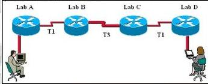

# PROVA — CÂMARA MUNICIPAL DE CURITIBA (PR) — ANALISTA DE SISTEMAS

## 1. Análise geral da prova

**Identificação da prova:**

- **Órgão:** Câmara Municipal de Curitiba — PR (logotipo da CÂMARA MUNICIPAL DE CURITIBA na capa; a questão 12 trata da bandeira municipal de Curitiba; a questão 36 cita "uma cidade do interior do Paraná")
- **Banca:** Instituto OPET — Educação e Cidadania (logotipo na capa)
- **Cargo:** **Analista de Sistemas** (cabeçalho da prova e do gabarito)
- **Ano:** **2007** (o concurso da Câmara Municipal de Curitiba organizado pelo Instituto OPET foi realizado em 02/12/2007; o nome do arquivo enviado mencionava "AC", sigla incorreta — a prova é de Curitiba/PR)
- **Gabarito aplicado:** gabarito oficial — tabela única "ANALISTA DE SISTEMAS / Gabarito" (com 13 questões ANULADAS)

**Transcrição integral da capa (contracapa de instruções):**

> # SÓ ABRA QUANDO AUTORIZADO
>
> Leia atentamente as instruções que se seguem.
>
> 1 - Este caderno contém sessenta questões, abrangendo um total de catorze páginas, numeradas de 2 a 14. Antes de começar a resolver as questões, verifique se seu caderno está completo. Caso haja algum problema, solicite a substituição deste caderno.
>
> 2 - Esta prova vale 100 pontos, assim distribuídos: Questões 01 à 10 valendo 0,5; Questões 11 à 15 valendo um ponto; Questões 16 à 60 valendo dois pontos.
>
> 3 - NÃO escreva seu nome nem assine nas folhas desta prova.
>
> 4 - Leia cuidadosamente cada questão da prova e escreva a resposta, A CANETA, nos espaços correspondentes da Folha de Resposta. Mais de uma alternativa a questão será considerada errada.
>
> 5 - Ao terminar a prova, entregue este caderno ao aplicador
>
> ATENÇÃO: Terminada a prova, recolha seus objetos lacrados, deixe a sala e, em seguida, o prédio. A partir do momento em que sair da sala e até a saída do prédio, continuam válidas as proibições ao uso de aparelhos eletrônicos e celulares, bem como não lhe é mais permitido o uso dos sanitários.

**Composição quantitativa:**

| Item | Quantidade |
|---|---|
| Total de questões | 60 (todas objetivas, **5 alternativas: A, B, C, D, E**) |
| Textos de apoio | 1 (conto "Fita verde no cabelo", de Guimarães Rosa) |
| Imagens | 1 (topologia de rede da questão 59) |
| Gráficos e tabelas | 2 tabelas (modelo entidade-relacionamento da questão 51 e tabela Item_NF da questão 53) |
| Grupos identificados | 1 |
| Questões independentes | 55 |
| Questões anuladas | 13 (08, 11, 15, 23, 25, 28, 29, 30, 32, 33, 40, 41, 51) |

**Composição por bloco (títulos originais do caderno):**

| Bloco | Questões | Quantidade |
|---|---|---|
| Prova de Conhecimentos Gerais | 01 a 15 | 15 |
| Prova de Conhecimentos Específicos | 16 a 60 | 45 |

**Observações sobre a estrutura original:**

- As questões 01 a 05 referem-se ao conto "Fita verde no cabelo" (João Guimarães Rosa, "Ave, palavra", Ed. José Olympio), transcrito integralmente e repetido dentro de cada uma dessas questões.
- A questão 15 é **idêntica** à questão 11 (mesmo enunciado e mesmas alternativas); no gabarito oficial ambas estão ANULADAS. Conforme a regra de fidelidade, as duas foram mantidas.
- As questões 39, 40, 41, 42, 54 e 55 contêm códigos-fonte (Java/JSP), preservados integralmente em blocos de código (formatação apenas — nenhum caractere foi alterado).
- As questões 51 e 53 contêm tabelas, reproduzidas como tabelas Markdown.
- A questão 59 depende da figura da topologia de rede (imagem_001.jpg), exibida dentro da questão e repetida em "Referências visuais".

**Gabarito oficial — tabela "ANALISTA DE SISTEMAS / Gabarito":**

| Questão | Resposta | Questão | Resposta | Questão | Resposta | Questão | Resposta | Questão | Resposta |
|---|---|---|---|---|---|---|---|---|---|
| 01 | **B** | 02 | **B** | 03 | **D** | 04 | **C** | 05 | **D** |
| 06 | **D** | 07 | **E** | 08 | **ANULADA** | 09 | **A** | 10 | **C** |
| 11 | **ANULADA** | 12 | **B** | 13 | **A** | 14 | **D** | 15 | **ANULADA** |
| 16 | **B** | 17 | **B** | 18 | **D** | 19 | **E** | 20 | **C** |
| 21 | **E** | 22 | **D** | 23 | **ANULADA** | 24 | **C** | 25 | **ANULADA** |
| 26 | **C** | 27 | **A** | 28 | **ANULADA** | 29 | **ANULADA** | 30 | **ANULADA** |
| 31 | **D** | 32 | **ANULADA** | 33 | **ANULADA** | 34 | **A** | 35 | **B** |
| 36 | **B** | 37 | **C** | 38 | **B** | 39 | **A** | 40 | **ANULADA** |
| 41 | **ANULADA** | 42 | **C** | 43 | **C** | 44 | **B** | 45 | **E** |
| 46 | **E** | 47 | **A** | 48 | **D** | 49 | **B** | 50 | **C** |
| 51 | **ANULADA** | 52 | **C** | 53 | **B** | 54 | **D** | 55 | **D** |
| 56 | **B** | 57 | **C** | 58 | **B** | 59 | **B** | 60 | **E** |

> 📌 Fonte: gabarito oficial enviado (arquivo "Gabarito - Câmara de Vereadores. - AC - Analista de Sistemas.pdf", 2 páginas; a questão 60 consta na página 2). Legenda do gabarito: ANULADA = questão anulada.

## 2. Questões agrupadas

### GRUPO 01 — Texto "Fita verde no cabelo" (João Guimarães Rosa)

**Questões relacionadas:** 01, 02, 03, 04 e 05.

---

#### QUESTÃO 01

✅ **Gabarito: B**

**Material de apoio:**

# SÓ ABRA QUANDO AUTORIZADO
Leia atentamente as instruções que se seguem.
1 - Este caderno contém sessenta questões, abrangendo um total de catorze páginas, numeradas de 2 a 14. Antes de começar a resolver as questões, verifique se seu caderno está completo. Caso haja algum problema, solicite a substituição deste caderno.
2 - Esta prova vale 100 pontos, assim distribuídos: Questões 01 à 10 valendo 0,5; Questões 11 à 15 valendo um ponto; Questões 16 à 60 valendo dois pontos.
3 - NÃO escreva seu nome nem assine nas folhas desta prova.
4 - Leia cuidadosamente cada questão da prova e escreva a resposta, A CANETA, nos espaços correspondentes da Folha de Resposta. Mais de uma alternativa a questão será considerada errada.
5 - Ao terminar a prova, entregue este caderno ao aplicador
ATENÇÃO: Terminada a prova, recolha seus objetos lacrados, deixe a sala e, em seguida, o prédio. A partir do momento em que sair da sala e até a saída do prédio, continuam válidas as proibições ao uso de aparelhos eletrônicos e celulares, bem como não lhe é mais permitido o uso dos sanitários.
As questões 01 a 05 referem-se ao texto a seguir:
**Fita verde no cabelo**
(Nova velha estória)
Havia uma aldeia em algum lugar, nem maior nem menor, com velhos e velhas que velhavam, homens e mulheres que esperavam, e meninos e meninas que nasciam e cresciam. Todos com juízo, suficientemente, menos uma meninazinha, a que por enquanto. Aquela, um dia, saiu de lá, com uma fita verde inventada no cabelo.
Sua mãe mandara-a, com um cesto e um pote, à avó, que a amava, a uma outra e quase igualzinha aldeia. Fita-Verde partiu, sobre logo, ela a linda, tudo era uma vez. O pote continha um doce em calda, e o cesto estava vazio, que para buscar framboesas.
Daí, que, indo, no atravessar o bosque, viu só os lenhadores, que por lá lenhavam; mas o lobo nenhum, desconhecido nem peludo. Pois os lenhadores tinham exterminado o lobo. Então, ela, mesma, era quem se dizia: “vou à vovó, com cesto e pote, e a fita verde no cabelo, o tanto que a mamãe me mandou”. A aldeia e a casa esperando a acolá, depois daquele moinho, que a gente pensa que vê, e das horas, que a gente não vê que não são.
E ela mesma resolveu escolher tomar este caminho de cá, louco e longo, e não o outro, encurtoso. Saiu, atrás de suas asas ligeiras, sua sombra também vinha-lhe correndo, em pós. Divertia-se de ver as avelãs no chão não voarem, com inalcançar essas borboletas nunca em buquê nem em botão, e com ignorar se cada uma em seu lugar as plebeinhas flores, princesinhas e incomuns, quando a gente tanto por elas passa. Vinha sobejadamente.
Demorou, para dar com a avó em casa, que assim lhe respondeu, quando ela, toque, toque, bateu:
- Quem é?
- Sou eu... – e Fita-Verde descansou a voz. – Sou sua linda netinha, com cesto e pote, com a fita verde no cabelo, que a mamãe me mandou.
Vai, a avó, difícil disse: “Puxa o ferrolho de pau da porta, entra e abre. Deus te abençoe.”
Fita-Verde assim fez, e entrou e olhou.
A avó estava na cama, rebuçada e só. Devia, para falar agagado e fraco e rouco, assim, de ter apanhado um ruim defluxo. Dizendo: “Depõe o pote e o cesto na arca, e vem para perto de mim, enquanto é tempo.”
Mas agora Fita-Verde se espantava, além de entristecer-se de ver que perdera em caminho sua grande fita verde no cabelo atada; e estava suada, com enorme fome de almoço. Ela perguntou:
- Vovozinha, que braços tão magros, os seus, e que mãos tão trementes!
- É porque não vou poder nunca mais te abraçar, minha neta – a avó murmurou.
- Vovozinha, mas que lábios, aí, tão arroxeados!
- É porque não vou mais poder te beijar, minha neta... – a avó suspirou.
- Vovozinha, e que olhos tão fundos e parados, nesse rosto encovado, pálido?
- É porque já não te estou vendo, nunca mais, minha netinha - a avó ainda gemeu.
Fita-Verde mais se assustou, como se fosse ter juízo pela primeira vez.
Gritou: - Vovozinha, eu tenho medo do Lobo!
Mas a avó não estava mais lá, sendo que demasiado ausente, a não ser pelo frio, triste e tão repentino corpo.
(João Guimarães Rosa, “Fita verde no cabelo, em Ave, palavra, Ed. José Olympio)

**Enunciado:**

O subtítulo “Nova velha estória”, utilizado por Guimarães Rosa, sugere um jogo dialógico com outro texto, um conto de fadas. As alternativas a seguir apresentam características que distinguem as duas estórias, exceto em:

**Alternativas:**

A) lábios arroxeados – boca grande.

B) Fita Verde – Chapeuzinho Vermelho.

C) cesta com doces – cesta vazia e pote cheio.

D) olhos fundos e parados – olhos grandes.

E) braços magros – braços fortes.

**Referências visuais:**

Nenhuma (material exclusivamente textual).

---

#### QUESTÃO 02

✅ **Gabarito: B**

**Material de apoio:**

# SÓ ABRA QUANDO AUTORIZADO
Leia atentamente as instruções que se seguem.
1 - Este caderno contém sessenta questões, abrangendo um total de catorze páginas, numeradas de 2 a 14. Antes de começar a resolver as questões, verifique se seu caderno está completo. Caso haja algum problema, solicite a substituição deste caderno.
2 - Esta prova vale 100 pontos, assim distribuídos: Questões 01 à 10 valendo 0,5; Questões 11 à 15 valendo um ponto; Questões 16 à 60 valendo dois pontos.
3 - NÃO escreva seu nome nem assine nas folhas desta prova.
4 - Leia cuidadosamente cada questão da prova e escreva a resposta, A CANETA, nos espaços correspondentes da Folha de Resposta. Mais de uma alternativa a questão será considerada errada.
5 - Ao terminar a prova, entregue este caderno ao aplicador
ATENÇÃO: Terminada a prova, recolha seus objetos lacrados, deixe a sala e, em seguida, o prédio. A partir do momento em que sair da sala e até a saída do prédio, continuam válidas as proibições ao uso de aparelhos eletrônicos e celulares, bem como não lhe é mais permitido o uso dos sanitários.
As questões 01 a 05 referem-se ao texto a seguir:
**Fita verde no cabelo**
(Nova velha estória)
Havia uma aldeia em algum lugar, nem maior nem menor, com velhos e velhas que velhavam, homens e mulheres que esperavam, e meninos e meninas que nasciam e cresciam. Todos com juízo, suficientemente, menos uma meninazinha, a que por enquanto. Aquela, um dia, saiu de lá, com uma fita verde inventada no cabelo.
Sua mãe mandara-a, com um cesto e um pote, à avó, que a amava, a uma outra e quase igualzinha aldeia. Fita-Verde partiu, sobre logo, ela a linda, tudo era uma vez. O pote continha um doce em calda, e o cesto estava vazio, que para buscar framboesas.
Daí, que, indo, no atravessar o bosque, viu só os lenhadores, que por lá lenhavam; mas o lobo nenhum, desconhecido nem peludo. Pois os lenhadores tinham exterminado o lobo. Então, ela, mesma, era quem se dizia: “vou à vovó, com cesto e pote, e a fita verde no cabelo, o tanto que a mamãe me mandou”. A aldeia e a casa esperando a acolá, depois daquele moinho, que a gente pensa que vê, e das horas, que a gente não vê que não são.
E ela mesma resolveu escolher tomar este caminho de cá, louco e longo, e não o outro, encurtoso. Saiu, atrás de suas asas ligeiras, sua sombra também vinha-lhe correndo, em pós. Divertia-se de ver as avelãs no chão não voarem, com inalcançar essas borboletas nunca em buquê nem em botão, e com ignorar se cada uma em seu lugar as plebeinhas flores, princesinhas e incomuns, quando a gente tanto por elas passa. Vinha sobejadamente.
Demorou, para dar com a avó em casa, que assim lhe respondeu, quando ela, toque, toque, bateu:
- Quem é?
- Sou eu... – e Fita-Verde descansou a voz. – Sou sua linda netinha, com cesto e pote, com a fita verde no cabelo, que a mamãe me mandou.
Vai, a avó, difícil disse: “Puxa o ferrolho de pau da porta, entra e abre. Deus te abençoe.”
Fita-Verde assim fez, e entrou e olhou.
A avó estava na cama, rebuçada e só. Devia, para falar agagado e fraco e rouco, assim, de ter apanhado um ruim defluxo. Dizendo: “Depõe o pote e o cesto na arca, e vem para perto de mim, enquanto é tempo.”
Mas agora Fita-Verde se espantava, além de entristecer-se de ver que perdera em caminho sua grande fita verde no cabelo atada; e estava suada, com enorme fome de almoço. Ela perguntou:
- Vovozinha, que braços tão magros, os seus, e que mãos tão trementes!
- É porque não vou poder nunca mais te abraçar, minha neta – a avó murmurou.
- Vovozinha, mas que lábios, aí, tão arroxeados!
- É porque não vou mais poder te beijar, minha neta... – a avó suspirou.
- Vovozinha, e que olhos tão fundos e parados, nesse rosto encovado, pálido?
- É porque já não te estou vendo, nunca mais, minha netinha - a avó ainda gemeu.
Fita-Verde mais se assustou, como se fosse ter juízo pela primeira vez.
Gritou: - Vovozinha, eu tenho medo do Lobo!
Mas a avó não estava mais lá, sendo que demasiado ausente, a não ser pelo frio, triste e tão repentino corpo.
(João Guimarães Rosa, “Fita verde no cabelo, em Ave, palavra, Ed. José Olympio)

**Enunciado:**

Os vocábulos “velhavam”, “encurtoso”, “inalcançar”, são exemplos de:

**Alternativas:**

A) pleonasmo.

B) neologismo.

C) barbarismo.

D) ambigüidade.

E) cacofonia.

**Referências visuais:**

Nenhuma (material exclusivamente textual).

---

#### QUESTÃO 03

✅ **Gabarito: D**

**Material de apoio:**

# SÓ ABRA QUANDO AUTORIZADO
Leia atentamente as instruções que se seguem.
1 - Este caderno contém sessenta questões, abrangendo um total de catorze páginas, numeradas de 2 a 14. Antes de começar a resolver as questões, verifique se seu caderno está completo. Caso haja algum problema, solicite a substituição deste caderno.
2 - Esta prova vale 100 pontos, assim distribuídos: Questões 01 à 10 valendo 0,5; Questões 11 à 15 valendo um ponto; Questões 16 à 60 valendo dois pontos.
3 - NÃO escreva seu nome nem assine nas folhas desta prova.
4 - Leia cuidadosamente cada questão da prova e escreva a resposta, A CANETA, nos espaços correspondentes da Folha de Resposta. Mais de uma alternativa a questão será considerada errada.
5 - Ao terminar a prova, entregue este caderno ao aplicador
ATENÇÃO: Terminada a prova, recolha seus objetos lacrados, deixe a sala e, em seguida, o prédio. A partir do momento em que sair da sala e até a saída do prédio, continuam válidas as proibições ao uso de aparelhos eletrônicos e celulares, bem como não lhe é mais permitido o uso dos sanitários.
As questões 01 a 05 referem-se ao texto a seguir:
**Fita verde no cabelo**
(Nova velha estória)
Havia uma aldeia em algum lugar, nem maior nem menor, com velhos e velhas que velhavam, homens e mulheres que esperavam, e meninos e meninas que nasciam e cresciam. Todos com juízo, suficientemente, menos uma meninazinha, a que por enquanto. Aquela, um dia, saiu de lá, com uma fita verde inventada no cabelo.
Sua mãe mandara-a, com um cesto e um pote, à avó, que a amava, a uma outra e quase igualzinha aldeia. Fita-Verde partiu, sobre logo, ela a linda, tudo era uma vez. O pote continha um doce em calda, e o cesto estava vazio, que para buscar framboesas.
Daí, que, indo, no atravessar o bosque, viu só os lenhadores, que por lá lenhavam; mas o lobo nenhum, desconhecido nem peludo. Pois os lenhadores tinham exterminado o lobo. Então, ela, mesma, era quem se dizia: “vou à vovó, com cesto e pote, e a fita verde no cabelo, o tanto que a mamãe me mandou”. A aldeia e a casa esperando a acolá, depois daquele moinho, que a gente pensa que vê, e das horas, que a gente não vê que não são.
E ela mesma resolveu escolher tomar este caminho de cá, louco e longo, e não o outro, encurtoso. Saiu, atrás de suas asas ligeiras, sua sombra também vinha-lhe correndo, em pós. Divertia-se de ver as avelãs no chão não voarem, com inalcançar essas borboletas nunca em buquê nem em botão, e com ignorar se cada uma em seu lugar as plebeinhas flores, princesinhas e incomuns, quando a gente tanto por elas passa. Vinha sobejadamente.
Demorou, para dar com a avó em casa, que assim lhe respondeu, quando ela, toque, toque, bateu:
- Quem é?
- Sou eu... – e Fita-Verde descansou a voz. – Sou sua linda netinha, com cesto e pote, com a fita verde no cabelo, que a mamãe me mandou.
Vai, a avó, difícil disse: “Puxa o ferrolho de pau da porta, entra e abre. Deus te abençoe.”
Fita-Verde assim fez, e entrou e olhou.
A avó estava na cama, rebuçada e só. Devia, para falar agagado e fraco e rouco, assim, de ter apanhado um ruim defluxo. Dizendo: “Depõe o pote e o cesto na arca, e vem para perto de mim, enquanto é tempo.”
Mas agora Fita-Verde se espantava, além de entristecer-se de ver que perdera em caminho sua grande fita verde no cabelo atada; e estava suada, com enorme fome de almoço. Ela perguntou:
- Vovozinha, que braços tão magros, os seus, e que mãos tão trementes!
- É porque não vou poder nunca mais te abraçar, minha neta – a avó murmurou.
- Vovozinha, mas que lábios, aí, tão arroxeados!
- É porque não vou mais poder te beijar, minha neta... – a avó suspirou.
- Vovozinha, e que olhos tão fundos e parados, nesse rosto encovado, pálido?
- É porque já não te estou vendo, nunca mais, minha netinha - a avó ainda gemeu.
Fita-Verde mais se assustou, como se fosse ter juízo pela primeira vez.
Gritou: - Vovozinha, eu tenho medo do Lobo!
Mas a avó não estava mais lá, sendo que demasiado ausente, a não ser pelo frio, triste e tão repentino corpo.
(João Guimarães Rosa, “Fita verde no cabelo, em Ave, palavra, Ed. José Olympio)

**Enunciado:**

No texto de Guimarães Rosa, a caracterização do tempo é constante. Assinale a alternativa que traduz, respectivamente, as expressões: “das horas, que a gente não vê que não são” “tudo era uma vez” “enquanto é tempo”

**Alternativas:**

A) Atemporalidade, efemeridade, esgotamento.

B) Efemeridade, esgotamento, atemporalidade.

C) Esgotamento, atemporalidade, efemeridade.

D) Efemeridade, atemporalidade, esgotamento.

E) Atemporalidade, esgotamento, efemeridade.

**Referências visuais:**

Nenhuma (material exclusivamente textual).

---

#### QUESTÃO 04

✅ **Gabarito: C**

**Material de apoio:**

# SÓ ABRA QUANDO AUTORIZADO
Leia atentamente as instruções que se seguem.
1 - Este caderno contém sessenta questões, abrangendo um total de catorze páginas, numeradas de 2 a 14. Antes de começar a resolver as questões, verifique se seu caderno está completo. Caso haja algum problema, solicite a substituição deste caderno.
2 - Esta prova vale 100 pontos, assim distribuídos: Questões 01 à 10 valendo 0,5; Questões 11 à 15 valendo um ponto; Questões 16 à 60 valendo dois pontos.
3 - NÃO escreva seu nome nem assine nas folhas desta prova.
4 - Leia cuidadosamente cada questão da prova e escreva a resposta, A CANETA, nos espaços correspondentes da Folha de Resposta. Mais de uma alternativa a questão será considerada errada.
5 - Ao terminar a prova, entregue este caderno ao aplicador
ATENÇÃO: Terminada a prova, recolha seus objetos lacrados, deixe a sala e, em seguida, o prédio. A partir do momento em que sair da sala e até a saída do prédio, continuam válidas as proibições ao uso de aparelhos eletrônicos e celulares, bem como não lhe é mais permitido o uso dos sanitários.
As questões 01 a 05 referem-se ao texto a seguir:
**Fita verde no cabelo**
(Nova velha estória)
Havia uma aldeia em algum lugar, nem maior nem menor, com velhos e velhas que velhavam, homens e mulheres que esperavam, e meninos e meninas que nasciam e cresciam. Todos com juízo, suficientemente, menos uma meninazinha, a que por enquanto. Aquela, um dia, saiu de lá, com uma fita verde inventada no cabelo.
Sua mãe mandara-a, com um cesto e um pote, à avó, que a amava, a uma outra e quase igualzinha aldeia. Fita-Verde partiu, sobre logo, ela a linda, tudo era uma vez. O pote continha um doce em calda, e o cesto estava vazio, que para buscar framboesas.
Daí, que, indo, no atravessar o bosque, viu só os lenhadores, que por lá lenhavam; mas o lobo nenhum, desconhecido nem peludo. Pois os lenhadores tinham exterminado o lobo. Então, ela, mesma, era quem se dizia: “vou à vovó, com cesto e pote, e a fita verde no cabelo, o tanto que a mamãe me mandou”. A aldeia e a casa esperando a acolá, depois daquele moinho, que a gente pensa que vê, e das horas, que a gente não vê que não são.
E ela mesma resolveu escolher tomar este caminho de cá, louco e longo, e não o outro, encurtoso. Saiu, atrás de suas asas ligeiras, sua sombra também vinha-lhe correndo, em pós. Divertia-se de ver as avelãs no chão não voarem, com inalcançar essas borboletas nunca em buquê nem em botão, e com ignorar se cada uma em seu lugar as plebeinhas flores, princesinhas e incomuns, quando a gente tanto por elas passa. Vinha sobejadamente.
Demorou, para dar com a avó em casa, que assim lhe respondeu, quando ela, toque, toque, bateu:
- Quem é?
- Sou eu... – e Fita-Verde descansou a voz. – Sou sua linda netinha, com cesto e pote, com a fita verde no cabelo, que a mamãe me mandou.
Vai, a avó, difícil disse: “Puxa o ferrolho de pau da porta, entra e abre. Deus te abençoe.”
Fita-Verde assim fez, e entrou e olhou.
A avó estava na cama, rebuçada e só. Devia, para falar agagado e fraco e rouco, assim, de ter apanhado um ruim defluxo. Dizendo: “Depõe o pote e o cesto na arca, e vem para perto de mim, enquanto é tempo.”
Mas agora Fita-Verde se espantava, além de entristecer-se de ver que perdera em caminho sua grande fita verde no cabelo atada; e estava suada, com enorme fome de almoço. Ela perguntou:
- Vovozinha, que braços tão magros, os seus, e que mãos tão trementes!
- É porque não vou poder nunca mais te abraçar, minha neta – a avó murmurou.
- Vovozinha, mas que lábios, aí, tão arroxeados!
- É porque não vou mais poder te beijar, minha neta... – a avó suspirou.
- Vovozinha, e que olhos tão fundos e parados, nesse rosto encovado, pálido?
- É porque já não te estou vendo, nunca mais, minha netinha - a avó ainda gemeu.
Fita-Verde mais se assustou, como se fosse ter juízo pela primeira vez.
Gritou: - Vovozinha, eu tenho medo do Lobo!
Mas a avó não estava mais lá, sendo que demasiado ausente, a não ser pelo frio, triste e tão repentino corpo.
(João Guimarães Rosa, “Fita verde no cabelo, em Ave, palavra, Ed. José Olympio)

**Enunciado:**

Um dos temas do conto Fita Verde no cabelo, é a brevidade da vida, caracterizado pela expressão:

**Alternativas:**

A) homens e mulheres esperam.

B) meninos e meninas nascem e crescem.

C) repentino corpo.

D) atrás de suas asas ligeiras.

E) caminho de cá, longo e louco.

**Referências visuais:**

Nenhuma (material exclusivamente textual).

---

#### QUESTÃO 05

✅ **Gabarito: D**

**Material de apoio:**

# SÓ ABRA QUANDO AUTORIZADO
Leia atentamente as instruções que se seguem.
1 - Este caderno contém sessenta questões, abrangendo um total de catorze páginas, numeradas de 2 a 14. Antes de começar a resolver as questões, verifique se seu caderno está completo. Caso haja algum problema, solicite a substituição deste caderno.
2 - Esta prova vale 100 pontos, assim distribuídos: Questões 01 à 10 valendo 0,5; Questões 11 à 15 valendo um ponto; Questões 16 à 60 valendo dois pontos.
3 - NÃO escreva seu nome nem assine nas folhas desta prova.
4 - Leia cuidadosamente cada questão da prova e escreva a resposta, A CANETA, nos espaços correspondentes da Folha de Resposta. Mais de uma alternativa a questão será considerada errada.
5 - Ao terminar a prova, entregue este caderno ao aplicador
ATENÇÃO: Terminada a prova, recolha seus objetos lacrados, deixe a sala e, em seguida, o prédio. A partir do momento em que sair da sala e até a saída do prédio, continuam válidas as proibições ao uso de aparelhos eletrônicos e celulares, bem como não lhe é mais permitido o uso dos sanitários.
As questões 01 a 05 referem-se ao texto a seguir:
**Fita verde no cabelo**
(Nova velha estória)
Havia uma aldeia em algum lugar, nem maior nem menor, com velhos e velhas que velhavam, homens e mulheres que esperavam, e meninos e meninas que nasciam e cresciam. Todos com juízo, suficientemente, menos uma meninazinha, a que por enquanto. Aquela, um dia, saiu de lá, com uma fita verde inventada no cabelo.
Sua mãe mandara-a, com um cesto e um pote, à avó, que a amava, a uma outra e quase igualzinha aldeia. Fita-Verde partiu, sobre logo, ela a linda, tudo era uma vez. O pote continha um doce em calda, e o cesto estava vazio, que para buscar framboesas.
Daí, que, indo, no atravessar o bosque, viu só os lenhadores, que por lá lenhavam; mas o lobo nenhum, desconhecido nem peludo. Pois os lenhadores tinham exterminado o lobo. Então, ela, mesma, era quem se dizia: “vou à vovó, com cesto e pote, e a fita verde no cabelo, o tanto que a mamãe me mandou”. A aldeia e a casa esperando a acolá, depois daquele moinho, que a gente pensa que vê, e das horas, que a gente não vê que não são.
E ela mesma resolveu escolher tomar este caminho de cá, louco e longo, e não o outro, encurtoso. Saiu, atrás de suas asas ligeiras, sua sombra também vinha-lhe correndo, em pós. Divertia-se de ver as avelãs no chão não voarem, com inalcançar essas borboletas nunca em buquê nem em botão, e com ignorar se cada uma em seu lugar as plebeinhas flores, princesinhas e incomuns, quando a gente tanto por elas passa. Vinha sobejadamente.
Demorou, para dar com a avó em casa, que assim lhe respondeu, quando ela, toque, toque, bateu:
- Quem é?
- Sou eu... – e Fita-Verde descansou a voz. – Sou sua linda netinha, com cesto e pote, com a fita verde no cabelo, que a mamãe me mandou.
Vai, a avó, difícil disse: “Puxa o ferrolho de pau da porta, entra e abre. Deus te abençoe.”
Fita-Verde assim fez, e entrou e olhou.
A avó estava na cama, rebuçada e só. Devia, para falar agagado e fraco e rouco, assim, de ter apanhado um ruim defluxo. Dizendo: “Depõe o pote e o cesto na arca, e vem para perto de mim, enquanto é tempo.”
Mas agora Fita-Verde se espantava, além de entristecer-se de ver que perdera em caminho sua grande fita verde no cabelo atada; e estava suada, com enorme fome de almoço. Ela perguntou:
- Vovozinha, que braços tão magros, os seus, e que mãos tão trementes!
- É porque não vou poder nunca mais te abraçar, minha neta – a avó murmurou.
- Vovozinha, mas que lábios, aí, tão arroxeados!
- É porque não vou mais poder te beijar, minha neta... – a avó suspirou.
- Vovozinha, e que olhos tão fundos e parados, nesse rosto encovado, pálido?
- É porque já não te estou vendo, nunca mais, minha netinha - a avó ainda gemeu.
Fita-Verde mais se assustou, como se fosse ter juízo pela primeira vez.
Gritou: - Vovozinha, eu tenho medo do Lobo!
Mas a avó não estava mais lá, sendo que demasiado ausente, a não ser pelo frio, triste e tão repentino corpo.
(João Guimarães Rosa, “Fita verde no cabelo, em Ave, palavra, Ed. José Olympio)

**Enunciado:**

“com uma fita verde inventada no cabelo”, a cor da fita representa:

**Alternativas:**

A) as preocupações ecológicas da menina.

B) as flores que existiam no caminho.

C) a esperança da menina por um mundo melhor.

D) a energia e imaturidade na menina.

E) a fome pelo almoço.

**Referências visuais:**

Nenhuma (material exclusivamente textual).

---


## 3. Questões independentes

#### QUESTÃO 06

✅ **Gabarito: D**

**Enunciado:**

Em qual alternativa há erro na acentuação gráfica?

**Alternativas:**

A) Místico, flor, gentil, céu.

B) Inveja, memória, estéril, longínqua.

C) Pálida, novo, injúria, álbum.

D) Herói, item, pajé, rubrica.

E) Baú, fértil, ateu, perdoa.

**Referências visuais:**

Nenhuma.

---

#### QUESTÃO 07

✅ **Gabarito: E**

**Enunciado:**

________ confessou-se ________ pela ________ com que a trataram no Brasil e prometeu visitar-nos novamente daqui ________ dois ou três anos.

**Alternativas:**

A) Sua Majestade – lisonjeada – fineza – há.

B) Vossa Magestade – lisonjeada – fineza – a.

C) Sua Majestade – lisonjeada – finesa – há.

D) Vossa Majestade – lisonjeada – finesa – a.

E) Sua Majestade – lisonjeada – fineza – a.

**Referências visuais:**

Nenhuma.

---

#### QUESTÃO 08

⚠️ **Gabarito: ANULADA**

**Enunciado:**

Ele teve uma reação ________ e ninguém sabe ________

**Alternativas:**

A) espontânea – porque.

B) espontânea – por que.

C) espontânea – porquê.

D) espontânea – por quê.

E) espontânea – porque.

**Referências visuais:**

Nenhuma.

---

#### QUESTÃO 09

✅ **Gabarito: A**

**Enunciado:**

Assinale a alternativa em que a colocação pronominal está incorreta:

**Alternativas:**

A) Não quero lhe mostrar o livro.

B) Não lhe quero mostrar o livro.

C) Não quero mostrar-lhe o livro.

D) Dar-te-ei o livro antes de mostrá-lo.

E) Dê-me o livro.

**Referências visuais:**

Nenhuma.

---

#### QUESTÃO 10

✅ **Gabarito: C**

**Enunciado:**

Relacione o vocábulo nepotismo a seu sentido:

**Alternativas:**

A) cortesia a um sobrinho.

B) regime de governo.

C) favoritismo a parentes.

D) modelo de oligarquia.

E) atividade natural do Nepal.

**Referências visuais:**

Nenhuma.

---

#### QUESTÃO 11

⚠️ **Gabarito: ANULADA**

**Enunciado:**

Assinale a alternativa correta:

**Alternativas:**

A) Para discutir o projeto em fase de primeira discussão, cada vereador disporá de 50 minutos.

B) Admite-se pedido de preferência para a votação das emendas.

C) As emendas serão lidas e votadas em bloco.

D) As comissões temporárias, que se extinguirem com o término da legislatura ou logo que tenham alcançado o seu objetivo são: especiais, de inquérito, de representação, processantes.

E) Se houver projetos substitutivos, estes serão votados após a votação dos projetos originais.

**Referências visuais:**

Nenhuma.

---

#### QUESTÃO 12

✅ **Gabarito: B**

**Enunciado:**

Na bandeira municipal de Curitiba, o brasão central e o retângulo representam respectivamente:

**Alternativas:**

A) a cidade sede do município e o governo municipal.

B) o governo municipal e a cidade sede do município.

C) o governo municipal e o governo estadual.

D) o governo estadual e o governo municipal.

E) o governo municipal e a câmara de vereadores.

**Referências visuais:**

Nenhuma.

---

#### QUESTÃO 13

✅ **Gabarito: A**

**Enunciado:**

O Executivo e o Legislativo municipais publicarão no órgão oficial do Município relatórios resumidos da execução orçamentária, até:

**Alternativas:**

A) 30 dias após o encerramento de cada bimestre.

B) 45 dias após o encerramento de cada bimestre.

C) 07 dias após o encerramento de cada bimestre.

D) 15 dias após o encerramento de cada bimestre.

E) 21 dias após o encerramento de cada bimestre.

**Referências visuais:**

Nenhuma.

---

#### QUESTÃO 14

✅ **Gabarito: D**

**Enunciado:**

De cada sessão plenária lavrar-se-á, a Ata, depois de lida, considerar-se-á aprovada a Ata que não sofrer:

**Alternativas:**

A) impedimento oral.

B) rasuras.

C) questionamentos.

D) impugnação.

E) revisões.

**Referências visuais:**

Nenhuma.

---

#### QUESTÃO 15

⚠️ **Gabarito: ANULADA**

**Enunciado:**

Assinale a alternativa correta:

**Alternativas:**

A) Para discutir o projeto em fase de primeira discussão, cada vereador disporá de 50 minutos.

B) Admite-se pedido de preferência para a votação das emendas.

C) As emendas serão lidas e votadas em bloco.

D) As comissões temporárias, que se extinguirem com o término da legislatura ou logo que tenham alcançado o seu objetivo são: especiais, de inquérito, de representação, processantes.

E) Se houver projetos substitutivos, estes serão votados após a votação dos projetos originais.
# CARGO ANALISTA DE SISTEMAS

**Referências visuais:**

Nenhuma.

---

#### QUESTÃO 16

✅ **Gabarito: B**

**Enunciado:**

Com relação ao Linux, analise as afirmativas a seguir: I. O comando "tar" pode ser executado para compactar diversos arquivos em um só, mesmo sem a presença de uma unidade de fita no computador. II. Para excluir um diretório e todo o seu conteúdo, o usuário pode incluir a cláusula -f no comando "rm". III. Para excluir um diretório vazio, pode-se usar o comando "rd". IV. Para excluir um diretório com conteúdo, pode-se usar o comando "rmdir". Assinale a opção que contém as afirmativas corretas:

**Alternativas:**

A) I e II

B) I

C) I, II e IV

D) I e IV

E) I, III e IV

**Referências visuais:**

Nenhuma.

---

#### QUESTÃO 17

✅ **Gabarito: B**

**Enunciado:**

Para que o Sistema Linux possa ser instalado concomitantemente com o Windows em uma mesma máquina, é necessário que seja instalado um programa Gerenciador de Boot (Boot Manager) para que possa ser feita a escolha entre os dois todas as vezes que o micro for ligado. Um dos programas que acompanha o Linux com essa finalidade é o:

**Alternativas:**

A) YUM

B) GRUB

C) KDE

D) GNOME

E) KERNEL

**Referências visuais:**

Nenhuma.

---

#### QUESTÃO 18

✅ **Gabarito: D**

**Enunciado:**

O Kernel do Linux é:

**Alternativas:**

A) o núcleo central e também a única parte livre do Sistema Operacional Linux.

B) o núcleo central e também a única parte para a qual se exige pagamento de licença no Sistema Linux.

C) a parte gráfica do sistema Linux, responsável pelos ícones e janelas.

D) o núcleo central do Sistema Linux (na verdade, o Kernel é o Linux).

E) Um aplicativo de desenho gráfico para o KDE.

**Referências visuais:**

Nenhuma.

---

#### QUESTÃO 19

✅ **Gabarito: E**

**Enunciado:**

A respeito dos comandos mais básicos do Sistema Operacional Linux, analise as afirmativas a seguir: I. O comando "ps" permite ao usuário verificar o status da impressora padrão configurada. II. O comando "mount" associa um dispositivo de hardware de bloco a um diretório no sistema de arquivos. Normalmente só o super usuário tem permissão de usar esse comando. III. O comando "su" permite que um usuário assuma os direitos de super usuário (root) sem conhecer a senha do mesmo. IV. O comando "sudo" permite que um comando seja executado com permissões de super usuário (root). Em alguns casos, será necessário apresentar a senha de super usuário. V. O comando "shutdown" pode ser usado para reiniciar um computador ao invés de desligá-lo. Para reiniciar o computador, usa-se a cláusula "-r" e para desligá-lo, usa-se "-h". Assinale a opção que contém as afirmativas corretas:

**Alternativas:**

A) I e III

B) I, II, IV e V

C) I, II, III, IV e V

D) II, III, IV e V

E) II, IV e V

**Referências visuais:**

Nenhuma.

---

#### QUESTÃO 20

✅ **Gabarito: C**

**Enunciado:**

Com relação à estrutura de diretórios do Linux, assinale a alternativa Incorreta:

**Alternativas:**

A) O diretório /etc guarda os arquivos de configuração do Sistema Linux e de seus aplicativos.

B) O diretório /bin armazena os arquivos dos comandos e executáveis do Linux. Esses arquivos normalmente podem ser executados por todos os usuários do sistema.

C) O diretório /proc armazena os arquivos dos módulos de programação usados para escrever e compilar novos programas no Linux, como as bibliotecas e arquivos-lonte.

D) O diretório /dev armazena os arquivos de dispositivos físicos instalados no computador.

E) O diretório /home guarda os diretórios pessoais dos usuários comuns no Linux.

**Referências visuais:**

Nenhuma.

---

#### QUESTÃO 21

✅ **Gabarito: E**

**Enunciado:**

O comando do Sistema Operacional Linux que mostra o conteúdo de um arquivo binário ou texto e o comando que mostra o espaço ocupado por arquivos e sub-diretórios do diretório atual são, respectivamente:

**Alternativas:**

A) cat e zu

B) ls e du

C) tac e su

D) df e ls

E) cat e df

**Referências visuais:**

Nenhuma.

---

#### QUESTÃO 22

✅ **Gabarito: D**

**Enunciado:**

Considerando-se um computador com apenas um disco rígido e uma única partição formatada com sistema de arquivo NTFS, é correto afirmar que neste disco rígido, sem a alteração da partição já formatada:

**Alternativas:**

A) será permitida a instalação apenas do Windows 98.

B) será permitida a instalação apenas do Linux.

C) o Windows 98 poderá ser instalado junto com o Linux desde que o sistema de arquivo seja transformado para FAT32 após a instalação e configuração do Linux.

D) será permitida a instalação do Windows 2000.

E) os sistemas operacionais Linux, Windows 2000 e Unix podem conviver em conjunto nesta máquina, desde que o Linux seja o primeiro sistema operacional a ser instalado.

**Referências visuais:**

Nenhuma.

---

#### QUESTÃO 23

⚠️ **Gabarito: ANULADA**

**Enunciado:**

Analise as seguintes afirmações relativas a Sistemas Operacionais: I. O Windows NT e o Windows 98 possuem sistema de arquivos NTFS e aceitam nomes longos para arquivos, com até 255 caracteres. II. O FAT e o FAT32 são sistemas de arquivos similares, tendo como principal diferença o tamanho o volume que podem suportar. III. No Windows NT é possível converter o sistema e arquivos NTFS para o FAT sem perder os dados existentes no NTFS. IV. No Windows 2000, quando um arquivo é copiado de uma pasta para outra, ele receberá as configurações da nova pasta, tanto para as permissões NTFS, como para a compactação. Indique a opção que contenha todas as afirmações verdadeiras.

**Alternativas:**

A) I e II.

B) II e III.

C) III e IV.

D) I e III.

E) II e IV.

**Referências visuais:**

Nenhuma.

---

#### QUESTÃO 24

✅ **Gabarito: C**

**Enunciado:**

A respeito do processo de BOOT, analise as afirmativas a seguir: I. Quando o computador é ligado, o sistema operacional, normalmente encontrado no Disco Rígido, é carregado para o BIOS do computador para poder, a partir de então, controlar o computador, permitindo que o usuário execute comandos. II. A presença de dois sistemas operacionais no computador só é possível se houver dois discos rígidos instalados, pois cada sistema operacional será armazenado em um disco diferente. III. O BIOS é a primeira camada de software de sistema que é carregada para a memória principal do computador. Depois de carregado, o BIOS realiza diversas operações, incluindo a chamada ao Sistema Operacional. IV. É responsabilidade do BIOS reconhecer componentes de sistema básicos, como o teclado, o drive de disquete e o Disco Rígido. Assinale a opção que contém as afirmativas corretas:

**Alternativas:**

A) I e II.

B) II e III.

C) III e IV.

D) I e III.

E) II e IV.

**Referências visuais:**

Nenhuma.

---

#### QUESTÃO 25

⚠️ **Gabarito: ANULADA**

**Enunciado:**

Assinale a alternativa correta com relação aos sistemas operacionais Windows e Linux:

**Alternativas:**

A) O Windows é bastante semelhante ao Linux, especialmente por ambos utilizarem as mesmas bibliotecas compartilhadas de acesso ao disco como os arquivos autoexec.bat e fdisk;

B) O Linux consegue com sucesso ler e gravar dados nos principais sistemas de arquivos do Windows, como o FAT32 e o NTFS.

C) O Windows consegue com sucesso ler e gravar dados nos sistemas de arquivos do Linux, como o EXT3 e o ReiserFS.

D) Arquivos escritos por aplicativos funcionando no Sistema Linux podem ser abertos e alterados por aplicações feitas para Windows, desde que estejam armazenados em partições suportadas por este Sistema.

E) Aplicativos criados para Windows podem ser executados diretamente no Sistema Linux porque ambos os sistemas operacionais utilizam suporte a arquivos executáveis com extensão EXE (programas). Os aplicativos feitos para Linux também podem ser executados pelo Windows, desde que este sistema seja configurado para aceitar arquivos executáveis feitos para Linux.

**Referências visuais:**

Nenhuma.

---

#### QUESTÃO 26

✅ **Gabarito: C**

**Enunciado:**

Assinale a alternativa correta quanto a Sistemas Operacionais diversos e suas principais características:

**Alternativas:**

A) Os sistemas GNU/Linux apresentam diversas características que o sistema operacional Windows não possui, como multitarefa, suporte a diversos sistemas de arquivos e interface gráfica.

B) Apesar de poder ser instalado diretamente no disco rígido, como um sistema operacional único no computador, o GNU/Linux normalmente é instalado como um aplicativo acessível por meio do Windows.

C) O Sistema operacional Windows não reconhece as partições formatadas em sistemas de arquivos que ele não suporta, como as partições EXT3 e ReiserFS, usadas no GNU/Linux. Devido a esse fato, os arquivos armazenados em partições Linux não podem ser acessados pelo Windows diretamente.

D) Ao contrário do GNU/Linux, o Windows exige uma partição reservada para ser usada como Memória Virtual de troca (SWAP). No GNU/Linux, a memória virtual é criada como um arquivo na partição principal.

E) Para que o Windows possa executar os mesmos aplicativos que o GNU/Linux consegue executar, é necessário instalar, no Windows, os mesmos arquivos DLL que o Linux utiliza, apenas renomeando-os, quando necessário.

**Referências visuais:**

Nenhuma.

---

#### QUESTÃO 27

✅ **Gabarito: A**

**Enunciado:**

Assinale a alternativa **incorreta** com relação aos conceitos e principais comandos do sistema GNU/Linux:

**Alternativas:**

A) "rpm" é um comando utilizado para alterar a rotação de unidades de disco, como drives de CD e DVD, drive de Disquete e Disco Rígido. Esse comando não funciona em pen drives.

B) Pacotes são arquivos compactados que normalmente instalam programas no sistema operacional GNU/Linux. Dependendo da distribuição Linux, esses pacotes podem ser gerenciados e instalados por programas diferentes.

C) O comando "cd ~" permite que o usuário acesse diretamente sua pasta pessoal no sistema GNU/Linux. O comando "cd ~" permite que o usuário acesse a última pasta que estava sendo acessada antes da atual.

D) É possível criar várias pastas ao mesmo tempo usando o comando mkdir e indicando, em seguida, os nomes das pastas a serem criadas, separados por espaços.

E) O comando "cp" copia apenas arquivos. Para que esse comando seja usado para copiar também diretórios e seus conteúdos, usa-se a opção "r".

**Referências visuais:**

Nenhuma.

---

#### QUESTÃO 28

⚠️ **Gabarito: ANULADA**

**Enunciado:**

Sobre os Serviços do Windows, **não é** correto afirmar:

**Alternativas:**

A) Um **Erro! A referência de hiperlink não é válida**. é um tipo de aplicativo que é executado no segundo plano e é semelhante a aplicativos utilitários (deamon) do UNIX.

B) Os aplicativos de serviço geralmente oferecem aos usuários recursos, como aplicativos cliente/servidor, servidores de banco de dados e outros aplicativos baseados em servidor.

C) É necessário ter as permissões apropriadas para iniciar, parar, pausar, reiniciar e desativar serviços.

D) Gerenciar serviços em computadores remotos que utilizam o Windows 98, 2000 ou NT

E) nda

**Referências visuais:**

Nenhuma.

---

#### QUESTÃO 29

⚠️ **Gabarito: ANULADA**

**Enunciado:**

Acerca dos procedimentos para iniciar, parar, pausar, continuar ou reiniciar um serviço, no Sistema Operacional Windows, considere: I) Para configurar parâmetros de inicialização para um serviço, o procedimento é: clicar com o botão direito do mouse no serviço, clicar em **Parâmetros de inicialização** e digite os parâmetros em **Propriedades** antes de clicar em **Serviços**. II) Uma das formas de abrir Serviços é clicar em **Iniciar**, em **Painel de controle**, em **Desempenho e manutenção**, em **Ferramentas administrativas** e, em seguida, clicar duas vezes em **Serviços**. III) Para realizar tais procedimentos o logon realizado deverá ser necessariamente como administrador. IV) Se o seu computador estiver conectado a uma rede, as configurações da diretiva de rede também poderão impedi-lo de concluir o procedimento. Assinale a opção que contém as afirmativas corretas:

**Alternativas:**

A) II, III e IV.

B) I e II.

C) I e III.

D) III e IV.

E) II e IV.

**Referências visuais:**

Nenhuma.

---

#### QUESTÃO 30

⚠️ **Gabarito: ANULADA**

**Enunciado:**

Sobre o Editor do Registro do Windows, considere: I) A área de navegação do Editor do Registro exibe pastas, cada uma delas representando uma **Erro! A referência de hiperlink não é válida**. no computador remoto. II) Uma das funções do editor de registro é permitir que um usuário execute tarefas como, por exemplo, eliminar entradas duplicadas ou excluir entradas de programas que foram desinstalados ou excluídos. III) O Registro não contém informações sobre como o computador deve funcionar. IV) Alterações incorretas podem danificar o sistema. Assinale a opção que contém as afirmativas corretas:

**Alternativas:**

A) II, III e IV.

B) I e II.

C) II e IV.

D) I e III.

E) III e IV.

**Referências visuais:**

Nenhuma.

---

#### QUESTÃO 31

✅ **Gabarito: D**

**Enunciado:**

A ocorrência de uma interrupção provoca em um sistema operacional:

**Alternativas:**

A) Travamento.

B) Um desvio no processamento para execução de rotinas especiais.

C) Paralisação temporária do programa até que seu tempo de execução seja atingido.

D) Um desvio no processamento para execução de rotinas especiais e, além disso, armazena informações vitais para o retorno do processamento.

E) Sendo uma interrupção de software, o Sistema Operacional processa prioritariamente as alterações de vídeo e mouse.

**Referências visuais:**

Nenhuma.

---

#### QUESTÃO 32

⚠️ **Gabarito: ANULADA**

**Enunciado:**

Com relação aos computadores em Dual Boot (dois sistemas operacionais), assinale a alternativa incorreta:

**Alternativas:**

A) É possível ter duas versões do Linux instaladas em um micro sem haver nenhuma do Windows previamente instalada.

B) Recomenda-se que o Linux seja instalado antes do Windows, caso se deseje um sistema dual boot com eles.

C) É recomendado haver, no mínimo, uma partição para o Windows e duas para o Linux, sendo que uma destas é para os arquivos do sistema Linux e a outra é para a Memória Virtual dele (chamada partição SWAP).

D) Não é recomendado instalar o Windows e o Linux em uma mesma partição de disco.

E) Há várias distribuições do Linux que podem ser executadas diretamente do CD-ROM, sem necessitar de processo de instalação, o que não modifica a estrutura do disco e não requer particionamento.

**Referências visuais:**

Nenhuma.

---

#### QUESTÃO 33

⚠️ **Gabarito: ANULADA**

**Enunciado:**

O menor espaço de um disco, usado para armazenar arquivos e que recebe um único endereço, registrado na Tabela de Alocação de arquivos do disco é chamado:

**Alternativas:**

A) Trilha

B) Cluster

C) Sistema de Arquivos

D) Setor

E) Nó

**Referências visuais:**

Nenhuma.

---

#### QUESTÃO 34

✅ **Gabarito: A**

**Enunciado:**

Qual é o próximo número da série 2938204185, 3938204184, 4938204183?

**Alternativas:**

A) 5938204182

B) 1938204183

C) 5939204182

D) 5938204186

E) 6038204182

**Referências visuais:**

Nenhuma.

---

#### QUESTÃO 35

✅ **Gabarito: B**

**Enunciado:**

Três pescadores descobriram um baú cheio de moedas de ouro. Guardaram-no para dividir o tesouro no dia seguinte. De manhã cedo, o primeiro pescador acordou e resolveu pegar a sua parte do tesouro. Dividiu as moedas em três partes iguais e, percebendo que sobrara uma, atirou-a ao mar para evitar brigas, retirando a sua parte em seguida. O segundo pescador acordou e, sem saber que o seu colega já havia retirado a sua parte, fez o mesmo que seu amigo: dividiu o tesouro em três partes iguais, retirou a sua parte e, como ao repartir também sobrou uma moeda, atirou-a ao mar. Quando o terceiro pescador acordou, decidiu dividir as moedas que ainda sobravam no baú em três partes iguais, retirando a sua parte e, como também sobrara uma moeda, jogou-a ao mar para evitar brigas, deixando no baú 14 moedas. Quando os três pescadores se reencontraram, conversaram e surpreenderam-se com o que havia acontecido, acertando amigavelmente as contas. Quantas moedas havia inicialmente no baú?

**Alternativas:**

A) 51

B) 52

C) 120

D) 121

E) 130

**Referências visuais:**

Nenhuma.

---

#### QUESTÃO 36

✅ **Gabarito: B**

**Enunciado:**

A rua principal de uma cidade do interior do Paraná possui cinco pontos comerciais, todos do mesmo lado da rua. A mercearia fica entre a drogaria e a panificadora, a drogaria fica entre o bar e a sapataria e o bar fica entre a panificadora e a mercearia. Dentre as hipóteses a seguir, é verdadeira:

**Alternativas:**

A) A sapataria está localizada entre a drogaria e o bar.

B) A mercearia está localizada entre o bar e a drogaria.

C) Para se ir da drogaria até a sapataria, passa-se em frente ao bar, à mercearia e à panificadora.

D) Para ir do bar até a sapataria, tem que passar necessariamente em frente à panificadora.

E) O bar está entre a drogaria e a sapataria.

**Referências visuais:**

Nenhuma.

---

#### QUESTÃO 37

✅ **Gabarito: C**

**Enunciado:**

Quais os quatro próximos números da seguinte série: 66, 22, 25, 75, 72, ____, ____, ____, ____

**Alternativas:**

A) 24, 36, 72, 68

B) 216, 213, 72, 69

C) 24, 27, 81, 78

D) 33, 11, 14, 42

E) 33, 30, 10, 13

**Referências visuais:**

Nenhuma.

---

#### QUESTÃO 38

✅ **Gabarito: B**

**Enunciado:**

Assinale a alternativa correta:

**Alternativas:**

A) Se uma superclasse declarar um método como abstract, uma subclasse qualquer (abstrata ou concreta) deverá implementar esse método.

B) Um objeto de uma classe que implementa uma interface pode ser pensado como um objeto desse tipo de interface.

C) As classes a partir das quais os objetos podem ser instanciados são chamadas abstratas.

D) Os métodos que não são métodos de interface e que não fornecem implementações não devem ser declarados como abstratos.

E) Métodos set são comumente chamados métodos de acesso ou métodos de consulta porque eles em geral alteram um valor.

**Referências visuais:**

Nenhuma.

---

#### QUESTÃO 39

✅ **Gabarito: A**

**Enunciado:**

Quais valores de A, B, C, D e E serão impressos ao final desse programa em Linguagem Java?

```java
public class Programa
{
    public static void main(String args[])
    {
        int a, b, c, d, e;
        a = 10;
        b = -7;
        c = 16;
        d = 4;
        e = -1;
        if(a < b || a > (b+d))
            a++;
        while((a > -1) && (b<= 8))
        {
            b+=2;
            a =2;
            e=b+2;
            if(d < c)
            {
                c = d;
                d = c - 1;
            }
        }
        System.out.println(a);
        System.out.println(b);
        System.out.println(c);
        System.out.println(d);
        System.out.println(e);
    }
}
```

**Alternativas:**

A) -1, 5, -1, -2, 7

B) -1, 5, 4, 15, 7

C) -5, 9, 0, -1, 11

D) -5, 9, 4, 15, 7

E) -2, 5, 4, 15, 7

**Referências visuais:**

Nenhuma.

---

#### QUESTÃO 40

⚠️ **Gabarito: ANULADA**

**Enunciado:**

Determine o trecho de código Java em que existe erro.

**Alternativas:**

A)

```
void g()
{
    System.out.println("Aqui é o método g");
}
```

B)

```
int soma(int a, int b)
{
    int result;
    result = a + b;
}
```

C)

```
int soma(int a, int b)
{
    int result
    result = a + b;
    return result;
}
```

D)

```
int soma(int a, int b)
{
    return a + b;
}
```

E)

```
int soma(int a, int b)
{
    If (a > b)
        return -1;
    else
        return a + b;
}
```

**Referências visuais:**

Nenhuma.

---

#### QUESTÃO 41

⚠️ **Gabarito: ANULADA**

**Enunciado:**

Sobre o constructor de uma classe em Java é correto affirmar que:

**Alternativas:**

A) O constructor serve para construir um objeto a partir de uma classe.

B) O Java não oferece um construtor padrão para uma classe, o mesmo deve ser declarado.

C) O constructor determina se a classe pode ou não ser instanciada.

D) O constructor determina como os atributos da classe devem ser inicializados e deve possuir o mesmo nome da classe.

E) O constructor determina como os atributos da classe devem ser inicializados e pode possuir o mesmo nome da classe.

**Referências visuais:**

Nenhuma.

---

#### QUESTÃO 42

✅ **Gabarito: C**

**Enunciado:**

Considere o segunte trecho de documento em Java:

```java
public class ClienteFísica extends Cliente
{
    private String cpf;
    public ClienteFísica(String nome, String cpf)
    {
        super(nome);
        this.cpf = cpf;
    }
    ...
}
Assinale a opção que contém a afirmativa incorreta.
```

**Alternativas:**

A) A classe ClienteFísica herda da classe Cliente.

B) A classe Cliente é a super-classe neste relacionamento de herança.

C) APALAVRA-CHAVE super() é quem realiza o processo de herança.

D) No número, aPALAVRA chave this está se referindo ao atributo cpf.

E) APALAVRA chave super()invoca o constructor da super-classe.

**Referências visuais:**

Nenhuma.

---

#### QUESTÃO 43

✅ **Gabarito: C**

**Enunciado:**

Assinale V para afirmativa verdadeira e F para falsa: i) Um relacionamento “tem um” é implementado via herança. ii) Uma classe Carro tem um relacionamento “é um” com as classes Volante e Freio. iii) Quando uma subclasse redefinir um método de superclasse utilizando a mesma assinatura, diz-se que a subclasse sobrecarrega esse método de superclasse. iv) É possível tratar objetos de superclasse e objetos de subclasse de maneira semelhante. v) Todos os métodos em uma classe abstract devem ser declarados como métodos abstract. Assinale a opção que contém a marcação correta:

**Alternativas:**

A) F, V, V, F, F.

B) V, V, V, F, V.

C) F, F, F, V, F.

D) V, F, V, V, F.

E) V, V, F, F, V.

**Referências visuais:**

Nenhuma.

---

#### QUESTÃO 44

✅ **Gabarito: B**

**Enunciado:**

A análise orientada a objetos se preocupa com a identificação dos conceitos, atributos e associações de interesse no contexto definido. Isto é demonstrado através de um modelo de domínio. O objetivo do modelo de domínio é:

**Alternativas:**

A) Descrever os objetos de software que serão implementados.

B) Visualizar conceitos ou modelos mentais do domínio do mundo real.

C) Identificar e controlar os maiores riscos.

D) Estabelecer um mapeamento entre uma classe e seu armazenamento persistente.

E) Descrever abstrações de software ou componentes com especificações e interfaces, considerando a tecnologia a ser utilizada.

**Referências visuais:**

Nenhuma.

---

#### QUESTÃO 45

✅ **Gabarito: E**

**Enunciado:**

Um Processo Unificado (PU) de desenvolvimento de software é iterativo, evolutivo e incremental. É composto das fases de: Concepção, Elaboração, Construção e Transição. Em relação ao PU, é correto afirmar:

**Alternativas:**

A) A maioria dos requisitos é definida detalhadamente antes do início da programação, criando abrangentes modelos do projeto. Isto possibilita a definição de um cronograma realista no início do projeto.

B) Cada iteração gera um protótipo experimental e descartável, utilizado para confirmação dos requisitos.

C) A fase de concepção é o levantamento dos requisitos do software a ser desenvolvido. A fase de elaboração se refere ao projeto e a fase de construção é a implementação propriamente dita.

D) O PU deve ter somente uma iteração e a maioria dos requisitos deve ser definida antes da fase de elaboração. Os elementos de risco não devem ser tratados nesta fase de elaboração.

E) Cada iteração gera um sistema parcial, executável, testável e integrável. As especificações são aperfeiçoadas a partir do refinamento dos requisitos.

**Referências visuais:**

Nenhuma.

---

#### QUESTÃO 46

✅ **Gabarito: E**

**Enunciado:**

Considere as seguintes definições de diagramas UML: I) Coleção de cenários relacionados de sucesso e fracasso, que descrevem um ator usado um sistema como meio para atingir um objetivo. II) Diagrama que modela o comportamento de um grupo de objetos que trabalham juntos na execução de um determinado cenário. III) Diagrama que modela o comportamento de um objeto individual, especificando a seqüência de estados que um objeto transita durante o seu tempo de vida, em resposta a eventos específicos. IV) Modelo estático do sistema. Mostra os requerimentos funcionais do sistema em termos de atributos e comportamentos. As descrições acima se referem, respectivamente:

**Alternativas:**

A) Diagrama de Seqüência, Diagrama de Casos de Uso, Diagrama de Classes, Diagrama de Máquina de Estados.

B) Diagrama de Seqüência, Diagrama de Atividades, Diagrama de Classes, Diagrama de Componentes.

C) Diagrama de Comunicação, Diagrama de Casos de Uso, Diagrama de Classes, Diagrama de Atividades.

D) Diagrama de Comunicação, Diagrama de Atividades, Diagrama de Componentes, Diagrama de Implantação.

E) Diagrama de Casos de Uso, Diagrama de Seqüência, Diagrama de Máquina de Estados, Diagrama de Classes.

**Referências visuais:**

Nenhuma.

---

#### QUESTÃO 47

✅ **Gabarito: A**

**Enunciado:**

A criação de uma superclasse em um relacionamento de generalização com subclasses deve ser considerada como uma solução viável quando:

**Alternativas:**

A) As potenciais subclasses conceituais representarem variações de um conceito semelhante.

B) As potenciais subclasses conceituais possuem atributos adicionais de interesse, mas não utilizam as associações definidas para a superclasse.

C) Uma instância de uma subclasse pode ou não ser uma instância da superclasse.

D) É recomendável quando se pretende utilizar heranças múltiplas como uma solução bastante comum para definição das subclasses.

E) Para assegurar que a superclasse irá aplicar o conceito de encapsulamento.

**Referências visuais:**

Nenhuma.

---

#### QUESTÃO 48

✅ **Gabarito: D**

**Enunciado:**

Métodos de desenvolvimento ágil podem ser definidos através dos seguintes termos:

**Alternativas:**

A) Refinamento Evolutivo, Modelagem em Pares, Ciclo de vida em Cascata, RUP.

B) Desenvolvimento guiado por testes, Extreme Programming, Modelo de Domínio, Requisitos Funcionais, Polimorfismo.

C) Abstração, Dicionário de Dados, Estimativas de Prazos, Modelagem em Pares.

D) Entrega incremental, Scrum, Iterações de curto prazo, modificações facilmente implementadas.

E) Entrega incremental, Polimorfismo, Modelagem de Negócio, Extreme Programming.

**Referências visuais:**

Nenhuma.

---

#### QUESTÃO 49

✅ **Gabarito: B**

**Enunciado:**

"Um Sistema Gerenciador de Banco de Dados (SGBD) é constituído por um conjunto de dados associados a um conjunto de programas para acesso a estes dados". Todas as características de um SGBD são verificadas e oferecidas ao usuário por meio destes programas. Marque a resposta que possui características corretas de um SGBD:

**Alternativas:**

A) Garantir a redundância de dados e não permitir isolamento de dados.

B) Garantir a segurança no acesso e manter a integridade de dados.

C) Garantir anomalias no acesso concorrente e manter inconsistência de dados.

D) Garantir as transações de gerenciamento e não manter acesso concorrente.

E) Garantir a dificuldade de acesso aos dados e romper a integridade de dados.

**Referências visuais:**

Nenhuma.

---

#### QUESTÃO 50

✅ **Gabarito: C**

**Enunciado:**

A linguagem SQL – Structured Query Language – é utilizada para manipular dados em um banco de dados, dar manutenção em objetos e consultar o dicionário de dados. Dentre as opções abaixo apenas uma não se refere a vantagens desta linguagem. Assinale-a.

**Alternativas:**

A) Independência de fabricante.

B) Portabilidade entre computadores.

C) Definição formal da linguagem após sua criação.

D) Inglês estruturado de alto nível.

E) Múltiplas visões dos dados.

**Referências visuais:**

Nenhuma.

---

#### QUESTÃO 51

⚠️ **Gabarito: ANULADA**

**Enunciado:**

O modelo entidade-relacionamento abaixo representa as tabelas: Pedido, Item e Produto.

|  Pedido |  | Item |  | Produto  |
| --- | --- | --- | --- | --- |
|  NumPed |  | NumPed | FK | CodProduto  |
|  PrazoEntrega | 1 | NumItem |  | DescrProduto  |
|  CodCliente | FK | CodProduto | FK | UnVenda  |
|  CodVendedor | FK | Quantidade |  | PreçoUnit  |

Os comandos SQL abaixo foram executados em um banco que implementou este modelo. I. SELECT descrproduto FROM produto WHERE codproduto IN (SELECT codproduto FROM item WHERE quantidade = 10) II. UPDATE produto SET precounit = precounit * 1.025 WHERE unvenda = 'Kg' III. DELETE FROM pedido WHERE NOT EXIST (SELECT numitem FROM item WHERE item.numped=pedido.numped) Considerando o modelo entidade-relacionamento e os comandos SQL acima, assinale a resposta verdadeira.

**Alternativas:**

A) Todos os comandos estão corretos.

B) Apenas os comandos II e III estão corretos.

C) Apenas os comandos I e II estão corretos.

D) Todos os comandos estão errados.

E) Apenas os comandos I e III estão corretos.

**Referências visuais:**

Nenhuma.

---

#### QUESTÃO 52

✅ **Gabarito: C**

**Enunciado:**

Considere as proposições abaixo sobre SGBD PostgreSQL. I. As ROLES são modelos de sistemas com determinados privilegios que lhes são atribuções. II. A cláusula CREATE GROUP em PostgreSQL é equivalente a CREATE ROLE dos demais SGBDRs que implementam SQL ANSI-92. III. No PostgreSQL, a autenticação de cliente é controlada pelo ar quovo pg_hba.conf, localizo no diretrório especified em $PGDATA. Este ar quovo é lido uma vez no start do banco e não pode ser editado quando o mesmo estiver em execuçao. Assinale a resposta verdadeira.

**Alternativas:**

A) Todas as proposições são verdadeiras.

B) Apenas as proposições II e III são verdadeiras.

C) Apenas as proposições I e II são verdadeiras.

D) Todas as proposições são falsas.

E) Apenas as proposições I e III são verdadeiras.

**Referências visuais:**

Nenhuma.

---

#### QUESTÃO 53

✅ **Gabarito: B**

**Enunciado:**

Observe a figura a seguir. Item_NF

|  NrNota (PK) | CodProd (PK) | Produto | Qtde | Preco | TotalItem  |
| --- | --- | --- | --- | --- | --- |
|  1 | CA | Chapa de Aço | 35 | R$ 15,00 | R$ 525,00  |
|  1 | BB | Bobina | 20 | R$ 15,00 | R$ 300,00  |
|  1 | TC | Tábuas Corridas | 50 | R$ 20,00 | R$ 1.000,00  |
|  2 | TC | Tábuas Corridas | 50 | R$ 20,00 | R$ 1.000,00  |
|  2 | CM | Compensado | 30 | R$ 15,00 | R$ 450,00  |
|  2 | RM | Ripas de Madeira | 300 | R$ 2,00 | R$ 600,00  |

Considerando a tabela Item_NF apresentada, seus dados e os conceitos de normalização introduzidos por Edgar Frank Codd, a partir de 1970, marque a alternativa correta:

**Alternativas:**

A) Estaabela respeita a 1FN (primeira forma normal) e a 3FN (terceira forma normal).

B) Estaabela respeita apenas a 1FN (primeira forma normal).

C) Estaabela respeita a 2FN (segunda forma normal) e a 3FN (terceira forma normal).

D) Estaabela respeita apenas a 2FN (segunda forma normal).

E) Estaabela respeita apenas a 3FN (terceira forma normal).

**Referências visuais:**

Nenhuma.

---

#### QUESTÃO 54

✅ **Gabarito: D**

**Enunciado:**

Assinale a opção que contém os fragmentos de uma sintaxe legal JSP para imprimir o valor de i:

**Alternativas:**

A)

```
<%int i = 1;%>
<%= i; %>
```

B)

```
<%int i = 1;
i; %>
```

C)

```
<%int i = 1%>
<%= i %>
```

D)

```
<%int i = 1;%>
<%= i %>
```

E)

```
<%int i = 1%>
<%= i; %>
```

**Referências visuais:**

Nenhuma.

---

#### QUESTÃO 55

✅ **Gabarito: D**

**Enunciado:**

Assinale a opção que apresenta o que acontecerá na primeira execução da página JSP abaixo:

```java
html><body>
<%
Integer count = (Integer) request.getSession(false).getAttribute("count");
if(count != null){
out.println(count);
} else
request.getSession(false).setAttribute("count", new Integer(1));
%>
Alo!
</body></html>
```

**Alternativas:**

A) Vai imprimir Alo!.

B) Vai imprimir Alo! e setar o valor 1 como atributo "count" na sessao do usuario.

C) Vai lançar uma exceço do tipo java.lang.NullPointerException.

D) Não irá compilar a págin.

E) Vai lançar uma exceço do tipo Java.lang.NumberFormatException.

**Referências visuais:**

Nenhuma.

---

#### QUESTÃO 56

✅ **Gabarito: B**

**Enunciado:**

Assinale a opção que contém os atributos de transação permitidos para um método de escuta (listener) de um Message Driven Bean, de acordo com a especificação EJB:

**Alternativas:**

A) NOT_SUPPORTED e MANDATORY

B) REQUIRED e NOT_SUPPORTED

C) REQUIRED e SUPPORTS

D) MANDATORY e NEVER

E) REQUIRESNEW e REQUIRED

**Referências visuais:**

Nenhuma.

---

#### QUESTÃO 57

✅ **Gabarito: C**

**Enunciado:**

Assinale a opção que contém o dispositivo usado para conectar redes locais geograficamente separadas que possuem endereços de rede diferentes:

**Alternativas:**

A) Hub

B) Bridge

C) Roteador

D) Repetidor

E) Modem

**Referências visuais:**

Nenhuma.

---

#### QUESTÃO 58

✅ **Gabarito: B**

**Enunciado:**

Durante o processo de encapsulamento, os dados são fragmentados pela camada de transporte em:

**Alternativas:**

A) Pacotes.

B) Segmentos.

C) Bits de dados.

D) Quadros.

E) Trailers.

**Referências visuais:**

Nenhuma.

---

#### QUESTÃO 59

✅ **Gabarito: B**

**Enunciado:**

Observe a figura a seguir. Com referência à figura acima, o throughput máximo possível obtido fim-a-fim nessa rede, quando o usuário no Lab A comunica-se com o usuário no Lab D é:



**Alternativas:**

A) Baseado na conexão maior, a T3.

B) Baseado na conexão menor, a T1.

C) Impossível ser determinado com os dados apresentados.

D) A velocidade T1 mais T3, dividida por 2.

E) Independente da velocidade das conexões

**Referências visuais:**


---

#### QUESTÃO 60

✅ **Gabarito: E**

**Enunciado:**

A camada OSI e TCP/IP que aparece em ambos os modelos, mas tem funções diferentes em cada um deles é:

**Alternativas:**

A) Transporte.

B) Sessão.

C) Física.

D) Internet.

E) Aplicação.

**Referências visuais:**

Nenhuma.

---

## 4. Observações e limitações da extração

- **Questões anuladas:** o gabarito oficial marca 13 questões como ANULADAS (08, 11, 15, 23, 25, 28, 29, 30, 32, 33, 40, 41, 51). Essas questões foram mantidas integralmente, com o indicativo ⚠️ **Gabarito: ANULADA**.
- **Duplicação original:** a questão 15 repete textualmente a questão 11 (mesmo enunciado e mesmas alternativas A–E). Ambas estão anuladas no gabarito, o que é coerente com a duplicação. Nada foi removido.
- **Artefatos do documento original preservados fielmente** (a prova original foi montada a partir de um documento Word com campos de referência quebrados): nas questões 28 e 30 aparece a expressão "**Erro! A referência de hiperlink não é válida**" no meio do texto — é assim que consta no PDF original.
- **Ruídos de OCR preservados** (nunca corrigidos, para fidelidade integral): questão 41 ("affirmar", "segunte" na 42), questão 42 ("APALAVRA-CHAVE", "aPALAVRA chave"), questão 52 ("ar quovo", "localizo", "especified", "execuçao"), questão 53 ("Estaabela"), questão 55 ("html><body>" sem o "<" inicial e "págin").
- **Códigos-fonte:** o código Java/JSP das questões 39, 40, 41, 42, 54 e 55 foi preservado caractere a caractere; os blocos ``` (fences) são apenas formatação Markdown.
- **Tabelas:** as tabelas das questões 51 e 53 foram reconstruídas em Markdown a partir da estrutura visual do PDF; conteúdo e valores preservados.
- **Imagens:** a figura da questão 59 foi extraída para `imagens/imagem_001.jpg`. Os dois logotipos da capa (Câmara Municipal de Curitiba e Instituto OPET) não são conteúdo de questão e não foram incluídos na pasta de imagens.
- **Identificação do órgão:** o nome dos arquivos enviados ("Câmara de Vereadores. - AC - Analista de Sistemas") não corresponde ao conteúdo: a capa traz o logotipo da **Câmara Municipal de Curitiba** e da banca **Instituto OPET**, e a prova cita Curitiba/PR (questões 12 e 36). O concurso da Câmara Municipal de Curitiba organizado pelo Instituto OPET foi realizado em 02/12/2007.
- **Gabarito:** tabela única, sem múltiplos cargos; a resposta da questão 60 ("E") consta na página 2 do PDF do gabarito e foi incorporada.
