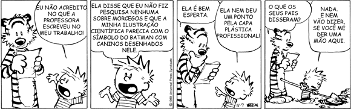

# PROVA — Camara_Embu-Guacu_2018_Agente_Legislativo_do_Gabinete_da_Presidencia

## 1. Análise geral da prova

- **Identificação:** Camara_Embu-Guacu_2018_Agente_Legislativo_do_Gabinete_da_Presidencia
- **Quantidade total de questões:** 50
- **Quantidade de textos de apoio (grupos):** 2
- **Quantidade de imagens:** 2
- **Quantidade de gráficos e tabelas:** incluídos nas imagens e no texto extraído, quando presentes no PDF original
- **Quantidade de grupos identificados:** 2
- **Quantidade de questões independentes:** 40
- **Questões que compartilham materiais:** texto-base das questões 31 a 36 → questões 31, 32, 33, 34, 35, 36; texto-base das questões 37 a 40 → questões 37, 38, 39, 40

### Transcrição integral da capa/instruções (conforme extraída do PDF)

> [!NOTE]
> Conteúdo integral das páginas anteriores à primeira questão, sem cortes.

> CÂMARA MUNICIPAL DE EMBU-GUAÇU
> ESTADO DE SÃO PAULO
> CONCURSO PÚBLICO DE PROVAS
> Nº 001/2018
> AGENTE LEGISLATIVO DO GABINETE DA
> PRESIDÊNCIA
> INSTRUÇÕES GERAIS:
> 01 - Esta Prova Teórica é composta de 50 (cinquenta) questões objetivas na forma de teste de
> múltipla escolha com 4 (quatro) alternativas cada, em que existe apenas uma alternativa correta
> para cada questão, versando sobre o programa constante do Edital do concurso.
> a) Responder às questões no GABARITO preenchendo apenas um quadrado, respectivo
> a cada questão, utilizando caneta esferográfica preta ou azul.
> b) As questões não respondidas, as que contenham mais de uma resposta (mesmo que
> uma esteja correta) e as com emenda ou rasura não serão consideradas ou
> computadas na contagem de pontos.
> 02 - A prova terá duração de 3 (três) horas.
> 03 - Ao término da prova o GABARITO E O CADERNO DE QUESTÕES deverão ser entregues
> ao Fiscal de Sala.
> 04 - Não se esquecer de assinar o GABARITO no local indicado.
> 05 - Os 2 (dois) últimos candidatos devem permanecer na sala até que o último candidato termine
> a prova.
> SUPORTE GESTÃO E RECURSOS HUMANOS LTDA

## 2. Questões agrupadas

### GRUPO 01 — Texto-base compartilhado pelas questões 31 a 36

**Questões relacionadas:** 31, 32, 33, 34, 35, 36.

#### QUESTÃO 31

⚠️ **Gabarito: oficial não disponível** (sem gabarito no acervo (ID 118 contém apenas a prova))

**Material de apoio:**

Leia o texto abaixo e responda as questões de 31 a 36.
Dormir pouco pode ser perigoso para o coração, mostra estudo
Dormir pouco pode ser perigoso para o coração, de acordo com um novo estudo realizado
por cientistas da Escola de Medicina da Universidade de Bonn (Alemanha). Os pesquisadores
avaliaram as condições cardíacas de médicos da própria equipe, que trabalham em turnos de 24
horas, e descobriram que a falta de sono aumenta a pressão sanguínea e sobrecarrega o
coração, aumentando a força dos batimentos (contratilidade) e sua frequência.
"Pela primeira vez, mostramos que uma privação de sono de curto prazo, no contexto dos
turnos de 24 horas pode levar a considerável aumento da pressão sanguínea, da contratilidade
e da frequência cardíaca", disse o autor principal do estudo, Daniel Kuetting, do Departamento
de Radiologia Diagnóstica da Universidade de Bonn.
Pessoas que trabalham em serviços de emergência, como médicos, policiais, bombeiros e
outros, são convocados com frequência para atuar em turnos de 24 horas. Já se sabia que esse
tipo de jornada estressante pode afetar diversos processos físicos, cognitivos e emocionais.
Mas, segundo Kuetting, o novo estudo é o primeiro a focar no impacto específico do turno
de 24 horas sobre as funções cardíacas. Os resultados da pesquisa foram apresentados na
manhã desta sexta-feira, 2, na reunião anual da Sociedade Radiológica da América do Norte
(RSNA).
Os estudos foram feitos com os próprios médicos da universidade. Foram selecionados 20
radiologistas saudáveis com idade média de 31,6 anos. Cada um dos participantes foi avaliado
com exames de ressonância magnética cardiovascular (RMC), com análise de deformação.
Os participantes foram submetidos aos exames antes e depois de seus turnos de 24 horas,
nos quais tiveram em média três horas de sono. Os cientistas também coletaram amostras de
sangue e de urina de todos eles e mediram a pressão sanguínea e a frequência cardíaca.
"A função cardíaca no contexto da privação de sono não havia ainda sido investigada com
análise de deformação em exames de RMC, que é o parâmetro mais minucioso de contratilidade
cardíaca", explicou Kuetting.
Após a privação de sono de curto prazo, além de apresentarem elevação considerável da
pressão sanguínea e da frequência e contratilidade cardíaca, os participantes também tiveram
um aumento importante dos níveis de hormônios da tireoide e do cortisol - um hormônio
liberado pelo organismo em resposta ao estresse.
Kuetting afirma que aumento da pressão sanguínea após a privação de sono não chegou a
valores que caracterizam pressão alta, mas ainda assim revelam uma conexão inequívoca entre

a privação de sono e o aumento da pressão. Ele afirma que será preciso realizar estudos com
grupos maiores para determinar possíveis efeitos de longo prazo da falta de sono.
"O estudo foi desenhado para investigar um caso real de privação de sono relacionada ao
trabalho. Não foi permitido que os participantes consumissem, durante o estudo, cafeína ou
alimentos e bebidas que contivessem teobromina, como chocolate, castanhas ou chá. Porém,
nós não levamos em conta fatores como estresse individual e estímulos ambientais", explicou
Kuetting.
http://noticias.uol.com.br/saude/ultimas-noticias/estado/2016/12/02/dormir-pouco-pode-
ser-perigoso-para-o-coracao-mostra-estudo.htm

**Enunciado:**

Após a leitura do texto, podemos afirmar que possui caráter:

**Alternativas:**

A) Opinativo.
B) Argumentativo.
C) Informativo.
D) Dissertativo-expositivo.

**Referências visuais:**

Nenhuma.

---

#### QUESTÃO 32

⚠️ **Gabarito: oficial não disponível** (sem gabarito no acervo (ID 118 contém apenas a prova))

**Material de apoio:**

Leia o texto abaixo e responda as questões de 31 a 36.
Dormir pouco pode ser perigoso para o coração, mostra estudo
Dormir pouco pode ser perigoso para o coração, de acordo com um novo estudo realizado
por cientistas da Escola de Medicina da Universidade de Bonn (Alemanha). Os pesquisadores
avaliaram as condições cardíacas de médicos da própria equipe, que trabalham em turnos de 24
horas, e descobriram que a falta de sono aumenta a pressão sanguínea e sobrecarrega o
coração, aumentando a força dos batimentos (contratilidade) e sua frequência.
"Pela primeira vez, mostramos que uma privação de sono de curto prazo, no contexto dos
turnos de 24 horas pode levar a considerável aumento da pressão sanguínea, da contratilidade
e da frequência cardíaca", disse o autor principal do estudo, Daniel Kuetting, do Departamento
de Radiologia Diagnóstica da Universidade de Bonn.
Pessoas que trabalham em serviços de emergência, como médicos, policiais, bombeiros e
outros, são convocados com frequência para atuar em turnos de 24 horas. Já se sabia que esse
tipo de jornada estressante pode afetar diversos processos físicos, cognitivos e emocionais.
Mas, segundo Kuetting, o novo estudo é o primeiro a focar no impacto específico do turno
de 24 horas sobre as funções cardíacas. Os resultados da pesquisa foram apresentados na
manhã desta sexta-feira, 2, na reunião anual da Sociedade Radiológica da América do Norte
(RSNA).
Os estudos foram feitos com os próprios médicos da universidade. Foram selecionados 20
radiologistas saudáveis com idade média de 31,6 anos. Cada um dos participantes foi avaliado
com exames de ressonância magnética cardiovascular (RMC), com análise de deformação.
Os participantes foram submetidos aos exames antes e depois de seus turnos de 24 horas,
nos quais tiveram em média três horas de sono. Os cientistas também coletaram amostras de
sangue e de urina de todos eles e mediram a pressão sanguínea e a frequência cardíaca.
"A função cardíaca no contexto da privação de sono não havia ainda sido investigada com
análise de deformação em exames de RMC, que é o parâmetro mais minucioso de contratilidade
cardíaca", explicou Kuetting.
Após a privação de sono de curto prazo, além de apresentarem elevação considerável da
pressão sanguínea e da frequência e contratilidade cardíaca, os participantes também tiveram
um aumento importante dos níveis de hormônios da tireoide e do cortisol - um hormônio
liberado pelo organismo em resposta ao estresse.
Kuetting afirma que aumento da pressão sanguínea após a privação de sono não chegou a
valores que caracterizam pressão alta, mas ainda assim revelam uma conexão inequívoca entre

a privação de sono e o aumento da pressão. Ele afirma que será preciso realizar estudos com
grupos maiores para determinar possíveis efeitos de longo prazo da falta de sono.
"O estudo foi desenhado para investigar um caso real de privação de sono relacionada ao
trabalho. Não foi permitido que os participantes consumissem, durante o estudo, cafeína ou
alimentos e bebidas que contivessem teobromina, como chocolate, castanhas ou chá. Porém,
nós não levamos em conta fatores como estresse individual e estímulos ambientais", explicou
Kuetting.
http://noticias.uol.com.br/saude/ultimas-noticias/estado/2016/12/02/dormir-pouco-pode-
ser-perigoso-para-o-coracao-mostra-estudo.htm

**Enunciado:**

De acordo com o texto, é correto afirmar que:

**Alternativas:**

A) O estudo foi realizado com equipe de bombeiros e policiais que trabalham em turnos de 24
horas.
B) Pessoas que dormem bastante tem um elevado número de hormônios do Cortisol.
C) O parâmetro mais minucioso de contratilidade cardíaca é o RMC.
D) O estudo afirma que o aumento da pressão devido à privação de sono, caracteriza-se pressão
alta.

**Referências visuais:**

Nenhuma.

---

#### QUESTÃO 33

⚠️ **Gabarito: oficial não disponível** (sem gabarito no acervo (ID 118 contém apenas a prova))

**Material de apoio:**

Leia o texto abaixo e responda as questões de 31 a 36.
Dormir pouco pode ser perigoso para o coração, mostra estudo
Dormir pouco pode ser perigoso para o coração, de acordo com um novo estudo realizado
por cientistas da Escola de Medicina da Universidade de Bonn (Alemanha). Os pesquisadores
avaliaram as condições cardíacas de médicos da própria equipe, que trabalham em turnos de 24
horas, e descobriram que a falta de sono aumenta a pressão sanguínea e sobrecarrega o
coração, aumentando a força dos batimentos (contratilidade) e sua frequência.
"Pela primeira vez, mostramos que uma privação de sono de curto prazo, no contexto dos
turnos de 24 horas pode levar a considerável aumento da pressão sanguínea, da contratilidade
e da frequência cardíaca", disse o autor principal do estudo, Daniel Kuetting, do Departamento
de Radiologia Diagnóstica da Universidade de Bonn.
Pessoas que trabalham em serviços de emergência, como médicos, policiais, bombeiros e
outros, são convocados com frequência para atuar em turnos de 24 horas. Já se sabia que esse
tipo de jornada estressante pode afetar diversos processos físicos, cognitivos e emocionais.
Mas, segundo Kuetting, o novo estudo é o primeiro a focar no impacto específico do turno
de 24 horas sobre as funções cardíacas. Os resultados da pesquisa foram apresentados na
manhã desta sexta-feira, 2, na reunião anual da Sociedade Radiológica da América do Norte
(RSNA).
Os estudos foram feitos com os próprios médicos da universidade. Foram selecionados 20
radiologistas saudáveis com idade média de 31,6 anos. Cada um dos participantes foi avaliado
com exames de ressonância magnética cardiovascular (RMC), com análise de deformação.
Os participantes foram submetidos aos exames antes e depois de seus turnos de 24 horas,
nos quais tiveram em média três horas de sono. Os cientistas também coletaram amostras de
sangue e de urina de todos eles e mediram a pressão sanguínea e a frequência cardíaca.
"A função cardíaca no contexto da privação de sono não havia ainda sido investigada com
análise de deformação em exames de RMC, que é o parâmetro mais minucioso de contratilidade
cardíaca", explicou Kuetting.
Após a privação de sono de curto prazo, além de apresentarem elevação considerável da
pressão sanguínea e da frequência e contratilidade cardíaca, os participantes também tiveram
um aumento importante dos níveis de hormônios da tireoide e do cortisol - um hormônio
liberado pelo organismo em resposta ao estresse.
Kuetting afirma que aumento da pressão sanguínea após a privação de sono não chegou a
valores que caracterizam pressão alta, mas ainda assim revelam uma conexão inequívoca entre

a privação de sono e o aumento da pressão. Ele afirma que será preciso realizar estudos com
grupos maiores para determinar possíveis efeitos de longo prazo da falta de sono.
"O estudo foi desenhado para investigar um caso real de privação de sono relacionada ao
trabalho. Não foi permitido que os participantes consumissem, durante o estudo, cafeína ou
alimentos e bebidas que contivessem teobromina, como chocolate, castanhas ou chá. Porém,
nós não levamos em conta fatores como estresse individual e estímulos ambientais", explicou
Kuetting.
http://noticias.uol.com.br/saude/ultimas-noticias/estado/2016/12/02/dormir-pouco-pode-
ser-perigoso-para-o-coracao-mostra-estudo.htm

**Enunciado:**

São palavras proparoxítonas encontradas no texto, exceto:

**Alternativas:**

A) Cardíaca.
B) Privação.
C) Médicos.
D) Magnética.

**Referências visuais:**

Nenhuma.

---

#### QUESTÃO 34

⚠️ **Gabarito: oficial não disponível** (sem gabarito no acervo (ID 118 contém apenas a prova))

**Material de apoio:**

Leia o texto abaixo e responda as questões de 31 a 36.
Dormir pouco pode ser perigoso para o coração, mostra estudo
Dormir pouco pode ser perigoso para o coração, de acordo com um novo estudo realizado
por cientistas da Escola de Medicina da Universidade de Bonn (Alemanha). Os pesquisadores
avaliaram as condições cardíacas de médicos da própria equipe, que trabalham em turnos de 24
horas, e descobriram que a falta de sono aumenta a pressão sanguínea e sobrecarrega o
coração, aumentando a força dos batimentos (contratilidade) e sua frequência.
"Pela primeira vez, mostramos que uma privação de sono de curto prazo, no contexto dos
turnos de 24 horas pode levar a considerável aumento da pressão sanguínea, da contratilidade
e da frequência cardíaca", disse o autor principal do estudo, Daniel Kuetting, do Departamento
de Radiologia Diagnóstica da Universidade de Bonn.
Pessoas que trabalham em serviços de emergência, como médicos, policiais, bombeiros e
outros, são convocados com frequência para atuar em turnos de 24 horas. Já se sabia que esse
tipo de jornada estressante pode afetar diversos processos físicos, cognitivos e emocionais.
Mas, segundo Kuetting, o novo estudo é o primeiro a focar no impacto específico do turno
de 24 horas sobre as funções cardíacas. Os resultados da pesquisa foram apresentados na
manhã desta sexta-feira, 2, na reunião anual da Sociedade Radiológica da América do Norte
(RSNA).
Os estudos foram feitos com os próprios médicos da universidade. Foram selecionados 20
radiologistas saudáveis com idade média de 31,6 anos. Cada um dos participantes foi avaliado
com exames de ressonância magnética cardiovascular (RMC), com análise de deformação.
Os participantes foram submetidos aos exames antes e depois de seus turnos de 24 horas,
nos quais tiveram em média três horas de sono. Os cientistas também coletaram amostras de
sangue e de urina de todos eles e mediram a pressão sanguínea e a frequência cardíaca.
"A função cardíaca no contexto da privação de sono não havia ainda sido investigada com
análise de deformação em exames de RMC, que é o parâmetro mais minucioso de contratilidade
cardíaca", explicou Kuetting.
Após a privação de sono de curto prazo, além de apresentarem elevação considerável da
pressão sanguínea e da frequência e contratilidade cardíaca, os participantes também tiveram
um aumento importante dos níveis de hormônios da tireoide e do cortisol - um hormônio
liberado pelo organismo em resposta ao estresse.
Kuetting afirma que aumento da pressão sanguínea após a privação de sono não chegou a
valores que caracterizam pressão alta, mas ainda assim revelam uma conexão inequívoca entre

a privação de sono e o aumento da pressão. Ele afirma que será preciso realizar estudos com
grupos maiores para determinar possíveis efeitos de longo prazo da falta de sono.
"O estudo foi desenhado para investigar um caso real de privação de sono relacionada ao
trabalho. Não foi permitido que os participantes consumissem, durante o estudo, cafeína ou
alimentos e bebidas que contivessem teobromina, como chocolate, castanhas ou chá. Porém,
nós não levamos em conta fatores como estresse individual e estímulos ambientais", explicou
Kuetting.
http://noticias.uol.com.br/saude/ultimas-noticias/estado/2016/12/02/dormir-pouco-pode-
ser-perigoso-para-o-coracao-mostra-estudo.htm

**Enunciado:**

Leia o trecho abaixo e assinale a informação incorreta.
Mas, segundo Kuetting, o novo estudo é o primeiro a focar no impacto específico do turno de 24
horas sobre as funções cardíacas. Os resultados da pesquisa foram apresentados na manhã
desta sexta-feira, 2, na reunião anual da Sociedade Radiológica da América do Norte (RSNA).

**Alternativas:**

A) Em “novo estudo” há o pressuposto de que já houve outros estudos.
B) No 2º parágrafo, podemos destacar dois adjuntos adverbiais.
C) Em “específico” contém o pressuposto que outros estudos já focaram o impacto do turno,
mas não o de 24 horas.
D) A expressão entre parênteses é uma abreviação.

**Referências visuais:**

Nenhuma.

---

#### QUESTÃO 35

⚠️ **Gabarito: oficial não disponível** (sem gabarito no acervo (ID 118 contém apenas a prova))

**Material de apoio:**

Leia o texto abaixo e responda as questões de 31 a 36.
Dormir pouco pode ser perigoso para o coração, mostra estudo
Dormir pouco pode ser perigoso para o coração, de acordo com um novo estudo realizado
por cientistas da Escola de Medicina da Universidade de Bonn (Alemanha). Os pesquisadores
avaliaram as condições cardíacas de médicos da própria equipe, que trabalham em turnos de 24
horas, e descobriram que a falta de sono aumenta a pressão sanguínea e sobrecarrega o
coração, aumentando a força dos batimentos (contratilidade) e sua frequência.
"Pela primeira vez, mostramos que uma privação de sono de curto prazo, no contexto dos
turnos de 24 horas pode levar a considerável aumento da pressão sanguínea, da contratilidade
e da frequência cardíaca", disse o autor principal do estudo, Daniel Kuetting, do Departamento
de Radiologia Diagnóstica da Universidade de Bonn.
Pessoas que trabalham em serviços de emergência, como médicos, policiais, bombeiros e
outros, são convocados com frequência para atuar em turnos de 24 horas. Já se sabia que esse
tipo de jornada estressante pode afetar diversos processos físicos, cognitivos e emocionais.
Mas, segundo Kuetting, o novo estudo é o primeiro a focar no impacto específico do turno
de 24 horas sobre as funções cardíacas. Os resultados da pesquisa foram apresentados na
manhã desta sexta-feira, 2, na reunião anual da Sociedade Radiológica da América do Norte
(RSNA).
Os estudos foram feitos com os próprios médicos da universidade. Foram selecionados 20
radiologistas saudáveis com idade média de 31,6 anos. Cada um dos participantes foi avaliado
com exames de ressonância magnética cardiovascular (RMC), com análise de deformação.
Os participantes foram submetidos aos exames antes e depois de seus turnos de 24 horas,
nos quais tiveram em média três horas de sono. Os cientistas também coletaram amostras de
sangue e de urina de todos eles e mediram a pressão sanguínea e a frequência cardíaca.
"A função cardíaca no contexto da privação de sono não havia ainda sido investigada com
análise de deformação em exames de RMC, que é o parâmetro mais minucioso de contratilidade
cardíaca", explicou Kuetting.
Após a privação de sono de curto prazo, além de apresentarem elevação considerável da
pressão sanguínea e da frequência e contratilidade cardíaca, os participantes também tiveram
um aumento importante dos níveis de hormônios da tireoide e do cortisol - um hormônio
liberado pelo organismo em resposta ao estresse.
Kuetting afirma que aumento da pressão sanguínea após a privação de sono não chegou a
valores que caracterizam pressão alta, mas ainda assim revelam uma conexão inequívoca entre

a privação de sono e o aumento da pressão. Ele afirma que será preciso realizar estudos com
grupos maiores para determinar possíveis efeitos de longo prazo da falta de sono.
"O estudo foi desenhado para investigar um caso real de privação de sono relacionada ao
trabalho. Não foi permitido que os participantes consumissem, durante o estudo, cafeína ou
alimentos e bebidas que contivessem teobromina, como chocolate, castanhas ou chá. Porém,
nós não levamos em conta fatores como estresse individual e estímulos ambientais", explicou
Kuetting.
http://noticias.uol.com.br/saude/ultimas-noticias/estado/2016/12/02/dormir-pouco-pode-
ser-perigoso-para-o-coracao-mostra-estudo.htm

**Enunciado:**

Os estudos foram feitos com os próprios médicos da universidade. Foram selecionados 20
radiologistas saudáveis com idade média de 31,6 anos. Cada um dos participantes foi avaliado
com exames de ressonância magnética cardiovascular (RMC), com análise de deformação.
Os verbos, no trecho acima, encontram-se na voz:

**Alternativas:**

A) ativa.
B) reflexiva.
C) passiva.
D) ativa e reflexiva.

**Referências visuais:**

Nenhuma.

---

#### QUESTÃO 36

⚠️ **Gabarito: oficial não disponível** (sem gabarito no acervo (ID 118 contém apenas a prova))

**Material de apoio:**

Leia o texto abaixo e responda as questões de 31 a 36.
Dormir pouco pode ser perigoso para o coração, mostra estudo
Dormir pouco pode ser perigoso para o coração, de acordo com um novo estudo realizado
por cientistas da Escola de Medicina da Universidade de Bonn (Alemanha). Os pesquisadores
avaliaram as condições cardíacas de médicos da própria equipe, que trabalham em turnos de 24
horas, e descobriram que a falta de sono aumenta a pressão sanguínea e sobrecarrega o
coração, aumentando a força dos batimentos (contratilidade) e sua frequência.
"Pela primeira vez, mostramos que uma privação de sono de curto prazo, no contexto dos
turnos de 24 horas pode levar a considerável aumento da pressão sanguínea, da contratilidade
e da frequência cardíaca", disse o autor principal do estudo, Daniel Kuetting, do Departamento
de Radiologia Diagnóstica da Universidade de Bonn.
Pessoas que trabalham em serviços de emergência, como médicos, policiais, bombeiros e
outros, são convocados com frequência para atuar em turnos de 24 horas. Já se sabia que esse
tipo de jornada estressante pode afetar diversos processos físicos, cognitivos e emocionais.
Mas, segundo Kuetting, o novo estudo é o primeiro a focar no impacto específico do turno
de 24 horas sobre as funções cardíacas. Os resultados da pesquisa foram apresentados na
manhã desta sexta-feira, 2, na reunião anual da Sociedade Radiológica da América do Norte
(RSNA).
Os estudos foram feitos com os próprios médicos da universidade. Foram selecionados 20
radiologistas saudáveis com idade média de 31,6 anos. Cada um dos participantes foi avaliado
com exames de ressonância magnética cardiovascular (RMC), com análise de deformação.
Os participantes foram submetidos aos exames antes e depois de seus turnos de 24 horas,
nos quais tiveram em média três horas de sono. Os cientistas também coletaram amostras de
sangue e de urina de todos eles e mediram a pressão sanguínea e a frequência cardíaca.
"A função cardíaca no contexto da privação de sono não havia ainda sido investigada com
análise de deformação em exames de RMC, que é o parâmetro mais minucioso de contratilidade
cardíaca", explicou Kuetting.
Após a privação de sono de curto prazo, além de apresentarem elevação considerável da
pressão sanguínea e da frequência e contratilidade cardíaca, os participantes também tiveram
um aumento importante dos níveis de hormônios da tireoide e do cortisol - um hormônio
liberado pelo organismo em resposta ao estresse.
Kuetting afirma que aumento da pressão sanguínea após a privação de sono não chegou a
valores que caracterizam pressão alta, mas ainda assim revelam uma conexão inequívoca entre

a privação de sono e o aumento da pressão. Ele afirma que será preciso realizar estudos com
grupos maiores para determinar possíveis efeitos de longo prazo da falta de sono.
"O estudo foi desenhado para investigar um caso real de privação de sono relacionada ao
trabalho. Não foi permitido que os participantes consumissem, durante o estudo, cafeína ou
alimentos e bebidas que contivessem teobromina, como chocolate, castanhas ou chá. Porém,
nós não levamos em conta fatores como estresse individual e estímulos ambientais", explicou
Kuetting.
http://noticias.uol.com.br/saude/ultimas-noticias/estado/2016/12/02/dormir-pouco-pode-
ser-perigoso-para-o-coracao-mostra-estudo.htm

**Enunciado:**

Os pesquisadores avaliaram as condições cardíacas de médicos da própria equipe, que
trabalham em turnos de 24 horas, e descobriram que a falta de sono aumenta a pressão
sanguínea e sobrecarrega o coração, aumentando a força dos batimentos (contratilidade) e sua
frequência.
Ao alterar o termo sublinhado para “grupo de pesquisadores”, fazendo as alterações
necessárias, como fica o trecho?

**Alternativas:**

A) O grupo de pesquisadores avaliou as condições cardíacas de médicos da própria equipe, que
trabalham em turnos de 24 horas, e descobriu que a falta de sono aumenta a pressão sanguínea
e sobrecarrega o coração, aumentando a força dos batimentos (contratilidade) e sua frequência.
B) O grupo de pesquisadores avaliou as condições cardíacas de médicos da própria equipe, que
trabalha em turnos de 24 horas, e descobriu que a falta de sono aumenta a pressão sanguínea
e sobrecarrega o coração, aumentando a força dos batimentos (contratilidade) e sua frequência.
C) O grupo de pesquisadores avaliou as condições cardíacas de médicos da própria equipe, que
trabalha em turnos de 24 horas, e descobriram que a falta de sono aumenta a pressão sanguínea
e sobrecarrega o coração, aumentando a força dos batimentos (contratilidade) e sua frequência.
D) O grupo de pesquisadores avaliou as condições cardíacas de médicos da própria equipe, que
trabalham em turnos de 24 horas, e descobriram que a falta de sono aumenta a pressão
sanguínea e sobrecarrega o coração, aumentando a força dos batimentos (contratilidade) e sua
frequência.
Observe a tirinha de Calvin e responda às questões 37 a 40.
http://67.media.tumblr.com/tumblr_m6jw3j21mT1rr7w5jo1_500.jpg

**Referências visuais:**

Nenhuma.

---

### GRUPO 02 — Texto-base compartilhado pelas questões 37 a 40

**Questões relacionadas:** 37, 38, 39, 40.

#### QUESTÃO 37

⚠️ **Gabarito: oficial não disponível** (sem gabarito no acervo (ID 118 contém apenas a prova))

**Material de apoio:**

Observe a tirinha de Calvin e responda às questões 37 a 40.

**Enunciado:**

A palavra “que” no último quadro tem a função de:

**Alternativas:**

A) Pronome adjetivo.
B) Conjunção.
C) Pronome interrogativo.
D) Pronome relativo.

**Referências visuais:**

---

#### QUESTÃO 38

⚠️ **Gabarito: oficial não disponível** (sem gabarito no acervo (ID 118 contém apenas a prova))

**Material de apoio:**

Observe a tirinha de Calvin e responda às questões 37 a 40.

**Enunciado:**

Podemos encontrar a linguagem conotativa em:

**Alternativas:**

A) Se você me der uma mão aqui.
B) Eu não acredito no que a professora escreveu no meu trabalho.
C) Ela é bem esperta.
D) O que os seus pais disseram?

**Referências visuais:**

---

#### QUESTÃO 39

⚠️ **Gabarito: oficial não disponível** (sem gabarito no acervo (ID 118 contém apenas a prova))

**Material de apoio:**

Observe a tirinha de Calvin e responda às questões 37 a 40.

**Enunciado:**

“Ela é bem esperta”
A fala acima denota que:

**Alternativas:**

A) A professora não se deixou enganar.
B) A professora é mais inteligente que Calvin.
C) O Tigre estava defendendo a professora.
D) A professora não entendeu o trabalho de Calvin.

**Referências visuais:**

---

#### QUESTÃO 40

⚠️ **Gabarito: oficial não disponível** (sem gabarito no acervo (ID 118 contém apenas a prova))

**Material de apoio:**

Observe a tirinha de Calvin e responda às questões 37 a 40.

**Enunciado:**

De acordo com texto, podemos inferir que:

**Alternativas:**

A) A professora não leu o trabalho de Kalvin.
B) Kalvin tirou a nota 0.
C) Os pais de Kalvin ficaram bravos com o trabalho dele.
D) O tigre ajudou Kalvin a fazer o trabalho.

**Referências visuais:**

---

## 3. Questões independentes

#### QUESTÃO 01

⚠️ **Gabarito: oficial não disponível** (sem gabarito no acervo (ID 118 contém apenas a prova))

**Enunciado:**

De acordo com a Lei Orgânica de Embu-Guaçu/SP, são símbolos do Município:
I. A Bandeira.
II. O Brasão de Espadas.
III. O Hino.
IV. A chave do Município.
Está correto o que se afirma em:

**Alternativas:**

A) Somente I e III.
B) Somente I e IV.
C) Somente I, II e III.
D) I, II, III e IV.

**Referências visuais:**

Nenhuma.

---

#### QUESTÃO 02

⚠️ **Gabarito: oficial não disponível** (sem gabarito no acervo (ID 118 contém apenas a prova))

**Enunciado:**

Segundo consta o artigo 2º da Lei Orgânica de Embu-Guaçu/SP, o Governo Municipal é
exercido pelo (a):

**Alternativas:**

A) Câmara dos Deputados e pelo Presidente.
B) Prefeito e assessores.
C) Câmara de Vereadores e pelo Prefeito.
D) Assessores, vereadores e agentes Legislativos.

**Referências visuais:**

Nenhuma.

---

#### QUESTÃO 03

⚠️ **Gabarito: oficial não disponível** (sem gabarito no acervo (ID 118 contém apenas a prova))

**Enunciado:**

Com base na Lei nº 8.666, de 21 de junho de 1993, assinale a alternativa incorreta:

**Alternativas:**

A) Não será computado como valor da obra ou serviço, para fins de julgamento das propostas
de preços, a atualização monetária das obrigações de pagamento, desde a data final de cada
período de aferição até a do respectivo pagamento, que será calculada pelos mesmos critérios
estabelecidos obrigatoriamente no ato convocatório.
B) A execução das obras e dos serviços deve programar-se, sempre, em sua totalidade, previstos
seus custos atual e final e considerados os prazos de sua execução.
C) É legítimo a realização de licitação cujo objeto inclua bens e serviços sem similaridade ou de
marcas, características e especificações exclusivas.
D) Qualquer cidadão poderá requerer à Administração Pública os quantitativos das obras e
preços unitários de determinada obra executada.

**Referências visuais:**

Nenhuma.

---

#### QUESTÃO 04

⚠️ **Gabarito: oficial não disponível** (sem gabarito no acervo (ID 118 contém apenas a prova))

**Enunciado:**

O artigo 15 da Lei Orgânica de Embu-Guaçu/SP, afirma que o Vereador poderá licenciar-se
em casos específicos.
Leia as alternativas abaixo e indique qual (s) condiz (em) com os casos descritos na lei:
I. Para tratar de interesses particulares, por prazo indeterminado, podendo reassumir o exercício
do mandato antes do término da licença.
II. Por moléstia devidamente comprovada ou por licença-gestante, com a homologação do
serviço médico municipal.
III. Para desempenhar missões temporárias de caráter cultural ou de interesse do Município.

**Alternativas:**

A) Somente I.
B) Somente II.
C) Somente I e III.
D) Somente II e III.

**Referências visuais:**

Nenhuma.

---

#### QUESTÃO 05

⚠️ **Gabarito: oficial não disponível** (sem gabarito no acervo (ID 118 contém apenas a prova))

**Enunciado:**

De acordo com o artigo 1 da Lei Complementar nº 88 de 05/01/2012 de Embu-Guaçu/SP, a
estrutura organizacional da Câmara Municipal é composta por quadro de pessoal específico.
Observe as opções abaixo. Depois, assinale a alternativa que contenha apenas os quadros de
pessoal expressamente previstos em lei:
I. Quadro Efetivo.
II. Quadro Itinerante.
III. Quadro Comissionado.
IV. Quadro Terceirizado.
V. Quadro Especial.

**Alternativas:**

A) Somente I, II, III e IV.
B) Somente II, IV e V.
C) Somente I, III e V.
D) I, II, III, IV e V.

**Referências visuais:**

Nenhuma.

---

#### QUESTÃO 06

⚠️ **Gabarito: oficial não disponível** (sem gabarito no acervo (ID 118 contém apenas a prova))

**Enunciado:**

Art. 6º - Ao Município compete legislar a tudo quanto respeite ao seu interesse peculiar,
tendo como objetivo o bem-estar de sua população e o pleno desenvolvimento de suas funções
sociais, cabendo-lhe, privativamente, entre outras, as seguintes atribuições:
I. Dispor sobre a concessão, permissão e autorização de serviços públicos locais.
II. Organizar e prestar, prioritariamente, por administração direta ou sob regime de concessão
ou permissão, os serviços públicos de interesse local, inclusive os de transportes coletivos, que
têm caráter essencial.
III. Promover, no que couber, adequado ordenamento territorial, mediante planejamento e
controle do uso do planejamento e da ocupação do solo urbano.
De acordo com o que afirma o artigo 6º da Lei Orgânica de Embu-Guaçu/SP, está correto o que
se afirma em:

**Alternativas:**

A) Somente I e II.
B) Somente I e III.
C) Somente II e III.
D) I, II e III.

**Referências visuais:**

Nenhuma.

---

#### QUESTÃO 07

⚠️ **Gabarito: oficial não disponível** (sem gabarito no acervo (ID 118 contém apenas a prova))

**Enunciado:**

Segundo a Lei nº 8.666, de 21 de junho de 1993, que institui normas para licitações e
contratos da Administração Pública, um Projeto Básico é o conjunto de elementos necessários
e suficientes, com nível de precisão adequado, para caracterizar a obra ou serviço, ou complexo
de obras ou serviços objeto da licitação, elaborado com base nas indicações dos estudos
técnicos preliminares, que assegurem a viabilidade técnica e o adequado tratamento do impacto
ambiental do empreendimento, e que possibilite a avaliação do custo da obra e a definição dos
métodos e do prazo de execução e deve conter elementos específicos.
Leia as opções abaixo e depois assinale a alternativa que contenha somente aquelas que são
essencialmente elementos de um Projeto Básico:
I. Orçamento detalhado do custo global da obra, fundamentado em quantitativos de serviços e
fornecimentos propriamente avaliados.
II. Identificação dos tipos de serviços a executar e de materiais e equipamentos a incorporar à
obra, bem como suas especificações que assegurem os melhores resultados para o
empreendimento, sem frustrar o caráter competitivo para a sua execução.
III. Soluções técnicas globais e localizadas, suficientemente detalhadas, de forma a minimizar a
necessidade de reformulação ou de variantes durante as fases de elaboração do projeto
executivo e de realização das obras e montagem.

**Alternativas:**

A) Somente I.
B) Somente I e III.
C) Somente II e III.
D) I, II e III.

**Referências visuais:**

Nenhuma.

---

#### QUESTÃO 08

⚠️ **Gabarito: oficial não disponível** (sem gabarito no acervo (ID 118 contém apenas a prova))

**Enunciado:**

Art. 159 - A União entregará do produto da arrecadação dos impostos sobre renda e
proventos de qualquer natureza e sobre produtos industrializados, 49% (quarenta e nove por
cento), na seguinte forma:
( ) Vinte e um inteiros e cinco décimos por cento ao Fundo de Participação dos Municípios.
( ) Vinte e dois inteiros e cinco décimos por cento ao Fundo de Participação dos Estados e do
Distrito Federal.
( ) Três por cento, para aplicação em programas de financiamento ao setor produtivo das
Regiões Sul, Sudeste e Centro-Oeste, através de suas instituições financeiras de caráter regional,
de acordo com os planos regionais de desenvolvimento, ficando assegurada ao semiárido do
Sudeste a metade dos recursos destinados à Região, na forma que a lei estabelecer.
( ) Um por cento ao Fundo de Participação dos Municípios, que será entregue no primeiro
decêndio do mês de dezembro de cada ano.
( ) 1% (um por cento) ao Fundo de Participação dos Municípios, que será entregue no primeiro
decêndio do mês de julho de cada ano.
Leia as alternativas acima e, em consonância com a Constituição da República Federativa do
Brasil – 1988, indique se estão corretas (C = correto) ou incorretas (I = incorreto):

**Alternativas:**

A) C, I, C, C, I.
B) C, C, I, C, I.
C) I, I, I, C, C.
D) C, C, C, I, C.

**Referências visuais:**

Nenhuma.

---

#### QUESTÃO 09

⚠️ **Gabarito: oficial não disponível** (sem gabarito no acervo (ID 118 contém apenas a prova))

**Enunciado:**

De acordo com a Lei Complementar nº 88 de 05/01/2012 de Embu-Guaçu/SP, assinale a
alternativa que não faz parte da composição da Divisão de Contabilidade, Finanças e Orçamento:

**Alternativas:**

A) Técnico Legislativo.
B) Agente de Serviço Administrativo Financeiro.
C) Chefe de Divisão de Contabilidade, Finanças e Orçamento.
D) Agente de Serviço de Recursos Humanos e Folha de Pagamentos.

**Referências visuais:**

Nenhuma.

---

#### QUESTÃO 10

⚠️ **Gabarito: oficial não disponível** (sem gabarito no acervo (ID 118 contém apenas a prova))

**Enunciado:**

O artigo 101 da Lei Orgânica de Embu-Guaçu/SP diz que a administração municipal será
exercida pelo Prefeito com auxílio de secretarias específicas.
Abaixo estão algumas das secretarias apontadas pela lei. Porém, uma delas está errada, indique
qual é:

**Alternativas:**

A) Secretaria da Indústria, Comércio e Turismo.
B) Secretaria da Habitação.
C) Secretaria de Comunicação.
D) Secretaria da Saúde.

**Referências visuais:**

Nenhuma.

---

#### QUESTÃO 11

⚠️ **Gabarito: oficial não disponível** (sem gabarito no acervo (ID 118 contém apenas a prova))

**Enunciado:**

A Lei nº 8.666, de 21 de junho de 1993, que institui normas para licitações e contratos da
Administração Pública, em seu artigo 12, afirma que nos projetos básicos e projetos executivos
de obras e serviços serão considerados principalmente os seguintes requisitos:
( ) Funcionalidade e adequação ao interesse privado.
( ) Segurança.
( ) Facilidade na execução, conservação e operação, sem prejuízo da durabilidade da obra ou
do serviço.
Leia as opções acima e depois assinale a alternativa que indica, se elas são verdadeiras (V) ou
falsas (F):

**Alternativas:**

A) V, F, V.
B) F, V, V.
C) V, V, V.
D) F, F, V.

**Referências visuais:**

Nenhuma.

---

#### QUESTÃO 12

⚠️ **Gabarito: oficial não disponível** (sem gabarito no acervo (ID 118 contém apenas a prova))

**Enunciado:**

Segundo o documento do Instituto Brasileiro de Administração Municipal – O vereador e a
câmara municipal, as atribuições da Câmara concentram-se em quais funções?

**Alternativas:**

A) Legislativa e fiscalizadora.
B) Executiva e administrativa.
C) Judiciária e competitiva.
D) Parlamentarista e indutiva.

**Referências visuais:**

Nenhuma.

---

#### QUESTÃO 13

⚠️ **Gabarito: oficial não disponível** (sem gabarito no acervo (ID 118 contém apenas a prova))

**Enunciado:**

De acordo com o documento Instituto Brasileiro de Administração Municipal – O vereador e
a câmara municipal, o termo “sessão” pode ser empregado para definir dois tipos de reunião.
Quais são eles?

**Alternativas:**

A) A Sessão Executiva e a Sessão do Plenário.
B) A Sessão Judiciária e a Sessão do Planalto.
C) A Sessão Parlamentarista e a Sessão do Município.
D) A Sessão Legislativa e a Sessão da Câmara.

**Referências visuais:**

Nenhuma.

---

#### QUESTÃO 14

⚠️ **Gabarito: oficial não disponível** (sem gabarito no acervo (ID 118 contém apenas a prova))

**Enunciado:**

“Art. 11 - Os servidores da Divisão de Serviços Técnicos Legislativos, convocados pelo
Presidente para prestar serviços no Plenário, terão direito a ______________ de gratificação do
vencimento”. (Lei Complementar nº 88 de 05/01/2012 de Embu-Guaçu/SP).
Assinale a alternativa que corresponda, de forma correta, à fração de gratificação especificada
no artigo acima:

**Alternativas:**

A) 1/2 (um meio).
B) 1/3 (um terço).
C) 1/4 (um quarto).
D) 1/5 (um quinto).

**Referências visuais:**

Nenhuma.

---

#### QUESTÃO 15

⚠️ **Gabarito: oficial não disponível** (sem gabarito no acervo (ID 118 contém apenas a prova))

**Enunciado:**

Com base na Constituição da República Federativa do Brasil – 1988, assinale a alternativa
incorreta:

**Alternativas:**

A) A faixa de até cento e cinquenta quilômetros de largura, ao longo das fronteiras terrestres,
designada como faixa de retenção, é considerada fundamental para evitar a entrada de pessoas
que estejam doentes.
B) A União, os Estados, o Distrito Federal e os Municípios instituirão, no âmbito de sua
competência, regime jurídico único e planos de carreira para os servidores da administração
pública direta, das autarquias e das fundações públicas.
C) Os Poderes Executivo, Legislativo e Judiciário publicarão anualmente os valores do subsídio e
da remuneração dos cargos e empregos públicos.
D) O número de Deputados à Assembleia Legislativa corresponderá ao triplo da representação
do Estado na Câmara dos Deputados e, atingido o número de trinta e seis, será acrescido de
tantos quantos forem os Deputados Federais acima de doze.

**Referências visuais:**

Nenhuma.

---

#### QUESTÃO 16

⚠️ **Gabarito: oficial não disponível** (sem gabarito no acervo (ID 118 contém apenas a prova))

**Enunciado:**

Segundo o documento intitulado O poder legislativo municipal no Brasil: papel institucional,
desafios e perspectivas, nos termos da Lei Orgânica municipal e de seu Regimento Interno, a
câmara é dividida em diversos órgãos com competências específicas. Dentre essas divisões,
destacam-se:

**Alternativas:**

A) Turma, cadeira e sessões.
B) Tribunal, cúpula e reuniões.
C) Plenário, mesa e comissões.
D) Conselho, bancada e pautas.

**Referências visuais:**

Nenhuma.

---

#### QUESTÃO 17

⚠️ **Gabarito: oficial não disponível** (sem gabarito no acervo (ID 118 contém apenas a prova))

**Enunciado:**

De acordo com artigo 133 da Lei Orgânica de Embu-Guaçu/SP, licença à gestante, sem
prejuízo do emprego e da remuneração, terá a duração de:

**Alternativas:**

A) cento e vinte dias.
B) noventa dias.
C) cento e quinze dias.
D) trinta dias.

**Referências visuais:**

Nenhuma.

---

#### QUESTÃO 18

⚠️ **Gabarito: oficial não disponível** (sem gabarito no acervo (ID 118 contém apenas a prova))

**Enunciado:**

Com base na Lei nº 8.159 de 1991 (In: Manual de gestão de documentos de arquivo da
Universidade de Brasília), indique a alternativa incorreta:

**Alternativas:**

A) Competem aos arquivos do Poder Legislativo Federal a gestão e o recolhimento dos
documentos produzidos e recebidos pelo Poder Legislativo Federal no exercício das suas
funções, bem como preservar e facultar o acesso aos documentos sob sua guarda.
B) Compete ao Arquivo Nacional a gestão e o recolhimento dos documentos produzidos e
recebidos pelo Poder Executivo Federal, bem como preservar e facultar o acesso aos
documentos sob sua guarda, e acompanhar e implementar a política nacional de arquivos.
C) Os arquivos públicos são os conjuntos de documentos produzidos e recebidos, no exercício
de suas atividades, por órgãos públicos e privados de âmbito federal, estadual, do Distrito
Federal e municipal em decorrência de suas funções administrativas, legislativas e judiciárias.
D) Fica resguardado o direito de indenização pelo dano material ou moral decorrente da violação
do sigilo, sem prejuízo das ações penal, civil e administrativa.

**Referências visuais:**

Nenhuma.

---

#### QUESTÃO 19

⚠️ **Gabarito: oficial não disponível** (sem gabarito no acervo (ID 118 contém apenas a prova))

**Enunciado:**

Art. 13 - Para os fins da Lei nº 8.666, de 21 de junho de 1993, que institui normas para
licitações e contratos da Administração Pública, consideram-se serviços técnicos profissionais
especializados os trabalhos relativos a:
( ) Fiscalização, supervisão ou gerenciamento de obras ou serviços.
( ) Restauração de obras de arte e bens de valor histórico.
( ) Estudos técnicos, planejamentos e projetos básicos ou executivos.
Leia as opções acima e depois assinale a alternativa que indica, de forma correta, se elas são
verdadeiras (V) ou falsas (F):

**Alternativas:**

A) V, F, V.
B) V, V, V.
C) F, F, F.
D) F, V, V.

**Referências visuais:**

Nenhuma.

---

#### QUESTÃO 20

⚠️ **Gabarito: oficial não disponível** (sem gabarito no acervo (ID 118 contém apenas a prova))

**Enunciado:**

Em conformidade com a Lei Orgânica de Embu-Guaçu/SP, assinale a alternativa que
apresenta erro:

**Alternativas:**

A) O Município, dentro de sua competência, organizará a ordem econômica e social, conciliando
a liberdade de iniciativa com os superiores interesses da coletividade.
B) Compete ao Município, isoladamente ou em convênio, promover programas de construção
de moradias populares, de melhoria das condições habitacionais e de saneamento básico.
C) O Poder Executivo publicará, até trinta dias após o encerramento de cada bimestre, relatório
resumido da execução orçamentária.
D) Será permitida a deposição final de resíduos radioativos que não pertençam a atividades no
Município.

**Referências visuais:**

Nenhuma.

---

#### QUESTÃO 21

⚠️ **Gabarito: oficial não disponível** (sem gabarito no acervo (ID 118 contém apenas a prova))

**Enunciado:**

Analise as afirmações a seguir:
I. O padrão de comunicação USB 1.0 foi lançado em janeiro de 1996 e tem uma taxa de
transferência teórica máxima de 12 Mbit/s.
II. O padrão de comunicação USB 2.0 foi lançado em abril de 2000 e tem uma taxa de
transferência teórica máxima de 480 Mbit/s.
III. O padrão de comunicação USB 3.0 foi lançado em novembro de 2008 e tem uma taxa de
transferência teórica máxima de 5Gbit/s.

**Alternativas:**

A) Apenas I está correta.
B) Apenas III está correta.
C) Apenas I e II estão corretas.
D) Todas as informações estão corretas.

**Referências visuais:**

Nenhuma.

---

#### QUESTÃO 22

⚠️ **Gabarito: oficial não disponível** (sem gabarito no acervo (ID 118 contém apenas a prova))

**Enunciado:**

Baseado nos padrões de energia USB, um dispositivo certificado na especificação Power
Delivery 2.0 Type-A/B/C pode, em corrente, voltagem e potência, suportar até qual valor?

**Alternativas:**

A) 1A,10V, 5W.
B) 1,5A, 10V, 50W.
C) 2A, 20V, 75W.
D) 5A, 20V, 100W.

**Referências visuais:**

Nenhuma.

---

#### QUESTÃO 23

⚠️ **Gabarito: oficial não disponível** (sem gabarito no acervo (ID 118 contém apenas a prova))

**Enunciado:**

Considere a imagem abaixo e informe a qual tipo de conexão USB ela pertence:
Fonte: https://en.wikipedia.org/

**Alternativas:**

A) Type-A.
B) Type-B.
C) Type-C.
D) Type-D.

**Referências visuais:**

---

#### QUESTÃO 24

⚠️ **Gabarito: oficial não disponível** (sem gabarito no acervo (ID 118 contém apenas a prova))

**Enunciado:**

O padrão 1000BASE‑T de cabos de par trançado para ethernet possui taxas máximas de
velocidade e distância entre pontos. Assinale abaixo quais essas máximas:

**Alternativas:**

A) 1000 Mb/s e 100 m.
B) 1000 Mb/s e 100 cm.
C) 1000 MB/s e 100 m.
D) 1000 MB/s e 1000 m.

**Referências visuais:**

Nenhuma.

---

#### QUESTÃO 25

⚠️ **Gabarito: oficial não disponível** (sem gabarito no acervo (ID 118 contém apenas a prova))

**Enunciado:**

Das opções abaixo, assinale qual não é um navegador de Internet:

**Alternativas:**

A) Edge.
B) Opera.
C) Bottlecap.
D) Netscape.

**Referências visuais:**

Nenhuma.

---

#### QUESTÃO 26

⚠️ **Gabarito: oficial não disponível** (sem gabarito no acervo (ID 118 contém apenas a prova))

**Enunciado:**

O BitTorrent é um protocolo de comunicação que tem como objetivo:

**Alternativas:**

A) o compartilhamento de arquivos.
B) a telefonia via Internet.
C) melhorar a velocidade da Internet.
D) enviar e receber e-mails.

**Referências visuais:**

Nenhuma.

---

#### QUESTÃO 27

⚠️ **Gabarito: oficial não disponível** (sem gabarito no acervo (ID 118 contém apenas a prova))

**Enunciado:**

Assinale a alternativa abaixo que contém o nome do protocolo de rede utilizado para
transmissão de arquivos de computador entre um cliente e um servidor em uma rede de
computadores:

**Alternativas:**

A) Ethernet.
B) BitTorrent.
C) FTP.
D) VoIP.

**Referências visuais:**

Nenhuma.

---

#### QUESTÃO 28

⚠️ **Gabarito: oficial não disponível** (sem gabarito no acervo (ID 118 contém apenas a prova))

**Enunciado:**

Assinale abaixo o nome do programa geralmente utilizado para atacar computadores de
forma maliciosa, que é capaz de se replicar automaticamente enviando cópias de si mesmo
entre computadores de uma mesma rede:

**Alternativas:**

A) worm.
B) trojan.
C) spyware.
D) botnet.

**Referências visuais:**

Nenhuma.

---

#### QUESTÃO 29

⚠️ **Gabarito: oficial não disponível** (sem gabarito no acervo (ID 118 contém apenas a prova))

**Enunciado:**

O Firewall tem como objetivo:

**Alternativas:**

A) bloquear conexões indesejadas com a Internet.
B) detectar e eliminar programas maliciosos de um computador.
C) realizar a configuração automática da rede em computadores.
D) instalar ou desinstalar drivers em computadores.

**Referências visuais:**

Nenhuma.

---

#### QUESTÃO 30

⚠️ **Gabarito: oficial não disponível** (sem gabarito no acervo (ID 118 contém apenas a prova))

**Enunciado:**

Um aplicativo que é desenvolvido sob uma licença open source se caracteriza por:

**Alternativas:**

A) ter seus códigos abertos, mas não disponíveis ao público.
B) serem distribuídos apenas mediante a pagamento de tarifas.
C) ter seu desenvolvimento de forma descentralizada, encorajando a colaboração.
D) não serem comercialmente rentáveis.
Leia o texto abaixo e responda as questões de 31 a 36.
Dormir pouco pode ser perigoso para o coração, mostra estudo
Dormir pouco pode ser perigoso para o coração, de acordo com um novo estudo realizado
por cientistas da Escola de Medicina da Universidade de Bonn (Alemanha). Os pesquisadores
avaliaram as condições cardíacas de médicos da própria equipe, que trabalham em turnos de 24
horas, e descobriram que a falta de sono aumenta a pressão sanguínea e sobrecarrega o
coração, aumentando a força dos batimentos (contratilidade) e sua frequência.
"Pela primeira vez, mostramos que uma privação de sono de curto prazo, no contexto dos
turnos de 24 horas pode levar a considerável aumento da pressão sanguínea, da contratilidade
e da frequência cardíaca", disse o autor principal do estudo, Daniel Kuetting, do Departamento
de Radiologia Diagnóstica da Universidade de Bonn.
Pessoas que trabalham em serviços de emergência, como médicos, policiais, bombeiros e
outros, são convocados com frequência para atuar em turnos de 24 horas. Já se sabia que esse
tipo de jornada estressante pode afetar diversos processos físicos, cognitivos e emocionais.
Mas, segundo Kuetting, o novo estudo é o primeiro a focar no impacto específico do turno
de 24 horas sobre as funções cardíacas. Os resultados da pesquisa foram apresentados na
manhã desta sexta-feira, 2, na reunião anual da Sociedade Radiológica da América do Norte
(RSNA).
Os estudos foram feitos com os próprios médicos da universidade. Foram selecionados 20
radiologistas saudáveis com idade média de 31,6 anos. Cada um dos participantes foi avaliado
com exames de ressonância magnética cardiovascular (RMC), com análise de deformação.
Os participantes foram submetidos aos exames antes e depois de seus turnos de 24 horas,
nos quais tiveram em média três horas de sono. Os cientistas também coletaram amostras de
sangue e de urina de todos eles e mediram a pressão sanguínea e a frequência cardíaca.
"A função cardíaca no contexto da privação de sono não havia ainda sido investigada com
análise de deformação em exames de RMC, que é o parâmetro mais minucioso de contratilidade
cardíaca", explicou Kuetting.
Após a privação de sono de curto prazo, além de apresentarem elevação considerável da
pressão sanguínea e da frequência e contratilidade cardíaca, os participantes também tiveram
um aumento importante dos níveis de hormônios da tireoide e do cortisol - um hormônio
liberado pelo organismo em resposta ao estresse.
Kuetting afirma que aumento da pressão sanguínea após a privação de sono não chegou a
valores que caracterizam pressão alta, mas ainda assim revelam uma conexão inequívoca entre
a privação de sono e o aumento da pressão. Ele afirma que será preciso realizar estudos com
grupos maiores para determinar possíveis efeitos de longo prazo da falta de sono.
"O estudo foi desenhado para investigar um caso real de privação de sono relacionada ao
trabalho. Não foi permitido que os participantes consumissem, durante o estudo, cafeína ou
alimentos e bebidas que contivessem teobromina, como chocolate, castanhas ou chá. Porém,
nós não levamos em conta fatores como estresse individual e estímulos ambientais", explicou
Kuetting.
http://noticias.uol.com.br/saude/ultimas-noticias/estado/2016/12/02/dormir-pouco-pode-
ser-perigoso-para-o-coracao-mostra-estudo.htm

**Referências visuais:**

Nenhuma.

---

#### QUESTÃO 41

⚠️ **Gabarito: oficial não disponível** (sem gabarito no acervo (ID 118 contém apenas a prova))

**Enunciado:**

Para consertar o telhado da Igreja, foram compradas 50 telhas, porém, somente 20% dessas
telhas foram usadas. Quantas telhas foram usadas?

**Alternativas:**

A) 10
B) 30
C) 20
D) 50

**Referências visuais:**

Nenhuma.

---

#### QUESTÃO 42

⚠️ **Gabarito: oficial não disponível** (sem gabarito no acervo (ID 118 contém apenas a prova))

**Enunciado:**

Em uma empresa, o gerente descobriu que 30% dos funcionários são corintianos, 20% são
palmeirenses, 20% torcem por São Paulo, 15% são santistas e 15% não gostam de futebol.
Sabendo que existem 200 funcionários na empresa, quantos são palmeirenses?

**Alternativas:**

A) 20
B) 30
C) 40
D) 50

**Referências visuais:**

Nenhuma.

---

#### QUESTÃO 43

⚠️ **Gabarito: oficial não disponível** (sem gabarito no acervo (ID 118 contém apenas a prova))

**Enunciado:**

Joaquim comprou uma bicicleta a prazo, pois não tinha como comprar o produto à vista.
Sabendo que o valor à vista é de $1350,00 e que o valor total a prazo é 20% maior que o valor à
vista, quanto Joaquim vai pagar na bicicleta?

**Alternativas:**

A) $ 1350,00
B) $ 1620,00
C) $ 1750,00
D) $ 1980,00

**Referências visuais:**

Nenhuma.

---

#### QUESTÃO 44

⚠️ **Gabarito: oficial não disponível** (sem gabarito no acervo (ID 118 contém apenas a prova))

**Enunciado:**

Qual montante teremos em 5 meses se aplicarmos um capital inicial de $6000,00 com juros
simples de 6% ao mês?

**Alternativas:**

A) $ 6000,00
B) $ 6500,00
C) $ 7000,00
D) $ 7800,00

**Referências visuais:**

Nenhuma.

---

#### QUESTÃO 45

⚠️ **Gabarito: oficial não disponível** (sem gabarito no acervo (ID 118 contém apenas a prova))

**Enunciado:**

Um investidor aplica $ 2000,00 a juros simples de 5% ao mês. Qual o valor recebido após um
ano?

**Alternativas:**

A) $ 2000,00
B) $ 2200,00
C) $ 3000,00
D) $ 3200,00

**Referências visuais:**

Nenhuma.

---

#### QUESTÃO 46

⚠️ **Gabarito: oficial não disponível** (sem gabarito no acervo (ID 118 contém apenas a prova))

**Enunciado:**

Para atender todos os clientes de um Banco são utilizados 4 funcionários, atendendo em
média, cada um deles 150 clientes ao dia. Aumentando-se para 6 o número de funcionários,
quantos clientes cada um atenderá em média diariamente?

**Alternativas:**

A) 100
B) 210
C) 225
D) 300

**Referências visuais:**

Nenhuma.

---

#### QUESTÃO 47

⚠️ **Gabarito: oficial não disponível** (sem gabarito no acervo (ID 118 contém apenas a prova))

**Enunciado:**

Uma usina produz 600 litros de álcool com 10 000Kg de cana. Quantos litros de álcool são
produzidos com 18 000Kg de cana?

**Alternativas:**

A) 1 000
B) 1 080
C) 10 000
D) 18 000

**Referências visuais:**

Nenhuma.

---

#### QUESTÃO 48

⚠️ **Gabarito: oficial não disponível** (sem gabarito no acervo (ID 118 contém apenas a prova))

**Enunciado:**

Para se levantar uma parede de 25m2 são necessários 5 trabalhadores. Quantos
trabalhadores são necessários para construir uma parede de 50m2?

**Alternativas:**

A) 5
B) 10
C) 15
D) 20

**Referências visuais:**

Nenhuma.

---

#### QUESTÃO 49

⚠️ **Gabarito: oficial não disponível** (sem gabarito no acervo (ID 118 contém apenas a prova))

**Enunciado:**

Resolva a equação: 4x - 5 = 2x - 3

**Alternativas:**

A) X = 1
B) X = 2
C) X = 3
D) X = 4

**Referências visuais:**

Nenhuma.

---

#### QUESTÃO 50

⚠️ **Gabarito: oficial não disponível** (sem gabarito no acervo (ID 118 contém apenas a prova))

**Enunciado:**

20% de 500 equivalem a:

**Alternativas:**

A) 50
B) 100
C) 250
D) 500
OBSERVAÇÃO: Nenhuma questão deste caderno de prova poderá ser
reproduzida por qualquer meio ou forma sem a prévia autorização da
empresa SUPORTE GESTÃO E RECURSOS HUMANOS LTDA. A violação dos
direitos autorais é crime estabelecido na lei nº 9.610/98 e punido pelo
artigo 184 do Código Penal.

**Referências visuais:**

Nenhuma.

---

## 4. Observações e limitações da extração

- Extração automática (texto selecionável do PDF via PyMuPDF), sem OCR: PDFs escaneados podem perder texto.
- Imagens repetidas (logos/marcas d'água) foram descartadas; as imagens de conteúdo foram salvas em `imagens/` com nomenclatura `imagem_00N`.
- A detecção de grupos usa os avisos padrão das bancas ("o texto seguinte servirá de base..."). Bancas sem esse aviso podem ter grupos não identificados — o conteúdo, porém, permanece integral.
- Se houver divergência entre esta versão e o PDF original, vale o PDF original; corrija manualmente o Markdown.
- Gabarito indisponível: a pasta de origem ("118 ID") não contém PDF de gabarito para este concurso.
- A imagem da questão 23 (conector USB) e a tirinha das questões 37 a 40 foram reposicionadas para as questões corretas na validação final.
