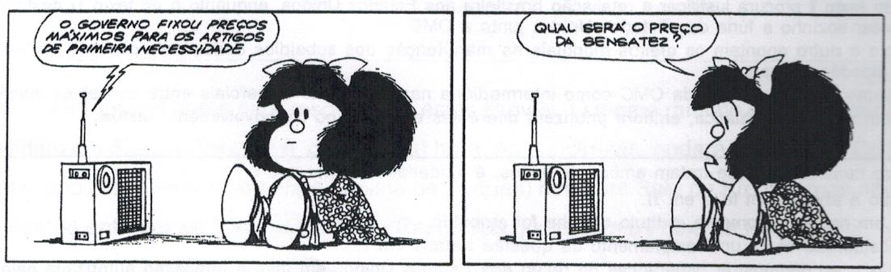
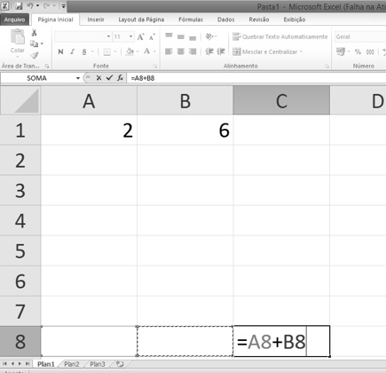

# PROVA — Camara_Estreito_2016_Agente_Administrativo

## 1. Análise geral da prova

- **Identificação:** Camara_Estreito_2016_Agente_Administrativo
- **Quantidade total de questões:** 40
- **Quantidade de textos de apoio (grupos):** 0
- **Quantidade de imagens:** 2
- **Quantidade de gráficos e tabelas:** incluídos nas imagens e no texto extraído, quando presentes no PDF original
- **Quantidade de grupos identificados:** 0
- **Quantidade de questões independentes:** 40
- **Questões que compartilham materiais:** nenhuma identificada automaticamente

### Transcrição integral da capa/instruções (conforme extraída do PDF)

> [!NOTE]
> Conteúdo integral das páginas anteriores à primeira questão, sem cortes.

> CONCURSO CÂMARA MUNICIPAL DE ESTREITO-MA
>
>
>
> Z
>
>
>
> ESTADO DO MARANHÃO
> CÂMARA MUNICIPAL DE ESTREITO
> CONCURSO PÚBLICO PARA PROVIMENTOS DE CARGOS
> CARGO
> AGENTE
> ADMINISTRATIVO
> A
> B
> D
>
>
>
> INSTITUTO MACHADO DE ASSIS - IMA
> CONCURSO PÚBLICO DA PREFEITURA MUNICIPAL DE ESTREITO-MA
> FOLHA DE ANOTAÇÃO DO GABARITO - ATENÇÃO: Esta parte somente deverá ser destacada pelo fiscal da sala, após o término da prova.
> NOME DO CANDIDATO(A)
> TURNO: MANHÃ
> CADERNO DE PROVA OBJETIVA
> Leia atentamente as instruções abaixo.
>
> 01- Você recebeu do fiscal o seguinte material:
> a) Este Caderno, com 40 (quarenta) questões da Prova Objetiva, sem repetição ou falha,
> conforme distribuição abaixo. Examine se a prova está completa, se há falhas ou imperfeições
> gráficas que causem dúvidas.
> Língua Portuguesa
> Matemática
> Informática
> Conhec. Específicos
>
> 02- A prova terá duração de 3 (três horas).
> 03- No Cartão de Respostas, a marcação da alternativa correta deve ser feita cobrindo a letra e
> preenchendo todo o espaço interno do quadrado, com caneta esferográfica de tinta na cor azul ou
> preta, de forma contínua e densa.
> Exemplo:
>
>
> 05- Para cada uma das questões objetivas, são apresentadas 4 (quatro) alternativas classificadas
> com as letras (A, B, C, D), mas só uma responde adequadamente à questão proposta. Você só
> deve assinalar uma alternativa. A marcação em mais de uma alternativa anula a questão, mesmo
> que uma das respostas esteja correta.
>
> 06- Será eliminado do Concurso Público o candidato que:
> a) Utilizar ou consultar cadernos, livros, notas de estudo, calculadoras, telefones celulares, pagers,
> walkmans, réguas, esquadros, transferidores, compassos, MP3, Ipod, Ipad e quaisquer outros
> recursos analógicos.
> b) Ausentar-se da sala, a qualquer tempo, portando o Cartão de Respostas.
> Observações: Por motivo de segurança, o candidato só poderá retirar-se da sala após 1
> (uma) hora a partir do início da prova.
> 5.11.1. O candidato somente poderá levar o Caderno de Questões caso saía da sala de aplicação
> de sua prova nos últimos 30 (trinta) minutos.
>
> NOME DO (A) CANDIDATO (A):_________________________________________________
>
>
>
> MAIS INFORMAÇÕES:
> Internet:
> www.institutomachadodeassis.com.br
> Telefone: (86) 3303-3146
> E-mail: ima.estreito2016@outlook.com
> A
> B
> D
>
>
>
> Página 2 de 11
>
>
>
> CARGO: AGENTE ADMINISTRATIVO
> INSTITUTO MACHADO DE ASSIS - IMA
> CONCURSO PÚBLICO CÂMARA MUNICIPAL DE ESTREITO-MA
>
>
>
>
>
>
> Página 3 de 11
> CARGO: AGENTE ADMINISTRATIVO
> INSTITUTO MACHADO DE ASSIS - IMA
> CONCURSO PÚBLICO CÂMARA MUNICIPAL DE ESTREITO-MA
> LÍNGUA PORTUGUESA QUESTÕES DE 1 A 10
> INSTRUÇÃO:
> Para responder a essas questões, assinale APENAS UMA ÚNICA alternativa correta e marque o
> número correspondente na Folha de Respostas.
> AS QUESTÕES 1 A 9 ESTÃO RELACIONADAS AO TEXTO ABAIXO
> TEXTO
> A quem a tecnologia beneficia?
> Bunge responde de maneira direta: a quem pode pagar e adaptar-se a ela. Esta
> resposta está sustentada no modo capitalista de organização. A corrida por inovações
> técnicas e pelo aprimoramento de tecnologias é própria do período industrial, como também
> o capitalismo. A máquina social move suas engrenagens para dar conta de sua estrutura.
> Neste contexto, a tecnologia digital é uma peça entrelaçada importante de sustentação do
> sistema. Ao mesmo tempo, as inovações técnicas, para Bunge, podem ser sinal de avanço e
> também podem conduzir ao aumento das desigualdades. A sociedade industrial é aberta à
> inovação tecnológica; semiaberta às transformações culturais, porém, fechada à inovação
> social progressiva. A chamada de atenção de Bunge é importante para olhar com cautela aos
> discursos de inclusão digital. A tecnologia está aí, é vivencial, mas não é um fator de
> igualdade e atende a interesses. O que poderia ainda fortificar estes argumentos poderá ser
> uma análise, mesmo que superficial, da telefonia celular brasileira. Se na segunda metade
> dos anos de 1990 a aquisição de um aparelho celular significava estar numa lista de espera e
> comprar ações, as privatizações das teles fizeram que qualquer pessoa pudesse comprar um
> aparelho celular em menos de dez minutos. Mesmo com o acesso popularizado encontramos
> outro problema, o Brasil está entre os países com maior cobrança pelos serviços e aparelhos
> mais caros, então, há acesso, mas ele não é igualitário e includente, ele atende a um
> mecanismo maquínico que vai além da discussão da tecnologia em si.
> FILOSOFIA, ciência & vida, nº 116, p.56, abril/2016
>
>
>
> Página 4 de 11
> CARGO: AGENTE ADMINISTRATIVO
> INSTITUTO MACHADO DE ASSIS - IMA

### Gabarito

| Questão | 01 | 02 | 03 | 04 | 05 |
|---|---|---|---|---|---|
| Resposta | D | B | A | C | C |

| Questão | 06 | 07 | 08 | 09 | 10 |
|---|---|---|---|---|---|
| Resposta | D | B | B | D | B |

| Questão | 11 | 12 | 13 | 14 | 15 |
|---|---|---|---|---|---|
| Resposta | A | B | C | D | B |

| Questão | 16 | 17 | 18 | 19 | 20 |
|---|---|---|---|---|---|
| Resposta | B | C | C | D | B |

| Questão | 21 | 22 | 23 | 24 | 25 |
|---|---|---|---|---|---|
| Resposta | B | B | B | D | B |

| Questão | 26 | 27 | 28 | 29 | 30 |
|---|---|---|---|---|---|
| Resposta | B | C | B | B | C |

| Questão | 31 | 32 | 33 | 34 | 35 |
|---|---|---|---|---|---|
| Resposta | B | B | C | A | B |

| Questão | 36 | 37 | 38 | 39 | 40 |
|---|---|---|---|---|---|
| Resposta | B | C | D | D | B |

## 2. Questões agrupadas

Nenhum grupo de questões compartilhando material foi identificado automaticamente nesta prova.

## 3. Questões independentes

#### QUESTÃO 01

✅ **Gabarito: D** (gabarito oficial pareado — cargo AGENTE ADMINISTRATIVO)

**Enunciado:**

Com embasamento nas ideias do texto, por
“modo capitalista de organização” (L.2),
infere-se:

**Alternativas:**

A) Um sistema econômico que permite que as
inovações tecnológicas cheguem a todas as
pessoas.
B) A produção capitalista consiste na produção
de mercadorias sem o objetivo lucro, mas
sim do desenvolvimento social.
C) Regime econômico-financeiro segundo o
qual com o avanço da tecnologia teria
resolvido as contradições sociais existentes.
D) Ser o modo de produção fundado na divisão
da sociedade em classes socioeconômicas
diferentes.

**Referências visuais:**

Nenhuma.

---

#### QUESTÃO 02

✅ **Gabarito: B** (gabarito oficial pareado — cargo AGENTE ADMINISTRATIVO)

**Enunciado:**

O texto evidencia:

**Alternativas:**

A) As vantagens que as inovações técnicas
podem trazer para as classes mais pobres.
B) As contradições existentes entre o avanço
tecnológico e a desigualdade social.
C) A constatação de que todas as classes sociais
podem fazer uso de tecnologias modernas.
D) As vantagens da tecnologia para as pessoas
mais pobres.

**Referências visuais:**

Nenhuma.

---

#### QUESTÃO 03

✅ **Gabarito: A** (gabarito oficial pareado — cargo AGENTE ADMINISTRATIVO)

**Enunciado:**

Com relação ao predicado, o nome é o núcleo
da informação em:

**Alternativas:**

A) “A sociedade industrial é aberta à inovação
tecnológica” (L.7/8).
B) “A tecnologia está aí” (L.10).
C) “ele atende a um mecanismo maquínico”
(L.18).
D) “Bunge responde de maneira direta” (L.1).

**Referências visuais:**

Nenhuma.

---

#### QUESTÃO 04

✅ **Gabarito: C** (gabarito oficial pareado — cargo AGENTE ADMINISTRATIVO)

**Enunciado:**

Transpondo-se a oração “A máquina social
move suas engrenagens” (L.4) para a voz
passiva, tem-se:

**Alternativas:**

A) Suas
engrenagens
serão
movidas
pela
máquina.
B) Suas engrenagens seriam movidas pela
máquina.
C) Suas
engrenagens
são
movidas
pela
máquina.
D) Suas
engrenagens
eram
movidas
pela
máquina.

**Referências visuais:**

Nenhuma.

---

#### QUESTÃO 05

✅ **Gabarito: C** (gabarito oficial pareado — cargo AGENTE ADMINISTRATIVO)

**Enunciado:**

Do ponto de vista semântico-sintático, é
verdadeiro o que se afirma em:

**Alternativas:**

A) “A expressão “por inovações técnicas” (L.
2/3) completa o sentido de um verbo.
B) A expressão “...de um aparelho celular”
(L.13) é agente da ação nominal.
C) O vocábulo “acesso”, em “há acesso” (L.17),
muda de função sintática se houver a
substituição do verbo haver por existir.
D) O
vocábulo
“como”
(L.3)
exprime
conformidade.

**Referências visuais:**

Nenhuma.

---

#### QUESTÃO 06

✅ **Gabarito: D** (gabarito oficial pareado — cargo AGENTE ADMINISTRATIVO)

**Enunciado:**

Os termos em negrito em “mesmo que
superficial” (L. 12) e “mas ele não é
igualitário”
(L.17)
exprimem,
respectivamente, ideias de:

**Alternativas:**

A) Alternância e conclusão.
B) Adição e ressalva.
C) Explicação e oposição.
D) Concessão e ressalva.

**Referências visuais:**

Nenhuma.

---

#### QUESTÃO 07

✅ **Gabarito: B** (gabarito oficial pareado — cargo AGENTE ADMINISTRATIVO)

**Enunciado:**

Com relação aos aspectos linguísticos usados
no texto, pode-se afirmar:

**Alternativas:**

A) A preposição “de” (L1) estabelece uma
relação de posse entre “responde” (L.02) e
“maneira”. (L.01)
B) A
palavra
“própria”
(L.3)
tem
valor
predicativo.
C) O vocábulo “que” (L.11) tem o mesmo valor
morfológico “de “ (L.14).
D) O vocábulo “-se” (L1) expressa condição.

**Referências visuais:**

Nenhuma.

---

#### QUESTÃO 08

✅ **Gabarito: B** (gabarito oficial pareado — cargo AGENTE ADMINISTRATIVO)

**Enunciado:**

Recebe acentuação gráfica pelo mesmo
motivo da palavra “própria” (L.3) aquela
presente na alternativa:

**Alternativas:**

A) “países” (L.16).
B) “igualitário” (L.17).
C) “técnicas” (L.3).
D) “porém” (L.8).

**Referências visuais:**

Nenhuma.

---

#### QUESTÃO 09

✅ **Gabarito: D** (gabarito oficial pareado — cargo AGENTE ADMINISTRATIVO)

**Enunciado:**

Analise as afirmativas abaixo, e marque a alternativa correta:

**Alternativas:**

A) Na palavra “análise” (L.12), a forma verbal se escreve “analizar”.
B) A palavra “industrial” (L.7) a forma verbal se escreve “industrialisar”.
C) A forma plural de “qualquer” (L.14) é “qualqueres”.
D) O vocábulo “sustentação” (L.5) tem, na progressão da formação de sentido um verbo na base de seu
início.
A QUESTÃO 10 ESTÁ RELACIONADA À TIRINHA ABAIXO

**Referências visuais:**

Nenhuma.

---

#### QUESTÃO 10

✅ **Gabarito: B** (gabarito oficial pareado — cargo AGENTE ADMINISTRATIVO)

**Enunciado:**

O questionamento de Mafalda, personagem presente na tira, em face da notícia sobre a atitude de
determinado governo, configura-se como uma reação:

**Alternativas:**

A) imperdoável.
B) crítico-irônica.
C) inadequada ao contexto
D) desprovida de bom senso.

**Referências visuais:**

---

#### QUESTÃO 11

✅ **Gabarito: A** (gabarito oficial pareado — cargo AGENTE ADMINISTRATIVO)

**Enunciado:**

O salário do professor Júlio equivale a 90% do
salário do professor Jonas. A diferença entre os
salários é de R$ 500,00. Qual é o salário do
professor Júlio:

**Alternativas:**

A) R$ 4.500,00
B) R$ 4.000,00
C) R$ 4.400,00
D) R$ 4.100,00

**Referências visuais:**

Nenhuma.

---

#### QUESTÃO 12

✅ **Gabarito: B** (gabarito oficial pareado — cargo AGENTE ADMINISTRATIVO)

**Enunciado:**

Com o peso da crise José decidiu investir toda e
qualquer economia que dispuser. Assim ele
aplicou R$ 3.000,00 à taxa de 2% a.m. durante 5
meses. Quanto ele receberá de juro se o regime
for de juro simples? E que montante terá ao final
dessa aplicação respectivamente?

**Alternativas:**

A) R$ R$ 350,00 e R$ 3.350,00
B) R$ R$ 300,00 e R$ 3.300,00
C) R$ R$ 303,00 e R$ 3.303,00
D) R$ R$ 390,00 e R$ 3.390,00

**Referências visuais:**

Nenhuma.

---

#### QUESTÃO 13

✅ **Gabarito: C** (gabarito oficial pareado — cargo AGENTE ADMINISTRATIVO)

**Enunciado:**

Com as economias acumuladas durante anos José
resolveu aplicar neste momento de crise. Assim
calculando o juro composto que será obtido na
aplicação que ele fez de R$ 25.000,00 a 25% ao
ano durante 72 meses será obtido um juro de:

**Alternativas:**

A) R$ 75.367,50
B) R$ 60.367,50
C) R$ 70.367,50
D) R$ 80.367,50

**Referências visuais:**

Nenhuma.

---

#### QUESTÃO 14

✅ **Gabarito: D** (gabarito oficial pareado — cargo AGENTE ADMINISTRATIVO)

**Enunciado:**

É notório que muitos operários hoje para
complementar a renda trabalham bastante. Assim
sendo assim um operário recebe R$ 2.150,00 por
50 dias de trabalho. Quanto receberá por 80 dias
de um trabalho igual?

**Alternativas:**

A) R$ 3.240,00
B) R$ 3.140,00
C) R$ 3.040,00
D) R$ 3.440,00

**Referências visuais:**

Nenhuma.

---

#### QUESTÃO 15

✅ **Gabarito: B** (gabarito oficial pareado — cargo AGENTE ADMINISTRATIVO)

**Enunciado:**

Todos os pares abaixo são soluções da equação
2x – y = 4, EXCETO:

**Alternativas:**

A) (2, 0)
B) (3, 5)
C) ( − 1, −6)
D) (4, 4)

**Referências visuais:**

Nenhuma.

---

#### QUESTÃO 16

✅ **Gabarito: B** (gabarito oficial pareado — cargo AGENTE ADMINISTRATIVO)

**Enunciado:**

Os periféricos são dispositivos que auxiliam no
manuseio da máquina. Entre os tipos de
periféricos temos os periféricos de Entrada,
Saída e Entrada/Saída. Qual das alternativas
abaixo só temos periféricos de saída?

**Alternativas:**

A) Teclado e Impressora
B) Caixa de Som e Margarida
C) Mouse e Scanner
D) Touch Pad e Webcam

**Referências visuais:**

Nenhuma.

---

#### QUESTÃO 17

✅ **Gabarito: C** (gabarito oficial pareado — cargo AGENTE ADMINISTRATIVO)

**Enunciado:**

Observe a planilha abaixo:
Sabendo que em C8 temos a seguinte fórmula
=A8+B8, e que a célula A1 foi arrastada até A8 e
que B1 foi arrastado até B8 com o CTRL
pressionado. Então o valor de C8 será:

**Alternativas:**

A) 8
B) 14
C) 15
D) 22

**Referências visuais:**

Nenhuma.

---

#### QUESTÃO 18

✅ **Gabarito: C** (gabarito oficial pareado — cargo AGENTE ADMINISTRATIVO)

**Enunciado:**

Os protocolos são conjuntos de normas ou
regras que estabelecem a comunicação entre
os computadores. Qual é o protocolo de
transporte, orientado a conexão confiável e
lento?

**Alternativas:**

A) FTP
B) IP
C) TCP
D) DNS

**Referências visuais:**

Nenhuma.

---

#### QUESTÃO 19

✅ **Gabarito: D** (gabarito oficial pareado — cargo AGENTE ADMINISTRATIVO)

**Enunciado:**

No Windows há um recurso responsável pela
segurança e manutenção do computador. O
recurso que está sendo citado na questão é o:

**Alternativas:**

A) UAC
B) Windows Explorer
C) ReadyBoost
D) Central de Ações

**Referências visuais:**

Nenhuma.

---

#### QUESTÃO 20

✅ **Gabarito: B** (gabarito oficial pareado — cargo AGENTE ADMINISTRATIVO)

**Enunciado:**

A respeito dos Editores de Texto, qual é o
atalho para inserir um Bloco de Construção?

**Alternativas:**

A) F2
B) F3
C) F4
D) F5

**Referências visuais:**

---

#### QUESTÃO 21

✅ **Gabarito: B** (gabarito oficial pareado — cargo AGENTE ADMINISTRATIVO)

**Enunciado:**

As compras, sempre que possível, deverão,
EXCETO:

**Alternativas:**

A) Ser processadas através de sistema de
registro de preços.
B) Atender ao princípio da padronização, que
imponha compatibilidade de especificações
técnicas
e
de
desempenho,
observadas,
sempre,
as
condições
de
manutenção,
assistência técnica e garantia oferecidas.
C) Ser subdivididas em tantas parcelas quantas
necessárias para aproveitar as peculiaridades
do mercado, visando economicidade.
D) Submeter-se às condições de aquisição e
pagamento semelhantes às do setor privado.

**Referências visuais:**

Nenhuma.

---

#### QUESTÃO 22

✅ **Gabarito: B** (gabarito oficial pareado — cargo AGENTE ADMINISTRATIVO)

**Enunciado:**

O
sistema
de
registro
de
preços
será
regulamentado por decreto, atendidas as
peculiaridades
regionais,
observadas
as
seguintes condições:

I. Seleção feita mediante concorrência ou leilão.
II. Validade do registro não superior a dois anos.
III. Estipulação prévia do sistema de controle e
atualização dos preços registrados.

É verdadeiro o que se afirma em:

**Alternativas:**

A) I, II e III
B) III
C) I e II
D) I

**Referências visuais:**

Nenhuma.

---

#### QUESTÃO 23

✅ **Gabarito: B** (gabarito oficial pareado — cargo AGENTE ADMINISTRATIVO)

**Enunciado:**

De acordo com a lei nº 8.666/93, é inexigível
a licitação quando houver inviabilidade de
competição, em especial:

I. Para contratação de profissional de qualquer
setor artístico, diretamente ou através de
empresário exclusivo, desde que consagrado
pela crítica especializada ou pela opinião
pública.
II. Para aquisição de materiais, equipamentos, ou
gêneros que só possam ser fornecidos por
produtor, empresa ou representante comercial
exclusivo, vedada a preferência de marca,
devendo a comprovação de exclusividade ser
feita através de atestado fornecido pelo órgão
de registro do comércio do local em que se
realizaria a licitação ou a obra ou o serviço,
pelo Sindicato, Federação ou Confederação
Patronal,
ou,
ainda,
pelas
entidades
equivalentes.
III. Para a contratação de serviços técnicos
enumerados no art. 13 desta Lei, de natureza
singular, com profissionais ou empresas de
notória
especialização,
vedada
a
inexigibilidade para serviços de publicidade e
divulgação.

É certo o que se indica em:

**Alternativas:**

A) I
B) I, II e III
C) I e III
D) II

**Referências visuais:**

Nenhuma.

---

#### QUESTÃO 24

✅ **Gabarito: D** (gabarito oficial pareado — cargo AGENTE ADMINISTRATIVO)

**Enunciado:**

Os
documentos
do Padrão
Ofício devem
obedecer à seguinte forma de apresentação,
SALVO:

**Alternativas:**

A) Todos os tipos de documentos do Padrão
Ofício devem ser impressos em papel de
tamanho A-4, ou seja, 29,7 x 21,0 cm.
B) Para símbolos não existentes na fonte Times
New Roman poder-se-á utilizar as fontes
Symbol e Wingdings.
C) Dentro do possível, todos os documentos
elaborados devem ter o arquivo de texto
preservado
para
consulta
posterior
ou
aproveitamento
de
trechos
para
casos
análogos.
D) Deve
ser
utilizado,
preferencialmente,
o
formato de arquivo doc nos documentos de
texto.

**Referências visuais:**

Nenhuma.

---

#### QUESTÃO 25

✅ **Gabarito: B** (gabarito oficial pareado — cargo AGENTE ADMINISTRATIVO)

**Enunciado:**

São considerados bens patrimoniais de uma
entidade:

I. Ferramentas.
II. Obras de arte.
III. Móveis e utensílios.
IV. Marcas e patentes.
É correto o que se afirma em:

**Alternativas:**

A) I e II
B) I, II, III e IV
C) I, II e III
D) III e IV

**Referências visuais:**

Nenhuma.

---

#### QUESTÃO 26

✅ **Gabarito: B** (gabarito oficial pareado — cargo AGENTE ADMINISTRATIVO)

**Enunciado:**

“Representa toda concessão gratuita de bem
de terceiros, que findo o prazo acordado,
devem
ser
restituídos
no
tempo
convencionado, ou recebidos por doação”.

O enunciado acima se refere a(o):

**Alternativas:**

A) Cessão de uso de bens de terceiros.
B) Comodato.
C) Permissão de uso de bens de terceiros.
D) Aquisição por convênio.

**Referências visuais:**

Nenhuma.

---

#### QUESTÃO 27

✅ **Gabarito: C** (gabarito oficial pareado — cargo AGENTE ADMINISTRATIVO)

**Enunciado:**

A baixa de bens patrimoniais pode se dar,
dentre outros, por:

I. Obsolescência.
II. Alienação de semoventes.
III. Permuta.
IV. Consumo.
A quantidade de assertivas corretas é:

**Alternativas:**

A) 3
B) 1
C) 4
D) 2

**Referências visuais:**

Nenhuma.

---

#### QUESTÃO 28

✅ **Gabarito: B** (gabarito oficial pareado — cargo AGENTE ADMINISTRATIVO)

**Enunciado:**

NÃO é princípio constitucional expresso da
Administração Pública:

**Alternativas:**

A) Impessoalidade.
B) Finalidade.
C) Eficiência.
D) Moralidade.

**Referências visuais:**

Nenhuma.

---

#### QUESTÃO 29

✅ **Gabarito: B** (gabarito oficial pareado — cargo AGENTE ADMINISTRATIVO)

**Enunciado:**

São espécies de bens intangíveis:
I. Marcas e patentes.
II. Pesquisa e desenvolvimento.
III. Direitos sobre recursos naturais.
É verdade o que se diz em:

**Alternativas:**

A) I
B) I, II e III
C) I e III
D) II

**Referências visuais:**

Nenhuma.

---

#### QUESTÃO 30

✅ **Gabarito: C** (gabarito oficial pareado — cargo AGENTE ADMINISTRATIVO)

**Enunciado:**

De acordo com a lei de licitações e contratos
administrativos, nas compras deverão ser
observadas:

I. A definição das unidades e das quantidades a
serem adquiridas em função do consumo e
utilização prováveis, cuja estimativa será
obtida,
sempre
que
possível,
mediante
adequadas
técnicas
quantitativas
de
estimação.
II. As condições de guarda e armazenamento que
não permitam a deterioração do material.
III. A especificação completa do bem a ser
adquirido com indicação da marca desejada.

É certo o que se afirma em:

**Alternativas:**

A) I
B) I, II e III
C) I e II
D) III

**Referências visuais:**

Nenhuma.

---

#### QUESTÃO 31

✅ **Gabarito: B** (gabarito oficial pareado — cargo AGENTE ADMINISTRATIVO)

**Enunciado:**

Sobre o disposto na lei nº 8.666/93 acerca do
registro de preços, assinale a opção ERRADA.

**Alternativas:**

A) Qualquer cidadão é parte legítima para
impugnar preço constante do quadro geral em
razão de incompatibilidade desse com o preço
vigente no mercado.
B) Os
preços
registrados
serão
publicados
bimestralmente
para
orientação
da
Administração, na imprensa oficial.
C) O sistema de controle originado no quadro
geral de preços, quando possível, deverá ser
informatizado.
D) A existência de preços registrados não obriga
a Administração a firmar as contratações que
deles poderão advir, ficando-lhe facultada a
utilização de outros meios, respeitada a
legislação
relativa
às
licitações,
sendo
assegurado
ao
beneficiário
do
registro
preferência em igualdade de condições.

**Referências visuais:**

Nenhuma.

---

#### QUESTÃO 32

✅ **Gabarito: B** (gabarito oficial pareado — cargo AGENTE ADMINISTRATIVO)

**Enunciado:**

Um sistema de administração de materiais
inclui:

I. Armazenagem.
II. Compras.
III. Planejamento.

É certo o que se indica em:

**Alternativas:**

A) I
B) I, II e III
C) I e III
D) II

**Referências visuais:**

Nenhuma.

---

#### QUESTÃO 33

✅ **Gabarito: C** (gabarito oficial pareado — cargo AGENTE ADMINISTRATIVO)

**Enunciado:**

O ofício deve conter as seguintes partes,
dentre outras:

I. Tipo e número do expediente, seguido da sigla
do órgão que o expede.
II. Local e data em que foi assinado, por extenso,
com alinhamento à direta.
III. Assunto: resumo do teor do documento.
IV. Fecho.

É verdadeiro o que se afirma em:

**Alternativas:**

A) III e IV
B) I, II e III
C) I, II, III e IV
D) I e II

**Referências visuais:**

Nenhuma.

---

#### QUESTÃO 34

✅ **Gabarito: A** (gabarito oficial pareado — cargo AGENTE ADMINISTRATIVO)

**Enunciado:**

São modalidades de licitação previstas na lei
nº 8.666/93, SALVO:

**Alternativas:**

A) Pregão.
B) Leilão.
C) Concurso.
D) Tomada de preços.

**Referências visuais:**

Nenhuma.

---

#### QUESTÃO 35

✅ **Gabarito: B** (gabarito oficial pareado — cargo AGENTE ADMINISTRATIVO)

**Enunciado:**

É a modalidade de licitação entre interessados
devidamente cadastrados ou que atenderem a
todas
as
condições
exigidas
para
cadastramento até o terceiro dia anterior à
data
do
recebimento
das
propostas,
observada a necessária qualificação:

**Alternativas:**

A) Leilão.
B) Tomada de Preços.
C) Concurso.
D) Convite.

**Referências visuais:**

Nenhuma.

---

#### QUESTÃO 36

✅ **Gabarito: B** (gabarito oficial pareado — cargo AGENTE ADMINISTRATIVO)

**Enunciado:**

Em relação às modalidades de licitação,
assinale a opção FALSA.

**Alternativas:**

A) Na execução de obras e serviços e nas
compras de bens, parceladas nos termos do
parágrafo anterior, a cada etapa ou conjunto
de etapas da obra, serviço ou compra, há de
corresponder licitação distinta, preservada a
modalidade pertinente para a execução do
objeto em licitação.
B) Na compra de bens de natureza divisível e
desde que não haja prejuízo para o conjunto
ou complexo, é permitida a cotação de
quantidade inferior à demandada na licitação,
com vistas a ampliação da competitividade,
não
podendo
o
edital
fixar
quantitativo
mínimo para preservar a economia de escala.
C) As obras, serviços e compras efetuadas pela
Administração
serão
divididas em tantas
parcelas quantas se comprovarem técnica e
economicamente viáveis, procedendo-se à
licitação com vistas ao melhor aproveitamento
dos recursos disponíveis no mercado e à
ampliação da competitividade sem perda da
economia de escala.
D) Nos
casos
em
que
couber
convite,
a
Administração poderá utilizar a tomada de
preços e, em qualquer caso, a concorrência.

**Referências visuais:**

Nenhuma.

---

#### QUESTÃO 37

✅ **Gabarito: C** (gabarito oficial pareado — cargo AGENTE ADMINISTRATIVO)

**Enunciado:**

É dispensável a licitação:

I. Na contratação de remanescente de obra,
serviço ou fornecimento, em conseqüência de
rescisão contratual, desde que atendida a
ordem de classificação da licitação anterior e
aceitas as mesmas condições oferecidas pelo
licitante vencedor, inclusive quanto ao preço,
devidamente corrigido.
II.
Quando
houver
possibilidade
de
comprometimento da segurança nacional, nos
casos estabelecidos em decreto do Presidente
da
República,
ouvido
o
Conselho
da
República.
III. Para a compra ou locação de imóvel destinado
ao atendimento das finalidades precípuas da
administração,
cujas
necessidades
de
instalação e localização condicionem a sua
escolha, desde que o preço seja compatível
com o valor de mercado, segundo avaliação
prévia.
IV. Para a impressão dos diários oficiais, de
formulários
padronizados
de
uso
da
administração, e de edições técnicas oficiais,
bem como para prestação de serviços de
informática a pessoa jurídica de direito público
interno, por órgãos ou entidades que integrem
a Administração Pública, criados para esse fim
específico.

A quantidade de itens corretos é:

**Alternativas:**

A) 2
B) 1
C) 3
D) 4

**Referências visuais:**

Nenhuma.

---

#### QUESTÃO 38

✅ **Gabarito: D** (gabarito oficial pareado — cargo AGENTE ADMINISTRATIVO)

**Enunciado:**

Sobre a linguagem dos atos e comunicações
oficiais, assinale a opção ERRADA.

**Alternativas:**

A) A língua escrita, como a falada, compreende
diferentes níveis, de acordo com o uso que
dela se faça.
B) A necessidade de empregar determinado nível
de linguagem nos atos e expedientes oficiais
decorre, de um lado, do próprio caráter
público desses atos e comunicações; de outro,
de sua finalidade.
C) Não existe propriamente um "padrão oficial de
linguagem"; o que há é o uso do padrão culto
nos atos e comunicações oficiais.
D) A linguagem técnica deve ser empregada
sempre.

**Referências visuais:**

Nenhuma.

---

#### QUESTÃO 39

✅ **Gabarito: D** (gabarito oficial pareado — cargo AGENTE ADMINISTRATIVO)

**Enunciado:**

A clareza deve ser a qualidade básica de todo
texto oficial, conforme já sublinhado na
introdução deste capítulo. Pode-se definir
como claro aquele texto que possibilita
imediata compreensão pelo leitor. No entanto
a clareza não é algo que se atinja por si só:
ela
depende
estritamente
das
demais
características da redação oficial. Para ela
concorrem:
I. A concisão, que faz desaparecer do texto os
excessos
linguísticos
que
nada
lhe
acrescentam.
II.
A
formalidade
e
a
padronização,
que
possibilitam a imprescindível uniformidade dos
textos.
III. A impessoalidade, de entendimento geral e por
definição avesso a vocábulos de circulação
restrita, como a gíria e o jargão.
IV. O uso do padrão culto de linguagem, em
princípio,
que
evita
a
duplicidade
de
interpretações que poderia decorrer de um
tratamento personalista dado ao texto.
A quantidade de itens corretos é:

**Alternativas:**

A) 3
B) 4
C) 1
D) 2

**Referências visuais:**

Nenhuma.

---

#### QUESTÃO 40

✅ **Gabarito: B** (gabarito oficial pareado — cargo AGENTE ADMINISTRATIVO)

**Enunciado:**

Deve ser utilizado o pronome de tratamento
Vossa
Excelência
para
as
seguintes
autoridades:
I. Prefeitos Municipais.
II. Vice-Governadores de Estado e do Distrito
Federal.
III. Embaixadores.
IV. Oficiais-Generais das Forças Armadas.
Está correto o que se afirma em:

**Alternativas:**

A) I, III e IV
B) I, II, III e IV
C) I, II e III
D) II e IV

**Referências visuais:**

Nenhuma.

---

## 4. Observações e limitações da extração

- Extração automática (texto selecionável do PDF via PyMuPDF), sem OCR: PDFs escaneados podem perder texto.
- Imagens repetidas (logos/marcas d'água) foram descartadas; as imagens de conteúdo foram salvas em `imagens/` com nomenclatura `imagem_00N`.
- A detecção de grupos usa os avisos padrão das bancas ("o texto seguinte servirá de base..."). Bancas sem esse aviso podem ter grupos não identificados — o conteúdo, porém, permanece integral.
- Se houver divergência entre esta versão e o PDF original, vale o PDF original; corrija manualmente o Markdown.
