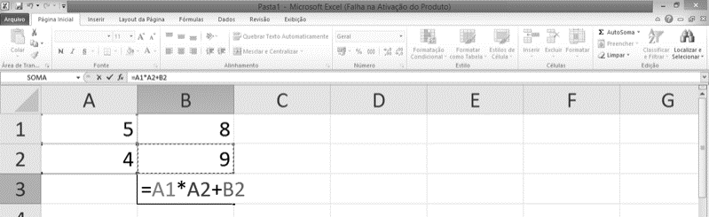

# PROVA — Camara_Estreito_2016_Analista_de_Sistema

## 1. Análise geral da prova

- **Identificação:** Camara_Estreito_2016_Analista_de_Sistema
- **Quantidade total de questões:** 40
- **Quantidade de textos de apoio (grupos):** 0
- **Quantidade de imagens:** 2
- **Quantidade de gráficos e tabelas:** incluídos nas imagens e no texto extraído, quando presentes no PDF original
- **Quantidade de grupos identificados:** 0
- **Quantidade de questões independentes:** 40
- **Questões que compartilham materiais:** nenhuma identificada automaticamente

### Transcrição integral da capa/instruções (conforme extraída do PDF)

> [!NOTE]
> Conteúdo integral das páginas anteriores à primeira questão, sem cortes.

> CONCURSO CÂMARA MUNICIPAL DE ESTREITO-MA

> Z
> A
> B
> D

> INSTITUTO MACHADO DE ASSIS - IMA
> CONCURSO PÚBLICO DA CÂMARA MUNICIPAL DE ESTREITO-MA

> ESTADO DO MARANHÃO
> CÂMARA MUNICIPAL DE ESTREITO
> CONCURSO PÚBLICO PARA PROVIMENTOS DE CARGOS
> FOLHA DE ANOTAÇÃO DO GABARITO - ATENÇÃO: Esta parte somente deverá ser destacada pelo fiscal da sala, após o término da prova.
> CARGO
> ANALISTA
> DE
> SISTEMA
> NOME DO CANDIDATO(A)
> TURNO: MANHÃ
> CADERNO DE PROVA OBJETIVA
> Leia atentamente as instruções abaixo.

> 01- Você recebeu do fiscal o seguinte material:
> a) Este Caderno, com 40 (quarenta) questões da Prova Objetiva, sem repetição ou falha,
> conforme distribuição abaixo. Examine se a prova está completa, se há falhas ou imperfeições
> gráficas que causem dúvidas.
> Língua Portuguesa
> Matemática
> Informática
> Conhec. Específicos

> 02- A prova terá duração de 3 (três horas).
> 03- No Cartão de Respostas, a marcação da alternativa correta deve ser feita cobrindo a letra e
> preenchendo todo o espaço interno do quadrado, com caneta esferográfica de tinta na cor azul ou
> preta, de forma contínua e densa.
> Exemplo:

> 05- Para cada uma das questões objetivas, são apresentadas 4 (quatro) alternativas classificadas
> com as letras (A, B, C, D), mas só uma responde adequadamente à questão proposta. Você só
> deve assinalar uma alternativa. A marcação em mais de uma alternativa anula a questão, mesmo
> que uma das respostas esteja correta.

> 06- Será eliminado do Concurso Público o candidato que:
> a) Utilizar ou consultar cadernos, livros, notas de estudo, calculadoras, telefones celulares, pagers,
> walkmans, réguas, esquadros, transferidores, compassos, MP3, Ipod, Ipad e quaisquer outros
> recursos analógicos.
> b) Ausentar-se da sala, a qualquer tempo, portando o Cartão de Respostas.
> Observações: Por motivo de segurança, o candidato só poderá retirar-se da sala após 1
> (uma) hora a partir do início da prova.
> 5.11.1. O candidato somente poderá levar o Caderno de Questões caso saía da sala de aplicação
> de sua prova nos últimos 30 (trinta) minutos.

> NOME DO (A) CANDIDATO (A):_________________________________________________

> MAIS INFORMAÇÕES:
> Internet:
> www.institutomachadodeassis.com.br
> Telefone: (86) 3303-3146
> E-mail: ima.estreito2016@outlook.com
> A
> B
> D

> CONCURSO PÚBLICO DA CÂMARA MUNICIPAL DE ESTREITO-MA
> CARGO: ANALISTA DE SISTEMA
> INSTITUTO MACHADO DE ASSIS - IMA

> CONCURSO PÚBLICO DA CÂMARA MUNICIPAL DE ESTREITO-MA
> CARGO: ANALISTA DE SISTEMA
> INSTITUTO MACHADO DE ASSIS - IMA
> LÍNGUA PORTUGUESA QUESTÕES DE 1 A 10
> INSTRUÇÃO:
> Para responder a essas questões, assinale APENAS UMA ÚNICA alternativa correta e marque o
> número correspondente na Folha de Respostas.
> AS QUESTÕES 1 A 9 ESTÃO RELACIONADAS AO TEXTO ABAIXO
> TEXTO
> Nunca se criticou tanto e tão acidamente a educação brasileira quanto agora. E
> merecidamente, pois é péssima. E, para que ela se mova, ainda é pouco o que criticamos. Mas não
> podemos perder a perspectiva histórica. Nunca tivemos uma educação tão vibrante e em tão rápida
> transformação. Vamos entender o paradoxo. Nossa educação é ruim porque sofreu quatro séculos e
> meio de abandono. Foi nos últimos cinquenta anos que tudo começou a acontecer. E, obviamente, é
> pouco tempo para recuperar os séculos perdidos e para evitar os solavancos e as incompetências do
> crescimento açodado.
> O desleixo passado nos deixa sequelas muito mais graves do que aquelas geradas pelas
> trapalhadas das décadas recentes.
> Ouvimos muitas lamúrias sobre o vácuo educacional, após a expulsão dos jesuítas. De
> fato, a cidade de São Paulo ficou sem escolas formais por 43 anos. Mas, enquanto funcionaram, seus
> colégios cobriam apenas 0,1% da população.
> Nossa educação era compatível com a mediocridade intelectual da época. Mesmo a
> educação das elites era débil e improvisada. No dizer de Bastos Ávila, era "um ensino de inutilidades
> ornamentais". O que havia era uma educação péssima para as elites e quase nada para os demais.
> Pergunta o visitante John Luckoc: "O que pode ensinar quem nada sabe?... Não havia outro meio,
> portanto, senão permitir que as crianças crescessem selvagens, em meio a uma chusma de escravos e
> vagabundos da pior espécie com quem testemunham e aprendem a praticar todas as vilanias de que
> sua tenra idade era capaz".
> O professor ensinava a um aluno de cada vez, era tudo o que ele sabia fazer. Como
> resultado, os outros ficavam inquietos e indisciplinados, gerando a necessidade da palmatória. Não
> havia seriação. Os alunos podiam entrar e sair da escola em qualquer período do ano. Da mesma
> forma, não havia a "grade curricular". A Aritmética não era lecionada simultaneamente ao Português,
> e a leitura e a escrita eram ensinadas em separado. Durante todo o Império, não houve prédios
> escolares em São Paulo nem móveis didáticos. Em Ubatuba, por exemplo, os alunos tinham de
> estudar em pé.
> Em suma, a principal razão do atraso de hoje é o início tardio, pois as escolas só
> começaram a tomar alguma consistência no século XX. Portanto, nosso retardo educativo vem
> menos do que fizemos mal nas últimas décadas e mais do não feito nos quatro séculos precedentes.
> Mas a nós, tataranetos, não se permite complacência. Justamente por estarmos tão atrasados, temos
> de recuperar o tempo perdido.
> CASTRO, Cláudio de Moura. A culpa é do tataravô. Veja. Adaptado.

> CONCURSO CÂMARA MUNICIPAL DE ESTREITO-MA

### Gabarito

| Questão | 01 | 02 | 03 | 04 | 05 |
|---|---|---|---|---|---|
| Resposta | D | A | B | C | B |

| Questão | 06 | 07 | 08 | 09 | 10 |
|---|---|---|---|---|---|
| Resposta | B | A | D | C | B |

| Questão | 11 | 12 | 13 | 14 | 15 |
|---|---|---|---|---|---|
| Resposta | C | D | D | B | A |

| Questão | 16 | 17 | 18 | 19 | 20 |
|---|---|---|---|---|---|
| Resposta | C | C | B | A | C |

| Questão | 21 | 22 | 23 | 24 | 25 |
|---|---|---|---|---|---|
| Resposta | A | C | B | D | D |

| Questão | 26 | 27 | 28 | 29 | 30 |
|---|---|---|---|---|---|
| Resposta | C | A | D | B | C |

| Questão | 31 | 32 | 33 | 34 | 35 |
|---|---|---|---|---|---|
| Resposta | B | B | D | C | B |

| Questão | 36 | 37 | 38 | 39 | 40 |
|---|---|---|---|---|---|
| Resposta | A | B | B | D | B |

## 2. Questões agrupadas

Nenhum grupo de questões compartilhando material foi identificado automaticamente nesta prova.

## 3. Questões independentes

#### QUESTÃO 01

✅ **Gabarito: D** (gabarito oficial pareado — cargo ANALISTA DE SISTEMAS)

**Enunciado:**

O autor do texto, no que se refere à Educação
no Brasil,

**Alternativas:**

A) vê as bases sociais do país, no presente,
como frágeis para que aí se implemente um
processo educacional de qualidade.
B) reconhece que são procedentes as críticas a
ela dirigidas, embora não aponte uma saída
para tal impasse.
C) sabe que, quando se trata de conquistas
educacionais,
é
desaconselhável
correr
contra o tempo.
D) associa o déficit educacional do presente ao
atraso da implantação da escola no passado.

**Referências visuais:**

Nenhuma.

---

#### QUESTÃO 02

✅ **Gabarito: A** (gabarito oficial pareado — cargo ANALISTA DE SISTEMAS)

**Enunciado:**

Atente para a frase abaixo:

"O desleixo passado nos deixa sequelas muito
mais graves do que aquelas geradas pelas
trapalhadas das décadas recentes." (L.8/9)

Com a declaração em destaque, o articulista

**Alternativas:**

A) Admite falhas na atual educação brasileira,
embora deixe subentendido que, em relação
ao passado, há avanços a considerar.
B) Condena a falta de dedicação dos educadores
de outrora e o descompromisso dos que
atuam no presente.
C) Deixa claro o caos reinante no processo
educacional dos brasileiros desde o início de
sua história até os dias atuais.
D) Acaba negando, tendo em vista o passado
histórico
da
Educação
no
país,
a
possibilidade defuma melhoria nesse setor, a
curto ou a médio prazo.

**Referências visuais:**

Nenhuma.

---

#### QUESTÃO 03

✅ **Gabarito: B** (gabarito oficial pareado — cargo ANALISTA DE SISTEMAS)

**Enunciado:**

No quarto parágrafo, o autor

**Alternativas:**

A) Mostra que o ensino de outrora era
totalmente dissociado da realidade.
B) Vale-se, para respaldar seu ponto de vista, do
discurso de outros enunciadores.
C) Refere-se, quando cita John Luckoc, à
devassidão em que vivia a população do
Brasil na época da escravatura.
D) Abomina,
mesmo
que
apoiado
nas
afirmações de outrem, o descaso das famílias
de antigamente para com os próprios filhos.

**Referências visuais:**

Nenhuma.

---

#### QUESTÃO 04

✅ **Gabarito: C** (gabarito oficial pareado — cargo ANALISTA DE SISTEMAS)

**Enunciado:**

"Durante todo o Império, não houve prédios
escolares em São Paulo nem móveis didáticos."
(L.24/25).
Esse fragmento exemplifica

**Alternativas:**

A) um texto descritivo enfocando a cidade de
São Paulo.
B) um enunciado constituído pela ambivalência
de sentido.
C) uma declaração que apresenta conteúdo de
caráter histórico.
D) uma estrutura narrativa cujas referências ao
tempo ficam a cargo, exclusivamente, das
formas verbais.

**Referências visuais:**

Nenhuma.

---

#### QUESTÃO 05

✅ **Gabarito: B** (gabarito oficial pareado — cargo ANALISTA DE SISTEMAS)

**Enunciado:**

A oração "Justamente por estarmos tão
atrasados" (L.30), sem prejudicar o seu
sentido original, pode ser assim reescrita:

**Alternativas:**

A) Justamente se estamos tão atrasados.
B) Justamente porque estamos tão atrasados.
C) Justamente quando estamos tão atrasados.
D) Justamente sem que estejamos tão atrasados.

**Referências visuais:**

Nenhuma.

---

#### QUESTÃO 06

✅ **Gabarito: B** (gabarito oficial pareado — cargo ANALISTA DE SISTEMAS)

**Enunciado:**

Em relação ao léxico do texto, é correto
afirmar:

**Alternativas:**

A) A palavra "perspectiva" (L.3) pode ser
substituída, sem comprometimento da ideia
expressa, por probabilidade de melhoria.
B) A expressão "educação tão vibrante e em tão
rápida
transformação"
(3/4)
mantém
relação
semântica
com
"crescimento
açodado" (L.7).
C) O vocábulo "paradoxo" (/L.4) corresponde,
nesse caso, a "um ensino de inutilidades
ornamentais" (L.14/15).
D) O termo "solavancos" (L.6) conota agressão,
assim como "incompetências" (L.6) equivale
a "trapalhadas" (L.9).
CONCURSO CÂMARA MUNICIPAL DE ESTREITO-MA

**Referências visuais:**

Nenhuma.

---

#### QUESTÃO 07

✅ **Gabarito: A** (gabarito oficial pareado — cargo ANALISTA DE SISTEMAS)

**Enunciado:**

No texto, a forma verbal

**Alternativas:**

A) "se criticou" (L.1) apresenta-se na mesma
voz que "era lecionada" (L.23).
B) "funcionaram"
(L.11)
está
no
plural,
concordando com o mesmo agente de
"cobriam" (L.12).
C) "crescessem" (L.17) mantém correlação
modo-temporal com "testemunham" (L.18).
D) "aprendem" (L.18) aparece como a mesma
regência de "vem" (L.28).

**Referências visuais:**

Nenhuma.

---

#### QUESTÃO 08

✅ **Gabarito: D** (gabarito oficial pareado — cargo ANALISTA DE SISTEMAS)

**Enunciado:**

Quanto ao predicado, o nome é o núcleo
central da informação em:

**Alternativas:**

A) “A
Aritmética
não
era
lecionada
simultaneamente ao Português,” (L.23).
B) “O professor ensinava a um aluno de cada
vez” (L.20).
C) “O desleixo passado nos deixa sequelas
muito mais graves” (L.8).
D) “Nossa educação era compatível com a
mediocridade intelectual da época.” (L.13).

**Referências visuais:**

Nenhuma.

---

#### QUESTÃO 09

✅ **Gabarito: C** (gabarito oficial pareado — cargo ANALISTA DE SISTEMAS)

**Enunciado:**

Do ponto de vista sintático-semântico, é
correto afirmar:

**Alternativas:**

A) O conectivo “que”, em “ainda é pouco o que
criticamos.” (L.2), introduz, no contexto, a
mesma relação estabelecida por “que”, em
“senão permitir que as crianças crescessem
selvagens,” (L.17).
B) O
vocábulo
“inquietos”
(L.21)
é
um
modificador do verbo, com sentido de modo.
C) “seriação”, em “Não havia seriação.”
(L.21/22), muda de função sintática se
houver a substituição do verbo haver por
existir.
D) “Tão”, em “tão vibrante e em tão rápida”
(L.3), tem valor de advérbio, assim como
“muitas”, em “Ouvimos muitas lamúrias
sobre o vácuo educacional” (L.10)

**Referências visuais:**

Nenhuma.

---

#### QUESTÃO 10

✅ **Gabarito: B** (gabarito oficial pareado — cargo ANALISTA DE SISTEMAS)

**Enunciado:**

Em face da fala de Mafalda e da reação de seus interlocutores, o texto evidencia

**Alternativas:**

A) a paz e o equilíbrio da humanidade como algo impossível de ser conquistado.
B) o relativismo ideológico, impedindo o entendimento entre os homens.
C) a falta de solidariedade, tornando o mundo cada vez mais violento.
D) as tensões cotidianas, gerando alienação.

A QUESTÃO 10 ESTÁ RELACIONADA À TIRINHA ABAIXO
CONCURSO CÂMARA MUNICIPAL DE ESTREITO-MA

**Referências visuais:**

---

#### QUESTÃO 11

✅ **Gabarito: C** (gabarito oficial pareado — cargo ANALISTA DE SISTEMAS)

**Enunciado:**

Samuel, em 2006, fez uma aplicação de renda fixa
com um depósito de R$ 1.000,00. A partir de
então, a cada ano, o saldo em conta dobra de valor.
Os juros produzidos pelo capital devem ser
divididos entre seus três filhos de maneira exata
(sem que sobre um único centavo de real). Assim,
um ano em que se poderá fazer esta divisão é:

**Alternativas:**

A) 2021
B) 2019
C) 2022
D) 2023

**Referências visuais:**

Nenhuma.

---

#### QUESTÃO 12

✅ **Gabarito: D** (gabarito oficial pareado — cargo ANALISTA DE SISTEMAS)

**Enunciado:**

Numa escola de 50 alunos, 26 alunos gostam de
Matemática e 20 de Física. O número de alunos
dessa escola que gostam de Matemática e de Física
é:

**Alternativas:**

A) Exatamente 16
B) Exatamente 10
C) No máximo 6
D) No mínimo 6

**Referências visuais:**

Nenhuma.

---

#### QUESTÃO 13

✅ **Gabarito: D** (gabarito oficial pareado — cargo ANALISTA DE SISTEMAS)

**Enunciado:**

40 operários constroem uma casa em 60 dias. Após
12 dias de trabalho o prazo foi diminuído de 8 dias.
Quantos operários precisam ser contratados, para
que a obra seja terminada no novo prazo?

**Alternativas:**

A) 48
B) 10
C) 46
D) 8

**Referências visuais:**

Nenhuma.

---

#### QUESTÃO 14

✅ **Gabarito: B** (gabarito oficial pareado — cargo ANALISTA DE SISTEMAS)

**Enunciado:**

Em novembro de 2010, Paulo gastava 20% de seu
salário no pagamento do aluguel de sua casa. A
partir de dezembro de 2010, ele teve um aumento
de 8% do seu salário e o aluguel de sua casa foi
reajustado em 35%. Nessas condições, para o
pagamento do aluguel após os reajustes, a
porcentagem do salário que Paulo deverá
desembolsar mensalmente é:

**Alternativas:**

A) 22,5%
B) 25%
C) 27,5%
D) 30%

**Referências visuais:**

Nenhuma.

---

#### QUESTÃO 15

✅ **Gabarito: A** (gabarito oficial pareado — cargo ANALISTA DE SISTEMAS)

**Enunciado:**

Uma pessoa, brincando com uma calculadora,
digitou o número 777. A seguir, foi subtraindo
sete, sucessivamente, só parando quando obteve
um número negativo. Quantas vezes ao todo ela
apertou a tecla correspondente ao sete?

**Alternativas:**

A) 115
B) 112
C) 114
D) 111
CONCURSO CÂMARA MUNICIPAL DE ESTREITO-MA

**Referências visuais:**

Nenhuma.

---

#### QUESTÃO 16

✅ **Gabarito: C** (gabarito oficial pareado — cargo ANALISTA DE SISTEMAS)

**Enunciado:**

Observe a planilha abaixo:
Em
B3
temos
a
fórmula
=A1*A2+B2,
se
mesclarmos as células A2 e B2, o valor de B3 será:

**Alternativas:**

A) 65
B) 29
C) 20
D) 45

**Referências visuais:**

Nenhuma.

---

#### QUESTÃO 17

✅ **Gabarito: C** (gabarito oficial pareado — cargo ANALISTA DE SISTEMAS)

**Enunciado:**

Os arquivos em PDF são documentos digitais
que são compatíveis com qualquer plataforma.
Em relação aos editores de textos, a partir de
qual versão o MS Word pessoal permite salvar
os documentos com a extensão PDF, sem a
necessidade
de
instalação
de
nenhum
programa adicional?

**Alternativas:**

A) 2003
B) 2007
C) 2010
D) 2013

**Referências visuais:**

Nenhuma.

---

#### QUESTÃO 18

✅ **Gabarito: B** (gabarito oficial pareado — cargo ANALISTA DE SISTEMAS)

**Enunciado:**

Os protocolos são conjuntos de normas ou
regras que estabelecem a comunicação entre
os computadores. O protocolo responsável por
inserir IP Variável na máquina é:

**Alternativas:**

A) FTP
B) DHCP
C) TCP
D) DNS

**Referências visuais:**

Nenhuma.

---

#### QUESTÃO 19

✅ **Gabarito: A** (gabarito oficial pareado — cargo ANALISTA DE SISTEMAS)

**Enunciado:**

No Windows existe um recurso visual
responsável
por
realizar
o
efeito
transparência. O recurso que está sendo citado
na questão é o:

**Alternativas:**

A) Aero Peek
B) Aero Shake
C) Aero Snap
D) Windows Aero

**Referências visuais:**

Nenhuma.

---

#### QUESTÃO 20

✅ **Gabarito: C** (gabarito oficial pareado — cargo ANALISTA DE SISTEMAS)

**Enunciado:**

Considere as seguintes células A1 = 2, A2 = 3,
A3 = 4, A4 = 5, A5 = 6, B1 = 5, B2 = 4, B3 = 3,
B4 = 2, B5 = 1, C1 = 3, C2 = 4, C3 = 5, C4 = 6, C5
= 7, D1 = 6, D2 = 5, D3 = 4, D4 = 3, D5 = 1. O
resultado da seguinte função =SOMA (B2:D3)
é:

**Alternativas:**

A) 18
B) 20
C) 25
D) 19

CONCURSO CÂMARA MUNICIPAL DE ESTREITO-MA

**Referências visuais:**

---

#### QUESTÃO 21

✅ **Gabarito: A** (gabarito oficial pareado — cargo ANALISTA DE SISTEMAS)

**Enunciado:**

Analise as afirmativas abaixo com relação aos
Gerenciamentos de Redes:

I-
A MIB é uma base de dados, cuja estrutura é
especificada pelo padrão SMI.
II-
SMI
é
a
base
de
informações
de
gerenciamento.
III- MIB é a linguagem de definição de dados.

**Alternativas:**

A) Apenas a afirmativa I está correta.
B) Apenas a afirmativa II está correta.
C) Apenas a afirmativa III está correta.
D) Todas as afirmativas estão corretas.

**Referências visuais:**

Nenhuma.

---

#### QUESTÃO 22

✅ **Gabarito: C** (gabarito oficial pareado — cargo ANALISTA DE SISTEMAS)

**Enunciado:**

O CMMI é um modelo:

**Alternativas:**

A) De
maturidade
mundialmente
conhecido,
usado
para
criar
uma
infraestrutura
de
processos organizacionais, abordando sites
específicos, tais como IP e Dados.
B) De
maturidade
mundialmente
conhecido,
usado para solidificar uma estrutura em uso,
para abordar domínios específicos, como
software e áreas de manutenção do sistema
na parte de hardware.
C) De
maturidade
mundialmente
conhecido,
usado
para
criar
uma
infraestrutura
de
processos
organizacionais,
abordando
domínios específicos, tais como software e
engenharia de sistemas.
D) De
maturidade
mundialmente
conhecido,
usado
para
criar
uma
infraestrutura
de
processos organizacionais, abordando todos
os domínio da parte de software e hardware.

**Referências visuais:**

Nenhuma.

---

#### QUESTÃO 23

✅ **Gabarito: B** (gabarito oficial pareado — cargo ANALISTA DE SISTEMAS)

**Enunciado:**

Analise as afirmativas abaixo com relação às
listas lineares:

I-
A pilha é conhecida como uma estrutura do
tipo LIFO.
II-
A filha é uma estrutura do tipo FIFO.
III- A maioria das estruturas de dados consideram
a memória primária (a chamada ROM) como
pilhas, filas, árvores binárias de busca.

**Alternativas:**

A) Apenas a afirmativa I está correta.
B) Apenas a afirmativa III é falsa.
C) Apenas a afirmativa III está correta.
D) Existe mais de um item falso.

**Referências visuais:**

Nenhuma.

---

#### QUESTÃO 24

✅ **Gabarito: D** (gabarito oficial pareado — cargo ANALISTA DE SISTEMAS)

**Enunciado:**

Analise os itens abaixo:

I-
A governança de TI relaciona-se com a
Gestão/gerenciamento de TI.
II-
A governança corporativa é o sistema pela
qual as organizações são dirigidas, monitoras
e incentivadas.
III- A governança de TI foi criada com o objetivo
de planejar e elaborar estratégias que possam
dar vantagens competitivas às ferramentas de
TI implantadas em uma empresa.

**Alternativas:**

A) Apenas a afirmativa I é falsa.
B) Apenas a afirmativa II é falsa.
C) Apenas a afirmativa III é falsa.
D) Todas as afirmativas estão corretas.

**Referências visuais:**

Nenhuma.

---

#### QUESTÃO 25

✅ **Gabarito: D** (gabarito oficial pareado — cargo ANALISTA DE SISTEMAS)

**Enunciado:**

Julgue
as
afirmativas
abaixo
em
V
(verdadeiro) ou F (Falso):

1.
O Cobit é um modelo de trabalho mais
utilizado na governa de TI.
2.
O ITIL é voltado para o público e não para o
proprietário.
3.
O PmBOK está voltado para o gerenciamento
de projetos, suas práticas de gestão são
recomendadas por especialistas da área e ele
pode ser utilizado para testar e garantir a
qualidade
dos
serviços
de
TI
prestado,
utilizando um sistema de métricas próprio.

**Alternativas:**

A) 1 – V, 2 – F, 3 – V.
B) 1 – V, 2 – V, 3 – V.
C) 1 – F, 2 – V, 3 – F.
D) 1 – V, 2 – V, 3 – F.

**Referências visuais:**

Nenhuma.

---

#### QUESTÃO 26

✅ **Gabarito: C** (gabarito oficial pareado — cargo ANALISTA DE SISTEMAS)

**Enunciado:**

Com relação aos tipos abstratos de dados
analise os itens abaixo:

I-
Os tipos e estruturas de dados existem para
serem usados pelo programa para acessar
informações neles armazenadas, por meio de
operações apropriadas.
II-
O programador que usa um tipo de dado real,
integer, array não precisa saber como tais
valores são representados internamente.

**Alternativas:**

A) Apenas a afirmativa I está correta.
B) Apenas a afirmativa II está correta.
C) As afirmativas I e II estão corretas.
D) As afirmativas I e II são falsas.
CONCURSO CÂMARA MUNICIPAL DE ESTREITO-MA

**Referências visuais:**

Nenhuma.

---

#### QUESTÃO 27

✅ **Gabarito: A** (gabarito oficial pareado — cargo ANALISTA DE SISTEMAS)

**Enunciado:**

Assinale a alternativa que representa um
Diagrama Estrutural da UML:

**Alternativas:**

A) De classe.
B) De atividade.
C) De interação.
D) De máquina de estados.

**Referências visuais:**

Nenhuma.

---

#### QUESTÃO 28

✅ **Gabarito: D** (gabarito oficial pareado — cargo ANALISTA DE SISTEMAS)

**Enunciado:**

Analise os itens abaixo com relação a
Linguagem Unificada de Modelagem (UML):

I-
É
uma
linguagem
de
modelagem
não
proprietária de terceira geração, não é um
método de desenvolvimento.
II-
A UML fornece a tecnologia necessária para
apoiar a prática de engenharia de software
orientada a objetos.

**Alternativas:**

A) Apenas a afirmativa I está correta.
B) Apenas a afirmativa II está correta.
C) As afirmativas I e II são falsas.
D) As afirmativas I e II são verdadeiras.

**Referências visuais:**

Nenhuma.

---

#### QUESTÃO 29

✅ **Gabarito: B** (gabarito oficial pareado — cargo ANALISTA DE SISTEMAS)

**Enunciado:**

São procedimentos de segurança em redes,
EXCETO:

**Alternativas:**

A) Caso
o
dispositivo
permitir
o
compartilhamento de recursos, desativar a
função e somente ativar quando necessário e
usando senhas para o acesso.
B) Desativar o firewall em caso de dificuldade de
compartilhamento de arquivos.
C) Utilizar
conexão
seguras
sempre
que
a
comunicação envolver dados confidenciais.
D) Manter o computador atualizado, com as
versões mais recentes e com todas as
atualizações aplicadas.

**Referências visuais:**

Nenhuma.

---

#### QUESTÃO 30

✅ **Gabarito: C** (gabarito oficial pareado — cargo ANALISTA DE SISTEMAS)

**Enunciado:**

Com relação a segurança de redes analise os
itens abaixo:

I-
Os ataques realizados através de telefonemas,
envio de mensagens por correio eletrônico ou
ate
mesmo
pessoalmente
são
tipos
de
ataques que envolvem a engenharia social.
II-
A politica de segurança refere-se a um
conjunto de regras, normas e diretrizes que
estabelecem padrões desejáveis e aceitáveis
de uso dos sistemas, bem como define as
limitações aferidas aos usuários da rede.

**Alternativas:**

A) Apenas a afirmativa I está correta.
B) Apenas a afirmativa II está correta.
C) As afirmativas I e II estão corretas.
D) As afirmativas I e II são falsas.

**Referências visuais:**

Nenhuma.

---

#### QUESTÃO 31

✅ **Gabarito: B** (gabarito oficial pareado — cargo ANALISTA DE SISTEMAS)

**Enunciado:**

Com
relação
aos
tipos
de
redes
de
computadores analise as afirmativas abaixo:

I-
Uma rede concentrada é uma área geográfica,
por exemplo um prédio, uma empresa ou um
escritório é considerada uma rede WAN.
II-
As redes de médio porte, normalmente são
redes de abrangência estadual são chamadas
de redes MANs.

**Alternativas:**

A) Apenas a afirmativa I está correta.
B) Apenas a afirmativa II está correta.
C) As afirmativas I e II estão corretas.
D) As afirmativas I e II são falsas.

**Referências visuais:**

Nenhuma.

---

#### QUESTÃO 32

✅ **Gabarito: B** (gabarito oficial pareado — cargo ANALISTA DE SISTEMAS)

**Enunciado:**

Os protocolos TCP/IP podem:

**Alternativas:**

A) Podem ser utilizados em apenas algumas
estruturas específicas de redes.
B) Podem ser utilizados sobre qualquer estrutura
de rede, seja ela simples como uma ligação de
ponto-a-ponto ou uma rede de pacotes
complexa.
C) Podem ser utilizadas em quase todas as
estruturas de redes, exceto nas estrutura
Token-Ring.
D) Podem
ser
utilizadas
na
maioria
das
estruturas de redes, porém as estruturas PPP,
ATM e FDDI não são aceitas.

**Referências visuais:**

Nenhuma.

---

#### QUESTÃO 33

✅ **Gabarito: D** (gabarito oficial pareado — cargo ANALISTA DE SISTEMAS)

**Enunciado:**

Julgue os itens abaixo com relação as
camadas de rede do modelo TCP/IP:

I-
A Camada de Transporte possui os protocolos
UDP e TCP.
II-
A Camada de Aplicação reúne os protocolos
que fornecem serviços de comunicação ao
sistema ou ao usuário.

**Alternativas:**

A) Apenas a afirmativa I é falsa.
B) Apenas a afirmativa II é falsa.
C) As afirmativas I e II são falsas.
D) As afirmativas I e II são verdadeiras.

**Referências visuais:**

Nenhuma.

---

#### QUESTÃO 34

✅ **Gabarito: C** (gabarito oficial pareado — cargo ANALISTA DE SISTEMAS)

**Enunciado:**

Com relação as segurança de redes analise as
afirmativas abaixo:

I-
O SSL opera acima da camada TCP em uma
pilha exigir que os usuários ou projetistas de
aplicações, para modificar programas para
autenticar cada certifica e assinante.
II-
O IPsec permite a troca de dados na rede, ou
camada IP, de entrada.

CONCURSO CÂMARA MUNICIPAL DE ESTREITO-MA
CARGO: ANALISTA DE SISTEMA
INSTITUTO MACHADO DE ASSIS - IMA
III- O IPsec é usado principalmente para conectar
redes públicas virtuais, quando se deve
acessar
de
outros
locais
a
partir
de
computadores conectados em rede.

**Alternativas:**

A) Apenas a afirmativa I é falsa.
B) Apenas a afirmativa II é falsa.
C) Apenas a afirmativa III é falsa.
D) Todas as afirmativas são falsas.

**Referências visuais:**

Nenhuma.

---

#### QUESTÃO 35

✅ **Gabarito: B** (gabarito oficial pareado — cargo ANALISTA DE SISTEMAS)

**Enunciado:**

Analise os itens abaixo com relação a
programação estrutura e a programação
orientada a objetivos:

I-
A reutilização do código na Programação
estrutura é possível porém em muitos casos é
necessário utilizar partes copiadas e coladas
dos códigos. Na programação orientada a
objetos é possível elaborar um relacionamento
entre diversos componentes, estabelecendo
comunicação
entre
eles
e
facilitando
a
reutilização de código.
II-
Na forma de execução, na programação
estrutura tenta fazer com que os problemas
sejam resolvidos de forma que possa resolve-
los
futuramente
com
a
mês
eficiência,
enquanto
na
programação
orientada
a
objetivo se dá pelo uso de resolução de
tarefas, um código resolvendo um problema.

**Alternativas:**

A) Apenas a afirmativa I está correta.
B) Apenas a afirmativa II está correta.
C) As afirmativas I e II são corretas.
D) As afirmativas I e II são falsas.

**Referências visuais:**

Nenhuma.

---

#### QUESTÃO 36

✅ **Gabarito: A** (gabarito oficial pareado — cargo ANALISTA DE SISTEMAS)

**Enunciado:**

A comunicação pela internet é feita através de
protocolos, sendo o ______ um dos mais
importantes deles. Isso porque está incluído
no conjunto de protocolos que formam o
TCP/IP, a base de comunicação via dados de
toda a internet.
O protocolo responsável é:

**Alternativas:**

A) TCP
B) UDP
C) FTP
D) DNS

**Referências visuais:**

Nenhuma.

---

#### QUESTÃO 37

✅ **Gabarito: B** (gabarito oficial pareado — cargo ANALISTA DE SISTEMAS)

**Enunciado:**

O protocolo __________ é mais simples e
também
menos
confiável.
Em
algumas
aplicações em que é preferível entregar os
dados o mais rapidamente possível, mesmo
que algumas informações se percam no
caminho.
É
o
caso
por
exemplo
das
transmissões
de
vídeo
pela
internet
(streaming). O tipo de protocolo é:

**Alternativas:**

A) TCP
B) UDP
C) HTTP
D) SMTP

**Referências visuais:**

Nenhuma.

---

#### QUESTÃO 38

✅ **Gabarito: B** (gabarito oficial pareado — cargo ANALISTA DE SISTEMAS)

**Enunciado:**

É um processo usado para a automação do
gerenciamento de memória. Funciona como
uma thread responsável por jogar fora todos
os objetos que não estão sendo referenciados
por nenhum outro objeto, seja de maneira
direta ou indireta. O tipo de processo é:

**Alternativas:**

A) Collector.
B) Garbage Collector.
C) Threads.
D) Coleções.

**Referências visuais:**

Nenhuma.

---

#### QUESTÃO 39

✅ **Gabarito: D** (gabarito oficial pareado — cargo ANALISTA DE SISTEMAS)

**Enunciado:**

Com relação ao protocolo SMTP analise as
afirmativas abaixo:

I-
O Protocolo SMTP é um dos protocolos que
suportam o processo de envio de mensagens
eletrônicas via internet.
II-
O protocolo SMTP é baseado no seguinte
processo de comunicação: um remetente
SMTP estabelece um canal de transmissão
com um servidor SMTP, que pode ser tanto o
destino final do mail enviado quanto um
destino intermediário.

**Alternativas:**

A) Apenas a afirmativa I é verdadeira.
B) Apenas a afirmativa II é verdadeira.
C) As afirmativas I e II são falsas.
D) As afirmativas I e II são verdadeiras.

**Referências visuais:**

Nenhuma.

---

#### QUESTÃO 40

✅ **Gabarito: B** (gabarito oficial pareado — cargo ANALISTA DE SISTEMAS)

**Enunciado:**

Julgue os itens abaixo com relação ao banco
de dados:

I-
BD – É uma coleção de dados interligados,
representando informações sobre um domínio
especifico.
II-
SGBD
–
É
um
software
com
recursos
específicos para facilitar a manipulação das
informações de um BD e o desenvolvimento
de programas aplicativos.
III- SBD – É um sistema de manutenção de
registros por computador envolvendo apenas
um componente principal: dados.

**Alternativas:**

A) Apenas a afirmativa I é verdadeira.
B) Apenas as afirmativas I e II são verdadeiras.
C) Apenas as afirmativas I e III são verdadeiras.
D) Todas as afirmativas são verdadeiras.

**Referências visuais:**

Nenhuma.

---

## 4. Observações e limitações da extração

- Extração automática (texto selecionável do PDF via PyMuPDF), sem OCR: PDFs escaneados podem perder texto.
- Imagens repetidas (logos/marcas d'água) foram descartadas; as imagens de conteúdo foram salvas em `imagens/` com nomenclatura `imagem_00N`.
- A detecção de grupos usa os avisos padrão das bancas ("o texto seguinte servirá de base..."). Bancas sem esse aviso podem ter grupos não identificados — o conteúdo, porém, permanece integral.
- Se houver divergência entre esta versão e o PDF original, vale o PDF original; corrija manualmente o Markdown.
