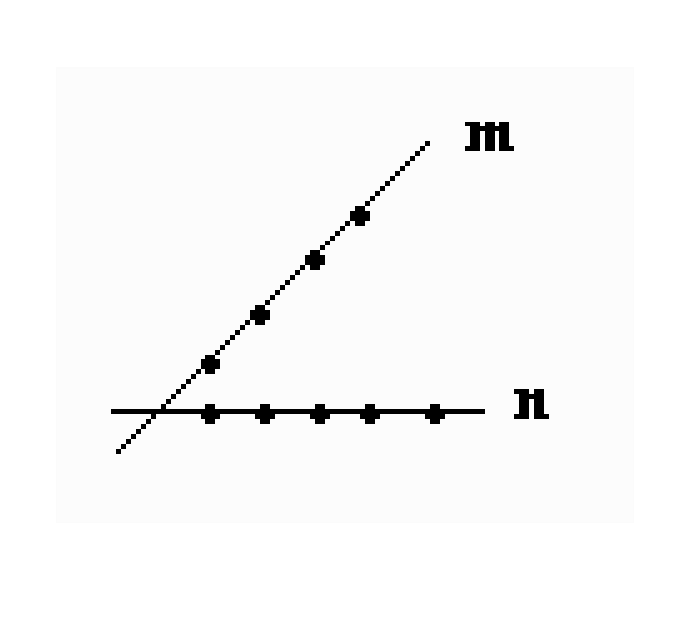

# PROVA — Camara_Florania_2007_Agente_Administrativo

## 1. Análise geral da prova

- **Identificação:** Camara_Florania_2007_Agente_Administrativo
- **Quantidade total de questões:** 40
- **Quantidade de textos de apoio (grupos):** 3
- **Quantidade de imagens:** 1
- **Quantidade de gráficos e tabelas:** incluídos nas imagens e no texto extraído, quando presentes no PDF original
- **Quantidade de grupos identificados:** 3
- **Quantidade de questões independentes:** 25
- **Questões que compartilham materiais:** texto-base das questões 01 a 15 → questões 01, 02, 03, 04, 05, 06, 14, 15; texto-base das questões 07 a 10 → questões 07, 08, 09, 10; texto-base das questões 11 a 13 → questões 11, 12, 13

### Transcrição integral da capa/instruções (conforme extraída do PDF)

> [!NOTE]
> Conteúdo integral das páginas anteriores à primeira questão, sem cortes.

> Câmara Municipal de
> Florânia/RN
> INSTRUÇÕES
> 01 – Este caderno de provas contém 40 questões de múltipla escolha.
> 02 – Para cada questão existe apenas uma resposta correta.
> 03 – Leia atentamente a questão no Caderno de Provas e escolha à alternativa que julgar correta.
> 04 – Marque as respostas com esferográficas azul ou preta preenchendo todo o retângulo da Folha de Respostas.
> 05 – As respostas à grafite ou rasuras serão consideradas erradas, na Folha de Respostas.
> 06 – Faça a sua prova em silêncio, para que todos façam também.
> 07 – Não será permitida qualquer espécie de consulta.
> 08 – Não será fornecido outro Caderno de Provas, exceto no caso do item 11.
> 09 – O tempo de duração da prova é aquele anotado na lousa.
> 10 – Este caderno, conforme disposto no Edital, não será devolvido.
> 11 – Verifique se a prova contém falhas: folhas em branco, má impressão, páginas trocadas, falta de questão etc.
> Encontrando falhas, levante a mão. O fiscal atenderá você e trocará o seu caderno.
> 12 – Ao concluir entregue ao fiscal o Caderno de Provas e a Folha de Resposta devidamente preenchida e assinada.
> CALENDÁRIO PREVISTO
> ORGANIZAÇÃO E REALIZAÇÃO
> CANDIDATO
>
> INSCRIÇÃO No
>
> SALA No
>
> ASSINATURA DO CANDIDATO
> AGENTE ADMINISTRATIVO
> ATIVIDADE
> DATA
> LOCAL
> Divulgação do gabarito e Prova Objetiva
> 07/03/2007
> www.multsai.com.br
> Prefeitura Municipal, imprensa e locais de
> realização das provas.
> Interposição de recursos contra o gabarito da Prova
> (deverá ser observado o disposto no Anexo IV do
> Edital que regulamenta o concurso)
> 08 e 09/03/2007
> www.multsai.com.br
> Presidente da Comissão Especial de
> Acompanhamento e Fiscalização do Concurso
> e entregue na sede da Prefeitura Municipal.
> Resultado do Concurso
> 23/03/2007
> www.multsai.com.br
> Prefeitura Municipal, imprensa local.
> Demais atividades consultar o Edital regulamentador do concurso ou www.multsai.com.br
>
>
>
> Questões de 01 a 15 = Português.
>  Leia o texto abaixo, com atenção para responder às
> questões propostas.

## 2. Questões agrupadas

### GRUPO 01 — Texto-base principal (editorial da VEJA sobre censura e televisão), compartilhado

**Questões relacionadas:** 01, 02, 03, 04, 05, 06, 14, 15.

#### QUESTÃO 01

⚠️ **Gabarito: oficial não disponível** (sem gabarito do acervo conferível (o PDF 'Gabarito (2)', ID 125, contém a prova sem quadro de respostas))

**Material de apoio:**

Leia o texto abaixo, com atenção para responder às questões propostas.

Num país como o Brasil, onde a pobreza faz com que a televisão seja a principal fonte de informação e entretenimento, ela desempenha um papel fundamental na vida de milhões e milhões de pessoas. A televisão não é um espelho neutro, objetivo, do que se passa na sociedade. Ela também contribui para divulgar modelos de comportamento, orientar atitudes e impor padrões de moralidade. Novelas, noticiários, filmes, programas humorísticos entram nas casas e seus personagens, conflitos e problemas passam a fazer parte da vida das pessoas. É um poder formidável que, exercido com sabedoria, além de divertir e entreter, serviria para melhorar o país.

O passado já ensinou que a censura não é, nem de longe, a maneira mais adequada de se ter uma programação melhor. A censura serviu tão-somente para desinformar a população, acobertar crimes e manter no poder políticos que chegaram a ele sem ter sido eleitos. A boa televisão só pode existir com liberdade. Entretanto, nos últimos tempos, diversas vozes vêm protestando contra os excessos cometidos pelas emissoras de televisão. Não é preciso ser um **extremista** puritano para perceber que, muitas vezes, cenas de violência gratuita, erotismo e grotesca vulgaridade são mostradas em profusão, bem cedo na noite. A alternativa do telespectador pode ser a de mudar de canal, mas quando a concorrência entre as emissoras se acirra, o nível mais baixo costuma se tornar **norma**. Se a censura não é o **caminho**, o que fazer diante

*(Nota: a última linha do texto está fisicamente cortada no PDF original do acervo e torna-se ilegível a partir daqui — o texto termina em “… o que fazer diante”. Nada foi inventado ou completado.)*

**Enunciado:**

01- De acordo com o sentido das palavras no último
parágrafo do texto, _________ equivale a _______:

**Alternativas:**

A) extremista = partidário;
B) norma = regra;
C) caminho = destino;
D) apelação = convocação.

**Referências visuais:**

Nenhuma.

---

#### QUESTÃO 02

⚠️ **Gabarito: oficial não disponível** (sem gabarito do acervo conferível (o PDF 'Gabarito (2)', ID 125, contém a prova sem quadro de respostas))

**Material de apoio:**

Leia o texto abaixo, com atenção para responder às questões propostas.

Num país como o Brasil, onde a pobreza faz com que a televisão seja a principal fonte de informação e entretenimento, ela desempenha um papel fundamental na vida de milhões e milhões de pessoas. A televisão não é um espelho neutro, objetivo, do que se passa na sociedade. Ela também contribui para divulgar modelos de comportamento, orientar atitudes e impor padrões de moralidade. Novelas, noticiários, filmes, programas humorísticos entram nas casas e seus personagens, conflitos e problemas passam a fazer parte da vida das pessoas. É um poder formidável que, exercido com sabedoria, além de divertir e entreter, serviria para melhorar o país.

O passado já ensinou que a censura não é, nem de longe, a maneira mais adequada de se ter uma programação melhor. A censura serviu tão-somente para desinformar a população, acobertar crimes e manter no poder políticos que chegaram a ele sem ter sido eleitos. A boa televisão só pode existir com liberdade. Entretanto, nos últimos tempos, diversas vozes vêm protestando contra os excessos cometidos pelas emissoras de televisão. Não é preciso ser um **extremista** puritano para perceber que, muitas vezes, cenas de violência gratuita, erotismo e grotesca vulgaridade são mostradas em profusão, bem cedo na noite. A alternativa do telespectador pode ser a de mudar de canal, mas quando a concorrência entre as emissoras se acirra, o nível mais baixo costuma se tornar **norma**. Se a censura não é o **caminho**, o que fazer diante

*(Nota: a última linha do texto está fisicamente cortada no PDF original do acervo e torna-se ilegível a partir daqui — o texto termina em “… o que fazer diante”. Nada foi inventado ou completado.)*

**Enunciado:**

02- No texto, o editor da VEJA questiona, principalmente:

**Alternativas:**

A) a primazia da televisão como fonte de educação e
entretenimento;
B) a guerra acirrada entre as emissoras pela disputa da
audiência;
C) o gosto duvidoso do público brasileiro, responsável pela
má qualidade dos espetáculos televisivos;
D) a ausência de limites morais e de uma orientação ética
nos programas de televisão.

**Referências visuais:**

Nenhuma.

---

#### QUESTÃO 03

⚠️ **Gabarito: oficial não disponível** (sem gabarito do acervo conferível (o PDF 'Gabarito (2)', ID 125, contém a prova sem quadro de respostas))

**Material de apoio:**

Leia o texto abaixo, com atenção para responder às questões propostas.

Num país como o Brasil, onde a pobreza faz com que a televisão seja a principal fonte de informação e entretenimento, ela desempenha um papel fundamental na vida de milhões e milhões de pessoas. A televisão não é um espelho neutro, objetivo, do que se passa na sociedade. Ela também contribui para divulgar modelos de comportamento, orientar atitudes e impor padrões de moralidade. Novelas, noticiários, filmes, programas humorísticos entram nas casas e seus personagens, conflitos e problemas passam a fazer parte da vida das pessoas. É um poder formidável que, exercido com sabedoria, além de divertir e entreter, serviria para melhorar o país.

O passado já ensinou que a censura não é, nem de longe, a maneira mais adequada de se ter uma programação melhor. A censura serviu tão-somente para desinformar a população, acobertar crimes e manter no poder políticos que chegaram a ele sem ter sido eleitos. A boa televisão só pode existir com liberdade. Entretanto, nos últimos tempos, diversas vozes vêm protestando contra os excessos cometidos pelas emissoras de televisão. Não é preciso ser um **extremista** puritano para perceber que, muitas vezes, cenas de violência gratuita, erotismo e grotesca vulgaridade são mostradas em profusão, bem cedo na noite. A alternativa do telespectador pode ser a de mudar de canal, mas quando a concorrência entre as emissoras se acirra, o nível mais baixo costuma se tornar **norma**. Se a censura não é o **caminho**, o que fazer diante

*(Nota: a última linha do texto está fisicamente cortada no PDF original do acervo e torna-se ilegível a partir daqui — o texto termina em “… o que fazer diante”. Nada foi inventado ou completado.)*

**Enunciado:**

03- Para sustentar seu ponto de vista, o autor vale-se de
diferentes recursos, à EXCEÇÃO de:

**Alternativas:**

A) exploração do contraste entre o que seria o ideal e o que
ocorre na realidade;
B) apresentação de situações que fundamentam afirmativas
feitas;
C) menção a fatos históricos que supõe ainda presentes na
memória do leitor;
D) proposta de uma solução definitiva e consensual para o
problema.

**Referências visuais:**

Nenhuma.

---

#### QUESTÃO 04

⚠️ **Gabarito: oficial não disponível** (sem gabarito do acervo conferível (o PDF 'Gabarito (2)', ID 125, contém a prova sem quadro de respostas))

**Material de apoio:**

I – A importância da TV, como fonte de informação e
entretenimento, é proporcional ao grau de desenvolvimento
do país.
II – Cabe à televisão assumir a sua parcela de
responsabilidade educativa e social.
III – A volta da censura é necessária para pôr fim à
vulgaridade de certos programas televisivos.
IV – Diante dos abusos cometidos pelas emissoras, o
telespectador que se sentir ferido deve simplesmente mudar
de canal ou desligar a TV.

**Enunciado:**

04- De acordo com as afirmativas acima, conclui-se que está
correta a alternativa:

**Alternativas:**

A) I e II;
B) II e III;
C) II e IV;
D) I e IV.

**Referências visuais:**

Nenhuma.

---

#### QUESTÃO 05

⚠️ **Gabarito: oficial não disponível** (sem gabarito do acervo conferível (o PDF 'Gabarito (2)', ID 125, contém a prova sem quadro de respostas))

**Material de apoio:**

Leia o texto abaixo, com atenção para responder às questões propostas.

Num país como o Brasil, onde a pobreza faz com que a televisão seja a principal fonte de informação e entretenimento, ela desempenha um papel fundamental na vida de milhões e milhões de pessoas. A televisão não é um espelho neutro, objetivo, do que se passa na sociedade. Ela também contribui para divulgar modelos de comportamento, orientar atitudes e impor padrões de moralidade. Novelas, noticiários, filmes, programas humorísticos entram nas casas e seus personagens, conflitos e problemas passam a fazer parte da vida das pessoas. É um poder formidável que, exercido com sabedoria, além de divertir e entreter, serviria para melhorar o país.

O passado já ensinou que a censura não é, nem de longe, a maneira mais adequada de se ter uma programação melhor. A censura serviu tão-somente para desinformar a população, acobertar crimes e manter no poder políticos que chegaram a ele sem ter sido eleitos. A boa televisão só pode existir com liberdade. Entretanto, nos últimos tempos, diversas vozes vêm protestando contra os excessos cometidos pelas emissoras de televisão. Não é preciso ser um **extremista** puritano para perceber que, muitas vezes, cenas de violência gratuita, erotismo e grotesca vulgaridade são mostradas em profusão, bem cedo na noite. A alternativa do telespectador pode ser a de mudar de canal, mas quando a concorrência entre as emissoras se acirra, o nível mais baixo costuma se tornar **norma**. Se a censura não é o **caminho**, o que fazer diante

*(Nota: a última linha do texto está fisicamente cortada no PDF original do acervo e torna-se ilegível a partir daqui — o texto termina em “… o que fazer diante”. Nada foi inventado ou completado.)*

**Enunciado:**

05- De acordo com o sentido que os segmentos abaixo têm
no texto, ocorre uma expressão conotativa em:

**Alternativas:**

A) “A televisão não é um espelho neutro, objetivo”;
B) “Ela também contribui para divulgar modelos de
comportamento”;
C) “personagens, conflitos e problemas passam a fazer parte
da vida das pessoas”;
D) “A boa televisão só pode existir com liberdade”.

**Referências visuais:**

Nenhuma.

---

#### QUESTÃO 06

⚠️ **Gabarito: oficial não disponível** (sem gabarito do acervo conferível (o PDF 'Gabarito (2)', ID 125, contém a prova sem quadro de respostas))

**Material de apoio:**

Leia o texto abaixo, com atenção para responder às questões propostas.

Num país como o Brasil, onde a pobreza faz com que a televisão seja a principal fonte de informação e entretenimento, ela desempenha um papel fundamental na vida de milhões e milhões de pessoas. A televisão não é um espelho neutro, objetivo, do que se passa na sociedade. Ela também contribui para divulgar modelos de comportamento, orientar atitudes e impor padrões de moralidade. Novelas, noticiários, filmes, programas humorísticos entram nas casas e seus personagens, conflitos e problemas passam a fazer parte da vida das pessoas. É um poder formidável que, exercido com sabedoria, além de divertir e entreter, serviria para melhorar o país.

O passado já ensinou que a censura não é, nem de longe, a maneira mais adequada de se ter uma programação melhor. A censura serviu tão-somente para desinformar a população, acobertar crimes e manter no poder políticos que chegaram a ele sem ter sido eleitos. A boa televisão só pode existir com liberdade. Entretanto, nos últimos tempos, diversas vozes vêm protestando contra os excessos cometidos pelas emissoras de televisão. Não é preciso ser um **extremista** puritano para perceber que, muitas vezes, cenas de violência gratuita, erotismo e grotesca vulgaridade são mostradas em profusão, bem cedo na noite. A alternativa do telespectador pode ser a de mudar de canal, mas quando a concorrência entre as emissoras se acirra, o nível mais baixo costuma se tornar **norma**. Se a censura não é o **caminho**, o que fazer diante

*(Nota: a última linha do texto está fisicamente cortada no PDF original do acervo e torna-se ilegível a partir daqui — o texto termina em “… o que fazer diante”. Nada foi inventado ou completado.)*

**Enunciado:**

06- A construção que pode substituir “exercido com
sabedoria”, no final do primeiro parágrafo, sem prejuízo
para a relação com as demais formas verbais presentes na
frase é:

**Alternativas:**

A) “quando for exercido com sabedoria”;
B) “caso seja exercido com sabedoria”;
C) ” por ser exercido com sabedoria”;
D) “porque é exercido com sabedoria”.

**Referências visuais:**

Nenhuma.

---

#### QUESTÃO 14

⚠️ **Gabarito: oficial não disponível** (sem gabarito do acervo conferível (o PDF 'Gabarito (2)', ID 125, contém a prova sem quadro de respostas))

**Material de apoio:**

Leia o texto abaixo, com atenção para responder às questões propostas.

Num país como o Brasil, onde a pobreza faz com que a televisão seja a principal fonte de informação e entretenimento, ela desempenha um papel fundamental na vida de milhões e milhões de pessoas. A televisão não é um espelho neutro, objetivo, do que se passa na sociedade. Ela também contribui para divulgar modelos de comportamento, orientar atitudes e impor padrões de moralidade. Novelas, noticiários, filmes, programas humorísticos entram nas casas e seus personagens, conflitos e problemas passam a fazer parte da vida das pessoas. É um poder formidável que, exercido com sabedoria, além de divertir e entreter, serviria para melhorar o país.

O passado já ensinou que a censura não é, nem de longe, a maneira mais adequada de se ter uma programação melhor. A censura serviu tão-somente para desinformar a população, acobertar crimes e manter no poder políticos que chegaram a ele sem ter sido eleitos. A boa televisão só pode existir com liberdade. Entretanto, nos últimos tempos, diversas vozes vêm protestando contra os excessos cometidos pelas emissoras de televisão. Não é preciso ser um **extremista** puritano para perceber que, muitas vezes, cenas de violência gratuita, erotismo e grotesca vulgaridade são mostradas em profusão, bem cedo na noite. A alternativa do telespectador pode ser a de mudar de canal, mas quando a concorrência entre as emissoras se acirra, o nível mais baixo costuma se tornar **norma**. Se a censura não é o **caminho**, o que fazer diante

*(Nota: a última linha do texto está fisicamente cortada no PDF original do acervo e torna-se ilegível a partir daqui — o texto termina em “… o que fazer diante”. Nada foi inventado ou completado.)*

**Enunciado:**

14- O conectivo ENTRETANTO (linha 18) estabelece,
entre os períodos, uma relação semântica de:

**Alternativas:**

A) adição;
B) adversidade;
C) explicação;
D) conclusão.

**Referências visuais:**

Nenhuma.

---

#### QUESTÃO 15

⚠️ **Gabarito: oficial não disponível** (sem gabarito do acervo conferível (o PDF 'Gabarito (2)', ID 125, contém a prova sem quadro de respostas))

**Material de apoio:**

Leia o texto abaixo, com atenção para responder às questões propostas.

Num país como o Brasil, onde a pobreza faz com que a televisão seja a principal fonte de informação e entretenimento, ela desempenha um papel fundamental na vida de milhões e milhões de pessoas. A televisão não é um espelho neutro, objetivo, do que se passa na sociedade. Ela também contribui para divulgar modelos de comportamento, orientar atitudes e impor padrões de moralidade. Novelas, noticiários, filmes, programas humorísticos entram nas casas e seus personagens, conflitos e problemas passam a fazer parte da vida das pessoas. É um poder formidável que, exercido com sabedoria, além de divertir e entreter, serviria para melhorar o país.

O passado já ensinou que a censura não é, nem de longe, a maneira mais adequada de se ter uma programação melhor. A censura serviu tão-somente para desinformar a população, acobertar crimes e manter no poder políticos que chegaram a ele sem ter sido eleitos. A boa televisão só pode existir com liberdade. Entretanto, nos últimos tempos, diversas vozes vêm protestando contra os excessos cometidos pelas emissoras de televisão. Não é preciso ser um **extremista** puritano para perceber que, muitas vezes, cenas de violência gratuita, erotismo e grotesca vulgaridade são mostradas em profusão, bem cedo na noite. A alternativa do telespectador pode ser a de mudar de canal, mas quando a concorrência entre as emissoras se acirra, o nível mais baixo costuma se tornar **norma**. Se a censura não é o **caminho**, o que fazer diante

*(Nota: a última linha do texto está fisicamente cortada no PDF original do acervo e torna-se ilegível a partir daqui — o texto termina em “… o que fazer diante”. Nada foi inventado ou completado.)*

**Enunciado:**

15-Em:
I – “A censura serviu tão-somente para desinformar a
população”.
II – “A ditadura militar censura as informações naquele
período”.
 Verificamos que, nos dois períodos acima, as palavras
CENSURA são:

**Alternativas:**

A) sinônimas;
B) antônimas;
C) homônimas;
D) parônimas.

**Referências visuais:**

Nenhuma.

---

### GRUPO 02 — Texto-base compartilhado pelas questões 07 a 10

**Questões relacionadas:** 07, 08, 09, 10.

#### QUESTÃO 07

⚠️ **Gabarito: oficial não disponível** (sem gabarito do acervo conferível (o PDF 'Gabarito (2)', ID 125, contém a prova sem quadro de respostas))

**Material de apoio:**

Leia o trecho, transcrito do texto, para responder às questões de 07 a 10:

“O **passado** já ensinou **que** a censura não é, nem de longe, a maneira **mais** adequada de se ter uma programação **melhor**.”

**Enunciado:**

07- Quanto à palavra CENSURA, no trecho, é correto
afirmar que:
I – Trata-se de uma palavra trissílaba/paroxítona.
II – Possui 7 letras e 6 fonemas.
III – Tem função morfossintática de substantivo e núcleo do
sujeito.

Verificamos que estão corretos:

**Alternativas:**

A) apenas os itens I e II;
B) apenas os itens II e III;
C) apenas os itens I e III;
D) todos os itens.

**Referências visuais:**

Nenhuma.

---

#### QUESTÃO 08

⚠️ **Gabarito: oficial não disponível** (sem gabarito do acervo conferível (o PDF 'Gabarito (2)', ID 125, contém a prova sem quadro de respostas))

**Material de apoio:**

Leia o trecho, transcrito do texto, para responder às questões de 07 a 10:

“O **passado** já ensinou **que** a censura não é, nem de longe, a maneira **mais** adequada de se ter uma programação **melhor**.”

**Enunciado:**

08- As palavras, em negrito no trecho, classificam-se
morfologicamente na seqüência como:

**Alternativas:**

A) substantivo – conjunção – advérbio – adjetivo;
B) adjetivo – preposição – advérbio – adjetivo;
C) substantivo – preposição – advérbio – adjetivo;
D) substantivo – conjunção – advérbio – advérbio.

**Referências visuais:**

Nenhuma.

---

#### QUESTÃO 09

⚠️ **Gabarito: oficial não disponível** (sem gabarito do acervo conferível (o PDF 'Gabarito (2)', ID 125, contém a prova sem quadro de respostas))

**Material de apoio:**

Leia o trecho, transcrito do texto, para responder às questões de 07 a 10:

“O **passado** já ensinou **que** a censura não é, nem de longe, a maneira **mais** adequada de se ter uma programação **melhor**.”

**Enunciado:**

09- No trecho, o conectivo QUE introduz uma oração:

**Alternativas:**

A) coordenada sindética;
B) subordinada substantiva;
C) subordinada adjetiva;
D) subordinada adverbial.

**Referências visuais:**

Nenhuma.

---

#### QUESTÃO 10

⚠️ **Gabarito: oficial não disponível** (sem gabarito do acervo conferível (o PDF 'Gabarito (2)', ID 125, contém a prova sem quadro de respostas))

**Material de apoio:**

Leia o trecho, transcrito do texto, para responder às questões de 07 a 10:

“O **passado** já ensinou **que** a censura não é, nem de longe, a maneira **mais** adequada de se ter uma programação **melhor**.”

**Enunciado:**

10- O período em questão no trecho:

**Alternativas:**

A) é formado por 2 orações;
B) é formado por 3 orações;
C) é formado por 4 orações;
D) trata-se de um período simples.

**Referências visuais:**

Nenhuma.

---

### GRUPO 03 — Texto-base compartilhado pelas questões 11 a 13

**Questões relacionadas:** 11, 12, 13.

#### QUESTÃO 11

⚠️ **Gabarito: oficial não disponível** (sem gabarito do acervo conferível (o PDF 'Gabarito (2)', ID 125, contém a prova sem quadro de respostas))

**Material de apoio:**

O período abaixo, transcrito do texto, servirá de base para as questões de 11 a 13:

“A televisão não é um espelho neutro, objetivo.”

**Enunciado:**

11- Temos no período:

**Alternativas:**

A) sujeito indeterminado e predicado nominal;
B) sujeito simples e predicado verbal;
C) sujeito simples e predicado nominal;
D) sujeito simples e predicado verbo-nominal.

**Referências visuais:**

Nenhuma.

---

#### QUESTÃO 12

⚠️ **Gabarito: oficial não disponível** (sem gabarito do acervo conferível (o PDF 'Gabarito (2)', ID 125, contém a prova sem quadro de respostas))

**Material de apoio:**

O período abaixo, transcrito do texto, servirá de base para as questões de 11 a 13:

“A televisão não é um espelho neutro, objetivo.”

**Enunciado:**

12- No período, UM é morfossintaticamente classificado
como:

**Alternativas:**

A) artigo e adjunto adnominal;
B) numeral e adjunto adnominal;
C) artigo e adjunto adverbial;
D) numeral e adjunto adverbial.

**Referências visuais:**

Nenhuma.

---

#### QUESTÃO 13

⚠️ **Gabarito: oficial não disponível** (sem gabarito do acervo conferível (o PDF 'Gabarito (2)', ID 125, contém a prova sem quadro de respostas))

**Material de apoio:**

O período abaixo, transcrito do texto, servirá de base para as questões de 11 a 13:

“A televisão não é um espelho neutro, objetivo.”

**Enunciado:**

13- No período, se modificássemos o tempo verbal para o
pretérito imperfeito do indicativo teríamos:

**Alternativas:**

A) seria;
B) será;
C) foi;
D) era.

**Referências visuais:**

Nenhuma.

---

## 3. Questões independentes

#### QUESTÃO 16

⚠️ **Gabarito: oficial não disponível** (sem gabarito do acervo conferível (o PDF 'Gabarito (2)', ID 125, contém a prova sem quadro de respostas))

**Enunciado:**

16- Em uma biblioteca existem 8 portas de acesso. O número
de modos dessa biblioteca estar aberta é:

**Alternativas:**

A) 40.320;
B) 20.160;
C) 255;
D) 9.

**Referências visuais:**

Nenhuma.

---

#### QUESTÃO 17

⚠️ **Gabarito: oficial não disponível** (sem gabarito do acervo conferível (o PDF 'Gabarito (2)', ID 125, contém a prova sem quadro de respostas))

**Enunciado:**

17- Formados e dispostos em ordem crescente todos os
números que se obtêm permutando os algarismos 1, 2, 3 e 4,
qual a posição ocupada pelo número 4.213?

**Alternativas:**

A) 24;
B) 23;
C) 22;
D) 21.

**Referências visuais:**

Nenhuma.

---

#### QUESTÃO 18

⚠️ **Gabarito: oficial não disponível** (sem gabarito do acervo conferível (o PDF 'Gabarito (2)', ID 125, contém a prova sem quadro de respostas))

**Enunciado:**

18- Na figura, marcamos 4 pontos distintos em **m** e 5 pontos
distintos em **n**.
- O número de triângulos com vértices nesses pontos é igual a:

**Alternativas:**

A) 20;
B) 50;
C) 60;
D) 70.

**Referências visuais:**



---

#### QUESTÃO 19

⚠️ **Gabarito: oficial não disponível** (sem gabarito do acervo conferível (o PDF 'Gabarito (2)', ID 125, contém a prova sem quadro de respostas))

**Enunciado:**

19- O número de soluções naturais da equação x + y + z = 10
é igual a:

**Alternativas:**

A) 66;
B) 120;
C) 46;
D) 210.

**Referências visuais:**

Nenhuma.

---

#### QUESTÃO 20

⚠️ **Gabarito: oficial não disponível** (sem gabarito do acervo conferível (o PDF 'Gabarito (2)', ID 125, contém a prova sem quadro de respostas))

**Enunciado:**

20- Seja uma matriz A =

```
    ⎡ 2   3   4 ⎤
A = ⎢ 4   9  16 ⎥
    ⎣ 8  27  64 ⎦
```

o valor do seu determinante é igual a:

**Alternativas:**

A) 0;
B) 1;
C) 24;
D) 48.

**Referências visuais:**

Nenhuma.

---

#### QUESTÃO 21

⚠️ **Gabarito: oficial não disponível** (sem gabarito do acervo conferível (o PDF 'Gabarito (2)', ID 125, contém a prova sem quadro de respostas))

**Enunciado:**

21- Quantos múltiplos de 7 existem entre 5 e 505?

**Alternativas:**

A) 70;
B) 72;
C) 77;
D) 84.

**Referências visuais:**

Nenhuma.

---

#### QUESTÃO 22

⚠️ **Gabarito: oficial não disponível** (sem gabarito do acervo conferível (o PDF 'Gabarito (2)', ID 125, contém a prova sem quadro de respostas))

**Enunciado:**

22- Uma bola elástica cai de uma altura de h metros,
elevando-se, em cada pulo, a altura igual a 3/4 da que caiu
anteriormente. O espaço percorrido pela bola ao bater no
solo pela quarta vez é:

**Alternativas:**

A) 45h/8;
B) 55h/8;
C) 207h/32;
D) 217h/32.

**Referências visuais:**

Nenhuma.

---

#### QUESTÃO 23

⚠️ **Gabarito: oficial não disponível** (sem gabarito do acervo conferível (o PDF 'Gabarito (2)', ID 125, contém a prova sem quadro de respostas))

**Enunciado:**

23- Joãozinho brinca com um pedaço de arame de 40 cm e
começa a formar retângulos, observando áreas diferentes.
Qual o maior retângulo que ele conseguiu formar em termos
de área?

**Alternativas:**

A) 75 cm²
B) 84 cm²
C) 91 cm²
D) 100 cm²

**Referências visuais:**

Nenhuma.

---

#### QUESTÃO 24

⚠️ **Gabarito: oficial não disponível** (sem gabarito do acervo conferível (o PDF 'Gabarito (2)', ID 125, contém a prova sem quadro de respostas))

**Enunciado:**

24- A função f do 1°grau cujo gráfico passa pelos pontos A
(- 2; 10) e B (1; 4), corresponde a:

**Alternativas:**

A) f (x) = 2x – 6
B) f (x) = - 2x + 6
C) f (x) = 2x + 6
D) f (x) = - 2x – 6

**Referências visuais:**

Nenhuma.

---

#### QUESTÃO 25

⚠️ **Gabarito: oficial não disponível** (sem gabarito do acervo conferível (o PDF 'Gabarito (2)', ID 125, contém a prova sem quadro de respostas))

**Enunciado:**

25- As dimensões de um paralelepípedo reto – retângulo, de
área total 376m², são proporcionais a 3, 4 e 5. O seu volume
é de:

**Alternativas:**

A) 480 m³
B) 1.620 m³
C) 960 m³
D) 3.340 m³

**Referências visuais:**

Nenhuma.

---

#### QUESTÃO 26

⚠️ **Gabarito: oficial não disponível** (sem gabarito do acervo conferível (o PDF 'Gabarito (2)', ID 125, contém a prova sem quadro de respostas))

**Enunciado:**

26- Se a área da base de um prisma diminui em 10% e a
altura aumenta em 20%, o seu volume:

**Alternativas:**

A) aumenta de 10%;
B) aumenta de 8%;
C) diminui de 10%;
D) não se altera.

**Referências visuais:**

Nenhuma.

---

#### QUESTÃO 27

⚠️ **Gabarito: oficial não disponível** (sem gabarito do acervo conferível (o PDF 'Gabarito (2)', ID 125, contém a prova sem quadro de respostas))

**Enunciado:**

27- Num cilindro circular reto, a área lateral é 30π m² e a
área total vale 48π m² . Adotando π = 3, o seu volume em
m³ é equivalente a:

**Alternativas:**

A) 45;
B) 90;
C) 135;
D) 270.

**Referências visuais:**

Nenhuma.

---

#### QUESTÃO 28

⚠️ **Gabarito: oficial não disponível** (sem gabarito do acervo conferível (o PDF 'Gabarito (2)', ID 125, contém a prova sem quadro de respostas))

**Enunciado:**

28- Observe a seqüência:

1
11
21
1211
111221
*(linha seguinte do original: caractere degradado/ilegível na digitalização do PDF)*

O próximo número da seqüência será:

**Alternativas:**

A) 1111321;
B) 1122211;
C) 312211;
D) 311221.

**Referências visuais:**

Nenhuma.

---

#### QUESTÃO 29

⚠️ **Gabarito: oficial não disponível** (sem gabarito do acervo conferível (o PDF 'Gabarito (2)', ID 125, contém a prova sem quadro de respostas))

**Enunciado:**

29- Se a = 0,666…; b = 1,333…; c = 0,1414…, o valor de a · b⁻¹ + c é igual a:

**Alternativas:**

A) 67/99;
B) 123/199;
C) 127/198;
D) 117/198.

**Referências visuais:**

Nenhuma.

---

#### QUESTÃO 30

⚠️ **Gabarito: oficial não disponível** (sem gabarito do acervo conferível (o PDF 'Gabarito (2)', ID 125, contém a prova sem quadro de respostas))

**Enunciado:**

30- O conjugado do número complexo z = (1 + i)² / (1 − i⁴³) é:

**Alternativas:**

A) 1 − i
B) −1 − i
C) −1 + i
D) 1 + i

**Referências visuais:**

Nenhuma.

---

## 3. Questões independentes

#### QUESTÃO 31

⚠️ **Gabarito: oficial não disponível** (sem gabarito do acervo conferível (o PDF 'Gabarito (2)', ID 125, contém a prova sem quadro de respostas))

**Enunciado:**

31– De conformidade com os limites do município de Flórânia, assinale a alternativa correta:

1.1 - ao Norte com Santana do Matos e Jucurutu;
1.2 - ao Sul com Cruzeta e São Vicente;
1.3 - ao Leste com Jucurutu e Caicó;
1.4 - ao Oeste com Tenente Laurentino Cruz e São Vicente.

**Alternativas:**

A) todas as afirmativas estão corretas;
B) apenas as afirmativas 1.1 e 1.2 estão corretas;
C) apenas as afirmativas 1.3 e 1.4 estão corretas;
D) apenas as afirmativas 1.2 e 1.4 estão corretas.

**Referências visuais:**

Nenhuma.

---

#### QUESTÃO 32

⚠️ **Gabarito: oficial não disponível** (sem gabarito do acervo conferível (o PDF 'Gabarito (2)', ID 125, contém a prova sem quadro de respostas))

**Enunciado:**

32– Segundo dados do IDEMA a distância da sede do município de Flórânia em relação à Capital do Estado é de ______ Km.

**Alternativas:**

A) 216;
B) 220;
C) 225;
D) 230.

**Referências visuais:**

Nenhuma.

---

#### QUESTÃO 33

⚠️ **Gabarito: oficial não disponível** (sem gabarito do acervo conferível (o PDF 'Gabarito (2)', ID 125, contém a prova sem quadro de respostas))

**Enunciado:**

33– Antes de ser denominado de Flores de Vossurubu, Flórânia era chamado de:

**Alternativas:**

A) Flores;
B) Roça do Urubu;
C) Roça do Vossurubu;
D) Flores do Urubu.

**Referências visuais:**

Nenhuma.

---

#### QUESTÃO 34

⚠️ **Gabarito: oficial não disponível** (sem gabarito do acervo conferível (o PDF 'Gabarito (2)', ID 125, contém a prova sem quadro de respostas))

**Enunciado:**

34– A mídia divulgou em peso e o país ficou chocado com o caso de dois homens que queimaram vivos, dentro de um carro, um casal, seu filho de cinco anos e mais uma pessoa, tendo o crime ocorrido no Estado de São Paulo, na Cidade de:

**Alternativas:**

A) Uberaba;
B) Bragança;
C) Santo André;
D) Itu.

**Referências visuais:**

Nenhuma.

---

#### QUESTÃO 35

⚠️ **Gabarito: oficial não disponível** (sem gabarito do acervo conferível (o PDF 'Gabarito (2)', ID 125, contém a prova sem quadro de respostas))

**Enunciado:**

35– Era território nacional e passou a ser Distrito Estadual de Pernambuco. O Enunciado está se referindo:

**Alternativas:**

A) a Ilha do Mel;
B) Ilha de Marajó;
C) Arquipélago de Abrolhos;
D) Arquipélago de Fernando de Noronha.

**Referências visuais:**

Nenhuma.

---

#### QUESTÃO 36

⚠️ **Gabarito: oficial não disponível** (sem gabarito do acervo conferível (o PDF 'Gabarito (2)', ID 125, contém a prova sem quadro de respostas))

**Enunciado:**

36– Dos Nomes abaixo, qual NÃO é Ministro de Estado do Governo Lula?

**Alternativas:**

A) Fernando Freire;
B) Marina Silva;
C) Gilberto Gil;
D) Tarso Genro.

**Referências visuais:**

Nenhuma.

---

#### QUESTÃO 37

⚠️ **Gabarito: oficial não disponível** (sem gabarito do acervo conferível (o PDF 'Gabarito (2)', ID 125, contém a prova sem quadro de respostas))

**Enunciado:**

37– A sua capital é Rio Branco:

**Alternativas:**

A) Rondônia;
B) Roraima;
C) Acre;
D) Tocantins.

**Referências visuais:**

Nenhuma.

---

#### QUESTÃO 38

⚠️ **Gabarito: oficial não disponível** (sem gabarito do acervo conferível (o PDF 'Gabarito (2)', ID 125, contém a prova sem quadro de respostas))

**Enunciado:**

38– Conforme noticiado pela mídia em geral, a Cúpula do Mercosul se reuniu em janeiro com a presença de diversos chefes de Estado do nosso continente, sendo a reunião realizada na cidade de:

**Alternativas:**

A) Porto Alegre;
B) Natal;
C) Rio de Janeiro;
D) Fortaleza.

**Referências visuais:**

Nenhuma.

---

#### QUESTÃO 39

⚠️ **Gabarito: oficial não disponível** (sem gabarito do acervo conferível (o PDF 'Gabarito (2)', ID 125, contém a prova sem quadro de respostas))

**Enunciado:**

39– Após o regime militar, foi convocada a Assembléia Nacional Constituinte, que teve como presidente:

**Alternativas:**

A) Ulysses Guimarães;
B) Tancredo Neves;
C) José Sarney;
D) Antônio Carlos Magalhães.

**Referências visuais:**

Nenhuma.

---

#### QUESTÃO 40

⚠️ **Gabarito: oficial não disponível** (sem gabarito do acervo conferível (o PDF 'Gabarito (2)', ID 125, contém a prova sem quadro de respostas))

**Enunciado:**

40– A Constituição de 1988 trouxe algumas conquistas para o trabalhador. Das alternativas abaixo, assinale a que NÃO faz parte de algumas conquistas:

**Alternativas:**

A) Licença paternidade de cinco dias;
B) Licença Gestante de cento e vinte dias;
C) Férias remuneradas com um terço (1/3) a mais que o salário normal;
D) Jornada de Trabalho de quarenta horas semanais.

**Referências visuais:**

Nenhuma.

---

## 4. Observações e limitações da extração

### Auditoria estrutural — reconstrução conforme PDF original do acervo (ID 125)

- QUESTÕES 31 A 40 (Conhecimentos Gerais) estavam ausentes nesta versão — transcritas integralmente do PDF do acervo (ID 125, páginas 3–4), incluindo o enunciado integral de cada uma.
- Materiais de apoio religados às questões corretas: a extração automática original desalinhava os blocos e o conteúdo da questão anterior vazava para a questão seguinte.
- As questões 16 a 30 (Matemática) não possuem texto-base compartilhado no PDF original (o rótulo “Questões de 16 a 30 = Matemática” é apenas divisão de seção da prova); foram movidas para “Questões independentes”.
- Q18: figura das retas m e n recortada do PDF original (`imagens/imagem_001.png`) e alternativas (A) 20 B) 50 C) 60 D) 70) recompostas — faltavam nesta versão.
- Q20: matriz 3×3 recomposta (camada de texto ilegível no original). Q22: fração 3/4 recomposta. Q29/Q30: enunciados e alternativas com frações recompostos.
- Q28: a linha seguinte da sequência aparece degradada/ilegível na digitalização do PDF original — transcritas apenas as linhas legíveis; nada foi inventado.
- A última linha do texto principal está fisicamente cortada no PDF original (termina em “… o que fazer diante”) — limitação registrada no material.
- Superscritos (cm², m², m³) normalizados conforme o original impresso.


- Extração automática (texto selecionável do PDF via PyMuPDF), sem OCR: PDFs escaneados podem perder texto.
- Imagens repetidas (logos/marcas d'água) foram descartadas; as imagens de conteúdo foram salvas em `imagens/` com nomenclatura `imagem_00N`.
- A detecção de grupos usa os avisos padrão das bancas ("o texto seguinte servirá de base..."). Bancas sem esse aviso podem ter grupos não identificados — o conteúdo, porém, permanece integral.
- Se houver divergência entre esta versão e o PDF original, vale o PDF original; corrija manualmente o Markdown.
- Gabarito oficial não disponível/pareado — nenhuma resposta foi preenchida.
