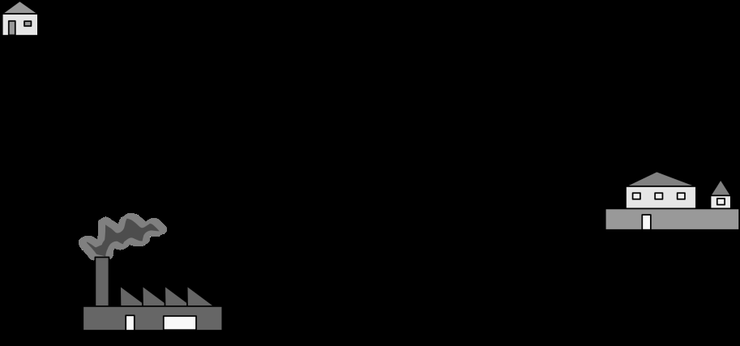

# PROVA — Camara_Flores_2019_Agente_Administrativo

## 1. Análise geral da prova

- **Identificação:** Camara_Flores_2019_Agente_Administrativo
- **Quantidade total de questões:** 40
- **Quantidade de textos de apoio (grupos):** 0
- **Quantidade de imagens:** 1
- **Quantidade de gráficos e tabelas:** incluídos nas imagens e no texto extraído, quando presentes no PDF original
- **Quantidade de grupos identificados:** 0
- **Quantidade de questões independentes:** 40
- **Questões que compartilham materiais:** nenhuma identificada automaticamente

### Transcrição integral da capa/instruções (conforme extraída do PDF)

> [!NOTE]
> Conteúdo integral das páginas anteriores à primeira questão, sem cortes.

> CONCURSO PÚBLICO N.º 001/2019
> CARGO: AGENTE ADMINISTRATIVO
> INSTRUÇÕES:
> VERIFIQUE SE ESTE CADERNO:
>
> 
> Corresponde a sua opção de cargo.
> 
> Contém 40 (quarenta) questões, numeradas de 01 a 40, caso contrário reclame ao fiscal da sala outro
> caderno. NÃO serão aceitas reclamações posteriores.
> 
> Para cada questão existe apenas UMA resposta certa.
> 
> Você deve ler cuidadosamente cada uma das questões e escolher a resposta certa.
> 
> A alternativa escolhida deve ser marcada na FOLHA DE RESPOSTAS que você recebeu.
> VOCÊ DEVE:
>
> 
> Procurar na FOLHA DE RESPOSTAS, o número da questão que você está respondendo.
> 
> Verificar no caderno de prova qual a letra (A, B, C, D, E) da resposta que você escolheu.
> 
> Marcar essa letra na FOLHA DE RESPOSTAS, conforme o exemplo: [█].
> ATENÇÃO:
>
> 
> Marque as respostas com caneta esferográfica azul ou preta.
> 
> Marque apenas uma letra para cada questão, mais de uma letra assinalada implicará nota zero à
> questão.
> 
> Não será permitida qualquer espécie de consulta, nem o uso de máquina calculadora.
> 
> Você terá 3 (três) horas para responder a todas as questão e preencher a folha de respostas.
> 
> Devolva esse caderno de prova ao aplicador, juntamente com a sua folha de respostas.
> 
> Proibida a divulgação ou impressão parcial ou total da presente prova. Direitos Reservados.
>
>
>
> CONCURSO PÚBLICO N.º 001/2190
> CÂMARA MUNICIPAL DE FLORES-PE
> RASCUNHO
>
>
>
> CONCURSO PÚBLICO N.º 001/2190
> CÂMARA MUNICIPAL DE FLORES-PE
> LÍNGUA PORTUGUESA – QUESTÕES 01 – 12 (02 PONTOS)
> Sexo e temperamento em três sociedades primitivas
> Nos anos 30, Margareth Mead comparou três sociedades primitivas da Nova Guiné, visando observar como
> as atitudes sociais se relacionavam com as diferenças sexuais. A partir dos resultados obtidos na pesquisa, concluiu
> que a crença, então compartilhada na sociedade americana, em um temperamento inato ligado ao sexo não era
> universal. Segundo ela, toda cultura determina de algum modo os papéis dos homens e das mulheres, mas não o faz
> necessariamente em termos de contraste entre as personalidades prescritas para os dois sexos nem em termos de
> dominação ou submissão.
> Entre os povos estudados por Mead, os montanheses Arapesh, agricultores e criadores de porcos, eram
> (homens e mulheres) maternais, cooperativos, sociáveis, pouco individualistas e orientados para as necessidades da
> geração seguinte. Em síntese, um povo com características “femininas”.
> Já os ferozes caçadores de cabeça Mundugumor, agricultores e pescadores, eram o extremo oposto. De
> acordo com a autora, desprezando o sexo como base para o estabelecimento de diferenças de personalidade,
> padronizaram o comportamento de homens e mulheres como “ativamente masculino, viril e sem quaisquer das
> características edulcoradas que estamos acostumados a considerar indiscutivelmente femininas”. Esse povo era
> formado por indivíduos implacáveis que se aproximavam de um tipo de personalidade que, na cultura americana, só
> se encontraria em homens indisciplinados e extremamente violentos.
> Nos Tchambuli, por sua vez, pescadores lacustres e amantes das artes, havia uma inversão das atitudes
> sexuais: a mulher seria o parceiro dirigente, dominador e impessoal, e o homem, menos responsável e
> emocionalmente dependente.
> Para Mead, o fato de que traços de temperamento tradicionalmente considerados femininos fossem, em uma
> tribo, erigidos como padrão masculino e, em outra, prescritos para a maioria das mulheres e dos homens demonstra
> não haver base para considerar tais aspectos comportamentais vinculados ao sexo. Essa conclusão seria reforçada
> pela inversão da posição de dominância entre os sexos no terceiro povo estudado.
> (PISCITELLI, Adriana. Uma questão de gênero – Mente cérebro. São Paulo: Duetto Editorial, 2008. p. 24)

## 2. Questões agrupadas

Nenhum grupo de questões compartilhando material foi identificado automaticamente nesta prova.

## 3. Questões independentes

#### QUESTÃO 01

⚠️ **Gabarito: oficial não disponível** (sem gabarito no acervo (ID 124 contém apenas a prova))

**Enunciado:**

Pode-se firmar sobre o texto que:

**Alternativas:**

A) Os papéis relativos a homens e mulheres são determinados por sua natureza sexual, ou seja, de gênero, que se
repete nas diversas civilizações, como chega à conclusão a autora.
B) Cada cultura determina de algum modo os papéis dos homens e das mulheres em sua sociedade; assim os papéis
não necessariamente se repetem nas diferentes sociedades por causa apenas do gênero.
C) Os povos Arapesh e Tchambuli, segundo Margareth Mead, apresentavam características semelhantes: eram mais
maternais; enquanto o povo Mundugumor era extremante viril, independente do sexo biológico.
D) O povo Mundugumor apresentava características demasiado masculinas nos homens, que eram agricultores e
pescadores, muito violentos, ao contrário de suas mulheres.
E) O povo Tchambuli era extremamente sensível, tanto os homens quanto as mulheres, o que gerava uma dificuldade
de relacionamento entre s gêneros.

**Referências visuais:**

Nenhuma.

---

#### QUESTÃO 02

⚠️ **Gabarito: oficial não disponível** (sem gabarito no acervo (ID 124 contém apenas a prova))

**Enunciado:**

O texto apresenta características marcadamente da tipologia:

**Alternativas:**

A) narrativa
B) descritiva
C) expositiva
D) argumentativa
E) injuntiva

**Referências visuais:**

Nenhuma.

---

#### QUESTÃO 03

⚠️ **Gabarito: oficial não disponível** (sem gabarito no acervo (ID 124 contém apenas a prova))

**Enunciado:**

Em relação à temática do texto, pode-se afirmar que há uma abordagem de caráter:

**Alternativas:**

A) memorialista
B) nostálgico
C) sociológico
D) antropológico
E) estético
CONCURSO PÚBLICO N.º 001/2190
CÂMARA MUNICIPAL DE FLORES-PE

**Referências visuais:**

Nenhuma.

---

#### QUESTÃO 04

⚠️ **Gabarito: oficial não disponível** (sem gabarito no acervo (ID 124 contém apenas a prova))

**Enunciado:**

O adjetivo “lacustre” (4º parágrafo) se refere àquilo que é próprio:

**Alternativas:**

A) de chuva
B) de lago
C) de rio
D) de selo
E) de mar

**Referências visuais:**

Nenhuma.

---

#### QUESTÃO 05

⚠️ **Gabarito: oficial não disponível** (sem gabarito no acervo (ID 124 contém apenas a prova))

**Enunciado:**

No primeiro período do texto: “Nos anos 30, Margareth Mead comparou três sociedades primitivas da Nova
Guiné, visando observar como as atitudes sociais se relacionavam com as diferenças sexuais.” A forma verbal
destacada introduz uma oração com valor semântico de:

**Alternativas:**

A) finalidade
B) causa
C) modo
D) tempo
E) concessão

**Referências visuais:**

Nenhuma.

---

#### QUESTÃO 06

⚠️ **Gabarito: oficial não disponível** (sem gabarito no acervo (ID 124 contém apenas a prova))

**Enunciado:**

Assinale a opção com informação INCORRETA sobre a pontuação do 2º parágrafo:

**Alternativas:**

A) As vírgulas 2ª e 3ª são obrigatórias, segundo as normas gramaticais.
B) Poder-se-iam substituir as vírgulas 2ª e 3ª por travessões, mantendo-se a correção gramatical.
C) Os parênteses utilizados poderiam ser substituídos por travessões, sem comprometer as normas gramaticais.
D) As vírgulas 4ª, 5ª e 6ª separam termos com funções sintáticas distintas.
E) A última vírgula admite o uso facultativo.

**Referências visuais:**

Nenhuma.

---

#### QUESTÃO 07

⚠️ **Gabarito: oficial não disponível** (sem gabarito no acervo (ID 124 contém apenas a prova))

**Enunciado:**

Os termos destacados nas passagens abaixo retiradas do texto desempenham o mesmo papel
morfológico, EXCETO:

**Alternativas:**

A) “(...) as atitudes sociais se relacionavam com as diferenças sexuais.” (1º parágrafo)
B) “(...) em um temperamento inato ligado ao sexo não era universal.” (1º parágrafo)
C) “(...) mas não o faz necessariamente em termos de contraste(...)” (1º parágrafo)
D) “Entre os povos estudados por Mead, (...)” (2º parágrafo)
E) “(...) eram o extremo oposto.” (3º parágrafo)

**Referências visuais:**

Nenhuma.

---

#### QUESTÃO 08

⚠️ **Gabarito: oficial não disponível** (sem gabarito no acervo (ID 124 contém apenas a prova))

**Enunciado:**

O vocábulo “inato” (1º parágrafo) apresenta uma relação sinonímica com o seguinte vocábulo da opção:

**Alternativas:**

A) congênito
B) impróprio
C) perene
D) prototípico
E) ímpio

**Referências visuais:**

Nenhuma.

---

#### QUESTÃO 09

⚠️ **Gabarito: oficial não disponível** (sem gabarito no acervo (ID 124 contém apenas a prova))

**Enunciado:**

O vocábulo em destaque no excerto “(...) então compartilhada na sociedade americana, (...)” expressa uma
circunstância adverbial corretamente apontada na alternativa:

**Alternativas:**

A) conclusão
B) condição
C) tempo
D) modo
E) meio

**Referências visuais:**

Nenhuma.

---

#### QUESTÃO 10

⚠️ **Gabarito: oficial não disponível** (sem gabarito no acervo (ID 124 contém apenas a prova))

**Enunciado:**

O termo destacado na passagem “os montanheses Arapesh, agricultores e criadores de porcos, eram (homens
e mulheres) maternais, (...)” (2º parágrafo) desempenha um papel sintático de:

**Alternativas:**

A) adjunto adnominal
B) aposto
C) complemento nominal
D) núcleo do sujeito
E) predicativo do sujeito
CONCURSO PÚBLICO N.º 001/2190
CÂMARA MUNICIPAL DE FLORES-PE

**Referências visuais:**

Nenhuma.

---

#### QUESTÃO 11

⚠️ **Gabarito: oficial não disponível** (sem gabarito no acervo (ID 124 contém apenas a prova))

**Enunciado:**

Em todas as alternativas abaixo, há elementos coesivos destacados que se referem a termos
anteriormente expressos no texto, com EXCEÇÃO da opção:

**Alternativas:**

A) “Segundo ela, toda cultura determina de algum modo os papéis dos homens e das mulheres, (...)” (1º parágrafo)
B) “(...) mas não o faz necessariamente em termos de contraste entre as personalidades prescritas (...)” (1º parágrafo)
C) “(...) e sem quaisquer das características edulcoradas que estamos acostumados a considerar indiscutivelmente
femininas”. (2º parágrafo)
D) “Esse povo era formado por indivíduos implacáveis (...)” (3º parágrafo)
E) “Essa conclusão seria reforçada pela inversão da posição de dominância entre os sexos no terceiro povo
estudado.” (5º parágrafo)

**Referências visuais:**

Nenhuma.

---

#### QUESTÃO 12

⚠️ **Gabarito: oficial não disponível** (sem gabarito no acervo (ID 124 contém apenas a prova))

**Enunciado:**

Como o vocábulo “papéis” (1º parágrafo), acentua-se o vocábulo da alternativa:

**Alternativas:**

A) destróier
B) armazém
C) vocês
D) pés
E) céu

**Referências visuais:**

Nenhuma.

---

#### QUESTÃO 13

⚠️ **Gabarito: oficial não disponível** (sem gabarito no acervo (ID 124 contém apenas a prova))

**Enunciado:**

Considere o seguinte padrão de números

16 ?
O número que substitui o símbolo “?” é

**Alternativas:**

A) 25
B) 23
C) 32
D) 20
E) 28

**Referências visuais:**

Nenhuma.

---

#### QUESTÃO 14

⚠️ **Gabarito: oficial não disponível** (sem gabarito no acervo (ID 124 contém apenas a prova))

**Enunciado:**

Considere a seguinte frase: “Se hoje é sábado, então ontem eu estudei”. Todas as afirmações estão
corretas, EXCETO:

**Alternativas:**

A) Hoje é sábado e ontem estudei
B) Hoje não é sábado e ontem não estudei
C) Hoje é sábado e ontem não estudei
D) Hoje não é sábado e ontem estudei
E) Ontem não estudei e hoje não é sábado

**Referências visuais:**

Nenhuma.

---

#### QUESTÃO 15

⚠️ **Gabarito: oficial não disponível** (sem gabarito no acervo (ID 124 contém apenas a prova))

**Enunciado:**

Nas segundas, quartas e sextas, Paulo faz o seguinte caminho: Casa -> Escola -> Fábrica -> Casa. Nas
terças e quintas ele faz o seguinte trajeto: Casa -> Escola -> Fábrica -> Escola -> Casa.

CONCURSO PÚBLICO N.º 001/2190
CÂMARA MUNICIPAL DE FLORES-PE
A distância percorrida por Paulo de segunda a sexta é:

**Alternativas:**

A) 76,7 km
B) 62,5 km
C) 98,0 km
D) 82,0 km
E) 85,3 km

**Referências visuais:**

---

#### QUESTÃO 16

⚠️ **Gabarito: oficial não disponível** (sem gabarito no acervo (ID 124 contém apenas a prova))

**Enunciado:**

Dois sanduíches e três refrigerantes custam R$ 20,00. Três sanduíches e dois refrigerantes custam R$
24,00. Um sanduíche e um refrigerante custam:

**Alternativas:**

A) R$ 6,40
B) R$ 2,40
C) R$ 12,80
D) R$ 8,80
E) R$ 7,20

**Referências visuais:**

Nenhuma.

---

#### QUESTÃO 17

⚠️ **Gabarito: oficial não disponível** (sem gabarito no acervo (ID 124 contém apenas a prova))

**Enunciado:**

Considere a análise a seguir, a respeito da identidade cultural brasileira, e marque a alternativa que
contém os termos que preenchem corretamente a lacuna.
“É devido à __________ no Brasil que é possível dizer que nosso país possui uma identidade cultural
muito variada. Na verdade, parece uma tarefa muito complexa definir um perfil para a população brasileira,
já que existe no país uma multiplicidade de costumes, crenças e até mesmo de fisionomias”. (Portal
Estudo Prático, 17/06/2019, com adaptações).

**Alternativas:**

A) polarização
B) religiosidade
C) miscigenação
D) luta de classes
E) desigualdade social

**Referências visuais:**

Nenhuma.

---

#### QUESTÃO 18

⚠️ **Gabarito: oficial não disponível** (sem gabarito no acervo (ID 124 contém apenas a prova))

**Enunciado:**

Os chamados “Objetivos para o Desenvolvimento Sustentável” são um conjunto de dezessete metas
globais estabelecidas pela Organização das Nações Unidas. Marque a alternativa que NÃO apresenta uma
dessas metas.

**Alternativas:**

A) Acabar com a pobreza em todas as suas formas, em todos os lugares.
B) Tomar medidas urgentes para combater a mudança do clima e seus impactos.
C) Assegurar a disponibilidade e gestão sustentável da água e saneamento para todos.
D) Assegurar uma vida saudável e promover o bem-estar para todos, em todas as idades.
E) Substituir o desenvolvimento econômico por uma abordagem exclusivamente ambiental.

**Referências visuais:**

Nenhuma.

---

#### QUESTÃO 19

⚠️ **Gabarito: oficial não disponível** (sem gabarito no acervo (ID 124 contém apenas a prova))

**Enunciado:**

Em 22 de março de 2019, representantes de oito países sul-americanos assinaram a Declaração de
Santiago, um documento com uma proposta para a criação do Prosul, fórum de desenvolvimento e
integração regional, que deve substituir a União das Nações Sul-Americanos (Unasul). Qual dos países
abaixo não esteve presente na assinatura da Declaração de Santiago?

**Alternativas:**

A) Argentina.
B) Chile.
C) Venezuela.
D) Paraguai.
E) Equador.

**Referências visuais:**

Nenhuma.

---

#### QUESTÃO 20

⚠️ **Gabarito: oficial não disponível** (sem gabarito no acervo (ID 124 contém apenas a prova))

**Enunciado:**

O BREXIT, o movimento de saída do Reino Unido da União Europeia, foi permeado de percalços e
graves crises políticas no País. A última primeira-ministra britânica foi uma vítima do caos criado, após
negociar um acordo de divórcio com a União Europeia (UE) durante três anos e de ver seu capital político
ruir até mesmo entre seus aliados. Qual o nome da última primeira-ministra britânica?

**Alternativas:**

A) Diane Abbott.
B) Jess Phillips
CONCURSO PÚBLICO N.º 001/2190
CÂMARA MUNICIPAL DE FLORES-PE
C) Anne Soubry.
D) Theresa May.
E) Caroline Spellman.
CONTEÚDO ESPECÍFICO AO CARGO – QUESTÕES 21 – 40 (03 PONTOS)

**Referências visuais:**

Nenhuma.

---

#### QUESTÃO 21

⚠️ **Gabarito: oficial não disponível** (sem gabarito no acervo (ID 124 contém apenas a prova))

**Enunciado:**

O antigo distrito de Flores teve a sua criação registrada em um alvará de 1783. Assinale a alternativa
que indica o dia em que se comemora o aniversário do Município de Flores.

**Alternativas:**

A) 12 de janeiro.
B) 8 de fevereiro.
C) 4 de abril.
D) 25 de maio.
E) 11 de setembro.

**Referências visuais:**

Nenhuma.

---

#### QUESTÃO 22

⚠️ **Gabarito: oficial não disponível** (sem gabarito no acervo (ID 124 contém apenas a prova))

**Enunciado:**

Segundo dados do Instituto Brasileiro de Geografia e Estatística (IBGE), a maior parte dos habitantes
do Município de Flores é constituída por:

**Alternativas:**

A) judeus.
B) espíritas.
C) católicos.
D) agnósticos.
E) evangélicos.

**Referências visuais:**

Nenhuma.

---

#### QUESTÃO 23

⚠️ **Gabarito: oficial não disponível** (sem gabarito no acervo (ID 124 contém apenas a prova))

**Enunciado:**

De acordo com o disposto no Regimento Interno da Câmara Municipal de Flores, a Legislatura terá a
duração de:

**Alternativas:**

A) um ano.
B) quatro anos.
C) oito anos.
D) dezesseis anos.
E) trinta e dois anos.

**Referências visuais:**

Nenhuma.

---

#### QUESTÃO 24

⚠️ **Gabarito: oficial não disponível** (sem gabarito no acervo (ID 124 contém apenas a prova))

**Enunciado:**

Para garantir o atendimento com qualidade tem que existir um bom atendimento, ou seja, postula que é
necessário que o usuário fique satisfeito com a qualidade dos serviços prestados. Para que isso ocorra
além de atender a uma real necessidade do usuário, é preciso observar à dimensão da validade, isto é, o
serviço (produto, informação) deve ser exatamente como o usuário espera, deseja ou necessita que ele
seja. Para agirmos com base nesses princípios, podemos nos orientar por algumas ações que imprimem
qualidade ao atendimento, EXCETO:

**Alternativas:**

A) cuidar apenas na comunicação verbal;
B) evitar informações conflitantes;
C) atenuar a burocracia;
D) cumprir prazos e horários;
E) fazer uso da empatia.

**Referências visuais:**

Nenhuma.

---

#### QUESTÃO 25

⚠️ **Gabarito: oficial não disponível** (sem gabarito no acervo (ID 124 contém apenas a prova))

**Enunciado:**

A comunicação é uma extraordinária ferramenta da qualidade no atendimento. Portanto, é preciso
muito cuidado para evitar ruídos na comunicação, ou seja, é necessário reconhecer os elementos que
podem complicar ou impedir o perfeito entendimento das mensagens.
É CORRETO afirmar acerca das barreiras da comunicação, EXCETO:

**Alternativas:**

A) as barreiras tecnológicas resultam de defeitos ou interferências dos canais de comunicação.
B) as barreiras tecnológicas são de natureza material, ou seja, resultam de problemas técnicos, como o do
telefone com ruído.
C) as barreiras psicológicas podem ocorrer em razão das gírias, regionalismos, dificuldades de verbalização,
dificuldades ao escrever, gagueira, entre outros.
D) as barreiras psicológicas provêm das diferenças individuais e podem ter origem em aspectos do comportamento
humano.
E) o egocentrismo é uma barreira psicológica que dificultada a comunicação.
CONCURSO PÚBLICO N.º 001/2190
CÂMARA MUNICIPAL DE FLORES-PE

**Referências visuais:**

Nenhuma.

---

#### QUESTÃO 26

⚠️ **Gabarito: oficial não disponível** (sem gabarito no acervo (ID 124 contém apenas a prova))

**Enunciado:**

No atendimento telefônico, a linguagem é o fator principal para garantir a qualidade da comunicação.
Portanto, é preciso que o atendente saiba ouvir o interlocutor para responder a suas demandas de maneira
cordial, simples, clara e objetiva. É fundamental que o atendente transmita a seu interlocutor segurança,
compromisso e credibilidade. São atitudes assertivas, EXCETO o que se afirma:

**Alternativas:**

A) assumir a responsabilidade pela resposta;
B) apressar a chamada, interrompendo o raciocínio do interlocutor quando necessário;
C) ter as informações à mão: um atendente deve conservar a informação importante perto de si e ter sempre à
mão as informações mais significativas de seu setor.
D) estabelecer os encaminhamentos para a pessoa que liga;
E) sorrir: um simples sorriso reflete-se na voz e demonstra que o atendente é uma pessoa amável, solícita e
interessada

**Referências visuais:**

Nenhuma.

---

#### QUESTÃO 27

⚠️ **Gabarito: oficial não disponível** (sem gabarito no acervo (ID 124 contém apenas a prova))

**Enunciado:**

Complete corretamente a lacuna, acerca da Estrutura Organizacional.
O organograma ____________ não se prende à apresentação da linha hierárquica existente entre os
cargos e funções na empresa. Esse modelo tem por objetivo demonstrar as relações entre as diversas
atividades da organização, apresentando os responsáveis por cada uma delas.

**Alternativas:**

A) em barras
B) matricial
C) linear
D) radial
E) funcional

**Referências visuais:**

Nenhuma.

---

#### QUESTÃO 28

⚠️ **Gabarito: oficial não disponível** (sem gabarito no acervo (ID 124 contém apenas a prova))

**Enunciado:**

A representação gráfica da estrutura organizacional é chamada de

**Alternativas:**

A) fluxograma
B) organograma
C) barema
D) matriz
E) stakeholders

**Referências visuais:**

Nenhuma.

---

#### QUESTÃO 29

⚠️ **Gabarito: oficial não disponível** (sem gabarito no acervo (ID 124 contém apenas a prova))

**Enunciado:**

Estrutura funcional é a estrutura organizacional determinada por especialização do trabalho. São
características desta estrutura, EXCETO:

**Alternativas:**

A) Autoridade funcional ou dividida;
B) Linhas diretas de comunicação;
C) Descentralização das decisões;
D) Ênfase na especialização;
E) Aspecto piramidal.

**Referências visuais:**

Nenhuma.

---

#### QUESTÃO 30

⚠️ **Gabarito: oficial não disponível** (sem gabarito no acervo (ID 124 contém apenas a prova))

**Enunciado:**

O termo atos da Administração, por sua vez, representa o gênero composto por todos os atos
praticados no exercício da função administrativa.
Por sua vez, Celso Antônio Bandeira de Mello (2004, p. 356) conceitua atos administrativos em sentido
amplo da seguinte forma:
[...] declaração do Estado (ou de quem lhe faça as vezes – como, por exemplo, um concessionário de
serviço público), no exercício de prerrogativas públicas, manifestada mediante providências jurídicas
complementares da lei a título de lhe dar cumprimento, e sujeitas a controle de legitimidade por órgão
jurisdicional.
O autor enfatiza, desta forma, as seguintes características do referido instituto:
1) é uma declaração jurídica que produz efeitos, como a certificação, declaração, criação, extinção, transferência,
ou modificação de direitos ou obrigações;
2) provém do Estado, ou de quem esteja investido de prerrogativas particulares;
3) a autoridade que o pratica encontra-se regido pelo Direito Público;
4) é providência jurídica complementar à lei (infralegal ou sublegal) a título de lhe dar cumprimento. Todavia,
excepcionalmente, existem atos administrativos complementares à Constituição – infraconstitucionais;

CONCURSO PÚBLICO N.º 001/2190
CÂMARA MUNICIPAL DE FLORES-PE
5) submete-se a exame de legitimidade pelo Poder Judiciário (controle judicial), podendo ser validados em casos
de ilegalidade.
Sobre o que se afirma, marque a alternativa CORRETA:

**Alternativas:**

A) estão corretas todas as afirmativas
B) estão incorretas todas as afirmativas
C) estão corretas as afirmativas 1,3 e 5.
D) estão corretas as afirmativas 1,2 e 4.
E) estão incorretas as afirmativas 2 e 5.

**Referências visuais:**

Nenhuma.

---

#### QUESTÃO 31

⚠️ **Gabarito: oficial não disponível** (sem gabarito no acervo (ID 124 contém apenas a prova))

**Enunciado:**

De acordo com José Cretella Júnior (1998, p. 195): “ato administrativo perfeito é aquele que preenche
todos os requisitos exigidos para tal”. Quando não há a convergência desses requisitos, a estrutura do ato
é defeituosa, imperfeita.
São requisitos do Ato Administrativo, EXCETO:

**Alternativas:**

A) competência
B) finalidade
C) forma
D) objeto
E) tempo

**Referências visuais:**

Nenhuma.

---

#### QUESTÃO 32

⚠️ **Gabarito: oficial não disponível** (sem gabarito no acervo (ID 124 contém apenas a prova))

**Enunciado:**

Acerca dos Atos Administrativos, DI PIETRO afirma: “Será vinculado quando a lei, ao descrevê-lo,
utilizar noções precisas, vocábulos unissignificativos, conceitos matemáticos, que não dão margem a
qualquer apreciação subjetiva” (DI PIETRO, 2006, p. 225).
O _______________ do ato administrativo, a depender do caso, poderá ser vinculado ou discricionário.
Complete a lacuna de forma correta.

**Alternativas:**

A) objeto
B) motivo
C) dever
D) direito
E) processo

**Referências visuais:**

Nenhuma.

---

#### QUESTÃO 33

⚠️ **Gabarito: oficial não disponível** (sem gabarito no acervo (ID 124 contém apenas a prova))

**Enunciado:**

Para liderar é preciso agir da maneira correta para inspirar, motivar e conseguir os melhores
resultados da sua equipe. Assinale a opção INCORRETA quanto aos deveres do Líder:

**Alternativas:**

A) Assegurar cuidadosamente a preparação dos planos e sua rigorosa execução;
B) Usar sanções contra faltas e erros;
C) Subordinar o interesse geral ao interesse individual;
D) Supervisionar a ordem material e humana;
E) Formular decisões de forma simples, nítida e precisa.
Excel é um aplicativo do pacote Office utilizado para a realização de planilhas eletrônicas que facilitam o
dia a dia através da utilização de fórmulas entre outros recursos para a organização diária. Este tipo de
software é chamado de software de planilha eletrônica, que permite a criação de tabelas que calculam
automaticamente os totais de valores numéricos inseridos. Analise a planilha Microsoft Excel abaixo, e
com relação as suas formulas existentes para realizar e facilitar cálculos numéricos, responda a duas
próximas questões.
A
B
C
IDADE
CONCURSO PÚBLICO N.º 001/2190
CÂMARA MUNICIPAL DE FLORES-PE
MÉDIA IDADE

**Referências visuais:**

Nenhuma.

---

#### QUESTÃO 34

⚠️ **Gabarito: oficial não disponível** (sem gabarito no acervo (ID 124 contém apenas a prova))

**Enunciado:**

Assinale a alternativa CORRETA que apresente uma formula que possibilite o calculo da SOMA de
todas as idades presentes na Planilha EXCEL acima.

**Alternativas:**

A) SOMA = 15+16+25+30
B) SOMA = (A2 : A5)
C) = SOMA15+16+25+30
D) SOMA = (15+16+25+30)
E) = SOMA(A2:A5)

**Referências visuais:**

Nenhuma.

---

#### QUESTÃO 35

⚠️ **Gabarito: oficial não disponível** (sem gabarito no acervo (ID 124 contém apenas a prova))

**Enunciado:**

Assinale a alternativa CORRETA que apresente uma formula que possibilite o calculo da média das
idades presentes na planilha EXCEL acima.

**Alternativas:**

A) MEDIA=(A2:A5)
B) = MEDIA(A2:A5)
C) MEDIA=A1:A5
D) MEDIA=A2+A3+A4+A5
E) = MEDIA(A1:A6)

**Referências visuais:**

Nenhuma.

---

#### QUESTÃO 36

⚠️ **Gabarito: oficial não disponível** (sem gabarito no acervo (ID 124 contém apenas a prova))

**Enunciado:**

Qual atalho é usado para imprimir um arquivo:

**Alternativas:**

A) Ctrl + F5
B) Alt + P
C) Ctrl + P
D) Ctrl + Alt + Del
E) Ctrl + Print

**Referências visuais:**

Nenhuma.

---

#### QUESTÃO 37

⚠️ **Gabarito: oficial não disponível** (sem gabarito no acervo (ID 124 contém apenas a prova))

**Enunciado:**

As fórmulas do Excel, editor de planilhas do pacote Microsoft Office, permitem aos usuários tirar o máximo de
documentos, desde funções básicas como fórmulas de porcentagem, soma e subtração, até recursos mais
avançados, como localizar dados em planilhas. O programa ainda tem operações matemáticas embutidas, que
permitem fazer cálculos complexos e até preenchimentos de forma automática.
Marque a alternativa CORRETA:

**Alternativas:**

A) =SE()
Adiciona os valores de um intervalo especificado se eles coincidirem com condições específicas.
B) =OU()
Analisa uma série de números e retorna o valor mais comum entre eles.
C) =PROCV()
Procura determinados valores em células específicas e retornar o valor de outra célula na mesma linha.
D) =MÉDIASE()
Calcula a média entre uma série de entradas numéricas.
E) =ÍNDICE()
Procura por uma determinada célula em um conjunto determinado e retorna sua localização relativa.

**Referências visuais:**

Nenhuma.

---

#### QUESTÃO 38

⚠️ **Gabarito: oficial não disponível** (sem gabarito no acervo (ID 124 contém apenas a prova))

**Enunciado:**

A política de segurança define os direitos e as responsabilidades de cada um em relação à segurança
dos recursos computacionais que utiliza e as penalidades às quais está sujeito, caso não a cumpra.
É considerada como um importante mecanismo de segurança, tanto para as instituições como para os
usuários, pois com ela é possível deixar claro o comportamento esperado de cada um. Desta forma, casos
de mau comportamento, que estejam previstos na política, podem ser tratados de forma adequada pelas
partes envolvidas.
Relacione as colunas e marque a alternativa CORRETA:
Coluna I
1. Política de senhas
2. Política de backup
3. Política de privacidade:
4. Política de confidencialidade

CONCURSO PÚBLICO N.º 001/2190
CÂMARA MUNICIPAL DE FLORES-PE
5. Política de uso aceitável (PUA) ou Acceptable Use Policy (AUP)
Coluna II
(___) define as regras sobre o uso de senhas nos recursos computacionais, como tamanho mínimo e máximo,
regra de formação e periodicidade de troca.
(___) também chamada de "Termo de Uso" ou "Termo de Serviço", define as regras de uso dos recursos
computacionais, os direitos e as responsabilidades de quem os utiliza e as situações que são consideradas
abusivas.
(___) define como são tratadas as informações institucionais, ou seja, se elas podem ser repassadas a terceiros.
(___) define as regras sobre a realização de cópias de segurança, como tipo de mídia utilizada, período de
retenção e frequência de execução.
(___) define como são tratadas as informações pessoais, sejam elas de clientes, usuários ou funcionários.

**Alternativas:**

A) 1 - 5 - 4 - 2 - 3
B) 1 - 5 - 3 - 2 - 4
C) 5 - 1 - 4 - 3 - 2
D) 4 - 5 - 5 - 2 - 3
E) 1 - 2 - 3 - 5 - 4

**Referências visuais:**

Nenhuma.

---

#### QUESTÃO 39

⚠️ **Gabarito: oficial não disponível** (sem gabarito no acervo (ID 124 contém apenas a prova))

**Enunciado:**

O PowerPoint é, sem dúvida, um dos programas mais usados do pacote Office. Trabalhos de faculdade,
apresentações empresariais, criação de slides para impressão, são muitas as aplicações deste programa. Para
facilitar o trabalho de quem passa horas na frente do computador usando o PowerPoint, listamos aqui os principais
atalhos de teclado do programa para que você possa ganhar tempo com os seus trabalhos.
Relacione as colunas e marque a alternativa CORRETA:
Coluna I
1. Ctrl + Shift + F
2. Ctrl + Shift + <
3. Número + Enter
4. Esc ou Hífen
5. Shift + F10
Coluna I
(___) Abre configurações de fonte para um texto que estiver selecionado.
(___) Finaliza a apresentação (mesmo antes de chegar ao final) e volta para o editor, mostrando o primeiro slide.
(___) Durante a apresentação, exibe um menu de atalhos.
(___) Durante a apresentação, digitar um número e dar Enter leva o usuário para a tela com o número digitado.
Por exemplo, para ir direto para o 10º slide, digite 10 e aperte Enter.
(___) O contrário do comando anterior, ele diminui a fonte do texto selecionado. Também pode ser usado até
chegar ao tamanho desejado.

**Alternativas:**

A) 3-4-5-1-2
B) 1-4-5-3-2
C) 5-4-3-2-1
D) 1-4-3-5-2
E) 4-1-3-5-2

**Referências visuais:**

Nenhuma.

---

#### QUESTÃO 40

⚠️ **Gabarito: oficial não disponível** (sem gabarito no acervo (ID 124 contém apenas a prova))

**Enunciado:**

Log é o registro de atividade gerado por programas e serviços de um computador. Ele pode ficar
armazenado em arquivos, na memória do computador ou em bases de dados. A partir da análise desta
informação você pode ser capaz de, EXCETO:

**Alternativas:**

A) detectar o uso indevido do seu computador, como um usuário tentando acessar arquivos de outros usuários, ou
alterar arquivos do sistema;
B) detectar um ataque, como de força bruta ou a exploração de alguma vulnerabilidade;
C) rastrear (auditar) as ações executadas por um usuário no seu computador, como programas utilizados,
comandos executados e tempo de uso do sistema;
D) detectar problemas de hardware ou nos programas e serviços instalados no computador.
E) bloquear o envio para terceiros de informações coletadas por invasores e códigos maliciosos.

**Referências visuais:**

Nenhuma.

---

## 4. Observações e limitações da extração

- Extração automática (texto selecionável do PDF via PyMuPDF), sem OCR: PDFs escaneados podem perder texto.
- Imagens repetidas (logos/marcas d'água) foram descartadas; as imagens de conteúdo foram salvas em `imagens/` com nomenclatura `imagem_00N`.
- A detecção de grupos usa os avisos padrão das bancas ("o texto seguinte servirá de base..."). Bancas sem esse aviso podem ter grupos não identificados — o conteúdo, porém, permanece integral.
- Se houver divergência entre esta versão e o PDF original, vale o PDF original; corrija manualmente o Markdown.
- Gabarito oficial não disponível/pareado — nenhuma resposta foi preenchida.
