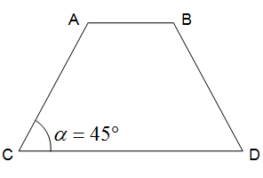
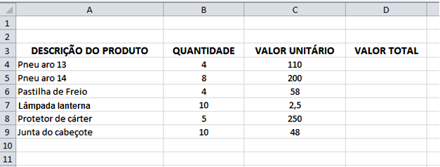

# PROVA — Camara_Foz_do_Iguacu_2012_Agente_Administrativo_I

## 1. Análise geral da prova

- **Identificação:** Camara_Foz_do_Iguacu_2012_Agente_Administrativo_I
- **Quantidade total de questões:** 80
- **Quantidade de textos de apoio (grupos):** 0
- **Quantidade de imagens:** 2
- **Quantidade de gráficos e tabelas:** incluídos nas imagens e no texto extraído, quando presentes no PDF original
- **Quantidade de grupos identificados:** 0
- **Quantidade de questões independentes:** 80
- **Questões que compartilham materiais:** nenhuma identificada automaticamente

### Transcrição integral da capa/instruções (conforme extraída do PDF)

> [!NOTE]
> Conteúdo integral das páginas anteriores à primeira questão, sem cortes.

> CÂMARA MUNICIPAL DE FOZ DO IGUAÇU
> ESTADO DO PARANÁ
> R E F . E D I T A L N º 0 1 / 0 1 / 2 0 1 2 – C O N C U R S O P Ú B L I C O
> INSTRUÇÕES
> 
> Você está recebendo do fiscal um Caderno de Questões com 80 (oitenta) questões numeradas sequencialmente que compõem a
> prova objetiva, conforme quadro a seguir:
> QUANTIDADE DE QUESTÕES
> MATÉRIA
> 01 a 20
> Língua Portuguesa
> 21 a 30
> Matemática
> 31 a 40
> Informática
> 41 a 80
> Conhecimentos Específicos
> 
> Você receberá, também, a Folha de Respostas personalizada para transcrever as respostas das questões da prova objetiva.
> ATENÇÃO
> 1.
> É proibido folhear o Caderno de Questões antes da autorização
> do fiscal.
> 2.
> Após autorização, verifique se o Caderno de Questões está
> completo, sem falhas de impressão e se a numeração está
> correta. Confira também se sua prova corresponde ao cargo
> para o qual você se inscreveu. Caso haja qualquer divergência,
> comunique o fato ao fiscal imediatamente.
> 3.
> Confira seu nome completo, o número de seu documento e o
> número de sua inscrição na Folha de Respostas. Caso
> encontre alguma divergência, comunique o fato ao fiscal para
> as devidas providências.
> 4.
> Você deverá transcrever as respostas das questões objetivas
> para a Folha de Respostas definitiva, que será o único
> documento
> válido
> para
> a
> correção
> das
> provas.
> O
> preenchimento
> da
> Folha
> de
> Respostas
> é
> de
> inteira
> responsabilidade do candidato.
> 5.
> Para realização da prova o candidato deverá utilizar caneta
> com tinta de cor azul ou preta.
> 6.
> Leia atentamente cada questão da prova e assinale, na Folha
> de Respostas, a opção que a responda corretamente. Exemplo
> correto da marcação da Folha de Respostas:
> 7.
> A Folha de Respostas não poderá ser dobrada, amassada,
> rasurada ou conter qualquer marcação fora dos campos
> destinados às respostas.
> 9.
> Na correção da Folha de Respostas, será atribuída nota 0
> (zero) às questões não assinaladas, que contiverem mais de
> uma alternativa assinalada, emenda ou rasura, ainda que
> legível. Assim que o candidato finalizar sua prova, deverá,
> obrigatoriamente, devolver a Folha de Respostas devidamente
> preenchida e assinada ao fiscal da sala.
> 10.
> Você dispõe de 5h (cinco horas) para fazer a prova, incluindo a
> marcação da Folha de Respostas. Faça-a com tranquilidade,
> mas controle seu tempo.
> 11.
> Você somente poderá deixar definitivamente a sala de prova
> após 60 (sessenta) minutos de seu início. Caso queira levar o
> caderno de questões, só poderá levá-lo após 5h (cinco horas)
> decorridas do início da prova, devendo, obrigatoriamente,
> devolver ao fiscal a Folha de Respostas assinada. As
> provas
> estarão
> disponibilizadas
> no
> site
> da
> FAFIPA
> (www.fafipa.org/concurso/), a partir da divulgação do Gabarito
> Preliminar. O candidato poderá anotar o gabarito no verso da
> capa da prova e levar consigo.
> 12.
> Os 03 (três) últimos candidatos da sala só poderão sair juntos e
> após a conferência de todos os documentos da sala e
> assinatura do termo de fechamento.
> 13.
> Será eliminado do concurso público o candidato que, durante a
> realização das provas, for surpreendido utilizando aparelhos
> eletrônicos, tais como bip, telefone celular, walkman, agenda
> eletrônica, notebook, palmtop, receptor, gravador, máquina de
> calcular, máquina fotográfica, controle de alarme de carro etc.,
> bem como relógio de qualquer espécie, óculos escuros ou
> quaisquer acessório de chapelaria tais como chapéu, boné,
> gorro etc.
> 14.
> Incorrerá, também, na eliminação do candidato, caso qualquer
> equipamento eletrônico venha a emitir ruídos, mesmo que
> devidamente acondicionado no envelope de guarda de
> pertences, durante a realização das provas.
> 15.
> Os objetos de uso pessoal, como telefones celulares e relógios,
> deverão ser desligados e mantidos dentro do envelope plástico,
> disponibilizado pela FAFIPA, até o término da prova e entrega
> da Folha de Respostas ao fiscal.
> 16.
> Qualquer tentativa de fraude, se descoberta, implicará em
> imediata denúncia à autoridade competente, que tomará as
> medidas cabíveis, inclusive com prisão em flagrante dos
> envolvidos.
>
>
>
> ED201
>
>
>
> -------------------------------------------------------------------------------(destaque aqui)-----------------------------------------------------------------------
> FOLHA PARA ANOTAÇÃO DAS RESPOSTAS DO CANDIDATO
> QUESTÃO
> RESP.
> QUESTÃO
> RESP.
> QUESTÃO
> RESP.
> QUESTÃO
> RESP.
>
>
>
> CARGO: AGENTE ADMINISTRATIVO I
> - 3 -
> LÍNGUA PORTUGUESA
> As “cotas” de Brasília
> J. R. Guzzo
> Muita água ainda vai rolar debaixo da ponte até que se
> possa chegar a algum consenso razoável sobre as
> vantagens e as desvantagens da aplicação no Brasil dos
> sistemas de “cotas”, pelos quais determinados cidadãos
> recebem determinadas prioridades para obter acesso a
> determinados bens públicos – conforme a cor de sua pele,
> por exemplo, têm direito a tantas ou quantas vagas nas
> universidades ou, num caso mais recente, em concursos
> para entrar no Itamaraty. Na teoria, supõe-se que isso
> sirva para melhorar com mais rapidez a vida de muitos
> brasileiros que hoje competem em desvantagem na
> maratona
> social
> e
> precisam,
> portanto,
> de
> uma
> compensação. Pode estar certo, pode não estar; o tempo
> dirá. Enquanto isso, prospera com vigor cada vez maior
> outro sistema de cotas, muito mais importante para o
> bem-estar de todos, seja qual for a sua cor, e sobre o qual
> não existe dúvida nenhuma: é uma completa calamidade.
> Trata-se da distribuição de cargos essenciais no serviço
> público federal através de cálculos aritméticos que dão a
> partidos ligados ao governo, grupos políticos regionais,
> gangues partidárias e bandos assemelhados o direito a
> receber um número X ou Y de postos na administração,
> que preenchem com nomes de sua escolha – e sem a
> mais remota preocupação em saber se os nomeados têm
> ou não alguma capacidade profissional para exercer as
> funções que receberam. Há perfeito consenso de que a
> existência dessas cotas torna praticamente impossível o
> bom funcionamento de qualquer governo. Há igual
> consenso, ao mesmo tempo de que “no Brasil é assim”. A
> única modificação esperada é que, a cada troca de
> comando, a coisa fique ainda pior.
> A atual transição em Brasília marca um novo patamar
> nesse processo. Cargos com impacto direto na vida dos
> cidadãos, e que obviamente exigem de seus ocupantes
> experiência, talento e aptidão profissional para ser
> exercidos com um mínimo de eficácia, são entregues “de
> porteira fechada” a esta ou àquela turminha. Não passa
> pela cabeça de ninguém, nem de longe, reivindicar
> qualquer cargo por ter ideias sobre como tocá-lo melhor,
> ou por ter algum projeto em relação a ele; exige-se o lugar
> simplesmente porque ele faz parte “da cota” de um grupo
> “aliado”. Discute-se abertamente o valor do posto, sem
> nenhuma tentativa de disfarce, pelo volume de verbas a
> seu dispor; tal posição, com verba de 20 bilhões de reais
> no orçamento deste ano, vale duas vagas com verbas de
> 10 bilhões cada uma. São debatidos em plena luz do dia e
> em português claro, igualmente, os atrativos mais
> importantes dos cargos em oferta no livre mercado de
> Brasília – quais os que dão as maiores oportunidades de
> nomear parentes e aliados, quais os que são mais
> promissores para a transação de negócios, quais são os
> que permitem roubar mais. A certa altura, discutiu-se a
> entrega
> de
> determinado
> posto
> diretamente
> a
> um
> empreiteiro de obras públicas. Em outro grande momento,
> falou-se na “cota” da presidente Dilma Rousseff – como
> se ela, após ser eleita com mais de 55 milhões de votos,
> tivesse direito a um número limitado de nomeações em
> seu próprio governo.
> Parece de notável desimportância, nessas condições,
> ficar quebrando a cabeça para determinar se o novo
> ministério é melhor, igual ou pior que o anterior. É, sem
> dúvida, uma das equipes mais cinzentas que um chefe de
> estado brasileiro já conseguiu reunir em tomo de si, não
> ajudando em nada, é claro, o fato de que um terço dos
> ministros
> foi
> herdado
> do
> governo
> anterior
> –
> provavelmente, a “cota” do ex-presidente da República. O
> ministro da Previdência Social diz que não entende nada
> de previdência social. A ministra da Cultura diz que não
> entende nada de direitos autorais. A primeira realização
> da ministra da Pesca (e, não podemos esquecer, da
> “Aquicultura”) foi trocar a placa de seu carro oficial; onde
> estava escrito “ministro” agora já se pode ler “ministra”.
> Mas e daí? Seria pura ilusão acreditar que com nomes
> diferentes o governo Dilma poderia ter um desempenho
> muito melhor, quando centenas de cargos que vêm logo
> abaixo deles, e onde se decidem as realidades do
> funcionamento de aeroportos, estradas, ambulatórios,
> escolas e tantas coisas mais, são disputados pelos
> políticos como se disputam pontos do tráfico no
> Complexo do Alemão. É motivo de espanto, nessas
> condições, que se consiga, por exemplo, embarcar e
> desembarcar alguma coisa nos portos brasileiros, que as
> aposentadorias sejam pagas em dia ou que a luz acenda
> quando se liga o interruptor. Pelo jeito, continuará sendo.
> Revista Veja, edição 2200, de 19 de janeiro de 2011.

### Gabarito

| Questão | 01 | 02 | 03 | 04 | 05 |
|---|---|---|---|---|---|
| Resposta | C | A | E | D | B |

| Questão | 06 | 07 | 08 | 09 | 10 |
|---|---|---|---|---|---|
| Resposta | A | C | B | E | C |

| Questão | 11 | 12 | 13 | 14 | 15 |
|---|---|---|---|---|---|
| Resposta | E | D | B | A | A |

| Questão | 16 | 17 | 18 | 19 | 20 |
|---|---|---|---|---|---|
| Resposta | E | B | B | C | C |

| Questão | 21 | 22 | 23 | 24 | 25 |
|---|---|---|---|---|---|
| Resposta | B | D | A | C | E |

| Questão | 26 | 27 | 28 | 29 | 30 |
|---|---|---|---|---|---|
| Resposta | C | D | A | E | B |

| Questão | 31 | 32 | 33 | 34 | 35 |
|---|---|---|---|---|---|
| Resposta | D | E | E | A | C |

| Questão | 36 | 37 | 38 | 39 | 40 |
|---|---|---|---|---|---|
| Resposta | D | C | B | A | B |

| Questão | 41 | 42 | 43 | 44 | 45 |
|---|---|---|---|---|---|
| Resposta | A | E | D | C | B |

| Questão | 46 | 47 | 48 | 49 | 50 |
|---|---|---|---|---|---|
| Resposta | B | D | C | B | E |

| Questão | 51 | 52 | 53 | 54 | 55 |
|---|---|---|---|---|---|
| Resposta | C | D | A | B | D |

| Questão | 56 | 57 | 58 | 59 | 60 |
|---|---|---|---|---|---|
| Resposta | E | C | D | E | C |

| Questão | 61 | 62 | 63 | 64 | 65 |
|---|---|---|---|---|---|
| Resposta | A | D | C | A | B |

| Questão | 66 | 67 | 68 | 69 | 70 |
|---|---|---|---|---|---|
| Resposta | D | D | B | D | C |

| Questão | 71 | 72 | 73 | 74 | 75 |
|---|---|---|---|---|---|
| Resposta | B | D | E | C | B |

| Questão | 76 | 77 | 78 | 79 | 80 |
|---|---|---|---|---|---|
| Resposta | A | C | A | D | B |

## 2. Questões agrupadas

Nenhum grupo de questões compartilhando material foi identificado automaticamente nesta prova.

## 3. Questões independentes

#### QUESTÃO 01

✅ **Gabarito: C** (gabarito oficial pareado — cargo AGENTE ADMINISTRATIVO I)

**Enunciado:**

“Parece
de
notável
desimportância,
nessas
condições,
ficar
quebrando
a
cabeça
para
determinar se o novo ministério é melhor, igual ou
pior que o anterior.”

O significado do prefixo des, em desimportância, é
o de

**Alternativas:**

A) separação.
B) reforço.
C) falta de.
D) intensidade.
E) ação contrária.

**Referências visuais:**

Nenhuma.

---

#### QUESTÃO 02

✅ **Gabarito: A** (gabarito oficial pareado — cargo AGENTE ADMINISTRATIVO I)

**Enunciado:**

Assinale a alternativa cuja expressão em destaque
foi empregada pelo autor para manifestar sua
opinião.

**Alternativas:**

A) “Cargos com impacto direto na vida dos cidadãos, e
que
obviamente
exigem
de
seus
ocupantes
experiência.”
B) “...exige-se o lugar simplesmente porque ele faz parte
“da cota” de um grupo “aliado”.”
C) “São debatidos em plena luz do dia e em português
claro, igualmente, os atrativos mais importantes dos
cargos...”
D) “A certa altura, discutiu-se a entrega de determinado
posto diretamente a um empreiteiro de obras públicas.”
E) “Discute-se abertamente o valor do posto, sem
nenhuma tentativa de disfarce, pelo volume de verbas
a seu dispor...”

**Referências visuais:**

Nenhuma.

---

#### QUESTÃO 03

✅ **Gabarito: E** (gabarito oficial pareado — cargo AGENTE ADMINISTRATIVO I)

**Enunciado:**

“Há perfeito consenso de que a existência dessas
cotas
torna
praticamente
impossível
o
bom
funcionamento de qualquer governo.”

A oração destacada funciona como

**Alternativas:**

A) adjunto adnominal.
B) objeto direto.
C) sujeito.
D) objeto indireto.
E) complemento nominal.
CARGO: AGENTE ADMINISTRATIVO I
- 4 -

**Referências visuais:**

Nenhuma.

---

#### QUESTÃO 04

✅ **Gabarito: D** (gabarito oficial pareado — cargo AGENTE ADMINISTRATIVO I)

**Enunciado:**

Assinale a alternativa cuja expressão destacada
NÃO funciona como adjunto adverbial de tempo.

**Alternativas:**

A) “Em outro grande momento, falou-se na “cota” da
presidente Dilma Rousseff...”
B) “A certa altura, discutiu-se a entrega de determinado
posto diretamente a um empreiteiro de obras públicas.”
C) “Muita água ainda vai rolar debaixo da ponte até que se
possa chegar...”
D) “...tal posição, com verba de 20 bilhões de reais no
orçamento deste ano...”
E) “...sirva para melhorar com mais rapidez a vida de
muitos brasileiros que hoje competem...”

**Referências visuais:**

Nenhuma.

---

#### QUESTÃO 05

✅ **Gabarito: B** (gabarito oficial pareado — cargo AGENTE ADMINISTRATIVO I)

**Enunciado:**

“Muita água ainda vai rolar debaixo da ponte até
que se possa chegar a algum consenso razoável
sobre as vantagens e as desvantagens da aplicação
no Brasil dos sistemas de „cotas‟...”

A oração destacada estabelece, em relação à
oração principal, uma relação

**Alternativas:**

A) causal.
B) temporal.
C) concessiva.
D) consecutiva.
E) condicional.

**Referências visuais:**

Nenhuma.

---

#### QUESTÃO 06

✅ **Gabarito: A** (gabarito oficial pareado — cargo AGENTE ADMINISTRATIVO I)

**Enunciado:**

Todos os fragmentos abaixo apresentam colocação
pronominal incorreta. Assinale a alternativa que
apresenta a justificativa correta para o não
emprego do pronome nessa posição.

**Alternativas:**

A) ... sejam pagas em dia ou que a luz acenda quando
liga-se o interruptor. (presença de conjunção adverbial)
B) Na teoria, se supõe que isso sirva para melhorar com
mais rapidez a vida... (emprego de verbo no presente
do indicativo)
C) Muita água ainda vai rolar debaixo da ponte até que
possa-se chegar a algum consenso... (presença de
verbo no infinitivo)
D) Onde estava escrito “ministro” agora já pode-se ler
“ministra”. (presença de locução verbal)
E) ...são disputados pelos políticos como disputam-se
pontos do tráfico no Complexo do Alemão.” (presença
de preposição)

**Referências visuais:**

Nenhuma.

---

#### QUESTÃO 07

✅ **Gabarito: C** (gabarito oficial pareado — cargo AGENTE ADMINISTRATIVO I)

**Enunciado:**

“Não passa pela cabeça de ninguém, nem de
longe, reivindicar qualquer cargo por ter ideias
sobre como tocá-lo melhor...”

A preposição por estabelece, no contexto, relação
de

**Alternativas:**

A) concessão.
B) condição.
C) causa.
D) consecução.
E) conformidade.

**Referências visuais:**

Nenhuma.

---

#### QUESTÃO 08

✅ **Gabarito: B** (gabarito oficial pareado — cargo AGENTE ADMINISTRATIVO I)

**Enunciado:**

“A
certa
altura,
discutiu-se
a
entrega
de
determinado posto diretamente a um empreiteiro de
obras públicas.”

A função do elemento se é a de

**Alternativas:**

A) conjunção integrante.
B) pronome apassivador.
C) partícula expletiva.
D) índice de indeterminação do sujeito.
E) pronome reflexivo.

**Referências visuais:**

Nenhuma.

---

#### QUESTÃO 09

✅ **Gabarito: E** (gabarito oficial pareado — cargo AGENTE ADMINISTRATIVO I)

**Enunciado:**

Em “Pelo jeito, continuará sendo.”, a sequência
verbal destacada expressa aspecto

**Alternativas:**

A) interativo.
B) incoativo.
C) permansivo.
D) conclusivo.
E) cursivo.

**Referências visuais:**

Nenhuma.

---

#### QUESTÃO 10

✅ **Gabarito: C** (gabarito oficial pareado — cargo AGENTE ADMINISTRATIVO I)

**Enunciado:**

Assinale a alternativa correta.

**Alternativas:**

A) Importânte
B) Dúvidar
C) Presidência
D) Notábilidade
E) Ambulatórial

**Referências visuais:**

Nenhuma.

---

#### QUESTÃO 11

✅ **Gabarito: E** (gabarito oficial pareado — cargo AGENTE ADMINISTRATIVO I)

**Enunciado:**

Assinale a alternativa correta sobre o que se afirma
a seguir.

**Alternativas:**

A) Uma vírgula após a expressão acreditar não altera a
gramática do fragmento “Seria pura ilusão acreditar que
com nomes diferentes o governo Dilma poderia...”
B) A retirada das vírgulas da expressão por exemplo não
altera a gramática do fragmento “É motivo de espanto,
nessas condições, que se consiga, por exemplo,
embarcar...”
C) A retirada das vírgulas da expressão portanto não
altera a gramática do fragmento “...hoje competem em
desvantagem na maratona social e precisam, portanto,
de uma compensação.”
D) A retirada das vírgulas da expressão é claro não altera
a gramática do fragmento “...que um chefe de estado
brasileiro já conseguiu reunir em tomo de si, não
ajudando em nada, é claro, o fato de que...”
E) A inserção de uma vírgula após a expressão ponte não
altera a gramática do fragmento “Muita água ainda vai
rolar debaixo da ponte até que se possa chegar...”

**Referências visuais:**

Nenhuma.

---

#### QUESTÃO 12

✅ **Gabarito: D** (gabarito oficial pareado — cargo AGENTE ADMINISTRATIVO I)

**Enunciado:**

De acordo com o texto,

**Alternativas:**

A) o sistema de cotas para negros nas universidades é
mais importante do que as regalias do governo.
B) o sistema de cotas é mais uma regalia concedida aos
negros para ingressarem no Itamaraty.
C) o autor critica o método dos concursos feitos pelo
Itamaraty, que tem privilegiado os afrodescendentes.
D) o autor se mostra reticente quanto às vantagens e
desvantagens da aplicação dos sistemas de cotas no
Brasil.
E) na prática, o fato de privilegiar afrodescendentes em
empregos públicos não tem surtido o efeito desejado.

**Referências visuais:**

Nenhuma.

---

#### QUESTÃO 13

✅ **Gabarito: B** (gabarito oficial pareado — cargo AGENTE ADMINISTRATIVO I)

**Enunciado:**

“A única modificação esperada é que, a cada troca
de comando, a coisa fique ainda pior.”

O elemento que, no contexto acima, é

**Alternativas:**

A) conjunção integrante.
B) partícula expletiva.
C) pronome relativo.
D) interjeição.
E) pronome indefinido.
CARGO: AGENTE ADMINISTRATIVO I
- 5 -

**Referências visuais:**

Nenhuma.

---

#### QUESTÃO 14

✅ **Gabarito: A** (gabarito oficial pareado — cargo AGENTE ADMINISTRATIVO I)

**Enunciado:**

“...e sem a mais remota preocupação em saber se
os nomeados têm ou não alguma capacidade
profissional
para
exercer
as
funções
que
receberam.”

A função sintática desempenhada pelo pronome
relativo destacado é a de

**Alternativas:**

A) objeto direto.
B) sujeito.
C) objeto indireto.
D) adjunto adnominal.
E) complemento nominal.

**Referências visuais:**

Nenhuma.

---

#### QUESTÃO 15

✅ **Gabarito: A** (gabarito oficial pareado — cargo AGENTE ADMINISTRATIVO I)

**Enunciado:**

O tema central abordado pelo autor é

**Alternativas:**

A) o sistema de cotas no serviço público federal.
B) o sistema de cotas para negros no Brasil.
C) a exclusão étnica e social no Brasil.
D) a exclusão econômica e social no Brasil.
E) o sistema de cotas em concursos públicos.

**Referências visuais:**

Nenhuma.

---

#### QUESTÃO 16

✅ **Gabarito: E** (gabarito oficial pareado — cargo AGENTE ADMINISTRATIVO I)

**Enunciado:**

Assinale a alternativa cuja expressão NÃO foi
empregada
para
retomar
algo
anteriormente
mencionado. Para tanto, você deve ler o texto
novamente.

**Alternativas:**

A) “Em outro grande momento, falou-se na „cota‟ da
presidente Dilma Rousseff – como se ela...”
B) “Há igual consenso, ao mesmo tempo de que „no Brasil
é assim‟”.
C) “...supõe-se que isso sirva para melhorar com mais
rapidez a vida de muitos brasileiros...”
D) “A única modificação esperada é que, a cada troca de
comando, a coisa fique ainda pior.”
E) “Muita água ainda vai rolar debaixo da ponte até que se
possa chegar a algum consenso...”

**Referências visuais:**

Nenhuma.

---

#### QUESTÃO 17

✅ **Gabarito: B** (gabarito oficial pareado — cargo AGENTE ADMINISTRATIVO I)

**Enunciado:**

Assinale a alternativa cuja expressão em destaque
funciona como sujeito.

**Alternativas:**

A) “Há igual consenso, ao mesmo tempo de que „no Brasil
é assim‟.”
B) “Enquanto isso, prospera com vigor cada vez maior
outro sistema de cotas...”
C) “Trata-se da distribuição de cargos essenciais...”
D) “Seria pura ilusão acreditar que com nomes diferentes
o governo Dilma...”
E) “É motivo de espanto, nessas condições, que se
consiga, por exemplo...”

**Referências visuais:**

Nenhuma.

---

#### QUESTÃO 18

✅ **Gabarito: B** (gabarito oficial pareado — cargo AGENTE ADMINISTRATIVO I)

**Enunciado:**

Em qual das alternativas abaixo a sequência verbal
destacada pode ser substituída por um tempo
verbal simples sem alteração do sentido original?

**Alternativas:**

A) “Muita água ainda vai rolar debaixo da ponte até que se
possa chegar a algum consenso razoável...”
B) “Muita água ainda vai rolar debaixo da ponte até que se
possa chegar a algum consenso razoável...”
C) “Seria pura ilusão acreditar que com nomes diferentes
o governo Dilma poderia ter um desempenho...”
D) “Pelo jeito, continuará sendo.”
E) “Parece de notável desimportância, nessas condições,
ficar quebrando a cabeça para determinar...”

**Referências visuais:**

Nenhuma.

---

#### QUESTÃO 19

✅ **Gabarito: C** (gabarito oficial pareado — cargo AGENTE ADMINISTRATIVO I)

**Enunciado:**

“Parece
de
notável
desimportância,
nessas
condições,
ficar
quebrando
a
cabeça
para
determinar se o novo ministério é melhor, igual ou
pior que o anterior.”

O elemento se desempenha função de

**Alternativas:**

A) pronome apassivador.
B) índice de indeterminação do sujeito.
C) conjunção integrante.
D) pronome reflexivo.
E) partícula expletiva.

**Referências visuais:**

Nenhuma.

---

#### QUESTÃO 20

✅ **Gabarito: C** (gabarito oficial pareado — cargo AGENTE ADMINISTRATIVO I)

**Enunciado:**

Assinale a alternativa correta quanto à acentuação.

**Alternativas:**

A) Tráficar
B) Própriedade
C) Prioritário
D) Cálcular
E) Impossíbilidade
MATEMÁTICA

**Referências visuais:**

Nenhuma.

---

#### QUESTÃO 21

✅ **Gabarito: B** (gabarito oficial pareado — cargo AGENTE ADMINISTRATIVO I)

**Enunciado:**

Resolva a seguinte equação exponencial a seguir:
1 

x
Em seguida, assinale a alternativa correta.

**Alternativas:**

A) 
B) 
C) 
D) 
E) 

**Referências visuais:**

Nenhuma.

---

#### QUESTÃO 22

✅ **Gabarito: D** (gabarito oficial pareado — cargo AGENTE ADMINISTRATIVO I)

**Enunciado:**

Qual é o trigésimo termo da Progressão Aritmética
“P.A.” ( 5, 8, ... )

**Alternativas:**

A) 
B) 
C) 
D) 
E) 

**Referências visuais:**

Nenhuma.

---

#### QUESTÃO 23

✅ **Gabarito: A** (gabarito oficial pareado — cargo AGENTE ADMINISTRATIVO I)

**Enunciado:**

Sendo os conjuntos A = { 0, 1, 2, 3 },
B = { 3, 4, 5 }, C = { 0, 2, 4, 6 } e D = { 3, 6 },
determine:
)
(
)
(
B
A
D
C



,
assinale
a
alternativa correta.

**Alternativas:**

A) { }
B) {6}
C) {1, 2, 3, 4, 5}
D) {0, 1, 2, 3, 4, 5}
E) {0, 1, 2, 3, 4, 5, 6}

**Referências visuais:**

Nenhuma.

---

#### QUESTÃO 24

✅ **Gabarito: C** (gabarito oficial pareado — cargo AGENTE ADMINISTRATIVO I)

**Enunciado:**

Pedro abriu três torneiras que levam 150 minutos
para encher uma piscina. Quanto tempo levaria, se
houvesse cinco torneiras equivalentes, para encher
a mesma piscina?

**Alternativas:**

A) Meia hora.
B) Uma hora.
C) Uma hora e meia.
D) Duas horas.
E) Duas horas e meia.
CARGO: AGENTE ADMINISTRATIVO I
- 6 -

**Referências visuais:**

Nenhuma.

---

#### QUESTÃO 25

✅ **Gabarito: E** (gabarito oficial pareado — cargo AGENTE ADMINISTRATIVO I)

**Enunciado:**

Determine a função inversa da seguinte função:
7 
x
y
, após calcular a função inversa,
assinale a alternativa correta.

**Alternativas:**

A) 4x
y 
B) 
x
y
C) 7x
y 
D) 
x
y
E) 
x
y

**Referências visuais:**

Nenhuma.

---

#### QUESTÃO 26

✅ **Gabarito: C** (gabarito oficial pareado — cargo AGENTE ADMINISTRATIVO I)

**Enunciado:**

Na
figura
abaixo,
ABCD
é
um
trapézio
isósceles
com
as
seguintes
medidas:
AB = 7 cm, CD = 15 e

45

.
Então, a área desse trapézio, em centímetros
quadrados, é

**Alternativas:**

A) 11.
B) 22.
C) 44.
D) 88.
E) 110.

**Referências visuais:**

Nenhuma.

---

#### QUESTÃO 27

✅ **Gabarito: D** (gabarito oficial pareado — cargo AGENTE ADMINISTRATIVO I)

**Enunciado:**

Determine as raízes da seguinte função do 2º grau:


x
x
, após calcular a função do 2º
grau, assinale a alternativa correta.

**Alternativas:**

A) }
{
e
B) }
{
e

C) }
{
e

D) }
{


e
E) }
{
e

**Referências visuais:**

Nenhuma.

---

#### QUESTÃO 28

✅ **Gabarito: A** (gabarito oficial pareado — cargo AGENTE ADMINISTRATIVO I)

**Enunciado:**

Resolva o seguinte logaritmo:
x

log2
. O
valor do logaritmo é

**Alternativas:**

A) 

x
B) 

x
C) 

x
D) 

x
E) 
x

**Referências visuais:**

Nenhuma.

---

#### QUESTÃO 29

✅ **Gabarito: E** (gabarito oficial pareado — cargo AGENTE ADMINISTRATIVO I)

**Enunciado:**

De quantas maneiras uma família de 6 pessoas
podem sentar-se num sofá de 6 lugares para tirar
uma foto?

**Alternativas:**

A) 2 maneiras.
B) 6 maneiras.
C) 24 maneiras.
D) 120 maneiras.
E) 720 maneiras.

**Referências visuais:**

Nenhuma.

---

#### QUESTÃO 30

✅ **Gabarito: B** (gabarito oficial pareado — cargo AGENTE ADMINISTRATIVO I)

**Enunciado:**

Uma loja está anunciando uma liquidação de
bicicletas. A bicicleta a ser comprada por Junior
custa R$ 1.200,00. Junior quer compra a bicicleta à
vista, e terá um desconto de 30%. Quanto Junior irá
pagar pela bicicleta, já com o desconto oferecido
pela loja?

**Alternativas:**

A) R$ 780,00
B) R$ 840,00
C) R$ 900,00
D) R$ 960,00
E) R$ 1.020,00
RASCUNHO

CARGO: AGENTE ADMINISTRATIVO I
- 7 -
INFORMÁTICA

**Referências visuais:**

Nenhuma.

---

#### QUESTÃO 31

✅ **Gabarito: D** (gabarito oficial pareado — cargo AGENTE ADMINISTRATIVO I)

**Enunciado:**

Considere a figura a seguir que ilustra parte de uma planilha eletrônica criada no Microsoft Excel e, com base nesta
planilha, assinale a alternativa correta.

Obs.: Considere a planilha eletrônica Microsoft Excel 2010 e BrOffice.org 3.2 Calc (instalação padrão português –
Brasil).

A utilização do caractere + é apenas para interpretação.

**Alternativas:**

A) Ao aplicar na célula D4 a fórmula=PRODUTO(B4*C4) obtém-se como resultado o valor 440 em ambas as planilhas eletrônicas
(Excel e Calc).
B) Ao aplicar a célula D5 a fórmula=B5*$C$5 o resultado obtido será mostrado em Real (R$), mesmo que a célula D5 esteja
formatada como número, pois a referência $ utilizada na fórmula faz com que o resultado retorne em valor de moeda de Real
(moeda brasileira).
C) Ao aplicar na célula B10 a fórmula =SOMA(B4;B9) obtém-se como resultado o valor 41.
D) Ao aplicar na célula B10 a fórmula =MÉDIA(B4:B9;1) obtém-se como resultado o valor 6.
E) As palavras do título (DESCRIÇÃO DO PRODUTO – QUANTIDADE – VALOR UNITÁRIO – VALOR TOTAL) foram formatadas
como Negrito e Centralizado com as seguintes teclas de atalho respectivamente: CTRL+N e CTRL+C em ambas as planilhas
eletrônicas (Excel e Calc).

**Referências visuais:**

Nenhuma.

---

#### QUESTÃO 32

✅ **Gabarito: E** (gabarito oficial pareado — cargo AGENTE ADMINISTRATIVO I)

**Enunciado:**

Em relação a planilhas eletrônicas, assinale a
alternativa INCORRETA.

Obs.: Considere as planilhas eletrônicas Microsoft
Excel 2010 (instalação padrão português – Brasil).

**Alternativas:**

A) Bolhas é uma opção de gráfico.
B) A fórmula =AGORA() retorna a data e a hora atual.
C) Para imprimir apenas parte de uma planilha, basta
selecionar a área desejada, entrar em “ARQUIVO”,
selecionar “IMPRIMIR” em Configurações escolher a
opção “IMPRIMIR SELEÇÃO”.
D) É possível reduzir os dados no Excel utilizando Tabela
Dinâmica.
E) O Excel, por ser uma planilha eletrônica, não tem a
ferramenta “VERIFICAR ORTOGRAFIA”

**Referências visuais:**

Nenhuma.

---

#### QUESTÃO 33

✅ **Gabarito: E** (gabarito oficial pareado — cargo AGENTE ADMINISTRATIVO I)

**Enunciado:**

Em relação à Intranet, assinale a alternativa
INCORRETA.

**Alternativas:**

A) A intranet possibilita tudo o que a própria internet
dispõe. Porém, a principal diferença entre ambas é que
a intranet é restrita a certo público.
B) A intranet ainda possibilita você a utilizar mais
protocolos de comunicação, não somente o HTTP
usado pela internet.
C) O protocolo VPN possibilita a criação de uma rede
privada virtual, permitindo assim que através da
internet seja criado um túnel de comunicação com sua
rede privada, como se estivesse fisicamente conectado
à esta rede.
D) Preferencialmente,
a
conexão
VPN
deve
ser
criptografada, para garantir a integridade dos dados.
E) Através da VPN, você tem acesso a todos os recursos
da
rede
local,
exceto
o
compartilhamento
de
impressoras.

**Referências visuais:**

Nenhuma.

---

#### QUESTÃO 34

✅ **Gabarito: A** (gabarito oficial pareado — cargo AGENTE ADMINISTRATIVO I)

**Enunciado:**

Assinale
a
alternativa
que
NÃO
apresenta
características corretas de aplicativos do Windows
XP Professional.

**Alternativas:**

A) No Bloco de Notas, as características de estilo,
tamanho e a cor das fontes podem ser alteradas.
B) A Calculadora pode ser exibida nos modos científica,
padrão, estatístico e programador.
C) Através do Painel de controle, podemos alterar o botão
do mouse.
D) No Paint, é possível personalizar o Zoom em 600%.
E) O Word Pad é o editor de texto do Windows XP
Professional que possibilita destacar um texto com
diversas cores.

CARGO: AGENTE ADMINISTRATIVO I
- 8 -

**Referências visuais:**

Nenhuma.

---

#### QUESTÃO 35

✅ **Gabarito: C** (gabarito oficial pareado — cargo AGENTE ADMINISTRATIVO I)

**Enunciado:**

Baseando-se no Processador de Texto Microsoft
Word 2010, relacione as colunas e assinale a
alternativa com a sequência correta.

Obs.: Considere o Processador de Texto Microsoft
Word 2010, instalação padrão Português- Brasil.
Itens

1.
Macros
2.
SmartArt
3.
Inserir Nota de Rodapé
4.
Marca D‟água

Opções

X.
Menu Inserir
Y.
Layout da Página
W.
Menu Exibir
Z.
Menu Referências

**Alternativas:**

A) 1Z – 2X – 3W – 4Y.
B) 1Y – 2Z – 3X – 4W.
C) 1W – 2X – 3Z – 4Y.
D) 1Z – 2Y – 3W – 4X.
E) 1X – 2W – 3Y – 4Z.

**Referências visuais:**

Nenhuma.

---

#### QUESTÃO 36

✅ **Gabarito: D** (gabarito oficial pareado — cargo AGENTE ADMINISTRATIVO I)

**Enunciado:**

Baseando-se no Processador de Texto BrOffice
Writer, assinale a alternativa correta.

Obs.: Considere o Processador de Texto BrOffice
Writer 3.2, instalação padrão Português- Brasil.

A utilização do caractere + é apenas para
interpretação.

**Alternativas:**

A) Comando CTRL+ N, atalho para colocar em negrito um
texto selecionado.
B) Comando
CTRL+
P,
atalho
para
imprimir
um
documento.
C) Comando CTRL + A, atalho para abrir um documento.
D) Comando CTRL + I, atalho para colocar em itálico um
texto selecionado.
E) Comando CTRL + T, atalho para selecionar todo um
texto.

**Referências visuais:**

Nenhuma.

---

#### QUESTÃO 37

✅ **Gabarito: C** (gabarito oficial pareado — cargo AGENTE ADMINISTRATIVO I)

**Enunciado:**

Sobre conceitos de Hardware e Software, analise as
assertivas e assinale a alternativa que aponta a(s)
correta(s).

I.
Mouse, teclado e Monitor LCD são exemplos
de periféricos de entrada.

II.
Slot tem a função de ligar periféricos ao
barramento.

III.
A interface AGP é um dispositivo utilizado na
comunicação entre o processador e a
memória RAM.

IV.
A memória ROM de um computador não
pode ter dados gravados pelo usuário, suas
gravações são referentes às rotinas de
inicialização gravadas pelo fabricante.

**Alternativas:**

A) Apenas II.
B) Apenas IV.
C) Apenas II e IV.
D) Apenas I, III e IV.
E) Apenas II, III e IV.

**Referências visuais:**

Nenhuma.

---

#### QUESTÃO 38

✅ **Gabarito: B** (gabarito oficial pareado — cargo AGENTE ADMINISTRATIVO I)

**Enunciado:**

A
cópia
de
dados
de
um
dispositivo
de
armazenamento para outro para que os dados
possam ser restaurados em caso de perda dos
dados originais é conhecido como

**Alternativas:**

A) Compactação.
B) Backup.
C) Formatação.
D) Spam.
E) Restauração.

**Referências visuais:**

Nenhuma.

---

#### QUESTÃO 39

✅ **Gabarito: A** (gabarito oficial pareado — cargo AGENTE ADMINISTRATIVO I)

**Enunciado:**

Browser é um programa de computador que
habilita
seus
usuários
a
interagirem
com
documentos
virtuais
da
internet.
Assinale
alternativa que NÃO apresenta um browser.

**Alternativas:**

A) Windows Explorer
B) Mozilla Firefox
C) Safari
D) Flock
E) GloogleChrome

**Referências visuais:**

Nenhuma.

---

#### QUESTÃO 40

✅ **Gabarito: B** (gabarito oficial pareado — cargo AGENTE ADMINISTRATIVO I)

**Enunciado:**

Sites são escritos ou dinamicamente convertidos
para

**Alternativas:**

A) IP.
B) HTTP.
C) TCP.
D) FTP.
E) URL.
CONHECIMENTOS ESPECÍFIOS

**Referências visuais:**

Nenhuma.

---

#### QUESTÃO 41

✅ **Gabarito: A** (gabarito oficial pareado — cargo AGENTE ADMINISTRATIVO I)

**Enunciado:**

De acordo com a Lei Orgânica do Município de Foz
do Iguaçu, são símbolos do Município que
representam a cultura e história do Município

**Alternativas:**

A) o Brasão, a Bandeira e o Hino.
B) o Brasão e as Cataratas do Iguaçu.
C) a Ponte da Amizade e as Cataratas do Iguaçu.
D) a Bandeira e a Ponte da Amizade.
E) o Hino, a Bandeira e as Cataratas do Iguaçu.

**Referências visuais:**

Nenhuma.

---

#### QUESTÃO 42

✅ **Gabarito: E** (gabarito oficial pareado — cargo AGENTE ADMINISTRATIVO I)

**Enunciado:**

Analise as assertivas e, em seguida, assinale a
alternativa que aponta a(s) correta(s).

O Prefeito e o Vice-Prefeito não poderão, desde a
posse, sob pena de perda de mandato:

I.
firmar ou manter contrato com o Município
ou com suas autarquias, empresas públicas,
sociedades de economia mista, fundações
ou empresas concessionárias de serviço
público municipal, salvo quando o contrato
obedecer a cláusulas uniformes.

II.
ser titular de mais de um mandato eletivo.

III.
ser proprietário, controlador ou diretor de
empresa que goze de favor decorrente de
contrato celebrado com o Município ou nela
exercer função remunerada.

IV.
fixar residência fora do Município.

**Alternativas:**

A) Apenas I.
B) Apenas I e II.
C) Apenas I e III.
D) Apenas I, II e III.
E) I, II, III e IV.
CARGO: AGENTE ADMINISTRATIVO I
- 9 -

**Referências visuais:**

Nenhuma.

---

#### QUESTÃO 43

✅ **Gabarito: D** (gabarito oficial pareado — cargo AGENTE ADMINISTRATIVO I)

**Enunciado:**

De acordo com a Lei Orgânica do Município de Foz
do Iguaçu, ao Município compete prover a tudo
quanto diga respeito ao seu interesse e ao bem-
estar da população, cabendo-lhe, privativamente,
dentre outras, as seguintes atribuições, EXCETO

**Alternativas:**

A) legislar sobre assuntos de interesse local.
B) instituir e arrecadar os tributos de sua competência,
bem como aplicar as suas rendas, sem prejuízo da
obrigatoriedade de prestar contas e publicar balancetes
nos prazos fixados em Lei.
C) manter, com a cooperação técnica e financeira do
Estado e da União, programas de educação pré-
escolar e ensino fundamental.
D) estabelecer cultos religiosos ou igrejas, subvencioná-
las, embaraçar-lhes o funcionamento ou manter com
eles ou seus representantes relações de dependência
ou aliança, ressalvada, na forma da Lei, a colaboração
de interesse público.
E) promover a cultura e as práticas esportivas.

**Referências visuais:**

Nenhuma.

---

#### QUESTÃO 44

✅ **Gabarito: C** (gabarito oficial pareado — cargo AGENTE ADMINISTRATIVO I)

**Enunciado:**

De acordo com a Lei Complementar nº 17, de 30 de
agosto de 1993, são requisitos básicos para
ingresso no Serviço Público, EXCETO

**Alternativas:**

A) a nacionalidade brasileira ou equiparada.
B) a quitação com as obrigações militares e eleitorais.
C) a idade mínima de 18 (dezoito) anos ou idade inferior
mínima de 14 (quatorze) anos, desde que compatível
com o cargo e seus requisitos essenciais.
D) o gozo de boa saúde.
E) o gozo dos direitos políticos.

**Referências visuais:**

Nenhuma.

---

#### QUESTÃO 45

✅ **Gabarito: B** (gabarito oficial pareado — cargo AGENTE ADMINISTRATIVO I)

**Enunciado:**

De acordo com a Lei Complementar nº 17, de 30 de
agosto de 1993, à pessoa portadora de deficiência é
assegurado o direito de se inscrever em concurso
público para provimento de cargo cujas atribuições
sejam compatíveis com a deficiência de que é
portadora, para o que poderão ser reservadas até

**Alternativas:**

A) 3% (três por cento) das vagas oferecidas no concurso.
B) 5% (cinco por cento) das vagas oferecidas no
concurso.
C) 10% (dez por cento) das vagas oferecidas no concurso.
D) 12% (doze por cento) das vagas oferecidas no
concurso.
E) 15% (quinze por cento) das vagas oferecidas no
concurso.

**Referências visuais:**

Nenhuma.

---

#### QUESTÃO 46

✅ **Gabarito: B** (gabarito oficial pareado — cargo AGENTE ADMINISTRATIVO I)

**Enunciado:**

De acordo com a Lei Orgânica do Município de Foz
do Iguaçu ao Município é vedado, EXCETO

**Alternativas:**

A) estabelecer cultos religiosos ou igrejas, subvencioná-
las, embaraçar-lhes o funcionamento ou manter com
eles ou seus representantes relações de dependência
ou aliança, ressalvada, na forma da Lei, a colaboração
de interesse público.
B) sinalizar as vias públicas urbanas e rurais.
C) recusar fé aos documentos públicos.
D) criar distinções entre brasileiros ou preferências entre
si.
E) subvencionar ou auxiliar, de qualquer modo, com
recursos pertencentes aos cofres públicos, quer pela
imprensa, rádio, televisão, serviço de alto-falantes ou
qualquer outro meio de comunicação, propaganda
político-partidária
ou
com
fins
estranhos
à
administração.

**Referências visuais:**

Nenhuma.

---

#### QUESTÃO 47

✅ **Gabarito: D** (gabarito oficial pareado — cargo AGENTE ADMINISTRATIVO I)

**Enunciado:**

O servidor nomeado para cargo de provimento
efetivo, ficará sujeito a estágio probatório, com
duração de 2 (dois) anos de efetivo exercício no
cargo, durante o qual sua adaptabilidade e
capacidade para o desempenho da função serão
objeto de avaliação obrigatória e permanente, para
o desempenho da função, observados, entre
outros, os seguintes requisitos, EXCETO

**Alternativas:**

A) produtividade.
B) assiduidade.
C) disciplina.
D) desídia.
E) conduta ética.

**Referências visuais:**

Nenhuma.

---

#### QUESTÃO 48

✅ **Gabarito: C** (gabarito oficial pareado — cargo AGENTE ADMINISTRATIVO I)

**Enunciado:**

De acordo com a Lei Orgânica do Município de Foz
do Iguaçu o Governo Municipal é constituído pelos
Poderes

**Alternativas:**

A) Legislativo e Judiciário.
B) Legislativo e Distrital.
C) Legislativo e Executivo.
D) Executivo e Distrital.
E) Executivo e Judiciário.

**Referências visuais:**

Nenhuma.

---

#### QUESTÃO 49

✅ **Gabarito: B** (gabarito oficial pareado — cargo AGENTE ADMINISTRATIVO I)

**Enunciado:**

De acordo com a Lei Complementar nº 17, de 30 de
agosto de 1993, o servidor habilitado em concurso
público e empossado em cargo de carreira
adquirirá estabilidade no serviço ao completar

**Alternativas:**

A) 1 (um) ano de efetivo exercício.
B) 2 (dois) anos de efetivo exercício.
C) 3 (três) anos de efetivo exercício.
D) 4 (quatro) anos de efetivo exercício.
E) 5 (cinco) anos de efetivo exercício.

**Referências visuais:**

Nenhuma.

---

#### QUESTÃO 50

✅ **Gabarito: E** (gabarito oficial pareado — cargo AGENTE ADMINISTRATIVO I)

**Enunciado:**

De acordo com a Lei Orgânica do Município de Foz
do Iguaçu, é vedado aos Poderes Municipais

**Alternativas:**

A) preservar a fauna, a flora e o meio ambiente.
B) realizar serviços de assistência social, diretamente ou
por meio de instituições privadas, conforme critérios e
condições fixados em Lei Municipal.
C) realizar programas de alfabetização.
D) fomentar o turismo e demais atividades econômicas.
E) a delegação recíproca de atribuições.
CARGO: AGENTE ADMINISTRATIVO I
- 10 -

**Referências visuais:**

Nenhuma.

---

#### QUESTÃO 51

✅ **Gabarito: C** (gabarito oficial pareado — cargo AGENTE ADMINISTRATIVO I)

**Enunciado:**

Relacione as colunas e, em seguida, assinale a
alternativa com a sequência correta.

1.
Readaptação.
2.
Reversão.
3.
Reintegração.
4.
Recondução.

**Alternativas:**

A) É o retorno do servidor público estável ao cargo
anteriormente ocupado, quando inabilitado em
estágio probatório relativo a outro cargo de
provimento efetivo.
B) É o retorno do inativo ao serviço, em face da
cessação dos motivos que determinaram a sua
aposentadoria por invalidez.
C) É o provimento do servidor público em cargo de
atribuições e responsabilidades compatíveis com
a limitação que tenha sofrido em sua capacidade
fisica ou mental, verificada em perícia por junta
médica oficial.
D) É o reingresso do servidor público estável no
cargo anteriormente ocupado, quando invalidada
a sua demissão, por decisão administrativa ou
judicial,
com
ressarcimento
de
todas
as
vantagens.

**Referências visuais:**

Nenhuma.

---

#### QUESTÃO 52

✅ **Gabarito: D** (gabarito oficial pareado — cargo AGENTE ADMINISTRATIVO I)

**Enunciado:**

São deveres do servidor público, EXCETO

**Alternativas:**

A) exercer com zelo e dedicação as atribuições do cargo.
B) ser leal às instituições a que servir.
C) zelar pela economia do material e a conservação do
patrimônio público.
D) representar contra legalidade.
E) guardar sigilo sobre assuntos da repartição.

**Referências visuais:**

Nenhuma.

---

#### QUESTÃO 53

✅ **Gabarito: A** (gabarito oficial pareado — cargo AGENTE ADMINISTRATIVO I)

**Enunciado:**

Preencha as lacunas e, em seguida, assinale a
alternativa correta.

O Poder Legislativo é exercido pela Câmara
Municipal,
composta
de
_______________
Vereadores, eleitos pelo voto _________ e secreto,
para cada legislatura entre cidadãos maiores de
__________
anos,
no
exercício
dos
direitos
__________________.

**Alternativas:**

A) 15 (quinze) / direto / dezoito / políticos
B) 12 (doze) / direto / dezesseis / dos consumidores
C) 14 (quatorze) / indireto / quinze / políticos
D) 20 (vinte) / indireto / vinte e um / dos consumidores
E) 16 (dezesseis) / direto / dezenove / políticos

**Referências visuais:**

Nenhuma.

---

#### QUESTÃO 54

✅ **Gabarito: B** (gabarito oficial pareado — cargo AGENTE ADMINISTRATIVO I)

**Enunciado:**

Ao servidor público é proibido, EXCETO

**Alternativas:**

A) ausentar-se do serviço durante o expediente, sem
prévia autorização do chefe imediato.
B) tratar com urbanidade as pessoas.
C) recusar fé a documentos públicos.
D) promover manifestação de apreço ou desapreço no
recinto da repartição.
E) participar de gerência ou administração de empresa
privada, de sociedade civil, ou exercer comércio, e,
nessa qualidade, transacionar com o Município.

**Referências visuais:**

Nenhuma.

---

#### QUESTÃO 55

✅ **Gabarito: D** (gabarito oficial pareado — cargo AGENTE ADMINISTRATIVO I)

**Enunciado:**

De acordo com a Lei do Município de Foz do Iguaçu
o Poder Legislativo é exercido pela Câmara
Municipal e cada legislatura terá a duração de

**Alternativas:**

A) 01 (um) ano.
B) 02 (dois) anos.
C) 03 (três) anos.
D) 04 (quatro) anos.
E) 05 (cinco) anos.

**Referências visuais:**

Nenhuma.

---

#### QUESTÃO 56

✅ **Gabarito: E** (gabarito oficial pareado — cargo AGENTE ADMINISTRATIVO I)

**Enunciado:**

Sobre as responsabilidades do servidor público,
analise as assertivas e, em seguida, assinale a
alternativa que aponta a(s) correta(s).

I.
O servidor público responde civil, penal e
administrativamente pelo exercício irregular
de suas atribuições.

II.
A responsabilidade civil decorre do ato
omissivo ou comissivo, doloso ou culposo,
que resulte em prejuízo ao erário ou a
terceiros.

III.
A responsabilidade penal abrange os crimes
e contravenções imputadas ao servidor
público, nessa qualidade.

IV.
A responsabilidade administrativa resulta de
ato omissivo ou comissivo praticado no
desempenho do cargo ou função.

**Alternativas:**

A) Apenas I.
B) Apenas I e II.
C) Apenas I e III.
D) Apenas I, II e III.
E) I, II, III e IV.

**Referências visuais:**

Nenhuma.

---

#### QUESTÃO 57

✅ **Gabarito: C** (gabarito oficial pareado — cargo AGENTE ADMINISTRATIVO I)

**Enunciado:**

Cabe à Câmara Municipal, com a sanção do
Prefeito, legislar sobre as matérias de competência
do Município, EXCETO

**Alternativas:**

A) tributos
municipais,
isenções,
anistias
fiscais
e
remissões de dívidas.
B) concessão de auxílios e subvenções.
C) concessão de propaganda político-partidária com
recursos pertencentes aos cofres públicos.
D) concessão e permissão de serviços públicos.
E) alienação e concessão de bens imóveis.

**Referências visuais:**

Nenhuma.

---

#### QUESTÃO 58

✅ **Gabarito: D** (gabarito oficial pareado — cargo AGENTE ADMINISTRATIVO I)

**Enunciado:**

A demissão será aplicada nos seguintes casos,
analise as assertivas e, em seguida, assinale a
alternativa que aponta a(s) correta(s).

I.
abandono de cargo.

II.
assiduidade habitual.

III.
improbidade administrativa.

IV.
incontinência
pública
e
conduta
escandalosa.

**Alternativas:**

A) Apenas I.
B) Apenas I e II.
C) Apenas I e III.
D) Apenas I, III e IV.
E) I, II, III e IV.
CARGO: AGENTE ADMINISTRATIVO I
- 11 -

**Referências visuais:**

Nenhuma.

---

#### QUESTÃO 59

✅ **Gabarito: E** (gabarito oficial pareado — cargo AGENTE ADMINISTRATIVO I)

**Enunciado:**

Analise as assertivas e, em seguida, assinale a
alternativa que aponta a(s) correta(s).

Compete à Câmara Municipal, privativamente, entre
outras, as seguintes obrigações:

I.
Eleger
sua
Mesa
Diretora,
bem
como
destituí-la na forma desta Lei Orgânica e do
Regimento Interno.

II.
Elaborar o seu Regimento Interno.

III.
Exercer, com o auxílio do Tribunal de Contas
do Estado a fiscalização contábil, financeira
e orçamentária, operacional e patrimonial do
Município.

IV.
Julgar as contas anuais do Município e
apreciar os relatórios sobre a execução dos
planos do Governo.

**Alternativas:**

A) Apenas I.
B) Apenas I e II.
C) Apenas I e III.
D) Apenas I, II e III.
E) I, II, III e IV.

**Referências visuais:**

Nenhuma.

---

#### QUESTÃO 60

✅ **Gabarito: C** (gabarito oficial pareado — cargo AGENTE ADMINISTRATIVO I)

**Enunciado:**

Em relação às infrações puníveis com demissão,
cassação
de
aposentadoria,
cassação
de
disponibilidade e destituição de função, a ação
disciplinar prescreverá em

**Alternativas:**

A) 01 (um) ano.
B) 03 (três) anos.
C) 05 (cinco) anos.
D) 06 (seis) anos.
E) 08 (oito) anos.

**Referências visuais:**

Nenhuma.

---

#### QUESTÃO 61

✅ **Gabarito: A** (gabarito oficial pareado — cargo AGENTE ADMINISTRATIVO I)

**Enunciado:**

Sobre a eleição da Mesa da Câmara Municipal é
INCORRETO afirmar que

**Alternativas:**

A) imediatamente após a posse, os Vereadores reunir-se-
ão sob a Presidência do Vereador mais novo e,
havendo maioria absoluta dos membros da Câmara,
elegerão os componentes da Mesa, que ficarão
automaticamente empossados.
B) o mandato da Mesa será de dois anos, permitida a
reeleição para o mesmo cargo de qualquer de seus
membros.
C) a eleição para renovação da Mesa realizar-se-á
obrigatoriamente na última Sessão Ordinária da
Sessão Legislativa, empossando-se os eleitos em 1º de
janeiro.
D) o Regimento Interno da Câmara Municipal disporá
sobre
a
composição
da
Mesa
Diretora
e,
subsidiariamente, sobre a sua eleição.
E) qualquer componente da Mesa poderá ser destituído,
pelo voto de dois terços dos membros da Câmara
Municipal, quando faltoso, omisso, ineficiente ou
exorbite no desempenho de suas atribuições, devendo
o Regimento Interno da Câmara Municipal dispor sobre
o processo de destituição e sobre a substituição do
membro destituído.

**Referências visuais:**

Nenhuma.

---

#### QUESTÃO 62

✅ **Gabarito: D** (gabarito oficial pareado — cargo AGENTE ADMINISTRATIVO I)

**Enunciado:**

Redação oficial é a maneira de redigir própria da
Administração Pública. Sua finalidade básica é
possibilitar a elaboração de comunicações e
normativos oficiais claros e impessoais, pois o
objetivo é transmitir a mensagem com eficácia,
permitindo entendimento imediato. São qualidades
e características fundamentais da redação oficial,
EXCETO

**Alternativas:**

A) clareza.
B) coesão.
C) concisão.
D) pessoalidade.
E) correção gramatical.

**Referências visuais:**

Nenhuma.

---

#### QUESTÃO 63

✅ **Gabarito: C** (gabarito oficial pareado — cargo AGENTE ADMINISTRATIVO I)

**Enunciado:**

Compete à Mesa da Câmara Municipal, além de
outras
atribuições
estipuladas
no
Regimento
Interno, EXCETO

**Alternativas:**

A) enviar ao Tribunal de Contas, até o primeiro dia de
março, as contas do exercício anterior.
B) propor ao Plenário projetos de resolução que criem,
transformem e extingam cargos, empregos ou funções
da Câmara Municipal e projetos de lei sobre a fixação
da
respectiva
remuneração,
observadas
as
determinações legais.
C) estabelecer cultos religiosos ou igrejas, subvencioná-
las, embaraçar-lhes o funcionamento ou manter com
eles ou seus representantes relações de dependência
ou aliança, ressalvada, na forma da Lei, a colaboração
de interesse público.
D) elaborar e encaminhar ao Prefeito, até o dia 15 de
setembro, após a apreciação pelo Plenário, a proposta
do orçamento da Câmara, para ser incluída na
proposta geral do Município, prevalecendo, na hipótese
da não aprovação pelo Plenário, a proposta elaborada
pela Mesa.
E) propor ao Plenário projetos de lei dispondo sobre a
abertura de créditos suplementares ou especiais, com
recursos indicados pelo Executivo e por projeto de
resolução mediante anulação parcial ou total de
dotações da Câmara.

**Referências visuais:**

Nenhuma.

---

#### QUESTÃO 64

✅ **Gabarito: A** (gabarito oficial pareado — cargo AGENTE ADMINISTRATIVO I)

**Enunciado:**

A Gestão da Qualidade é um conjunto de práticas e
ferramentas, apoiada em políticas e normas
internacionalmente estabelecidas com o propósito
de assegurar a qualidade de produtos, processos e
serviços. São princípios de gestão da qualidade,
EXCETO

**Alternativas:**

A) impessoalidade.
B) liderança.
C) envolvimento das pessoas.
D) melhoria contínua.
E) focalização no cliente.

**Referências visuais:**

Nenhuma.

---

#### QUESTÃO 65

✅ **Gabarito: B** (gabarito oficial pareado — cargo AGENTE ADMINISTRATIVO I)

**Enunciado:**

De acordo com a Lei Orgânica do Município de Foz
do Iguaçu o Presidente da Câmara, ou quem o
substituir, somente manifestará o seu voto nas
seguintes hipóteses, EXCETO

**Alternativas:**

A) na eleição da Mesa Diretora.
B) na eleição dos Vereadores e seus assessores.
C) quando a matéria exigir, para a sua aprovação, o voto
favorável de dois terços ou de maioria absoluta dos
membros da Câmara.
D) quando ocorrer empate em qualquer votação no
Plenário.
E) nos casos de escrutínio secreto.
CARGO: AGENTE ADMINISTRATIVO I
- 12 -

**Referências visuais:**

Nenhuma.

---

#### QUESTÃO 66

✅ **Gabarito: D** (gabarito oficial pareado — cargo AGENTE ADMINISTRATIVO I)

**Enunciado:**

As ferramentas do Controle da Qualidade são de
muita utilidade para a solução de problemas e
podem ser utilizadas em conjunto ou mesmo
separadamente. São ferramentas do controle da
qualidade, EXCETO

**Alternativas:**

A) Gráfico de Pareto.
B) Histograma.
C) Folha de Verificação.
D) Técnica alfabética.
E) Fluxograma.

**Referências visuais:**

Nenhuma.

---

#### QUESTÃO 67

✅ **Gabarito: D** (gabarito oficial pareado — cargo AGENTE ADMINISTRATIVO I)

**Enunciado:**

Sobre as sessões legislativas, analise as assertivas
e, em seguida, assinale a alternativa que aponta
a(s) correta(s).

I.
A sessão legislativa desenvolve-se de 2 de
fevereiro a 17 de julho e de 1º de agosto a 22
de
dezembro,
independentemente
de
convocação.

II.
As sessões da Câmara Municipal deverão
ser realizadas em recinto destinado ao seu
funcionamento,
no
entanto,
as
que
realizarem-se
fora
dele
não
serão
consideradas nulas, desde que haja uma
autorização
prévia
pelo
Presidente
da
Câmara Municipal.

III.
As sessões da Câmara serão públicas, salvo
deliberação
em
contrário,
tomada
pela
maioria absoluta de seus membros, quando
ocorrer motivo relevante de preservação do
decoro parlamentar.

IV.
As sessões somente poderão ser abertas
pelo Presidente da Câmara ou por outro
membro da Mesa com a presença mínima de
um terço dos seus membros.

**Alternativas:**

A) Apenas I.
B) Apenas I e II.
C) Apenas I e III.
D) Apenas I, III e IV.
E) I, II, III e IV.

**Referências visuais:**

Nenhuma.

---

#### QUESTÃO 68

✅ **Gabarito: B** (gabarito oficial pareado — cargo AGENTE ADMINISTRATIVO I)

**Enunciado:**

Ato administrativo é toda manifestação de vontade
da Administração Pública, tendo como objetivo
imediato adquirir, resguardar, modificar, extinguir e
delarar direitos e impor obrigações a si própria e
aos
administrados.
São
elementos
sempre
essenciais à validade dos atos administrativos,
EXCETO

**Alternativas:**

A) forma própria.
B) condição resolutiva.
C) finalidade.
D) motivação.
E) autoridade competente.

**Referências visuais:**

Nenhuma.

---

#### QUESTÃO 69

✅ **Gabarito: D** (gabarito oficial pareado — cargo AGENTE ADMINISTRATIVO I)

**Enunciado:**

Sobre a convocação extraordinária da Câmara
Municipal é INCORRETO afirmar que

**Alternativas:**

A) dar-se-á pelo Presidente da Câmara quando este a
entender necessária.
B) dar-se-á pelo Prefeito em casos de urgência ou
interesse público relevante, justificados por escrito.
C) dar-se-á a requerimento da maioria absoluta dos
membros da Câmara.
D) serão convocadas com antecedência mínima de 05
(cinco) dias e nelas poderão ser tratadas, além da
matéria da convocação, outras matérias que não foram
convocadas.
E) o Presidente da Câmara dará ciência da convocação
aos Vereadores por meio de comunicação escrita e
mediante recibo de recebimento.

**Referências visuais:**

Nenhuma.

---

#### QUESTÃO 70

✅ **Gabarito: C** (gabarito oficial pareado — cargo AGENTE ADMINISTRATIVO I)

**Enunciado:**

Qual o nome que se dá ao ato administrativo que
não está apto para produzir os seus efeitos
jurídicos, porque não completou todas as etapas
necessárias para a sua formação?

**Alternativas:**

A) Ato inválido.
B) Ato imperfeito.
C) Ato pendente.
D) Ato consumado.
E) Ato composto.

**Referências visuais:**

Nenhuma.

---

#### QUESTÃO 71

✅ **Gabarito: B** (gabarito oficial pareado — cargo AGENTE ADMINISTRATIVO I)

**Enunciado:**

Cabe às comissões da Câmara Municipal, em razão
da matéria de sua competência, EXCETO

**Alternativas:**

A) apreciar projetos e sobre eles dar parecer.
B) realizar
audiências
privadas
com
entidades
da
sociedade civil e empresas particulares.
C) convocar Secretários Municipais ou ocupantes de
cargos da mesma natureza para prestar informações
sobre assuntos inerentes às suas atribuições.
D) receber petições, reclamações, representações ou
queixas de qualquer pessoa contra atos ou omissões
das autoridades ou entidades públicas.
E) apreciar programas de obras e planos e sobre eles
emitir parecer.

**Referências visuais:**

Nenhuma.

---

#### QUESTÃO 72

✅ **Gabarito: D** (gabarito oficial pareado — cargo AGENTE ADMINISTRATIVO I)

**Enunciado:**

Contrato Administrativo é o contrato celebrado pela
Administração Pública, com base em normas de
direito público, com o propósito de satisfazer as
necessidades de interesse público, podendo ser
rescindido

**Alternativas:**

A) por inadimplemento do contratado, desde que haja
decisão judicial.
B) por vontade do contratante, sem necessidade de
decisão judicial.
C) somente por acordo em face de a posição das partes
ser de horizontalidade.
D) unilateralmente pela Administração em caso de
interesse público ou conveniência.
E) em caso de ilegalidade da licitação, em procedimento
administrativo onde seja assegurada ampla defesa.
CARGO: AGENTE ADMINISTRATIVO I
- 13 -

**Referências visuais:**

Nenhuma.

---

#### QUESTÃO 73

✅ **Gabarito: E** (gabarito oficial pareado — cargo AGENTE ADMINISTRATIVO I)

**Enunciado:**

Sobre as Comissões Parlamentares de Inquérito,
analise as assertivas e, em seguida, assinale a
alternativa que aponta a(s) correta(s).

I.
Terão poderes de investigação próprios das
autoridades
judiciais,
além
de
outros
previstos no Regimento Interno da Casa, e
serão
criadas
pela
Câmara
Municipal,
mediante requerimento de um terço dos seus
membros,
para
apuração
de
fato
determinado e por prazo certo, sendo suas
conclusões, se for o caso, encaminhadas ao
Ministério Público, para que promova a
responsabilidade
civil
ou
criminal
dos
infratores.

II.
No exercício de suas atribuições, poderão as
Comissões
Parlamentares
de
Inquérito
realizar
as
diligências
que
reputarem
necessárias,
convocar
Secretários,
Assessores e servidores municipais, tomar o
depoimento
de
quaisquer
autoridades
municipais, ouvir os indiciados, inquirir
testemunhas sob compromisso, requisitar de
repartições
públicas e dos
órgãos
da
administração
indireta
informações
e
documentos, e transportar-se aos lugares
onde se fizer mister sua presença.

III.
A criação de Comissão Parlamentar de
Inquérito
dependerá
de
deliberação
do
plenário, se não for determinada pelo terço
dos Vereadores.

IV.
Os pedidos de informações e documentos
necessários à investigação independem de
deliberação do Plenário da Câmara, sendo os
prazos para o seu fornecimento definidos
pela própria Comissão.

**Alternativas:**

A) Apenas I.
B) Apenas I e II.
C) Apenas I e III.
D) Apenas I, II e III.
E) I, II, III e IV.

**Referências visuais:**

Nenhuma.

---

#### QUESTÃO 74

✅ **Gabarito: C** (gabarito oficial pareado — cargo AGENTE ADMINISTRATIVO I)

**Enunciado:**

Serviço público é todo aquele prestado pela
Administração direta, indireta ou por agentes
delegados, sob normas e controles estatais, com o
objetivo de satisfazer às necessidades coletivas. O
serviço de fornecimento de energia elétrica é
serviço

**Alternativas:**

A) público propriamente.
B) administrativo.
C) de utilidade pública.
D) impróprio do Estado.
E) industrial.

**Referências visuais:**

Nenhuma.

---

#### QUESTÃO 75

✅ **Gabarito: B** (gabarito oficial pareado — cargo AGENTE ADMINISTRATIVO I)

**Enunciado:**

De acordo com a Lei Orgânica do Município de Foz
do
Iguaçu
o
Processo
Legislativo
Municipal
compreende a elaboração de, EXCETO

**Alternativas:**

A) emendas à Lei Orgânica Municipal.
B) emendas à Leis Estaduais.
C) Leis Complementares.
D) Leis Ordinárias.
E) Decretos Legislativos.

**Referências visuais:**

Nenhuma.

---

#### QUESTÃO 76

✅ **Gabarito: A** (gabarito oficial pareado — cargo AGENTE ADMINISTRATIVO I)

**Enunciado:**

Arquivo é a acumulação ordenada dos documentos
criados por uma instituição ou pessoa, no curso de
sua atividade, e preservados para a consecução de
seus objetivos, visando à utilidade que podem
oferecer no futuro. São métodos de arquivamento,
EXCETO

**Alternativas:**

A) fluxograma.
B) por assunto.
C) numérico.
D) geográfico.
E) alfabético.

**Referências visuais:**

Nenhuma.

---

#### QUESTÃO 77

✅ **Gabarito: C** (gabarito oficial pareado — cargo AGENTE ADMINISTRATIVO I)

**Enunciado:**

Compete, privativamente, ao Prefeito Municipal a
iniciativa das leis que versem sobre, EXCETO

**Alternativas:**

A) regime jurídico dos servidores.
B) criação
de
cargos,
empregos
e
funções
na
Administração direta do Município, ou aumento de sua
remuneração.
C) criação, estruturação e atribuições dos órgãos privados
estabelecidos no município.
D) orçamento anual, diretrizes orçamentárias e plano
plurianual.
E) criação, estruturação e atribuições dos órgãos da
Administração direta do Município.

**Referências visuais:**

Nenhuma.

---

#### QUESTÃO 78

✅ **Gabarito: A** (gabarito oficial pareado — cargo AGENTE ADMINISTRATIVO I)

**Enunciado:**

Qual princípio administrativo é um parâmetro de
valoração dos atos do Poder Público para aferir se
eles estão informados pelo valor superior inerente
a todo ordenamento jurídico: a justiça?

**Alternativas:**

A) Razoabilidade.
B) Moralidade.
C) Impessoalidade.
D) Motivação.
E) Publicidade.

**Referências visuais:**

Nenhuma.

---

#### QUESTÃO 79

✅ **Gabarito: D** (gabarito oficial pareado — cargo AGENTE ADMINISTRATIVO I)

**Enunciado:**

De acordo com a Lei Orgânica Municipal, são
objeto de Leis Complementares as seguintes
matérias, EXCETO

**Alternativas:**

A) Código Tributário Municipal.
B) Código de Obras ou de Edificações.
C) Código de Postura.
D) Código Penal Brasileiro.
E) Código de Parcelamento do Solo.

**Referências visuais:**

Nenhuma.

---

#### QUESTÃO 80

✅ **Gabarito: B** (gabarito oficial pareado — cargo AGENTE ADMINISTRATIVO I)

**Enunciado:**

O método alfabético de arquivamento possui as
seguintes características, EXCETO

**Alternativas:**

A) é direto.
B) este método é utilizado quando o elemento principal
considerado é a procedência ou local.
C) o acesso é feito no local de guarda.
D) tem como modalidades de ordenação as ordens
alfabética e alfanumérica.
E) o arquivamento de nomes obedece a regras de
alfabetação e regras de ordenação.
CARGO: AGENTE ADMINISTRATIVO I
- 14 -

**Referências visuais:**

Nenhuma.

---

## 4. Observações e limitações da extração

- Extração automática (texto selecionável do PDF via PyMuPDF), sem OCR: PDFs escaneados podem perder texto.
- Imagens repetidas (logos/marcas d'água) foram descartadas; as imagens de conteúdo foram salvas em `imagens/` com nomenclatura `imagem_00N`.
- A detecção de grupos usa os avisos padrão das bancas ("o texto seguinte servirá de base..."). Bancas sem esse aviso podem ter grupos não identificados — o conteúdo, porém, permanece integral.
- Se houver divergência entre esta versão e o PDF original, vale o PDF original; corrija manualmente o Markdown.
