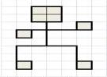
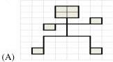
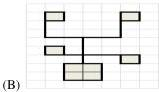
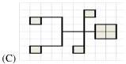
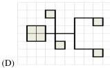
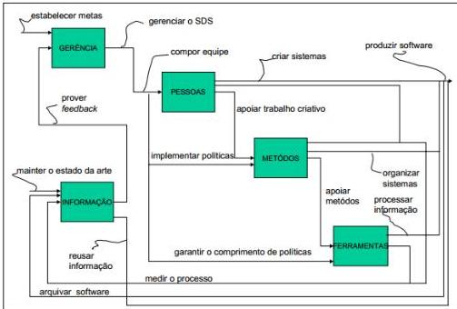

# PROVA — CÂMARA MUNICIPAL DE ITAPURANGA (GO) — 2014 — ANALISTA DE SISTEMAS

## 1. Análise geral da prova

**Identificação da prova:**

- **Órgão:** Câmara Municipal de Itapuranga — GO
- **Concurso:** Concurso Público — Edital 01/14 (banca Itame Consultoria e Concursos)
- **Cargo:** **Analista de Sistemas** (rodapé original de todas as páginas: “Câmara de Itapuranga2014/Analista de Sistemas”; os arquivos enviados mencionavam “Motorista”, cargo que **não** corresponde a este caderno)
- **Gabarito aplicado:** Gabarito Preliminar oficial Itame — tabela “ANALISTA DE SISTEMA” (Ensaio Superior), assinado em 16 de dezembro de 2014

**Composição quantitativa:**

| Item | Quantidade |
|---|---|
| Total de questões | 40 (todas objetivas, **4 alternativas: A, B, C, D**) |
| Textos-base de questão única | 4 (Q3 “A Mudança começa em nós”; Q21 trecho da CF; Q23 tabela + texto eleições 2014; Q24 texto de Gustavo Cerbasi) |
| Imagens | 7 (tirinha da Q8; 5 figuras da Q20 — figura-base + 4 alternativas; diagrama da Q40) |
| Gráficos e tabelas | 1 (tabela de votação Israel/Palestina no material da Q23) |
| Grupos identificados | 0 — nenhum material é compartilhado entre questões |
| Questões independentes | 40 (cada uma com seu próprio material, quando houver) |
| Questões anuladas | 0 (a tabela “ANALISTA DE SISTEMA” não traz anulação; as anulações “X” do gabarito ocorrem só nas provas de Ensino Fundamental) |

**Composição por bloco (títulos originais do caderno):**

| Bloco | Questões | Quantidade |
|---|---|---|
| Língua Portuguesa | 01 a 10 | 10 |
| Matemática | 11 a 20 | 10 |
| Conhecimentos Gerais e Atualidades | 21 a 30 | 10 |
| Conhecimentos Específicos | 31 a 40 | 10 |

**Observações sobre a estrutura original:**

- O PDF **não possui capa nem instruções** — inicia diretamente no título “Língua Portuguesa – questões de 1 a 10.” (11 páginas).
- As questões 3, 21, 23 e 24 têm anúncio explícito de texto/material próprio (*“Leia o texto abaixo para responder a questão N”*); o material está reproduzido integralmente dentro de cada questão.
- A Questão 20 apresenta uma figura-base e **quatro alternativas que são figuras** (imagens); a associação A–D segue a ordem de aparição no caderno.
- As questões 34, 36 e 39 trazem códigos-fonte (PHP, Java e C), preservados integralmente.

**Gabarito Preliminar oficial — tabela “ANALISTA DE SISTEMA”:**

| Questão | Resposta | Questão | Resposta | Questão | Resposta | Questão | Resposta |
|---|---|---|---|---|---|---|---|
| 01 | **A** | 02 | **D** | 03 | **C** | 04 | **A** |
| 05 | **A** | 06 | **B** | 07 | **D** | 08 | **A** |
| 09 | **D** | 10 | **C** | 11 | **D** | 12 | **A** |
| 13 | **B** | 14 | **B** | 15 | **B** | 16 | **A** |
| 17 | **B** | 18 | **C** | 19 | **B** | 20 | **B** |
| 21 | **C** | 22 | **C** | 23 | **A** | 24 | **B** |
| 25 | **B** | 26 | **C** | 27 | **D** | 28 | **D** |
| 29 | **B** | 30 | **C** | 31 | **D** | 32 | **A** |
| 33 | **B** | 34 | **D** | 35 | **A** | 36 | **A** |
| 37 | **B** | 38 | **B** | 39 | **B** | 40 | **B** |

> 📌 Fonte: Gabarito Preliminar oficial Itame — Edital 01/14, Câmara Municipal de Itapuranga (GO), tabela “ANALISTA DE SISTEMA” (Ensino Superior), 16/12/2014.

---
## 2. Questões agrupadas

**Nenhum agrupamento foi identificado nesta prova.** Não há texto, imagem, gráfico, tabela ou situação-problema compartilhado entre duas ou mais questões: cada material de apoio (textos das questões 3, 21, 23 e 24; tirinha da questão 8; figuras das questões 20 e 40) pertence a uma única questão e está reproduzido integralmente dentro dela, na seção 3.

---
## 3. Questões independentes

As 40 questões são independentes entre si: cada uma contém todo o conteúdo necessário para ser compreendida e respondida individualmente. As questões 3, 21, 23 e 24 trazem material de apoio próprio, reproduzido integralmente antes do enunciado.

---
### LÍNGUA PORTUGUESA (Questões 01 a 10)

---

#### QUESTÃO 01

✅ **Gabarito: A**

**Enunciado:**

Leia os períodos abaixo e assinale a alternativa correta:

I- Estando em boa fase, não fez grande partida.
II- Não veio por estar muito ocupado.
III- Feitas as ressalvas, encerramos a reunião.

As orações em destaque apresentam, respectivamente, as seguintes circunstâncias:

**Alternativas:**

A) Concessão-causa-tempo.

B) Condição-consequência-finalidade.

C) Proporcionalidade-causa-concessão.

D) Condição-explicação-consequência.

---

#### QUESTÃO 02

✅ **Gabarito: D**

**Enunciado:**

No período: “Sempre que chovia à tarde, vínhamos a todos uma vontade irresistível de tomar café com sonhos fritos” é correto afirmar que há:

**Alternativas:**

A) Três orações subordinadas além da principal.

B) Apenas duas orações, incluindo a principal.

C) Uma oração subordinada adverbial causal.

D) Uma oração subordinada reduzida de infinitivo, completiva nominal.

---

#### QUESTÃO 03

✅ **Gabarito: C**

**Material de apoio:**

Leia o texto abaixo para responder a questão 3.

# A Mudança começa em nós

Vilmar Berna

Todos nós desejamos viver num mundo melhor, mais pacífico, fraterno e ecológico. O problema é que as pessoas sempre esperam que esse mundo melhor comece no outro. É comum ouvirmos pessoas falando que têm boa vontade para ajudar, mas como ninguém as convida para nada, nem se organizam, então não podem contribuir como gostariam para um mutirão de limpeza da rua, por exemplo, ou para plantio de árvores. Pessoas assim acabam achando mais fácil reclamar que ninguém faz nada, ou que a culpa é do “Sistema”, dos governantes ou empresas, mas não se perguntam se estão fazendo a parte que lhes cabe.

Por outro lado, é importante não ficar esperando a perfeição individual - pois isso é inatingível. O fato de adquirirmos consciência ambiental, não nos faz perfeitos. O importante é que tenhamos o compromisso de ser melhor todo dia, procurando sempre nos superarmos.

Disponível em: http://www.jornaldomeioambiente.com.br/JMA-EditorVilmarBerna/Artigos.asp#e2. Acesso em 05de novembro de 2014.

**Enunciado:**

Julgue os seguintes itens, relativos às transformações propostas para o texto.

I. A substituição da expressão “O problema é que” pelo conectivo Mas transforma o período composto por três orações em período composto por duas orações e preserva as ideias do texto.
II. Como, de acordo com as ideias do texto, a palavra pessoas está sendo empregada para designar qualquer pessoa em geral, sua substituição pelo pronome alguém preserva a coerência e a correção gramatical do texto.
III. Mantém-se a correção e a coerência do texto por meio da transformação do discurso indireto apresentado no trecho “É comum (...) ajudar” para a seguinte forma de discurso direto. É comum ouvir pessoas dizendo: “eu tenho boa vontade para ajudar”.
IV. A substituição de tenhamos por temos preserva a correção gramatical do texto, mas altera uma forma verbal que exprime hipótese por outra que faz a declaração sobre uma realidade.

Assinale a alternativa correta.

**Alternativas:**

A) Todos os itens estão corretos.

B) Somente os itens I e II estão corretos.

C) Somente os itens I, III e IV estão corretos.

D) Somente os itens I e IV estão corretos.

---

#### QUESTÃO 04

✅ **Gabarito: A**

**Enunciado:**

A maneira como os verbos e os nomes se articulam com seus complementos nas orações, denomina-se regência. Sobre a regência dos verbos e dos nomes destacados, coloque V ou F e assinale a sequência correta.

( ) Em “... Necessita de melhoramentos...” e em “... a consequente necessidade de alimentos...”, há respectivamente, um verbo transitivo indireto e um substantivo que requer um complemento nominal regido por preposição.
( ) Em “trata-se de um debate...”, a forma verbal destacada é um verbo de ligação.
( ) Em “... como aconteceu com Copernico...”, a forma verbal destacada é um verbo transitivo direto.
( ) Em “... porquanto é próprio da ciência...”, estão destacados um verbo de ligação e seu predicativo que é um nome que rege um complemento com preposição.

( ) Em “... tirar proveito das descobertas...” estão destacados um verbo transitivo direto e um complemento nominal regido de preposição pelo antecedente , o substantivo “proveito”.

**Alternativas:**

A) V, F, F, V, V.

B) F, V, V, V, F.

C) V, F, V, F, V.

D) F, F, V, V, F.

---

#### QUESTÃO 05

✅ **Gabarito: A**

**Enunciado:**

Analise as afirmações abaixo, sobre as características morfológicas de algumas palavras.

I. O sufixo presente em escritor equivale semanticamente ao sufixo presente em ficcionista.

II. Na expressão o rádio a escolha do artigo masculino é aleatória, pois essa expressão tem o mesmo valor semântico de a rádio.

III. A palavra aterrizar é formada pelo acréscimo de prefixos e sufixos ao substantivo terra, e tem, como variante, a forma aterrissar.

IV. O prefixo presente em incrédulo está presente também em irritado, em ambos os casos, tem valor de negação.

Assinale a alternativa correta.

**Alternativas:**

A) As afirmações I e III estão corretas.

B) As afirmações II, III estão corretas.

C) As afirmações I e IV estão corretas.

D) As afirmações II, III, e IV estão corretas.

---

#### QUESTÃO 06

✅ **Gabarito: B**

**Enunciado:**

Nos trechos:

“O pavão é um arco- íris de plumas”.

“Quase morri de rir”.

“Vive só para mim, só para minha vida, só para meu amor”.

“O animal teme a morte porque vive, o homem também , e porque a desconhece (..)” Fernando Pessoa

“E rir meu riso e derramar meu pranto”. Vinicius de Moraes

“O mar canta como um canário”, Oswald de Andrade

Enquanto procedimento estilístico, temos respectivamente:

**Alternativas:**

A) Zeugma, pleonasmo, gradação, hipérbole, metáfora, comparação.

B) Metáfora, hipérbole, gradação, zeugma, pleonasmo, comparação.

C) Gradação, pleonasmo, hipérbole, metáfora, zeugma, comparação.

D) Metáfora, comparação, zeugma, hipérbole, gradação, pleonasmo.

---

#### QUESTÃO 07

✅ **Gabarito: D**

**Enunciado:**

Avalie a regência verbal nas seguintes orações.

I- Paz e harmonia é o objetivo a que visa a mensagem.

II- Não é fácil se lembrar o bem que os outros fazem.

III- Prefiro mais viver só do que mal acompanhada.

IV- Todos aspiram à paz

V- Se todos chegam à mesma conclusão, devem estar certos.

De acordo com a norma padrão culta, quanto à regência verbal, estão corretas as orações.

**Alternativas:**

A) I, II, IV e V.

B) I, III, IV e V.

C) I, II e IV.

D) I, IV e V

---

#### QUESTÃO 08

✅ **Gabarito: A**

**Material de apoio:**

Leia a tirinha abaixo e responda.


**Enunciado:**

Considere as seguintes afirmações sobre a tira humorística acima, em que Q1 representa o primeiro quadrinho e Q2, o segundo e coloque V para verdadeiro e F para falso:

( ) um exemplo de intertextualidade no Q1 possibilitou um efeito humorístico na sequência da tira.
( ) a leitura do Q1 isoladamente leva a crer que a personagem Hagar concorda com o provérbio, mas a articulação com Q2, através de a não ser (que), exprimindo condição, hipótese, subverte essa leitura.
( ) de forma jocosa, a tira humorística contesta as verdades irrefutáveis que são veiculadas pelo discurso do senso comum.
( ) em sua fala no Q1, a personagem Hagar procura mostrar uma atitude firme, positiva, segura, empregando verbos no modo indicativo, já no Q2 , a ação verbal é apresentada no modo subjuntivo, para traduzir um processo de incerteza, de dúvida.

Estão corretas

**Alternativas:**

A) V, V, V, F.

B) V, F, V, V.

C) V, F, V, F.

D) F, F, F, V.

**Referências visuais:**


---

#### QUESTÃO 09

✅ **Gabarito: D**

**Enunciado:**

Marque a alternativa correta.

O par de vocábulos cujos prefixos apresentam significação equivalente à dos elementos iniciais de impessoal e predeterminado.

**Alternativas:**

A) Amoral-epidérmico.

B) Antiaéreo-hipertenso.

C) Disforme-ultrapassado.

D) Desumano-antediluviano.

---

#### QUESTÃO 10

✅ **Gabarito: C**

**Enunciado:**

Assinale a alternativa que completa adequadamente as lacunas desses trechos:

1. Vai_______à carta minha fotografia. Essas pessoas cometeram crime de_______ patriotismo. Elas_______ não quiseram colaborar.
2. Muito_______disse ela. Vocês procederam_______, considerando meu ponto de vista e minha argumentação_______”
3. É_______serenidade, assim como é_______banir os pseudopatriotas.
4. Ele chegou ao meio-dia e_______, por isso ela estava_______aborrecida com sua atitude.

**Alternativas:**

A) 1. incluso-leso-mesma; 2. obrigado-certo-sensatos; 3. necessária-preciso; 4. meia-meio.

B) 1. inclusa-lesa-mesmo; 2. obrigada-certa-sensatos; 3. necessário-preciso; 4. meio-meio.

C) 1. inclusa-leso-mesmas; 2. obrigada-certo-sensatos; 3. necessário-preciso; 4. meia-meio.

D) 1.inclusos-leso-mesmo; 2. Obrigado-acerto-sensatos; 3. necessária-preciso; 4. meia-meio.

---

### MATEMÁTICA (Questões 11 a 20)

---

#### QUESTÃO 11

✅ **Gabarito: D**

**Enunciado:**

Um atleta disputa uma corrida de aventura, percorrendo 42 km, em três etapas. Na primeira etapa ele percorreu uma distância de 10,5 km e na terceira etapa, ele percorreu $\frac{2}{3}$ da distância percorrida na segunda etapa. Pode-se concluir que a distância percorrida na terceira etapa foi de

**Alternativas:**

A) 18,9 km.

B) 15,5 km.

C) 10,5 km.

D) 12,6 km.

---

#### QUESTÃO 12

✅ **Gabarito: A**

**Enunciado:**

A Confederação de Futebol Profissional (CFP) decidiu distribuir prêmios, proporcionais à quantidade de gols marcados, aos cinco melhores goleadores de um campeonato. Sabe-se que a entidade distribuiu um total de R$ 800 000,00 em premiação. Os jogadores premiados fizeram respectivamente 21, 15, 14, 13 e 12 gols. Com base nessas informações é possível afirmar que o segundo melhor goleador recebeu uma quantia de

**Alternativas:**

A) R$ 160 000,00.

B) R$ 224 000,00.

C) R$128 000,00.

D) R$ 250 000,00.

---

#### QUESTÃO 13

✅ **Gabarito: B**

**Enunciado:**

Considere a seguinte afirmação “O vestido de Maria é vermelho e João não beberá cerveja na festa hoje”. A negação dessa declaração é

**Alternativas:**

A) “O vestido de Maria não é vermelho e João não beberá cerveja na festa hoje”.

B) “O vestido de Maria não é vermelho ou João beberá cerveja na festa hoje”.

C) “O vestido de Maria não é vermelho então João beberá cerveja na festa hoje”.

D) “O vestido de Maria não é vermelho nem João beberá cerveja na festa hoje”.

---

#### QUESTÃO 14

✅ **Gabarito: B**

**Enunciado:**

Sejam os números $A = 5,42222\ldots$, $B = \frac{2\frac{5}{9}}{9}$ e $C = -13$. Nessas condições é correto afirmar que $A + B - C$ é igual a

**Alternativas:**

A) $-20\frac{44}{45}$.

B) $-5\frac{1}{45}$.

C) $20\frac{44}{45}$.

D) $5\frac{1}{45}$.

---

#### QUESTÃO 15

✅ **Gabarito: B**

**Enunciado:**

Sejam os números $A = \frac{1}{4}$ e $B = \frac{9}{20}$. Sobre estes números é correto afirmar que

**Alternativas:**

A) $A + B$ corresponde a um aumento de 80% em relação ao valor de A.

B) $A + B$ corresponde a um aumento de 180% em relação ao valor de A.

C) $A + B$ corresponde a um aumento de 280% em relação ao valor de A.

D) $A + B$ corresponde a um aumento de 380% em relação ao valor de A.

---

#### QUESTÃO 16

✅ **Gabarito: A**

**Enunciado:**

Em uma urna existem 50 bolas enumeradas de 1 a 50. Caso uma bola seja retirada ao acaso a probabilidade de seu número ser primo e maior que 25 será igual a

**Alternativas:**

A) $\frac{17}{25}$.

B) $\frac{4}{5}$.

C) $\frac{3}{20}$.

D) $\frac{1}{25}$.

---

#### QUESTÃO 17

✅ **Gabarito: B**

**Enunciado:**

O valor da expressão a seguir é igual a

$$-\left(-\frac{\left(\frac{0,2}{0,8}\right)^{-2}-2}{2}-\sqrt[2]{0,008}\right)-\left[-\left(-\frac{\left(\frac{1}{(14)^{\frac{1}{3}}}\right)^{-3}+0,2}{2}\right)\right]$$

**Alternativas:**

A) $-0,3$.

B) $0,1$.

C) $0,3$.

D) $13,9$.

---

#### QUESTÃO 18

✅ **Gabarito: C**

**Enunciado:**

O tempo, em meses, necessário para que um capital, aplicado a juros compostos a uma taxa efetiva de 2% a.m., duplique o seu valor é de

Observação: se precisar considere: $\log 2 = 0,301$ e $\log 1,02 = 0,0086$

**Alternativas:**

A) 12

B) 24

C) 35

D) 50

---

#### QUESTÃO 19

✅ **Gabarito: B**

**Enunciado:**

Numa construção, os pedreiro deverão concretar duas salas. No primeiro dia de trabalho, 5 betoneiras, com potências iguais, produziram em 4 horas, massa de concreto para cobrir o piso de uma sala 1 200 m². No segundo dia, a sala a ser trabalhada é de 1 300 m², porém 3 betoneiras não funcionaram. Logo, o tempo necessário para produzir massa de concreto no segundo dia para cobrir o piso da segunda sala será maior do que o dia anterior em:

**Alternativas:**

A) 5h40min15seg

B) 6h50min

C) 10h01mim23seg

D) 6h

---

#### QUESTÃO 20

✅ **Gabarito: B**

**Enunciado:**

Observe a figura a seguir:



Qual das alternativas a seguir é simétrica à figura acima?

**Alternativas:**

A) 

B) 

C) 

D) 

**Referências visuais:**


---

### CONHECIMENTOS GERAIS E ATUALIDADES (Questões 21 a 30)

---

#### QUESTÃO 21

✅ **Gabarito: C**

**Enunciado:**

Leia o texto abaixo para responder a questão 21.

De acordo com a Constituição Federal, artigo 196, a saúde é direito de todos e dever do Estado, garantido mediante políticas sociais econômicas que visem à redução do risco de doença e de outros agravos e ao acesso universal e igualitário às ações e serviços para sua promoção, proteção e recuperação.

Disponível em <http://conselho.saude.gov.br/web_sus20anos/20anossus/legislacao/constituicaofederal.pdf> acesso em 21 de OUT de 2014

Para atender a população brasileira foi criado, em 1988, um dos maiores sistemas de saúde do mundo que ficou conhecido pela sigla:

**Alternativas:**

A) UNIMED.

B) SUEBAS.

C) SUS.

D) INSS.

---

#### QUESTÃO 22

✅ **Gabarito: C**

**Enunciado:**

A nova ordem internacional sinalizada pela onda do liberalismo e do neoliberalismo, intensificada pela livre circulação de mercadorias, pessoas e capitais, marcantes nas últimas décadas, denomina-se:

**Alternativas:**

A) Anarquismo.

B) Bolivarismo.

C) Globalização.

D) Capitalismo Ortodoxo.

---

#### QUESTÃO 23

✅ **Gabarito: A**

**Material de apoio:**

Considere tabela e texto abaixo para responder a questão 23.

|  País/Candidato (%) | Dilma | Aécio | Marina | Outros | Branco/Nulo | TOTAL  |
| --- | --- | --- | --- | --- | --- | --- |
|  Israel | 15 (7,2%) | 142 (68,6%) | 36 (17,4%) | 8 (3,9%) | 6 (2,9%) | 207 (32%)  |
|  Palestina | 315 (71,9%) | 44 (10%) | 22 (5%) | 25 (5,7%) | 32 (7,4%) | 438 (68%)  |
|  TOTAL | 330 | 186 | 58 | 33 | 38 | 645  |
|  TOTAL em % | 51,16% | 28,88% | 8,98% | 5,10% | 5,88% | 100%  |

“Seja na representação brasileira em Ramallah, ou na embaixada brasileira em Tel Aviv, nota-se números muito destoantes do resultado nacional brasileiro do primeiro turno: do total de votos apurados, Dilma Rousseff obteve 41,59% (43,3 milhões) contra 33,55% (34,9 milhões) de Aécio Neves. (...) Os resultados estão aí para comprovar, (...) em parte explicados pela atual política externa brasileira na região.”

Disponível em <http://www.conexaoisrael.org/israel-vota-aecio-e-palestina-vota-dilma/2014-10-25/david/> acesso em 25 de OUT de 2014.

**Enunciado:**

As informações acima remetem ao primeiro do turno das eleições de 2014 e à votação de brasileiros residentes na região conflituosa da Palestina e Israel. Identifica-se, a partir da análise dos dados apresentados, que a votação expressiva em:

**Alternativas:**

A) Aécio Neves, em Israel, é uma resposta ao apoio significante que o Brasil tem dado à Autoridade Palestina na Cisjordânia e ao Hamas em Gaza.

B) Marina Silva, tanto em Israel, quanto na palestina, é reveladora de uma desconfiança do eleitorado, naquela região, pelos presidenciáveis do PT e do PSDB.

C) Dilma Rousseff, na Palestina, é justificada pelo fato de que a candidata à reeleição se converteu ao islamismo.

D) Dilma Rousseff, em Israel e na Palestina, é resultado de um posicionamento de neutralidade do governo brasileiro, em relação aos conflitos entre judeus e palestinos.

---

#### QUESTÃO 24

✅ **Gabarito: B**

**Material de apoio:**

Leia o texto abaixo e responda a questão 24.

“No passado, historiadores, geógrafos, e economistas dividiam a maior parte dos países entre primeiro mundo, segundo mundo e terceiro mundo. Mais recentemente, convencionou-se dividir o mundo em países desenvolvidos (ou ricos), países pobres (ou dependentes da ajuda dos ricos) e países em desenvolvimento. No Brasil, nos sentimos promovidos para posição intermediária.”

CERBASI, Gustavo. As obrigações do governo eleito. Revista Época. Nº 856. SP: Editora Globo. 27 de OUT de 2014. p. 111.

**Enunciado:**

Assim, podemos afirmar que o Brasil durante a Guerra Fria fazia parte:

**Alternativas:**

A) Do terceiro mundo e atualmente é dependente da ajuda de países ricos.

B) Do terceiro mundo e atualmente é classificado como país em desenvolvimento.

C) Do segundo mundo e atualmente é dependente da ajuda de países ricos.

D) Do segundo mundo e atualmente é classificado como país em desenvolvimento.

---

#### QUESTÃO 25

✅ **Gabarito: B**

**Enunciado:**

O processo de ocupação da Amazônia brasileira foi acelerado a partir da década de 1970. A respeito desse processo, é correto afirmar:

**Alternativas:**

A) Baseou-se na implantação de projetos hidroviários e no desenvolvimento do setor terciário.

B) Atraiu projetos voltados para o desenvolvimento da agropecuária e para a exploração de minérios.

C) Estabeleceu-se em áreas de fronteira mediante a preservação dos recursos vegetais e hídricos.

D) Impulsionou a criação de zonas de exportação e exploração seletiva da vegetação.

---

#### QUESTÃO 26

✅ **Gabarito: C**

**Enunciado:**

O Brasil concentra quase 12% da água doce superficial do mundo, uma grave crise de água em nosso país poderia ser motivada por:

**Alternativas:**

A) Escassez de rios e de grandes bacias hidrográficas.

B) Reduzida área de solos agricultáveis.

C) Degradação dos manaciais e desperdícios no consumo.

D) Ausência de reservas de águas subterrâneas.

---

#### QUESTÃO 27

✅ **Gabarito: D**

**Enunciado:**

Sobre o Regimento Interno da Câmara Municipal, assinale V ou F (verdadeiro ou falso):

( ) O Poder Legislativo é exercido pela Câmara Municipal que tem funções legislativas de fiscalização financeira e de controle externo do Executivo.

( ) Cabe a Câmara Municipal no exercício das funções legislativas a elaboração de emendas à Lei Orgânica, leis complementares, leis ordinárias, decretos legislativos e resoluções sobre quaisquer matérias de competência do Município.

( ) As funções julgadoras ocorrem nas hipóteses em que é necessário julgar o Prefeito, quando este comete infrações político-administrativa prevista em lei.

**Alternativas:**

A) VVV

B) VFV

C) FFF

D) VVF

---

#### QUESTÃO 28

✅ **Gabarito: D**

**Enunciado:**

Estabelece o Regimento Interno da Câmara Municipal que: “As Comissões Permanentes incumbe estudar as proposições e os assuntos distribuídos ao seu exame, manifestando sobre elas sua opinião para orientação do Plenário” São Comissões Permanentes, exceto:

**Alternativas:**

A) Meio Ambiente e Política Urbana.

B) Educação, Saúde e Assistência.

C) Finanças e Orçamentos

D) Inquérito e Justiça

---

#### QUESTÃO 29

✅ **Gabarito: B**

**Enunciado:**

Assinale a afirmativa correta.

Segundo a Lei Orgânica do Município de Itapuranga compete privativamente ao prefeito:

**Alternativas:**

A) exercer a direção superior de Administração Estadual e Municipal

B) Sancionar, promulgar e fazer publicar as leis, expedir decretos e regulamentos para que sejam fielmente executados.

C) celebrar convênios, acordos, contratos e outros ajustes de acordo com a conveniência do executivo, desde que autorizados pela Câmara.

D) Vetar totalmente os projetos de leis.

---

#### QUESTÃO 30

✅ **Gabarito: C**

**Enunciado:**

De acordo com a Lei Orgânica são bens do município:

- I. Os recursos naturais.
- II. Os que atualmente já lhe pertence.
- III. Os recursos minerais, inclusive os do subsolo.
- IV. As nascentes, as águas, córregos, riachos e rios de cursos na circunscrição do município.

Estão corretos os itens:

**Alternativas:**

A) II, III e IV

B) I e II

C) II e IV

D) I, II e IV

---

### CONHECIMENTOS ESPECÍFICOS (Questões 31 a 40)

---

#### QUESTÃO 31

✅ **Gabarito: D**

**Enunciado:**

Uma transação pode ser definida como um conjunto de operações (alteração, inclusão, exclusão, atualização, etc.) realizadas nos dados de uma aplicação em um dado momento. Uma transação tem o seu início no início de uma sessão e o seu término no encerramento da sessão (fechamento do programa ou operação.). Avalie as alternativas abaixo:

I - O início de uma nova transação é marcada pela diretiva BeginTrans.

II - O início de uma nova transação é marcada pela diretiva InitTrans.

III - O encerramento pela diretiva RollBack.

IV - O método RollBack irá encerrar as modificações feitas desde que InitTrans foi ativado.

V - Se for fechado o objeto Workspace sem salvar ou encerrar as transações pendentes, as transações são automaticamente canceladas. (RollBack).
São corretas as alternativas:

**Alternativas:**

A) I, III, V.

B) II, III, IV.

C) II, III.

D) I, V.

---

#### QUESTÃO 32

✅ **Gabarito: A**

**Enunciado:**

Sobre problemas que afetam os computadores hoje em dia, assinale a alternativa que contenha a sequência correta dos seus nomes:

1 - É um pequeno programa escrito com o objetivo de alterar a forma como um computador opera, sem a permissão ou o conhecimento do usuário.
2 - São impostores, arquivos que se passam por um programa desejável, mas que, na verdade, são prejudiciais. Eles contêm códigos maliciosos que, quando ativados, causam a perda ou até mesmo o roubo de dados. Para que se espalhe, o próprio usuário deve instalar esse programa no computador, por exemplo, abrindo um anexo de e-mail ou fazendo o download e executando um arquivo diretamente da Internet.
3- São programas que se duplicam, passando de um sistema a outro, sem utilizar um arquivo host. Embora eles geralmente existam dentro de outros arquivos, como documentos do Word ou Excel, há uma diferença no modo com se utilizam o arquivo host.

**Alternativas:**

A) 1=VIRUS, 2=CAVALO DE TRÓIA, 3=WORMS

B) 1=CAVALO DE TROIA, 2=VIRUS, 3=WORMS

C) 1= WORMS, 2=CAVALO DE TRÓIA, 3= VIRUS

D) 1=VIRUS, 2= VIRUS, 3=WORMS

---

#### QUESTÃO 33

✅ **Gabarito: B**

**Enunciado:**

Apesar de todas as vantagens que a OO pode trazer ao desenvolvimento de software, um problema fundamental ainda persiste: identificar corretamente e completamente objetos (classes), atributos e operações. Usualmente, várias técnicas (de uso não exclusivo) são usadas para identificar classes. Marque a opção abaixo que NÃO representa uma técnica de identificação de classe:

**Alternativas:**

A) Categorias de conceitos.

B) Diagramação MER.

C) Análise de casos de uso.

D) Identificação dirigida a responsabilidades.

---

#### QUESTÃO 34

✅ **Gabarito: D**

**Enunciado:**

Analise o trecho de código desenvolvido em linguagem PHP:


```
<?php
$vet01 = array();
$vet01[] = "Sistemas operacionais";
$vet01[] = "Compiladores";
$vet01[] = "Bancos de dados";

$vet02 = array(1, 2, 3, 4, 5);

$vet03 = array( 0 => 0, 2 => 3, 10 => 5, );

for ($i = 0; $i < count($vet01); $i++) {
    echo $vet01[$i] . " " . ($vet02[$i + 1] * $vet03[10] ) . "
";
}

if($vet01[$i - 1] * $vet02[$i - 1] <= $vet03[2] * 2)
    $vet04 = explode(" ", "sistemas de informação _");

echo ucfirst($vet04[$i - 1]). $vet04[$i - 2].$vet04[$i - 0].ucfirst($vet04[$i - 3]);
?>
```


Marque a opção correspondente ao apresentado no navegador de Internet após a execução do código acima:

**Alternativas:**

A) Sistemas operacionais 10
Compiladores 15
Bancos de dados 20

B) Sistemas operacionais 10
Compiladores 15
Bancos de dados 20

C) Sistemas operacionais 10
Compiladores 15
Bancos de dados 20
Informação de_sistemas

D) Sistemas operacionais 10
Compiladores 15
Bancos de dados 20
Informação de_Sistemas

---

#### QUESTÃO 35

✅ **Gabarito: A**

**Enunciado:**

AJAX, diferentemente do que pensam alguns, não se trata apenas de uma marca de detergente! Na verdade, além vai bem além. É uma forma de programar que envolve algumas linguagens de programação diferentes e uma nova forma de integrar formulários às páginas de Internet. O grande conceito de AJAX é permitir que o cliente se comunique com o servidor em segundo plano, sem recarregar a página, efetivamente unindo a tecnologia client-side com a tecnologia server-side e potencializando a comunicação. Sobre os conceitos de Ajax, marque a opção correta.

**Alternativas:**

A) O AJAX é um conjunto de técnicas novas, envolvendo diversas tecnologias antigas, dentre elas: .Net, Java, XML, Document Object Model (DOM).

B) Conceitualmente, AJAX significa Javascript Assíncrono e XML, mas na prática é possível utilizar objetos com notação JSON (JavaScript Object Notation) também, ao invés de XML.

C) O Send(content) simula o funcionamento do browser. No AJAX, essa requisição é feita da mesma forma, porém o resultado não se carrega na janela e sim dentro do próprio objeto de send, isso causa o efeito de segundo plano que o AJAX apresenta.

D) Open(“method”,”URL”,async,”uname”,”pswd”) é um método que envia parâmetros de forma síncrona ou assíncrona, determinando se o código continua sendo aguardando independente da resposta ou se a resposta é aguardada para continuar o processamento.

---

#### QUESTÃO 36

✅ **Gabarito: A**

**Enunciado:**

Análise o exemplo de algoritmo estruturado em Java e vemos uma classe chamada filmes, que é uma extensão de outra classe chamada conexão. Responda a alternativa correta:


```
public class filmes extends conexao {

    private String nome;

    public String getNome() {

        return nome ;

    }

    public void setNome(String nome) {

        this.nome = nome;

    }

}
```

**Alternativas:**

A) é declarada uma variável e são implementados os métodos get/set.

B) é declarada uma variável e são implementados os métodos extends/set.

C) é declarada uma variável e são implementados os métodos String/Class.

D) é declarada uma variável e são implementados os métodos public/void.

---

#### QUESTÃO 37

✅ **Gabarito: B**

**Enunciado:**

A ideia é análoga a linha de produções em série, mas utilizada na execução das instruções. Primeiro divide-se as instruções em pedaços menores de forma que uma instrução em código de máquina demore muitos ciclos curtos para ser executada. Depois disso o controle do microprocessador encarrega-se de executar várias instruções ao mesmo tempo, cada uma utilizando um pedaço distinto do processador. Isto tem como objetivo que na média cada instrução demore 1 ciclo curto para ser executada. Este texto refere-se:

**Alternativas:**

A) Semicondutores

B) Pipeline

C) String

D) Variável

---

#### QUESTÃO 38

✅ **Gabarito: B**

**Enunciado:**

Texto 1:** Permite que várias tabelas sejam usadas simultaneamente através do uso de apontadores (ou referências). Algumas colunas contêm apontadores para outras tabelas ao invés de dados. Assim, as tabelas são ligadas por referências. **Texto 2:** Consiste de matrizes simples, bidimensionais, compostas por elementos de dados: inteiros, números reais, etc. Este modelo plano é a base das planilhas eletrônicas.

Existem vários Modelos de Base de Dados: Modelo Plano, Modelo em Rede, Modelo Hierárquico, Modelo Relacional, Orientado a objetos, e Objeto-Relacional. Os textos acima se referem a quais modelos:

**Alternativas:**

A) Modelo Relacional e Modelo Plano.

B) Modelo em Rede e Modelo Plano.

C) Modelo Hierárquico e Objeto-Relacional.

D) Modelo Hierárquico e Modelo Relacional.

---

#### QUESTÃO 39

✅ **Gabarito: B**

**Enunciado:**

Analisando o código abaixo, responda:


```
#include <stdio.h>

float media(float numeros[], int n)

{
    int count;
    float media=0.0;

    for(count=0 ; count<n ; count++)
        media += numeros[count];

    return (media/n);
}

int main(void)

{
    float numeros[5];
    int count;

    for(count=0 ; count < 5 ; count++)
    {
        printf("Entre com o numero %d: ", count+1);
        scanf("%f", &numeros[count]);
    }

    printf("A media desses numeros e: %.2f\n", media(numeros, 5));
    return 0;
}
```

**Alternativas:**

A) Código acima calcula média aritmética, com vetor somente.

B) Código acima calcula média de, com vetor e função.

C) Código acima calcula média aritmética, com vetor e dimensão.

D) Todas as alternativas estão corretas.
pg. 10

---

#### QUESTÃO 40

✅ **Gabarito: B**

**Enunciado:**

Em relação a figura abaixo, escolha a opção correta:



**Alternativas:**

A) Trata-se de arquitetura de funções e variáveis.

B) Trata-se de qualidade de software.

C) Trata-se em gerenciar o computação gráfica.

D) Trata-se de modelagem hipermídia.
pg. 11

**Referências visuais:**


## 4. Observações e limitações da extração

- **Cargo no nome dos arquivos:** os arquivos enviados mencionam “Analista de Sistemas Pg. 1” e também “Motorista”. O rodapé de todas as páginas do caderno (“Câmara de Itapuranga2014/Analista de Sistemas”), a quantidade de questões (40) e os blocos de conteúdo confirmam que a prova é do cargo **Analista de Sistemas**. A tabela “MOTORISTA” do gabarito (30 questões, Ensino Fundamental) **não** corresponde a este caderno e não foi aplicada.
- **Gabarito com múltiplas tabelas:** o PDF de gabarito traz 6 tabelas (Auxiliar de Serviços Gerais, Guarda Noturno e Motorista — 30 questões; Recepcionista — 40; Analista de Sistema — 40). Foi aplicada apenas a tabela **“ANALISTA DE SISTEMA”**. As marcações “X” (questão anulada) existem apenas nas provas de Ensino Fundamental (Q10 das provas de 30 questões; Q27 da Guarda Noturno) e não afetam esta prova.
- **Questão 16 — divergência entre gabarito oficial e o enunciado:** o gabarito oficial indica a alternativa A (“17/25”), mas o cálculo direto dos dados do enunciado (bolas primas maiores que 25 entre 1 e 50: 29, 31, 37, 41, 43, 47 → 6/50 = 3/25) não corresponde a nenhuma das alternativas apresentadas. O gabarito oficial foi mantido como publicado.
- **Questão 20 — alternativas em figura:** as quatro alternativas são figuras (imagens), sem texto. A associação às letras A, B, C e D segue a ordem de aparição das figuras no caderno original. A figura-base e as quatro alternativas estão em `imagens/imagem_002.jpg` a `imagem_006.jpg`.
- **Fórmulas matemáticas:** as expressões das questões 11, 14, 15, 16 e 17 foram extraídas em notação LaTeX (por exemplo, `$\\frac{2}{3}$`), representação OCR das fórmulas impressas; preservadas como extraídas.
- **Códigos-fonte (Q34, Q36, Q39):** preservados integralmente; foram apenas delimitados com blocos de código (```) para legibilidade. A quebra de linha original foi mantida.
- **Alternativas A e B da Questão 34** são textualmente idênticas no OCR (diferindo apenas na indentação); a diferença real está nas alternativas C e D (linha adicional de saída). Conteúdo preservado como extraído.
- **Rodapés de página removidos:** “Câmara de Itapuranga2014/Analista de Sistemas”, “pg. [nº]” e “www.pciconcursos.com.br”.
- **OCR:** extração por OCR do PDF original; pequenas variações de pontuação ou acentuação podem existir em relação ao impresso (ex.: “manaciais” na Q26, possivelmente “mananciais” no original — mantido como extraído). Nenhum trecho ilegível foi identificado.
