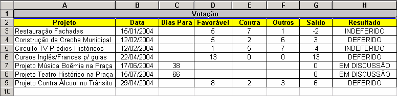

# PROVA — CÂMARA MUNICIPAL DE OURO PRETO (MG) — AGENTE LEGISLATIVO II

## 1. Análise geral da prova

**Identificação da prova:**

- **Órgão:** Câmara Municipal de Ouro Preto — Estado de Minas Gerais (MG)
- **Cargo:** Agente Legislativo II
- **Banca:** não identificada no documento
- **Ano:** não consta no documento
- Códigos de prova: LP 05, Informática 06, Redação Oficial 09, Direito 10
- **Gabarito aplicado:** Gabarito Oficial — tabela "CARGO: AGENTE LEGISLATIVO II"

**Composição quantitativa:**

| Item | Quantidade |
|---|---|
| Total de questões objetivas | 50 (4 alternativas: A–D) |
| Textos de apoio | 1 (planilha Excel descrita em texto, compartilhada pelas questões 11 e 12) |
| Imagens de conteúdo | 1 (planilha Excel) |
| Gráficos e tabelas | 1 (a própria planilha) |
| Grupos identificados | 1 |
| Questões independentes | 48 + transcrição de frase |

**Composição por bloco:**

| Bloco | Questões | Quantidade |
|---|---|---|
| LÍNGUA PORTUGUESA | 01 a 10 | 10 |
| NOÇÕES DE INFORMÁTICA | 11 a 25 | 15 |
| TÉCNICAS DE REDAÇÃO OFICIAL | 26 a 35 | 10 |
| NOÇÕES DE DIREITO | 36 a 50 | 15 |
| Transcrição de frase (avaliação de escrita) | 1 frase | 1 |

**Observações sobre a estrutura original:**

- A prova é dividida em seções identificadas no rodapé ("PROVA DE ... – CÓD. NN").
- O ano do concurso não consta no documento e não foi inventado.
- A frase de transcrição (avaliação de escrita) foi preservada integralmente.

> Assine e coloque seu número de inscrição no quadro abaixo. Preencha,
> com traços firmes, o espaço reservado a cada opção na folha de resposta.
> 
> Nº de Inscrição
> Nome

**Gabarito oficial — tabela "GABARITO OFICIAL, cargo Agente Legislativo II — Câmara Municipal de Ouro Preto (MG)":**

| Questão | Resposta | Questão | Resposta | Questão | Resposta | Questão | Resposta | Questão | Resposta |
|---|---|---|---|---|---|---|---|---|---|
| 01 | **D** | 02 | **A** | 03 | **D** | 04 | **B** | 05 | **C** |
| 06 | **C** | 07 | **A** | 08 | **B** | 09 | **C** | 10 | **A** |
| 11 | **C** | 12 | **D** | 13 | **B** | 14 | **C** | 15 | **A** |
| 16 | **B** | 17 | **A** | 18 | **C** | 19 | **A** | 20 | **D** |
| 21 | **B** | 22 | **A** | 23 | **C** | 24 | **D** | 25 | **D** |
| 26 | **C** | 27 | **D** | 28 | **A** | 29 | **B** | 30 | **C** |
| 31 | **A** | 32 | **D** | 33 | **B** | 34 | **C** | 35 | **D** |
| 36 | **A** | 37 | **A** | 38 | **C** | 39 | **D** | 40 | **B** |
| 41 | **A** | 42 | **C** | 43 | **D** | 44 | **B** | 45 | **B** |
| 46 | **C** | 47 | **B** | 48 | **A** | 49 | **C** | 50 | **B** |

> 📌 Fonte: GABARITO OFICIAL, cargo Agente Legislativo II — Câmara Municipal de Ouro Preto (MG)

---

## 2. Questões agrupadas

### GRUPO 01 — Planilha Excel de projetos de leis — compartilhada pelas questões 11 e 12

**Questões relacionadas:** 11 e 12.

**Material de apoio compartilhado:**

> Texto de referência (utilizado nas questões 11 e 12):
> 
> As questões de 11 a 12 vão utilizar esta planilha excel. Aqui temos uma tabela com alguns projetos hipotéticos sobre leis votadas e a votar na Câmara Municipal de Vereadores de Ouro Preto. A coluna “Data” indica a data de votação, a coluna “Dias Para” fica vazia caso a votação já tenha ocorrido ou mostra, dinamicamente, o número de dias que faltam até a votação. As colunas “Favorável”, “Contra” e “Outros” mostram os resultados apurados na votação. A coluna “Saldo” mostra a diferença entre os votos favoráveis e contra da votação. A coluna “Resultado” mostra um texto com os valores “EM DISCUSSÃO” se o saldo da votação é igual a zero, “DEFERIDO” se o saldo da votação é maior que zero ou “INDEFERIDO” se o saldo da votação é menor que zero. Considere também, para todas as questões, que a fórmula “HOJE()” retorna a data “09/04/2004”. DICA: A fórmula condicional SE, do Excel, tem este formato: =SE(<condição>;<valor exibido para condição verdadeira>;<valor exibido para condição falsa>)

---

#### QUESTÃO 11

✅ **Gabarito: C** (gabarito oficial — Câmara Municipal de Ouro Preto (MG), cargo Agente Legislativo II)

**Material de apoio:**

> Texto de referência (utilizado nas questões 11 e 12):
> 
> As questões de 11 a 12 vão utilizar esta planilha excel. Aqui temos uma tabela com alguns projetos hipotéticos sobre leis votadas e a votar na Câmara Municipal de Vereadores de Ouro Preto. A coluna “Data” indica a data de votação, a coluna “Dias Para” fica vazia caso a votação já tenha ocorrido ou mostra, dinamicamente, o número de dias que faltam até a votação. As colunas “Favorável”, “Contra” e “Outros” mostram os resultados apurados na votação. A coluna “Saldo” mostra a diferença entre os votos favoráveis e contra da votação. A coluna “Resultado” mostra um texto com os valores “EM DISCUSSÃO” se o saldo da votação é igual a zero, “DEFERIDO” se o saldo da votação é maior que zero ou “INDEFERIDO” se o saldo da votação é menor que zero. Considere também, para todas as questões, que a fórmula “HOJE()” retorna a data “09/04/2004”. DICA: A fórmula condicional SE, do Excel, tem este formato: =SE(<condição>;<valor exibido para condição verdadeira>;<valor exibido para condição falsa>)

**Enunciado:**

Pede-se que o conteúdo da célula A7, “Projeto Música Boêmia na Praça”, seja utilizado em células abaixo dessas de modo a criar novas tabelas. Essas novas tabelas não devem possuir uma réplica do nome do projeto e sim fórmulas apontando para a célula desta tabela. A vantagem de evitar a réplica está no caso de alteração do nome do projeto, situação que provoca a exibição do nome alterado em todas as células com a fórmula. A formula deve ser passível de passar pelas operações Copiar e Colar sem perder a referência para o nome do projeto. Marque a alternativa com a fórmula correta.

**Alternativas:**

A) =A7

B) =A$7

C) =$A$7

D) =$A7

**Referências visuais:**

---

#### QUESTÃO 12

✅ **Gabarito: D** (gabarito oficial — Câmara Municipal de Ouro Preto (MG), cargo Agente Legislativo II)

**Material de apoio:**

> Texto de referência (utilizado nas questões 11 e 12):
> 
> As questões de 11 a 12 vão utilizar esta planilha excel. Aqui temos uma tabela com alguns projetos hipotéticos sobre leis votadas e a votar na Câmara Municipal de Vereadores de Ouro Preto. A coluna “Data” indica a data de votação, a coluna “Dias Para” fica vazia caso a votação já tenha ocorrido ou mostra, dinamicamente, o número de dias que faltam até a votação. As colunas “Favorável”, “Contra” e “Outros” mostram os resultados apurados na votação. A coluna “Saldo” mostra a diferença entre os votos favoráveis e contra da votação. A coluna “Resultado” mostra um texto com os valores “EM DISCUSSÃO” se o saldo da votação é igual a zero, “DEFERIDO” se o saldo da votação é maior que zero ou “INDEFERIDO” se o saldo da votação é menor que zero. Considere também, para todas as questões, que a fórmula “HOJE()” retorna a data “09/04/2004”. DICA: A fórmula condicional SE, do Excel, tem este formato: =SE(<condição>;<valor exibido para condição verdadeira>;<valor exibido para condição falsa>)

**Enunciado:**

Marque a alternativa com a fórmula correta para o valor apresentado na célula G9.

**Alternativas:**

A) =D9-E9+F9

B) =D9-E9-F9

C) =E9-F9

D) =D9-E9

**Referências visuais:**

---

## 3. Questões independentes

#### QUESTÃO 01

✅ **Gabarito: D** (gabarito oficial — Câmara Municipal de Ouro Preto (MG), cargo Agente Legislativo II)

**Enunciado:**

Ambas as palavras estão acentuadas INCORRETAMENTE em:

**Alternativas:**

A) pólens / reúnem

B) raínhas / ínterim

C) aínda / ruínas

D) ítens / núvens

---

#### QUESTÃO 02

✅ **Gabarito: A** (gabarito oficial — Câmara Municipal de Ouro Preto (MG), cargo Agente Legislativo II)

**Enunciado:**

Todas as palavras estão grafadas INCORRETAMENTE em:

**Alternativas:**

A) reinvindicar / impecilho / analizar

B) surpreza / palidez / friesa

C) alizar / vulgarizar / amenisar

D) burguez / proesa / holandesa

---

#### QUESTÃO 03

✅ **Gabarito: D** (gabarito oficial — Câmara Municipal de Ouro Preto (MG), cargo Agente Legislativo II)

**Enunciado:**

Observe atentamente o emprego da vírgula nos enunciados abaixo. I. Argumentavam, que as explicações eram necessárias. II. Saindo de casa, procurou novamente seus verdadeiros amigos. III. As mulheres do bairro, nunca se manifestaram daquela forma. O emprego está correto em:

**Alternativas:**

A) I, II e III

B) I e II apenas

C) I e III apenas

D) II apenas

---

#### QUESTÃO 04

✅ **Gabarito: B** (gabarito oficial — Câmara Municipal de Ouro Preto (MG), cargo Agente Legislativo II)

**Enunciado:**

“Há alguns pontos polêmicos os quais permitem a pessoas razoáveis, isto é, pessoas não-dogmáticas, identificar boas estratégias a seu favor e contra elas.” As palavras sublinhadas são respectivamente:

**Alternativas:**

A) pronome – artigo – preposição

B) pronome relativo – preposição – preposição

C) conjunção subordinativa – artigo – advérbio

D) conjunção integrante – preposição – advérbio

---

#### QUESTÃO 05

✅ **Gabarito: C** (gabarito oficial — Câmara Municipal de Ouro Preto (MG), cargo Agente Legislativo II)

**Enunciado:**

A forma verbal destacada está flexionada corretamente em:

**Alternativas:**

A) O deputado que pôr alguma objeção será mal avaliado nas pesquisas.

B) Ele havia trago as notícias denunciadoras de corrupção.

C) Quando virem seus livros, entenderão todas as razões.

D) Todos manteram suas idéias até o fim da discussão.

---

#### QUESTÃO 06

✅ **Gabarito: C** (gabarito oficial — Câmara Municipal de Ouro Preto (MG), cargo Agente Legislativo II)

**Enunciado:**

NÃO são exemplos de substantivos masculinos:

**Alternativas:**

A) lança-perfume / dinamite

B) champanha / faringe

C) libido / cal

D) formicida / clã

---

#### QUESTÃO 07

✅ **Gabarito: A** (gabarito oficial — Câmara Municipal de Ouro Preto (MG), cargo Agente Legislativo II)

**Enunciado:**

Assinale o verbo em negrito que apresenta regência verbal correta.

**Alternativas:**

A) Sempre me esqueço de avaliar bem as situações apresentadas.

B) Dizíamos com freqüência que lhes conhecemos ano passado.

C) Não o assiste o direito de encaminhar tais projetos.

D) Informaram-lhe de tudo que pudesse me comprometer.

---

#### QUESTÃO 08

✅ **Gabarito: B** (gabarito oficial — Câmara Municipal de Ouro Preto (MG), cargo Agente Legislativo II)

**Enunciado:**

A crase foi usada de forma correta em:

**Alternativas:**

A) Seus pais estavam dispostos à muitas concessões.

B) A atenção às nossas propostas acabou comprando inimizade.

C) Durante a sua visita, jamais se referia à nós.

D) À partir das considerações propostas, encaminhamos o seu projeto.

---

#### QUESTÃO 09

✅ **Gabarito: C** (gabarito oficial — Câmara Municipal de Ouro Preto (MG), cargo Agente Legislativo II)

**Enunciado:**

Leia atentamente os enunciados a seguir. I. Grande parte dos cidadãos dos bairros da periferia avaliou bem a situa- ção proposta. II. Não se permitiram discussões que envolvessem os políticos vizinhos. III. Os senadores estavam agora sós com as medidas tomadas; não havia mais apoio popular. A concordância da palavra destacada está correta em:

**Alternativas:**

A) II e III apenas

B) I e II apenas

C) I, II e III

D) III apenas

---

#### QUESTÃO 10

✅ **Gabarito: A** (gabarito oficial — Câmara Municipal de Ouro Preto (MG), cargo Agente Legislativo II)

**Enunciado:**

“Como não me procuraram mais, considerei que haviam me esquecido.” A oração subordinada exprime circunstância de:

**Alternativas:**

A) causa

B) comparação

C) concessão

D) conseqüência

---

#### QUESTÃO 13

✅ **Gabarito: B** (gabarito oficial — Câmara Municipal de Ouro Preto (MG), cargo Agente Legislativo II)

**Enunciado:**

Um arquivo em formato texto, sem formatação especial do Excel, que possua em cada linha quatro dados, cada um separado do outro por um ponto e vírgula pode ser aberto pelo Excel de modo que cada um dos quatro dados fique separado dos demais em colunas diferentes do Excel. Marque a alternativa correta com a extensão utilizada pelo Excel para denominar esse tipo de arquivo.

**Alternativas:**

A) DOC

B) CSV

C) TXT

D) DAT

---

#### QUESTÃO 14

✅ **Gabarito: C** (gabarito oficial — Câmara Municipal de Ouro Preto (MG), cargo Agente Legislativo II)

**Enunciado:**

Um arquivo em formato Word pode ser convertido, por meio da opção “Salvar como...”, para estes formatos à exceção de um. Marque a alternativa com essa EXCEÇÃO.

**Alternativas:**

A) RTF

B) TXT

C) CSV

D) HTML

---

#### QUESTÃO 15

✅ **Gabarito: A** (gabarito oficial — Câmara Municipal de Ouro Preto (MG), cargo Agente Legislativo II)

**Enunciado:**

Sejam dadas as afirmações sobre tabelas no Word: I. Permite criar tabelas com uma quantidade parametrizada de linhas e colunas, sem a necessidade de inserir linha por linha; II. Permite mesclar duas ou mais linhas em uma única linha e duas ou mais colunas em uma única coluna, mas não permite mesclar, juntas, mais de uma linha e mais de uma coluna; III. O recurso de ordenação de tabelas também permite ordenar parágrafos do Word sem que estes estejam em uma tabela. IV. Assim como no Excel, permite inserir fórmulas de soma que são dinamicamente atualizadas sempre que um valor incluído na soma é alterado. Marque a alternativa com todas as afirmações corretas.

**Alternativas:**

A) I e III

B) II e III

C) I e II

D) II e IV

---

#### QUESTÃO 16

✅ **Gabarito: B** (gabarito oficial — Câmara Municipal de Ouro Preto (MG), cargo Agente Legislativo II)

**Enunciado:**

Em um documento Word com nove páginas, o intervalo de páginas “1-2;3-5;6- 9” fará a impressão correta de:

**Alternativas:**

A) todas as páginas com exceção das páginas 7 e 8.

B) todo o documento.

C) todas as páginas com exceção da página 4.

D) todas as páginas com exceção das páginas 4, 7 e 8.

---

#### QUESTÃO 17

✅ **Gabarito: A** (gabarito oficial — Câmara Municipal de Ouro Preto (MG), cargo Agente Legislativo II)

**Enunciado:**

As opções abaixo são exemplos de fontes de letras comuns ao Word, à exce- ção de uma. Marque a alternativa com essa EXCEÇÃO.

**Alternativas:**

A) Itálico

B) Lúcida Console

C) Courier New

D) Verdana

---

#### QUESTÃO 18

✅ **Gabarito: C** (gabarito oficial — Câmara Municipal de Ouro Preto (MG), cargo Agente Legislativo II)

**Enunciado:**

São exemplos de opções configuráveis pelo usuário do Word, EXCETO:

**Alternativas:**

A) Verificar ortografia ao digitar.

B) Verificar gramática ao digitar.

C) Ignorar palavras em minúsculas.

D) Ignorar palavras em MAIÚSCULAS.

---

#### QUESTÃO 19

✅ **Gabarito: A** (gabarito oficial — Câmara Municipal de Ouro Preto (MG), cargo Agente Legislativo II)

**Enunciado:**

São exemplos de opções configuráveis pelo usuário do Outlook, para uma mensagem, através do diálogo “Opções de mensagem”, EXCETO:

**Alternativas:**

A) Solicitar confirmação de remoção.

B) Não entregar antes de uma data.

C) Solicitar confirmação de leitura.

D) Prioridade.

---

#### QUESTÃO 20

✅ **Gabarito: D** (gabarito oficial — Câmara Municipal de Ouro Preto (MG), cargo Agente Legislativo II)

**Enunciado:**

Pede-se que uma mensagem, recebida com um documento anexado, seja enviada para outro endereço de correio eletrônico de modo que esse outro endereço também receba o documento anexado. Marque a alternativa com a ação correta para atingir esse propósito.

**Alternativas:**

A) Responder

B) Salvar anexos

C) Responder a todos

D) Encaminhar

---

#### QUESTÃO 21

✅ **Gabarito: B** (gabarito oficial — Câmara Municipal de Ouro Preto (MG), cargo Agente Legislativo II)

**Enunciado:**

São exemplos de organização de mensagens utilizando pastas do Outlook, EXCETO:

**Alternativas:**

A) Arquivo morto

B) Marcar como lida

C) Assistente de Regras

D) Mensagens não Desejadas

---

#### QUESTÃO 22

✅ **Gabarito: A** (gabarito oficial — Câmara Municipal de Ouro Preto (MG), cargo Agente Legislativo II)

**Enunciado:**

O Windows possui o comando “dir” que, quando acionado, pelo Prompt de comando, exibe, em formato texto, dados como data, hora e nome dos arqui- vos em uma pasta. O sistema Linux possui um comando similar. Marque a alternativa com o nome correto desse comando Linux.

**Alternativas:**

A) ls

B) grep

C) find

D) sh

---

#### QUESTÃO 23

✅ **Gabarito: C** (gabarito oficial — Câmara Municipal de Ouro Preto (MG), cargo Agente Legislativo II)

**Enunciado:**

Seja dada esta definição extraída do índice da Ajuda On-Line do windows: “Um conjunto de regras e convenções para envio de informações em uma re- de. Essas regras regem o conteúdo, formato, duração, seqüência e controle de erro de mensagens trocadas nos dispositivos de rede”. Marque a alternativa correta com o conceito dessa definição.

**Alternativas:**

A) domínio

B) programa

C) protocolo

D) internet

---

#### QUESTÃO 24

✅ **Gabarito: D** (gabarito oficial — Câmara Municipal de Ouro Preto (MG), cargo Agente Legislativo II)

**Enunciado:**

Seja dada esta definição baseada no índice da Ajuda On-Line do windows: “Um conjunto de dados usados por autenticação e intercâmbio seguro de in- formações em redes não seguras, como a Internet. Vincula seguramente uma chave pública à entidade que mantém a chave particular correspondente. São assinados digitalmente pela autoridade emissora e podem ser gerenciados por um usuário, um computador ou um serviço”. Marque a alternativa correta com o conceito dessa definição.

**Alternativas:**

A) criptografia

B) autorização

C) endereço IP

D) certificado

---

#### QUESTÃO 25

✅ **Gabarito: D** (gabarito oficial — Câmara Municipal de Ouro Preto (MG), cargo Agente Legislativo II)

**Enunciado:**

Seja dada esta definição baseada no índice da Ajuda On-Line do windows: “Uma pasta da área de trabalho que oferece um local conveniente para arma- zenar documentos, gráficos ou outros arquivos para acesso rápido. Quando você salva um arquivo em um programa, como no WordPad ou Paint, o arqui- vo é gravado automaticamente nessa pasta a menos que você escolha uma pasta diferente”. Marque a alternativa correta com o nome da pasta dessa definição.

**Alternativas:**

A) WINNT

B) Arquivos de Programas

C) Painel de Controle

D) Meus documentos

---

#### QUESTÃO 26

✅ **Gabarito: C** (gabarito oficial — Câmara Municipal de Ouro Preto (MG), cargo Agente Legislativo II)

**Enunciado:**

O tratamento impessoal dado aos assuntos constantes das comunicações oficiais decorre dos seguintes fatores, EXCETO:

**Alternativas:**

A) impessoalidade de quem recebe a comunicação.

B) caráter impessoal do próprio assunto tratado.

C) impossibilidade de identificação de quem emite a comunicação.

D) ausência de impressões individuais de quem comunica.

---

#### QUESTÃO 27

✅ **Gabarito: D** (gabarito oficial — Câmara Municipal de Ouro Preto (MG), cargo Agente Legislativo II)

**Enunciado:**

A formalidade de tratamento na comunicação oficial diz respeito aos seguintes aspectos, EXCETO:

**Alternativas:**

A) polidez no próprio enfoque dado ao assunto tratado na comunicação.

B) emprego do pronome de tratamento apropriado ao destinatário da comu- nicação.

C) uniformidade da comunicação, mediante a observância de normas espe- cíficas para cada tipo de expediente.

D) uso de expressões rebuscadas e de figuras de linguagem próprias da lín- gua literária.

---

#### QUESTÃO 28

✅ **Gabarito: A** (gabarito oficial — Câmara Municipal de Ouro Preto (MG), cargo Agente Legislativo II)

**Enunciado:**

É INCORRETO afirmar que um texto conciso:

**Alternativas:**

A) exige economia de pensamento, para ser o menos extenso possível, mes- mo omitindo expressões substanciais.

B) não contém palavras inúteis ou redundâncias.

C) preserva as idéias fundamentais, omitindo as secundárias consideradas dispensáveis.

D) transmite um máximo de informações em um mínimo de palavras.

---

#### QUESTÃO 29

✅ **Gabarito: B** (gabarito oficial — Câmara Municipal de Ouro Preto (MG), cargo Agente Legislativo II)

**Enunciado:**

“(........) Presidente, Encaminho a (........) os documentos a que (........) em (........) correspondência.” Supondo que o trecho acima redigido deva constar de correspondência dirigi- da ao Presidente de uma Câmara Municipal, indique a alternativa em que es- tão indicados os pronomes, a expressão de tratamento e a forma verbal a se- rem empregados, seqüencialmente, nas linhas pontilhadas:

**Alternativas:**

A) Doutor – V. Exa. – vos referistes – vossa.

B) Senhor – V. Exa. – se referiu – sua.

C) Senhor – V. Sa. – se referiu – sua.

D) Doutor – V. Sa. – vos referistes – vossa.

---

#### QUESTÃO 30

✅ **Gabarito: C** (gabarito oficial — Câmara Municipal de Ouro Preto (MG), cargo Agente Legislativo II)

**Enunciado:**

NÃO é empregado o pronome de tratamento Vossa Excelência em relação a:

**Alternativas:**

A) Deputados Federais, Estaduais e Distritais.

B) Conselheiros dos Tribunais de Contas Estaduais.

C) Servidores das Câmaras Municipais.

D) Prefeitos Municipais.

---

#### QUESTÃO 31

✅ **Gabarito: A** (gabarito oficial — Câmara Municipal de Ouro Preto (MG), cargo Agente Legislativo II)

**Enunciado:**

Assinale a alternativa em que o vocativo indicado entre parênteses NÃO cor- responde ao pronome de tratamento que o antecede:

**Alternativas:**

A) Vossa Senhoria (Excelentíssimo Senhor Chefe).

B) Vossa Eminência (Eminentíssimo Senhor Cardeal).

C) Vossa Excelência Reverendíssima (Excelentíssimo e Reverendíssimo Senhor Arcebispo).

D) Vossa Magnificência (Magnífico Reitor).

---

#### QUESTÃO 32

✅ **Gabarito: D** (gabarito oficial — Câmara Municipal de Ouro Preto (MG), cargo Agente Legislativo II)

**Enunciado:**

Uma ata contém, na parte identificada como abertura, os seguintes elemen- tos, EXCETO:

**Alternativas:**

A) indicação, por extenso, do dia, mês, ano, hora e local da reunião a que se refere.

B) denominação da entidade que realiza a reunião e nome do Presidente e do Secretário.

C) finalidade da reunião a que se refere.

D) narração dos assuntos tratados e indicação das decisões tomadas na reunião a que se refere.

---

#### QUESTÃO 33

✅ **Gabarito: B** (gabarito oficial — Câmara Municipal de Ouro Preto (MG), cargo Agente Legislativo II)

**Enunciado:**

Considerando as modalidades de comunicação oficial relacionadas na Coluna 1 e a definição enunciada na Coluna 2, faça a devida correlação e assinale, a seguir, a seqüência correta. Coluna 1 Coluna 2 1. Ata 2. Circular 3. Memorando 4. Ofício ( ) ( ) ( ) ( ) Destina-se ao tratamento de assuntos oficiais pe- los órgãos da Administração Pública entre si e, ainda, com particulares. É correspondência dirigida por uma autoridade, de forma simultânea, a vários servidores a ela subor- dinados, para lhes transmitir determinações uni- formes. Registra, de forma resumida, mas clara e fiel, as ocorrências de uma reunião de pessoas para um determinado fim, divulgado, em geral, pelo edital de convocação. Realiza-se entre unidades administrativas de um mesmo órgão, tratando de assunto interno e men- cionando o destinatário pelo cargo que ocupa.

**Alternativas:**

A) 2 – 1 – 3 – 4

B) 4 – 2 – 1 – 3

C) 3 – 2 – 4 – 1

D) 1 – 4 – 2 – 3

---

#### QUESTÃO 34

✅ **Gabarito: C** (gabarito oficial — Câmara Municipal de Ouro Preto (MG), cargo Agente Legislativo II)

**Enunciado:**

O texto de um requerimento contém os seguintes elementos, EXCETO:

**Alternativas:**

A) nome e identificação perfeita do requerente.

B) exposição do que se está requerendo, com a clareza necessária.

C) agradecimentos antecipados à autoridade a quem se dirige o requerimento.

D) justificativa do que se requer, por meio de citações legais e indicação de documentos comprobatórios.

---

#### QUESTÃO 35

✅ **Gabarito: D** (gabarito oficial — Câmara Municipal de Ouro Preto (MG), cargo Agente Legislativo II)

**Enunciado:**

Além da indicação do tipo e número do expediente, seguido da sigla do órgão que o expede, do local e data, do assunto, do nome e cargo da pessoa a quem o expediente é dirigido, e do respectivo texto, são partes comuns ao ofício e ao memorando, EXCETO:

**Alternativas:**

A) fecho.

B) assinatura do autor da comunicação.

C) identificação do signatário.

D) endereço do destinatário. AS QUESTÕES DE NÚMEROS 36 A 39 BASEIAM-SE NA LEI COMPLEMEN- TAR N.º 95, DE 26 DE FEVEREIRO DE 1998, COM AS ALTERAÇÕES INTRO- DUZIDAS PELA LEI COMPLEMENTAR N.º 107, DE 26 DE ABRIL DE 2001.

---

#### QUESTÃO 36

✅ **Gabarito: A** (gabarito oficial — Câmara Municipal de Ouro Preto (MG), cargo Agente Legislativo II)

**Enunciado:**

A respeito da estruturação do projeto de lei, é correto afirmar, EXCETO:

**Alternativas:**

A) A epígrafe, a ementa e o preâmbulo integram a parte normativa.

B) As disposições transitórias, quando necessárias, a cláusula de vigência e a cláusula de revogação, quando cabível, integram a parte final.

C) O preâmbulo indica o órgão ou instituição competente para a prática do ato e sua base legal.

D) A cláusula de revogação deve enumerar, expressamente, as leis ou dis- posições legais revogadas.

---

#### QUESTÃO 37

✅ **Gabarito: A** (gabarito oficial — Câmara Municipal de Ouro Preto (MG), cargo Agente Legislativo II)

**Enunciado:**

Ainda no que se refere à estruturação do projeto de lei, é correto afirmar, EXCETO:

**Alternativas:**

A) A ementa constitui-se do título designativo da proposição, do número res- pectivo e do ano de apresentação.

B) Exceto no caso de projeto de código, cada projeto de lei deve tratar de um único objeto.

C) O projeto de lei não deve conter matéria estranha a seu objeto ou a este não vinculada por afinidade, pertinência ou conexão.

D) A vigência da lei deve ser indicada no projeto de forma expressa e de modo a assegurar prazo razoável para que ela seja amplamente conhecida.

---

#### QUESTÃO 38

✅ **Gabarito: C** (gabarito oficial — Câmara Municipal de Ouro Preto (MG), cargo Agente Legislativo II)

**Enunciado:**

São princípios aplicáveis à articulação dos textos legais, EXCETO:

**Alternativas:**

A) O artigo é a unidade básica de articulação, sendo indicado pela abreviatura “Art.”, seguida de numeração ordinal até o nono e cardinal a partir deste.

B) Os artigos desdobrar-se-ão em parágrafos ou em incisos; os parágrafos em incisos, estes em alíneas, e estas em itens.

C) Os parágrafos serão sempre representados pelo sinal gráfico “§”, sendo utilizada, quando existente apenas um parágrafo, a expressão “§ único”.

D) Os Títulos são agrupamentos de Capítulos, e estes são agrupamentos de Seções, podendo estas dividir-se em Subseções.

---

#### QUESTÃO 39

✅ **Gabarito: D** (gabarito oficial — Câmara Municipal de Ouro Preto (MG), cargo Agente Legislativo II)

**Enunciado:**

No que se refere à redação das disposições normativas, é correto afirmar, EXCETO:

**Alternativas:**

A) As palavras e as expressões devem ser usadas em seu sentido comum, salvo quando se tratar de assunto técnico.

B) Deve-se buscar a uniformidade do tempo verbal, dando preferência ao tempo presente ou ao futuro simples do presente.

C) Deve-se evitar o emprego de sinonímia com objetivo meramente estilístico, pois a mesma idéia deve ser expressa por meio das mesmas palavras.

D) Os parágrafos devem ser utilizados para as discriminações e enumerações, e os incisos, para as exceções à regra estabelecida no caput do artigo.

---

#### QUESTÃO 40

✅ **Gabarito: B** (gabarito oficial — Câmara Municipal de Ouro Preto (MG), cargo Agente Legislativo II)

**Enunciado:**

A proposição acessória denominada emenda tem como finalidades, EXCETO:

**Alternativas:**

A) acrescentar dispositivo a projeto de lei.

B) alterar lei em vigor.

C) retirar dispositivo de projeto de lei.

D) alterar dispositivo de projeto de lei.

---

#### QUESTÃO 41

✅ **Gabarito: A** (gabarito oficial — Câmara Municipal de Ouro Preto (MG), cargo Agente Legislativo II)

**Enunciado:**

A Constituição Federal Brasileira de 1988 pode ser classificada como:

**Alternativas:**

A) escrita, dogmática, rígida, popular

B) escrita, histórica, rígida, popular

C) escrita, dogmática, flexível, outorgada

D) escrita, histórica, flexível, outorgada.

---

#### QUESTÃO 42

✅ **Gabarito: C** (gabarito oficial — Câmara Municipal de Ouro Preto (MG), cargo Agente Legislativo II)

**Enunciado:**

Sobre a formalização dos contratos administrativos, é INCORRETO afirmar:

**Alternativas:**

A) O instrumento termo de contrato é obrigatório nos casos em que se exi- gem as modalidades licitatórias de concorrência e tomada de preços.

B) A publicação resumida do contrato constitui condição indispensável para sua eficácia.

C) Os contratos administrativos devem ser registrados junto ao Tribunal de Contas que sobre eles exercerá prévio controle.

D) A formalização, em alguns casos, pode ser dada por nota de empenho de despesa ou ordem de serviço.

---

#### QUESTÃO 43

✅ **Gabarito: D** (gabarito oficial — Câmara Municipal de Ouro Preto (MG), cargo Agente Legislativo II)

**Enunciado:**

Mesmo que haja compatibilidade de horários, a acumulação de cargos públi- cos NÃO é permitida na hipótese de:

**Alternativas:**

A) dois cargos de odontólogo.

B) um cargo de professor e outro de Advogado do Estado.

C) um cargo de médico e outro de professor.

D) um cargo de professor e outro de diretor de instituição autárquica estadual.

---

#### QUESTÃO 44

✅ **Gabarito: B** (gabarito oficial — Câmara Municipal de Ouro Preto (MG), cargo Agente Legislativo II)

**Enunciado:**

Um Município do interior de Minas Gerais pretende comprar determinado imó- vel cujas características físicas e de localização constituem fator preponderan- te para o desenvolvimento da prestação de serviço público essencial. Após verificar que o preço estipulado pelo proprietário encontra-se compatível com o valor de mercado, a Administração Municipal lhe consulta sobre a realização do negócio. Considerando as normas legais atinentes ao caso, você poderia afirmar que a aquisição do aludido bem:

**Alternativas:**

A) dependerá de licitação na modalidade de concorrência por se tratar de compra de bem imóvel.

B) poderá se efetuada com dispensa de licitação.

C) constitui hipótese de inexigibilidade de licitação.

D) deverá ser efetivada mediante licitação cuja modalidade a ser adotada dependerá do valor do imóvel.

---

#### QUESTÃO 45

✅ **Gabarito: B** (gabarito oficial — Câmara Municipal de Ouro Preto (MG), cargo Agente Legislativo II)

**Enunciado:**

Sobre as autarquias, é INCORRETO afirmar:

**Alternativas:**

A) Os atos lesivos ao patrimônio autárquico são passíveis de anulação por ação popular.

B) As autarquias se encontram hierarquicamente subordinadas à administra- ção direta a que se vinculam.

C) A instituição das autarquias se dá por lei específica

D) As proibições de acumulação remunerada de cargos, empregos e funções abrangem os servidores das autarquias.

---

#### QUESTÃO 46

✅ **Gabarito: C** (gabarito oficial — Câmara Municipal de Ouro Preto (MG), cargo Agente Legislativo II)

**Enunciado:**

Consoante o que dispõe a Lei Orgânica do Município de Ouro Preto, constitui matéria ou medida de competência da Câmara dos Vereadores que indepen- de de sanção do Prefeito:

**Alternativas:**

A) aquisição e alienação de bem imóvel do Município.

B) fixação do quadro de emprego das empresas públicas, sociedade de eco- nomia mista e demais entidades sob controle direto ou indireto do Município.

C) realização de referendo e convocação de plebiscito.

D) plano plurianual e orçamento anuais.

---

#### QUESTÃO 47

✅ **Gabarito: B** (gabarito oficial — Câmara Municipal de Ouro Preto (MG), cargo Agente Legislativo II)

**Enunciado:**

Inserem-se na iniciativa privativa da Mesa da Câmara dos Vereadores de Ouro Preto os projetos referentes às seguintes matérias, EXCETO:

**Alternativas:**

A) a autorização para o Prefeito ausentar-se do Município.

B) a convocação de sessão extraordinária da Câmara.

C) mudança temporária da sede da Câmara.

D) organização administrativa da Câmara.

---

#### QUESTÃO 48

✅ **Gabarito: A** (gabarito oficial — Câmara Municipal de Ouro Preto (MG), cargo Agente Legislativo II)

**Enunciado:**

Considere a seguinte e enumeração: I. abertura de reuniões da Câmara II. aprovação de emenda à Lei Orgânica III. rejeição de veto Segundo o Regimento Interno da Câmara Municipal de Ouro Preto, os quo- runs para a adoção das medidas ou deliberações acima enumeradas são, respectivamente, de:

**Alternativas:**

A) maioria absoluta dos membros da Câmara; 2/3 dos votos dos membros da Câmara, e voto da maioria absoluta dos membros da Câmara.

B) 2/3 dos membros da Câmara, voto de 3/5 dos membros da Câmara e voto da maioria absoluta dos membros da Câmara.

C) 3/5 dos membros da Câmara, voto da maioria absoluta dos membros da Câmara e 2/3 dos votos do membros da Câmara.

D) 2/3 dos membros da Câmara, voto da maioria absoluta dos membros da Câmara e voto da maioria absoluta dos membros da Câmara.

---

#### QUESTÃO 49

✅ **Gabarito: C** (gabarito oficial — Câmara Municipal de Ouro Preto (MG), cargo Agente Legislativo II)

**Enunciado:**

Sobre o funcionamento da Comissão Parlamentar de Inquérito na Câmara Municipal de Ouro Preto, é correto afirmar, EXCETO:

**Alternativas:**

A) A Comissão detém poderes de investigação próprios das autoridades judiciais.

B) À comissão de Legislação, Justiça e Redação, com auxílio das Assesso- rias Técnicas da Casa, compete analisar as provas e o mérito do requeri- mento de criação de CPI, cabendo-lhe emitir parecer conclusivo sobre a criação da mesma.

C) A vedação de participação na Comissão recai exclusivamente sobre o Presidente da Câmara, dada sua função de autoridade responsável pela direção dos trabalhos institucionais e por sua ordem.

D) O relatório da CPI será submetido à apreciação e deliberação do Plenário.

---

#### QUESTÃO 50

✅ **Gabarito: B** (gabarito oficial — Câmara Municipal de Ouro Preto (MG), cargo Agente Legislativo II)

**Enunciado:**

É correto afirmar sobre o funcionamento das Comissões Permanentes da Câmara de Vereadores de Ouro Preto:

**Alternativas:**

A) A reunião conjunta de comissões será presidida pelo Presidente daquela que tenha sido, cronologicamente, a primeira a apresentar parecer sobre a matéria.

B) As Comissões a que forem distribuídas uma mesma proposição emitirão pareceres, isolados, salvo na hipótese de reunião conjunta.

C) Na discussão do parecer de Comissão, apenas os Vereadores, membros ou não da Comissão, podem usar a palavra.

D) Os pareceres aprovados pelas Comissões serão encaminhados diretamente por seus Presidentes ao Plenário.

---

### TRANSCRIÇÃO DE FRASE — AVALIAÇÃO DE ESCRITA

**Enunciado:**

ATENÇÃO COM SUA ESCRITA HABITUAL, TRANSCREVA, PARA O ES- PAÇO RESERVADO PELA COMISSÃO, NA FOLHA DE RES- POSTA, A SEGUINTE FRASE: Novas tecnologias constituem um dos elementos transformadores da atividade educacional vigente.

---

## 4. Observações e limitações da extração

- Extração automática do texto selecionável do PDF (sem OCR), com conferência integral linha a linha.
- A planilha das questões 11 e 12 existe como imagem no PDF e foi extraída integralmente (imagem_001.png).
- Marcas de origem (pcimarkpci, www.pciconcursos.com.br) não foram reproduzidas como conteúdo.
- O ano do concurso não consta no documento original.
